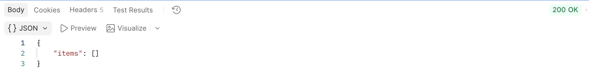
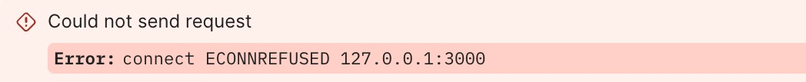
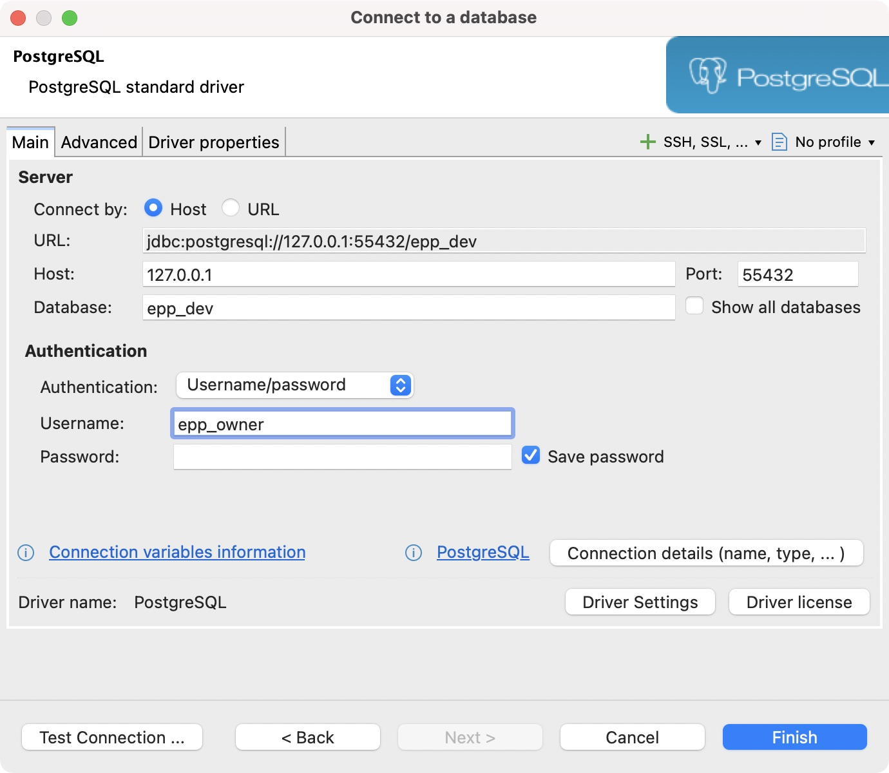
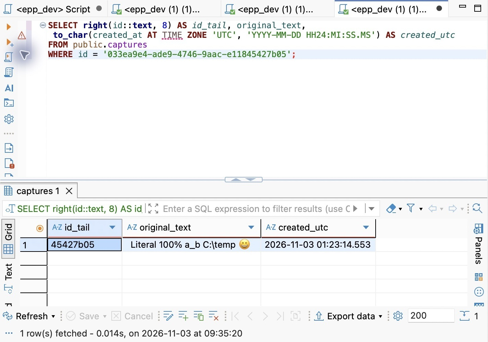
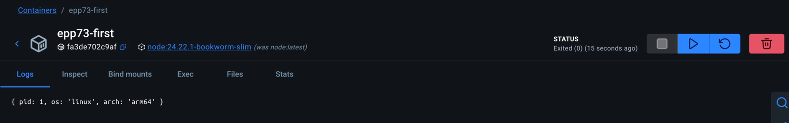

# 附录 J　Postman、DBeaver 与 Docker Desktop 操作指南

你在 Postman 里点了一次“保存原文”。响应里有这句话，DBeaver 里却找不到它。先留下响应中的 ID 和请求地址。如果运行的是第 3 章，句子保存在那个 Node 进程里；到了第 21 章，才可以拿同一个 ID 去 PostgreSQL 找行。打开几个窗口很容易，难的是知道眼前的窗口能回答哪个问题。

这三组练习可以分开做。第一次打开 Postman，从第 2 章的空列表开始。手上已有第 17 章的学习库，就从 DBeaver 的连接向导开始。想熟悉 Docker Desktop，只需先完成环境准备里的本机引擎检查。软件的下载、安装和各阶段使用的版本见[开发环境配置](environment-setup.md)。

## J.1　Postman：发一条请求，留下可以重做的现场

**先把成功和失败留在两个页签里。** 在 VS Code 打开[第 2 章的项目](part-01-nodejs/chapter-02-first-http/chapter.md)，按该章启动开发服务，保留显示监听地址的终端。打开 **Postman 桌面版**，用 **New → HTTP** 新建请求。在上方方法框选 **GET**，右边填 `http://127.0.0.1:3000/captures`，保持 Body 为空，点 **Send**。上半部仍是刚才可编辑的请求；下半部出现本次响应。先看状态，再看下面的 **Body** 和 **Headers**。在第 2 章应当能找到三项相互印证的结果：200、含空数组的 `{"items":[]}`、响应头中的 JSON 媒体类型。



点 **Save**，为请求命名“列表”，在保存窗口选自己的练习集合。第一次使用时可在左侧 **Collections** 新建集合“EPP 本机练习”，再回来保存。重新从集合打开“列表”，核对方法和地址。再新开一个 HTTP 页签，复制相同地址，只把末尾的 `/captures` 改成 `/missing`。发出后看状态和正文。此时收到 404，还能在响应头里找到服务给出的类型。切回第一个页签，重新发送，应仍为 200。由此能把排查收窄到同一服务接到的路径。

现在在运行第 2 章服务的终端按 **Ctrl+C**，等提示符返回，再发送原来成功的“列表”。观察这次有没有服务给的状态码。若端口无人监听，Postman 会显示连接失败，详情可见 `ECONNREFUSED`。这时改 JSON 没有用，连接还没把请求送到处理函数。重新按本章步骤启动服务，等监听日志出现，用同一个页签再点一次 Send。保存好的请求能原样重发，页签里上一次显示的内容则要靠这次发送才会更新。[Postman 响应区说明](https://learning.postman.com/docs/use/send-requests/response-data/responses/)



### 保存一组创建和读回请求

进入[第 3 章](part-01-nodejs/chapter-03-minimal-service/chapter.md)后，先停掉占用同一端口的第 2 章服务，再从第 3 章项目启动开发服务。若使用配套快照，点 Postman 的 **Import**，从该章项目选择 `requests/epp.postman_collection.json`，在 **Collections → EPP 本机接口调试** 展开请求。只跟写代码的读者可用上一节的练习集合，按下面的方法手建三条请求。导入后点击请求名只会打开配置，点 Send 才会发出。

1. 打开“01 查看列表”，发送 GET，先记下已有几项。接着打开“02 创建原文”，或新建 **POST**，地址与列表相同。上方 **Body → raw**，在格式下拉框选 **JSON**，输入下面这一行。切到上方 **Headers** 确认生效的 `Content-Type` 为 `application/json`。如果之前手填过同名头，去掉冲突的那一项。
2. 点一次 **Send**。在下方 Body 找 `id`、`originalText` 和 `createdAt`，复制实际的 id；下方 Headers 里找 `Location`。比对路径末段与 id。再发列表请求，找到这个 id。每点一次创建都可能留下另一条同文记录，比较时要沿第一次取得的 id 走。
3. 新建 **GET**，将 `http://127.0.0.1:3000` 与 Location 中以斜杠开头的路径接起来，点 Send。应得到 200、同一个 id 和同一句原文。保存为“详情”。如果使用集合中的“03 查看详情”，按下一段先填变量。

```json
{"originalText":"I'm not much of cook."}
```

集合里的详情地址写作 `{{baseUrl}}/captures/{{captureId}}`。点左侧**集合名称 → Variables**，找到 `baseUrl` 的本地值，填服务日志中的地址（末尾不加斜杠）；将 `captureId` 的本地值换成刚才的 id，不带 JSON 的双引号。保存修改，回到详情请求，把鼠标停在变量上查看解析值。若仍指向别处，查看当前选中的 Environment 是否也定义了同名变量；本次练习可切回 **No environment** 再核对。手建集合也可用同名的两行变量，把三个请求改用同一地址前缀。之后换端口就只需改一处。

**把一次拒绝留作对照。** 在集合中对创建请求打开 **… → Duplicate**，另存为“原文类型错误”，只将 JSON 里的字符串值改成数字 `42`。也可直接打开配套的“04 原文类型错误”。发送后读 400 的错误正文，再发送列表，看数量和原 id 是否保持。若意外收到 201，打开底部 **Console**（也可从 View 菜单找 Postman Console），展开发出的那笔请求，对照实际方法、展开变量后的 URL、请求头与正文，确认发送的是哪个页签。这里判断服务究竟收到了什么，比查看页签名称可靠。

到了支持搜索的章节，在请求的 **Params** 表格中填一行，Key 写 `q`，Value 写要找的原文片段。勾选这行，看地址栏随之变化，发送一次；去掉勾选再发一次，保留输入就能比较有无筛选的列表。只在实现了该参数的版本推断结果。比如要搜一个百分号，在 Value 里直接填 `%`，然后在 Console 检查实际地址里的编码。回到工作区时先发一次只读请求确认地址；第 3 章服务重启后原 id 会失效，这时重新创建练习素材，再更新集合变量。

## J.2　DBeaver：从保存的连接找到这一条数据

**先让数据库报出自己的名字。** 按[第 17 章](part-03-postgresql/chapter-17-postgresql-environment/chapter.md)启动学习实例并建立角色和数据库。打开 **DBeaver Community → Database → New Database Connection**，搜索 PostgreSQL，点 Next。Host 填 `127.0.0.1`，Port 填 `55432`，Database 填 `epp_dev`，Username 填 `epp_owner`，Password 用该练习角色的密码。第一次点 **Test Connection** 可能弹出驱动下载框，完成下载再测试。若出错，看详细消息提到的是下载地址、拒绝连接、认证失败，还是数据库不存在：分别回查驱动下载、实例监听、角色密码和 Database 一格。



测试成功点 **Finish**，在左侧 **Database Navigator** 将连接重命名为容易辨认的“EPP DEV 55432”。右击这个连接，选 **SQL Editor → New SQL Script**。在编辑器顶栏找到数据源名，把下面这条查询粘进去，选中整条，使用 **SQL Editor → Execute SQL Statement**（部分版本显示 **Execute SQL query**）。下方会打开结果网格，一行中的每个格子来自本次连接的数据库：

```sql
SELECT current_database() AS db, current_user AS login,
       inet_server_addr() AS host, inet_server_port() AS port,
       pg_backend_pid() AS session_id;
```

前四格应为 `epp_dev`、`epp_owner`、`127.0.0.1`、`55432`。最后一格是服务器给当前会话的进程号，各人各次连接可以不同。以后编辑器打开旧 SQL 文件，先在那个编辑器运行这一句。即使左边选中了正确的连接，右边旧脚本仍可能绑定另一数据源。**保存脚本**留下 SQL 文本；**执行**才会给服务器发语句。[DBeaver 单条与整份脚本执行](https://dbeaver.com/docs/dbeaver/SQL-Execution/)

### 看表、查一行，再决定该刷新哪里

展开左侧连接里的 **Databases → epp_dev**（有些布局直接显示当前库），继续展开 **Schemas → public → Tables**。刚完成第 17 章时，这里还没有业务表。等第 18 章建表和装入种子后，右击 **Tables → Refresh**，打开目标表。**Properties** 中可以看列名、类型和约束；**Data** 页显示这张表取回的行。若设置了过滤条件，先记住它；需要看全表时清除过滤并重新取数。翻到后一页或加载下一批能看到更多行，当前网格显示的行数未必是表内总数。

例如第 21 章从 Postman 创建特殊字符原文后，把返回的完整 ID 带到该章的查询中，执行后只看那一行。结果中 `C:\temp` 对应 JSON 里的 `C:\\temp`。可以双击或用值查看器展开被截短的内容，查看后退出编辑；仅为辨认长字符串时，直接用 SELECT 的结果最省事。若别人又插入一行，旧结果仍是上次查询取回的那些行。回到 SQL 编辑器重新执行，或在 Data 页点刷新。刷新左侧 Tables 解决的是“对象树里有没有这张表”，这两个刷新位置各有用途。[第 21 章创建请求与完整 ID 对账](part-03-postgresql/chapter-21-existing-records/chapter.md)



### 安全试一次修改，观察哪一步可以撤回

回到已核对身份的 DEV 编辑器，新开一个同连接的空白脚本。下面只用会话临时表，适合尚未建业务表时操作。确认练习连接上没有其他正在编辑的事务，再在工具栏事务模式菜单选择 **Auto-commit**，关闭 **Smart commit**，以免写语句自动切回手动提交。下面两条**分别选中执行**。第一条在本会话建立两列，第二条写一行基准值。此时每一条成功语句各自提交。

```sql
CREATE TEMP TABLE tool_note (id integer PRIMARY KEY, body text);
INSERT INTO tool_note VALUES (1, 'draft');
```

在同一编辑器把事务模式切成 **Manual commit**。先选中下面的 UPDATE 单条执行，查看返回的行；再单独选中 SELECT 执行。两次都应看到 `revised`。现在先想好希望下次查询读到哪个词，再到工具栏找 **Rollback**（悬停可看动作名），点它后只重跑 SELECT。预期恢复为 `draft`。这次回退的边界正好在已经提交的基准行之后。若把 UPDATE 改为 `WHERE id = 2`，执行成功也会返回零行，重跑查询可见第 1 行仍在。

```sql
UPDATE tool_note SET body = 'revised' WHERE id = 1 RETURNING id, body;
SELECT id, body FROM tool_note ORDER BY id;
```

再做一轮真的保留修改：用 `id = 1` 重跑 UPDATE，点 **Commit**，重跑 SELECT。此时点 Rollback 再查仍是 `revised`。如果第一轮就撤不回，检查当时的模式和上次按下的按钮；如果报找不到表，先看会话号是否变了。结束练习时回滚剩余练习事务，断开该练习连接，临时表随会话结束消失。下次回到第 19 章，先按该章恢复 Auto-commit 和脚本执行设置。日常在 **Data** 网格直接改格子时还有一步：单元格先标为已编辑，**Save** 才会发出修改；发出后能否撤回取决于当时的事务模式。先在临时样本里认识这两个时刻，再回业务表操作。

想进一步验证“同事此刻读到什么”，用第 19 章已提交的共享样本，分别在 A、B 运行身份查询，先确认会话号不同。会话临时表只属于创建它的会话，用它无法检验另一人何时看见提交。第 19 章给出了提交前后 B 的两张结果图，可以沿同一个 ID 重做。[第 19 章 SQL 与双会话练习](part-03-postgresql/chapter-19-sql/chapter.md)

## J.3　Docker Desktop：从一行容器记录追到程序和文件

**找回安装时那行问候。** 从 Mac 的“应用程序”打开 Docker，等待 **Engine running**。完成[环境准备的 Docker Desktop 检查](environment-setup.md#在-mac-用-docker-desktop-管理容器)后，打开左侧 **Containers**，清掉搜索和“只看运行中”的筛选，再搜 `epp-install-check`。点击名称进入 **Logs**，寻找 `Hello from Docker!` 和状态 **Exited (0)**。点同一容器的 **Start**，等它再次停下，滚到日志底部。问候又出现了一次；返回列表仍只有一个这个名字的容器。这个进程的工作就是打印信息，完成后退出，保留下来的行让你第二天仍能读到输出。

接着打开 **Images → Local**，找 `hello-world`，点这一行的 **Run**。展开 **Optional settings**，在 Container name 填一个尚未使用的 `epp-appendix-hello`，端口、卷和环境变量都留空，再点 Run。回到 Containers，用 `hello` 或新名字找它，打开详情看容器 ID（详情顶部或 **Inspect** 的 `Id` 字段）。比较它与安装检查容器的 ID、镜像名和日志。两个实例都能打印同一句话，ID 却不同。下次要重跑原实例，从 **Containers** 点 Start；需要从同一份程序再创建一个实例，才从 **Images** 点 Run。[Docker Desktop 的镜像操作](https://docs.docker.com/desktop/use-desktop/images/)



图中是[第 72 章](part-09-deployment/chapter-72-container-image/chapter.md)换成 Node 镜像后的同一观察位置。这个命令打印进程号、操作系统与架构，输出自然与问候不同。遇到本应常驻的 API 却显示 Exited 时，先打开该实例的 Logs，看最后一次启动到退出之间的消息，再到 **Inspect → State** 找状态、退出码和结束时间。退出码为零说明主进程正常结束；要判断 API 能否接请求，还需看它是否持续监听并实际访问入口。[Docker Desktop 的容器详情](https://docs.docker.com/desktop/use-desktop/container/)

### 打开服务端口，找清楚谁在接请求

用当前章节已经启动的 Web 容器练习；上面的问候容器没有 Web 服务。进入 **Containers**，如果看到 Compose 项目名，展开它，再选 API 那一行。先看 **Port(s)** 列。例如若显示 `127.0.0.1:18080 → 3000/tcp`，Mac 上 Postman 使用左边的 `http://127.0.0.1:18080` 加接口路径，程序在容器内监听右边的 3000。这里只是读法，实际填写自己看到的主机端口。容器详情中的 **Inspect → NetworkSettings → Ports** 可复核具体绑定。如果只有容器端口而没有主机映射，回到该章部署配置查看谁负责转发；经 nginx 对外的应用用该章给出的 HTTPS 入口。

发送一个已知的只读请求，记下时间，再在 **Logs** 查看同一时段的服务输出。某些服务只记启动、错误或事件，成功请求可能没有逐笔日志；此时直接用客户端状态、响应正文及该版本可读回的记录做验证。只有容器运行时才适合用 **Stats** 看当下的 CPU、内存变化。若列表里根本没有章节说的服务，先核对它是在本机 Desktop 还是另一台 Debian 上启动。Mac 的界面显示本机引擎里的对象，远端部署要在对应主机核对。

### 重启后再读收据，定位文件存在哪儿

沿第 72 章的收据实验创建 `epp73-layer` 后，在 **Containers → epp73-layer → Logs** 找 `created receipt-A`。记下 ID，点 **Start** 后找新增的 `found receipt-A`。第 72 章接着用同镜像新建容器查询这个文件，得到 `false`。重启仍读得到，因为同一个容器的可写层还在；从镜像重新创建实例，就得到另一份可写层。若你只点了 Start 两次，还没有检验“重新创建”。


到[第 73 章的卷练习](part-09-deployment/chapter-73-compose-deployment/chapter.md)，两个短命容器先后使用同一个命名卷。选择本机引擎做这个独立实验时，先完成写收据的那条命令，**在删除实验卷之前**打开 **Volumes**，搜索实际卷名（回到创建卷的终端运行 `echo "$data_volume"` 即可看到），打开详情查看 **Data / Stored data** 中的收据文件。写入容器已自动移除，此时卷可以显示未被容器使用。再运行该章的只读挂载命令，核对读回 `receipt-A`；去掉挂载，新的容器找不到文件。对还在列表里的容器，可在 **Inspect → Mounts** 对照 Type、来源和 Destination，判断程序写的路径有没有落在挂载里。一个卷存在，并不足以断定眼前这个容器用的就是它。

临时离开时用 **Stop** 停自己的常驻实验容器，回来从 Containers 启动。一次性问候程序已经退出，可以直接留着。若要收掉这次新建的副本，核对容器名 `epp-appendix-hello` 和 ID，再在该行选 **Delete**；删除会带走它的可写层和本地容器日志。镜像仍可在 Images 找到，其他容器可以继续使用。卷有独立的删除入口；第 73 章的卷只在完成读回、确认不再需要那份练习收据后，才按该章的卷名清理。

## J.4　把工具放回同一次排查

在[第 21 章的数据库版本](part-03-postgresql/chapter-21-existing-records/chapter.md)试一次交接。让同事只给你一条“创建成功，详情也返回 200，但显示了旧句子”的记录。先用该章 Postman 集合创建一条带特殊字符的原文，保留创建响应。暂时保留集合中原本可读的旧 ID，发送详情，再从 Console 记下实际 URL 的末段。在 DBeaver 按创建响应的 ID 查一次，按详情 URL 的 ID 再查一次。比较这两行的原文。现在只改集合的详情变量再发 GET；如果新句子出现，你已经解释了为何两次 200 都成立，也保住了最初的创建记录。此处补发 POST 会多造一条记录，反而使两端更难对齐。

换一个条件：同一个 GET 昨天成功，今天连状态码都没有。第 2 章的场景去看启动 Node 的终端；如果服务已经迁到容器，就先核对引擎、实例、运行状态和公布的端口。拿到 HTTP 响应后再判断路径、身份和记录。将来把现场交给下一位开发者，留下“实际请求的方法和地址、响应状态或连接错误、核对过的记录 ID”，再按需要加上“数据库和角色”或“容器 ID 和最近启动时间”。下一位读者由此能重复同一次只读观察。

[返回总目录](README.md) · [开发环境配置](environment-setup.md)
