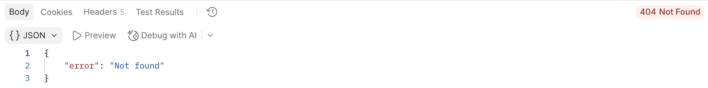
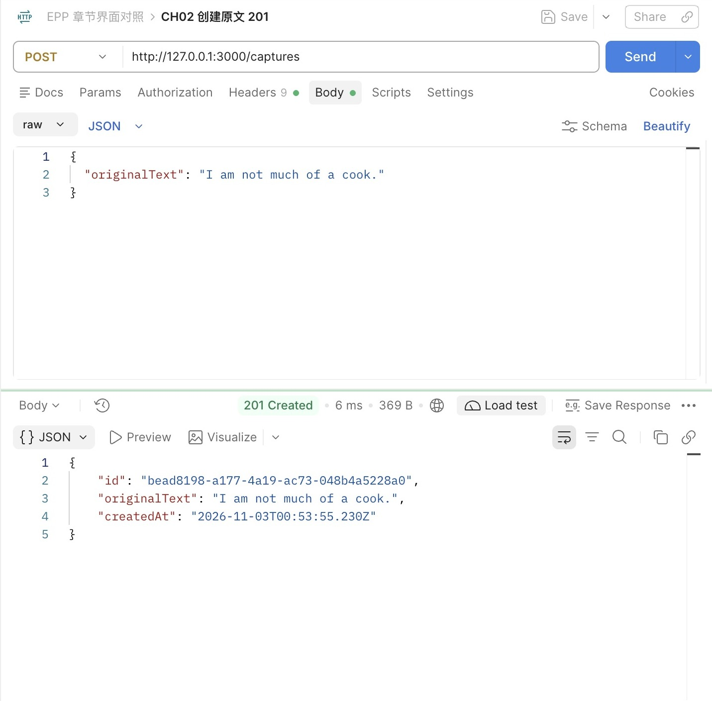
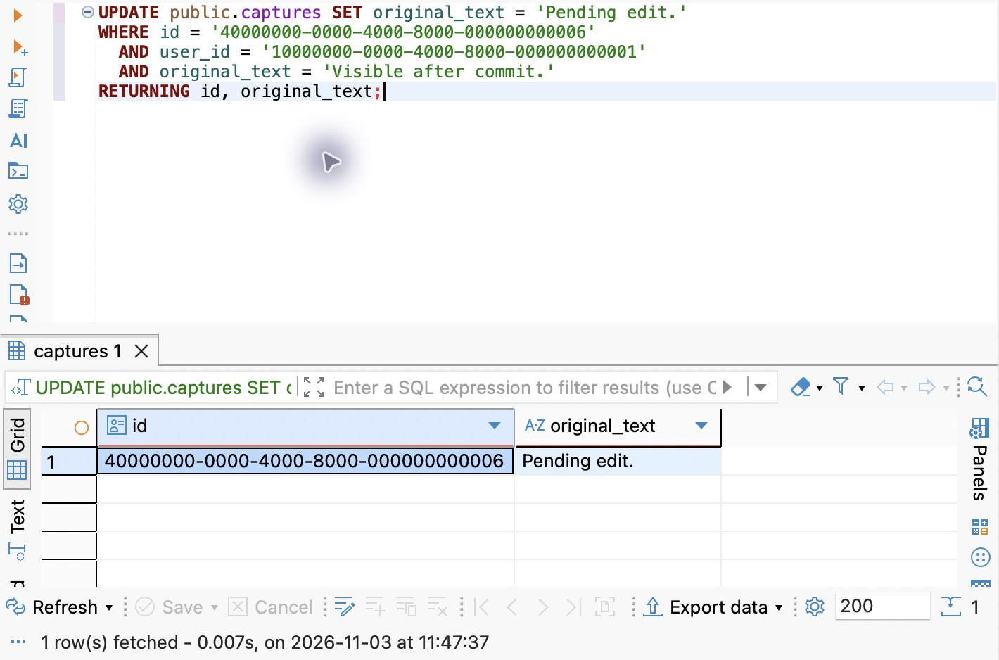
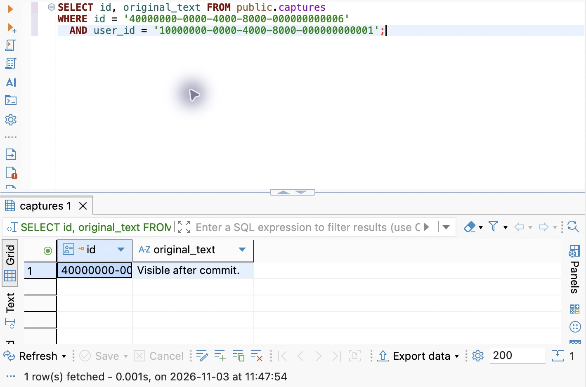
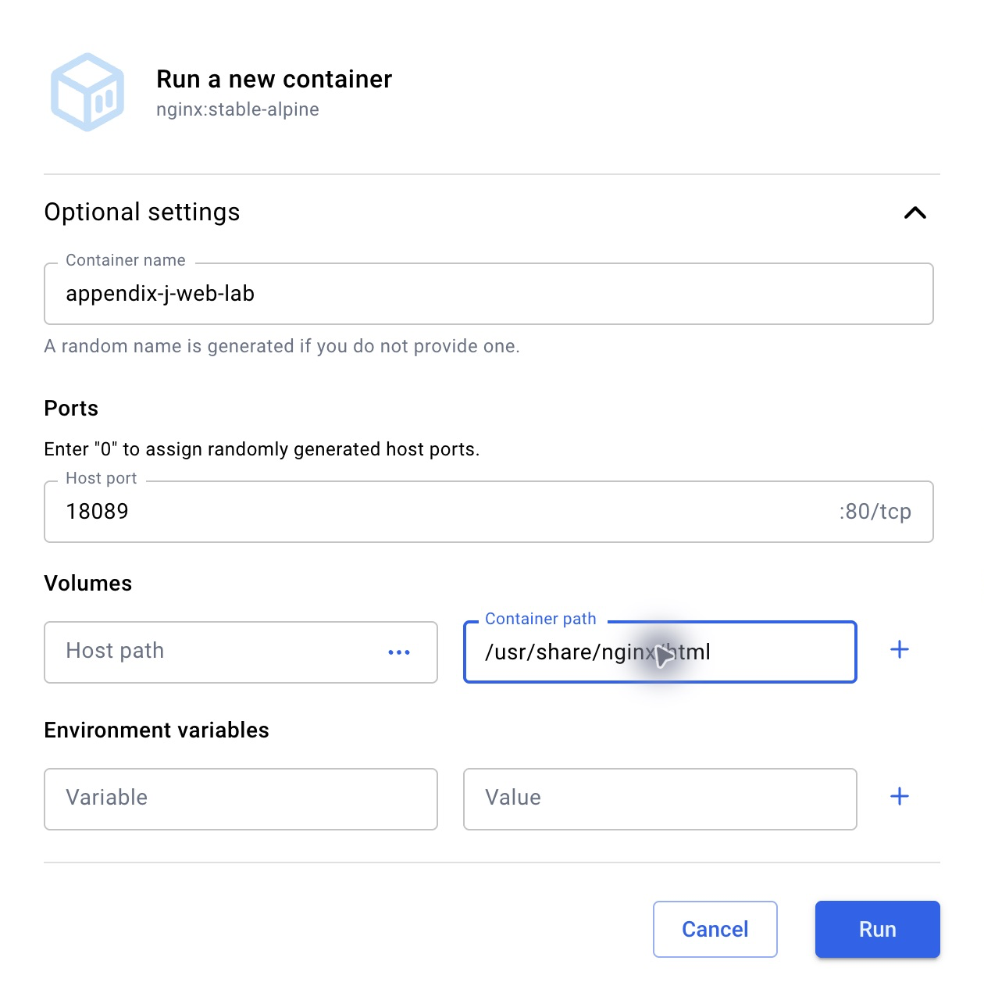
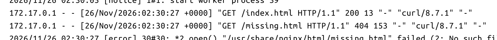
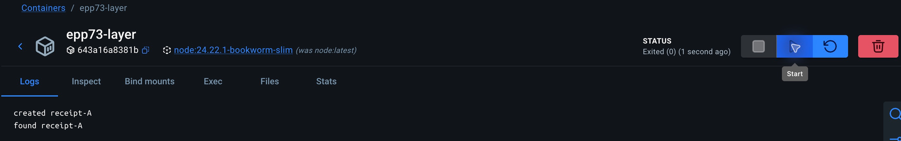

# 附录 J　Postman、DBeaver 与 Docker Desktop 操作指南

你在 Postman 打开创建原文的请求，点了一次 Send。响应里有这句话，DBeaver 里却找不到它。先留下响应中的 ID 和请求地址。如果运行的是第 3 章，句子保存在那个 Node 进程里；到了第 21 章，才可以拿同一个 ID 去 PostgreSQL 找行。打开几个窗口很容易，难的是知道眼前的窗口能回答哪个问题。

这三组练习可以分开做，每组结束都有一个可以关掉再找回的现场：Postman 里的一组请求、DBeaver 里的两行卡片、Docker Desktop 里的一个网页。第一次打开 Postman，从第 2 章的空列表开始。手上已有第 17 章的学习库，就从 DBeaver 的连接向导开始。想熟悉 Docker Desktop，只需先完成环境准备里的本机引擎检查。软件的下载、安装和各阶段使用的版本见[开发环境配置](environment-setup.md)。

## J.1　Postman：发一条请求，留下可以重做的现场

### 把桌面留成两个窗口

先只做一件事：让 Postman 查出当前有几条原文。把 VS Code 放在屏幕左边，Postman 放右边。左边留着运行程序，右边可以反复发请求。关掉 Postman 再打开，服务仍在左边运行。

1. 已经跟写第 2 章的读者，在 VS Code 选 **File → Open Folder**，打开能同时看到 `package.json` 和 `src` 的那个文件夹。只想单独练工具，也可以在浏览器打开[第 2 章完成快照](https://github.com/SamChowRock/epp-public/tree/part-01/chapter-02)，在该分支选 **Code → Download ZIP**，用 Finder 解开，打开解压所得的项目文件夹。把正在跟写的项目留在原处。
2. 在 VS Code 选 **Terminal → New Terminal**。按[环境准备](environment-setup.md#选择项目使用的-node)选好 Node 后，在下方终端输入 `npm run dev`，按回车。等它打印 `EPP listening on http://127.0.0.1:3000`。光标留在这里、没有回到平时的提示符，就是本次要保留的状态。若提示找不到 package.json，在左侧文件树重新定位项目根目录；若报告地址已占用，先找到先前运行本书服务的终端，按 Ctrl+C 停掉自己那一份，再重试。
3. 从 Finder 的“应用程序”打开 **Postman**。在自己的工作区找 **New → HTTP**，也可用工作区页签栏的 **+** 打开一个空请求。如果当前只用了轻量客户端，可以先完成下面的发送实验；要做后面的集合、变量与导入，请进入带 **Collections** 侧栏的个人练习工作区。屏幕上同时出现方法下拉框、长地址栏和 **Send**，才到了填请求的位置。[Postman 桌面客户端说明](https://learning.postman.com/docs/getting-started/basics/using-api-client/)

### 第一次按 Send，然后把请求关掉再找回来

1. 点地址左边的方法框，选 **GET**。点长地址栏，填 `http://127.0.0.1:3000/captures`。上方 **Body** 保持 **none**。先别按 Send，看看下半区，此时还没有这次请求的结果。
2. 点 **Send** 一次。先在**下半区**找 **200 OK**。再点这一区的 **Body**，应看到 `{"items":[]}`，自动排版成几行也一样。切到它旁边的 **Headers**，找 `Content-Type`，值里有 `application/json`。回头看上半区也有一个 Headers：下半区这行是刚才收到的，上半区则可以编辑下次要发出的头。
3. 在请求右上方点 **Save**。在保存框的请求名里填“01 查看列表”，选练习集合；还没有集合时，用保存框里的创建集合入口，或先在左侧 **Collections → +** 建一个空集合，取名“EPP 本机练习”，再回来保存请求。确认左侧展开集合能看到“01 查看列表”。
4. 关掉**请求页签**，保留两个应用。现在从左侧集合点“01 查看列表”，检查地址还在，按 Send，重新得到 200 和空数组。这是明天能独立恢复的起点。左侧若只有 History，可从历史打开那一条 GET，点 Save 存入集合，再做这一步。


### 只改路径，再只停进程

从集合右边的 **… → Add request** 新建“路径对照”，方法 GET，地址填 `http://127.0.0.1:3000/missing`。先预测下方是完全空白，还是会出现响应。按 Send，读状态 404、错误正文与响应头。切回“01”再发，仍是 200。两个页签只差地址最后那一段；左边终端在两次请求期间一直开着。



现在在运行第 2 章服务的终端按 **Ctrl+C**，等提示符返回，再发送原来成功的“列表”。观察这次有没有服务给的状态码。若端口无人监听，Postman 会显示连接失败，详情可见 `ECONNREFUSED`。这时改 JSON 没有用，连接还没把请求送到处理函数。重新按本章步骤启动服务，等监听日志出现，用同一个页签再点一次 Send。保存好的请求能原样重发，页签里上一次显示的内容则要靠这次发送才会更新。[Postman 响应区说明](https://learning.postman.com/docs/use/send-requests/response-data/responses/)


### 在同一地址创建一句话，再从另一个页签把它取回来

此处换到第 3 章，因为第 2 章只实现了列表。在左边运行服务的终端按 **Ctrl+C**，等提示符回来。用同样的方法打开[第 3 章完成快照](https://github.com/SamChowRock/epp-public/tree/part-01/chapter-03)或自己完成的项目，从它自己的根目录运行 `npm run dev`。右边的 Postman 可以一直开着。先重发“01 查看列表”，记下起始数量。新启动的第 3 章进程应有零条。

1. **另建页签。** 在“EPP 本机练习”集合右侧点 **… → Add request**，命名“02 创建原文”。选 **POST**，地址仍填 `http://127.0.0.1:3000/captures`。现在侧栏应有两条请求；点回“01”还能看到原先的 GET。
2. **填写内容。** 回到“02”，点地址栏下方的 **Body**，在选项里点 **raw**，然后在格式下拉菜单中把 **Text** 换成 **JSON**。在出现的大文本框里只粘贴下面这一行。若看到的是一格 Key、一格 Value，说明仍在表单输入方式，重新点 raw。

```json
{"originalText":"I'm not much of cook."}
```

3. **发送并留住这次结果。** 点 **Save**，再点一次 **Send**。在下半区打开 **Body**：状态应是 201，`originalText` 和输入相同，另外有一个 `id` 和一个 `createdAt`。用鼠标选中 **id 的两个双引号之间**的字符，复制到临时便签中，写上“第一次”。这串由你的服务生成。下图中只用来找字段位置。
4. **用第二种方式认出这条记录。** 在同一次响应的 **Headers** 找 `Location`，把整段以 `/captures/` 开头的值也复制到便签。比对末尾和刚才的 id。切回“01”，点 Send。数量增加一，items 中应出现同一 id。然后回“02”看原响应，保持它开着。
5. **造出详情地址。** 在集合上再点 **Add request**，命名“03 查看详情”，方法选 GET。地址栏先填 `http://127.0.0.1:3000`，紧接着粘贴那段 Location。保留两段之间的一个斜杠，Body 选 none。点 Send，应得到单个对象，相同 id 和原文；点 Save。至此，左边三个名字分别代表看全体、增加一条、取回某一条。



**有意制造一笔会被拒绝的输入。** 在左侧“02”右边点 **… → Duplicate**，把副本改名“04 类型错误”。打开副本，将整份 Body 换成 `{"originalText":42}`，点 Save、Send。先读 400 的错误正文，再切回“01”点 Send，核对第一次的 id 仍在，数量没有增加。如果得到了 201，回到刚刚发送的页签，确认 42 没被引号包住。如果是 415，回到上方 Headers，看生效的 Content-Type；恢复 raw 的 JSON 格式，取消手写的冲突头，再原样发送。在两次尝试间只改变一个输入，才看得出服务拒绝的是哪一层。

### 让“详情”跟着你选中的那一笔走

先点“02”，保持原始字符串，再发一次。把这次的 id 另存作“第二次”。切回“03”直接 Send，看它读到哪一个 id。两句文字完全相同，地址里仍写着第一次的 ID。现在练一次**只换值、不另造请求**。

1. 点左侧的**集合名**“EPP 本机练习”，在打开的集合页面找 **Variables**。在空行的变量名格填 `baseUrl`，它的值填 `http://127.0.0.1:3000`。下一行变量名填 `captureId`，值粘贴便签里的第二个 id。如果界面区分本地与共享值，这次填自己使用的本地值。保存集合。
2. 回到“03”，把地址栏全选，替换为 `{{baseUrl}}/captures/{{captureId}}`，点 Save。把鼠标停在两个带花括号的名字上，看解析出来的地址和 id。变量若未解析，先比较大小写，再看请求是否保存在刚才的集合中。若值与集合里不同，检查右上角当前 Environment 的同名变量，本次可选 **No environment** 再试。
3. 点 Send，拿响应 id 和第二个比对。回 Variables，把 `captureId` 换成第一次的值，保存；不改“03”的地址再次发送。两次都可以是 200，但读到的身份确实变了。
4. 想知道某次**最终发往哪里**，从下方 **Console** 或 **View → Show Postman Console** 打开控制台。在请求页再发送“03”，回控制台看刚新增的 GET，展开它，找出完整 URL 的末段。屏幕上同时有模板地址和实际地址时，就能判断问题在变量取值还是服务器读回。

如果用配套集合做下一章，点 **Import → Files**（也可把文件拖入导入框），在本章项目的 `requests` 文件夹选 `epp.postman_collection.json`。展开新出现的“EPP 本机接口调试”，依次打开 01、02、03：方法和地址已经填好，两个集合各用自己的变量。先在新集合 Variables 中核对 `baseUrl`，把刚才同一进程里的有效 id 粘到 `captureId`，只发 03 就可以验收导入；导入本身不会执行 POST。关掉重开 Postman 后可以继续用这些配置；若 Node 也重启过，先发 01 看当前数量，再创建练习记录并换入新的 id。

到了支持搜索的章节，在请求的 **Params** 表格中填一行，Key 写 `q`，Value 写要找的原文片段。勾选这行，看地址栏随之变化，发送一次；去掉勾选再发一次，保留输入就能比较有无筛选的列表。只在实现了该参数的版本推断结果。比如要搜一个百分号，在 Value 里直接填 `%`，然后在 Console 检查实际地址里的编码。回到工作区时先发一次只读请求确认地址；第 3 章服务重启后原 id 会失效，这时重新创建练习素材，再更新集合变量。

## J.2　DBeaver：从保存的连接找到这一条数据

### 从空窗口保存第一份连接

准备好[第 17.3 节的学习实例](part-03-postgresql/chapter-17-postgresql-environment/chapter.md#173-安装启动再从两个客户端连接同一个库)，包括运行中的 PostgreSQL、`epp_dev` 数据库和你给 `epp_owner` 设置的密码。这一步只需做到能登录，不必先建业务表。下面会用两行专供点击和修改的数据。

1. 从“应用程序”打开 **DBeaver Community**。如果出现要不要创建示例库的提示，可以关掉它。在屏幕顶部点 **Database → New Database Connection**。在弹出的数据库选择器中搜索 `PostgreSQL`，选 PostgreSQL，点 **Next**。看到 Host、Port 和 Database 三个独立输入框后，停在这一页。
2. 在 **Host** 填 `127.0.0.1`，**Port** 把默认的值改成 `55432`，**Database** 填 `epp_dev`。在认证区域将 **Username** 填成 `epp_owner`，**Password** 输入这个角色的密码。只填本机练习连接，不需要 SSH 隧道。对着图从上到下再读一遍，特别看看有没有把用户名填进 Database。
3. 点左下 **Test Connection**。第一次如果弹出驱动下载窗口，点 **Download**，等待下载完成，再测一次。看到已连接及 PostgreSQL 版本后点 **OK** 回到向导，点 **Finish** 保存。在左侧 **Database Navigator** 找到新连接，右击选 **Rename**，取名“EPP 附录 A”。已有同参数的日常连接也请为本实验单独建这一项，便于辨认事务属于哪个窗口。


测试没过时，先展开 **Details**，看它到底在说哪一格。若是 `connection refused`，回第 17.3 节检查原学习实例在 55432 上是否启动；若是 `password authentication failed for user`，核对引号里的角色再填密码；若是 `database … does not exist`，先核对 Database 与端口。改完只再点 Test Connection 即可，不用从头新建连接。

### 第一次执行 SQL：先认出自己在哪个会话

右击 **EPP 附录 A → SQL Editor → New SQL Script**。左侧保留导航树，右侧上半部可以打字，下半部等执行后才出现网格。在右上编辑区粘贴下面一条，选中从 SELECT 到分号的整句。打开 **SQL Editor** 菜单，选择执行当前 SQL 的动作 **Execute SQL query / Execute SQL Statement**。稍后同一个脚本里会有多条语句，届时仍然一次只选要运行的那一条。

```sql
SELECT current_database() AS db, current_user AS login,
       inet_server_addr() AS host, inet_server_port() AS port,
       pg_backend_pid() AS session_id;
```

在下半区沿第一行横向读：`epp_dev`、`epp_owner`、`127.0.0.1`、`55432`、一个整数。把最后的整数记作 A。只按保存脚本而没看见这一行时，再执行刚才的选区。若左树选在 A 而结果是另一个库，检查**编辑器上方的数据源**。从 A 右键新建脚本，然后在新脚本重查，是最容易复原的办法。[DBeaver 单条与整份脚本执行](https://dbeaver.com/docs/dbeaver/SQL-Execution/)

### 建两张写着同一句话的卡片，用网格找回第二张

1. 在 A 的新练习会话里，找到编辑器工具栏的事务模式，选 **Auto-commit**，关闭 **Smart commit**。若看到待处理的其他工作，回到刚建的专用连接。把下面三句接在查询之后，**逐句选中并执行**。前两句结束可能只给执行统计；运行第三句才会看见两行。若第一句报告对象已存在，先停下：之前做过本实验就直接查询核对样本；若是同名的其他表，换一个专用表名并在后续步骤沿用。

```sql
CREATE TABLE public.appendix_j_card (id integer PRIMARY KEY, body text NOT NULL);
INSERT INTO public.appendix_j_card (id, body) VALUES (1, 'draft'), (2, 'draft');
SELECT id, body FROM public.appendix_j_card ORDER BY id;
```

2. 左侧依次展开 **EPP 附录 A → Databases → epp_dev → Schemas → public → Tables**，有些布局直接从当前库显示 Schemas。右击 **Tables → Refresh**，找到 `appendix_j_card`，双击它。在右侧对象页点 **Properties → Columns** 看列名，再切 **Data**。此时右边至少有两个页签：一个是刚才的 SQL 编辑器，另一个是表对象。记住哪一个有 Data。
3. 在 Data 页**网格上方的筛选表达式栏**点一下，输入 `id = 2`，按回车或点旁边应用筛选的箭头。这里只填条件。确认只剩一行、第一格是 2、第二格是 draft。把条件改成 `id = 22` 再应用，应该只剩列头。清空筛选栏，重新应用，两行又都出现了。这个动作没有删除任何卡片。
4. 在 id 为 2 的那一行双击 body，只把 draft 改成 `trial`，按 Enter 离开单元格。看网格下方的 **Save** 和 **Cancel**（有的版本叫 Revert）是否可用。先点**取消本次网格编辑**，再刷新 Data。id 为 2 的卡片应仍为 draft。这一轮改动还只在客户端的编辑缓冲区里。接下来才要把改动送到数据库。

### 两个窗口盯同一行：保存到哪一步，别人才能读到

**先准备观察者 B。** 重复连接向导，用同一组主机、端口、库和角色另存一份“EPP 附录 B”。从 B 右键打开新的 SQL 脚本，执行刚才的身份查询；前四格应和 A 一致，第五格要不同。在 B 的工具栏保持 **Auto-commit**，把下面这句放在 B 编辑区，先执行一次，记下 `2 | draft`。以后每次说“B 重读”，都是在这个 B 页签重新执行这一句。

```sql
SELECT id, body FROM public.appendix_j_card WHERE id = 2;
```

1. 回到 **A 的 SQL 编辑器**（此轮全部修改都在同一个 A 编辑器做）。确认工具栏连接名为 A，把事务模式切到 **Manual commit**。粘贴下面的 UPDATE，单独选中执行。下方应有一行 `2 | revised`；这是该次更新返回的值。**停在这里**，先别碰 Commit。

```sql
UPDATE public.appendix_j_card
SET body = 'revised'
WHERE id = 2
RETURNING id, body;
```

2. 切到 B，重读刚才那句 SELECT。把两个结果并排记在便签上。若 B 读到 draft，先回 A 点工具栏的 **Rollback**，然后在 A 运行同一条 SELECT。A 此时也应读到 draft。这就找到了一个可以撤回整个修改的时刻。若 B 提前读到 revised，检查 A 当时是不是 Auto-commit，以及两边的会话号。
3. 回 A **再执行一次 UPDATE**。这次点 **Commit**。切回 B，先看网格里仍显示哪个词，再执行 SELECT。只有新查询才带回 `revised`。此后在 A 开个新事务再回滚，已经提交的修改仍在。想把练习复原，需在 A 把 UPDATE 里的新值改成 `draft`、执行并 Commit，让 B 再查一次。
4. 换个条件自己验：回 A 把 WHERE 改为 `id = 22`，执行并看返回几行。B 分别查 1 和 2，说明为什么“执行成功”与“改到了第二行”需要两份证据。回 A 点 Rollback 结束这轮。





图中是第 19 章把相同动作换到业务原文后的两个窗口。对照自己刚做的实验，只比两处：A 的 RETURNING 网格和 B 此次 SELECT 网格。若想练表格保存，现在回 A 的表对象 Data 页，**先看这个表编辑器自己的事务模式**，选 Manual commit。在 id 为 2 的行把 body 改为 `from grid`，离开格子，点下方 Save；若出现 SQL 预览，核对表名和主键 2 后执行。到 B 重读。回到 **A 的这个表编辑器**点 Commit，B 再重读。两次预期依次是原先已提交值、from grid。这样就能把“离开单元格”“网格发出 UPDATE”“服务器提交”三个时刻对起来。[DBeaver 事务模式](https://dbeaver.com/docs/dbeaver/Auto-and-Manual-Commit-Modes/)

下次想继续，可保留专用表并关掉 A、B 的活动事务。要收掉练习时，先在 B 重查两行，确认这就是自己刚建的 `public.appendix_j_card`。在 A、B 确认没有待处理改动，结束两边的事务并关闭表的 Data 页后，在 A 的 SQL 编辑器执行 `DROP TABLE public.appendix_j_card;` 并提交，然后右击 Tables 刷新。只想暂时离开就保留这张表。以后读到[第 21 章](part-03-postgresql/chapter-21-existing-records/chapter.md)，用同样的“按 ID 重查”去找 Postman 刚创建的业务原文。

## J.3　Docker Desktop：从一行容器记录追到程序和文件

**找回安装时那行问候。** 从 Mac 的“应用程序”打开 Docker，等待 **Engine running**。完成[环境准备的 Docker Desktop 检查](environment-setup.md#在-mac-用-docker-desktop-管理容器)后，打开左侧 **Containers**，清掉搜索和“只看运行中”的筛选，再搜 `epp-install-check`。点击名称进入 **Logs**，寻找 `Hello from Docker!` 和状态 **Exited (0)**。点同一容器的 **Start**，等它再次停下，滚到日志底部。问候又出现了一次；返回列表仍只有一个这个名字的容器。这个进程的工作就是打印信息，完成后退出，保留下来的行让你第二天仍能读到输出。

接着打开 **Images → Local**，找 `hello-world`，点这一行的 **Run**。展开 **Optional settings**，在 Container name 填一个尚未使用的 `epp-appendix-hello`，端口、卷和环境变量都留空，再点 Run。回到 Containers，用 `hello` 或新名字找它，打开详情看容器 ID（详情顶部或 **Inspect** 的 `Id` 字段）。比较它与安装检查容器的 ID、镜像名和日志。两个实例都能打印同一句话，ID 却不同。下次要重跑原实例，从 **Containers** 点 Start；需要从同一份程序再创建一个实例，才从 **Images** 点 Run。[Docker Desktop 的镜像操作](https://docs.docker.com/desktop/use-desktop/images/)


图中是[第 72 章](part-09-deployment/chapter-72-container-image/chapter.md)换成 Node 镜像后的同一观察位置。这个命令打印进程号、操作系统与架构，输出自然与问候不同。遇到本应常驻的 API 却显示 Exited 时，先打开该实例的 Logs，看最后一次启动到退出之间的消息，再到 **Inspect → State** 找状态、退出码和结束时间。退出码为零说明主进程正常结束；要判断 API 能否接请求，还需看它是否持续监听并实际访问入口。[Docker Desktop 的容器详情](https://docs.docker.com/desktop/use-desktop/container/)

### 从一个空文件夹运行自己的网页

准备一个能让你立刻认出来的页面。接下来用 Docker Desktop 启动它，用 Postman 访问它。你只需要本机的 Docker Desktop 和文本编辑器，此处不用启动任何章节的 API。

1. 在 Finder 的“文稿”中新建空文件夹 `epp-window-web`。在 VS Code 选 **File → Open Folder**，打开这个文件夹。点左侧文件树的“新建文件”图标，文件名输入 `index.html`。在编辑区只写一行 `EPP window A`，按 **⌘S**。回到 Finder 确认刚才那个文件夹里直接就有 index.html；稍后的选择框要选**这一层文件夹**。
2. 打开 Docker Desktop，确认左下 **Engine running**。点 **Images → Local**，搜 `nginx`，寻找仓库名 nginx、标签 stable-alpine 的组合。第一次本机通常没有。点窗口顶端的 **Search**，搜索 nginx，在镜像结果选择 Docker Official Image 的 nginx，展开标签选择 **stable-alpine**，点 **Pull**。回到 Images → Local，看到该行再继续。若该版本界面没提供标签选择，Mac 终端运行一次 `docker --context desktop-linux pull nginx:stable-alpine`：这会把指定镜像下载到本机 Desktop，接着仍回到 Images 操作。[nginx 官方镜像](https://hub.docker.com/_/nginx)
3. 点击这行镜像进入详情，点 **Run → Optional settings**。先填下表，暂时别点窗口底部的 Run。

| 对话框里的位置 | 本次填写 | 怎么确定填对了 |
| --- | --- | --- |
| Container name | `appendix-j-web-lab` | 稍后在 Containers 搜这个完整名称 |
| Ports → Host port | `18089` | 右边已经印着 `:80/tcp`，左格只填数字 |
| Volumes → Host path | 点该格旁的 **…**，选择刚建的 `epp-window-web` 文件夹 | 最后一段是文件夹名，不是 index.html |
| 同一行 Container path | `/usr/share/nginx/html` | 这是 nginx 读取网页的目录，注意开头的斜杠 |
| Environment variables | 保持空白 | 本次网页不需要另外配置 |



图中 Host path 留给你从 Mac 选择。Volumes 同一行的两格是一对，若有 **+ / Add volume** 就点它加入这一对；若随即多出空行，留空即可。界面用 Host port 发布的范围取决于本机引擎设置，本次文件夹只放这份练习文字。点最下方的 **Run**。回到 **Containers**，清空旧搜索条件，输入 `appendix-j-web-lab`。目标行应有运行状态及 `18089:80`。若同名已经存在，先打开那一行核对镜像、端口与挂载，延续上次练习即可。若提示端口被占用，另选一个空闲主机端口（如 18090），后面地址也跟着换。

### 从 Postman 找到 Docker 日志里的那一次访问

1. 保持容器运行。在 Postman 新建 **GET**，地址填 `http://127.0.0.1:18089/index.html`，点 Send。预期状态 200，响应 Body 里读到你自己写的 `EPP window A`。若出现 nginx 欢迎页，说明联系上了网页服务，但读取的根目录或目标实例需要再核对。回容器详情的 **Bind mounts** 或 **Inspect → Mounts**，比对自己的文件夹与 `/usr/share/nginx/html`，同时确认 Postman 用的是该容器公布的主机端口。
2. 复制这个 GET，只把末段改成 `missing.html`，发送。此时仍能得到服务器给的 404。回 Docker Desktop，点目标行的**名字**，在 **Logs** 滚到最底部。找到 `GET /index.html` 和 `GET /missing.html`，越过 HTTP 版本看后面的 200 和 404。顶部端口链接左侧的 18089 是刚才 Postman 访问的端口。图中使用另一个 HTTP 客户端取样，日志里的客户端名会随工具变化；用路径和状态就能辨认两次请求。



3. 回 VS Code 把 index.html 中的 A 改为 B，先**别保存**；回 Postman 重新发送原先成功的 GET，看正文。然后回 VS Code 按 ⌘S 再发一次。关闭编辑器的 Auto Save 时应依次看到 A、B；如果第一次已经得到 B，查一下 **File → Auto Save**。整个过程没有重新构建镜像或重启。你选中的 Mac 文件夹正挂在容器读取网页的位置。
4. 在容器详情顶部找方形 **Stop**（可悬停看提示），点击后等待状态变为 Exited。重发同一条 GET，观察这一次还有没有 HTTP 状态码。回到**原容器**点三角形 **Start**，等恢复 Running，再次发送，应该读到 B 和 200。把这次连接失败与上面的 404 对照：哪一次在 Logs 有对应的访问记录？哪一次根本没机会送到 nginx？
5. 合上电脑前可以 Stop。明天先在 Containers 找原名字，点 Start，再发保存好的 GET。若决定收掉练习，Stop 后只删除这个练习容器，再用 Finder 打开 `epp-window-web/index.html`。B 应仍在；以后从 Images 重新 Run，把同一个文件夹挂回同一路径，就又能读到它。只重新运行镜像却漏选文件夹时，会看到镜像自带的首页。这给你一个比“容器是绿色的”更具体的验收方法。

### 重启后再读收据，定位文件存在哪儿

沿第 72 章的收据实验创建 `epp73-layer` 后，在 **Containers → epp73-layer → Logs** 找 `created receipt-A`。记下 ID，点 **Start** 后找新增的 `found receipt-A`。第 72 章接着用同镜像新建容器查询这个文件，得到 `false`。重启仍读得到，因为同一个容器的可写层还在；从镜像重新创建实例，就得到另一份可写层。若你只点了 Start 两次，还没有检验“重新创建”。



到[第 73 章的卷练习](part-09-deployment/chapter-73-compose-deployment/chapter.md)，两个短命容器先后使用同一个命名卷。选择本机引擎做这个独立实验时，先完成写收据的那条命令，**在删除实验卷之前**打开 **Volumes**，搜索实际卷名（回到创建卷的终端运行 `echo "$data_volume"` 即可看到），打开详情查看 **Data / Stored data** 中的收据文件。写入容器已自动移除，此时卷可以显示未被容器使用。再运行该章的只读挂载命令，核对读回 `receipt-A`；去掉挂载，新的容器找不到文件。对还在列表里的容器，可在 **Inspect → Mounts** 对照 Type、来源和 Destination，判断程序写的路径有没有落在挂载里。一个卷存在，并不足以断定眼前这个容器用的就是它。

临时离开时用 **Stop** 停自己的常驻实验容器，回来从 Containers 启动。一次性问候程序已经退出，可以直接留着。若要收掉这次新建的副本，核对容器名 `epp-appendix-hello` 和 ID，再在该行选 **Delete**；删除会带走它的可写层和本地容器日志。镜像仍可在 Images 找到，其他容器可以继续使用。卷有独立的删除入口；第 73 章的卷只在完成读回、确认不再需要那份练习收据后，才按该章的卷名清理。

## J.4　把工具放回同一次排查

先完成了 J.1 和 J.3 的读者已经能重做第一种排查：在 Postman 把成功页的路径改错，回容器找相同路径；然后恢复路径、只停容器，再发一次。关掉本页，把观察到的两个结果写成两句话，让别人能判断该改地址的哪一段，还是该去启动哪个进程。

到了[第 21 章的数据库版本](part-03-postgresql/chapter-21-existing-records/chapter.md)，再做一个容易误判的交接。先按该章启动已接好数据库的 API，导入**第 21 章**的集合，把集合详情变量指向该章可读的一条旧种子。在 DBeaver 的目标库开一个只读查询页。第 3 章的内存版本不参与这次对账。

1. 在 Postman 发送第 21 章集合的“03 创建特殊字符原文”。把 201 响应的完整 id 复制出来，记作新 ID。暂时不改集合变量。打开“04 按返回 ID 读取”，发一次 GET；在 Console 复制实际 URL 最后一段，记作详情 ID。即使得到 200，也先看一下原文是哪一句。
2. 在 DBeaver 填下面的查询，先只把单引号中的文字替换为**新 ID**并执行。记下原文。再把同一位置换成**详情 ID**执行第二次。若碰到 UUID 格式错误，先确认只复制了末段，去掉 URL、花括号或 JSON 双引号。

```sql
SELECT id, original_text, created_at
FROM public.captures
WHERE id = '在这里粘贴一个完整 UUID';
```

3. 在 Postman 的**第 21 章集合**打开 Variables，把 captureId 改成新 ID，保存。只重发 04，对照新响应、创建响应和 DBeaver 第一轮查询。无需补发创建请求。如果两行分别存在且原文不同，就能解释为什么刚才的 201 和 200 都正确，却读到了旧句子。


换一个条件：同一个 GET 昨天成功，今天连状态码都没有。第 2 章的场景去看启动 Node 的终端；如果服务已经迁到容器，就先核对引擎、实例、运行状态和公布的端口。拿到 HTTP 响应后再判断路径、身份和记录。将来把现场交给下一位开发者，留下“实际请求的方法和地址、响应状态或连接错误、核对过的记录 ID”，再按需要加上“数据库和角色”或“容器 ID 和最近启动时间”。下一位读者由此能重复同一次只读观察。

[返回总目录](README.md) · [开发环境配置](environment-setup.md)
