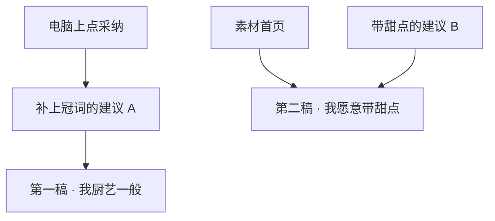

# 第 0 章 后端接口设计：从页面操作到数据读写

假设你刚接到一个熟悉的前端需求：编辑页有个「保存」按钮，详情页要把修改前后的文字并排显示。组件很好写，只要传进来两段文字就行。现在接口也归你负责了。同事拿着详情页的地址在新窗口打开，左边那段原文从哪里来？

拿一句英文做样本。周五，你在聊天框里写了 `I'm not much of cook.`，朋友帮你补上一个 `a`。如果写接口只接收编辑器里最后的值，一次提交就会把缺词的句子换成正确的句子。保存可以返回成功，详情页却再也拼不出同事要的对照。

先在编辑器里模拟一次写入和一次读取，找出接口要保留的数据。等第 3 章服务跑起来，你可以关掉编辑页，在 Postman 里另发一次请求，用同一个样本检验自己的实现。

## 0.1 从详情页要读的数据，反推写入时该留什么

打开手边的编辑器，新建一个空白文档。把这份文档当作服务保存的全部数据。把聊天框里那句缺词的英文贴进去，按朋友的建议补上 `a`。现在同事来接手，要给下周的练习卡做背面。他只拿得到你准备交付的文档，看不到聊天，也用不了你的撤销历史。请他给你当初写错的位置加下划线。

文档里只有这一行：

> I'm not much of a cook.

试着给同事出一道公平的题。甲原来写的是 `I'm not much of cook.`，乙听朋友说过正确的句子，一字不差地摘了下来。把两个人的最终文档并排放在屏幕上。下划线应当画在同一个地方吗？乙根本没漏词。一旦只交付成稿，任何差异算法拿到的都是相同的输入。这里少了一件写组件时容易想当然的东西：差异视图左边那栏，从哪里取？

回到编辑器，把周五的文档改成你愿意交接给同事的版本。给自己一个限制：将来要同时回答“我当时怎么写”和“朋友建议怎么写”，现在只许多留一行。整理好以后再展开。

看一份能直接画出差异的交接稿

| 我当时写的 | 朋友建议的 |
| --- | --- |
| I'm not much of cook. | I'm not much of a cook. |

同事逐词比较两栏，就能把新添的 a 标在右侧。若换成乙的摘录，左栏应当原样包含 a；他从未请人修改，右栏可以一直空着。将来即使用模型生成建议，最左边的文字也只来自提交它的人。

现在换一项需求。另一位朋友建议你回 `I'd rather bring dessert.`。它也能自然地接在邀请后面，可你究竟想表达“我厨艺一般”，还是想主动提出带甜点？这一次，比较两段英文解决不了问题。把自己真正想说的中文写在原话旁边，再决定愿不愿意采用这条建议。这就是项目后来会收集“中文意图”的缘故。没有填写时，服务能诚实交给下一位读者的答案就是“当时没填”。

再翻一次面。这一次只看“同事邀请你一起做饭，谦虚地回应他”，另起一行用英文作答，然后才揭开周五收录的句子。你现在拥有三次来自不同时间的书写：最初拿不准的原话、后来愿意收下的表达、今天凭记忆给的回答。即使后两次完全相同，“我收藏过”与“我今天自己说出来了”也各有各的证据。做到这里，你已经亲手走过这本练习本的一轮使用过程。

## 0.2 两个窗口同时打开，怎样用 ID 指定写入目标

把刚才的文档并排打开两份，用复制出来的两个草稿模拟电脑和手机。左边保留周五的场景和朋友补冠词的建议。右边是你周五晚上重新打开同一条素材，给它补一句说明：“这次我是想主动提出带甜点。”在右边写下另一条建议 `I'd be happy to bring dessert.`。把两个窗口都留着。

现在回到左边。你很喜欢补冠词的那句，决定把它收进练习本。假如按钮只把“收下这条素材的最新建议”发给后端，你合上两个窗口以后，练习本里会出现什么？用手指一下你刚刚按的那一句，再指一下服务按“最新”会取的那一句。两个答案不同；左边的按钮即使一直可见，也救不回来。

给按钮换个说法。你可以在两张便笺上各写一句请求，交给一位看不到你屏幕的同伴：

| 试交给同伴的请求 | 后来又添了一条建议时，同伴怎样找到目标 |
| --- | --- |
| 收下这份素材最新的建议 | 必须重新看最新的是哪一条，结果会随时间变 |
| 收下我选中的建议 A | 找到 A，能沿它回到第一次提交的英语和中文说明 |

如果把“建议 A”换成“列表第一行”，排一下序，错误又回来了。给每条建议一个稳定编号，按钮便能传递你真正作出的选择。再给素材的两次提交各自留一个版本，点开 A 的来源，就能读到你尚未提及甜点时的说明。代码里把同一条素材叫作 Capture，其中一次明确提交的输入叫作 Revision，基于某一版给出的建议叫作候选。此刻可以不记这几个英文名字；只要能把左边选中的那句话交给一个看不见你屏幕的人，就能检验自己的设计。

把两个窗口留下的关系画出来，尝试从“电脑上点采纳”沿箭头走一遍。再从“素材首页”走一遍。图里的每个终点都是你刚才实际写过的一行。

我们的练习本允许用户主动收下旧版的建议。所以刚才左边的选择可以成功，练习本里出现的是带 a 的句子，素材首页仍应显示最新的甜点说明。现在只换一个条件：用右边的窗口先**放弃 A**，再去左边点采纳 A。此时两个操作争的是同一条候选，服务应当拒绝后到的采纳，练习本里不会凭空多出一条来源。你可以用这两轮检验一个实现有没有把“已经有了新版”和“这一条已经放弃”混在一起。

有一天，另一次聊天也让你收下了同一句英语。你的练习列表可以只列一次这个表达，但点开“从哪里学来的”应有两次收录。现在你只做一遍回忆练习。合上文档，自己给三处角标填数：有几个要练的表达、几次收录来源、几次作答？在将相同表达归到一起的这个例子里，读数分别是 1、2、1。以后有人提需求说“这里加一个总数”，先请他指一下面前的三个角标，比立即开始写计数查询更有用。

## 0.3 创建接口怎样验收：按 ID 读回，再创建一次

假设明天你就想在自己的开发机上用它。收集一天里拿不准的英语最着急，朋友愿意下周再给建议。把刚才的两栏界面暂时合上，拿一张纸写下这个版本怎样算能用。试着写到这样的程度：同事拿到纸，即使界面是他重做的，也能替你验收。

先给他下面三个动作，空格留给你填。这里的甲、乙只是为方便交流起的小名。未来真正运行时，要记下服务实际返回的编号。

| 他要做的事 | 他该带着什么结果去做下一步 |
| --- | --- |
| 提交 `I'm not much of cook.`，关闭输入页 | 要留下什么，才能直接找回刚才那一条？ |
| 另开请求，按刚留下的线索读取 | 该看哪个词，才能发现服务偷偷润色过？ |
| 主动再摘录一遍同一句，两次详情分别打开 | 哪部分应该一样，哪部分必须能区分？ |

展开一份可以拿到 Postman 里执行的验收稿

第一次创建后，留下服务给的编号甲和详情地址。另发一次读取，打开甲，逐字看原文。much of 后面应该直接接 cook。主动创建第二次，得到另一个编号乙。甲和乙各自可读，原文相同，各自带创建时间。两个创建时间有可能落在相同的时间刻度，辨别两条记录用它们各自的编号。

如果同事为了省事，只把刚才提交的文字画在列表最上面，第一眼看上去也会通过。让他直接从详情地址另开一次请求，就可以拿掉页面自己的那份记忆。这一个动作解释了为什么我们一开始就写读取接口，也解释了为什么创建接口要把编号交回来。第一个能工作的版本只需要记录编号、原文、创建时间。它还没有中文意图字段，此刻不会讲英语也能实现它；把那句语法有问题的英文原样读回来，才是这一次的成功。

再替同事决定一个容易有歧义的条件。他关掉输入页，再开一个页面，请求仍然发给原来那个服务进程，甲应当在。他停掉服务，重新启动，再请求甲呢？第一篇先把记录放在进程内存里，这一轮会读到空列表，按甲查详情会得到 404。若你给明天的版本写了“开发机关机以后也能继续”，刚才这份实现便无法交货。到了数据库篇，我们专门用一次重启检验新的承诺。你可以在纸上把它圈出来，等做到那一篇再亲手改掉预期。

## 0.4 请求超时后，怎样确认服务是否已经写入

第三节里，有个细节还没处理：**主动再摘录**。假设第一次采纳 A 后屏幕一直在转，最后只显示连接断开。此时你再按一下，是要再收录一次，还是要知道刚才那一下到底成功了？把鼠标交给另一位同事，让他分别扮演服务和页面，走下面两条路。

| 连接在哪一刻断开 | 页面看见什么 | 服务里下次应该能查到什么 |
| --- | --- | --- |
| 请求还没送到服务 | 等不到结果 | 没有这次采纳 |
| 服务已保存采纳结果，回话没送到页面 | 同样等不到结果 | 已有这次采纳及它产生的学习记录 |

若界面一律写“失败，重新创建”，第二行可能多收一次；若一律写“采纳成功”，第一行又说了假话。先把界面上的字改成“结果待确认”。但只改文案还没有做完：要查的究竟是哪一次？给这一回采纳留一个操作编号，重试时沿用它，服务才有机会交回那一次的结果。这个约定到第四篇的采纳流程才会实现；第三节里两次**主动**摘录英文，仍应得到两条不同记录。

这也给出了整本书的读法。每当你发现今天能通过的验收，到明天换个条件就会失效，可以沿着那个具体条件去找下一段技术：

| 把哪个条件换掉 | 到哪里把承诺做实 |
| --- | --- |
| 关闭输入页，手里只剩一个地址 | 第一篇从终端和一个空目录起步，用 Node.js 接住请求，在 Postman 另发请求读回，再把编译好的服务搬出开发目录。 |
| 服务重启；或者你在另一台设备上修改了昨天的素材 | 第二篇先把接口职责整理进 Nest；第三篇把原文存进 PostgreSQL，第四篇再处理修订、旧候选和重复采纳。 |
| 朋友也开始使用，随后运行服务的机器出了故障 | 上部接着建立身份和归属、后台执行与运行维护。到部署与恢复时，要在另一端用原账号、原编号读到那条旧素材。上部最后换成预约服务，独立交付一次。 |
| 给建议的人换成模型，或用户从 Agent 对话里收录 | 下部继续扩展这本练习本，接入模型、检索和练习。模型调用耗时或失败时，先前保存的素材仍要能打开；换一个入口，也应当能指出用户选的是哪条候选。 |

这里有一个值得带走的问题。模型说“已经生成”，用户打开页面却没看到建议。看刚才编辑器里的两栏，你需要哪一栏一直保留？哪一栏可以显示“尚在处理”？如果外部调用已经返回，但执行任务的进程还没把建议写入就退出，下次打开界面的人凭什么看见它？后面的后台任务章节要给这几步各自留下能读取的状态。现在就为这件事搭队列和数据库，反而会让你错过最便宜的起点：先把左栏写进去，再按编号读一次。

把第三节的验收稿留到第 3 章。你可以把英文换成自己真的写过、也真的想练的一句，刻意保留一处会被自动纠正的拼写。等你亲手写的服务第一次把它原样交还给你，再翻回来看看，这行看似平常的文字究竟通过了哪项验收。

接下来打开[第 1 章的 Unix Shell 练习](../chapter-01-unix-shell/chapter.md)，从编辑器下方的终端开始。第 2 章会在空目录里启动服务，第 3 章就能在 Postman 里拿这张验收稿试它。

## 附录：本章必要技术点速查

| 实现时卡住的地方 | 回头查哪份东西 |
| --- | --- |
| 两句英文相同，究竟创建了几条？ | 用创建结果的编号分别读详情。英语文字只负责核对内容。 |
| 想还原朋友看到的原话和意图 | 沿候选找当时那一版输入。素材首页给出的是今天的版本。 |
| 建议已经显示，练习本里应有几条？ | 看用户是否实际采纳，再区分来源数、表达数与作答次数。 |
| 断线后恢复操作，页面可以说成功了吗？ | 看同一次采纳有没有可确认的结果。客户端等待超时无法回答这个问题。 |

[返回第一篇](../README.md) · [返回全书目录](../../README.md)
