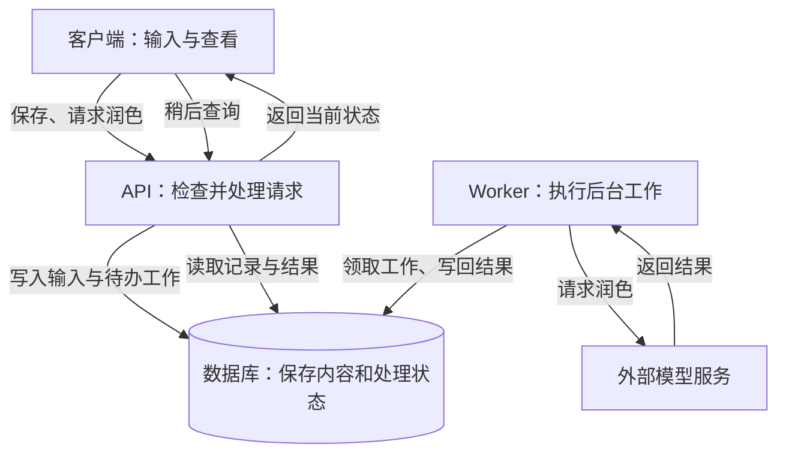

# 第 1 章 保存一句英语之后

给朋友写消息时，你想说“我不太擅长做饭”。英文写出来了，有个地方却拿不准。你希望有个工具能记下当时的写法和想表达的意思，等有空时看看修改建议，再选出自己愿意拿来练习的说法。

对后端来说，这里有一个很具体的问题。如果“保存原文”和“接受建议”都往同一个字段里写，等你回来练习时，还能找出自己当时拿不准的地方吗？本章沿着这一句话，看看哪些内容需要分别保存，以及一次请求应该改变哪一份内容。

动手时先从最小的一步开始。第 2 章让客户端读到一份空列表，第 3 章用 Node.js 接收一条英语原文，再从列表和详情里把它读回来。后面引入数据库、修订和练习时，这条最早保存的原文仍然有用。

## 1.1 从一条英语表达开始

### 一句英文，为什么还不够

先看你在聊天框里写下的原句：

> I'm not much of cook.

要是过几天才回来整理，你还能判断一条修改建议是否保留了当时的意思吗？除了英文原句，你还可以顺手记下那句中文。

为什么不能直接让 AI 猜？因为一句英文可能语法不正确，也可能语法正确却表达了另一个意思。只看英文，系统无法可靠地区分这两种情况。把中文意图一起保留下来，后面才能判断一次修改是否偏离了原意。

于是，一份有用的输入就变成了：

> 想学的表达：I'm not much of cook.  
> 想表达的意思：我不太擅长做饭。

这两个字段来自一个具体需要：修改英语时，仍然能回头核对用户想表达的意思。以后设计数据结构时，我们也会这样追问每个字段。字段越多并不代表设计越完整；要先说清楚，没有它会丢掉什么信息，哪一个操作会因此做不对。

先做一个很小的产品访谈。假设这句话是从聊天框里拷出来的，用户说：“我当时写的就是这样，请帮我记住哪里用错了。”此时少的那个冠词恰恰是最有学习价值的部分。现在换一个人，他从一本教材里抄来已经修正的句子，希望记下将来能在什么场合使用。同一句正确的英语，在第一种情形里是系统给出的建议，在第二种情形里却是用户亲手交来的原文。只看字符串，两种来历无法区分。先问“谁在什么时候提供了它”，才知道这次操作究竟是在保存素材，还是在对一份素材给意见。

中文意图也有来历。如果用户没有填写，我们能确定的是这一次没有收到说明。系统若自动补成“我不会做饭”，读详情的人很容易把它当成用户的自述，后来再好的润色也只能围绕一个猜来的意思展开。假如确实想保留模型的理解，可以把它作为等待判断的一份解释，界面上写明来源。轮到用户自己补上说明时，再保留他实际提交的那句话。一开始只让用户填英文的版本，同样可以沿用这条规则：这次没问过的问题，就让它保持未知。

试着把界面关掉，只给同伴看一次操作后真正留下的东西。若留下的是原文、用户写的意图和一份建议，对方可以分别指出“原来怎样”“本来想说什么”“有人建议怎样改”。若只留一段最好看的英文，就让同伴从中反推原来有没有冠词，以及用户是谦虚还是认真拒绝做饭。很快会发现，每一种猜法都可能讲成一个合理的故事。数据设计在这里要解决的，是让将来的读取者有依据选出确实发生的那个故事。

### 修正一句话，为什么不能直接覆盖

现在请 AI 帮忙整理。一个合理的修改是补上冠词 `a`：

> I'm not much of a cook.

如果用这个结果覆盖原始输入，后续就无法还原本次修改，也无法比较原文与候选。这里需要保留的是两份有来源关系的数据。

所以，我们会把用户提交的输入和 AI 给出的结果分开保存。前者说明“这次交给系统处理的内容是什么”，后者说明“系统建议把它改成什么”。我们把后者叫作**候选**，因为它还需要用户判断是否适合自己。

比如，AI 也可能建议另一种说法。这种说法即使很自然，也未必是用户这次想学的表达。保存原文，能够让用户继续判断、修改或放弃，而不必接受一次不可撤回的替换。

有时候也不会产生候选。输入信息不够，系统需要追问；外部模型调用失败，系统暂时拿不到结果。无论哪种情况，之前提交的内容都应该还在。用户已经花时间写下的东西，不应随着一次润色失败一起消失。

我们由此得到了一个会反复使用的设计思路：**先保留已经收到的输入，再围绕它进行后续处理。** 这样，后面的处理即使失败，也有明确的起点可以恢复。

### 再改一次，就需要认识“版本”

假设用户看完候选，想补充自己的意思。他把输入改成了：

> 想学的表达：I'm not much of cook.  
> 想表达的意思：我厨艺一般，想在朋友邀请我一起做饭时谦虚地说明这一点。

我们可以继续覆盖数据库里那份原始输入，但很快又会遇到问题：之前的候选到底是根据哪份内容生成的？如果新一轮处理还没完成，旧结果此时返回，应该显示哪一个？

只保留“最新文字”已经不足以解释这个过程。我们需要保留每次明确提交的输入，并知道它们的先后关系。第一次提交是修订 1，这次补充后提交的是修订 2。候选也要注明自己针对哪个修订生成。

这些修订仍然属于同一条逻辑记录。代码里把这样一条记录称为 **Capture**，把其中每次提交的版本称为 **Revision**。记录负责把这一轮整理过程串起来，修订保留每次明确提交的输入快照，候选绑定到其中一个修订。

有了版本，系统就能解释一个常见场景：你在电脑上打开旧候选，还没决定是否采纳；随后在手机上补充了意思，提交了新修订；回到电脑时，旧页面仍然停在那里。

采纳请求因此需要绑定用户实际看见的候选及其修订。这里允许用户明确采纳旧修订的候选：旧内容仍然可能值得学习，新的修订不会自动撤销这次选择。服务端不能在提交时悄悄换成最新候选，而应核对指定候选的归属和状态，保留它所依据的输入。多个请求同时采纳或放弃时，这些条件仍要在写入生效时成立。若另一种产品规定只能采纳最新版，则还需增加当前版本条件；绑定来源与限制最新版是两项不同的规则。

后面我们会把记录、修订和候选之间的关系落到数据库里，再处理多个请求同时到来时的情况。现在暂时不需要知道应该建几张表，但应该能说明为什么只有一个随时覆盖的字符串不够用了。

可以用四张纸把“属于哪一版”画出来。第一张记作甲，代表这一次整理；第二、三张分别写第一版和第二版的完整输入，各画一条线连回甲；最后一张写候选乙，连向产生它的第一版。现在遮住第三张，只凭甲仍然可以说出这是哪一次整理，只凭乙也能沿线读回用户当时提供的意思。再把第三张放回来，两条线都无需移动。这个动作说明为何记录身份应该比当前内容更稳定：将来即便修改了原文的每个字，用户仍应能从原入口打开这次整理。

再拿掉候选与修订之间的线，只保留“候选属于甲”。在只有第一版时，页面仍然能显示正确的原文。等第二版出现，同一个页面若每次都拿甲的最新输入，候选乙的说明就会悄悄改变，虽然乙本身没有被编辑。这种错误很难靠测试一条刚创建的记录发现。要验证自己的设计，应当让同一记录至少有两版，而且故意让两版在一个可见处不同，再拿第一版的候选去读详情。读回的究竟是哪份意思，一眼就能判定。

版本还需要一个清楚的产生时刻。用户在输入框里删掉三个字，想了想又按撤销，此时应用可能已经重新渲染了好几次。对用户来说，他还没有交出第二稿。反过来，他可能明确提交了两次，两份文字完全一致，却希望保留两次整理经过。是否允许空改动另有产品约定；仅凭两个字符串相等，推不出有没有两次明确提交。让“提交”在界面上有清楚的动作，让服务端为接受的输入留下依据，才能避免把每一次按键都错当成历史版本。

可以据此设计一道很短的验收题。第一版的意图是“我不太擅长”，第二版改为“我想谦虚地回应邀请”。用户重新打开甲，应该读到补充后的意思；打开乙的来源，应该读到最初的意思。再打开从甲进入的历史列表，应当两版都在。三个入口谈的都是同一条记录，却故意应当返回不同的内容。如果验收时笼统地写“页面显示正确英文”，这三种读取就很容易在实现里被写成同一个“取最新”操作。

### 采纳之后，留下什么

回到那句修正好的英语。用户确认它符合原意，也愿意把它留下来学习，于是点击“采纳”。

从这一刻起，系统才有理由把它放进正式的表达集合。此前保存的输入和生成的候选仍然有价值，但它们表示的是整理过程；用户采纳后，才表示“这份内容是我决定留下的”。每采纳一次，就留下一条**最终学习记录**。

如果把“AI 已经生成”和“用户已经采纳”当成同一件事，用户只是试着问了一次，就会发现收藏里多了自己没有决定要学的内容。把两者分开，既影响界面的按钮，也影响后端允许哪些数据进入正式集合。

接下来再考虑一个稍远一点的情形。一个月后，用户在另一段材料里又遇到了同样的表达，并且再次记录下来。我们希望保留这次新的来源，却未必希望列表里出现两个完全重复的学习目标。

这就需要区分“某次收录的记录”和“持续学习的那个表达”。我们把后者叫作**表达单元**：多次收录可以在确认是同一项表达能力后，关联到同一个单元，而每次来源仍然各自保留。后面提到的“表达星图”，就是查看、搜索和管理这些正式表达的地方，可以先把它理解为一个带有含义、来源和关联信息的表达列表。

这里也能看到数据库关系的来由。我们还没有开始设计表，业务已经提出了“一项表达可能来自多次记录”的需要。等到学习一对多关系时，就能用这个问题判断自己的结构是否合适，而不只是记住一种表的写法。

### 从“记住了这句话”走到“能用出这句话”

收录解决了内容留存的问题。用户真正希望的是，下次与朋友聊天时，能自然地用出这句话。因此，在把表达加入练习池后，我们还会给出一个情境，让用户自己写一句英语。例如：

> 朋友邀请你一起准备晚餐。请用刚才的表达说明自己厨艺一般，再说说你能帮什么忙。

用户可能写出：

> I'm not much of a cook, but I can help chop the vegetables.

这时要保存的内容又变了。我们需要知道当时出的什么题、用户实际写了什么、有没有看提示，以及系统如何评价这次作答。把这些内容放在一起，才能理解一次练习。我们把它叫作**练习尝试**。

为什么不能只在表达上放一个 `mastered` 字段，答过一次就改成 `true`？因为这会把过程压缩成一个无法解释的结论。用户可能看过参考答案，可能只是在某个熟悉情境下用对了，也可能对自己的表现很有信心，但实际用法仍有问题。保留作答和评估，才有依据讨论掌握程度；用户选择“掌握了”可以记录为自我感受，却不能独自代替这些依据。

走到这里，我们已经从一句英文推导出几种不同的数据：提交过的输入、每一版修订、等待判断的候选、采纳后留下的学习记录，以及后续的练习。它们各自回答不同的问题，因此不能全部塞进一个“内容”和一个“是否完成”的字段里。

从输入一句话，到能追溯练习用的表达来自哪一次收录，中间已经出现了数据关系和版本问题。如果两次修改同时到达，或一次整理半途失败，后端还要决定怎样保存各自的结果。我们能够沿着同一个例子理解这些技术为何有用，并观察自己的实现究竟保护了什么。

### 合上名词表，自己给三张清单对数

现在换一句短语做迁移练习。周一读者在一封邮件里遇到 “take a rain check”，记下一次素材并采纳了一个候选。周五他在另一段对话里又遇到这句话，再记一次并采纳一次。假定两次义项经过确认完全相同，系统也决定复用同一表达。周末他带提示答对一道练习题。请先写下三个数：学习来源列表应有几项，正式表达集合应有几项，练习历史应有几次。然后给三个数旁边各写一个动词，说明究竟是哪一次操作让它增加。

按题目给的范围，来源为二，表达为一，尝试为一。来源列表的一项代表一次已采纳的材料，保留它才找得到周五那段对话；表达集合的一项代表正在学的同一义项，两次收录只增加了一份来源；练习的一项从提交答案产生，与周一或周五记下素材的次数没有固定关系。若只给出一个“共两条”的数字，却没说明数的对象，读者无法知道是在说两次输入、两次正式收录，还是两道已经完成的练习。

改一个条件再算。周五那份候选生成后被用户放弃了，其他动作照旧。素材仍有两份，因为第二次输入确实发生；正式学习来源只剩周一那一份。若用“今天看到了几条建议”代替“今天采纳了几份内容”，这两种周五会被记成同一个结果。再把条件换回两次都采纳，但周末只是打开练习页面，看完提示便离开，题设要求提交答案才算一次尝试，那么练习历史应是零。打开、提交、得到评估也可以分别是可观察动作，究竟拿哪一个计数，要回到问题本身。

最后把周末答对的结果交给一位不知道经过的老师，只告诉他“答对一次”。他不能从这个数推出这位读者一周后能否独立使用这句话。若再给他题目、原回答和是否查看过提示，他便能提出可检验的下一步：换一个拒绝邀请的情境，收起提示，再看能否用出同一义项。以后在实现里见到一个看似方便的布尔字段，可以试着把它还原成这样的判断题。若没有人能说清在哪次操作之后应该置真，又该凭什么改回去，那项判断暂时只适合写在产品讨论里。

## 1.2 一条记录怎样经过整个系统

### 先划分保存、润色和采纳的边界

记录流程中有三个不同的操作：保存输入、请求润色、采纳候选。我们会将它们分别处理，让每个操作都有明确的完成条件。

保存输入只负责留下修订，不依赖模型可用；请求润色针对指定修订启动生成过程，不修改输入本身；采纳则检查候选是否有效，再形成正式学习记录。这样，润色超时可以被单独处理，不需要让保存操作也跟着失败。

采纳内部还涉及多处数据变化：候选变为已采纳，新增学习记录，并关联或创建表达单元。如果只完成前一处写入，候选显示已采纳，正式记录却不存在；如果反过来，重试又可能重复创建记录。这些变化需要作为一个整体成功或失败，这就是后续引入数据库事务的具体原因。

我们会使用 PostgreSQL 保存这些数据，但“用了数据库”并不自动保证整个操作一致。哪些写入放在同一个事务里、并发请求如何竞争同一个候选、哪些条件由数据库约束保证，都需要在实现时明确。

用一次保存把图里的箭头读成可核对的动作。用户在输入框里写完一句话，页面上的文字此时只证明这个页签持有一份草稿；他点保存，客户端把约定的字段放进请求；服务端检查输入，决定能否建立一条记录；成功时为它分配身份，随后把结果送回。每跨过一步，能回答的问题才多一个。按钮变灰能说明页面进入了等待，页面自己在列表顶部先画一行能给用户即时反馈，但这两种现象都可能发生在服务尚未作出决定之前。

所以要给每一个“完成”找一个独立的观察点。比如后来做创建接口时，先在 Postman 保留创建响应里的 ID，然后另发一次详情读取，把两边的 ID 和原文对起来。第二次读取迫使服务按同一个身份找到刚才接受的材料，能排除“页面只是把提交的文本原样画回来”这种解释。如果重新开一份请求只问列表总数有没有增加，别人同时新增的一行就可能让计数碰巧正确。一个具体身份能回答的事，集合总数回答不了。读回时还要记住比较的运行范围，本篇的内存记录只在原进程存活期间可见。

再看采纳这条稍长的路径。假设候选丙最初可采纳，用户点击后，希望学习列表出现一行，并希望下次点开丙能看到它的处置结果。写前先把这两处读数记下来，写后再读同一个丙。只改候选状态，前一个页面缺来源；只追加学习记录，后一个页面仍让人继续采纳。这就是为什么要从两个读者各自提出的问题去划定一次业务动作的范围。若需求只是“把草稿标记为下次继续整理”，这两个读数根本不该一起变化，也就不应把草稿按钮接到采纳逻辑上。

把动作边界划好之后，还可以先在纸上放一个故障点。例如让服务在刚检查完输入、尚未保存之前停下，此时再次查询应看不到新记录。把停点移到已保存但尚未开始回传，数据库阶段的下一次读取应能看到记录。若采用当前篇的内存版本又恰好把进程整个关掉，则存储也跟着消失；要观察“已经保存但回包没到”，需让同一个服务继续运行，或等到后续使用持久存储。这点实验条件决定了这两个现象能否被拿来比较。

### 写入成功之后，响应仍可能丢失

即使数据库写入已经完成，API 返回的响应仍可能在途中丢失。此时服务端和客户端掌握的信息不同：服务端已经保存成功，客户端只知道请求超时。

如果记录已经写入，响应却没能送到浏览器，用户看到的可能只是超时。再次点击保存，会不会多出一条？单凭“没收到响应”无法判断。后续讲幂等时，我们就要解决这种问题：让系统认得出这是同一次操作的重试，而不是一份全新的请求意图。

具体到实现，我们需要能够识别原操作、查询其结果，并决定重复请求应返回已有结果还是产生冲突。这些判断会影响接口参数、操作记录和数据库约束，不能仅靠客户端避免重复点击。

可以把这个困境当成一道信息题。不让浏览器看到服务日志，只让它看“已发送，等待超时”。写下两段都能产生这句话的经过。第一段里，服务收到请求以前连接就断了；第二段里，服务产生记录甲以后，响应在返回途中断了。现在要求客户端在两段经过里都自动做出正确决定。若统一再发一次，在第二段可能创建两份；若统一告诉用户保存成功，在第一段会让用户丢掉输入。两个现场给客户端的可见线索完全一样，光把等待时间从五秒改成十秒，并没有给它增加能区分二者的信息。

能补回哪一项信息？如果第一次已经拿到了服务分配的记录 ID，按这个 ID 读详情可以帮助核对。偏偏本题丢的正是携带 ID 的响应，不能让用户提供一个他从未收到过的值。改成在列表里搜索整句也不够：用户上周可能已经录过一模一样的句子。即便库里恰好只有一条，单靠文字也无法确认它就是刚才那次动作产生的。后续引入由发起方在发送前保存的操作标识，正是为了让第一次响应丢失后，双方仍然有一项共同知道的依据。

换成另一个产品决定：用户就是想在今天把同一句话再记一次，因为这回来自新的材料。此时让所有相同正文都得到昨天的记录，会悄悄抹去今天的来源。区分这两种意图时，比较的应当是“重问昨天那笔操作的结果，还是明确发起一笔新的记录”。以后看到“系统会自动重试”的要求，先用这两个例子请提出需求的人分别写下预期记录数。若连正确数字都还没有定下来，选择客户端重发几次也无法给出可靠的实现。

### 当一项工作比请求更慢

保存一小段文字通常很快。请外部模型润色，就没那么可控了。模型可能几秒后返回，也可能暂时不可用。我们可以让 API 等待它的结果，但随着需求增加，需要考虑用户离开页面、连接中断，以及服务重启后的处理方式。

`async/await` 可以组织这段异步调用，但调用的执行状态仍然留在当前进程里。进程退出后，仅凭这段代码无法知道调用尚未发出、已经发出，还是拿到结果却没来得及保存。后台执行要解决的关键问题，就是把恢复所需的状态持久化，并针对不同中断位置规定后续动作。

为此，我们会把待处理的工作保存下来，再交给专门的后台程序执行。这个程序通常称为 **Worker**。在我们将要建设的服务中，它可以作为独立的 Node.js 进程运行：检查哪些工作需要处理，领取其中一项，调用外部服务，再把结果写回数据库。

于是，API 可以先告诉页面“输入已保存，润色正在等待处理”，不用让最初的请求一直等到模型完成。用户稍后打开页面，仍能查询同一条记录的处理状态。

下面这张图预览的是后续接入服务端模型调用后的一条路径。当前还没有这些程序；我们会按章节逐步把它们搭起来。

沿着图看，保存原文和完成润色就不再是同一个时刻。模型出了问题，原文仍然在数据库里；Worker 暂时停止，已经保存的工作也有机会在恢复后继续处理。页面可以据此展示真实进度，而不必把所有情况都归成“成功”或“失败”。

当然，多启动一个 Worker 并不能自动获得这些能力。我们还要处理同一项工作被重复领取、外部结果未知，以及执行到一半退出等情况。数据库里保存什么状态、什么时候允许重试，才是可靠性的来源。第六篇会先用后台投递建立这些基础，之后再把它们用于 AI 调用。

拿一项具体工作走三次，差别会更明显。输入甲的第一版已经保存，用户随后点了润色。第一次把程序停在它还没登记这项工作的地方。重开页面能读到原文，却找不到用户请求过润色的依据。若产品承诺“点击成功后即使离开也会继续”，这个停点说明按钮的成功提示太早了。若产品只承诺保存输入，确实没有收到润色请求，也应允许只有素材没有待办；不能看见每份素材都替用户启动一次调用。

第二次把停点移到工作已经登记、执行者还没开始的地方。此时可以先关闭页面。换一个客户端，只要允许读取同一份素材，仍能查到“等待处理”。执行者恢复时能从已保存的工作里找到目标修订。假如只存下素材身份，每次执行时再取最新输入，用户在等待期间改写了意思，排队的老工作就会拿着新内容出发。给工作记录保留产生它的修订身份，既能避免这个错配，也能让晚到的结果回到原处。

第三次让外部服务已经处理完，但执行者尚未把返回内容保存就退出。现在本地仍然没有可展示的候选，外部却可能已经完成一次计费调用。只查询本地工作能发现“还没保存结果”，不能据此对用户保证“从来没有调用过”。假若外部支持按调用标识查结果，就能在恢复时使用那条依据；若没有这种能力，再调用一次可能得到不同措辞，即使两次都语法正确，也要保留各自对应的输入并按约定处理重复。这一步不需要现在就选消息系统。先把中断点画在两个不同系统的动作之间，便能看出哪些判断需要对方也提供证据。

这些差别会直接改写页面的文案。能读到输入但找不到任务，不要显示“生成第百分之八十”；能读到等待中的工作而没有结果，可以让用户安心离开，稍后再查；能读到候选只代表可以审阅，还不能在练习列表自动加一。试着逐句给文案圈出一个能够支持它的事实，若圈不到，就把文案改窄。这也是前端经验能直接带进后端设计的地方：页面想向用户许什么承诺，就要能指出服务里哪项变化让这句话成立。

### 生成内容的人可以变，保存规则仍要成立

除了让后台调用模型，用户还可以在 Agent 对话中记录和练习。走这个入口时，由 Agent 整理表达，再调用记录服务提供的工具保存结果。

这时，候选不必经过上图中的模型调用路径，但它仍然要对应一份已经保存的输入，仍然需要用户采纳。否则，只是换了一个入口，系统就出现了两套相互矛盾的记录规则。

这也是后端值得集中维护业务规则的原因。网页、小程序和 Agent 的交互方式各不相同，但“采纳的是用户指定的候选，来源不可偷换，已放弃的候选不能再采纳”这样的判断，应当在执行操作的服务端保持一致。客户端负责把操作组织得方便，服务端负责让不同入口共同遵守同一组条件。

实现上，这意味着不同入口应复用记录与采纳的业务逻辑，各自处理自己的身份凭据和协议格式。后面组织 Nest 模块、接入权限与 Agent 工具时，会沿用这一分工。

## 1.3 项目的建设范围与演进路线

### 先知道目的地，但从空项目动手

我们从一个空目录开始写这个记录服务，用到哪段代码、哪张表，就在那一步把它建起来。

这意味着，每一章都需要接住前一章留下的项目。如果上篇只保存了英语原文，这一篇增加中文意图，就得说明原来的记录如何继续读取；如果后来加入修订，就得说明现有数据怎样变成第一版修订。不能每遇到一个新机制，就换一个已经准备齐全的项目，把衔接过程跳过去。

随着 Web、小程序和 Agent 逐步接入，代码组织也会随之调整。例如，后端和小程序需要使用一致的响应字段与校验规则，我们会在共享契约篇把这部分约定提取成包，再处理版本升级和跨仓协作。

目前先从单包服务开始。等到客户端接入和共享需求出现，再处理契约包的导出、版本升级及跨仓依赖，避免在业务接口尚未建立时就承担拆包的维护成本。

### 为什么第一步只保存三个字段

先用 GET /captures 验证第一次 HTTP 往返，再实现英语原文的新增与详情接口，保存 ID、原文和创建时间。这个范围用于集中实践 Node.js 的请求处理、调试和进程管理，暂时用内存存储，不接数据库和外部模型。

这是一项阶段性的实现取舍。接口先运行起来，后续再替换存储、扩充数据结构，才能实际经历接口行为如何保持兼容、已有数据如何迁移，而不是直接拿到一份所有组件都已齐备的项目。

第一篇会围绕这个小服务认识 Node.js：进程如何启动和停止，代码在哪里运行，一个请求等待 I/O 时另一个请求会怎样，TypeScript 又如何变成可执行的程序。

有了这些经验，再在第二篇引入 Nest，就能讨论它如何组织我们已经写过的处理逻辑。第三篇接入 PostgreSQL，解决已经看到的数据丢失，并给保留下来的记录补充中文意图。随后，我们继续在这些数据上增加修订、候选和采纳，而不是重新开始另一个例子。

第一节里讲到的完整业务，会沿着这条路线逐步实现。暂时省略一项能力，需要知道自己省略了什么、以后从哪里接回；这也是实际开发中控制复杂度的一种方法。

可以把第一版的交付写成一段不依赖界面样式的小故事。先启动一个全新的服务进程，打开列表，得到的是一份可以读取的空集合。提交刚才那句英语，保存服务给的编号；再打开列表应能找到它，打开该编号的详情应当得到同样的原文与创建时间。如果把客户端关掉重新打开，但服务没有重启，这份记录依旧应该读得回来。等到你确实停止并重新启动服务之后，空列表才重新成为这个练习的正常起点。客户端刷新与后端重启看起来都像“重新打开”，它们结束的却是不同地方的一次运行。

三个字段各自支撑这个故事的一段。原文让人能核对究竟保存了什么；编号使两句逐字相同的记录也能各自打开；创建时间记录服务建立这条记录的时间。假设把编号换成原文，第二个人再次摘下同一句话时，详情地址该打开哪一次？假设按创建时间当编号，同一时间精度里的两次写入怎样区分？反过来，如果只给用户一串编号而不返回原文，机器能定位记录，使用者却很难发现一次复制粘贴是否漏掉了一个词。每个字段都应当经得起“拿掉它后哪项操作失去依据”这个检验。

这个小故事还可以用来审查一次改版。有人提议把列表从一组原文卡片改成时间线。只要前端用服务已经返回的创建时间展示，原来的三条接口可能已足够。又有人提议“编辑后能看见最初的输错”，三个字段在一个可覆盖对象上就不够用了。还有人说“我把笔记本关机，明天同一编号还能读回”，即使当天的三个接口一直返回正确结果，内存也承受不了这一项新承诺。三个提议都能从一个页面发起，所需的改变却分别落在展示、历史建模、存储寿命上。听完需求先找出会改变哪次读取的答案，常常能少做一大截无关工作。

迁移同样可以先从一个旧样本推出来。假设第三篇给素材新增可选的中文意图，昨天创建的甲只有英文。新程序若为了通过必填检查，读出所有旧素材都自动写上“用户想表达同一句话”，数据库看起来齐整，实际却替用户捏造了一段意图。让旧样本先能按编号读回，明确区分“当时没收集”与“用户后来补了说明”，再验证新建样本能保存新字段，才算原来的能力接上了新需求。第一篇的内存内容不会跨重启自动带入第三篇，到了有持久样本的阶段才做真实数据迁移；这里先练习选择一个最容易被升级误伤的旧场景。

### 每一步都按实际研发的方式完成

第一版只保存三个字段，变化的是功能范围。工作时仍然要知道自己运行的是哪个版本、使用哪份配置、请求发到哪个进程，以及修改后如何判断结果。创建接口的同时准备可保存的请求，用图形客户端反复调用；需要理解内部原因时连接源码调试器，修改保存后自动重新启动，再用同一份输入对照结果。这些操作从第一次实现就一起建立。

准备交付时，关注点会变化。开发时监听文件和暂停断点能提高修改效率；运行交付版本时，需要明确采用的代码、配置和依赖，使无关文件的保存不会改变服务行为。引入 TypeScript 后还要检查实际生成的产物，而不只是在源码目录里运行成功。后面出现数据库和外部平台时，相应的开发数据、环境配置和排错工具也要同时落地。

暂时使用内存存储意味着重启会丢失记录，因此这一步适合观察请求与进程，不能用来承诺真实用户的数据不会丢失。我们会把这种功能边界讲清，同时对已经提供的行为负责：合法输入怎样保存，失败为什么没有写入，内部错误能向调用方透露什么，怎样验证自己的修改。逐步建设的过程本身，就应当是能够在实际项目中复用的研发过程。

跟做时可以给每次观察留三样最少的信息：发往哪个地址，使用的是哪一次运行，凭什么知道读回来的是刚才那条。比如在 Postman 把“创建”“查列表”“按编号查详情”保存为三份请求，不必保存每次试验的全部截屏。先从一次创建响应取编号，把它放进详情请求里。稍后若出现“列表居然没有我刚写的那句”，用保存的详情请求在同一地址再读，便能分辨是列表展示出了问题，还是连这条记录本身都不见了。若刚才修改文件触发过自动重启，还要把那次重启列入可能经过。拿同一份请求对照前后，比反复新建一条直到绿色提示出现更能说明原因。

再考虑调试时容易出现的一种误会。先发一个请求，把服务暂停在做决定之前。网页一直在等，工具栏却显示断点已经命中，这两件事可以同时为真。断点告诉我们程序走到了那一行，看变量能知道目前收到了什么；只有继续执行、观察响应并另行读回，才能知道最终是否保存。以后某一章让你停下查看状态，先给自己留一个明确的恢复动作。若停在那里就继续做下一组请求，后来请求的等待可能由调试器造成，不能拿来作为正常运行时服务会有多慢的依据。

从开发目录走到交付目录，也可以用刚才的三份请求来比较。先从开发入口验证一轮，记下运行的端口和返回对象应有的字段；停掉它，从交付入口重新启动，再用新的合成样本验证第二轮。两次都是内存进程，第二轮无需把第一轮的随机编号再读一遍，但应该能从自己刚建的那一条查回匹配的原文。把“行为应一致”误解成“两轮编号和时间应逐字相同”，会让明明正常的新建也被判失败。相反，两个目录都返回同一份写死的成功示例，虽然逐字一样，真正的任意原文却无法读回。为每一轮换一句普通短句，即可让这种假成功露出来。

在第一篇已经支持选择端口的第 4 章配套上，可以检验前面这段故事。同一进程连续收到两次主动创建，输入都是本章那句缺冠词的英语，返回两个不同的 ID；用各自的 Location 另开请求，读回的对象分别与自己的创建结果一致。列表里能依插入次序找到两个 ID。随后关闭服务，在同一端口启动一份新进程，列表为空，读取旧 ID 得到 404。读到第 4 章时可以反过来先做预测：只新开一个客户端请求，上述哪一个结果会改变？再决定是否真的需要重启服务来证明这一点。

### 让项目随着理解一起长出来

公开代码与公开用户数据是两回事。我们会使用编写的英语材料和练习答案，用自己的开发配置，之后再建立专用的数据库和文件存储，不把真实用户记录或凭据放进项目。

这些准备会在需要时一步步进行，现在不用先安装所有依赖，也不用配置模型账号。以后引入数据库时，我们会核对连接目标、写入示例记录，并保留它们供后续迁移使用。代码可以重新运行，已经保存的数据却不能因为换了一章就被随意抹掉。

阅读时也可以始终带着一个判断标准：假如需求稍微变了，我能否说清楚该改哪一部分，以及为什么？比如，把“英语表达”换成别的个人记录，接收请求、持久保存、区分用户和恢复失败的需要仍然存在。到那时，你可以用另一种记录试一试自己的设计。

进入下一章前，可以选三个场景推演：采纳旧候选时新修订同时提交，采纳完成后响应丢失，以及模型返回后 Worker 尚未保存便退出。分别写下系统需要保留哪些信息，才能判断下一步允许做什么。这些问题会随着数据库、事务与后台任务的实现逐一落实。

把推演留成一张可以自己批改的纸。左边写“用户做了什么”，中间写“服务已经留下什么”，右边写“用户此刻有证据说什么”。以采纳旧候选为例，中间应同时有候选所依据的旧版和用户实际选择的候选；新的修订即使先保存，也不会把旧候选的来源改到自己名下。右边若写“系统自动选了最新表达”，就把用户并未做过的决定加到了结果上。换成响应丢失，服务可能已有成功结果，右边此刻只能写“结果尚待确认”。换成模型已返回但本地还没保存，外部处理和本地可展示内容也会落到不同格。三行比较下来，哪里信息不足、要向谁查，自然会比一句“失败后重试”清楚得多。

最后换到一个与英语无关的项目：朋友想记住每次做菜用了多少盐，后来还想请人建议怎样减盐。先关上前面的例子，给他设计一个最小的创建、列表、详情故事。分别写出原料记录、厨师提出的建议和实际照做后的评价；如果他今天主动试做第二次，为什么两份相同的配方仍值得各自留一条记录？如果他后来修改了份量，昨日的建议应当回到哪一份输入？如果他只想找出自己最常做的菜，又应当数哪种对象？

对照时可以这样检查自己的答案：从一条建议能否找回当时的份量，从两次试做能否追到各自的结果，同一道菜能否在总览中只列一项。某一种设计若能回答前两问却不能回答第三问，先把欠缺的区分写清楚，不必立即给每一种对象都建一张表。能够从新的问题倒推出需要多保留的事实，再决定在哪一篇实现它，这种判断才会随着技术栈更换继续有用。

下一章启动一个只处理列表读取的 HTTP 服务，并在 Postman 区分正常应答、未知路径和连接失败。

阅读约 53～65 分钟，纸上推演与换题自检另加约 12～18 分钟。可在画完候选与修订的关系后暂停，再分次梳理请求路径和第一版交付。

## 附录：本章必要技术点速查

本章先区分业务对象与操作的完成条件。以后遇到相似名称，可以回到这里核对它们承担的职责；具体表结构和实现随后续章节建立。

| 概念 | 本章含义与边界 |
| --- | --- |
| Capture / Revision | 同一条整理记录 / 其中某次明确提交的输入快照；候选要能追溯到生成所依据的修订。 |
| 候选 / 最终学习记录 | 等待用户判断的建议 / 用户采纳后留下的结果；生成成功不等于采纳完成。 |
| 表达单元 / 练习尝试 | 持续学习的目标 / 某个情境下的作答与评估；一次答对不能代替掌握依据。 |
| 版本条件 | 采纳时要确认候选仍适用；较早查询得到的有效结论不保证写入时仍有效。 |
| 事务 | 把采纳涉及的多处数据库变化作为一个整体提交；仍需明确并发时的条件与约束。 |
| 幂等 | 识别同一次操作的重试，避免重复产生业务效果；响应丢失不代表写入失败。 |
| 后台 Worker | 执行已经保存的工作；可恢复性来自持久化状态与恢复规则，不能只靠多启动一个进程。 |

机制查阅：[PostgreSQL 18 事务概念](https://www.postgresql.org/docs/18/tutorial-transactions.html)、[HTTP 幂等语义](https://www.rfc-editor.org/rfc/rfc9110.html#section-9.2.2)。HTTP 方法的幂等语义与应用对某次创建的去重需要分别判断；本章尚未给创建接口实现幂等能力。

[返回第一篇](../README.md) · [返回全书目录](../../README.md)

[下一章：完成第一次 HTTP 往返](../chapter-02-first-http/chapter.md)
