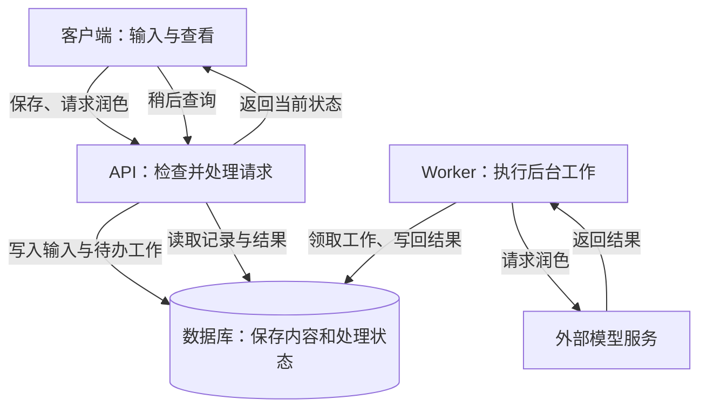

# 第 1 章 先认识我们要建设的 EPP

第一篇的目标，是建立公开 EPP 的第一个可运行版本，并围绕它掌握 Node.js 的运行与调试。起步时只实现三个接口：新增一条英语原文、读取记录列表、查看单条记录。随后用同一份代码研究进程、事件循环和构建，再在后续篇章中接入 Nest 与 PostgreSQL。

这三个接口会一直保留下来。随着项目发展，原文会有修订版本，记录会关联 AI 整理出的候选，用户采纳后还会形成正式的学习内容。我们需要在保持已有功能可用的同时，让数据结构和处理逻辑逐步容纳这些变化。

贯穿这条路线的项目叫作 EPP，一个英语表达记录与练习工具。它从用户想学的一句表达开始，保留原意、辅助整理，最后通过练习帮助用户使用所收录的内容。这个过程为后续的数据建模、事务和后台任务提供了连续的实践场景。

因此，先把“记录”具体指什么说清楚，会直接影响接口和数据的设计：保存用户提交的原文、保存模型的修改结果，以及确认一份内容可以正式收录，是三个不同的操作。如果一开始把它们混为一谈，后续增加修订和采纳时，就很难说明原有数据应该怎样延续。

本章就沿着一条表达梳理这些区别，再把操作放到系统的请求与执行路径中。下一章从其中最小的一步开始实现：保存原文，并能将它读回来。

## 1.1 从一条英语表达开始

### 一句英文，为什么还不够

假设你想表达“我不太擅长做饭”，写下了这样一句英语：

> I'm not much of cook.

你感觉它不太对，却又不确定问题在哪里，于是想把它记下来，之后再整理和练习。这个例子是我们为本章编写的；接下来会一直沿用它。

EPP 要根据用户原意整理表达，因此除了这句英文，还需要保存用户想表达的意思。

为什么不能直接让 AI 猜？因为一句英文可能语法不正确，也可能语法正确却表达了另一个意思。只看英文，系统无法可靠地区分这两种情况。把中文意图一起保留下来，后面才能判断一次修改是否偏离了原意。

于是，一份有用的输入就变成了：

> 想学的表达：I'm not much of cook.  
> 想表达的意思：我不太擅长做饭。

这两个字段来自一个具体需要：修改英语时，仍然能回头核对用户想表达的意思。以后设计数据结构时，我们也会这样追问每个字段。字段越多并不代表设计越完整；要先说清楚，没有它会丢掉什么信息，哪一个操作会因此做不对。

### 修正一句话，为什么不能直接覆盖

现在请 AI 帮忙整理。一个合理的修改是补上冠词 `a`：

> I'm not much of a cook.

如果用这个结果覆盖原始输入，后续就无法还原本次修改，也无法比较原文与候选。这里需要保留的是两份有来源关系的数据。

所以，我们会把用户提交的输入和 AI 给出的结果分开保存。前者说明“这次交给系统处理的内容是什么”，后者说明“系统建议把它改成什么”。我们把后者叫作**候选**，因为它还需要用户判断是否适合自己。

比如，AI 也可能建议另一种说法。这种说法即使很自然，也未必是用户这次想学的表达。保存原文，能够让用户继续判断、修改或放弃，而不必接受一次不可撤回的替换。

有时候也不会产生候选。输入信息不够，系统需要追问；外部模型调用失败，系统暂时拿不到结果。无论哪种情况，之前提交的内容都应该还在。用户已经花时间写下的东西，不应随着一次润色失败一起消失。

我们由此得到了一个会反复使用的设计思路：**先保留已经收到的输入，再围绕它进行后续处理。** 这样，后面的处理即使失败，也有明确的起点可以恢复。

### 再改一次，就需要认识“版本”

假设用户看完候选，想补充自己的意思。他把输入改成了：

> 想学的表达：I'm not much of cook.  
> 想表达的意思：我厨艺一般，想在朋友邀请我一起做饭时谦虚地说明这一点。

我们可以继续覆盖数据库里那份原始输入，但很快又会遇到问题：之前的候选到底是根据哪份内容生成的？如果新一轮处理还没完成，旧结果此时返回，应该显示哪一个？

只保留“最新文字”已经不足以解释这个过程。我们需要保留每次明确提交的输入，并知道它们的先后关系。第一次提交是修订 1，这次补充后提交的是修订 2。候选也要注明自己针对哪个修订生成。

这些修订仍然属于同一条逻辑记录。EPP 把这个容器称为 **Capture**，把其中每次提交的版本称为 **Revision**。记录负责把这一轮整理过程串起来，修订保留每次明确提交的输入快照，候选绑定到其中一个修订。

有了版本，系统就能解释一个常见场景：你在电脑上打开旧候选，还没决定是否采纳；随后在手机上补充了意思，提交了新修订；回到电脑时，旧页面仍然停在那里。

采纳请求因此需要绑定候选及其修订，服务端检查它是否仍是当前版本。更进一步，检查通过后、新修订提交前后，都可能发生并发写入。如果先查询“版本有效”，过一会儿再单独执行采纳，两步之间的状态仍可能改变。后面实现时，需要让版本条件在写入生效时仍然成立。

后面我们会把记录、修订和候选之间的关系落到数据库里，再处理多个请求同时到来时的情况。现在暂时不需要知道应该建几张表，但应该能说明为什么只有一个随时覆盖的字符串不够用了。

### 采纳之后，留下什么

回到那句修正好的英语。用户确认它符合原意，也愿意把它留下来学习，于是点击“采纳”。

从这一刻起，系统才有理由把它放进正式的表达集合。此前保存的输入和生成的候选仍然有价值，但它们表示的是整理过程；用户采纳后，才表示“这份内容是我决定留下的”。在 EPP 中，这次决定形成的结果叫作**最终学习记录**。

如果把“AI 已经生成”和“用户已经采纳”当成同一件事，用户只是试着问了一次，就会发现收藏里多了自己没有决定要学的内容。把两者分开，既影响界面的按钮，也影响后端允许哪些数据进入正式集合。

接下来再考虑一个稍远一点的情形。一个月后，用户在另一段材料里又遇到了同样的表达，并且再次记录下来。我们希望保留这次新的来源，却未必希望列表里出现两个完全重复的学习目标。

这就需要区分“某次收录的记录”和“持续学习的那个表达”。EPP 把后者叫作**表达单元**：多次收录可以在确认是同一项表达能力后，关联到同一个单元，而每次来源仍然各自保留。后面提到的“表达星图”，就是查看、搜索和管理这些正式表达的地方，可以先把它理解为一个带有含义、来源和关联信息的表达列表。

这里也能看到数据库关系的来由。我们还没有开始设计表，业务已经提出了“一项表达可能来自多次记录”的需要。等到学习一对多关系时，就能用这个问题判断自己的结构是否合适，而不只是记住一种表的写法。

### 从“记住了这句话”走到“能用出这句话”

收录解决了内容留存的问题。用户真正希望的是，下次与朋友聊天时，能自然地用出这句话。因此，在把表达加入练习池后，我们还会给出一个情境，让用户自己写一句英语。例如：

> 朋友邀请你一起准备晚餐。请用刚才的表达说明自己厨艺一般，再说说你能帮什么忙。

用户可能写出：

> I'm not much of a cook, but I can help chop the vegetables.

这时要保存的内容又变了。我们需要知道当时出的什么题、用户实际写了什么、有没有看提示，以及系统如何评价这次作答。把这些内容放在一起，才能理解一次练习。我们把它叫作**练习尝试**。

为什么不能只在表达上放一个 `mastered` 字段，答过一次就改成 `true`？因为这会把过程压缩成一个无法解释的结论。用户可能看过参考答案，可能只是在某个熟悉情境下用对了，也可能对自己的表现很有信心，但实际用法仍有问题。保留作答和评估，才有依据讨论掌握程度；用户选择“掌握了”可以记录为自我感受，却不能独自代替这些依据。

走到这里，我们已经从一句英文推导出几种不同的数据：提交过的输入、每一版修订、等待判断的候选、采纳后留下的学习记录，以及后续的练习。它们各自回答不同的问题，因此不能全部塞进一个“内容”和一个“是否完成”的字段里。

这也解释了为什么选择 EPP 来展开后端实践。它的起点足够小，输入一句话就能开始；随着记录和使用逐渐发生，数据关系、版本、并发和失败处理会接连出现。我们能够沿着同一个例子理解这些技术为何有用，并观察自己的实现究竟保护了什么。

## 1.2 一条记录怎样经过整个系统

### 先划分保存、润色和采纳的边界

记录流程中有三个不同的操作：保存输入、请求润色、采纳候选。我们会将它们分别处理，让每个操作都有明确的完成条件。

保存输入只负责留下修订，不依赖模型可用；请求润色针对指定修订启动生成过程，不修改输入本身；采纳则检查候选是否有效，再形成正式学习记录。这样，润色超时可以被单独处理，不需要让保存操作也跟着失败。

采纳内部还涉及多处数据变化：候选变为已采纳，新增学习记录，并关联或创建表达单元。如果只完成前一处写入，候选显示已采纳，正式记录却不存在；如果反过来，重试又可能重复创建记录。这些变化需要作为一个整体成功或失败，这就是后续引入数据库事务的具体原因。

我们会使用 PostgreSQL 保存这些数据，但“用了数据库”并不自动保证整个操作一致。哪些写入放在同一个事务里、并发请求如何竞争同一个候选、哪些条件由数据库约束保证，都需要在实现时明确。

### 写入成功之后，响应仍可能丢失

即使数据库写入已经完成，API 返回的响应仍可能在途中丢失。此时服务端和客户端掌握的信息不同：服务端已经保存成功，客户端只知道请求超时。

如果记录已经写入，响应却没能送到浏览器，用户看到的可能只是超时。再次点击保存，会不会多出一条？单凭“没收到响应”无法判断。后续讲幂等时，我们就要解决这种问题：让系统认得出这是同一次操作的重试，而不是一份全新的请求意图。

具体到实现，我们需要能够识别原操作、查询其结果，并决定重复请求应返回已有结果还是产生冲突。这些判断会影响接口参数、操作记录和数据库约束，不能仅靠客户端避免重复点击。

### 当一项工作比请求更慢

保存一小段文字通常很快。请外部模型润色，就没那么可控了。模型可能几秒后返回，也可能暂时不可用。我们可以让 API 等待它的结果，但随着需求增加，需要考虑用户离开页面、连接中断，以及服务重启后的处理方式。

`async/await` 可以组织这段异步调用，但调用的执行状态仍然留在当前进程里。进程退出后，仅凭这段代码无法知道调用尚未发出、已经发出，还是拿到结果却没来得及保存。后台执行要解决的关键问题，就是把恢复所需的状态持久化，并针对不同中断位置规定后续动作。

为此，我们会把待处理的工作保存下来，再交给专门的后台程序执行。这个程序通常称为 **Worker**。在我们将要建设的服务中，它可以作为独立的 Node.js 进程运行：检查哪些工作需要处理，领取其中一项，调用外部服务，再把结果写回数据库。

于是，API 可以先告诉页面“输入已保存，润色正在等待处理”，不用让最初的请求一直等到模型完成。用户稍后打开页面，仍能查询同一条记录的处理状态。

下面这张图预览的是后续接入服务端模型调用后的一条路径。当前还没有这些程序；我们会按章节逐步把它们搭起来。

沿着图看，保存原文和完成润色就不再是同一个时刻。模型出了问题，原文仍然在数据库里；Worker 暂时停止，已经保存的工作也有机会在恢复后继续处理。页面可以据此展示真实进度，而不必把所有情况都归成“成功”或“失败”。

当然，多启动一个 Worker 并不能自动获得这些能力。我们还要处理同一项工作被重复领取、外部结果未知，以及执行到一半退出等情况。数据库里保存什么状态、什么时候允许重试，才是可靠性的来源。第六篇会先用后台投递建立这些基础，之后再把它们用于 AI 调用。

### 生成内容的人可以变，保存规则仍要成立

除了由 EPP 的后台调用模型，我们还会建设另一种入口：用户直接在 Agent 对话中记录和练习，由 Agent 使用自身 AI 整理内容，再调用 EPP 提供的工具保存结果。

这时，候选不必经过上图中的模型调用路径，但它仍然要对应一份已经保存的输入，仍然需要用户采纳。否则，只是换了一个入口，系统就出现了两套相互矛盾的记录规则。

这也是后端值得集中维护业务规则的原因。网页、小程序和 Agent 的交互方式各不相同，但“旧修订的候选不能再采纳”这样的判断，应当在执行操作的服务端保持一致。客户端负责把操作组织得方便，服务端负责让不同入口共同遵守同一组条件。

实现上，这意味着不同入口应复用记录与采纳的业务逻辑，各自处理自己的身份凭据和协议格式。后面组织 Nest 模块、接入权限与 Agent 工具时，会沿用这一分工。

## 1.3 项目的建设范围与演进路线

### 先知道目的地，但从空项目动手

我们会从零搭建 EPP，代码、表结构和运行命令都随着实践逐步出现。

这意味着，每一章都需要接住前一章留下的项目。如果上篇只保存了英语原文，这一篇增加中文意图，就得说明原来的记录如何继续读取；如果后来加入修订，就得说明现有数据怎样变成第一版修订。不能每遇到一个新机制，就换一个已经准备齐全的项目，把衔接过程跳过去。

随着 Web、小程序和 Agent 逐步接入，代码组织也会随之调整。例如，后端和小程序需要使用一致的响应字段与校验规则，我们会在共享契约篇把这部分约定提取成包，再处理版本升级和跨仓协作。

目前先从单包服务开始。等到客户端接入和共享需求出现，再处理契约包的导出、版本升级及跨仓依赖，避免在业务接口尚未建立时就承担拆包的维护成本。

### 为什么第一步只保存三个字段

下一章先实现英语原文的新增、列表和详情接口，字段保留 ID、原文和创建时间。这个范围用于集中实践 Node.js 的请求处理、调试和进程管理，暂时用内存存储，不接数据库和外部模型。

这是一项阶段性的实现取舍。接口先运行起来，后续再替换存储、扩充数据结构，才能实际经历接口行为如何保持兼容、已有数据如何迁移，而不是直接拿到一份所有组件都已齐备的项目。

第一篇会围绕这个小服务认识 Node.js：进程如何启动和停止，代码在哪里运行，一个请求等待 I/O 时另一个请求会怎样，TypeScript 又如何变成可执行的程序。

有了这些经验，再在第二篇引入 Nest，就能讨论它如何组织我们已经写过的处理逻辑。第三篇接入 PostgreSQL，解决已经看到的数据丢失，并给保留下来的记录补充中文意图。随后，我们继续在这些数据上增加修订、候选和采纳，而不是重新开始另一个例子。

第一节里讲到的完整业务，会沿着这条路线逐步实现。暂时省略一项能力，需要知道自己省略了什么、以后从哪里接回；这也是实际开发中控制复杂度的一种方法。

### 每一步都按实际研发的方式完成

第一版只保存三个字段，变化的是功能范围。工作时仍然要知道自己运行的是哪个版本、使用哪份配置、请求发到哪个进程，以及修改后如何判断结果。创建接口的同时准备可保存的请求，用图形客户端反复调用；需要理解内部原因时连接源码调试器，修改保存后自动重新启动，再用同一份输入对照结果。这些操作从第一次实现就一起建立。

准备交付时，关注点会变化。开发时监听文件和暂停断点能提高修改效率；运行交付版本时，需要明确采用的代码、配置和依赖，使无关文件的保存不会改变服务行为。引入 TypeScript 后还要检查实际生成的产物，而不只是在源码目录里运行成功。后面出现数据库和外部平台时，相应的开发数据、环境配置和排错工具也要同时落地。

暂时使用内存存储意味着重启会丢失记录，因此这一步适合观察请求与进程，不能用来承诺真实用户的数据不会丢失。我们会把这种功能边界讲清，同时对已经提供的行为负责：合法输入怎样保存，失败为什么没有写入，内部错误能向调用方透露什么，怎样验证自己的修改。逐步建设的过程本身，就应当是能够在实际项目中复用的研发过程。

### 让项目随着理解一起长出来

公开代码与公开用户数据是两回事。我们会使用编写的英语材料和练习答案，用自己的开发配置，之后再建立专用的数据库和文件存储，不把真实用户记录或凭据放进项目。

这些准备会在需要时一步步进行，现在不用先安装所有依赖，也不用配置模型账号。以后引入数据库时，我们会核对连接目标、写入示例记录，并保留它们供后续迁移使用。代码可以重新运行，已经保存的数据却不能因为换了一章就被随意抹掉。

阅读时也可以始终带着一个判断标准：假如需求稍微变了，我能否说清楚该改哪一部分，以及为什么？比如，把“英语表达”换成别的个人记录，接收请求、持久保存、区分用户和恢复失败的需要仍然存在。我们通过 EPP 学到的后端能力，应该能够带到其他项目里。

进入下一章前，可以选三个场景推演：采纳旧候选时新修订同时提交，采纳完成后响应丢失，以及模型返回后 Worker 尚未保存便退出。分别写下系统需要保留哪些信息，才能判断下一步允许做什么。这些问题会随着数据库、事务与后台任务的实现逐一落实。

下一章先编写最小记录服务，建立后续持续演进的代码起点。

阅读参考（估算）：约 22～25 分钟。末尾的场景推演可按需选做，附录供回查。

## 附录：本章必要技术点速查

本章先区分业务对象与操作的完成条件。以后遇到相似名称，可以回到这里核对它们承担的职责；具体表结构和实现随后续章节建立。

| 概念 | 本章含义与边界 |
| --- | --- |
| Capture / Revision | 同一条整理记录 / 其中某次明确提交的输入快照；候选要能追溯到生成所依据的修订。 |
| 候选 / 最终学习记录 | 等待用户判断的建议 / 用户采纳后留下的结果；生成成功不等于采纳完成。 |
| 表达单元 / 练习尝试 | 持续学习的目标 / 某个情境下的作答与评估；一次答对不能代替掌握依据。 |
| 版本条件 | 采纳时要确认候选仍适用；较早查询得到的有效结论不保证写入时仍有效。 |
| 事务 | 把采纳涉及的多处数据库变化作为一个整体提交；仍需明确并发时的条件与约束。 |
| 幂等 | 识别同一次操作的重试，避免重复产生业务效果；响应丢失不代表写入失败。 |
| 后台 Worker | 执行已经保存的工作；可恢复性来自持久化状态与恢复规则，不能只靠多启动一个进程。 |

机制查阅：[PostgreSQL 18 事务概念](https://www.postgresql.org/docs/18/tutorial-transactions.html)、[HTTP 幂等语义](https://www.rfc-editor.org/rfc/rfc9110.html#section-9.2.2)。HTTP 方法的幂等语义与应用对某次创建的去重需要分别判断；本章尚未给创建接口实现幂等能力。

[返回第一篇](../README.md) · [返回全书目录](../../README.md)
