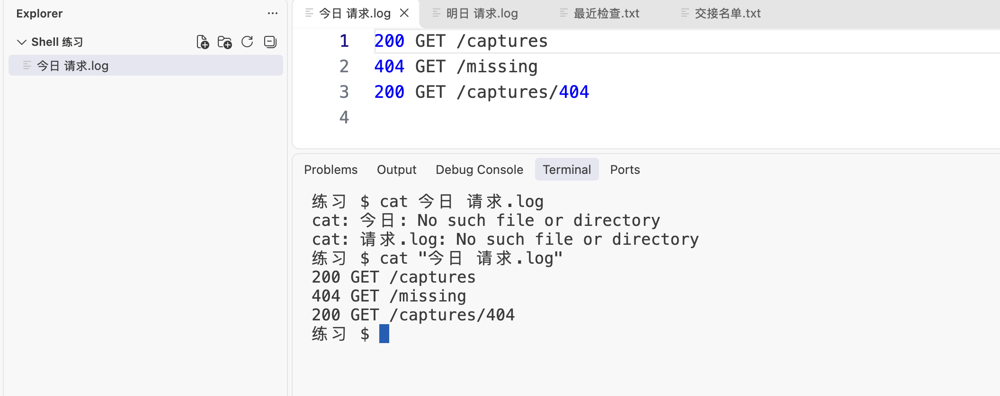
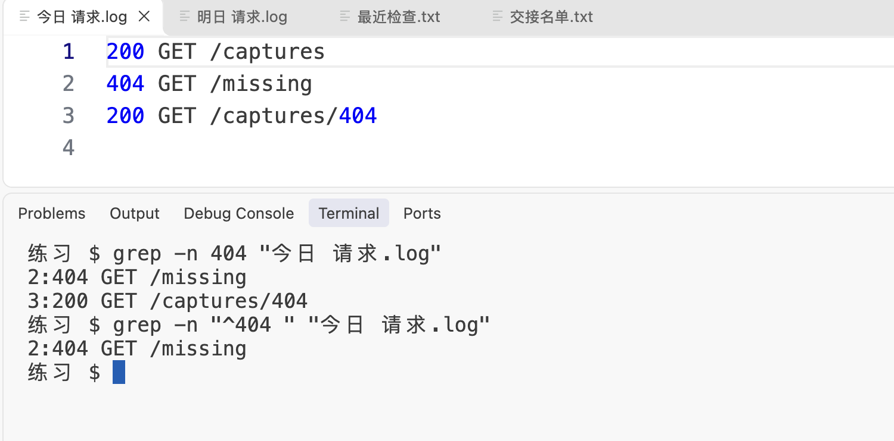
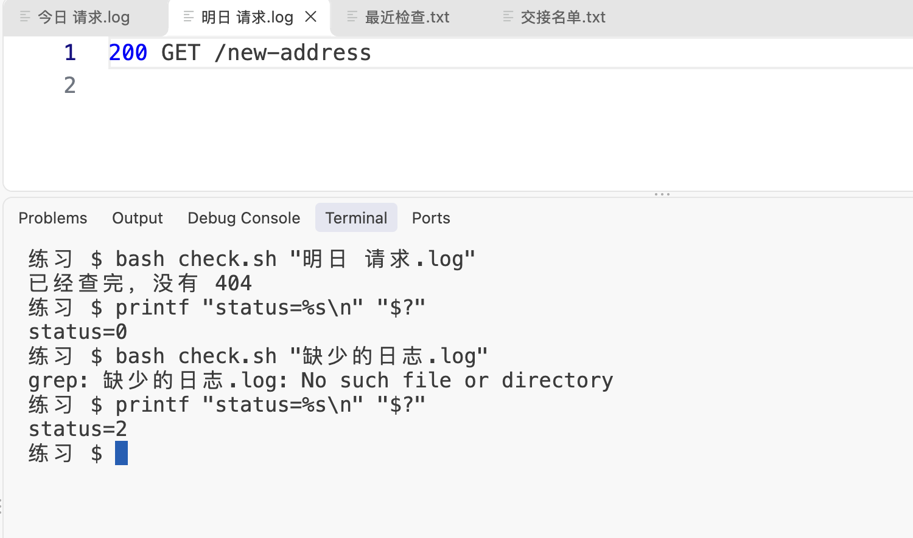
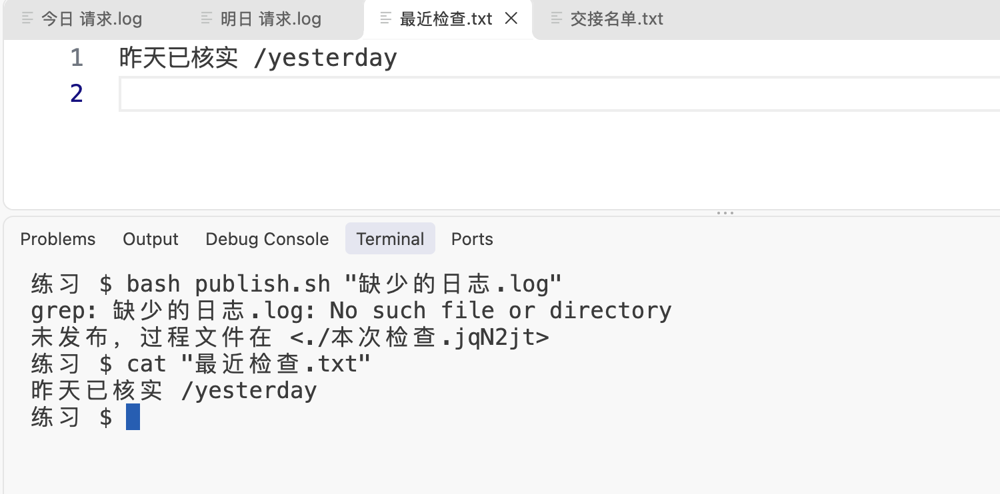
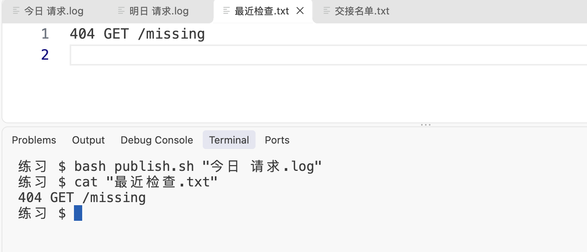
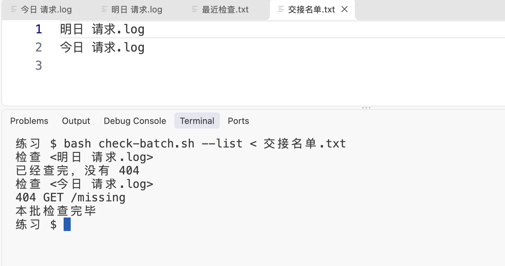

# 第 1 章 第一次读懂 Unix Shell

有人递给你一份请求日志，说：“刚才有个页面没打开，你看一下，是哪个地址？”如果你习惯打开编辑器，搜索 404，就从那里开始。先在编辑器和终端里看**同一份文件**。你已经能用第一种办法找到答案，有东西可以拿来判断第二种办法究竟在做什么。

在 Mac 的 Finder 里新建一个空文件夹，叫 `Shell 练习`。在 VS Code 选 **文件 → 打开文件夹**，打开它。在左侧新建一个文件，取名 **今日 请求.log**，中间留一个空格。写下这三行，保存。如果在 Linux 或 WSL 里做，打开那里的练习文件夹和终端即可。这一章用 Bash 或 Zsh，两者都不需要先安装 Node。

```text
200 GET /captures
404 GET /missing
200 GET /captures/404
```

在编辑器里按 Command＋F（Linux 用 Ctrl＋F），搜一下 `404`。会停在两个地方。你大概只会把第二行交给同事，因为左边是状态码，最后一行的 404 只是地址的一部分。先把这份文件留在屏幕上。

可以分几晚来做，阅读约 83～110 分钟，跟做另需约 125～170 分钟。第一次打开终端，先做到两边都能读出今日文件，就可以收手。下次按自己留在文件树里的成果接着走：

- 整理出交班副本、能挑中两份早班日志后，进 [1.2 从文件内容里找记录](#12-我只想看到出错的那一行)。
- 留下两份内容不同的日志和能换文件的 check.sh 后，进 [1.4 处理缺件、空报告和失败后的交接](#14-屏幕上一行都没有是好消息吗)。
- 能从名单逐份检查后，可以放下这套脚本，在 [1.6](#16-同一份检查为什么换个窗口就找不到样本了)、[1.7](#17-光标还没回来怎样从另一个窗口看这次工作) 换一对窗口，观察程序从哪里取得配置、怎样启动和退出。最后在 [1.8](#18-给明天的页面演示留一份检查结果) 用一份新的交接要求检验自己的办法。

## 1.1 同一个文件，为什么拖进去能打开，敲名字却不行

在 VS Code 选 **终端 → 新建终端**。下方出现一块可以打字的区域。等光标停住，输入下面这一行，按回车。只输入框里的内容。

```bash
ls
```

往上看编辑器左边的文件树，再看光标上方刚多出来的一行。两处应该都有 `今日 请求.log`。如果两边完全对不上，输入 `pwd`。它会显示终端当前所在的目录，你可以把这条路径粘进 Finder 的“前往文件夹”，看它究竟打开了哪里。要把终端带回练习目录，输入 `cd` 和一个空格，从 Finder 拖入**练习文件夹**，回车，再看一次 `ls`。以后换项目时也可以这样核对。

现在在终端里打 `cat` 和一个空格，把刚才的**日志文件**从 Finder 拖到光标处（Linux 也可从支持拖入路径的文件管理器操作），回车。屏幕应该多出那三条请求。没有拖放功能，可以直接输入 `cat "今日 请求.log"`。上面的编辑器仍然开着，文件内容没有变化。

既然终端就在这个文件夹里，试着自己照着文件名敲一遍：

```bash
cat 今日 请求.log
```

这次别急着重新复制。看看错误里有几个名字。通常一行提到“今日”，另一行提到“请求.log”。切回编辑器，那三条请求还在。刚才的操作究竟是读不到文件，还是根本没去读那个名字？

按 ↑ 找回刚才自己敲的那一行。路径保持原样，只在文件名两端各加一个英文双引号，再回车。现在三行都出来了。你可以顺手试试 `cat "并不存在.log"`：这回也报错，却只有**一个**名字。两个样本给了我们一个判断办法。错误里若出现的是文件名的一半，先看这行字被拆成了几份；错误里若出现的是完整名字，再去看目录和拼写。



先对照左边的一个文件名和下方两条诊断的名字。第二次输入加上引号后，终端读出的三行可以逐行和上方编辑器核对。

这时给刚才发生的事取名字就容易些了。你打字的窗口叫**终端**；接到这行字、把它拆开、再启动 `cat` 的程序叫 **Shell**。它把第一个词当命令名，把后面的词作为**参数**交给命令。不加引号时，空格把两个词分开；加上引号，`cat` 就只收到一个完整名字。拖入路径时，终端往往替你在空格前加了反斜线，也能让这个空格进入文件名。下回看到一长串路径里的引号，你已经知道它保护的是哪一段文字。

### 两个窗口各自打开了哪份交接单

日志先留在原地。假设自己值早班，得给晚班留下请求样本，交班前还想留一份自己能继续改的草稿。在 Finder 里打开刚才那个“Shell 练习”，新建子文件夹“交班练习”。下面所有交接单和样本都放在这个子文件夹里。若你曾经做过这段，在 Finder 里先把旧的“交班练习”改成一个空闲的名字，留给自己对照，再建一个空的。从 VS Code 左边展开新文件夹，在里面新建“交接单.txt”，第一行写“早班，样本待整理”并保存。文件树上看得到它，右侧也开着正文。让编辑器保持原样，回到终端，只输入 `cat "交接单.txt"`。

如果你还在“Shell 练习”，这次得到的是完整文件名和找不到它的提示。先点一下编辑器里的交接单，再回下方按 ↑ 重试。还是相同的结果。把 `ls` 和文件树放在一起看，终端能列出“交班练习”，交接单位于它下面一层。保持终端原地，在名字前补上这一级，再看一次。

```bash
cat "交班练习/交接单.txt"
pwd
```

屏幕上有了早班那句话。把第二行命令给出的路径留在那儿。在终端工具栏点加号开第二个终端，用选择终端的列表来回切换。把刚才那个称作甲，新开的称作乙。先在乙输入 `pwd`；如果和甲不同，用之前拖文件夹的办法把乙也带到“Shell 练习”。在乙输入下面三行，每输一行都先看一下编辑器顶部的文件标签有没有换。

```bash
cd "交班练习"
pwd
cat "交接单.txt"
```

乙能用短名字读到了。现在让甲只执行同一条 `cat`，看看跟乙是不是同一结果。两个窗口都能在侧栏看到这份文件，差别在两次 `pwd` 的末尾。刚才在乙输入的 `cd` 改了乙寻找文件的出发点。甲沿用自己的起点，打开编辑器标签也没有改变它。碰到一个终端里能跑、换个窗口就找不到文件的情况，可以各读一次起点，再决定需不需要重新输那条命令。

趁两个起点不同，把刚才成功的两次读法配个对。甲写的 `交班练习/交接单.txt` 是从练习根目录往下一层再取文件，乙写的 `交接单.txt` 是直接在眼前这层取。这样的写法叫**相对路径**。现在在甲打出 `cat` 和空格，从 Finder 拖入交接单，回车。把这条完整命令取回，复制到乙再运行一次。看清路径的开头是否为斜线，两边都读出了什么。如果拖放工具填了相对写法，取乙的 `pwd` 输出，末尾接上 `/交接单.txt`，用一对英文双引号包起整条路径再交给两边的 `cat`。这个从系统目录树顶端一路写下来的地址叫**绝对路径**。它省去了约定各自从哪里出发；明天练习目录若改了名字，旧地址里仍写着今天的名字。

在乙停着别动，甲输入 `ls "交班练习"`，接着输入 `pwd`。能看见里面的交接单，甲的起点却还停在上一层。换成 `cd "交班练习/交接单.txt"` 试一回，用同一个地址，为什么这次会提示它不是目录？前一次想列出目录里的项目，这一次要求终端把终点当作后续操作的起点，走到最后遇见的是一份文本。现在你可以在甲原地读内部文件而无须来回走，把其余整理工作交给乙。

### 留一份草稿，送出一份副本

回到乙，用 `pwd` 认出结尾“交班练习”。把左侧文件树展开，逐行输入下面的命令。第一行后看看新目录出现在哪一层，第二行后再看原处和新目录各有什么。

```bash
mkdir "待交"
cp "交接单.txt" "待交/"
ls "待交"
```

刚才 `mkdir` 在乙所在的位置建了目录。`cp` 读左边的文件，右边写的是已有目录，便在目录里按原名放了一份。现在侧栏有两个同名文件。单击“待交”里的那份，把第一行改成“晚班，从这里取样本”并保存。假如把副本理解成另一个指向原文的入口，你会预期两边同时变。先在乙读 `cat "待交/交接单.txt"`，再在甲用上一段成功的相对路径读外层交接单，看看哪一边仍说“早班”。这就是交班时能让晚班改他们那份、自己继续写草稿的依据。终端里刚出现过的旧文字会留在屏幕上，比较时以本次回车后新增的一段为准。

晚班说，文件叫“交接单”容易和自己的交接单混淆，最好看到名字就知道哪个班送来的。打开副本确认晚班那句话还在，这次只要换个名字。先在侧栏确认“待交”里只有刚才的一个名字，在乙输入下面这行。前后两个地址的前半截一样，先预测回车以后侧栏应当有几个文本文件，再动手。

```bash
mv "待交/交接单.txt" "待交/早班交给晚班.txt"
```

展开“待交”，先按旧名字读，再按新名字读。只有新名字能读出那句“晚班，从这里取样本”。目录外仍然有原来的交接单。这里的 `mv` 把副本从旧路径移到了新路径，两处只差最后一个名字，就得到了在 Finder 里重命名的效果。若想留住旧名再做一个新名，前面的复制实验已经给了你另一项选择。两个操作都从一个名字写到另一个名字，区别可以直接在旧名处检验。

现在加一层变化。晚班希望交接单和样本合装在“晚班收件”中，里面保留“待交”这个目录名。你打算把“待交”直接改名，还是先建好收件处？在乙先执行 `mkdir "晚班收件"`，再执行 `mv "待交" "晚班收件/"`。在侧栏从上往下数，新名字和旧名字之间是什么关系？回到乙按上一段成功的路径再读交接单，会少了哪一段？先让 `ls "晚班收件"` 说出第一层，再给 `cat` 写到文件那层。你应当重新读到晚班那句话。这次 `mv` 的终点是一个已有目录，“待交”连同里面的文件一起进去了。上次改名时终点是尚未使用的文件名，因而没有把旧名嵌套到它下面。假如漏了先建收件处这一步，在 Mac 上移动目录时，即使末尾留了斜线，也可能把“待交”直接改名为“晚班收件”。回头一看，交接单就会少套一层。你可以先用侧栏看清收件处是不是已经存在，再决定要写哪条命令。

晚班再来一句“包名也换成样本吧”。留在乙的原位置，照刚才改文件名的办法，把 `晚班收件/待交` 改为同一层下尚未使用的 `晚班收件/样本`。点击改名后的目录，检查交接单有几份、正文写的是哪个班，再用 `cat "晚班收件/样本/早班交给晚班.txt"` 验一次。若误在“待交”里面先建了“样本”，侧栏会多出一层；这时先在 Finder 把目录整理成“晚班收件”下面直接有“样本”，再继续。以后两个已有目录可能已经装着同名文件，准备复制或移动前分别展开源和目的，确认目标名字空闲；只凭命令执行后没打印文字，分辨不出哪份旧内容可能被替换。

### 怎样挑出要交给晚班的两份日志

交接单就位，还缺请求样本。用 VS Code 在“交班练习”这一层新建三个文件，分别叫“早班 一.log”“早班 二.log”和“早班 说明.txt”。前两份各写一行请求，地址分别用 `/one` 和 `/two`；说明里写“只交日志”。都保存后，在乙输 `ls`，用眼睛挑出你要的两个名字。你当然可以每次把这两个名字完整写出来。但如果下次这里有十二份日志呢？先从只列名字开始，暂时不要往收件处复制。

```bash
ls *.log
ls "*.log"
```

看第一行列出了什么，再看第二行的提示提到了哪个名字。左右两次在同一目录，文件一个没动。若星号两边带引号，传到 `ls` 的就是字面上的文件名 `*.log`（一个星号、一个点、三个字母）。文件树中没有叫这个名字的文件。去掉引号，Shell 会在这一层用名字与模式相配，把匹配到的各个路径作为独立参数，交给 `ls`。可以换回熟悉的 `cat *.log`，看见两份正文各自的地址。名字里的空格并未把已选中的一份拆为两份。这里用到的星号叫**通配符**，它能替你选名字；文件中的地址再像一个日志名，也不参与这次选择。

如果只按后缀选择，乙在别的班也送来日志时会怎样？在同一层新建“午班 一.log”，写一行含 `/noon` 的请求，保存。先原样再读一次，看哪个地址混了进来。你可以把前缀也写进去。试着只给固定的“早班 ”加引号，把负责挑名字的星号留在引号外。

```bash
ls "早班 "*.log
cat "早班 "*.log
```

引号里最后那个空格也属于前缀；引号结尾和星号之间没有分隔。现在两份正好符合要求。在执行复制前，让乙用 `ls "晚班收件/样本"` 核对目标里只有刚才的交接单。把选中的两份交给同一个收件处，用 `cp "早班 "*.log "晚班收件/样本/"`。回到侧栏分别点开收到的两份，能读到不同的地址才交接。以后你在另一个名为“样本”的标签页里看见某行文字，沿标签的面包屑往上找，也能判断那是收到的版本还是仍在改的原稿。

### 昨天的一份日志去哪了

晚班交接时又问，收件处会不会漏了某份存档？在 VS Code 的“交班练习”里建子目录“昨日”，在里面新建与今天同名的“早班 一.log”，写一行带 `/yesterday` 的请求。然后在“交班练习”里新建文件“.交班备注”，写上“昨日另存”，记得保留最前面那个英文点。回到乙，找找普通 `ls` 能列出哪一个新名字。先别重建那份看不见的备注，试试 `cat ".交班备注"`。Finder 可以按 Command＋Shift＋句点切换隐藏项目显示，再切回原样。终端里换作 `ls -a` 也能看见备注，多出来的单点与双点分别指当前目录与上一层。以点开头的名字平常默认隐藏，知道确切路径就能读取。再运行一次之前的 `ls "早班 "*.log`，里面有没有昨日那份？明明加了一个新文件，为什么还是那两个名字？

仔细看这次的两个“看不见”。备注就在眼前这层，换一种列法就出来了。昨日那份有个普通可见的名字，却隔着一级目录，你可以定点去读它。若晚班只记得文件名的一部分，连隔着哪一层也不知道，手动点开每个目录容易漏。留在乙，试下面这行，比较输出开头的几段。顺序可以不同，看看哪个前缀代表当前的原稿，哪个代表收件处，哪个代表昨日。

```bash
find . -type f -name '早班 *.log'
```

你能数到五个文件路径，其中两个在当前这一层，两个经过“晚班收件”，还有一条经过“昨日”。把命令里紧跟 `find` 的单点换成 `"晚班收件"`，再数一次，应该只剩两条。这两个起点决定了沿哪棵目录树向下找。`-type f` 只留普通文件，`-name` 让它按最后一级名字挑选。这里模式两侧的引号要保留，因为负责一路走下去对名字的程序是 `find`，留给它的应该是一整个带星号的模式。现在不用挪动任何文件，自己写一条只找昨日早班日志的命令，用结果中的路径交给 `cat`，看看是否真的收到 `/yesterday`。

回到甲，在“Shell 练习”运行 `cat "今日 请求.log"`，应当仍是最开始的三条。可以用甲接着查这个请求，也可以在乙输入 `cd ..`，用 `pwd` 与甲核对，再读同一个短名字。留在“交班练习”里的稿件和副本随时能从侧栏回看。

## 1.2 我只想看到出错的那一行

回到同事的问题。编辑器搜索 404 得到两个位置，终端能把这两条原文取出来吗？把刚才的文件名留在原处，前面换成这样：

```bash
grep '404' "今日 请求.log"
```

对照编辑器，终端把两条含 404 的**整行**都打印出来了。我们能用眼睛排除最后一条，是因为知道要在行首找状态码。现在让机器也试一次，只给搜索条件加一个字符：

```bash
grep '^404' "今日 请求.log"
```

消失的是哪一行？要验证是位置起作用，可以回编辑器，把第三行的地址改成 `/404/404`，保存，用 ↑ 再运行同一条命令。地址里即便多了一个 404，也进不了结果。这里的 `^` 是 **grep** 搜索模式里表示行首的符号。外面的单引号让 Shell 把里面的字符原样交给 grep。再把条件收紧成 `'^404 '`，最后那个空格表示状态码到这里就结束了。

同事接着说：“把出错的几行放到一份文件里，我稍后再看。”你可以选中终端文字复制。也可以调回刚才的命令，在末尾给结果指定一个去处。只选练习文件夹里一个还没有用过的输出名：

```bash
grep '^404 ' "今日 请求.log" > errors.txt
```

终端安静了。看看编辑器左侧，是不是多了 errors.txt？点开它，再点回今日 请求.log。一个有一行，一个仍有三行。刚才负责筛选的命令完全相同，变化的是筛选结果去了哪里。`>` 让 Shell 把原本会显示的普通输出写到右侧文件。

这个符号值得亲手试第二次。先把上面命令的条件改成 `'^200 '`，输出仍选 **errors.txt**，然后重新打开它。旧的 404 行还在吗？这次结果说明，`>` 遇到已有文件会先清空它。因而左边读的原日志和右边写的报告需要用两个名字。若要保留已有结果，可以把 `>` 改成 `>>`；这次换回筛 404，再看新行出现在什么位置。

如果同事只要一个数，还要先产生这份中间文件吗？先试 `wc -l errors.txt`，看它数出了多少行。然后直接把筛选结果送给它：

```bash
grep '^404 ' "今日 请求.log" | wc -l
```

这次应是 1。左边仍能单独运行，右边的 `wc -l` 数它读到的换行，两条命令之间的 `|` 把结果直接送过去。这就是**管道**。当一行命令看着太长，可以在竖线处先停下，单独运行左半边，看看究竟有什么东西可交给右边。



图里用开头的三行原样日志，加 `-n` 让 grep 顺带显示原文件行号。第 3 行的 404 出现在地址里；第二次输出只留下第 2 行。你如果已经改过地址，按自己的行号和状态码核对即可。

### 终端的搜索框在哪儿

刚才是把文件名交给 grep。还有一种工作现场：同事在聊天里贴给你几行日志，暂时没有文件。先点开 VS Code 的一个新终端，先确认这里可以输入命令，再只输入下面一行，回车。

```bash
grep '^404 '
```

这回很像卡住了。先别关闭窗口，试着键入 `200 GET /first`，回车；再键入 `404 GET /second`，回车。你自己敲的文字当然都看得见，注意第二次回车后，哪一行又单独出现了一次？在**空行开头**按 Ctrl＋D，原先那个可以输命令的提示符才回来。刚才第一行回车后 Shell 已经启动了 grep；后来你敲进去的两行，是 grep 在读。没有传文件名，它便从一个约定的入口继续读，既可以接键盘，也可以接另一条命令。这个入口叫**标准输入**。空行处的 Ctrl＋D 在这里使读取者得到输入结束。要是临时不想继续筛选，Ctrl＋C 可以打断这次前台操作，两种结束方式留给程序的含义不同。

这也解释了为什么终端里会同时看见一条 200 和两条相同的 404。键入时屏幕回显的是**你输入的字**；除此以外 grep 只交出了一条匹配结果。若要看得更清楚，回到打开练习目录的那个终端，再给它同一份输入，这次由 Shell 替你从文件接入：

```bash
grep '^404 ' < "今日 请求.log"
```

屏幕上只剩匹配的那条。回看刚才敲的命令，文件名出现在小于号右边，grep 自己收到的是一个搜索条件。让记录从键盘换成文件，并没有要求它改变筛选规则。再试 `wc -l < "今日 请求.log"` 与 `wc -l "今日 请求.log"`：若三条记录行末都有换行，两次都能数出三行，但只有拿到文件名的那次会把名字一并打印出来。这个差别以后很有用，特别是你只想把数值交给另一个命令的时候。

如果眼睛在编辑器里看见三条，这里却只数出二，不妨把光标移到末行文字最后，按一次回车、保存，再数一次。编辑器可以显示一行还没有换行结尾的文字；`wc -l` 数的是文件中的换行符。若末尾已经有换行，光标会落到下一行开头，这时不用再加。在本书这些逐行交接的小文件里，记录末尾都留一个换行，编辑器和计数工具才有同一份边界可用。

### 把明细整理成同行能核对的数字

同事看了地址，又问：“有多少次是同一个地址没找到？”现在那一个样本给不出区别。用编辑器另建 **重试样本.log**，保存以下六行。先用手指分别点出出错的请求和出错的地址：一个数请求次数，一个数出现过的不同地址。等会儿每改变一次命令，都可以回来找原行。

```text
404 GET /alpha
200 GET /alpha
404 GET /beta
404 GET /alpha
200 GET /beta
404 GET /beta
```

先在终端运行 `grep '^404 ' "重试样本.log"`。应该留下四条，顺序仍然是 alpha、beta、alpha、beta。想只取地址，注意这个**练习文件**约定每条都有三个字段，字段之间恰好一个空格。把留下的四行交给下面这条管道的右半边：

```bash
grep '^404 ' "重试样本.log" | cut -d ' ' -f 3
```

不用记选项字母，可以用结果倒推含义。把 3 改成 2，每行就只剩 GET；改回 3，才拿到地址。`-d` 后面指定字段之间的分隔字符，`-f` 后面指定要留下的第几个字段。引号保护的那个单独的空格也是一个参数。往样本的一条 404 记录里，在状态码和 GET 中间多加一个空格，先用 ↑ 重跑。第三个字段现在出现了 GET。打开编辑器看，这行的业务含义没变，变化的是切字段的方法遇到了一个空字段。恢复成单空格后再继续。将来看到的是 JSON 日志时，已经有字段名和自己的解析规则，也应从它的字段取值，不能靠一个“刚好是第三段”的位置猜地址。

下一个动作很容易写得看似正确。暂时就用这四个地址做对照，把 `| uniq -c` 接在刚才的命令后。你知道有两个不同地址，显示出来的却是四条各一次。把文件中的两条出错的 alpha 移成相邻两行，重新运行，你会看见一个二出现。可见这个工具会将**相邻**的相同输入合起来。现在恢复原样，不让操作者手工改日志，把同样的工作交给命令：

```bash
grep '^404 ' "重试样本.log" | cut -d ' ' -f 3 | sort | uniq -c
```

第一次只运行到 sort，应该按名字读到 alpha、alpha、beta、beta；再接最后一段，就有两行各二次。原文件在编辑器里仍能按事情发生的顺序阅读。此时可以给同事两种不同的产物：想查单笔就给按原顺序的明细，想看哪些地址反复出错就给合计。若先按地址去重再数，又会丢掉同一地址重复失败的次数。选哪条命令，取决于交到同事手里的“一行”应该代表什么。

挑一条 200 改成 404，再给出改动前后的两份结果。只有对应地址的次数会增加；不同地址的种数仍为二。如果你能在看结果前指出哪一列变、哪一列不变，哪怕明天忘了 `uniq` 的拼法，也有办法判断搜索来的命令有没有回答错问题。遇到某个选项拿不准时，输入 `man uniq`，查找关于连续重复行的说明；看完按小写 q 回终端。这类本机手册对应本机的工具，遇到一份给 Linux 写的命令、却在 Mac 上看到“不认识这个选项”时尤其有用。

### 找第一次出错的位置，保住行号和前后文

如果同事回的是“第二次 /alpha 出错之前发生了什么”，刚做好的合计表就派不上用场了。回到那份六行原样的重试样本。先在编辑器左侧找到第二次出错的 /alpha 的行号，再尝试把出处也放进筛选结果：

```bash
grep -n '^404 ' "重试样本.log"
```

行首新加的是在**原文件**中的位置。原样的两次 /alpha 对应第 1、4 行。用 `head -n 4 "重试样本.log"` 看开头四行，再把这四行交给 `tail -n 2`，终端会显示第 3、4 行。这里读取的是上下文，你仍然看得到排在前面的那次 /beta。若先筛完 404 再取前后两行，结果里提到的“上一条”只会是上一次命中的请求，中间的正常请求可能已经被滤掉。把第 3 行的 404 暂时改成 200，就能让这两种“上一条”指向不同记录。

真实日志可能比这个窗口高得多。可以在编辑器点行号跳到那里；如果人在只有终端的机器上，试一次 `less "重试样本.log"`。进去以后输入 `/alpha`，回车，按小写 n 找下一处，再按 q 回到提示符。这个查看器让你来回看文件里的位置，离开查看器时不需要保存什么。终端里看似都是“键入一行回车”，刚才的斜线是在查看器里搜索；回到提示符再输入同样的字，就交给 Shell 解释了。以后按钮全消失、键入的命令没有按预期执行时，先看看眼前还停在哪个程序里。

最后恢复重试样本的六行。过一会儿要用一条真实存在的记录跟另一种失败做对照。今日文件可以保留改过的地址，后文都只依赖里头那条 `404 GET /missing`。

## 1.3 第二天，换一份文件还能做同一个检查吗

假设明天也要查。你已经有一条能工作的命令，可以把它像保存一段 JS 一样保存下来。在左侧新建 **check.sh**，把刚才验证过的筛选原样写进去，保存：

```bash
grep '^404 ' "今日 请求.log"
```

回终端执行 `bash check.sh`。应该还是那条 `404 GET /missing`。这里的 Bash 是一种 Shell，刚才让它读文件里的命令，做的事和你在窗口里逐行输入相同。这样一个装着命令、可供再次执行的文本文件，就是你的第一个 **Shell 脚本**。

现在在编辑器里另建 **明日 请求.log**，只写一行 `404 GET /new-address`，保存。请留意这个地址，等下能用它判断读的究竟是哪份文件。试试在运行命令后面写明天的文件名：

```bash
bash check.sh "明日 请求.log"
```

看到的仍是 `/missing`。你确实交给了脚本一个新名字，只是打开 check.sh 看，那行命令还指着“今日”。想看清两边怎么接起来，可以在脚本第一行临时加上 `printf '收到：<%s>\n' "$1"`，保存后再运行。现在上面写着“明日”，下面仍然是昨天的地址。`printf` 把收到的文字填在 `%s` 的位置，末尾的 `\n` 用来换行。`$1` 就是调用者交进来的第一个参数。

于是只需要把真正读文件的位置换掉。把 check.sh 改成下面这样。这个名字后面有空格，1.1 里试过的引号在这里同样有用。

```bash
log="$1"
grep '^404 ' "$log"
```

第一行给收到的路径取名 `log`；等号紧贴两边。第二行用 `$log` 取回这个值，双引号保住整个文件名。分别把今日和明日的文件名传给 `bash check.sh`。同一份脚本，现在应该能给出两个不同的地址。这个时刻才值得把脚本留给明天，因为你已经用两份内容不同的文件证实了它会听调用者的话。

### 命令从屏幕折成两行，参数会不会也变成两份

看看前面试过的一对名字。今日与明日都带空格，但“要找哪种错误”还写死在脚本里。有一天同事要看 503，你也可以复制一个文件、改三个数字。先考虑另一种用法：同一个工具每次接两个东西，前一个是状态码，后一个是日志文件。这样明天多查一种错误时，就不用在编辑器里另存十份脚本。先在旁边新建 **choose.sh**。第一版只负责显示它拿到了什么，暂时把读文件的那步留空。

```bash
printf '个数 <%s>\n' "$#"
printf '条件 <%s>\n' "$1"
printf '文件 <%s>\n' "$2"
```

运行 `bash choose.sh 404 "今日 请求.log"`。三个输出位置应该依次是 2、404、完整的文件名。再试不把文件名包进引号。现在第一个位置是 3，第二个位置仍是 404，第三个位置只剩“今日”。剩下那个“请求.log”也到了脚本里，只是目前没在屏幕上显示它。这次有个很直观的事实可用：名字在**调用的那一行**就拆错的话，在脚本里面给 `"$2"` 再包一层引号，也没有办法让它知道第三个参数原来该并到第二个里。圈出 shell 收到参数的那一层，往往比在各处轮流试引号快得多。

保持正确的两份参数不变，换一种排版再调用一次。反斜线是每行的最后一个字符，后面直接回车：

```bash
bash choose.sh \
  404 \
  "今日 请求.log"
```

两次的三个读数应该完全相同。以后安装说明里那些占五行的命令，也可以这样还原。行尾反斜线和紧随的换行一起被去掉，下一行继续同一条命令；这里保留的空格仍然把参数隔开。在交互终端逐行输入时，中间可能出现不同的续行提示符，表示还在等后半条。现在试一次只敲第一行，按回车后发现拿错了文件名，直接按 Ctrl＋C。看到正常提示符后重输即可。终端自动把一条长命令在屏幕边缘折行，又是另一回事：你没有插入换行，命令保存和执行时仍是同一行。

接着把真正要做的动作补在三个 printf 后面。我们需要送给 grep 的条件，在这次调用时应该是五个字符：起头符号、三个数字、结尾那个空格。先把准备交给它的字符串打印出来，再据此换成筛选：

```bash
code="$1"
file="$2"
printf '<%s>\n' "^${code} "
grep "^${code} " "$file"
```

用 404 调一次，尖括号之间应该是 `^404 `，随后是命中的那行。把条件换成 200，只改调用处，应该出现两条。再把 printf 那一行的双引号换成单引号看看：括号里会真的出现美元符和花括号。这时两个看似差不多的写法有了可观察的区别：当我们希望某些文字一字不动地交给下一方时用单引号；希望 Shell 先拿变量的值来拼文字、又保持结果为一个参数时用双引号。`${code}` 的花括号圈出变量名，与后面的字符拼在一起时仍然分得开。后面的 `"$file"` 就不需要再圈名字。

### 怎样让脚本记住刚才所在的目录

做完刚才的比较，回到只检查 404 的 check.sh。设想同事双击打开报告时，希望看到“检查于哪个目录”。路径会随每个人的电脑改变。你已经有一个能打印正确路径的命令，也有一个能把变量值放进文字的写法。试着把它们接起来，先单独在终端做，不改 check.sh：

```bash
place=pwd
printf '本次位置 <%s>\n' "$place"
place=$(pwd)
printf '本次位置 <%s>\n' "$place"
```

第一种做法只在尖括号里得到三个字母，第二种才出现那条带练习目录的路径。运行圆括号中的命令，把它的标准输出取回，称作**命令替换**。它去掉输出末尾的换行，所以后面的尖括号仍紧接着路径。请留意屏幕上没有先多出一行 pwd 的结果再出现报告，输出在这里有了另一位接收者。如果内层报告错误，标准错误仍会去原来的地方；不能凭“变量里有几个字”就认定命令成功。1.4 会专门用读取失败来检查这一点。

给这个试验换个条件。在练习目录里进入任一子目录，再查看 `"$place"` 和新执行的 `pwd`：前者保留先前取得的文字，不会因为你挪了目录就自己跟着变。用 `cd "$place"` 回到原练习目录，核对这里还能列出 check.sh 和今日文件。这种用法在后文很常见，例如在离开项目根目录前记住其绝对位置。若只保存一个相对名字，换目录后再把这个名字交给程序，仍然要按当时的工作目录重新找。知道变量保存的到底是值还是一个随时重新执行的动作，可以省掉不少“为什么在我的机器上读到了别处”的猜测。

如果刚才用单引号试过 `'$place'`，那串字会原样交给 cd，于是会尝试寻找一个名字包含美元符的目录。用 ↑ 改回双引号便可。一条命令里的字母、美元符、引号和程序名并非全都归同一方解释。你可以把最有疑问的一小段先交给 printf 并用尖括号包住，看 Shell 完成替换以后，下一个程序究竟收到什么。这也是在真实配置里遇到长命令时，可以自己动手做的一种阅读方法。

### 为什么能用 Bash 读，却不能直接启动这个文件

本章一直运行 `bash check.sh`。有些项目说明却写成 `./check.sh`。在现在这个刚用编辑器建的普通文件上，两种入口有什么实际差别？保留 check.sh，单独在练习根目录新建 **hello-shell.sh**，保存以下两行。第一行的两个符号要放在文件开头：

```bash
#!/bin/bash
printf '练习脚本启动了\n'
```

先执行 `bash hello-shell.sh`。再看 `ls -l hello-shell.sh` 的第一列，从常见的 `-rw-r--r--` 里，可以看到几处 r 和 w，还没有 x。若自己编辑器生成的文件已经有 x，先对这个小样本执行 `chmod u-x hello-shell.sh`，再比。现在用 `./hello-shell.sh`，普通 Mac 或 Linux 本地文件系统会报告权限不足。两次给的是同一个文件，内容也能被 Bash 读出；此时再去修改 printf 里的文字，显然解释不了差别。

只对这个练习文件执行 `chmod u+x hello-shell.sh`，再用 ls 看同一列，文件属主对应的那组三个位置多出了 x。再次运行 `./hello-shell.sh`，现在应看见启动提示。前一种写法请求运行的是 Bash，由 Bash 读取脚本文字；后一种写法请求系统直接运行当前目录下的文件，因此需要相应的执行权限，文件首行告诉系统本例交给哪个解释器。对一个可读文件而言，读取它和请求把它作为程序启动是两种不同的操作。这里显式使用 `./` 指向当前目录，后面的环境实验会用同名工具解释省去这一段以后 Shell 如何查找程序。

从 Finder 的“显示简介 → 共享与权限”可以看见这个文件的持有者，以及谁可以读写；需要精确核对执行位时，用刚才的 ls 输出最直观。从左边类型标记之后起，每三个位置依次属于属主、所属组、其他人；一个短横表示那个位置未授予对应权限。回到 hello-shell.sh 试着只去掉刚加的执行位，两种启动方式又回到了第一次的区别。这个小样本留在这里，后面出现一个“权限不足”的工具时，你可以先问清当前账号、具体路径、请求的是读还是执行，再决定该看哪一组位。共享挂载或某些 WSL 宿主盘上的权限行为也受挂载设置影响，遇到 chmod 后执行仍被拒绝，先在 Linux 自己的主目录重做同一对照，才有理由去改脚本本身。

## 1.4 屏幕上一行都没有，是好消息吗

把明日文件里唯一的状态码改成 200，保存。再用它运行脚本。这次终端什么都没打印。如果同事只收到一份空报告，他怎么知道是“一切正常”，还是“这次压根没读到日志”？

先不要改脚本。用下面两组输入在手里留下证据。每组第二行都紧接着第一行执行：

```bash
bash check.sh "明日 请求.log"
printf '%s\n' "$?"
bash check.sh "缺少的日志.log"
printf '%s\n' "$?"
```

第一次没有命中，数字是 1。第二次找不到文件，你会看见文件名和错误说明，数字大于 1。再用今日文件查一次，会打印那条 404，紧接着读到的数字是 0。这个数字叫**退出状态**。`$?` 能取到上一条命令的状态，刚才 check.sh 最后一条命令正是 grep。要是先跑了一次 `ls` 再看，拿到的就是 ls 的结果。多数命令用 0 表示成功，碰到非零还要看具体程序如何约定；今天亲手测出来的三种含义属于 grep。

此时再决定脚本该怎么写。同事只提出一个要求：“日志确实查过、又没有 404 时，请明确写一句。”沿用现在的 check.sh，在 grep **下面**添上这些行：

```bash
result=$?
if [ "$result" -eq 1 ]; then
  printf '已经查完，没有 404\n'
  exit 0
fi
exit "$result"
```

顺着你刚看到的三种结果往下读。第一行在做别的事情前先把数字收好。`[ "$result" -eq 1 ]` 问的是“这个整数等于 1 吗”，方括号内两边的空格要保留。成立就走进 `then` 下面，给同事一句说明，然后用 `exit 0` 告诉调用者检查已经完成。`fi` 是这段条件语句的结尾。如果没走进去，就把原状态交还给调用者。找不到文件时，grep 原来的错误说明也仍会出现在终端。

再试今日、明日和缺件三份名字。此刻脚本和 grep 的退出状态有一个有意的差别：查过明日文件后，grep 给出 1，而脚本给出 0。你可以据此读懂下一章会遇到的另一种写法。运行下面这一行，再把“明日 请求.log”换成“缺少的日志.log”：

```bash
bash check.sh "明日 请求.log" && printf '报告可以交给同事了\n'
```

只有前一条成功，`&&` 右边那句才会出现。如果你自己来决定什么时候可以交出报告，现在有了比“屏幕上有几个字”更可靠的依据。



上方是确实存在的明日文件。下方两次都没有输出一条 404 记录，但只有第一次打印“已经查完”；第二次的诊断指向一个明确的缺件。

### 接受一个筛选条件，该接哪些值

再打开 1.3 的 choose.sh。之前我们专心核对传入的路径，这次换状态码。

如果同事给的是任意字符串，样例里的 grep 会把其中一些字符当成搜索模式。现在让**这个小工具**只接受三个十进制数字，先从最容易跑错的一次试起：运行 `bash choose.sh 4.4 "今日 请求.log"`。今日文件真的写了“4.4”吗？仍能匹配，是因为搜索模式里的点可以匹配一个字符。规定“输入三位数字”的约束要放在自己接参数的入口。单靠调整双引号，控制不了另一个程序理解字符串的方式。

为了看清规则，先在终端保留最早三个 printf 的输出供回查，再把 choose.sh 的完整内容换成下面这个版本。有两道选择：先决定这次调用给齐了没有，再决定第一个参数能否用作这里约定的状态码。

```bash
if [ "$#" -ne 2 ]; then
  printf '用法：bash choose.sh 三位状态码 日志文件\n' >&2
  exit 2
fi
case "$1" in
  [0-9][0-9][0-9]) code="$1" ;;
  *) printf '状态码需要三位数字\n' >&2; exit 2 ;;
esac
grep "^$code " "$2"
```

如果第一次碰到这个外形，先只用 404 和 4.4 各跑一遍，看哪一次真的打开了日志。再试只给一个参数，或在正确命令末尾多给一个词。数字的形式和参数的数量，是两个不同的问题；最前面的 `-ne` 检查两个整数不相等，在数量不对时用 `exit` 提前返回。`>&2` 让提示写到给操作者的错误通道，稍后把结果和诊断分别交给两个文件，就能比较这个选择的后果。现在你只需比较三个分支各给出了怎样的回应。

`case` 让 Shell 拿一个值从上往下跟几种**外形**对照。三个 `[0-9]` 各占一位，全都符合才走第一路。`;;` 表示这一组动作结束，`*)` 接住此前条件都没匹配的输入，`esac` 结束整个选择。可以再试 44、0404 和 000。最后那个能通过外形检查，却未必是业务系统允许的 HTTP 状态。这里构造的是一个按三位数字筛演示日志的小工具；要限定为常用 HTTP 状态码，还需要按报告约定缩小范围。保留这些样本的好处，是日后有人要求“只允许 4xx 或 5xx”时，你知道应该修改哪一个判断，能拿什么输入证明限制真的生效。

### 命令能读通，为什么仍然取错了参数

在编辑器里复制 choose.sh 为 **trace-choice.sh**。先删掉副本中结束条件的那一行 `fi`，保存，运行 `bash -n trace-choice.sh`。终端会指出语法有问题；指向的位置可能已经到了文件末尾，因为 Bash 一直在等某段语句结束。把它补好，再运行同一条命令。终端安静了，那份今日文件有没有真的被检查？只要把日志名留空也做一次语法检查，就能发现它只检查命令的结构，没有执行检查日志的工作。

现在在副本里保留正确的语法，只把最后一行取文件名的 `"$2"` 错写成 `"$1"`。语法检查依然会通过；正常调用却会抱怨没有叫 404 的文件。在这个只装合成日志的练习目录执行 `bash -x trace-choice.sh 404 "今日 请求.log"`，找到靠近末尾实际交给 grep 的那一行。那里出现了两个跟 404 有关的词，却没有今日文件。调试输出把完成变量替换后即将执行的命令显示出来，让你能把脚本文字里的位置和这次真正拿到的值对上。现在只修最后那个位置，再跟一次，读回的原文应与编辑器里的今日文件相同。实际运维中若参数含密码或令牌，这条跟踪也可能把展开后的值写进日志；排查参数位置，用这里的假值就能复现，不必把真实凭据带进跟踪。

### 同一份空报告，左边失败，右边却能成功

刚才一直让脚本打印结论。现在沿用同事上次的要求，他想要一个**行数**。先在开着练习根目录的终端运行这个看似很自然的组合：

```bash
grep '^404 ' "缺少的日志.log" | wc -l
printf '整条命令返回 %s\n' "$?"
```

终端里会同时出现缺文件的诊断、一个零和管道的退出状态。如果正在用默认设置的 Bash 或 Zsh，状态通常也是零。若你的配置已经让这一组返回非零，可以用下方显式指定的 Bash 命令做两轮。先在纸上把“零”写成两列：一列说右边收到了几行，一列说这次检查可不可以交付。前一列确实是零，后一列却缺少输入。这两件事用同一个数字显示，很容易看串。

要知道哪个程序在说什么，可以在根目录用两个新名字把证据分开。先确认没有需要保留的同名文件，再运行：

```bash
grep '^404 ' "缺少的日志.log" > hits.txt 2> reason.txt
printf '筛选返回 %s\n' "$?"
```

点开 hits.txt，里面没有记录；再点开 reason.txt，那个找不到的文件名在这里。把命令里的名字换成只有 200 的明日文件重跑。hits 仍为空，但这回 reason 也空，状态成了 1。换成今日文件再运行，会看到普通结果确实进了 hits。对同一个命令，Shell 给普通结果和诊断安排了两条去路。两者都接屏幕时文字混在一起，很难看出归属；把两份接到不同文件，你就能像在调试器里分开看两个值一样，独立判断。标准输出的编号是 1，标准错误的编号是 2，刚才的 `2>` 与数字紧贴，中间没有空格。夹进空格，数字就可能成了传给 grep 的另一个文件名。

同事如果想在一个窗口里同时看结果和诊断，会看到另一种写法。先用新的练习文件名，在终端试 `grep '^404 ' "缺少的日志.log" > both.txt 2>&1`。打开 both.txt，里面有报错。把两段顺序调换，试 `grep '^404 ' "缺少的日志.log" 2>&1 > only-output.txt`，这次报错回到了终端，only-output.txt 是空的。文件名是另一份新的练习文件，两轮的输入完全一样。Shell 从左往右连接这些去处：第一轮先让普通输出去文件，再让错误输出也指向**那一刻**普通输出所指的地方；第二轮复制去处时，普通输出还连着终端。以后想留下整次诊断记录时，就能判断那个看起来紧凑的 `2>&1` 应该写在哪里。要把正常结果另交程序解析时，仍应保留两条独立通道。

再读回那条管道。左右两个命令都各有自己的退出状态，普通管道把最后一段的状态交给外层 Shell。下面两次明确让 Bash 去运行引号里那串命令，省去各人终端初始设置的差异：

```bash
bash -c 'set +o pipefail; grep "^404 " "缺少的日志.log" | wc -l'
printf '默认管道 %s\n' "$?"
bash -c 'set -o pipefail; grep "^404 " "缺少的日志.log" | wc -l'
printf '带 pipefail 的管道 %s\n' "$?"
```

两次 wc 都尽责地打印了零。改变的仅仅是外面收到的状态。打开 pipefail 后，如果各段都成功，整条管道才返回零；若有非零状态，会采用管道中最靠右的那个非零值。再把缺少的名字换成明日文件。筛选到零行原本正是一次完成的检查，启用这个选项也会带回 1。所以保持好脚本刚才对“没有匹配”的解释很重要：只改一个通用开关，无法替你决定今天的业务到底怎样算完成。后面有的脚本在开头用 `set -e` 要求某些命令失败便退出。普通的 grep 空结果也能成为它提前退出的原因；而作为 `if` 条件的命令本来就要让脚本判断两条路。遇到这种缩写，先拿一个应当能交付的空样本去测，再决定它是否符合你的脚本约定。

### 为什么失败以后，昨天的好报告也空了

假设文件 **最近检查.txt** 由同事每天早上打开，里面应该是最近一次**成功完成**的结果。先让它的内容足够好认，再安排一次注定失败的输入。以下同名文件都在自己的练习目录里：

```bash
printf '%s\n' '昨天已核实 /yesterday' > "最近检查.txt"
bash check.sh "缺少的日志.log" > "最近检查.txt"
```

失败诊断仍会显示。先别修路径，直接在编辑器重新打开最近检查.txt。昨天那句也没了。回忆整个过程：要让 check.sh 一开工就能写结果，谁必须在这之前把输出文件接好？把右侧改成一个尚不存在的练习文件名再试一遍，你会发现，即使里面没写出任何结果，那个新文件也已经出现了。打开目标、对旧内容截短，都发生在程序获得写入机会之前。在脚本最后加一段“如果失败，就不要保存”已经来不及改变这个外部动作。

可以从同事的阅读方式倒推改法。对方只从“最近检查.txt”这个固定名字读报告，我们便另找一个名字承接本次尚未完成的写入，只在确认成功后才把它换到固定名字。先重新写回昨天那条已核实的文字。在根目录建一个 **publish.sh**，先从下面这版开始。它约定脚本、日志和报告都在当前练习目录；本节只有一位操作者，一次运行完再运行下一次。

```bash
if [ "$#" -ne 1 ]; then
  printf '用法：bash publish.sh 日志文件\n' >&2
  exit 2
fi
draft=$(mktemp "./本次检查.XXXXXX") || exit 1
if bash check.sh "$1" > "$draft"; then
  mv "$draft" "./最近检查.txt" || exit 1
else
  result=$?
  printf '未发布，过程文件在 <%s>\n' "$draft" >&2
  exit "$result"
fi
```

先让 publish.sh 读那个缺少的文件，再读今日文件。第一轮之后固定名字里仍能读到昨天的原句；失败诊断会指出一个新的过程文件。第二轮之后固定名字里能读到真正的 `404 GET /missing`。这两次一定要分别打开**固定名字**读回。若只核对“脚本没报错”或在 Finder 里看到“好几个文件都存在”，两种方案很难分出高下。



失败后，过程文件名每次可能不同。接手人关心的是固定名字：图中打开的最近检查.txt 和终端再次读取的都是昨天那一行。

看看脚本里哪些写法是由刚才的损失逼出来的。`mktemp` 按给定样式建立一个实际的新文件，把选出的名字打印出来；命令替换把这个名字留在 draft 中。`./` 让它和最终报告在同一目录，不同运行会拿到不同的过程文件。后面两次使用名字都加引号。符号 `||` 让左边返回非零时才执行右边，连临时文件都没建好就不应继续。随后 `if` 直接运行真正做检查的命令，凭它报告的状态决定是否把新文件改名。写入在另一个名字上发生，同一文件系统内这次改名替换让**随后新打开**固定名字的读者看到完整的新文件。编辑器若保留已经打开的旧内容，可以关闭标签再重开。过程残件是这次演练特意留下的现场，可以从 Finder 移走自己刚刚观察的那一份。



用完整的今日样本再跑，固定名字仍叫最近检查.txt，这次打开才出现 /missing。两张图放在一起，可以查出报告究竟在哪一轮被替换。

换一个不直观的变式：读明日的全 200 文件。如果固定的报告仍然只给出昨天的 404，就会让接手人以为故障还在。我们写过的 check.sh 对“查完但没有 404”会给一句说明并返回零，所以这次新的健康结果也会替换旧文件。将“没有错误”粗略地一律当成筛选失败，或者把“有数字打印出来”一律当成成功，都过不了这三个输入。此处我们核验的是单次、单人检查的发布时机。若两个人同时交两份各自正确但属于不同日期的报告，两个过程文件能分开写，最后哪份应该成为“最近”却需要另订次序；一个改名动作没有日期方面的知识。

假如一时记不清 `if` 的标点，先在编辑器旁边写下自己在 Finder 会亲手做的三步：先导出一个新副本，打开核对，合格才替换交付件。再回脚本找出分别承载三步的哪一行。这样学会的条件执行，到后面做数据库导出或打包时还能沿用；只是“核对合格”的要求会提高到能重新读取结构、身份与实际数据。

先用编辑器复制一份 check.sh，在副本上做一次交接，保留原脚本供下一节继续使用。同事明天要找 **503**。你会先改哪儿，又会往哪份样本里写什么，让自己相信找对了？可以同时放进 `503 GET /retry` 和 `200 GET /503`。脚本交付的结果应当只有前者。在编辑器搜索一下副本里的“404”，看看除了筛选条件，还有哪句给人看的说明需要跟着改。

## 1.5 两天都查过了，凭什么说整批完成

同事把周一、周二两份日志交给你，请你按这个次序查，哪天有出错的请求就列出原行，没有也跟他说一声。上节最后试过改查 503，这份交接仍按原来的 404 查。回到 VS Code 打开的练习文件夹，打开原来的 `check.sh`，确认筛选条件和无匹配时的说明都使用 404，保留 1.4 末尾处理退出状态的几行。用左侧文件树分别新建下面两份日志，和 `check.sh` 放在同一层。周一的文件名是 **周一 请求.log**，保存这两行。

```text
404 GET /first-day
200 GET /archive/404
```

周二的文件名是 **周二 请求.log**，先只有这行。

```text
200 GET /second-day
```

从现在起，所有调用都在这个练习文件夹的终端运行。若之前打开了别的文件夹，先用 `pwd` 与编辑器核对。在脚本里写 `bash check.sh`，Bash 会从调用时的工作目录寻找这个文件；这一节交给同事的日志名也都相对于这里。现在手里只有两个名字，先按你已有的办法各查一次。第一条命令后面即使再放一个文件名，原脚本读的也是第一个参数，不能靠它完成第二次检查。

```bash
bash check.sh "周一 请求.log"
bash check.sh "周二 请求.log"
```

把屏幕上的结果想成桌上的两张纸。写着 `/first-day` 的那张，还有地址可供追查；只有“没有 404”的那张，一旦换了位置，你就很难说清它属于周几。先在编辑器新建 **check-batch.sh**。这次从两次已成功的调用往回想，哪部分每次都要做，哪部分每次换一个值？可以先把两份名字直接写在新文件里，保留前面已经用过的显示方法。把下面这段保存到新文件。

```bash
for log in "周一 请求.log" "周二 请求.log"; do
  printf '检查 <%s>\n' "$log"
  bash check.sh "$log"
done
```

运行 `bash check-batch.sh`，在屏幕上把每个尖括号里的名字与紧跟在下面的结果配起来。现在只交换第一行的两个名字，别改下面的检查，再运行。终端最上面现在是“周二”和没有命中，再往下才看见周一的地址。第一行的 `for` 每次把一个已经分好的值赋给 `log`，从 `do` 到 `done` 之间的命令随这个值运行一遍。你在这段里面两次读 `"$log"`，同一次循环里读到的是同一个名字。调换次序能安静地改变结果，说明报告次序取决于你列名字的次序，文件在 Finder 里如何排列与此无关。

### 把文件的选择交还给发起检查的人

如果下周只查周二，按目前的写法还得请同事进编辑器删一个名字。上节已经能把一个文件名作为参数传进来，这里先只改 `for` 那一行，把 `in` 后面的两个固定名字换成 `"$1" "$2"`，分号及后面的文字保留。带两个名字运行仍正常。现在只传周二，注意“没有 404”下面有没有又出现一对空尖括号。去文件树里找不到这样一个文件；是脚本自己写了两个带引号的位置，第二个位置没收到内容，仍然给这轮检查提供了一个空字符串。反过来，给它三个名字，第三个即使真是个文件也轮不到。如果是你写 JS，大概已经想遍历调用者传来的整组值了。

先把新脚本的第一行改成 `for log in "$@"; do`，下面三行保持原样。用下面三种方式运行。最后一次故意把周一交两遍，观察有没有少查一遍、多一次空名字，或者把两个文件拼成一长串。

```bash
bash check-batch.sh "周二 请求.log"
bash check-batch.sh "周二 请求.log" "周一 请求.log"
bash check-batch.sh "周一 请求.log" "周二 请求.log" "周一 请求.log"
```

`"$@"` 在这里展开为调用者提供的各个参数。外面是一对引号，交进来的两个参数仍然保留两个边界；参数中间的空格则留在各自的名字里。可以只在其中一次试验中去掉调用命令里“周二 请求.log”的引号，先看尖括号，再把这对引号加回去。只改调用处就能让脚本收到“周二”和“请求.log”两项，脚本内部再认真保护每项，也猜不出这两项原本应该连在一起。反过来，调用处保护好了，脚本里也需要保留 `"$@"` 和 `"$log"` 的引号，免得 Bash 在后续展开时又拆开它们。到这里可以停一下，把只查一天和两天倒序的命令都留在终端历史里；后面的失败实验还会用到它们。

### 中间缺一天，谁还会说“完成”

在循环的 `done` 下面加一行 `printf '本批检查完毕\n'`。同事按日期给了你三项，其中第二项的文件还没送到。先别建缺的文件，原样运行，再读退出状态。

```bash
bash check-batch.sh "周一 请求.log" "尚未送到.log" "周二 请求.log"
printf '批次状态 %s\n' "$?"
```

周一有一行命中，第二项报错，周二仍然查完了，末尾写着“本批检查完毕”，状态还是零。试着定位这个零属于谁。单独把中间那项交给 `check.sh`，紧接着查看 `$?`，你会拿到非零，说明上一节已经把读取错误送回来了。批量脚本收到这个数之后继续进入下一轮，最后成功打印了末尾那句话，调用者就只看到末条命令的成功。把缺件换到最后再试一次也能暴露同一个问题。光凭错误出现在屏幕上的位置，不能推断是谁决定整批是否完成。

这次约定遇到第一项查不下去就停，哪一项缺了，同事可以补上再重跑，已经打印的周一只代表它自己。回到循环里，给 `bash check.sh "$log"` 的结尾接上 ` || exit "$?"`。再跑刚才的三项。周一仍有结果，记录第二个名字后出现诊断，周二的标题和完成句都消失了，再读批次状态，应与单独检查这个缺件相同。`||` 在左侧命令返回非零时才执行右侧，右侧的 `$?` 这时恰好还是那次检查的状态。你可以把周二移到开头再跑，“没有 404”会通过这一关，随后才走到缺件；之所以能继续，靠的是 1.4 已经给这种情况返回零。这样，同事只要在命令后接 `&&`，就能把决定是否使用报告交给实际检查结果。

还有一次不出错却不该交付的调用。把所有参数都去掉，只运行 `bash check-batch.sh`。一个标题也没出现，末行却照旧。这里要在进入循环前区分“检查了一个没有命中的文件”和“根本没人指明文件”。先在新脚本顶部添上下面几行，零个参数时给出一条可照着运行的用法。再分别以零个参数、一个周二文件名调用。

```bash
if [ "$#" -eq 0 ]; then
  printf '用法：bash check-batch.sh 日志路径...\n' >&2
  exit 2
fi
```

`$#` 给出实际参数个数，那个带空格的文件名只算一个。这里的 2 是我们替用法错误选的非零状态，单凭数字不能区分这次失败和缺文件；同事还可以看诊断是哪句话。末尾的 `>&2` 把这句使用说明送到标准错误。试着给不带参数的调用加上 `> batch-preview.txt`（只用新的练习输出名），说明仍在终端，打开预览文件则是空的。若有一个正确的文件名，同一个重定向会在文件里留下标题、结果和完成句。中途遇到缺件，预览里也可能已经有前几行；交给下一个人的依据仍是整次调用的状态。至此，同事偶尔交几天日志的情形已经够用，可以把这版保存下来。

### 名单从编辑器送来，该读名字还是读日志

又过几天，同事发来的已经是一份文本附件，每行一个文件名，次序经过人工确认。把它贴到命令行再逐一补引号，既多做了一遍工作，也可能改掉原来的分组。在编辑器新建 **交接名单.txt**，第一行写 `周二 请求.log`，第二行写 `周一 请求.log`。在第二行末尾再按一次回车，然后保存。文件里的名字两侧都不加引号，每行就是一个完整路径。先运行 `bash check.sh "交接名单.txt"` 看看。如果它说没有 404，打开附件，把里面实际查过的两行指给自己看。脚本当然能成功读到这两行，可它检查的是名单的正文。我们需要的多一步动作，是从这两行各取得一个名字，随后才去打开那个名字指向的日志。

先在编辑器建个临时的 **看名单.sh**，把打开日志的步骤留空，只保留一个能观察每行内容的窗口。保存后在终端运行 `bash 看名单.sh < "交接名单.txt"`。

```bash
while IFS= read -r log; do
  printf '<%s>\n' "$log"
done
```

`<` 让终端这边的 Shell 打开名单，把它接到脚本的标准输入。每次 `read` 取下一行，把终止该行的换行留在值外，将这一行的文字存到 `log`。它成功取完一行就进入 `do`，回到 `while` 又会取下一行。同样是两个标题，现在它们来自文件内容，脚本的参数个数却是零，因为重定向的符号和路径都由启动它的 Shell 处理。若用这条思路直接修改原脚本，前面写的零参数检查会挡住它。先决定一个清楚的入口，例如要求同事用 `--list` 表示接下来应从标准输入读名单，这样漏输参数仍然能得到提示。

在写入口之前，先对这三行试验一下。可以在名单末尾临时加一行，两端各留一个普通空格，中间写 `组\一.log`，保存为有末行换行的文本。只看尖括号里的内容，不用新建对应日志。尝试先把 `IFS=` 去掉，再恢复，随后单独去掉 `-r`，分别看看空格和反斜线。默认的字段分隔会去掉行首尾的空白，`IFS=` 给这一次读取临时设定空的字段分隔符；`-r` 则叫 `read` 保留文字里的反斜线。名单里的字符在这里已经是文件内容，和开头从 Finder 拖入路径时，发给 Shell 解析的那行命令属于不同的输入。把脚本和名单都恢复到刚才的两项，再换一个只能从文件结尾发现的条件。

```bash
printf '%s\n%s' '周二 请求.log' '周一 请求.log' > 末行名单.txt
bash 看名单.sh < 末行名单.txt
```

这个新练习文件只有中间一个换行，编辑器里看得见两条路径，屏幕上却少了末项。为了分清是字符没读到，还是取到了字符却没进循环，可以先在 `done` 后添 `printf '停下时剩下 <%s>\n' "$log"`。再次运行时周一出现在这句话里。原来 `read` 碰到文件结尾时已经把周一的文字放进变量，只因缺少结束这行的换行，返回了非零。把那句临时显示删掉，将循环条件换成 `while IFS= read -r log || [ -n "$log" ]; do`。在普通的完整行上左侧已经成功，到结尾时，如果还取到了非空文字，右侧再让它处理最后这一项；下次两边都不成立才结束。用有无末行换行的两份名单比一次，两个尖括号现在应逐字相同、次序也一致。

### 让两种入口共用同一次检查

两边现在都有了产生一个名字的办法。先在原批量脚本里找出“名字已经确定，接下来查这一份”对应的两行。把显示标题、启动单份脚本这两行移进下面的 `run_one`，把失败时退出批次的决定留在每个调用处。函数体里的 `"$1"` 指这次交给函数的第一个参数，即使整个批次有十个参数，这里也只会读到传给它的那一个。函数运行到右花括号时，最后一条命令的状态会回到调用处。若随手在函数末尾再加一条总会成功的打印，前面已经亲手发现过的错误就会回来。

按下面的次序整理成最终的 **check-batch.sh**。顶部的 `usage` 收拢两处都需要的用法提示。名单里允许同事为了易读而留空行，整行长度为零才跳过；只含空格的一行仍会被当作一个路径，误写时就能看到缺哪个名字。`continue` 会回到循环条件去取下一项。用 `seen` 记有没有一份真的通过检查，这样空附件也能跟“每一份都查完”区分开。普通文本名单约定每个路径占一行，文件名本身含换行时这份格式无法表达，可用第一种入口逐项传入。两种入口遇到以短横开头的文件名，都可以把路径写成 `./-周一.log`，让单份检查中的 grep 按路径读它。

```bash
usage() {
  printf '用法：bash check-batch.sh 日志路径...\n或：bash check-batch.sh --list < 名单文件\n' >&2
  exit 2
}

run_one() {
  printf '检查 <%s>\n' "$1"
  bash check.sh "$1"
}

if [ "$#" -eq 0 ]; then
  usage
fi

if [ "$1" = "--list" ]; then
  if [ "$#" -ne 1 ]; then
    usage
  fi
  seen=0
  while IFS= read -r log || [ -n "$log" ]; do
    if [ -z "$log" ]; then
      continue
    fi
    run_one "$log" || exit "$?"
    seen=1
  done
  if [ "$seen" -eq 0 ]; then
    printf '名单里没有日志路径\n' >&2
    exit 2
  fi
else
  for log in "$@"; do
    run_one "$log" || exit "$?"
  done
fi
printf '本批检查完毕\n'
```

现在用同一个次序从两个入口交付，先各自把报告放进新的练习文件。两次都应成功，从编辑器左侧分别打开两份报告，对着周二的标题、没有命中的说明、周一的原文和末尾那句话逐行核对。

```bash
bash check-batch.sh "周二 请求.log" "周一 请求.log" > 参数报告.txt
bash check-batch.sh --list < 末行名单.txt > 名单报告.txt
```



也可以拿最初的明日、今日文件来跑本节的名单入口。上方第一行先列明日，下方第一项也先报告无匹配；接着才轮到今日的 /missing。

最后把选择权交给自己。手里的名单可能有一个空行，也可能只有一个空行，这两种附件该不该获得同一份完成说明？在编辑器各存一份，从名单入口试，看第一项有效路径是在哪里把 `seen` 改掉的。再自选一份名单，把中间的名字写错，先在纸上圈出最后一个应该出现的标题，再运行。交给同事时你已经能解释，为什么同一份报告里周一的结果可以是真的，而整批仍需要重做。

## 1.6 同一份检查，为什么换个窗口就找不到样本了

设想每天要从几个目录挑一份日志交给同一个脚本。脚本和样本都开在编辑器里，上午那个终端能找到文件，下午在旁边新开的终端却不行。先做一个能重现差异的小现场。在前面的练习文件夹里，用 VS Code 的文件树新建空文件夹 `窗口实验`，里面建一份 `上午.log`，只写 `404 GET /morning`，再建 `下午.log`，只写 `404 GET /afternoon`，各自保存。给两份样本留不同的地址，即使待会儿两次都查到了记录，也认得出各自读的是谁。

在文件树上右击“窗口实验”，选“在集成终端中打开”。把这个终端叫作甲。再从同一文件夹打开一个终端乙，可以点终端列表的名称来回切换。在两边各跑一次 `pwd`，以及 `cat 上午.log`。先让两边读到同一条上午记录；如果目录不同，用前面拖文件夹的方法对齐。现在只在甲输入前两行，在乙只输入第二行。

```bash
EPP_CH01_LOG=上午.log
printf '选中的文件 <%s>\n' "$EPP_CH01_LOG"
```

甲的尖括号里有文件名，乙的尖括号里是空的。回到甲执行 `cat "$EPP_CH01_LOG"`，屏幕上是上午的地址。在乙直接敲 `cat 上午.log`，同样能看到内容。可以先放下“文件没保存好”这个猜测。文件可以从两个窗口打开，给文件名取的这个简称却只在甲有效。留着乙，下次还可以用它代表一个没有在甲执行过那些设置的工作现场。

接下来就把甲那条读文件的命令保存在这个文件夹的 `read-log.sh` 里。第一行让脚本先报出它拿到的名字；没有名字时让它停在这里，避免把空字符串拿去当路径，制造一个掩盖原因的新错误。方括号里的 `-z` 检查字符串长度是否为零，错误说明后面的 `>&2` 把这句话送到诊断输出。

```bash
printf '脚本收到 <%s>\n' "$EPP_CH01_LOG"
if [ -z "$EPP_CH01_LOG" ]; then
  printf '还没有选择日志\n' >&2
  exit 2
fi
cat "$EPP_CH01_LOG"
```

在甲运行 `bash read-log.sh`。有意思的是，这次明明还坐在能读到文件的那个窗口，尖括号竟然也是空的。在同一个提示符重新执行那条成功过的 `cat "$EPP_CH01_LOG"`。一边能读到，一边连文件名都没拿到，这已经把问题缩到命令发出去的那一步了。看屏幕上两条命令里的美元符号出现在哪里。直接敲的那条由甲先换入文件名，再让 cat 打开；运行脚本时，甲交给 Bash 的参数只有脚本路径，美元符号在文件里面，要到新启动的 Bash 读文件时才会遇见。

留在甲，先执行 `export EPP_CH01_LOG`，再调回刚才的 `bash read-log.sh`。这次出现上午的地址。往乙看一眼，它自己的 `printf` 还是那对空括号。变量存放在使用它的 Shell 里；用 `export` 标上的变量，会进入这个 Shell 随后启动程序时交出去的**环境**。脚本里的 Bash 收到当时那一份。两个已经开着的终端各自运行一个 Shell，甲没有机会在乙启动以后重新交给乙一份。反过来，乙里即便选了下午，也不会把甲的上午改掉。

下午的样本只核对一次，随后还要回到上午。先用你已经会的写法在甲试试：单独一行给变量换成下午，再运行脚本。它此后会一直读下午，因为这个变量已经标为导出。把值改回上午，让脚本确认一次。现在保留这个起点，把下午的赋值和要运行的程序写在**同一行**，紧跟着再运行一次原命令。

```bash
EPP_CH01_LOG=下午.log bash read-log.sh
bash read-log.sh
```

拿两个地址作判断：第一次能读下午，第二次自己回到了上午。等号后面那个空格的位置值得看一眼：先是完整的“名称等于值”，再用空格隔开命令名，等号本身两边仍然紧挨文字。这样给这次启动的程序单独准备一个值，用完就结束。以后读到 `NODE_ENV=development` 紧接着一个启动命令，可以照这个过程推断谁能看到设置；只在别的终端里改变量，对已经运行的那份程序也没有重新传值的机会。

如果要交给同事一套命名好的选择，例如让对方输入 `epp_ch01_pick` 就能切到下午，文件里可以存下这项约定。在编辑器新建 `afternoon.sh`，写好下面几行。先看花括号里的那一行，它就是刚才亲手试过的选择动作。外层把这项动作收在一个有名字的 Shell 函数里，读到右花括号时，动作还没有执行。

```bash
epp_ch01_pick() {
  export EPP_CH01_LOG=下午.log
}
```

在甲先执行 `bash afternoon.sh`，随后执行 `command -v epp_ch01_pick`。后一条让眼前的 Shell 报出它会怎样找到这个名字；这里应没有输出，紧接着读 `$?` 会是非零。刚才读文件的是另一个 Bash，称为甲启动的子 Shell，它读完就退出了。再把同一文件交给甲自己读，输入 `. ./afternoon.sh`。最前面的点是命令，它后面留空格；后面的点和斜线才是“当前目录里的这份文件”。再查一次名字，这回能看到 `epp_ch01_pick`。先跑一次读日志脚本，仍是上午；现在执行 `epp_ch01_pick`，再跑脚本，才读到下午。文件在、定义被载入、动作已执行，这三件事在屏幕上留下了不同的证据。点命令会在眼前的 Shell 执行文件里的命令，因此这里用的是自己刚刚保存、知道全部内容的那份文件。

手里已经有了一条查名字的命令，可以顺便拆开另一个容易误会的现象。实际运行的工具也许藏在很深的目录里，为什么能只写一个名字？在“窗口实验”下另建 `bin` 文件夹，在里面新建 `epp-ch01-where`，第一行写 `#!/bin/sh`，第二行写 `printf '这一份在窗口实验里\n'`，保存。在甲执行下面前三行，最后一行稍后再执行。第一行给这个新建文件的所有者添加执行许可，第二行用带斜线的路径直接运行它。文件开头的 `#!/bin/sh` 告诉系统该请哪个解释器来读它。

```bash
chmod u+x ./bin/epp-ch01-where
./bin/epp-ch01-where
command -v epp-ch01-where
( PATH="$PWD/bin:$PATH"; command -v epp-ch01-where; epp-ch01-where )
```

路径调得通，第三行却找不到这份工具。此时再运行括号里的最后一行：把当前目录下 bin 的完整路径放在 `PATH` 开头，再查名字，会显示刚才文件的路径，随后打印它那句独有的文字。`PATH` 用冒号分隔一串目录；找外部程序时，Shell 沿这个顺序挑可执行文件。这里只在开头加自己的目录，原来的搜索目录接在后面。括号把几条操作放进一个子 Shell 环境，里面承接甲已有的设置；回到甲的提示符再查，新增目录带来的结果也随它结束了。至此可以暂停，文件留在编辑器里，关闭练习终端即可放下这次的变量和函数。

到第 2 章准备运行环境时，可以回来看环境指南里这两行默认配置。现在只读它们，练习不用安装 Node，也不用把实验目录写进自己的启动配置。

```bash
export NVM_DIR="$HOME/.nvm"
[ -s "$NVM_DIR/nvm.sh" ] && . "$NVM_DIR/nvm.sh"
```

第一行借登录用户的主目录拼成安装位置，让以后启动的程序也能拿到这个值。第二行先检查指定文件存在且大小大于零，成功才在当前 Shell 读入它；其中会定义 `nvm` 函数。因此某个窗口里查不到 nvm 时，把 `command -v nvm` 放在**实际要工作**的窗口运行。沿着刚才的上午样本去查，安装文件在哪儿、这个窗口是否读过它、接下来实际会找到哪一个 node，是三项可以分别取证的事实。新窗口的启动配置承担的是让每个需要它的 Shell 自己做一遍加载。[第 2 章的环境准备](../../environment-setup.md#选择项目使用的-node)

## 1.7 光标还没回来，怎样从另一个窗口看这次工作

打开 VS Code，另建一个空的“等待实验”文件夹，在文件树里右击它打开集成终端甲、乙。两边用 `pwd` 核对目录。设想有个检查需要先交出一行结果，然后留出一段时间给你观察。做个无需网络的样本，在文件夹内新建 `probe.sh`，写下这三行。秒数由运行的人传进来，所以练习里可以自由缩短等待。

```bash
printf '样本已经读到\n'
printf '正在等待 %s 秒\n' "$1" >&2
exec sleep "$1"
```

在甲执行 `bash probe.sh 3`，先看两行字都出现在什么地方，再留意提示符什么时候回来。它们几乎立刻出现，但过了三秒才能输下一条命令。此刻若要分辨“工作还在进行”和“程序已经退出，只是没有新的输出”，看提示符比盯着最后一行字更直接。第三行的 `sleep` 在指定时间内等待，`exec` 在这里让同一个进程接着运行 sleep；稍后能用同一个号码从开始追到结束。

现在把三秒换成六十秒，给普通输出指定一个文件：在甲输入 `bash probe.sh 60 > result.txt`。屏幕上只剩“正在等待”。不用动甲，在乙执行 `cat result.txt`，或者直接在文件树打开它。那行“样本已经读到”已经保存下来。假如只是把终端里最后出现的那句话复制成报告，交出的恰好是留给操作人的进度，真正的结果反倒落下了。这里一边输出交给文件，另一边仍送到终端，使你能在程序运行期间阅读两边；文件里出现第一行也不能代替整项工作结束的证据。

在六十秒内点回**甲的终端文字区域**，按 Control＋C，Mac 上也用 Control。提示符会提前回来，马上运行 `printf '结束状态 %s\n' "$?"`。若等满六十秒才看，读到的会是正常结束的零，可以重新跑一轮再按键比较。提前中断通常读到 130，结果文件里先写好的那行仍在。终端把这次中断送给在它前台运行的作业，等它结束，Shell 才能接着收命令。刚才乙可以随时打开文件，但在乙按键只会作用在乙的前台；把观察窗口和启动窗口分开，才知道应该在哪里结束自己的这次工作。

还有一个读报告的实际问题。想把进度留给稍后接班的人，就在甲用短时间重跑，给第二种输出也取个名字。执行 `bash probe.sh 3 > result.txt 2> progress.txt` 时，甲屏幕上会安静三秒。在乙或编辑器里对照两个文件：普通文字在 result，等待秒数在 progress。这里的数字二指向刚才用 `>&2` 写入的标准错误，也常用来写诊断和进度。让脚本把秒数换成 `oops` 再跑一次，紧接着查看退出状态。结果文件仍有同一句，进度文件却在原有提示后多了 sleep 对非法时长的说明，而且退出状态非零。由此可以解释为什么只读结果文件会在两轮中作出同一个判断。重定向改的是写到哪里；程序自己何时成功结束，还要从运行它的 Shell 取证。这里每一轮都用 `>` 覆盖两份练习文件，错误轮的证据看完后再开始下一轮。

有时手边只有一个终端，还想在检查尚未结束时读进度。先在甲试一次自然结束的短运行。末尾的 `&` 和上面 `>&2` 里的位置不同，请把它留在整条命令的最后。第二行要紧接着执行。

```bash
bash probe.sh 5 > result.txt 2> progress.txt &
probe_pid=$!
printf '本次号码 %s\n' "$probe_pid"
wait "$probe_pid"
printf '本次结束状态 %s\n' "$?"
```

第一行回车之后就出现提示符，在编辑器打开两个文件，程序一开始等待就已经写出了那两行字。能继续打字和实际检查已经结束，原来是两件可以分开的事。Shell 把这次作业放在后台，用 `$!` 提供刚刚启动的后台进程号，把它记进变量就可以指定这一次。终端若另外显示方括号中的小整数，那是这个 Shell 给作业编的号，和系统给进程的号码各有用途。`wait` 由启动它的甲执行，若工作尚在进行就等它结束，若已经结束而状态还保留在甲，就直接取回结果。甲在这轮得到零，代表等到正常结束。把五改成 oops、从第一行整组再跑一次，提示符同样立即回来，最后一行却会显示非零；“启动后立即返回”没有替后台工作作成功承诺。

最后需要亲自停掉一次还没等满的后台任务。用专门的甲窗口，只运行下面这一份后台作业。三百秒便于你慢慢看字段，若中途离开了，回来先用 `jobs -l` 看它是否仍在；已经结束就另起一轮。别从旧日志抄号码。在甲逐行执行，停在最后一行看输出。

```bash
bash probe.sh 300 > result.txt 2> progress.txt &
probe_pid=$!
jobs -l
ps -p "$probe_pid" -o pid=,comm=,args=
```

第一份显示属于甲的作业，能看到方括号里的作业号、进程号以及运行状态；第二份让系统只列这个进程的号码、程序名和启动参数。对照先前记下的号，看命令是否已经变成 `sleep 300`。刚启动就查可能还看到 Bash 正要读脚本，再查一次即可。在乙也能运行同一条 ps，只需用甲打印或显示的实际进程号代替变量；乙里的 `jobs -l` 却看不到甲的作业。两处一起看，便能区别“这台机器上有没有它”和“这个 Shell 能否等到它的结果”。

回到甲，确认 `jobs -l` 中当前带加号的是这一份仍在运行的三百秒样本，再执行下面两行。若列表已经空了，跳过停止动作。`%+` 指刚刚核对过的当前作业，`kill` 默认送出请求终止的 TERM 信号。这里只选甲认识的那份练习作业；不必在整台机器里按 sleep 的名字搜索并批量结束。

```bash
kill %+
wait "$probe_pid"
```

紧接着执行 `printf '结束状态 %s\n' "$?"`，这轮通常得到 143，和五秒自然结束的零、在前台按键中断的 130 都有区别。作业结束通告出现的时机随 Shell 而异，可再看一次 `jobs -l`，确认没有这份正在运行的作业。结果文件里的文字不会因为随后中止而消失。以后遇到长期占用终端的开发程序，可以先用第二个窗口观察它实际交出的结果，再回到启动的一侧决定继续等待还是结束它。这个停点不需留下任何进程，下次打开文件夹，只凭三行脚本就能再做一次。

## 1.8 给明天的页面演示留一份检查结果

离开日志，换一个前端项目也会碰到的工作。明天同事要演示两个静态页面，需要你在今晚发一份检查结果。约定很简单：每个页面都有一行单独写的标题标记；报告按他给的顺序列出文件名和那一行。缺了任何一页，或者读到一页却找不到标题，今晚这份就不能替换昨晚已验过的报告。

在 VS Code 里新建一个独立文件夹“演示交接”，在这里自建甲、乙两个文件，名字里至少有一个空格。每份都放上 `<title>甲场</title>` 或 `<title>乙场</title>` 这样一行，再放一行提到另一个场次、但并非标题的说明。这个练习用的是写法约定严格的小样本，只查独占一行的标题；实际允许标签跨行或结构变化的 HTML 要交给解析器。看着文件树，用笔写出**乙在前、甲在后**时希望出现的四行。既然你知道同事最后会读到什么，接下来就有一个独立于脚本的答案。

从一份文件开始试。你可以重用前面试过的工具，也可以回手册里找一个选项。先只做“给一个文件，打印它的标题”这一步，让它处理两条外形接近的行，直到只打印你写下的那条。然后只把甲文件的标题行改成一行普通正文，再单独查它。比较这次与路径拼错的那一次，分别记住标准输出、诊断、退出状态。恢复甲的原文。到了这里再考虑怎样处理两份文件，会自然遇到一个需要由你决定的问题：哪些东西可以沿用日志检查的办法，哪些完成条件得由接手人重新定义？

如果沿用 check.sh 把“读到了文件、但没命中”写作完成，你会在缺失标题的这轮交出一份短少内容的报告。以前那个零是给“已经查完有没有错误”的承诺，这回对方需要的是“这页有标题，我拿得到它”。相同的工具给出相同的数字，换了工作就得重新判断。把单份检查的出口定下来，再去选循环、打印每份文件的名字。试一次调换两份文件在调用处的顺序。报告如果仍然照文件树里的顺序打印，就有理由去找脚本里是不是又悄悄展开了一个固定模式。

最后，在当前目录放一份只写“昨晚已验”的旧报告。第一轮给两份好的文件；只有在**重新打开固定名字**看到乙的标题确实排在甲前面时，才把这轮算作通过。第二轮保留乙的好标题，移走甲的标题行，按原顺序再运行。打开固定名字，应仍是上次的四行；如果只剩乙那半份，回去查本轮第一次写入固定名字发生在什么时候。第三轮补回甲的标题，把调用处的文件名故意少敲一个字，确认同事能辨认是哪个输入没有读到。此处各自留下的材料不同：程序运行时能记录经过，已经交付的文件只承载完整的一轮；两个用途都不必牺牲。

把你打算交出去的调用写给明天的自己。除了命令文字，留下需要进入哪个目录、这里应当有哪几份输入、怎样凭已知标题认回这次产物。关掉终端，重新打开这个文件夹，按这张便条再做一次。若新窗口少了一个变量，你在 1.6 已经见过原因；如果正看着前台程序而无法继续输命令，1.7 的两个窗口能派上用场。能用这些证据复原一次工作，下一章打开一个空项目再看到命令行时，你就知道第一眼该去找什么了。

## 本章知识支线

手里还有哪一个问题没解决，就从对应样本继续。每条都可以在新的练习目录中单独开始。

- [支线 1A　交付目录里，两个名字指向的是哪一份文件](side-01-file-identity.md)。两个名字都能读到旧稿，改了一份另一个会不会跟着变？用同一份说明核对权限、链接、搬移与回滚。
- [支线 1B　一份文本报表怎样做到不重算、不漏算](side-02-text-reports.md)。从早晚班的九行记录找出六个请求，再用 awk 合并修订、补上零请求的区域，验证重放不多算。
- [支线 1C　终端里成功的任务，换成定时运行为什么会失败](side-03-unattended-job.md)。逐次拿走工作目录、窗口变量和键盘输入，观察超时、中断与重叠运行以后还能交出哪一份报告。
- [支线 1D　在自己的电脑上打开了页面，交给别人还能打开吗](side-04-portable-archive.md)。把能打开的页面制成归档，在新旧收件目录打开同一包，分辨标题、资源、版本和传输完整性。

## 附录：本章必要技术点速查

| 你刚刚遇到过的现象 | 回去看哪里 |
| --- | --- |
| 文件明明在，错误却只提到半个名字 | 1.1，对照 `cat` 前后两次收到的参数，用 `pwd` 和 `ls` 看所在目录。 |
| 屏幕上没文字，编辑器里多了文件 | 1.2，对照 `>` 写入文件、`>>` 接在末尾、`\|` 交给下一条命令。 |
| 换了文件名，脚本仍然检查昨天的日志 | 1.3，从调用处的第一个参数追到脚本里的 `"$1"`。 |
| 无匹配和未完成检查都没有结果行 | 1.4，分别看 grep 的诊断和退出状态，再决定脚本如何报告。 |
| 输入看着一样，输出文件却少了一段旧内容 | 1.2 区分覆盖与追加；1.4 用新文件承接本次结果，成功后才换到固定名字。 |
| 两条管道都给零行，该相信哪条？ | 1.4 单读错误文件，对照管道的状态与各程序的约定。 |
| 两个名字变成三项、清单的最后一项消失了 | 1.5 分别检查调用参数的边界、每行文件名以及最后一行的换行。 |
| 在另一个窗口能找到的命令，这里找不到 | 1.6 在出问题的窗口用 `command -v` 核对，查看它继承的环境与加载的函数。 |
| 文件里已经有结果，终端里的工作结束了吗？ | 1.7 在启动的终端观察前台、后台作业和 `wait` 取得的状态。 |

核对自己写的脚本时，可以打开[本章完成代码与四条支线的练习文件](https://github.com/SamChowRock/epp-public/tree/part-01/chapter-01)。

[上一章：保存一句英语之后](../chapter-00-epp/chapter.md) · [下一章：完成第一次 HTTP 往返](../chapter-02-first-http/chapter.md) · [返回第一篇](../README.md) · [返回全书目录](../../README.md)
