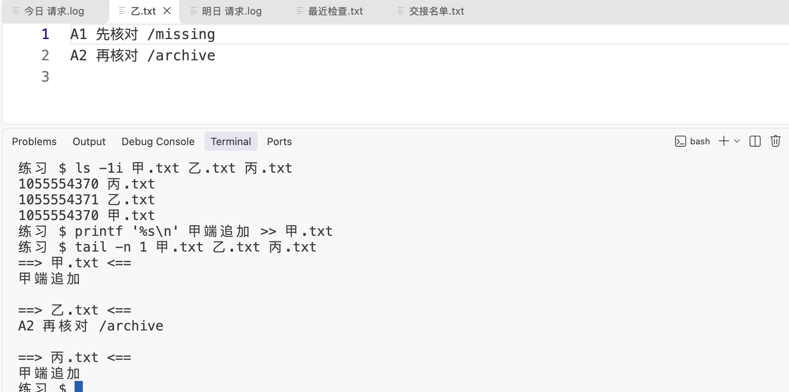

# 支线 1A　交付目录里，两个名字指向的是哪一份文件

白班编辑了一份请求说明，晚班希望无论包叫什么，都能在固定位置打开当前说明。你自己还想留一份能恢复的旧版。先用 Finder 想一想这件事。把说明复制两份，改名为“当前”和“留底”，今天完全够用。明天纠正一个错字，改哪份？后天把整个包移到另一个目录，对方还能打开“当前”吗？这条支线里一直交付同一件东西。每一步都留下可以重新打开的样本，可以到下一次再继续。

先完成本章正文。你会用工作目录和引号定位文件，知道怎样把一行普通输出写入文件，也能从终端检查刚刚产生的结果。本支线可分三次做。第一次准备说明并查清谁可以读、改、进入，第二次做出可以搬动的双版本包，第三次从打开的文件、另一处解包和一次回滚分别验收。阅读约 75～105 分钟，跟做另需约 90～145 分钟。

## 给晚班留一份认得出的原件

在 Finder 中打开自己的本机练习目录，建一个空文件夹“晚班交付台”。Linux 上用文件管理器完成同样的操作。选本机普通磁盘上由自己管理的位置，例如主目录下专放练习的文件夹。共享盘、同步软件接管的目录和随身盘可以留到最后当另一种交付条件。眼下如果改了一个名字，两边都跟着变，应该能确定是自己刚做的操作造成的。若已有同名台子，把新建的空目录叫“晚班交付台 第二轮”，旧目录原样留着。下面所有相对路径都以新台子为起点。我们始终用自己的普通登录账号操作。

在 VS Code 里打开这个空文件夹，把终端也带到这里，先用 `pwd` 与文件管理器核对。建三个并列的子目录“制备”“收件”“观察”，分别放编辑中的包、拿到的包和随时可以改坏的小样。可以在文件树上右击工作区根建目录，也可以在终端执行下面三行。第一行一次交给命令三个名字。第二行逐级建出包里的两层，展开侧栏就能看清它们放在哪里。这里的 `-p` 让 `mkdir` 把给定路径中尚缺的中间目录一并建出来。

```bash
mkdir "制备" "收件" "观察"
mkdir -p "制备/白班包/版本一"
printf '%s\n' 'A1 先核对 /missing' 'A2 再核对 /archive' > "制备/白班包/版本一/说明.txt"
```

在编辑器点开说明，看见两个地址以后，在文件管理器里也展开“白班包”。先在“观察”里复制出一份叫“留底.txt”的说明，办法随你。用图形界面就先复制文件、在“观察”粘贴，再改副本名字；终端里可用 `cp "制备/白班包/版本一/说明.txt" "观察/留底.txt"` 达到同样目的。交班单上可以把两个文件都写成“两行，第一行含 missing”。试着仅在留底的末尾续一句“已核对”，保存。该从哪条路径回读，才能驳倒“原件也多了一行”的猜测？点开两个标签，留意上方的面包屑。在终端分别用 `cat` 读完整的两个路径也行。留底随你改，原件只含最初的两行。把这个性质记在自己的纸上，后面还会有一种看起来像复制、实际结果不同的操作。

收件人给了一个很实际的限制，明天下午他只会把整个白班包搬到新位置，然后照着交接单找当前说明。他不会一起搬你的“观察”，也没有作者的工作区。现在若把指向“观察/留底.txt”的文字写成当前说明，在自己的电脑上或许找得到，换个位置就没有凭据。先在纸上画一个圈，把必须随包交出去的文件和路径圈进来。“制备”“收件”的名字都在圈外；将来核验要让圈外的名字真的发生变化，否则在原地开十次都不能替对方回答问题。

在中途停手时，能简单检查自己回到了哪一站。重新用编辑器打开“晚班交付台”，在终端执行 `ls`，三个并列的目录应该都在；用 `cat "制备/白班包/版本一/说明.txt"` 确认内容。丢了底稿又不确定改到哪一步时，重新开一张空台子比往旧目录整段粘贴命令容易核对。下面做权限和改名实验的材料都在“观察”单独制备。若一个观察样本已存在，先在 Finder 将那一份改一个空闲名字保留，或照着上次做到的状态继续，不要把还没核实的内容覆盖掉。

## 一个锁上的说明，能不能换名字

收件人说“这份先锁住，我怕改错”。在图形界面也许会去看“显示简介”中的共享与权限。先写下他这句话可能要求的两个结果：自己不能往文件里加一行，自己不能把这个名字从所在目录移走。这两件事在界面上看起来都像“改了文件”。现在只用专门的小样，把两种操作分开观察。在台子根的终端输入下面三行。第一行建一格观察目录，第二行放入原件的普通副本，第三行列目录自身和里面那份文件的详细信息。用 `-d` 是因为我们也想看目录自己那一行，否则列目录时常会展开里面的名字。

```bash
mkdir "观察/换名格"
cp "制备/白班包/版本一/说明.txt" "观察/换名格/说明.txt"
ls -ld "观察/换名格" "观察/换名格/说明.txt"
```

找以 `d` 开头的那一行，再找以 `-` 开头的那行，沿着各自的名字往回看。开头标出条目的种类，后面那串字母最靠前的一组三位属于所有者，后面另有两组。此刻先看文件那一行的第一组三位，中间若有 `w`，它会在下一步发生变化。先确认你读的是“观察”里面那份，再输入 `chmod u-w "观察/换名格/说明.txt"`。这里让文件模式发生变化的命令叫 `chmod`；`u-w` 指从所有者那组去掉写位。再列一次同一行，你能不能从新旧两次输出中圈出那个位置？在 Finder 的“显示简介”里展开文件的“共享与权限”，也可以看到当前所有者的一行。这里看的读写访问与简介上独立的“已锁定”勾选项可能有不同的作用，这回只动刚才比对过的这一位。

现在将光标留在终端，先运行 `cat "观察/换名格/说明.txt"`，再试着追加。使用下面的连续两行，读最后一次回车之后的内容，而不要把第一次原样读出的文字误认作追加结果。

```bash
printf '%s\n' 'A3 已登记' >> "观察/换名格/说明.txt"
cat "观察/换名格/说明.txt"
```

在由自己所有、普通本地权限生效的样本中，打开文件准备追加时会得到拒绝，仍只有开头的两行。如果意外追加成功，先停在小样，执行 `id`，把里面的用户与详细列表里的所有者对上；再看是否在特殊挂载或有额外的访问控制。后文会把这些条件拆开。现在换一个动作，保持刚才那一位原样，在 Finder 内把“说明.txt”改名为“已确认.txt”，或运行下面第一行来改。随后读新名字并查看上一层目录的第一组三位。

```bash
mv "观察/换名格/说明.txt" "观察/换名格/已确认.txt"
cat "观察/换名格/已确认.txt"
ls -ld "观察/换名格"
```

这一回名字真的换掉了，内容依旧可读。在这里，往文件追加需要打开文件写入；同一目录内改成一个空闲名字，改动的是父目录里登记名字的那一项。那次 `chmod` 只改了说明文件，目录仍允许你修改里面的名字。这能解释一个常见的交接分歧：作者只验证过内容追加失败，就对晚班承诺原名会一直留在原处。若最终交付需要两项都成立，验证时得分别打开文件尝试写入，再对父目录做一次名字操作。不要在唯一原稿上做这两次试验。

再把两项互换，看看这个解释是否经得住。先输入 `chmod u+w "观察/换名格/已确认.txt"` 恢复文件的写位，再输入 `chmod u-w "观察/换名格"` 去掉目录的写位。先不看预期答案，自行在终端用原来的追加指令写到新名字，接着尝试把它改回“说明.txt”。这次应当可以写入第三行，却无法改回名字。即使目录不让你挪动条目，只要还能沿这个路径到达文件，并有权写这个文件，改里面的字节仍可能成功。用 `cat` 读出第三行，然后用 `ls` 核对到底还叫哪个名字。最后执行 `chmod u+w "观察/换名格"` 恢复目录。若在一半停下，先在根目录用 `ls -ld` 看两行，再从自己改过的那一项恢复即可。

为什么这一步坚持在终端用追加来测？编辑器的“保存”有时还包含写入临时文件、再换回原名等动作；某些软件还会主动询问要不要取得写权限。若它告诉你“保存失败”，单凭弹出的字眼分不清是写原文件失败还是在该目录建临时文件失败。刚才两次各做一件小事，能让你带着具体的差异回头解释界面。将来你接到“能编辑却不能保存到这里”的反馈，先让对方指明是打开后改字、另存为新名字，还是将新稿覆盖现有名字。这三种动作触及的位置不同，索要的权限也不同。

## 只能过门、只能看名单，两种目录如何验收

包里有个资料室，里面的文件名提前写在交接单上。晚班问，“我知道准确名字，是否一定能把资料读出来？”先从有把握的一组开始，用 `mkdir "观察/资料室"` 建空目录，把原件复制成 `观察/资料室/已知.txt`。让 `ls "观察/资料室"` 和 `cat "观察/资料室/已知.txt"` 各成功一次，再把自己的终端停留在台子根。接下来的每一次改变都从这个已知能工作的起点出发。若副本没有准备好，就先复制并读回，再去动目录；否则后面自己少写一层路径，也会看起来像没有权限。

只关掉目录的读位。做完先猜一猜谁失败：列里面的名字、读交接单上写明的文件、进入目录。这回特意用简短的 `ls -1`，其中的是数字一；需要看的只是名字，不要换成长格式去读每项的更多属性。最后一行用一对圆括号把几步放在一个临时的 Shell 环境，能进去就打印当前位置，结束后外层终端依旧停在台子根。

```bash
chmod u-r "观察/资料室"
ls -1 "观察/资料室"
cat "观察/资料室/已知.txt"
( cd "观察/资料室" && pwd )
```

把结果写成三个空格，分别填入有没有名单、有没有两行原文、有没有以“资料室”结尾的位置。普通所有者在本实验条件下会得到“无、有、有”。这时你没有权限请目录报出里面所有成员，但已经知道“已知.txt”，系统可以沿这个给定名字找到文件，文件本身又允许读取。它跟文件菜单的“最近打开”容易混淆。即使用一个全新的终端，知道确切路径也能再试一次；若只知道后缀，想让星号帮忙列出候选，事情就变了。星号要先枚举该目录，缺少读位时不能靠它找出候选。至于看见星号原文报错、由 Shell 先报无匹配，还是看不到候选，要看你用的 Shell 及其设置。只收集自己刚才确定要查的那三项就足以做判断。

先把读位恢复，再从目录去掉 `x`。在普通文本文件旁边，读者也许在运行脚本时见过这个字母。放到目录上，刚才那三种实际操作里会影响哪个？仍从台子根运行下面四行，再到文件管理器点开资料室对照。界面可能会尝试进一步取图标、大小或日期，弹出的错误可能把多次访问合在一起；命令分别让你看到是哪一步遇到门槛。

```bash
chmod u+r,u-x "观察/资料室"
ls -1 "观察/资料室"
cat "观察/资料室/已知.txt"
( cd "观察/资料室" && pwd )
```

现在应当能列到条目名，但读文件和进入都遭拒。Mac 上短列表也可能在打印“已知.txt”的同时报告无法继续遍历，并返回非零状态。先把普通输出中的名字与诊断文字分开看；这里检验的是有没有拿到名字，单靠状态无法回答这件事。如果想只靠名字判断究竟有哪步失败，可以列出更丰富的信息 `ls -l "观察/资料室"`。某些平台会打印名字再配一串问号，另一些会直接点名无法取得属性。你尝试的其实是两步，先拿到一串名字，然后逐个走到对应的条目查类型和其他属性。第一次只要名单，第二次还需要从目录走到名字所指向的对象。这是目录上 `x` 通常叫“搜索”或“遍历”权限的缘由。读目录靠 `r`，沿已知名字往下走或把目录当工作目录靠 `x`；一个动作如果同时要求几样，就要分别具备。

先输入 `chmod u+x "观察/资料室"` 恢复通行，再用两步访问全成功来确认。在路径中再插一层试试。建 `观察/资料室/内柜`，在内柜里放一份“内页.txt”，照常读出它。现在只去掉“资料室”那一级的所有者遍历位，保持内柜和内页的位都原样。你能从台子根读到 `观察/资料室/内柜/内页.txt` 吗？试完从台子根用同一条 `chmod u+x "观察/资料室"` 恢复，再读一次。如果第一次拒绝、第二次看见原文，即使最后那个文件从未变过，也足以解释两次访问的差别。一段看起来正常的文件权限信息不能代表整条路上都能通过。这也解释了在外面的终端能成功查到“资料室”本身的属性、却未必能查到它里面那张内页的现象。你只需要通过“观察”就能找到“资料室”这个目录条目。

若打算把这种摆法拿来设计资料共享，问问自己那个“已知名字”究竟从哪来。收件人若先前就在交班单上读过内页名，就不能拿“列不全名单”证明他打不开这项；假如希望允许他枚举和打开每一份，给目录读位而拿掉遍历也不够。两种要求都会让“文件管理器里的样子对不对”显得过于笼统。正式交接时写下收件人需要在什么起点做什么事、能否列名字、是否预先知道名字，再选最小的验收动作；今天所有的实验仅涉及自己的小样，涉及另一个真实账号时还要补上下一段的身份条件。

## 用谁的眼睛看那九个位置

晚班让你传一张权限截图，“我看看能不能打开”。拍之前先在台子根输入 `id`，另起一行执行 `ls -ld "观察/资料室" "观察/资料室/已知.txt"`。在自己的输出上找两组能对应的文字。详细列表在链接数之后列出所有者与所属组；`id` 里 `uid` 后面是你的用户编号及名字，`gid` 是主组，`groups` 列出了当前身份参加的组。可以在 Finder 的“共享与权限”中对照名字；文件管理器的语言设置可能改变显示名称，终端里这两次输出最容易直接对起来。交接记录只需自己辨认，不必把私人账号、家目录和组清单交给别人。

现在请在纸上把文件行那个首字符单独隔开，再把后面的九个位置每三个一组分开。这三组分别供所有者、所属组和其他身份判断访问。每一组从左到右是读、写、执行或遍历。在普通模式位的规则下，先看发起访问的有效用户是否就是所有者；如果是，用第一组。否则看其有效组身份是否符合文件所属组，符合时用第二组，剩下的用第三组。这个挑选次序有一个能就地证伪的猜想：“我是所有者，也恰好在该文件所属组，那么所有者组缺了读位，我能自动借后面那组的读位吗？”你不需要另开账号，可以用自己的独立小样来回答。

在“观察”里复制一份原件叫“身份样本.txt”。先记录 `ls -l` 的结果，再运行下面三行。这个样本只含两行演示文字；为了只检验分类，不让其他任何人因为这项实验取得内容，可将外层“观察”的访问限制在自己，方法是先在这个自建目录执行 `chmod 700 "观察"`。数字写法接下来要逐位读，先看效果：所有者那组 `rwx` 都在，其他两组各自是三条短线。若文件所属组不在你 `id` 的组清单中，仍能试下面的读写，但别把这个环境当成“同时属于两类”的反例。

```bash
chmod 040 "观察/身份样本.txt"
ls -l "观察/身份样本.txt"
cat "观察/身份样本.txt"
```

文件行应有 `----r-----` 这样的开头。最前面一个短线是普通文件类别，第一组全空，第二组开头留有 `r`。以普通所有者身份读取，收到拒绝。现在只改为 `chmod 400 "观察/身份样本.txt"` 再读一回，原文又能打开。两次文件所含的字节和整个地址都一样，改变的是被选中那一组里有没有读位。这个差异能帮你审一张“看着挺宽松”的权限截图。要先知道最终读文件的进程是谁，才能知道应该读哪三个位置。你用自己的编辑器打开成功，说明你自己的起点、组和身份满足了这次访问；后台运行者可能用另外的身份、从另外的上级目录去找。仅凭把窗口换成另一个终端，也没有变成另一个用户。

看一眼刚刚两个数字留下的结果，数字四放在哪一列，哪一组就显示出读位。你可以从已有文件做出其余两种变化。先在自己的样本执行 `chmod u+w "观察/身份样本.txt"`，看到第一组变成 `rw-`，再执行 `chmod 600 "观察/身份样本.txt"`，同一组三位保持原样。读值四、写值二，同时具备就得到六；再加执行的一就是七。把“观察”设为七零零让自己能列目录、登记名字并进入，让该层成为只在自己这次练习中可达的边界。普通交付说明要读、写但不需要像程序那样被直接执行，用六就能表达。三组各自加总，得到 `640` 时是所有者读写、所属组只读、其他没有。逐组读一回，比把整串数字当作一种共享程度更容易察觉把写位给错了哪一组。

有时详细列表的模式位旁还有额外符号。Mac 可能有表示扩展属性的 `@`，也可能有访问控制表标记，Linux 的工具还可能显示其他安全信息。若普通用户的小样没有重现两次对照，先回到由自己所有的本地空目录，看清了宿主、拥有者、文件系统和额外授权再解释。比如图形程序本身可能受到系统的隐私保护，而终端恰好获得了某个文件夹的授权；网络共享还要经过服务端的身份映射。这些情况下两次开文件已经不是纯粹比较九个普通模式位。没有在目标身份下实际做过读回，就把交班结论写成“本机作者可读，收件身份待验证”。这是一个接手者能接着做的判断，不用为练习申请管理员身份，也不要求与同事共享真实账户。

## 同一张空白说明，为什么一份能给组员读

每天都在编辑器点“新建”，交班前才一份份修权限，很容易漏掉点开得少的附件。先查清两种选择：是在创建时就有一个合适的起点，还是事后改变已有文件。台子根开两组临时环境，用同一条创建指令，各写进不同的新目录。目录和文件名都尚未使用；如果已做过这段，直接核对原样本，或在新台子复做。下面独占一行的左括号和右括号合起来包住一组指令。括号结束后，里面改的默认值不带回当前终端。第一行先读当前值，最后一行再读它，看看你的日常终端到底有没有被改变。

```bash
umask
(
  umask 077
  mkdir "观察/自用盒"
  printf '%s\n' '等我复核' > "观察/自用盒/草稿.txt"
)
(
  umask 027
  mkdir "观察/组用盒"
  printf '%s\n' '等我复核' > "观察/组用盒/草稿.txt"
)
ls -ld "观察/自用盒" "观察/组用盒"
ls -l "观察/自用盒/草稿.txt" "观察/组用盒/草稿.txt"
umask
```

把两行目录并排读，再把两行文件并排读。普通本地设置下，前一对目录是 `drwx------` 与 `drwxr-x---`，两份文本是 `-rw-------` 与 `-rw-r-----`。如果你只看内容，都是“等我复核”。比较第一组和第二组的所有者三位，数值没有差别；再比较所属组三位，第二个盒子允许组员列与进，文件也多了读位。至于一开始的“观察”七零零会挡住组员，是上层单独的一道条件；我们现在检查的是新对象自己带着什么位，不宣称收件人已经实际读到里面的文件。

从这四个结果回想两个问题。为什么同样设了二七，目录会给所有者执行位，文字却没有？为什么自用盒用的数字比组用盒大，放出去的位反而少？创建者会先提出它需要的模式，像这里的 `mkdir` 创建普通目录时通常请求七七七，经重定向新建普通文本时通常请求六六六；当前进程的 `umask` 遮掉其中的位。遮罩中某位是一，就从请求中清掉这一位。以二七那次来说，所有者这一列写零，原先请求了什么就保留什么；所属组那列遮掉二，即写位；其他那列写七，整个组都不留。文件原先未请求执行，即使遮罩愿意保留，它也不会平白长出来。在有默认访问控制表等条件的文件系统上，新建结果还可能受继承规则影响，读回出来的模式才是这个目录里该拿去交接的结果。

再改一个条件检查自己是否把遮罩当成了十进制减法。在新的临时括号里设 `umask 011`，然后只创建 `观察/执行位试纸.txt`，可以像上面那样写一行自己的预测。当普通文本请求的是六六六时，后两组压根没有请求执行位，去遮这两位，常规结果还是六六六。外层“观察”已收紧在自己名下，这些样本都留在里面。若只是算“六六六减十一”，末尾会出现一个不该有的结果。对照一眼实际模式，再只针对自用盒的草稿做下一试：在二七遮罩下往那份已有草稿追加一行，列前后权限。你会看见文字增加，文件仍只允许所有者读写。遮罩参与创建，打开已经存在的文件追加通常不会重新套一次创建规则。所以光改默认值，解决不了昨天留下的宽权限附件；只逐个修昨天的附件，又不能规定明天新来的默认值。

编辑器此时也能做一次有意义的旁观。用同一个编辑器进程分别去两个盒子里新建另一个样本，比较落盘后的模式。两个盒子的名字并没有内建“自用”和“组用”的规则，刚才的差异来自两个创建进程的设置。如果编辑器是在别处启动的，它也不会因为你后来在一个短暂的括号里执行 `umask` 就继承那次设置。这能解释为何某个打包步骤生成的文本与手工另存的文本访问方式不同。若想比较工具的默认行为，先用未用过的名字，分清创建进程，列实际模式；若你原本点开的是已有文件，还要留意工具究竟就地写还是替换文件。后面可以借已经打开的读者把这两种行为分辨出来。

## 两个名字能不能当作两份留底

权限样本已经能解释谁可以改。接下来回到白班包，解决固定入口和恢复副本。先别把未经检验的东西放进包。在“观察”里建“同文对照”目录，把版本一的说明普通复制进去，叫“甲.txt”。从甲再复制一个叫“乙.txt”，然后试一个只多一个名字的办法。逐行执行下面三行。猜一猜第一行会不会使说明文字占用两份，暂时不要用文件大小作结论。第二行加了 `-i` 让每一项开头多出一个数字，`-l` 则让你能同时看文件大小、模式、链接数和名字。

```bash
ln "观察/同文对照/甲.txt" "观察/同文对照/丙.txt"
ls -li "观察/同文对照"
cat "观察/同文对照/丙.txt"
```

在纸上画三行，先抄开头那个数字，随后抄权限右边的计数。三个名字都有相同内容和大小，可是甲和丙开头的数字相同，计数各是二；乙的数字不同，计数是一。先把这个差异当作线索，再让它对下一次操作做出预测。如果两个名字对应的确实是同一份存放数据的文件，往甲里面追加一行，读丙会怎样？乙又会怎样？用终端重定向指定“甲.txt”，加上“甲端追加”四个字，分别读这三项。现在甲和丙多一个尾行，乙留着两行。即使用新的终端来读，也应当看到这种分组。用编辑器操作时若另存触发了替换，结果可能不同，这里特意选用打开原文件追加的方式。



图中只列名字和编号，省去属主等无关列。重点是这一轮甲和丙的数字相同，再看下面三份末行；乙的编辑器标签仍保留最初两行。

刚刚 `ln` 建的是**硬链接**。在这个本地文件系统里，目录里登记的名字通向一份文件对象；甲原先就有一项这样的登记，后来丙也登记到同一个对象。详细列表里的链接数在每个名字看来都是二，意思是有两处目录项连到这份对象；数字 `-i` 显示的叫 inode 编号，用来辨认这个文件系统里的对象。它没有告诉你当初先起的是甲还是丙，两个名字在读写现有内容时能力相同。要解释为什么新增名字后大小栏还是原来的数，想想 `ls -l` 显示的是从一个名字找到的文件有多少字节，列第二个名字时也能查到同一份长度。把两行大小相加据此估算硬盘上实际占用，会把同一份算两次。跨文件系统不能只用编号判断同一性，删除后编号也可能在将来被重用；这里在同一目录、一份仍存在的小样中当场对照，条件比较干净。

改动也不限于文字。先执行 `chmod u-w "观察/同文对照/丙.txt"`，再列三个名字各自的模式。甲也失去所有者写位，乙原样。这次两份模式一起变，支持“权限记录在同一个文件对象上”这项解释。恢复时从甲那边执行 `chmod u+w "观察/同文对照/甲.txt"`，再从丙那边追加一行，甲也能看见。现在在 Finder 把甲改成空闲名字“搬走的甲.txt”，回终端读丙，追加所得仍在。若丙里面保存的是甲的名字，甲一改名它就应该失效。这里没有失效，链接数仍是二。目录中甲这一项换了个拼法，丙能直接到同一份对象，两边无需查找对方的名字。

这时再回去审“留底”。若晚班需要的是“以后继续看相同的修订”，硬链接能使两边对就地写入的改动保持一致；若要的是“保留交付当时的旧字节”，只要任意一边还可能就地修改，它就不符合这个要求。在“观察/留底.txt”里读到的是你改过的独立草稿，再看乙，它仍保持复制那一刻的两行文字。一份能独立纠错的底稿必须能经受对另一份的写入试验。两份硬链接也不会让你得到另一块磁盘上的备份，因为这类链接要求同一个文件系统。今天不需要人为制造跨盘错误，只要弄清“我准备怎样改”以及“我需要在哪种损坏之后还能恢复”，就能判断能不能拿同一对象的另一个名字来承诺交付。

想看看计数真与名字有关，可以在这格里另给丙建一个叫“临时证据.txt”的硬链接，先列出三个相同编号的名字，预计计数应变成三。确认文件树里的临时名字是自己刚创建的，再只移除这一项，例如 `unlink "观察/同文对照/临时证据.txt"`。它接收一个确切路径，去掉那个目录项。到丙读回新增的尾行，再看计数应回到二。这里不用递归操作，也不用碰原稿；若刚才其实只是把名字移进另一个同盘目录，并未去掉那一项，计数就不会下降。下一段还会遇到 `unlink`，那时最值得预判的，是它究竟移除指路的那一项还是指向的文件本身。

## 把能搬走的入口放进包里

白班的真实要求终于可以动手做了。希望在包里固定读“当前说明”，等版本二来了，入口换过去，版本一的两行仍能读出。直接给版本一做硬链接，遇到下次要让入口改指另一份文件时，还得重新登记。另一种可能是让入口自己保存一段找路的文字。先试一个**看起来合理却走错地方**的写法，失败也只影响这个刚起的入口名。你仍站在台子根，`cat "制备/白班包/版本一/说明.txt"` 确实能读，所以试着把刚能读成功的那段路径交给下面的 `ln -s`。这里 `-s` 要求建一种能保存路径文字的链接，第二个参数是将来放入口的位置。

```bash
ln -s "制备/白班包/版本一/说明.txt" "制备/白班包/试走入口"
ls -l "制备/白班包/试走入口"
readlink "制备/白班包/试走入口"
cat "制备/白班包/试走入口"
```

列表中多出一个以 `l` 开头的条目，右边用箭头标出文字。专门读取链接本身的 `readlink` 也打印那段文字；最后想读原文却失败。你亲眼看见末端文件还在原位，拼写连空格都没错。先用手指按住**试走入口所在的目录**，沿刚刚打印的“制备”往下找。白班包里面有这样一层吗？再试着保持最后三个操作原样，只在一个新名字里换掉指路文字。这回假设自己已经站在“白班包”里，先回答从这里到“说明.txt”需要经过几层，然后输下面几行。

```bash
ln -s "版本一/说明.txt" "制备/白班包/当前说明"
readlink "制备/白班包/当前说明"
cat "制备/白班包/当前说明"
( cd "收件" && cat "../制备/白班包/当前说明" )
```

两次读取都得到那两行。你在台子根创建链接，却按照入口**所在**的目录来写相对目标，甚至换到“收件”仍能沿它走通。这种入口叫**符号链接**，也常叫软链接。先由调用者从自己的起点找到入口；一旦走到它，若里面保存的是相对目标，就从存放这个链接的目录继续解析。我们的第一项试走把从台子根出发的路径塞给了白班包里的入口，第二段路额外找了一层“制备”。创建链接时可以写一条暂时走不通的路径，难怪第一行也能成功。遇到类似故障，列链接和读原文应当作为两项不同的观察；只在界面看见图标还不足以认定收件人能读。

试着让同一入口暂时发生故障然后原样恢复。在 Finder 里把“版本一”暂时改成空闲的“版本一待核”。再运行 `readlink "制备/白班包/当前说明"` 和对应的 `cat`。第一个仍能交出原来的指路文字，第二个却找不到终点。这种状态叫悬空链接。它与前面把硬链接的甲改名有可辨认的区别，当时丙照样读到原文。现在在 Finder 里把目录名改回“版本一”，不重建入口，重新读当前说明。又成功了。如果你希望寄出空入口、等另一个步骤稍后才填入目标，这种行为也能使用，但晚班要求一拿到就能打开，验收条件应该包括所指文件确已到位。最后先用 `readlink "制备/白班包/试走入口"` 认出指错的那一项，再运行 `unlink "制备/白班包/试走入口"`。用原路径读取版本一，仍然读得出，移走的只是那条指路文字。

现在你可以预判另一种常见做法。从 Finder 拖入“说明.txt”，把完整绝对路径写进一个链接，即使它放在“白班包”里，此刻也能读到正确正文。这种写法省去推算第二段路，代价是什么？先别动真正的白班包。在“观察”里建“绝对试件”目录，从台子根执行下面两行。命令里 `$(pwd)` 取本次终端的路径文字，与后面的固定部分合在双引号里成为一个绝对地址。先用 `pwd` 看过起点，再执行建立链接的那行。

```bash
mkdir "观察/绝对试件"
ln -s "$(pwd)/制备/白班包/版本一/说明.txt" "观察/绝对试件/当前说明"
```

把“绝对试件”整个挪进“收件”，再从“收件/绝对试件/当前说明”读，居然还是成功。这个结果很有迷惑性，你似乎已把包搬过，实际承载字节的文件却仍在制备端。只要作者原目录还在、同一个账号能访问，走回作者目录就能交出正确文字。等会儿我们会把制备端临时改名，借一次真正断开旧路径的对照来排除这种假成功。现在先从待交白班包旁边看清两个圈：相对入口指去圈内版本一，绝对试件则把收件人带回圈外。

## 要寄的是一份文字，还是一条仍能改向的入口

晚班一位同事只需打印当前说明，另一位值守者还要将来换版本。两人此刻看到的内容相同，却不该仅凭“复制后还能读”来验收。在“观察”里建“复印台”目录。先想好两份材料到手后 `ls -l` 开头应当分别出现哪个标记，再运行下面几行。这里把复制链接时的选择写成选项，让 Mac 与 Linux 上的练习都能明确你的意图。

```bash
mkdir "观察/复印台"
cp -L "制备/白班包/当前说明" "观察/复印台/打印稿.txt"
cp -P "制备/白班包/当前说明" "观察/复印台/入口样张"
ls -l "观察/复印台"
cat "观察/复印台/打印稿.txt"
readlink "观察/复印台/入口样张"
```

从开头的 `-` 可以认出“打印稿.txt”是一份普通文件，递给打印的人，只要有权读它，就能看见复制那刻的文字。`-L` 在这项复制里沿着源链接去取实际内容。另一份开头是 `l`，`-P` 让复制保留链接。它保存的仍是“版本一/说明.txt”，可“复印台”里没有“版本一”，从新位置用 `cat` 读入口样张自然会失败。你把这段话换个说法问自己就能避免常见误判：“原入口为什么成功？新入口继续沿哪一条路走？”两份都原样复制了你要求的东西，收件任务决定了正确结果是保留路径还是取得内容。若文件管理器的菜单写“制作替身”“创建快捷方式”，在跨平台交付前用 `ls -l` 和 `readlink` 验一下成品形态。某些桌面系统的替身是另外一种文件格式，不一定能用这里的 Shell 工具按符号链接来读。Linux 上可以从 [GNU Coreutils 的 cp 说明](https://www.gnu.org/software/coreutils/manual/html_node/cp-invocation.html) 核对这两个选项对来源的处理。

给晚班打一整份包时，入口和目标都必须在新位置就位。此刻先不复制正式包，在观察格内试验一个容易写错的目标。先用 `mkdir "观察/整包试装"` 建收件目录，保持“整包试装/白班包”尚不存在，然后运行 `cp -RP "制备/白班包" "观察/整包试装/"`。大写的 `-R` 让复制逐层处理目录内容，`-P` 保留遇到的符号链接。展开成品，先数从“整包试装”到“当前说明”隔几层，实际读一次；再列链接并指出“版本一”落在哪里。如果收件处本身是已有目录，复制一个目录进去通常会在下面保留源目录名。只记住一长串工作命令而没核对这层，交接单很可能少写一段，或让第二次复制与第一次产生不同的合并效果。一个空的、专用的收件位置让你能辨认这次到底新建了什么。

现在在试装的“版本一/说明.txt”末尾仅追加“试装独有”，分别从试装的当前说明与制备的当前说明读回。前者多一行，后者仍是两行。你已拿到比“两边都能开”更强的对照：入口跟随的是各自包内的一份内容。再读“打印稿.txt”，它还停留在复印时的两行。若读试装入口反而看见制备端新改的字，第一件值得核对的是入口文字有没有留着绝对地址；若入口是一份有全部字节的普通文件，后续更新又不会自动显现在那里。这两种失配就算今天都打印出同样的两行，明天也会给值守者不同的事故。让打印者验内容，值守者还得验入口结构，两个任务的差别到这一步才算能从台子上指出来。

## 同一把门，退一层会站在哪里

晚班说目录名太长，希望能先进入一个叫“当班”的入口，再打开里面的说明。在白班包根新建 `导航` 目录，然后把一个叫“当班”的**目录链接**放在导航里面。先在纸上从导航回到白班包、再走进“版本一”，把要保存的相对目标写出来。这里的双点只跨一级，`readlink` 之后你能对照它保存的是哪个方向。

```bash
mkdir "制备/白班包/导航"
ln -s "../版本一" "制备/白班包/导航/当班"
( cd "制备/白班包/导航/当班" && pwd -L && pwd -P && cat "说明.txt" )
```

站在里面看同一张说明，`pwd -L` 的输出末尾经过“导航/当班”，`pwd -P` 的输出末尾却是“白班包/版本一”。前者保留了 Shell 在通常的逻辑目录模式下记着的那条进入路线，后者把沿路的符号链接解开，显示实际到达目录的路径。在 Mac 上，两行前面某些系统目录也可能不同，把目光放在自己建的末尾几层就够了。如果你平时专门配置了物理模式，想从同一逻辑起点重做，可以在临时括号里把第一次进入的命令写成 `cd -L "制备/白班包/导航/当班"`。这回不必挪动任何文件，用同一个起点试两个“上一级”就能看到这两种记法各自会把你带到哪一层。

```bash
( cd -L "制备/白班包/导航/当班" && cd -L .. && pwd -L && ls )
( cd -L "制备/白班包/导航/当班" && cd -P .. && pwd -P && ls )
```

第一行退回逻辑路线上的“导航”，里面可以列出“当班”；第二行沿真实目录退回“白班包”，里面能列出“版本一”“导航”和“当前说明”。你可以把自己的纸图画成两个分叉，每条都指向版本一，这样就能解释“进去时打开同一份文件，出来却看见不同的邻居”。若调试时只截一个已经缩写的提示符，另一人会根据他自己推测的上层去找文件。此时一份 `pwd -P` 的结果加一个具体目标名，比反复切换标签更能指明实际文件在哪里。反过来，给习惯从“导航”进入的值守者写操作说明，使用稳定的逻辑入口也有意义，将来版本目录改名，你更新这条入口保存的目标后，他仍然可沿同样的路线操作。

再观察一个容易在组合命令里出现的差别。在临时括号中 `cd -L` 到“当班”，先 `ls ..`，再 `cd -L ..` 后 `ls`。你会发现第一次列的是实际目录的父级，第二次列的是逻辑父级。为什么 `..` 都一样，两个名字清单却不一样？第一次 Shell 把双点作为普通参数交给外部程序 `ls`，后者在进程实际所在目录上解析这个路径。第二次让 Shell 自己执行它的目录切换，才使用了明确指定的逻辑处理。由此看见一条带双点的命令，先辨认谁负责解释路径，再决定能否拿上次的屏幕当依据。今天这点会直接帮我们写交接单：给包验收时写从包根出发的确切路径，值守者就无须跟你拥有相同的打开标签和退回历史。

## 名字换成了新稿，已经翻开旧稿的人会读到什么

在正式包动第二版之前做个交班瞬间的实验。白班正在念两行说明，恰在念完第一行的时候，另一人把新说明放到原名上。晚班此时新打开，应该读新版；已经开始念的白班呢？这个差别很难靠肉眼协调两个人恰好同时点击。台子根另开一个普通交互终端，把它叫作“朗读窗”。先用 `pwd` 核准在台子根，以后这一小段的命令都在这同一个窗口逐行执行，中途可以停下猜结果。在“观察”建“朗读桌”，把原件普通复制成“桌面.txt”，再新建“候选.txt”，内容如下。每次用的第三号通道只在这个练习窗口存在，结束会关掉。

```bash
mkdir "观察/朗读桌"
cp "制备/白班包/版本一/说明.txt" "观察/朗读桌/桌面.txt"
printf '%s\n' 'B1 改看 /today' 'B2 再核 /later' > "观察/朗读桌/候选.txt"
exec 3< "观察/朗读桌/桌面.txt"
IFS= read -r line <&3
printf '%s\n' "$line"
```

屏幕上应出现 `A1 先核对 /missing`。解释这些新写法可以从发生了什么开始。我们需要“先翻开，合上之前分两次读”，以前用 `cat` 一下就读完了。这里的 `exec 3<` 让此 Shell 打开文件供读取，留一个编号为三的**文件描述符**，供后面按号找回已经打开的文件。这个编号是当前进程自己的索引。下一行的 `<&3` 让读命令从该通道取输入；`read` 读到一行，把它存入自己起的变量 `line`。`IFS=` 让这次读保留行首行尾空白，`-r` 让反斜线按普通文字读取。最后显示 `line` 的值。从现在起，这个正在读的入口还有一件事值得跟踪：已经越过第一行，下一次从哪里接着读？

先在文件树里确认“候选.txt”是那两行 B，再运行下面四行。这里有意用候选替换已存在的“桌面.txt”，只在刚启动的这张朗读桌内操作。先验新打开者，再读一次第三号通道；猜测请落到具体行号及地址，两次都说“能读到”无法区分哪份。

```bash
mv -f "观察/朗读桌/候选.txt" "观察/朗读桌/桌面.txt"
cat "观察/朗读桌/桌面.txt"
IFS= read -r line <&3
printf '%s\n' "$line"
```

新打开的 `cat` 读到 B1 和 B2，沿已经打开的通道只读到 A2。最后用 `exec 3<&-` 把这个读入口关掉。原名还叫“桌面.txt”，只是这名字现在指向原来候选的文件对象。读者刚才已经按名字打开过旧对象，即使旧名字被替换，那次打开留下的引用仍有效，读到的位置也仍在第一行之后。这还补充了硬链接计数实验的一个边界：就算最后一个目录项消失，已打开的引用也可能让文件继续存在，直至相关引用也释放。旧字节还能从原通道读出的这段时间，不等于操作员能靠旧路径重新打开。恢复需求若包含重新打开，得另留有名字的旧版本。

换一种动作再试。第二次我们要保持同一份已打开的文件，亲自改它里面的字。用下面这段最短的英文标记，故意把两组第一行设计为等长。同样每行末尾有一个换行，这能让“指针已经越过第一行”的解释面对一个能算清的位置；中英文混用时按眼睛数几个字，会与文件里的字节距离不同。现在“桌面.txt”是一次性小样，可以直接覆盖。看见第一行 `A1` 后才写新的两行，再从旧通道读，并同刚才的换名试验比较。

```bash
printf '%s\n' A1 A2 > "观察/朗读桌/桌面.txt"
exec 3< "观察/朗读桌/桌面.txt"
IFS= read -r line <&3
printf '%s\n' "$line"
printf '%s\n' B1 B2 > "观察/朗读桌/桌面.txt"
IFS= read -r line <&3
printf '%s\n' "$line"
exec 3<&-
```

这一次第二行是 B2。重定向写已有普通文件会在打开时截短，并从开头写新字节；正在读的通道仍指向这个对象，读位置不会自动回到开头。等长示例里，原先越过的是 A、1 和一个换行，三个字节之后恰好落在新稿第二行的开头。如果再做一轮，将新稿第一行由 B1 改成 B123，第二次读取会从第三个字节之后读到 `3`，才遇到第一个换行。亲手把字节位置写到纸上，比看到一个奇怪的单字便怀疑“读取有缓存”更容易判断。若把稿子截短到该位置之前，下一次读取还可能直接到结尾；`read` 返回失败时应检查它的状态，不要把上一次打印的变量当成新内容。另一种实验是试图同时写和读而不约好停点，那会引入执行时序，这里每步按完才做下一步，专门用来分清对象与位置。

现在再回想在编辑器里改了硬链接甲，为何有人看到丙没有跟着变。可以在观察格另做一份硬链接对照，保存前列一次 `ls -li`，用自己的编辑器改甲并保存，保存后再列。若两个名字仍同号且内容同步，这次保存改到了同一对象；若甲换号、丙还指着旧号，结果就像换稿试验，应该再读旧名核实。不同编辑器、配置和文件系统有不同保存方式，不必预判哪个平台一定怎样。对于需要读到一份前后一致说明的值守程序，“我只应打开一次并读完”与“我每读一行都从名字重新打开”也是两种契约。后者需要自行记录位置，还可能半途中跨两个版本。这里同一个人、同一个窗口刻意留下的打开引用，让你能指出这类承诺究竟从哪一步开始成立。

## 换版后从空收件处拆开，再走一次旧路

现在制备端有且只有一份内容正式入包，版本一两行仍是 A。值守者提出三个交付条件：他用“当前说明”要读到版本二，查昨天要能按旧名字读回版本一，另外交一张随版本二走的校对单。先在文件树上展开到“白班包”，看看哪些是正文、哪些是指路的入口；特别是“导航/当班”，它至今还指着版本一。若交出去时两种入口都叫“当班”或“当前”，却读到不同版本，用哪一项做验收会直接左右结论。先把工作副本两项都调好，再允许晚班拿走整包；这样制备期间暂时一新一旧的窗口就不会成为对方的可见交付状态。

用 `mkdir "制备/白班包/版本二"` 建一个从未使用的目录。在里面新建“说明.txt”，第一行写“B1 先核对 /today”，第二行写“B2 再核对 /later”，文件末尾也保留换行。再在同一目录建“.校对单”，写“B 已校对 两行”，同样在行尾保留一个换行。用图形界面切换隐藏项目显示并核对它在版本二里面，用 `cat "制备/白班包/版本二/.校对单"` 直接回读。这个点文件是正式交付的一部分。若只在一个能列出普通文件的窗口中全选再拖动，是否把它带上要看那一刻的可见项；如果用 Shell 的星号挑选，通常也会略过点开头的条目。我们会直接交整个目录，并把校对单列在对方可以独立读取的验收动作里。

先给自己一次修正路径的机会。在同一包内建立一个尚未占用的名字“待核入口”，此时值守的正式名字不变。待核入口与正式入口同一层，因而能在切换前试走将来要用的相对目标。执行下面三行，先读目前的 A，再读预期的 B。若两份一样，回到 `readlink` 核查，直到两个版本确实可区分，再继续。

```bash
ln -s "版本二/说明.txt" "制备/白班包/待核入口"
cat "制备/白班包/当前说明"
cat "制备/白班包/待核入口"
```

先验证 `ls -l "制备/白班包/当前说明"` 明确它是指向**普通文件**的符号链接，再用 `mv -f "制备/白班包/待核入口" "制备/白班包/当前说明"` 将这个候选换到固定名字。两个名字在同目录，目的也不是目录入口，移动所替换的是旧的链接项。验证新入口文字、读回 B、直接读旧文件确认 A 各做一遍。若手上是另一种指向目录的入口，不要机械套这条移动命令，某些工具和选项会把目的解释成一个目录，从而把来源挪进去。我们这回在尚未开放的工作包里改“导航/当班”，可以先用 `readlink` 确认为 `../版本一`，运行 `unlink "制备/白班包/导航/当班"` 只去掉旧的目录链接，随即用 `ln -s "../版本二" "制备/白班包/导航/当班"` 建新入口。这两个动作之间存在一个暂时没有入口的时刻。整包仍在制备，没有向同时访问的读者承诺两条入口在同一个瞬间切换。正式有并行读者时，若要所有材料始终来自同一版，还需要选择一次发布的边界、安排读者固定在同一版本上。

原来那次普通复制已经能在本机制造收件效果，这回换成日常更接近交付的一份归档。只打自己刚刚准备的白班包；输出名“白班交付.tar”应当尚未用过。建包工具 `tar` 随 macOS 与常见 Linux 开发环境提供，也可以先从文件管理器确认压缩入口。这里选一种能保留符号链接并能在解开前先列出成员的格式；如果接手者改用图形归档器，可以同样按下面的相对位置和实际内容来验，而不依赖菜单长得一样。下面第一行让工具从“制备”这层收取整个“白班包”，在台子根写出归档文件。`-c` 新建归档，`-f` 后面跟着归档名，`-C` 后面是收取成员时的工作目录。第二行用 `-t` 看清单，`-v` 展开细节。注意看归档成员的路径从哪里开头，有没有把“观察/身份样本.txt”也装进去。

```bash
tar -cf "白班交付.tar" -C "制备" "白班包"
tar -tvf "白班交付.tar"
```

你应能认出两版说明、版本二校对单、固定说明入口和目录入口，路径以“白班包”起头。列表的细节排版可能不同，Mac 某些文件系统还会携带额外元数据，先盯以上必需项以及有无不应入包的草稿。每份链接都应保存相对目标。再新建一个空的“收件/首轮安装”目录，运行 `tar -xf "白班交付.tar" -C "收件/首轮安装"`。这里 `-x` 指解开，`-C` 指把成员放在哪个目录下面。目录必须事先存在，首次交付不能解到已经装有个人资料的目录，否则同名成员可能替换原有内容，而且上一包曾有、这一包删去的旧文件可能残留下来。要重做时在“收件”下另取一个空目录，按新的名字读回。练习只打开刚刚亲手建的本地归档，所以你知道成员从哪里来，链接预期指向哪里。

先关掉可能正在编辑制备端正文的标签，保留文件树。在 Finder 将“制备”临时改为旁边一个空闲的名字“制备暂存”。暂且不读任何制备端的东西，从一张全新的终端用 `cd` 和拖放进入“首轮安装/白班包”。交接单上应当能只写下面这些相对名字。第一行核对你确实站在解包后的那一份，其余四行保留结果各自对应的入口。任何一行读错，就沿刚才学过的两段路去查。

```bash
pwd -P
cat "当前说明"
cat "版本一/说明.txt"
cat "导航/当班/.校对单"
readlink "导航/当班"
```

你要交出的证据应包含来自新稿的两个地址、来自旧稿的两个地址、那句版本二校对文字，以及目录链接中的 `../版本二`。再从台子根试一下绝对试件的入口 `cat "收件/绝对试件/当前说明"`。之前它在收件处能打印出 A，此时制备原路径不存在，读取应失败。若正式包也遇到这种情况，列开它所有入口，尤其检查里面有无台子根的绝对地址。若正式包成功、绝对试件失败，你已经用相同的换位置条件故意让错误方案暴露出来，再据此说明正式包能独立展开。回到 Finder 把“制备暂存”改回“制备”，从台子根再读一次绝对试件，原稿重新出现。如此做完，作者可以继续工作，对方也有一份仍然自足的安装目录。

## 接手者改变要求之后，你怎样恢复

晚班验收刚结束，业务又来一句“切回 A，明天可能再启 B，今晚我写的值守记录不能丢”。如果直接把整个安装目录扔掉重解，确实可以恢复**某个**打包时的状态，但归档中默认选中的是 B，里面也没有晚班刚写的记录。先在已安装的“白班包”内新建“值守记录.txt”，写“交班后记了一笔”。关掉标签重新打开，确认真的保存，再把值守者说的话分成几笔能独立查的事实：打开固定名字看哪个版本、B 的独立文件还在不在、点文件校对单属于哪版、现场新写的一笔还能不能按原名读到。把这四个名字写在纸上，别把“回滚成功”孤零零写成一句。

这次先自己拟定动哪些目录项。把手指放在收件端，而不是制备端；使用 `pwd -P` 校准起点。如果只要固定入口回去，最小改动是换两个指向当前版本的链接。先创建一个新的临时候选指向 A，读通过后换到“当前说明”；在专用练习包没有其他读者的时段，把“导航/当班”重定向到 A。直接读版本二下的校对单仍应成功，但沿已经回到 A 的“导航/当班/.校对单”会找不到。这个失败恰是有区分力的证据，版本一不曾拥有 B 的校对单。若沿导航还能读到 B 的备注，却以为切回完成，应该先分别查两个入口的目标，找出还留在旧指向的那一个。最后读“值守记录.txt”，关掉文件管理器再重新打开原路径都行。你应当能看见那一笔，版本二也依然可以从它自己的名字打开。今后再启 B，不需要从归档提取一份可能覆盖现场记录的整目录。

如果希望明天交给另一班的是“可随时从头装的 A 首选包”，刚刚就地改好的收件处也不能直接当成可分发的成品，它已经有晚班自己的日志。你可以独立做最后一轮：在“观察”里另建一个干净的“返工台”，从原来**已验过**的归档解出原包；在返工台的白班包里把两条入口换到 A，保留 B 校对单，额外加一份只用于这一轮的“交付说明.txt”，写明 B 应从哪个固定版本路径打开。归档取新名字，在“收件”里再选空目录解开。试着不用翻回原步骤，按刚才纸上的四个事实拟定一次核验。为了证明“值守记录确实没出现在返工包”与“验证者其实看错目录”有区别，先读你新加的交付说明，再在同一个包根列全部条目。读到了本轮说明、默认路线到 A、直接到 B 仍能找到点文件，并且包中没有上一班的现场记录，这几项才共同说明你选对了原料、归档起点与安装目标。

交接时还可以让另一个人独立重复核验。章节配套的 `side-01-file-identity/check-install.sh` 接受解开后的白班包目录和期望版本 `A` 或 `B`，按两条实际路径读回，并逐字节比对两版原文、换行和校对单。在配套脚本所在目录输入 `bash check-install.sh` 和空格，拖入解包后的白班包，再输入空格与期望版本。你可以先故意交错期望版本，观察诊断，再恢复正确版本。值守记录与返工说明取决于这次现场做了什么，仍由接手者独立核对。

整理现场也按这个边界来做。在文件管理器内回到自己的台子根，先关闭仍停在收件目录的临时终端；若朗读窗还留着第三号通道，执行 `exec 3<&-` 或关掉该练习窗口即可。确认“制备”已经改回原名，确认“观察/资料室”有所有者读和遍历，确认“换名格”恢复写位，再把整张台子保留作样本或移动到个人练习归档处。若要撤销这次练习，从文件树区分清楚哪一张是这回新建的空台子、哪一张可能有此前工作；在 Finder 把确认属于本次的那一张移到废纸篓，给自己保留恢复机会。整段始终没要求你改变个人文档、工作区根或系统目录的权限。回到主线后，那份“今日 请求.log”仍应从主线练习目录独立读出。以后接到“我在这里能读，为何换个入口就不行”的反馈时，你已经有一组能分别检验起点、身份、目标和读者是否已打开文件的问题。

## 附录：本支线必要技术点速查

| 看到的现象 | 回到实验中怎样核对 |
| --- | --- |
| 原文件无法追加，却改得了文件名 | 在“换名格”分别改文件与父目录的所有者写位，分别用追加和改到空闲名字试。 |
| 不能列目录，却能读已知路径 | 在“资料室”分别去掉读位与遍历位，比较列名字、开已知文件、进入目录。 |
| 文件列表里有读位，自己仍被拒 | 将实际用户、所属组、文件所有者与九个模式位对上，再看沿途每级目录。 |
| 同一程序创建目录和文件，权限不同 | 比较自用盒与组用盒的四行模式，区分创建时请求的位、遮掉的位与旧文件已有的位。 |
| 改一份文字，另一名字也跟着变 | 在同一文件系统用 `ls -li` 对照编号与链接数，再分开测试原地写、改名与替换。 |
| 链接能列却读不到，复制后才出错 | 用 `readlink` 读保存的目标，从链接所在的目录重新走相对路径；比较 `cp -L` 与 `cp -P`。 |
| 进入同一目录又退一层，清单竟不一样 | 从“导航/当班”比较 `pwd -L` 与 `pwd -P`，区分 `cd -L ..` 与外部程序接到的 `..`。 |
| 新打开是 B，先打开的通道仍读 A | 用第三号描述符停在第一行之后，分别替换名字、就地重写，再读同一通道。 |
| 打包处看似正常，收件处需要独立验收 | 先列归档，解到空目录，临时移开制备端，分别核对当前、旧版、点文件及现场记录。 |

[返回第 1 章《第一次读懂 Unix Shell》](chapter.md)
