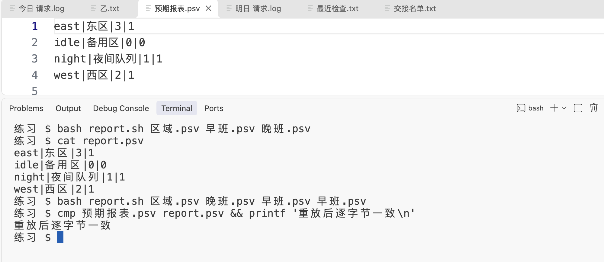

# 支线 1B　一份文本报表怎样做到不重算、不漏算

可以从主线 1.9 的文本处理继续，也可以接在[值班交接的批量检查](side-05-log-handoff.md#1e5-两天都查过了凭什么说整批完成)之后。手边的几份文件都能按指定顺序读出，每一份也能单独检查是否读完。值班交接时多出另一个问题。早班和晚班各送来一份记录，同事想知道各区域一共接了多少个请求，其中多少个出了错。你能打开两份文件，找到每一条错误，也能数出行数。可是如果同事晚上重新发了一遍早上漏传的附件，明早是否应该上报更多请求？

先留出一张纸，分成“我收到的”和“我准备交出去的”两栏。前者可以从原文件重新查到，后者留给你自己推出来。这里不会安装服务，也不需要数据库。在 VS Code 用一个新的空文件夹做本支线，以下各次操作都在这个文件夹的集成终端。上次试验留下的日志和这次的输入格式不同，先分开放。跟配套做可以打开第 1 章配套分支里的 `side-02-text-reports` 文件夹，原样本留一份，改条件时用副本。所有姓名、编号和记录都是练习数据。

整条支线可以分三次。第一次在纸上和两个小文件里，把九行交接对到账上的六次请求；第二次从空编辑器写一个能自己挑出现行记录的程序，再把六行送进区域表；第三次用独立凭据查报表差异，并试一次中途坏掉的交付。阅读约 75～105 分钟，跟做另需约 100～155 分钟，按成稿估算。第一次停在一张手算明细上，第二次停在一份可以再次生成的报表上。把两样都保留下来，复做比从长长的终端历史里猜上次进度容易。

## 两个班一共交了几件事

在编辑器左侧新建 **早班.psv**，把下面四行写进去，最后一行也以回车结束。`.psv` 在这里表示用竖线分列的文本，仍然可以像日志一样直接打开。最左边是接入服务给一次请求分配的编号，其次是这笔记录的版次，然后是负责区域、响应状态码和请求路径。来自不同班次的同一请求继续沿用原编号，重新发起的一次请求有新编号。这些是这次出数能用的上游约定，稍后可以自己试试缺掉哪一个就推不出答案。

```text
R101|1|east|200|/ping
R102|1|west|404|/clip.v1
R103|2|east|200|/clipXv1
R104|1|east|404|/clip.v1
```

再新建 **晚班.psv**。此处的“晚班”是收到这份交接的时段；晚班可能补送早些时候产生的一版。路径上的点与大写字母都照原样保留。

```text
R102|1|west|404|/clip.v1
R103|1|east|503|/clipXv1
R105|1|east|404|/clip.v1
R106|1|night|503|/queue
R104|2|west|200|/clip.v1
```

先遮住晚班，单独向同事报一次早班的数。你会在东区数到三笔，西区一笔，两个区域各有一笔错误。这里把 400 至 599 计入错误，请求总数则包括成功与出错。把晚班第一行拖选出来，再回早班搜索这一整行。假如有人把这两行计为西区两个错误，你能请他指出第二次请求的编号吗？上游说同一次请求发出的同一版可以重送，所以这里保留两条交接证据，却只能在回答“有多少次请求”时添一笔。若同事问的是消息通道忙了多少次，答案才会有另一种取法。先在纸上把这两行用一道短线连起来，留下能追回去的两个文件位置。

接着把早班最后一行和晚班第三行并排看。若你只看请求路径、状态和地区，两行每一项都能对上。快照里的版次也相同。可这次把它们摞成一张纸会发生什么？左边明明有两个不同的编号。可以是两位用户点了同一个地址，也可以是同一个人重新点了一次；这份数据不告诉我们是哪一种。它只保证这是两次请求。如果把外观一致的记录都丢弃，连同它们各自的发生次数也丢了。先把两个编号分别写在纸上。以后哪怕有人让你分析独立用户数，光凭这个请求编号也还需要别的证据。

剩下两组看起来更难断定。把 R103 的两行抄在一起，看看后收到的那一行能不能推翻早班的记录。如果上游约定版次较大者是对这笔请求更晚一次确认，版二的 200 才是当前应采用的结果。它先到，并不使它变旧。再核对 R104，早班一版登记在东区并标了错误，晚班二版改成西区且成功。这次若先按早班和晚班各自求和，再把和数相加，晚班那一行就只能“加一”。可是要得到最终报表，你实际上得把先前那笔东区错误移走，再把一笔成功放进西区。一个只有两个总数、没有编号和原行的中间结果，在哪里能找回该移走的那一笔？

现在合上文件，把纸的右栏按编号各写一行，在每一行旁边写出你采用的版次、区域与状态。六个编号从 R101 到 R106 都应各占一行。先自己数一次，再去看下面四个互相牵制的数。东区应有三次，只有 R105 出错；西区应有两次，只有 R102 出错；夜间队列一次，就是 R106 的错误；合起来六次、三错。还有没有上报过请求的备用区，同事也想看到它，当日两列都应为零。最好把你的六行留在编辑器里另存为个人对照，用自己的推导留底。后面一次换算法可能让总数完全吻合，却把一笔账放进错误的区域。

到这里可以给那张纸上的几种“相同”起名字了。整行完全一样，是一版记录的重放；两次真实请求刚好长得一样，应由不同的请求编号分开；同一编号有不同版次，是修订历史，回答现状要选最高一版。还有一种输入暂时没给你。假如 R102 的第一版在早班写 404，晚班同一编号同一版却写 200，应该采信哪张？两者凭证地位相同，上游约定无法给出先后，这一批就需要退回。把它称为冲突很有实际后果，后面要让程序拒绝交付，而不是靠哪一份放在命令尾部来猜。

## 在一行上试工具，找出它究竟选了什么

编辑器搜索框里查 `/clip.v1`，先关掉正则表达式开关，看两个文件里的命中位置。再打开带 `.*` 的开关，看原来哪个没被选中的地址亮了。终端里也可以让两种找法并排发生。先单独对早班做，短到每个结果都可以眼核。

```bash
grep -F '/clip.v1' 早班.psv
grep -E '/clip.v1' 早班.psv
```

第一种会找到 R102、R104，第二种多出 R103。两条命令之间输入文件、搜索文字都没变，点号在第二次会匹配一个任意字符，所以那行里的大写 X 也过关了。如果同事交来的是字面路径，固定字符串搜索能省掉逐个判断特殊字符的麻烦；如果他问所有以某一段开头、后面接不同版号的路径，才轮到可描述一类字符的模式。注意第一次只是检查一行中含有这一串。临时在早班的另一个副本给一行路径写上 `/clip.v10`，固定字符串也能查到前半段的 `/clip.v1`。要得到“路径恰好等于它”，下一步要知道路径在哪一列，还要比较整列的值。

在终端运行下面第一行，先看左边有几列，再运行第二行比较。单引号里的小程序交给 awk 执行，Shell 直接传里面的文字，因此交给 awk 的 `$1` 始终写作两个字符；它在程序运行时取第一列，和 Shell 脚本里取第一个调用参数的同形写法由不同的程序处理。

```bash
awk '{ print NF, $1 }' 早班.psv
awk -F '[|]' '{ print NF, $1, $5 }' 早班.psv
awk -F '[|]' '$5 == "/clip.v1" { print $1, $5 }' 早班.psv
```

第一条每行开头都是 1，后面跟着整条原文。awk 默认按空白切列，这四行里面都是竖线，整条还只算一列。第二条每行的列数都变成五，后面分别是一个编号和一个路径。这里用 `-F` 指定列间分隔，`[|]` 表示只匹配这个字符组中的竖线，读到一处就切开一列。听见“每一行切成五块”，你也许会想自己是不是还要去写个读文件的循环。实际写下的那一对花括号只说明拿到**一条**记录后怎样处理。awk 替你逐条取，取到下一行又从同一条规则开始；`NF` 是这一条切出的字段数，下一行可以有不同的值。第三条把条件放在花括号前，只有本行第五列与引号中的路径逐字相同时才打印，在刚才的副本上也不会误收 `/clip.v10`。

换一次条件试试。你想知道在晚班中哪些编号被标为错误，先只比较第四列，保留编号，别把版次扔掉。先在终端自己打一条 awk，把判定放在左边，把要给人看的列放在花括号里。纸上暂时应有四个候选 R102、R103、R105、R106。可以用 `awk -F '[|]' '$4 + 0 >= 400 { print $1, $2, $4 }' 晚班.psv` 作对照。这里把字段转作数再比较，前提是已经知道第四列合法。给副本的第四列写成 `503坏` 就会看见数值转换仍可能留下开头的 503。给结果加一项运算只决定如何计算，不能证明输入一开始就有效；我们会在适合拒绝整批的位置建立这层检查。

把这四个候选和手算明细对一下。R103 是一版、不是应当采用的二版，这次筛出来不能直接算进最终错误；R104 曾经出错，晚班看到的二版恰好是成功。这让我们得到一个比“能否写出筛选命令”更要紧的决定。**什么时候**筛选错误，会改变你还看不看得到推翻旧错误的那条成功消息。试着在纸面先删除所有 200 再选最新版本：R103 和 R104 都会留下本应消失的错误。若最终还要报告请求总数，所有从未出错的请求也被这一剪刀剪走了。所以接下来先保留每个编号所有版次所需的信息。等它们折叠成当前请求，再作“成功或错误”的分类。

## 给交接双方划一条能检验的文本边界

有一个很快的试法能检查我们刚才依赖了什么。用编辑器复制早班文件到 **试格式.psv**。只把最后一行的路径改成 `/clip|draft`，其余字一个也别碰。重新运行打印列数、第一列、第五列的命令。编号没变，显示的路径却只剩 `/clip`，列数跳到了六。同事如果只看这三个打印出来的字段，甚至可能误以为上游真的接到了这个短路径。再把这行的路径全删掉，保留第四列右边的竖线。你会看到列数又回到五，第五列却是空的。单看列数能挡住前一个例子，后一个例子却能顺利通过。

若常接前端传过来的 JSON，你可能想在竖线前加一个反斜线表示“这个竖线属于值”。先别约定，实际试试 `/clip\|draft`。这两个字符进入文件时是一个反斜线和一个竖线；按前面的分隔规则，切列看见竖线就结束这一列，左侧得到带反斜线的短路径，右侧仍多出一列。再试用双引号把整个路径包住，它们也只是文件中的引号。Shell 在命令行里消掉一对引号的规则，到读磁盘文字这一步早已结束。生产者和消费者如果没有共同约好如何编码和解码，加符号只会造出另一份不符合约定的输入。这里选择一个范围较小、双方都能检验的格式。路径需要从斜杠开头，由可见的 ASCII 字符构成，值里没有原样的竖线。若真实系统允许这样的字节，应该让两端共同采用能表示它的格式，或者按双方约定先把路径编码成可传的字符串。在本练习中不替上游猜该把哪一列再拼回去。

另一种损坏更不显眼。把编辑器右下角的行尾指示从 LF 临时改为 CRLF，另存为 **另一种行尾.psv**，不要动原交接。再使用单纯打印第五列的命令。画面往往看不出不同，因为回车本来就是控制光标的字符。可以在两份上分别问 `awk -F '[|]' '$5 == "/ping" { print $1 }' 文件名`。同一眼看上去相同的路径，一份能对到 R101，一份对不到。把第四、五列位置交换时，这种变化甚至可能被一次数值转换悄悄盖住。为了让后面逐字比较有依据，本接口约定 UTF-8 文本、Unix 换行 LF，不含字节序标记，也不让控制字符进入路径和区域名称。本文练习由可信的编辑器生成文本，不把 awk 当任意二进制输入或 UTF-8 合法性的完整检查器。遇到对方确实交的是 Windows 行尾，可以先留一份原件，再在编辑器切回 LF 保存转换副本，双方确认后使用。看到不同就静默剪空格，也可能把真实差异改成一次重放。

再从纸上六个编号抽两个看看它们承担的工作。R103、R104 最左边都有字母 R，后面是正整数的十进制写法，约好不带前导零。这里的 R 是编号组成部分，所以我们把它当字符串保留。如果别人的编号是 `0012` 和 `12` 两个不同的人，先转数字再计算就会把两人揉在一起。版次做的是另一件事，它需要能分先后，因此只许值在一至九十九万九千九百九十九之间，同样不带前导零。为什么要考虑长度？本练习要把版次转成数比较，限定到六位使这些整数在系统 awk 中都能准确比较；任意长度的十进制编号写成浮点数后比较，靠最后一位才分出先后的两版可能被看成相等。本批不要求从一版到最高版每个中间版本都送达，只要求在交来的记录中挑出**已见最高版**。报表的措辞相应也是“本批覆盖的请求当前记录”。当另外一个来源还攥着未送的第三版，从本地确认不了世界上再也没有更高版。

区域键用小写 ASCII 字母开头，后面可以接小写字母与数字。区域的中文显示名稍后单独从清单取得。状态码要有三位数字，第一位在一到五之间，所以 `40`、前面多了空格的 ` 404`、后面带着说明文字的 `404 missing` 都该在进入加法以前报错。若有新状态要不要计错，这是同事可以改变的报表口径，与状态字段有没有写全是两件事。当前只用 400 以上计错。用相同的输入还可以重作“五百段故障数”，到时只改分类那一处。原始请求明细有足够的信息支持改口径，之前若只保存一个混在一起的错误总数，就不能再解释其中几笔属于五百段。

先写一条能帮你找到坏行的命令。输入 `awk -F '[|]' 'NF != 5 { print FILENAME, FNR, NF }' 试格式.psv`，把刚才的竖线例子再造一次。文件名、行号、实际列数都在，回到编辑器直接前往这一行就可以复核。如果同时打开两班文件，`FNR` 随文件重新从一开始数；把 `FNR` 临时换成 `NR`，将早班、晚班一起传入并把条件去掉，会看到后一个文件从五开始。一个表示当前文件的位置，另一个表示这次调用截至当前的累计记录数。诊断里给同事的是一份可以打开的文件，把第几个全批输入行报给他，除非他恰好也按你这一顺序拼好了文件，否则对不上他的编辑器。本支线在程序发现问题时都保存文件名与文件内行号。你可以先删掉试格式副本，原来的九行交接从此保持不动。

## 从空文件写出一行一个请求的明细

新建 **current.awk**。把刚才命令行中的规则拆出来，先只写这三段，暂时不做错误计数。第一段在处理第一行之前执行一次，指明怎样切列；中间在每一行做一件很小的事；最后一段在所有输入行处理完毕时才输出。这里又用到一个叫“尾”的时刻，和文件中的末行有关系，却不能只靠猜“晚班最后一行”来代替它。

```awk
BEGIN { FS = "[|]" }
{ times[$1]++ }
END { for (id in times) print id, times[id] }
```

在终端输入 `awk -f current.awk 早班.psv 晚班.psv`。`-f` 后面给的是装着 awk 规则的文件，后面两个名字给的是数据。从结果里找到出现两回的三个编号。把编辑器里的原文逐一对回去，一个是完全相同的交接，另外两个都有两版。脚本现在还区分不了它们，只是替每个出现过的名字积了一格计数。方括号里放一个编号，它就能在名为 `times` 的关联数组里找到该编号的格子；`++` 把格子里的数加一，第一次累加时由零起步。把这段看作一个用字符串作键的表会比把它想作只有零到长度减一的数组容易些。`for (id in times)` 逐一取出已有的键，它不承诺照录入次序或数字大小出来。若有人正对着纸上的六行读，开头是哪一个编号都不影响这些次数。待核对两份完整文本时，我们再固定次序。

这次换掉中间与最后一段，只用 `{ row[$1] = $0 }` 记整条原文，最后用 `END { for (id in row) print row[id] }`。保留 `BEGIN` 的分隔说明。运行刚才的命令，再把两个文件名对调运行。两次都只交出六行，这个简单机制是否已经够用？去找 R103 和 R104，别只用 `wc -l` 核对。早班在前时 R103 留下旧的 503，晚班在前时 R104 留下旧的东区错误。你其实把“最近收到”写成了规则。若来源保证按同一键严格递增且绝不迟到，这个模型有机会工作；眼前这组早班二版、晚班一版的事实已经推翻了它的条件。调换文件名这样的便宜对照，能在不用制造上万行样本的情况下揭出看总数绝对看不见的问题。

拿一张便签先只处理 R103。见到它的二版时写下“已留二版”和那一整行；后来见到一版时比较数字，保留原便签。接着反过来看 R104，第一次留下第一版，真正见到第二版时才替换版号和整行。照这个顺序给刚才的中段加个门槛。你需要两个按同一编号找的格子，一个记数字用于比较，一个保留不经重组的文字用于交付。把代码改成如下形状，再运行两种文件顺序，分别核实两笔的版号和状态。写在 `if` 里的 `in` 可以检查这个编号有没有出现过，外层 `!` 将判断取反。未见过时直接存第一份，已经见过才需要和过去留下的数字比。

```awk
BEGIN { FS = "[|]" }
{
    version = $2 + 0
    if (!($1 in best) || version > best[$1]) {
        best[$1] = version
        row[$1] = $0
    }
}
END { for (id in row) print row[id] }
```

试一个在两版以内很难看出差别的条件。在编辑器给一份新文件 **后来.psv** 写 `R103|10|east|503|/clipXv1`。用它放在早班前，再晚班后各运行一次。新版本都应取十。可以想想你在编辑器里按字母次序排版号文字时，“10”的首字符排在“2”之前，直接取文本最后一个会得到哪一个？在这一处保留数值比较就是为了让“第十次确认”超过“第二次确认”。另一方面，如果写成“只许版号加一才接受”，眼下只有一、二、十，缺少三到九，第十版又会被无端挡在外面。等你要接的是一串操作指令、必须依次执行每个增量才能恢复状态时，才需要重新讨论缺版；我们手里每条消息给的都是该版完整五列，十版的归属和状态无须从第九版借来。看清传的是整行快照还是差量，是决定算法之前要向上游问清的事。

还记得同一版两个值无法裁定吗？要找出这种冲突，只检查当前已选的那条够不够？另存一份 **旧版异文.psv**，让它只含 `R103|1|east|200|/clipXv1`。先送早班的二版，再送晚班里的旧一版，最后送这份异文。刚才的脚本会一直保留二版，最终的六行好像完全正确。但上游交出了两份互相矛盾的一版，若同事明天只取旧版做复盘就会得到不同的事故记录。交付约定要求任何收到的同版异文都退回，解释“当天怎么修订到现在”时也要能信得过输入。要做到这一点便不能只给每个编号留一格。还要有一份登记，按“编号加版次”找到这次交接此前见到的原文。若合同只关心现状并且允许忽略旧版矛盾，完全可以讨论减少记忆；在这里减少到只存最高版会让你失去识别这份坏交接的能力。

试着把 `id` 和 `版次` 直接拼起来，在纸上为 R12 的三版和 R1 的二十三版写下拼接结果。两者居然都是 `R123`。键不能把这两张登记卡放同一格。这里用 awk 的 `SUBSEP` 放在两段中间，它是一种字段内容中不会出现的分隔字符。之所以有把握，是因为编号与版次都先限制了字符范围，谁也不会含这个控制字符。若以后接自由填写的备注和来源作为组合键，别仅凭“用户大概不会写这个字符”沿用。可以采用语言提供的结构化键，或约好长度编码，让值边界能够复原。先有了这个反例，再看 `key = $1 SUBSEP $2` 时，眼睛看到的不只是三个东西挨在一起，而是给两层身份留下了边界。

把“对照同一版”放在“比较最高版”前面，按下列四个动作自己先写几行。先构造键，到登记里找它；见过且原文相同就跳到下一输入行，版次与账中位置都无须再动；见过但原文不同就报错并停止；第一次见过才登记，继而进入你已写好的版次比较。awk 的 `next` 会结束当前行的一切后续动作，开始新的输入行。在此用它略过的那份是重放。合法的两次请求尽管路径和区域相同，它们的编号不同，不会走进这条捷径。

这次还要把坏格式送到同一个拒绝出口。在成品里 `function reject(reason)` 让调用处交出原因，再添上文件位置写到标准错误。程序在读行期间调用 `exit`，awk 还是会转去执行 `END`。若那里无条件打印，本已算出的一半数据就会和错误一起流出去，让下游还能生成半份报表。先用 `bad` 记这次不是正常读完，再在 `END` 开头判断，有错误就直接传出失败状态。拒绝输入和抑制未完成结果这两个动作放在不同的地方，正好和“读一条”与“收尾”这两个发生时刻对应。

下面是 **current.awk** 的完整内容。先自己用 `NF != 5` 及五位数、字母、斜杠的条件写规则，再用它对照。路径开头的斜杠写成 `\/`，因为这里在两道斜杠之间写模式，要让中间的那个斜杠成为模式所匹配的字面字符。后面的 `[[:graph:]]` 在稍后会固定的 C 区域设置下只接收可见的非空白 ASCII 字符，恰好把试过的回车挡在外面；路径只写一个根斜杠也允许。`$0` 始终取整条原记录，代码未给任何字段重新赋值，保存时字段次序和内容仍可逐字核对。

```awk
BEGIN { FS = "[|]" }
function reject(reason) {
    print FILENAME ":" FNR ": " reason > "/dev/stderr"
    bad = 1
    exit 2
}
{
    if (NF != 5) reject("需要五个字段")
    if ($1 !~ /^R[1-9][0-9]*$/) reject("请求编号不合约定")
    if ($2 !~ /^[1-9][0-9]*$/ || length($2) > 6) reject("版次不合约定")
    if ($3 !~ /^[a-z][a-z0-9]*$/) reject("区域键不合约定")
    if ($4 !~ /^[1-5][0-9][0-9]$/) reject("状态码不合约定")
    if ($5 !~ /^\/[[:graph:]]*$/) reject("路径不合约定")
    key = $1 SUBSEP $2
    if (key in delivery) {
        if (delivery[key] != $0) reject("同一请求同一版内容冲突 " $1 " v" $2)
        next
    }
    delivery[key] = $0
    version = $2 + 0
    if (!($1 in best) || version > best[$1]) {
        best[$1] = version
        row[$1] = $0
    }
}
END {
    if (bad) exit 2
    for (id in row) print row[id]
}
```

在当前练习终端运行下列五行。第一行选定 C 区域设置，会影响从这个终端启动的文本工具；中文显示名仍以原来的字节输出，只是排序与字符类按 C 的规则处理。若不想影响日常工作的别的命令，就为这次练习保留单独的集成终端。第二行只在这个新文件夹里写供查看的中间文件；单独运行每一段，发现错误容易指回上一个边界。

```bash
export LC_ALL=C
awk -f current.awk 早班.psv 晚班.psv > 现行未排序.psv
sort 现行未排序.psv > 现行.psv
cat 现行.psv
awk -f current.awk 早班.psv 晚班.psv 旧版异文.psv
```

前四行应当给出与便签同样的六个编号，R103 留二版的东区成功，R104 留二版的西区成功。最后一条应仅在标准错误出现旧版异文的文件名、行一、编号及版次。立刻用 `printf '%s\n' "$?"` 看，应为二。若被错误挡住的反倒是原早班或晚班，请先看正文样本里的竖线是不是误粘成看起来相似的全角竖线，编辑器右下角是不是 LF。只在一格里出错，程序说明里就应该有它的位置。若是分两天写程序，也可以在这里停下。保留完整的两份原交接、能运行的程序和六行现行明细，下次先在终端重跑前四行，和纸上的便签逐项对齐，再继续算区域。

## 同事要看到备用区，零从哪里来

把六行现行明细显示在编辑器右边，左边开一个空白文件，自己先在左边写三条积数的规则。每处理一行，就给第三列所属的区域加一次请求；如果第四列大于等于四百，再给同一区域加一次错误；读完后按已有区域输出两项数字。先不管显示名，纸上写东区三比一、西区二比一、夜间队列一比一，看看下面的命令能不能交出它们。这里的 `+0` 还可以让只加过总数、没发生过错误的格子显示数字零。临时删掉一份副本里某区域的所有错误行，再对照有无这个小小的加法会看见什么。

```bash
awk -F '[|]' '
  { n[$3]++; if ($4 + 0 >= 400) e[$3]++ }
  END { for (g in n) print g, n[g], e[g]+0 }
' 现行.psv
```

东、西、夜间三个区域都出来了。拿笔圈出“备用区零比零”应该放在哪里。只有在遍历行时记下来的区域才有名字可打印，完全没出现的区域，程序连它叫什么都不知道。你可以在脚本里直接写一个备用区，明早新增第五区就还得动脚本。这里同事其实已经有另一种材料可用，就是本次交接对应的区域名册。新建 **区域.psv**，左边放稳定的区域键，右边放按交接单印出来的显示名。两者有不同用途，更改“东区”这两个字的叫法无需重写每个请求的历史。

```text
east|东区
west|西区
night|夜间队列
idle|备用区
```

先别把两份文本逐行贴在一起。按原次序，名册第一行确实是东区，现行明细第一条也在东区；但一份是四行，另一份是六行，遇到同一区域第二条请求时，横着粘在一起的行已经没有对应关系。拿 R105 试一遍，从第三列的 east 去名册第一列找同样的键，才能确定该显示“东区”。同一个键可以在明细出现好几次，名册里却只能出现一次。后面这个“一次”值得专门试个坏样本。把名册复制到 **重名册.psv** 再添一行 `east|东区值班组`。若程序每遇名册一行都替请求加次计数，东区三笔可能变六笔；若只给同一个格子反复赋名，最后采用哪个显示名又随名册顺序改变。两种结果都没有交接约定作为依据，所以名册键重复也应整批拒绝，即便两行文字刚好完全一样。请求允许重放是上游消息约定，不能顺手套到一份静态清单上。

给每个区域一行还藏着一个方向问题。拿着名册问“这个区域有几次请求”，即使一笔都找不到也要保留那个区域。反过来，拿着请求问“它所属的区域能不能在名册里找到”，找不到绝不代表它没发生。若悄悄跳过这行，交出去的总请求数比六少一。若把它随便算到备用区，六这个总数虽然回来了，归属却错了。试着新建 **未登记.psv**，只写 `R107|1|north|503|/clip.v1`，把它和原始两班一起交给前一程序运行。格式符合约定，确实得到第七个编号。该不该接收 north 是稍后的名册检查能回答的事，前一步只凭字符是不能知道全部有效区域的。现在可以理解，为什么有些检查要看单行，有些检查直到拿到两份不同材料才能做。

在编辑器新建 **by-region.awk**。先亲手写一版只做“给每一行找到显示名”的程序。在开头写 `BEGIN { FS = "[|]" }`。再写一段 `FILENAME == ARGV[1] { label[$1] = $2; next }`，最后写 `{ print $1, $3, label[$3] }`。运行 `awk -f by-region.awk 区域.psv 现行.psv`。第一份输入里的四条先填好标签，`next` 让它们绕过最后的动作；第二份输入到来时，每条请求就可按自己的区域找出该显示哪几个字。试试把 `next` 临时删掉。六个请求之前多了什么？名册的每一行也会去执行最末的 `print`，它没有第三列，输出便成了貌似丢列的四行。把 `next` 加回去，数据类型是在这条边界上分开的。

你也许见过有人用 `NR == FNR` 标记第一份输入。两个计数在第一份文件中相等，这组正常样本确实可以。现在新建一个零字节的 **空名册.psv**，只传它和那六条现行明细，设想处理第一条请求时两个计数各是多少。前一份是空的，累计记录数与第二份文件内行号都会从一开始。如果拿相等来判断“这是名册”，一个错误的解释就能一路持续到文件末尾。这里看 `FILENAME == ARGV[1]` 指定第一个输入的文件名，即使名册一行都没有，依然不会把第二份中的请求当作名册条目。入口使两个文件是不同路径。处理动作看见未登记区域就要出错；空名册和空请求碰在一起则代表这次登记零区、收到零笔，输出零行，二者在本练习的约定里是有效的。若工作站要求名册至少一个区域，应在读完时增加那条检查，不能把所有空报表一概归结为“肯定没有请求”。

把最后的 `print` 换成两次累加，并将最后的遍历对象从“出现过请求的区域”改为“名册里的区域”。先看你自己能否写出总数为零和错误数为零的那一行，再对照下方完整程序。`OFS` 用于 `print` 逗号分开的几项，默认一个空格，这里改成竖线，正好让下一位接手的人仍按列读。加号对空格子作数值运算，印出来就是 0。显示名只要非空、不含分隔符或控制字符就按原样保留，可以有普通空格。输出列的顺序始终是区域键、显示名、总请求、错误请求。

```awk
BEGIN { FS = "[|]"; OFS = "|" }
function reject(reason) {
    print FILENAME ":" FNR ": " reason > "/dev/stderr"
    bad = 1
    exit 2
}
FILENAME == ARGV[1] {
    if (NF != 2 || $1 !~ /^[a-z][a-z0-9]*$/ || $2 == "") reject("区域表格式错误")
    if ($0 ~ /[[:cntrl:]]/) reject("区域表含控制字符")
    if ($1 in label) reject("区域重复 " $1)
    label[$1] = $2
    next
}
{
    if (!($3 in label)) reject("区域未登记 " $3 " " $1)
    total[$3]++
    if ($4 + 0 >= 400) errors[$3]++
}
END {
    if (bad) exit 2
    for (region in label) print region, label[region], total[region]+0, errors[region]+0
}
```

一次只变一项输入。先用正确的四行名册与已验证的六行明细运行，看看备用区。再只把名册换成重名册，原有六条请求也救不回来违反唯一性的登记。接着用正确名册，把早晚和未登记三份原始输入经过第一步生成七行明细，再送到这里。应看到北区的键和 R107 出现在标准错误中。这是告诉同事“请求已到达，负责单位待核对”的证据。为了解释为什么第七笔被退回，两步中间保留真正的明细很重要。如果只看最后没有生成新报表，可能有人误以为是第一步没收到它。

这里的 `by-region.awk` 输入约定是“已由上一程序校验并选过版的明细”。单独把九条原始交接交给它仍会做加法，而且会重算。把两步分别放在可打开、可检查的文件中，是为了出现差异时能找出从哪一步开始错；日常交付会把入口固定，免得值班同事要凭记忆选择中间文件。若将来有人想把第二步当作可以接收任意输入的独立服务，第一步提供的这些保证就要写进服务契约，必要时在新入口再检查。将一段程序能运行误当成它接受任何形状的数据，很容易让一个看上去正确的和数掩盖脏明细。

## 把“怎么少了一行”拆成两个能回答的问题

同事把你生成的报表翻开，看见备用区是零。他想知道究竟有没有一条区域拼错，恰好被忘掉了。你可以重跑全部程序，也可以先写两份各只有一列的材料。第一份列出名册里被允许出现的键；第二份列出现行请求真正使用过的键。先把东、西、夜间、备用四张纸排成一列，再把东、西、夜间三张排成另一列。你用手比的时候，同一侧重复的东区有几张，对“哪一个名字在那一侧缺席”没有影响。所以这里只取每侧不同的键；一会儿核对每一笔是否都算了一次，就不能继续用这种会主动丢次数的方法。

```bash
awk -F '[|]' '{print $1}' 区域.psv | sort -u > 名册.keys
awk -F '[|]' '{print $3}' 现行.psv | sort -u > 使用.keys
comm -23 名册.keys 使用.keys
comm -13 名册.keys 使用.keys
```

这几行沿用前面终端里的 `LC_ALL=C`。若另开了终端，先执行 `export LC_ALL=C`。在先后存出的两个文本中，排序次序必须与比较它们的 `comm` 对同样的字符串采用的次序相同。可以把两个光标放在两份已排好的名字上：两边相同就各进一步，若左边的名字较小，它在右边当前位置及后面都不可能再出现，所以只记录左边独有，再令左边向前。这个动作之所以能作决定，依靠的是后面不会冒出本来该排在前面的名字。试着把纸上的东区放到最后，过早判断“右边没它”的错误就有了来由。有的工具会发现输入乱序并诊断，有的输入会制造看似合理的输出，调用时先排好双方才是可靠前提。选用 C 排序使这几份供机器复核的文本不随个人的语言排序偏好变化；人读的中文名保留原样，这里排序的是稳定键。

`comm` 的第一列只属于左边，第二列只属于右边，第三列是双方都有。选项里的数字指要藏起来的列。第三条命令藏第二、三列，只剩名册有而实际没用到的 idle；第四条藏第一、三列，只剩使用过却没登记的键，当前应当空。先预测缺 north 的七行变式在这两次比较里各会新增什么，再照做。注意一份键只出现在某一侧属于命令的正常输出，即使确实打印了 north，`comm` 正常完成时退出状态仍然可以是零。若要让未知区域挡住发布，不要只在末尾检查“命令是否跑完”；前面程序明确查看键是否在名册里才决定成败，正是在落实这条业务含义。

谁被漏了和谁被多算了还可以互相抵消。假设有人在六行明细里把 R105 误换为 R104 的又一次副本，请求行数仍六，总体的“行数等于六”照样能过。两份只看键**集合**的文本可以检出 R105 消失，但只告诉你 R104 还在，没说它在两行。用另一份独立的实物来验。在纸上数过的六个编号写进 **应有编号.txt**，一行一个，从 R101 起顺次到 R106；然后拿实际明细只选第一列，排序但这次不要加 `-u`。两边按相同次序比整列，重复出现和遗漏都应该留下痕迹。若编号行确实只能来自上游这两份交接，也可以另外从原始交接选编号后做一次唯一化作为覆盖核对，那能检查程序没有掉已收到的编号，但不能检查上游完全没交某次请求。两种独立性要分清：一个是拿已收的原文查处理过程，一个是拿另外的交付清单查收件范围。

```bash
awk -F '[|]' '{print $1}' 现行.psv | sort > 实得编号.txt
diff -u 应有编号.txt 实得编号.txt
```

没有输出时立即读退出状态，应为零，表示这两份文件逐行相同。另存 **替换明细.psv**，用 R104 整行替换原本的 R105。再把上面第一行的输入换成它，第二行照旧。以减号开头的记录是左边预期中有、在对照的位置失去的文字，加号则表示在右边实际中多出来的文字。这个例子里你应该能同时对出多的四号、少的五号，`diff` 找到差异后返回一。前面 grep 的一有“没有命中”的含义，这里的一恰好表示有差异；换成一个不存在的文件名再做一次，退出状态会大于一，连比较都没正常完成。三种结果在需要决定是否能签收时各有用处。若一股脑把所有非零都解释为“内容不同”，下一班就可能被要求去找一份其实没成功打开的文件中的错行。

把预期与实得的范围再拉深一层。相同编号、相同数量还可能选了不同版或错的区域。`diff` 拿掉一整行、补进一整行能显示字段到底在哪里改变，前提是两边都按约定稳定排序。用你最初的手算六行构造完整五列后，与 `现行.psv` 排序核对；仅有编号、区域、状态的纸面便签，也可以将实际明细投影为这三列再对照。比较前先让两侧表达同一件事，用相同的列顺序与分隔符，保留你关心的版号，否则“东区成功”相同并不能说明采纳了哪一次修订。遇到差异先从第一个不同编号返回两班原件查看。若预期直接用正在验的程序生成，程序稳定地犯同一个错也会让两份文本完全一样。最开始费心手算的那张纸，在这里给了这次对照另一条独立来源。

小样到这里已经能交出两层证据。一层告诉你名单里的区域都在、哪些键暂未被使用，另一层告诉你每个请求是否真的保留了一次、保留的是哪一版。对这个问题，用字典查显示名比再要求每个人学一条连接命令短，也更好把未知区域钉在具体请求上。如果真实的清单有几百万行，不能全放在内存里，才需要考虑先按关联键分别排好，将两边顺序合并，例如用 `join`。届时需要重新决定两边同键多行应怎么配、哪边无匹配仍要输出、排序是否按连接字段而非整条文本，普通的默认内连接会使无匹配的备用区消失。眼下在两个数组和两份可打开的键表里已经可以直接试出这些后果，学会提出哪侧必须留下，比为同一问题背第三套语法更有用。

## 让每天的调用只交付一份已查完的报告

已经核准的四行报表，先在新文件 **预期报表.psv** 里手工留下这份。它对应的是原始两班和四区名册，后面加入新交接时不要反过来覆盖它。这里不另印列头，四列次序沿用上一段的约定；直接把一行中文列头当普通记录传给后续程序会多出一个从来没有登记过的区域。

```text
east|东区|3|1
idle|备用区|0|0
night|夜间队列|1|1
west|西区|2|1
```

每天接班只需拿名册和原始交接来运行一次。先考虑失败最容易掩在什么地方。前面那份旧版异文使现行程序报错，如果你把 `awk -f current.awk ... | sort` 直接交给下游，右侧的排序会收到多少行？因为左侧在收尾时压住了结果，右侧只看见文件结束，对零行排序它完全可以成功。若此时把空明细接进有四个区域的名册程序，会输出四个区域全零，读起来甚至比空文件更像经过正式检查的“好消息”。动手试时，只让这条失败的管道写入 **误判明细.psv**，然后在编辑器单独看着它被区域统计解释成了什么，别把这份结果送给同事。加上左端的状态，才能分清确实收到一份空日志与拒绝一份坏日志。

```bash
bash -c 'set +o pipefail; awk -f current.awk 早班.psv 晚班.psv 旧版异文.psv | sort > 误判明细.psv'
printf '默认管道 %s\n' "$?"
awk -f by-region.awk 区域.psv 误判明细.psv
bash -c 'set -o pipefail; awk -f current.awk 早班.psv 晚班.psv 旧版异文.psv | sort > 误判明细.psv'
printf '检查整段管道 %s\n' "$?"
```

这两次都看得见左侧的诊断，落盘的临时明细也都没有行，状态却应该由零变二。排序能否处理完它自己收到的内容，与左侧是否完成所有输入校验是两件可以分别成立的事。Bash 的 `pipefail` 让管道中至少一段失败时，整段返回最靠右的非零状态。这里显式启动 Bash 实验，所以你的日常 Zsh 窗口如何设置不会改变两轮的差别。要让“发布新内容”真的依赖这段状态，接下来还得让脚本在失败处分支退出；单把选项打开并不会阻止后面写着的另一条发布命令执行。

新建 **report.sh**。如果从空文件写，先只写检查参数的条件：第一项是区域表，剩下至少一份日志，因此少于两项时提示用法。再把合法输入按原样各保留成一个参数。这里 Bash 的数组 `inputs=()` 起初为空，循环中 `inputs+=("...")` 每次追加一个完整字符串。所有相对路径前再加 `./` 有一个不只与空格有关的理由。把早班复制为名叫 `slot=early` 的文件，运行 `awk 'END {print NR}' slot=early 晚班.psv` 和 `awk 'END {print NR}' ./slot=early 晚班.psv`。第一轮 awk 按命令行上“变量等于某值”的写法处理那个词，只数晚班五行；第二轮它明确收到一个文件路径，总数变成九。遇到开头有短横的文件名同样可用路径表示。Shell 替参数保住引号解决了拆词，下一层程序还会按自己认识的参数形式解释这串文字。

如果文件树里早已有个叫 report.psv 的目录，应在开始前指出这项名字冲突。否则移动文件时，系统会把目录理解为“把结果放进这里”，命令看似成功，同事却仍打不开约定的那份文件。接着在当前练习目录下由 `mktemp -d` 创建本次独用的工作目录。两条管道都先写过程文件；任一条以非零结束，右侧的 `exit "$?"` 在这一刻退出，不会运行最后的改名。正常路径中先清除已核完的工作明细，再将结果从工作目录移动为当前的 **report.psv**。临时目录与最终文件处于同一练习目录下，替换时读者看到的是上次完整文件或本次完整文件。输入有问题时，文件树里的“本批报表”目录保留这次写过的部分，方便复核；退出时的 `rmdir` 只试着清理空目录，带文件的目录不会被它递归删除。做完可以在编辑器确认名字，只清理自己的这一轮临时目录。整个练习约定只有这一个发布者，且运行期间输入是已经保存、不会被覆盖的完整交接文件。两个操作者同时成功运行会各有过程文件，最终谁后改名谁覆盖，不能靠独用过程目录判定谁有发布资格。

```bash
if [ "$#" -lt 2 ]; then
  printf '用法：bash report.sh 区域表 一份或多份日志\n' >&2
  exit 2
fi
if [ -d ./report.psv ]; then
  printf '报表目标是目录 <./report.psv>\n' >&2
  exit 2
fi
export LC_ALL=C
set -o pipefail
inputs=()
for path in "$@"; do
  if [ ! -f "$path" ] || [ ! -r "$path" ]; then
    printf '输入不是可读普通文件 <%s>\n' "$path" >&2
    exit 2
  fi
  case "$path" in
    /*) inputs+=("$path") ;;
    *) inputs+=("./$path") ;;
  esac
done
work=$(mktemp -d "./本批报表.XXXXXX") || exit 1
trap 'rmdir "$work" 2>/dev/null || :' EXIT
awk -f current.awk "${inputs[@]:1}" | sort > "$work/current.psv" || exit "$?"
awk -f by-region.awk "${inputs[0]}" "$work/current.psv" | sort > "$work/result.psv" || exit "$?"
rm "$work/current.psv" || exit "$?"
mv "$work/result.psv" ./report.psv || exit "$?"
```

从参数行往回读。Bash 数组从零编号，`"${inputs[0]}"` 只拿最前面的名册；`"${inputs[@]:1}"` 从下标一开始逐项展开，把其余所有日志完整传入同一轮 awk。为什么要同一轮？若每一份日志都启动一次新的 awk，刚才在内存里记下的版次和登记就不会跨文件保存。两个早班晚班各自看来都能发现区域、都能累计总数，可跨班重放的 R102 仍会算两次。把参数去向看清，就能自己查出“文件名全部传对了、结果却依然重算”的另一种实现错在哪里。

运行 `bash report.sh 区域.psv 早班.psv 晚班.psv`，接着 `diff -u 预期报表.psv report.psv`。屏幕若无差异，核状态为零。再运行一次 `bash report.sh 区域.psv 晚班.psv 早班.psv 早班.psv`，猜一猜交接消息总行数从九变成十三之后四行报表中哪一个数字会变。验证时用相同的预期再比一次。同事如果是补发文件，接手的人不用回忆上一次到底喂过早班没有；所报的对象是请求，整份重放没有制造新请求。反过来，把那个未登记的 R107 再加进调用，这一轮应该非零。**先**记录这个状态，再拿旧报表对照预期，两个观察分别回答“这次是否完成”和“上次好结果是否仍然可读”。旧报表仍读得通，不能用它冒充收到 R107 后的新报表。

空输入也有一次廉价但管用的对照。在编辑器新建 **无人值班.psv**，不写任何字符就保存。在原名册下只给它这一份输入，程序应确认四个区域各零笔；只有文件不存在时才在读取前拒绝。先预测上次旧报表在这两种调用后分别会不会改变，再分别做。重新拿原两班跑一次，回到基准报表，下次接着从四行中挑出 west 的二比一。这里留下第二个停点。若你是从另一个终端继续，先看所在目录，在编辑器打开 `report.psv` 与原始样本对照，脚本会在自己启动时选定区域设置，无须依赖昨天窗口里是否还保留着环境变量。



上方四行来自独立写下的预期报表。下方先从两个班次生成结果，再把早班多传一遍；最后一行只在新结果和预期文件逐字节相等时才打印。

## 扩到更多天，答案先写在命令以外

两班的九行能用眼检查，周末同事若补送一批几十个编号的汇总，逐条手算会变得费力。与其随机产生不知道正确答案的数据，不如先画一个有可推导结果的分组。假定另来六十笔，编号从 R201 到 R260，每两笔为一组，前一笔归东区、后一笔归西区；每三笔中最后一笔出错，其余成功。每六笔是两种周期都回到起点的一轮。这六笔里的第三笔（东区）与第六笔（西区）各错一笔，所以六十笔合起来，两区各新增三十笔、十个错误。先把这个预期写在纸上，再生成文件，运行程序时就有和生成器表达方式不同的核对办法。

```bash
awk 'BEGIN {
    for (i = 1; i <= 60; i++) {
        region = (i % 2 == 1 ? "east" : "west")
        status = (i % 3 == 0 ? 503 : 200)
        printf "R%d|1|%s|%d|/batch\n", 200+i, region, status
    }
}' > 周末新增.psv
bash report.sh 区域.psv 早班.psv 晚班.psv 周末新增.psv
```

这段单独在 `BEGIN` 里生成数据，循环变量从一加到六十，取余决定它在两笔或三笔的小周期里的位置。前六行可以直接打开检查。预期报表里东区从三比一变三十三比十一，西区从二比一变三十二比十一，另外两区原样。合计应为六十六次、二十三错。若得到的是每区三十比十，你大概只传了新文件；若总数恰好六十六可错数比预期少一，顺着编号先看哪条已知旧错消失。可以用前面学的 `diff` 比较你独立写下的四行预期，快速把问题缩到是哪一区的哪一列变了，然后再查该区的请求明细。重复传入整份周末新文件不会再多六十笔，把里面某一行改成新的编号且同一状态才会多一笔。这两个变式交给值班同事任选一个，你可以仅凭输出变化解释到底发生了哪种变化。

接下来别整份生成一轮大改，挑会改变分组的单笔处理。新建 **周末更正.psv**，写 `R203|2|west|200|/batch`。先找到周末原表的第三行，它本来是东区的一笔错误。新文件把它改列西区成功。先算明白四项该怎样变：东区三十二比十，西区三十三比十一，合计次数不变，错数少一。把更正文件排在周末新增的**前面**交一次，报表仍应服从你算的结果。若有人写的程序只按最后出现的位置选版，这一次它又会输给原周末文件。再试把同一笔二版的状态改成 404，另存为第二份异文，保留原更正一起传。若输出这时还给你一组整齐的数字，追根究底要查的是同版登记有没有全部走过，修订迁移与冲突拒绝需要两种不同的验证。

把这个实验转到新的业务口径也能试出什么时候要回头要数据。假设客服想按值班**收到交接的那一天**算收到几条消息，重放和旧版都要计入工作量。手里的两份文件代表已知的两个交接班，直接按文件逐行数反而符合这个问题，六十笔生成器不是必要条件。若他问“周一实际发生的请求中，最终被确认出错的有多少”，现有五列却没有请求发生时间。不能拿晚班文件中的第一版推断它是晚班才发生，也不能拿版次比较两个**不同**编号谁较早。此时你可以画出两份完全相同的交接输入，在纸上分别让 R103 属于周一或周二，现有五列都不用改，按发生日统计的答案却变了。这正说明哪一个问题凭当前输入无法唯一作答。向上游要一个含时区或明确时基的发生时刻，再决定一天从何时到何时，才有依据按日归属。若只是多收几天的交接，又共享同一编号空间和修订约定，现在的批处理已经能做跨天累计。

还有一种现实变化会令整个合并失去依据。设两台彼此独立的采集器都从 R101 开始编号，主机甲的 R101 第一版和主机乙的 R101 第一版可以同时存在。纸上给甲乙都写 `R101|1|east|200|/ping`，程序会判成同版重放，可确实发生了两次；换个路径又会被判成同版冲突。能修正的是输入中必须含来源标识，把它与编号一起作为请求身份，再与版次一起作交接身份。仅把文件名加进键并不总对：同一采集器的同一请求可能在今天与明天两个附件中重发。应取来源定义的稳定身份，和一次消息碰巧放在哪个文件分开。这一反例也给独立接手一份陌生文本留下很具体的开场问题：让提供者举出两次真实请求和一次重放，在样本里指出能分开它们的列，再请他展示修订怎样抵达以及谁有权裁决同版冲突。材料缺了这些条件，改再多排序参数也算不出确定答案。

最后从窗口回望一下今天留下的东西。交接原件回答“收到什么”，一行一个编号的明细回答“采纳哪版”，四行报表回答“各区多少”，独立预期用来发现处理结果偏离哪一项。若服务运行中的日志还在被其他进程追加，并且同一个请求每天可能出新版本，这套读已封存文本、内存里保留各个版本的办法会遇到边界。新的一天只喂当天的一份，昨天 R104 的旧版就没法从昨天总数中撤掉；要么从足够完整的一组文件重算，要么保存能够回查原编号、原归属和历史版本的状态。数据大到内存装不下时，能按键排序的外部工具或数据库可以接过这部分工作；在换工具之前仍需回答同样的问题，保留一笔的依据是谁、重复数有没有被丢掉、错误中途发生后交出的究竟是哪一版报告。哪怕只交四行数字，知道每行可以回查到哪些请求，也比能把几十条命令串在一起更容易接下一次值班。

## 附录：本支线必要技术点速查

| 手里的疑问 | 可以回查的操作 |
| --- | --- |
| 为何搜字面路径时另一条也亮了 | 用 `grep -F` 查固定文字，用 awk 的字段相等比较查整列相同，`grep -E` 的点号可以匹配另一个字符。 |
| 怎样指出是哪份文件的哪一行 | awk 的 `FILENAME`、`FNR` 给出文件与行号，`NF` 为本行列数，`$0` 保留整条记录。 |
| 需要记到什么时候 | 每行用关联数组保留同一编号和版次的原文，用另一个按编号的数组留最高版，读完整批再输出。拒绝时检查 `END` 是否还会打印。 |
| 哪侧必须留下零、哪侧不得失联 | 从区域名册逐键输出，在每一条现行请求进入累计前检查归属。按同样规则排序后用 `comm -23`、`comm -13` 查两个方向的缺席。 |
| 怎样看出同一编号多一次、另一个少一次 | 各列编号排序，保留重复，再用 `diff -u` 比对。逐行相同返回零，有差异为一，比较不能完成时大于一。 |
| 一段排序成功后能否发布 | Bash 打开 `pipefail`，每段管道检查状态，全部完成才将过程文件改名交付。 |

本机可用 `man awk`、`man comm` 和 `man diff` 核对所装工具，按 `q` 退出。字段与关联数组、已排序文本比较、差异的退出状态也可分别查阅官方手册。[awk](https://man.openbsd.org/awk) · [comm](https://man.openbsd.org/comm) · [diff](https://man.openbsd.org/diff.1)

[返回第 1 章《Unix Shell：从第一条命令到独立写脚本》](chapter.md)
