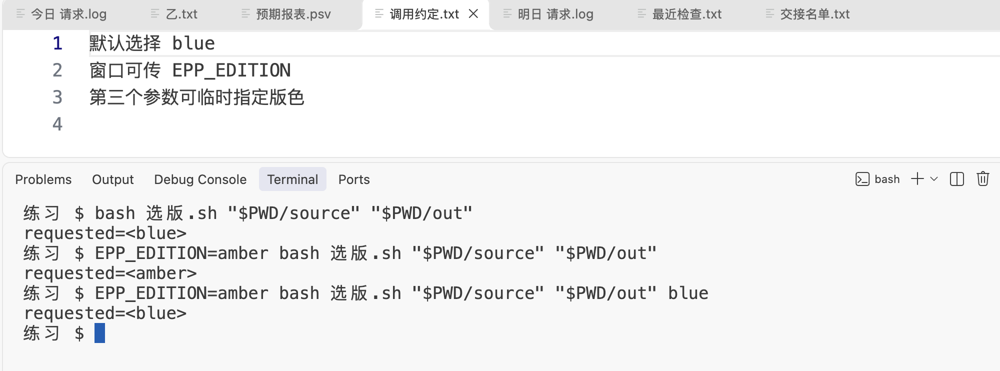

# 支线 1C 终端里成功的任务，换成定时运行为什么会失败

下午四点，编辑把明天展示用的英语例句交过来。你每天从一个目录取原文，核对它属于约定的那一版，再交一份标过版本的文本。今天打开终端敲几行就能做。编辑想把时间提前到清晨，人还没来到电脑前，页面预览时就能读到当天的结果。先用手里这台电脑试一回：把你认为机器一定知道的几件事逐一拿走，看工作还能走到哪里。这样即使明天的接手人用的是另一种定时器，你也有办法跟他核对是从哪一步开始不同。

这条支线需要[第 1 章](chapter.md)里读参数、区分两路输出、读退出状态和等后台作业的经验。阅读估计 65～90 分钟，动手另计 75～110 分钟，可分三次。第一次做到能从空目录、空环境开工；第二次做到发布失败仍能打开旧报告；最后再让两次交付在同一地点相遇。各段都在自己的目录、自己的普通用户下做。已经做过主线的日志、上次保留的终端进程以及第 2 章的 Node，都不是这个现场的前提。

## 白天那份成功样本里藏了什么

在文件管理器新建一个叫“清晨交付”的空文件夹，用 VS Code 打开。左侧再建三个目录，叫 source、out、desk。先在 source 新建 release.txt，写一行 `release=blue`；同目录的 body.txt 写一行 `The bridge is open.`。两份都在最后按一次回车、保存。若编辑器把新文件存成 Windows 换行，点状态栏上的 CRLF，选 LF，再保存；稍后会故意拿多一个字符的输入做一次对照。out 用来接收交付，desk 是模拟明早启动位置的空目录。留一个容易认出的版本名，是为了区分“命令成功退出”和“找对了编辑交来的那一版”。

在窗口下方新建终端甲，执行 `pwd`，核对它在“清晨交付”。把 `root=$PWD` 单独执行一次，保留这个练习目录的完整位置。为避免自己在不同标签页写错文件，可以在文件树点开三个目录，实验中每生出一份文件，都在这里看看它落到哪一层。先按白天的工作方式交一份样本，逐行执行，到最后直接点开 out/report.txt。

```bash
root=$PWD
cat source/release.txt
printf 'checked=blue\n' > out/report.txt
cat source/body.txt >> out/report.txt
```

第一行报告里写着蓝版，下一行是桥已开放。这里替程序作判断的人是你：眼睛看到标记确实是 blue，才执行写蓝版的命令。把命令原样记录下来，明早照顺序运行，遇到标记已换成 amber 会怎样？先在编辑器改标记，正文写成 `The ferry is delayed.`，两处保存，再照白天的顺序重做。两条写报告的命令都可以成功，得到的却是蓝版标题配轮渡例句。仅仅证实机器能够打开源文件，补不上刚才人眼作的这个决定。把蓝版和桥的原句恢复，再交一份正确的蓝报告，留给后面的失败轮比较。

还有一个白天很容易被忽略的决定。点击文件树里的 desk，右击“在集成终端中打开”，得到乙。在乙敲刚才第一条读文件命令，注意错误提到的名字；回甲再敲，原文还在。文件树只画一棵，两个终端却从树的不同位置出发。为了给第二种情况制造一个更难发现的结果，可以在 desk 里临时新建另一个 source，里面也放 release.txt，内容写 `release=desk-copy`。再在乙读一次。上一轮缺文件，错误很响；这一轮连状态都是零，只有标记说明读错了。一次真正的无人值守交付，不应靠“恰好找不到另一个同名文件”替你守住输入位置。

回甲，把原本需要在场的判断拆成一句可以执行的话。在根目录建 tiny.sh，里面先只放下面四行。这里的 grep 用 `-F` 逐字匹配，`-x` 要求整行匹配，`-q` 遇到所需证据后不输出原行。尾部的短路写法在左边失败时运行右边，先只让这份草稿中止，后面会给不同失败留可区分的状态。

```bash
grep -Fqx 'release=blue' source/release.txt || exit 1
printf 'checked=blue\n' > out/report.txt || exit 1
cat source/body.txt >> out/report.txt || exit 1
printf 'published blue\n'
```

甲用 `/bin/bash ./tiny.sh` 跑通；在甲输入 `(cd desk && /bin/bash "$root/tiny.sh")` 再试一次。第二次明明把脚本的完整位置给了 Bash，里面的相对名字还是去找桌面副本。把 desk 下的标记短暂写成 blue，注意这次程序会走得更远，在 desk 缺 out 的地方才停。此时工作路径、脚本路径、任务要读的资料路径已经有三个不同答案。以后在定时器界面只填一个绝对脚本名，那个名字最多帮解释器找到这几行程序；从哪里读业务文件，仍然要有人替程序决定。把 desk 下那份标记恢复为 desk-copy，它以后可以一直充当错取样本。

如果此处关上电脑，下次恢复不必猜哪份是正确报告。先在 VS Code 打开根目录下的 source/release.txt 与 out/report.txt，看是否分别是蓝版和桥的原句。再在根目录打开终端、重设 `root=$PWD`。这些落在文件上的事实能跨过一次关机，变量需要由新 Shell 重新取得。正是这个差别，让习惯于保存项目文件的人有时会高估一个新窗口能天然继承多少昨天的现场。

## 把启动的人换掉，先只拿走一项条件

要定位清晨会失败的原因，不急着去安装定时服务。下一轮连时钟都不用换，还是甲手动启动，只把某一项条件跟白天区别开。先在根目录新建 where.sh，写入下面几行。printf 的参数分开给，一个占位符只填一个值。内置的 pwd 问实际的工作目录，环境里已有一个同名的文字变量也不能取代开头这次独立读数。为了便于之后把结果交给接手人，只打印练习里用得到的几项，不把整张环境变量表写进交付文件。

```bash
printf 'cwd=<%s>\n' "$(pwd)"
printf 'edition=<%s>\n' "${EPP_EDITION-unset}"
printf 'bash=<%s>\n' "$BASH_VERSION"
command -v grep
```

在甲依次作三次调用，前两个在同一工作目录；第三个才进入 desk。每轮先看两行带尖括号的读数，再看解释器版本和最后报出的程序位置。这几项若能分开对照，就用不到猜测“定时器是不是有自己的语法”。

```bash
export EPP_EDITION=amber
/bin/bash "$root/where.sh"
/usr/bin/env -i PATH=/usr/bin:/bin /bin/bash "$root/where.sh"
(cd "$root/desk" && /usr/bin/env -i PATH=/usr/bin:/bin /bin/bash "$root/where.sh")
```

第一轮看到 amber，第二轮版色一栏成了 unset，目录还是原来的那个。第三轮才出现 desk。这里请 `env` 以 `-i` 建一个不继承原有变量的环境，然后只提供这一行写出的 PATH，再启动指定路径上的 Bash。由调用者安排的工作目录却原样留给了新进程；“清空环境”和“进到另外一个目录”可以分别制造差异。脚本里的 Bash 还会为自己的运行建立一部分变量，例如能报出自己的版本，所以第二轮并不意味着进程内部从头到尾连一个变量都不存在。

可以再做一次更贴近排查程序来源的变化。把第二轮的 PATH 暂时改成只有 `"$root/desk"`，继续用绝对路径启动 Bash。前三行还会输出，最后那条查询在这里找不到 grep，整个 where.sh 的最后状态也随它变成非零。换回 `/usr/bin:/bin`，查到的系统路径又出现了。这次缺少的不是读取脚本的能力。先要能启动解释器，之后才由它寻找脚本中写成短名字的外部工具。假如用的是 `/usr/bin/env bash` 来寻找解释器，搜索 PATH 的步骤还会提前到脚本第一行执行之前；在这台练习机上既然已经验证 `/bin/bash` 在，就可以把入口约定在这个具体文件。迁移到没有此文件的机器时，那项约定也要跟着确认。

试想同事说“我在终端里输入上次起的简称就能交”，他有可能在说一个实际文件，也可能指上次点加载的函数。在甲临时定义 `morning_card() { printf 'manual shortcut\n'; }`，直接输入 `morning_card`，能看到提示。让新 Bash 执行 `/bin/bash -c 'command -v morning_card'`，比较它报出的状态。在这个没有另行导出该函数的实验里，新解释器连这个名字都不认识。若改用真实脚本文件的位置，两次都可以让解释器打开文件。把桌面窗口的个性化配置全部塞进无人值守任务，可能顺手带入别的版本、别的简称、需要人的提示；从这次工作真正依赖的几个名字出发，比较容易解释每一项的作用。

此时可以把入口从“运行某串碰巧有效的字”缩小为两份位置。在根目录另建 deliver.sh，先写一个沿途报出实参的骨架。用到的 `case` 在主线已见过；这里的模式 `/*` 要求第一个字符为斜线，后面可跟其他字符。这个约定给负责启动的人一个检查点，不尝试猜他的工作目录。两行赋值只是留个容易辨认的名字，真正读文件时仍要像主线对带空格文件名那样给变量加双引号。

```bash
if [ "$#" -lt 2 ] || [ "$#" -gt 3 ]; then exit 64; fi
src=$1
out=$2
case "$src" in /*) ;; *) printf 'source path must be absolute\n' >&2; exit 64 ;; esac
case "$out" in /*) ;; *) printf 'output path must be absolute\n' >&2; exit 64 ;; esac
printf 'source=<%s>\noutput=<%s>\n' "$src" "$out"
```

在甲先给它两个相对名字，如 `/bin/bash "$root/deliver.sh" source out`。这回希望在读目录之前就看到拒绝。仍留在甲，把参数改成 `"$root/source" "$root/out"` 通过，再把同一命令放进刚才切到 desk 的括号里。两次应报完全相同的两份位置，desk 下那份刻意写错的标记没有机会参与。直接给一整个目录加外层引号，Shell 交出去的是一个完整参数；把整个“解释器、脚本、两个目录”一起用一对引号包起来，则会变成一个带空格的命令名。若以后换到图形调度工具，先看表单让你填的是单个可执行文件及分立参数，还是一行需要交给 Shell 解读的命令。这两个接口表达同一业务动作，转义和参数数量却不能照搬。

如果只想完成这一段实验，可以保留这份骨架，不必往用户的启动文件里写任何配置。甲里因对照而导出的 amber 记得用 `unset EPP_EDITION` 移去；后面正要区分“故意指定一种版色”和“什么也没指定”。从空环境、另一个工作目录还能把两份绝对位置原样交到脚本，正是本段要带走的成功样本。同时留下故意传相对目录的那一轮，失败在参数检查之前，就不必再去研究 grep 和正文的内容。

## 当参数、窗口设置和默认版本三者各说各话

明天有两批稿，一批采用蓝版，一批采用琥珀版。希望完全不写要求时照旧收蓝版；某个工作窗口连续做琥珀版时能预先设置；临时替另一份稿核对时又能在命令行覆盖一次。先不写“优先级”三个字，拿三张纸当三次交接单：第一张没有写版色，桌上也没有便签；第二张空白，桌上便签写 amber；第三张明确写 blue，便签仍为 amber。请给每张的报告标题先写上你会负责任交出的字。第三张的要求尤其能分出两种实现，若只拿默认蓝版运行，永远看不出到底听的是谁。

在已有骨架末尾，把临时打印绝对路径的命令换成下面这段。这里的 `$#` 表示调用者交给脚本的参数个数。已经检查过只能有两个或三个，出现第三个位置就能确定有人给了这项输入，至于他给了什么，还要单独判断。执行到每个分支时，它只会把来源里的值放进 edition；碰到什么都没有给的情况，才替调用者选蓝版。

```bash
if [ "$#" -eq 3 ]; then
  edition=$3
elif [ "${EPP_EDITION+x}" = x ]; then
  edition=$EPP_EDITION
else
  edition=blue
fi
case "$edition" in
  blue|amber) printf 'requested=<%s>\n' "$edition" ;;
  *) printf 'edition must be blue or amber\n' >&2; exit 64 ;;
esac
```

第一轮在没导出变量的窗口跑 `/bin/bash "$root/deliver.sh" "$root/source" "$root/out"`。第二轮只在这条命令前紧贴加上 `EPP_EDITION=amber`，按空格再接解释器。第三轮保留整个第二轮，只在末尾另添参数 `blue`。应当依次读到 blue、amber、blue。刻意选择第二轮与第三轮相冲突，才证明命令行真的能临时接管。如果把便签和第三个参数都写成 blue，两种优先级会给出同一答案，无法拿它们中任何一次当作覆盖已生效的证据。



图中把刚写到这一步的选版代码另存为“选版.sh”。读第二和第三次调用：两次都把 amber 交给进程，第三次额外提供的参数改变了最终选择。

还有一张很容易被漏掉的交接单：上面印着“我要覆盖版色”，生成字段的程序却交了一个空字符串。手动在命令末尾放 `""`，这仍然是一个实参，三个参数的那条路应拒绝它；再拿掉它，只在命令前放 `EPP_EDITION=`，环境里同样存在一项刻意给出的空值，也应当拒绝。这里使用 `${EPP_EDITION+x}`，变量存在就展开成字符 x，连空字符串也算存在；完全没有这项设置时才展开为空。用这个小区别保护编辑的意图，是因为“没有提出要求，同意采用正常流程”和“试图提出要求，但输入没传完整”需要不同的处理。若两种都无声地落回 blue，绿色的成功提示恰好会掩盖发布程序漏字段的错误。

可以给明早的负责人演示一次。他拿到 shell 命令和报告里的 blue，怀疑是环境没传过去。只改便签、不动显式第三个参数，结果始终为 blue；再拿掉第三个参数，便签突然生效。这个变式说明环境传递和“传来的值在本次是否被选中”是两个问题。排查时保存**这一次实际收到的参数**和少量约定的环境键足以区分，直接把所有环境内容打印进文件反倒增加无关数据，还可能夹带同窗口里别的项目放进去的凭据。最终脚本只在成功时输出选择的版本，失败时能指出是哪项约定没有满足。

现在回来看输入目录的蓝版标记。如果把两条 `release=blue` 连写两行，最早的 grep 会怎样？先复制该文件留出恢复样本，给原文件末尾多添一行 `release=amber`，在甲运行 tiny.sh。这里第一行满足 grep，脚本照样交蓝版；若文件里有两份互相矛盾的标记，编辑并未给出唯一版本，交付人有理由停下。一个写着目标版色的变量只能表达“我想要哪一版”，不能替对方文件作证它确实就是这一版。这次要判断的是整份标记跟约定的内容是否完全相同。恢复一行蓝版并保留末尾换行，把正确报告也恢复给桥的那一句。

先在 out 里另起一个仅供眼睛核对的 expected.demo，用 `printf 'release=blue\n' > "$root/out/expected.demo"` 写入。运行 `cmp -s "$root/out/expected.demo" "$root/source/release.txt"`，立刻读 `$?`。完全一样时为零。去掉标记最后的换行再比，两个编辑器标签里看上去几乎一样，这次却为一；复原换行，再把比较中的源文件名临时写成不存在的路径，状态大于一。同一条命令区分出“确实看到了两个不同的内容”和“这次连比较都没做完”。`-s` 把比较的文字输出收住，接下来由我们的脚本按状态给交接人诊断。别为通过比较去修剪所有输入，那会悄悄改变约定，把编辑需要发现的误改也清除掉。

这里不让编辑用版本标记表达时间或承担身份认证。两份不同的正文都可能配一个合法的 blue，字节相等只能证实版色文件符合这次约定；明天若还要按具体修订号交接，就要由发布方提供独立的修订编号或内容摘要，并让检查者比较那个依据。眼前我们有意用两句能一眼辨认的合成原文，目的是让后面失败后打开旧报告时读得到差异。把“这次核对了什么”说得具体，接手者便不会把报告上的一行标题当作所有内容都已经验证的承诺。

## 空着的输入口，有没有人在另一头

中午交接时，版色不明确还可以当面追问。有人提议把默认分支改成打印“明天交哪一版”，让运行的人输答案。这在终端里确实很自然。先别把它加进 deliver.sh，在根目录建一个只有三步的小文件 ask.sh，保住前面已经能处理参数的版本。调用一旦失败，先观察它停在哪里；下面用 read 的状态把“收到一行文字”和“这次再也没有一行输入”分开。

```bash
printf 'edition? ' >&2
if IFS= read -r answer; then
  printf 'answer=<%s>\n' "$answer"
else
  printf 'no complete answer\n' >&2
  exit 64
fi
```

在甲执行 `/bin/bash "$root/ask.sh"`，见到提示后输入 blue、按回车，得到尖括号里的 blue。第二次直接按回车，会看到空括号，read 仍成功，因为输入里实际有一行，内容虽为空却以换行收尾。第三次在空提示处按 Control＋D，错误一侧才会出现 no complete answer。终端在行首把这个动作解释为当前没有更多输入可读；在这次程序退出之后，甲的提示符还能照常接受命令。它与主线里 Control＋C 请求前台作业中断留下的状态不是一件事。这里的 `IFS=` 使 read 不用默认分隔符收掉行首尾空白，`-r` 让反斜线也按普通文字读，目的是让判断建立在接到的实际一行上。

接下来将运行方式改成 `/bin/bash "$root/ask.sh" </dev/null`。相同的提示照样印出来，程序却不用等人按键就走到失败。左边的输入改接一个打开后立刻能读到结束的位置。在另一轮让 `printf 'amber\n' | /bin/bash "$root/ask.sh"` 来供应答案，又能不经键盘取得琥珀版。你可以据此判断常见的一个设想：“机器晚上没人在，就会默认替我按回车。”若真是发来一个换行，结果应该像第二次的空括号；现在实际看到的却是没有完整答案。无人值守程序还可能接着一个无人写入但仍开着的管道，一直等不到一行，也等不到结束。要分清是在等待、收到了空行、还是来源已关闭，光看屏幕上的那个问题很难知道。

这里还有比接到空设备更苛刻的一种启动。试 `/bin/bash "$root/ask.sh" <&-`，这次调用者连标准输入这个编号都关了，read 可能额外给出描述符无效的诊断。空设备可读，读取时报告结束；关闭以后，没有可供读取的入口。两轮都会走这份 ask 草稿的失败分支，但背后发生的事情不同。回到目前只从实参、环境、标记判断的 deliver.sh，用同样两种写法各跑一遍。得到的应是相同的版色，因为任务根本没有必要去读标准输入。将这条要求交给以后接手的人，比要求他记住某个定时器恰好怎样提供输入更牢靠。

有时把提示重定向到文件，看似解决了“运行时没地方显示问题”。你可以把 ask 的普通输出写到 out/answer.demo，把诊断写到 out/question.demo，先保持键盘仍相连。看起来安静了，甲的提示符却迟迟不回来；到乙点开 question.demo，那句问题正躺在文件里。回到甲输入 blue 回车，answer.demo 才出现值。输出有地方去，并不会替输入安排发送者。反过来，明确将版色作为参数传进来，连错误诊断都能完整保留，就没有必要在长期运行的环境里模拟一双手。

从阅读角度可以在这里收一下前半段的意外：一个成功的命令字符串可能使用了当前目录、窗口定义、搜索路径、已导出变量和键盘，但业务本身其实只需两个绝对目录和一个可选版色。把本次选择写成一条可重放的调用，不需要把整个开发环境复制给机器。到根目录，以前面保存好的 tiny 和 where 作对照，另开一个终端丙，在丙重设 `root=$PWD`，用下列命令从 desk 启动。进入括号后将另起一个工作环境，括号结束仍能在根目录继续，这样后面的路径不会因实验而悄悄改变。

```bash
(
  cd "$root/desk" || exit 1
  /usr/bin/env -i PATH=/usr/bin:/bin /bin/bash "$root/deliver.sh" \
    "$root/source" "$root/out" blue </dev/null
)
printf 'result=%s\n' "$?"
```

这里脚本位置和两个参数是外层 Shell 在启动 env 时就从 root 拼好的；root 这个变量自己不需要被传进空环境。若把整句先放进单引号、改成要求脚本再去找 `$root`，空环境里的脚本自然失去了原来的拼图。这正是有些人在终端复制了一行成功命令，挪到另一个配置框里却得不到相同路径的原因。此次看到的零只表示骨架认可传入的条件。下一步让同一个入口真正检查、写出、交付，仍然保留丙作为稍后重放的调用者。

## 做到一半失败，旧报告可不可以继续给人看

先把正确的蓝版、桥的原句、两行完整报告留在文件树。设想下午临时拿到了新蓝稿，正文正从别处复制过来，标记已经到位，正文文件却还没到。为了看清失败到底发生在哪里，在编辑器里把 source/body.txt 改名为 body.hold；同目录 release.txt 保持正确。留在根目录运行第一份 tiny.sh，观察退出状态，再点开 out/report.txt。原文少了，只剩一行蓝标题。若把正文改名回来再重试，状态会恢复，但从第一次失败到重试之间，已经有读者可能打开过那份半成品。

把昨天的报告手工恢复后，只改 tiny 的第一行，让它提前检查正文在不在，会拦住这一次故障。然而正文可能在真正读取时才出现错误，写报告也可能在写完标题才失败。重做一份更可靠的交付时，可以先用文件树模拟动作：保留 out/report.txt，给另一个新名字写标题，哪怕正文还没补上，点击正式名字仍看到旧报告。等新名字里两行都齐，才让它占据正式名字。核心决定落在“读者何时能看到新版本”。在私有的本地目录中，暂存和正式名字位于同一文件系统，用改名替换能使新打开这个名字的人取到完整的旧文件或完整的新文件。一个已经打开旧文件的读者仍可能继续读旧内容，也不会因改名而跳到新文件中间。

先做一个容易观察中途状态的手工轮。把 source/body.txt 恢复并写上另一个完整句子 `The bridge opens at noon.`，标记仍为 blue。保留旧报告给清晨的页面，同时在 out 的新文件 report.next.demo 里只写标题。在甲执行 `cat "$root/out/report.txt"`，在乙打开草稿，二者应分别是完整旧句和孤零零的标题。再在甲把新正文追加给草稿，先检查两份仍然不同，最后执行下面这一行。切回编辑器，若旧标签提示磁盘内容变动，就从文件树重新打开正式名字，确认文件名保持原样，句子已换成中午。

```bash
mv -f "$root/out/report.next.demo" "$root/out/report.txt"
```

这里选择同一输出目录还有一个实在的理由。某些人会把草稿写在系统临时目录，等完成才“移动”到目的卷；如果两个目录在不同文件系统，mv 可能退化成先复制再删除，读者等待期间能够看到什么就不能沿用上次的结论。这条练习把草稿建在 out 下面，跟目标共享文件系统。成功改名能说明本机此刻名字的切换，却没有检验断电后数据是否已经持久写到介质。若有人要据此宣称突然掉电仍能恢复，需要另外核对文件与目录的持久化保证，不能用同一台开着的机器反复打开报告来证实。

回到 deliver.sh，把临时打印选择结果的地方收成只有校验：合法版色的分支用 `:`，表示此处执行一个什么也不用做但返回成功的命令。接在判断尾部，先写一版只适合**一个人一次启动**的操作。文件名暂时带 demo 便于在图形界面识别，完整配套稍后把它们收进本次交付独占的目录。执行此段时 source/body.txt 应存在，out/report.txt 应是刚验证过的普通文件。

```bash
work="$out/draft.demo"
mkdir "$work" || exit 73
printf 'release=%s\n' "$edition" > "$work/expected" || exit 73
cmp -s "$work/expected" "$src/release.txt"
match=$?
case "$match" in
  0) ;;
  1) printf 'release marker differs\n' >&2; exit 65 ;;
  *) printf 'release marker unreadable\n' >&2; exit 66 ;;
esac
printf 'checked=%s\n' "$edition" > "$work/report.next" || exit 73
cat "$src/body.txt" >> "$work/report.next" || exit 74
mv -f "$work/report.next" "$out/report.txt" || exit 73
printf 'published %s\n' "$edition"
```

第一次从 desk 走完先前那条干净调用，读报告，状态零。到 out/draft.demo 还能看见 expected。第二次不改任何输入就启动，mkdir 却告诉你同名目录已经存在。程序已经进步到能保住旧报告，但这次不能重做。先在停止所有上述调用后，用文件树检查并**只把刚才自己的 draft.demo 改名为 draft.first**，不要用一个宽泛的清理命令。然后把标记改成 amber 而继续要求 blue，运行后应读到 65；这次正式报告也应保留中午的旧句。走到的不同行留下不同草稿，解释了为什么简单地在最后一行加“删除临时目录”仍会漏掉早退的轮次。

在交接说明中，最好把这笔工作的顺序讲得像实际发生的一样。开始时旧报告提供当前可读内容；获得私有草稿空间后进行比较；校验通过再写新正文；临近最后一步才允许改正式名字。这样碰到一次报错，接班人可以拿先前保存的句子验证“旧交付是否仍在”，而不必从文件时间猜是不是已经被截短。时间戳的精度、文件浏览器刷新和两轮内容完全相同都可能让猜测失真。我们故意让正文的桥在中午才开，正是为了给打开文件的人留下辨得出的证据。

## 准备信号还没来，怎样给等待一个结束条件

原文复制途中缺件会让人误判。编辑现在愿意给一个明确约定：先在一个源目录把版本和正文准备完整，这一批读取期间保持它们不变，最后才新建普通文件 ready。检查者只要看到这一批的 ready 就可以开始。先把这个动作同业务内容分开。在 source 里保持正确蓝版与中午原句，初始**不要**有 ready。既有文件若来自上一轮，先在确认没有操作进行时改名为 ready.hold。编辑再次换稿应另备一个未交给读者的源目录，或者等前一轮全部结束再移走标记、改内容、重新放回。这一位编辑与检查者的配合，是标记有意义的前提。

在根目录新建 wait-ready.sh，先写下面的小段，让等待的快慢可见。第二个参数用单个十进制数字，暂时手工输入零或三，避免把陌生输入直接放进算术。方括号的 `-f` 检查这条路径是否指向普通文件；读到 `!` 时先把条件翻过来。用三个减到零的样本能让“还愿意再等几回”和“已经确认失败”都在短时间里走到。

```bash
src=$1
budget=$2
case "$budget" in 0|1|2|3|4|5|6|7|8|9) ;; *) exit 64 ;; esac
while [ ! -f "$src/ready" ]; do
  [ "$budget" -gt 0 ] || { printf 'ready marker timed out\n' >&2; exit 75; }
  printf 'waiting for ready: %s\n' "$budget" >&2
  sleep 1 || exit 74
  budget=$((budget - 1))
done
printf 'ready observed\n'
```

在没有 ready 的时候用 `/bin/bash "$root/wait-ready.sh" "$root/source" 0` 运行，应立即给出超出等待的诊断。然后在乙或编辑器新建 source/ready，内容可以为空，再给零重做。此次即使一步也不肯等，仍会成功，因为先检查条件，只有条件不满足才消耗预算。若先看余量再查文件，已经准备好的批次也会被误拒。移开 ready，用三步再试，应能从进度里看到三、二、一，然后才返回 75。一开始就看到零的那次与等三回的那次都没获得输入；它们使用不同时间成本，给上一层的最终含义却一致。

下一轮让甲从九开始，在乙看到第一条等待后立即新建 ready（例如 `: > "$root/source/ready"`，乙先在根目录设定自己的 root）。在甲看最后打印的剩余数，通常不会等九次。这里没有每次都把九秒睡满，成功与否终于取决于输入真的准备好了没有。如果编辑声称已经完成，可以在等待尚在进行时用乙点开实际源目录看标记；先等超时、再去看已经生成的文件，不能拿后来的状态倒推当时已经满足。这种观察习惯用到后面调服务就很省力，往往比“把超时调得更长一点再试”更能定位差异。

这笔预算专门用来等 ready，每步会请求 sleep 一秒。进程得等系统分配执行机会，磁盘也可能顿一下，所以三步是三次等待机会，不是严格到毫秒的整项工作截止时间。若正文放在响应缓慢的远端文件系统，复制本身可能比预算长；若有人把源换成一个永远不结束的输入流，等到了 ready 也不能保证整个任务会按时退出。我们的任务只接本机受自己控制的普通文件，完整版本先检查两个输入确实是普通文件。如果明天的需求升级成“启动后五秒必须有确定的处理结果”，启动者还要能独立计时、向这次工作发停止请求、等它退出并检查发布发生在哪一侧。简单把轮询数字改成五，满足不了这个新的范围。

要把这段接进阶段稿，先在配套实验用的 out 中，把上一轮遗留的 draft.demo 改成新的保留名字。已有 deliver.sh 顶部取得了 src，第二个参数已用作输出位置，因此保留其原有参数处理。在创建草稿之后、比较标记之前加上 `budget=${EPP_WAIT_STEPS-3}`，从 wait-ready.sh 复制检查数字的 case 和整个 while 循环；不要复制它开头独立运行时取得两个参数的赋值，也不需要循环末尾那条示范用的成功打印。版本和正文文件都要在 ready 之后打开；否则先读到旧标记，再等到新正文，就有可能拼出一个从未真正存在过的批次。完整配套会读取 `EPP_WAIT_STEPS`，若完全没设就取三，显式空值交给数字校验拒绝。这一个开关是为了验收可复现：可以在已经就绪时用零要求立即返回，在测试重入时才用九留下观察时间。没有必要把所有内部动作都设计成可配置项，只有确实会改变这笔交接的输入或观察时机才值得留下接口。

若希望这里停下来，先结束正在等的那轮，确认编辑器里只留自己的草稿，并把正确的单行 blue 和完整原文保存在 source。下次从根目录重设 root，看一眼 ready 是否存在，便能主动选择“立即成功”或“停在等待中”的分支。现阶段已经拥有一个可以固定停在比较前的现场。下一轮正好拿它试停止，不用赌自己的手速，甚至不用找运行很慢的真实服务来配合。

## 停止请求送到以后，谁来收起半成品

只在末尾扫一次目录，漏掉了前面比较失败的那一轮。现在又多了一种离开现场的方式：等待期间操作者主动让工作结束。先拿一个独立小文件看清时序，避免把停掉任务等同于“进程从来没有运行过”。在根目录建 notes.sh，写下这几行；参数由你选 keep 或 fail。观察时让每一行都打印一小句，不把它和正式报告混在一起。

```bash
finish() {
  saved=$?
  printf 'finishing with %s\n' "$saved" >&2
  exit "$saved"
}
trap finish EXIT
printf 'started\n'
if [ "$1" = fail ]; then exit 65; fi
exit 0
```

先用 keep 再用 fail 各跑一次，调用者分别用 `$?` 读状态。两次都先看到 started，又各自在最后看到 finishing，外部拿到零和六十五。Bash 的 `trap` 让你为一个时机登记一段动作，这里的时机是当前脚本退出。finish 开头立即抓住进入清理时的原始结果，最后交还它。若先输出一条“开始收拾”再取 `$?`，那次成功的打印就会把原失败的状态盖住。你可以把两行互换测试一次，亲眼看看一份因标记错误而失败的任务怎样在清理时假装成功，然后恢复原序。

再让小脚本临时多出一个动作，在 started 之后、判断 fail 之前加一行 `sleep 3`，前台运行时按 Control＋C。观察屏幕上最后的数字，回到提示符再核对。现在给脚本安装 `trap 'printf "stop noticed\n" >&2' TERM`，让它在后台执行，保存 `$!`，等 started 已打印再由甲对本次号码发 TERM。你也许期待最后是停止，然而如果收到信号后只是打印一句而没有选择结束，等前台的短 sleep 完成，Bash 运行登记的动作，随后仍可继续走到 `exit 0`。操作系统把停止请求送到了，处理者看见了，这两件事都不足以证明业务不会继续发布。

拿这件事去设计真正的停止。要在运行中留下一个记号，表示后面的正式替换应当取消；又要避免在已经申请到资源、还没记下“这份是我的”时突然跳走。完整版本在取得草稿前登记三个动作，收到 TERM 就把变量 stop 设为 143，收到 HUP 记为 129，收到 INT 记为 130。每次准备等待、等待完毕准备处理、准备执行改名之前，主动检查这个数，非零则带着它退出。相同的 EXIT 清理能服务于普通成功、输入错误和这些配合处理的停止请求。这样可以把“准备停”的决定和“到了适合收尾的位置”分开，观察者也就能预期最多还会看到哪些动作。

看看下面这个思路里最容易写反的两行。由 launch 方给的是信号，轮到停的是当前脚本；在子进程里执行一个 `exit` 并不会顺便让父脚本跳过发布。把下面的登记和函数写在 Bash 脚本自身的最外层，函数在需要它的位置直接调用。这段让你先试 TERM 一种，完成快照才把 HUP、INT 一并列上。

```bash
stop=0
trap 'stop=143' TERM
check_stop() {
  if [ "$stop" -ne 0 ]; then
    printf 'stop requested\n' >&2
    exit "$stop"
  fi
}
```

在 wait-ready 的循环顶部和离开循环后各加一次 `check_stop`。让 ready 缺席，用九步在后台启动这份修改过的脚本，正常把进度露在终端，记录 `p=$!`。等第一条 waiting 出现再执行 `kill -TERM "$p"` 和 `wait "$p"`，立刻打印 `$?`。此时停止请求有确定目标，进度也证明它已开始自身的工作。你应在下一次检查附近读到 stop requested 和状态 143。Bash 正等其中一条短 sleep 时，登记的处理可以等那个前台外部命令结束才被执行，所以“发了信号还隔了一会儿才打印”与正确收尾相容。不能把这种观察推广成一条能立刻中断任意慢命令的保证。

需要区别主动发给后台 PID 的 TERM 和给前台作业按键产生的 INT。前者只选中 Bash 这一进程号，发送者还可以在本次脚本退出后取回状态；后者通常送给当前前台的整个进程组，在不同的启动方式下后台作业还可能继承已忽略的 INT。为了让这个练习清楚地批注谁被要求停止，后台轮固定使用 TERM，不把“在乙敲了一个按键”当成取消甲所启动工作的证据。等到你以后真正使用运行管理工具，读其送给哪个进程或进程组、等待多久的约定，就有了可以对照的经验。

从改名前、改名后两个读者的位置考虑停止，就会发现一条边界。即使改名前一行检查了 stop，信号仍可能恰好落在最后核对已经完成、替换已经开始的间隔，或到达时改名已经成功。请求停止不能让已经发生的替换倒流；因此清理只清除未发布草稿，不会碰正式报告。接手人如果在这样的窗口没看见“成功”的那行回声，应当按自己的版本与正文打开正式报告核对，而不能根据一次信号推断一定仍是旧版。这是为什么我们每轮要留不同的句子：回复丢了，再读事实仍然有办法区分“还没发生”和“已经发生”。如果旧、新两版内容本来就相同，单靠最终字节更不可能算出改名究竟发生过几次。

## 第二份作业也醒了，谁有资格收拾目录

现在回到 out 里那个叫 draft.demo 的目录。先前第一次完成、第二次失败，是因为你保留它作观察。假如改成每次开头都把这份草稿清掉，自己连续试两次当然会很顺畅。换个顺序：甲还停在 waiting，乙碰巧也到了发起时间；乙先清掉旧草稿，再开始做自己的任务，甲结束等待后会把文件写到谁的草稿里？写文件的动作看起来仍然一条条成功，但两位交付人用的是同一个名字。若报告后来出现蓝版标题配另一个编辑的原句，你甚至很难从零状态推回是谁删了谁的现场。

用一个不碰正式报告的小实验分开两种抢占方法。在 out 新建空目录 replay，用其代表一张工作台。在甲乙各设置 `bench="$root/out/replay/seat"`，核对两处 root 是相同的练习根。在两边**先只判断** `[ -d "$bench" ]`，立即读上一条的状态；初始都为非零。若一份程序据此记住“刚才看是空的，所以我马上能开始”，这两个人已同时拿到了肯定答案。让甲执行 `mkdir "$bench"`，它会成功。乙不重新作判断，照样调用相同的 mkdir，这次会非零。只用前面那个真假判断，两者都会以为有位置；真的向文件系统申请同一个目录，才会有一个成功而另一个被拒绝。

于是把“能不能开始”的裁决放在 mkdir 自己的结果上。只在创建成功后设置 owned 为一，才有资格在退出时清理里面属于本轮的已知文件。若创建失败，可能已经有同名目录，也可能根本没有写权限；先保留 mkdir 的诊断，再按当前能否看见这份目录给出进一步的说明。不要使用 `mkdir -p` 来做这一步。你可以在刚才仍有 seat 的状态下让乙分别执行普通 mkdir 和带 `-p` 的版本，观察状态。后者对“目录本来就在”也会成功，适合确保父目录存在，却已经丢掉区分谁先申请到位置的信号。练习结束时先确认甲、乙都已回到提示符，只处理这个空 seat。

这个决定改变了资源的边界。我们关心的是同一个正式目标不能同时有两个发布者，因此把目录固定命名为 `"$out/.delivery.lock"`；不同 out 各有自己的一把锁。不能为每次启动都造一个随机的锁名，那样人人都有独立草稿，却仍可同时覆盖同一份报告。也不能在一个全局位置只设一把锁，把两个互不相关的班组都拦在外面。若允许几个班组共用 out 而交不同正式文件，锁的粒度又要随正式名字细化。现在只有这一个 report.txt，目录和目标一一对应，容易从结果理解为何会互相等待或拒绝。

将这一决定写进完整脚本时，有一小段先后次序值得用手在纸上推过。设置 owned 为零，登记 EXIT 的清理和前面的信号处理，然后调用 mkdir。成功回来先立刻设置 owned 为一，再检查是否已经有人发来停止请求。假定 TERM 恰好在拿到目录之前到达，处理函数只改一个标记；若 mkdir 随后成功，脚本仍会先记清谁负责回收，再按停止状态离开。若 mkdir 因错误失败，它不会清掉别人的东西。把“收到 TERM 立刻删除目录并退出”写成一条看似利落的处理，反倒会给这个边界留下相反的两种错误，或误删别人的工作，或漏掉自己刚刚拿到的位置。

清理同样只收自己的几件物品。完整脚本会在锁目录里写 owner、expected、report.next，EXIT 里按名字移去它们，再试着用 rmdir 移去空目录。未生成的某一个已知文件不妨不存在；若冒出了与契约无关的第四份文件，rmdir 拒绝删除非空目录，可以把这个异常留下来查。清理时先保存原状态，短时间忽略能够配合处理的 HUP、INT、TERM，让一次收尾走完；清理出错要让调用者知道，尤其在发布已经成功后，也不能把“场地已经让出来”随便报告成成功。这里不引入递归删除，因为我们的任务只会生成这几个特定名字，没有理由授权它去处理一棵未知的目录树。

实际合并时，可以对照 `part-01/chapter-01` 配套的 `side-03-unattended-job/deliver.sh`。在编辑器用“选择以进行比较 / 与已选项目进行比较”，把自己的阶段稿同完成稿并排看。从处理参数和版色开始，顺着申请目录、等待 ready、比较两份标记、写标题、追加正文、改正式名一直向下找。若你只想复现后面的运行现场，先把自己的阶段稿另存为 deliver-before-lock.sh，再把配套的 deliver.sh 复制进“清晨交付”根目录作为这个阶段的入口；它只依赖系统 Bash 和本机常规工具。临时文件现在都在同一锁目录里，之前保留下来的 draft.first 不参与运行。下面几轮一律使用这一份完成稿。

在甲乙分别从根目录开工，各执行 `root=$PWD`。先在 source 放回正确的 blue 和中午原句，建立 ready。在甲运行 `/bin/bash "$root/deliver.sh" "$root/source" "$root/out" blue`，正常应输出 published blue，完成后 out/report.txt 内容正确。第二遍立即重跑，仍应成功。此时两份工作先后进行，后来的清理不妨碍先前已经打开的读者。这个“同一输入连续执行两遍，没有叠出两行标题”很重要：完整任务每次构造整份报告再替换，避免了把重试变成重复追加。它实际上可能改名两次，文件的时间也可能变化；从业务文本看结果相同的能力，和证明动作只执行了一次要分别检验。

再试重叠。把 ready 改名为 ready.hold，若已经有同名保留样本便新取一个只在这轮用的名字。甲执行下面两行，以第一条 waiting 为准，再做后续操作。留意编辑器可能隐藏点开头的目录；可在任一终端用 `ls -a "$root/out"` 发现 .delivery.lock，再到编辑器的“文件 → 打开文件”输入其 owner 的实际路径查看。

```bash
EPP_WAIT_STEPS=9 /bin/bash "$root/deliver.sh" "$root/source" "$root/out" blue </dev/null &
first=$!
```

乙不碰 ready，立即运行同一任务（不必给九步）。这一次应报告 delivery lock present，立即打印的状态是 75。稍后才让甲结束会使这两个结论更容易分清。趁它还在等待，乙打开 owner，只从里面读甲此次运行的进程号；再看 report.txt，仍是之前完整交付的旧句。在甲用 `kill -TERM "$first"` 通知本次作业，紧接着 `wait "$first"` 后保存状态。应看到 143，之后的 `ls -a` 不再列锁目录。若第一份的九步在两个人之间的操作间隙已经耗尽，不要对过时号码发信号；重新开启一轮，以新出现的 waiting 和甲 `jobs -l` 列出的当次作业核对。

还有一轮不走取消路径。在没有 ready 的时候重开第一份，乙被拒后马上把 ready 放回。甲完成，状态零。乙先前的那次仍然是失败，没人替它排队；要它工作，需要由启动方另发一次。若每次运行都在相同输入上产出相同报告，稍后重试即可；如果工作代表一笔只能处理一次的发送请求，便不能把这个实验的“输出字节一致”拿来充当防止重复投递的证明。两种要求会逼出不同的身份记录、回执与重试条件，后面的业务章节才会用到。眼下同一输出只容一位正在干活的人，已经解决了这份静态报告的相互覆盖。

若用秒表手工切换来不及，可以先在甲启动九步任务并保存号码，听到第一条 waiting 后在甲同一个提示符依次运行第二次命令、读状态、恢复 ready、wait 第一份。无需多个窗口才能制造重叠，关键是第一份确实尚未结束。两次先后成功的打印不能证明锁发挥了作用；拒绝一份后，另一份仍能完成或按要求清理，才说明失败者没有接管第一份资源。相同地，把乙的 out 改成一个另建的空目录，应能让两次申请各自成功。两份任务仍可对同一份不可变源读取，发生竞争的是正式输出位置。

## 看得见 out，不代表能在里面替换报告

前面每一轮都由同一位开发者运行。真实的定时器可能使用另一位登录身份；而即使仍是自己，也可能面对只能读取的交付目录。用一个可逆的例子先看，不要求切换系统用户。在文件树另建 out-permission，只用于这一段，把正式报告复制进去。分别用 `id -un` 和 `ls -ld "$root/out-permission"` 记录此刻的运行人和目录权限；再打开其中 report.txt，确认仍能读原句。接下来的权限变化只针对自己的这个副本，绝不对根目录、主目录或日常项目执行。

在普通用户终端执行 `chmod u-w "$root/out-permission"`，这会从所有者那一组拿走目录的写位。在本次由你拥有、没有额外授权的私有目录里，直接读取现成报告仍可成功；试用 `mkdir "$root/out-permission/seat"` 申请一个新名字，应被拒绝。再把这个绝对输出目录交给完成版脚本。它能读到 src 的存在，也能确认 out 是目录，却在创建自己的锁空间时报告 cannot create delivery lock，状态为 73。现在打开原报告核对。读取文件的证据能说明读者这一侧可用，不能说明发布者有能力创建或替换目录项。

实验完成立刻执行 `chmod u+w "$root/out-permission"` 恢复刚动的所有者写位，再跑一次同样的任务。若最初 mkdir 反而成功，不要把它当作程序“忽略权限”，先核对当前用户是否真是目录所有者、是否有额外授权或以具有特权的身份运行；先恢复这次权限操作，不必为了看到失败去改系统用户。在输出目录下另建一个**名为 report.txt 的目录**也能给出独立而可控的拒绝样本：完成稿检查到正式名字被目录占用，返回 73，原目录仍在。这个替代实验能检验输出形状错误的保护，但不是切换用户的证据。

仔细看这个例子，还能区分两种“没有写权限”。若只把旧 report.txt 的文件内容设成只读，而你仍可写入它所在的目录，你可以观察到同目录改名替换在普通本地目录里仍有机会成功，因为发布者要更新的是“report.txt 指向哪个文件”的目录项。反过来，旧文件本身看着能写，父目录不让创建暂存，完整任务仍然没法起步。于是碰到正式环境的拒绝时，单查最终文件那一行权限不足以解释，从入口到目标的每级父目录能否穿过、目标目录能否建新名字、读取与替换是否用同一个运行者都要分别核对。若文件系统设了额外访问列表、不可变标志或只读挂载，还应让管理者核实对应条件。

模拟到这里已经可以约定真实定时入口将来要提供的东西：可验证的解释器、脚本和两个绝对目录，明确的版色来源，允许创建和替换的专用本地输出目录，可分别收集的普通输出和诊断，以及等待工作结束并记录结果的调用者。完成稿在开头设置 `umask 077`。可以对照你刚刚新建的报告与另一份手工创建的练习文件，用 `ls -l` 读所有者之外的权限位；这项设置会从**后续新建**的文件和目录的初始权限中屏蔽其他人的访问位。它不会修理已有目录的权限，也意味着若将来要由另一身份读取报告，要重新设计读者和发布者的授权。这个支线假设同一普通用户读写专属练习目录，不把“让所有人都能写”用作权限错误的一键补救。

权限和自己的脚本状态还会在更早处交会。把解释器命令写成 `/bin/bash "$root/deliver.sh" ... > "$root/out-permission/launch.log"` 时，若调用它的 Shell 连日志目标都打不开，重定向会先失败，deliver.sh 根本没有启动。那份锁尚未存在，脚本也不可能打印自己的错误。在目录不可写的对照轮，如果日志和正式报告同时放在那个被禁止的目录里，这两种故障很容易被混成“脚本没报错”。将临时观察日志放在能写的 desk，下次便能比较“启动者打开日志失败”和“任务工作期间写报告失败”。出错的窗口、错误里被点名的路径、是否出现本次任务的进度，共同决定应该从哪一侧查。

## 留下来的锁究竟代表谁

回到刚才那份 143：第一份合作地收到 TERM、执行清理，锁目录消失。现在设想电脑突然断电，或进程遭到了无法被它捕获的强制终止。EXIT 里的那几行也要靠 Bash 活着才有机会执行；进程已经不在，磁盘上的目录却可能留下。想检验接手流程，不必为了学习关机，甚至不必向任何程序发不可处理的信号。在所有练习作业都结束、ready 已放好时，从甲暂时切换到一个新建的 out-stale。在里面手工建 `.delivery.lock`，只放一份 owner，内容写 `record from an earlier run`。这个夹具模拟“发现这样一份遗留磁盘状态”，并不重现掉电或证明真实故障原因。

让完成任务用 out-stale 作为输出。应有 delivery lock present、75，没有 report.txt。把 owner 改成某个很久以前的日期，或者把锁目录的时间改成昨天，再执行，结论一样。把 owner 本身拿掉，再试一次，仍然拒绝。由此能知道程序凭什么判定暂时不能接管：申请同一个目录失败，而不是对一串文字或一个日期的信任。正常运行时的 owner 方便你把眼前那笔作业和自己刚启动的 PID 对照，但机器日后可以把同一个 PID 分给另一个程序；看见某个号码仍存在，既不能证明它负责这份锁，也不能授权向它发停止信号。

反过来，owner 缺了，也不能断言所有者已死。回到前面对顺序的推演，mkdir 已经成功、程序还没来得及写 owner 时，你会看到这种短暂的中间状态。有人选择“超过十分钟就删除”似乎可以自动解救下一批。想想电脑被挂起十分钟后唤醒，或者旧作业正阻塞在文件系统上，时钟跨过阈值也没有让原作业放弃发布权。若新任务因此占了锁，老任务又回来，两个都认为自己拥有同一个位置，问题就回到了最初那对白天成功过的草稿。只凭年龄不足以证明可以接管，尤其不要让后来者用一次危险的自动清理掩盖这种不确定性。

在这个个人练习目录里，人能取得足够的额外事实：只有你能启动完成稿，两个窗口都在面前，所有测试均已 wait 返回，没有外部定时配置。此时可以暂时停住所有新的发起动作，确认现场只剩自己刻意造的夹具，然后在编辑器或文件管理器**把它改名为一个新的保留名字**，例如 stale-inspected-1。不要覆盖已有同名证据。再次交付应能建立全新的锁、提交正式报告、清掉自己的工作区；旧保留目录仍可打开。真实多人机器若无法证明发起入口已停止、原拥有者确已退出，就把不确定状态交给能核对运行历史的人。没有足够证据时，守住旧报告并让下一次失败可见，比默默让两位发布者同时入场更能保护这份交付。

这个取舍还解释了为什么正常运行时不用在脚本里自动探测“谁拥有整个系统上的同名进程”。有其他名为 Bash 或 sleep 的程序再正常不过，它们可能在处理不同目录、不同工作。当前锁的保护对象是这个 out 中的 report.txt，清理或恢复时也应该围绕这个目标与本次独占目录收集证据。将来若换成多个主机共享目录、容器内不同视角或可能分区的网络存储，单机练习里的原子操作和核对 PID 都不足以推断跨主机所有权；那时应从实际存储和调度协议重新验证，不宜给这个简短 Shell 加一个随意猜测的过期秒数就宣称能接管。

## 把一次清晨交付交给下一位同事

最后回到编辑最初的需求，做一轮不用人盯着键盘回答的交付。仍在自己的根目录，source 使用正确标记和一行能跟上一版明显区分的英文，例如 `The ferry leaves at six.`。本次准备琥珀版，在一切作业均已结束后移开旧 ready，写好 `release=amber` 和新正文，再恢复 ready。先保留 out 下的完整蓝报告。给同事的调用从 desk 发起，采用空环境、没有键盘输入，普通回执和诊断分别进 desk 的独立文件。每一轮换文件名留证，以免写第二份时抹掉第一份关键诊断。

```bash
(
  cd "$root/desk" || exit 1
  /usr/bin/env -i PATH=/usr/bin:/bin /bin/bash "$root/deliver.sh" \
    "$root/source" "$root/out" </dev/null > first.out 2> first.err
)
printf 'first=%s\n' "$?"
```

这一轮没有说明要取琥珀版，应读到 65，打开 first.err 见到 release marker differs；蓝报告仍是中午那句。这里成功重现的恰恰是一次应有的失败，说明调用者没有偷偷把前一次窗口里的选择借给这次任务。第二轮只在 `"$root/out"` 后增加参数 amber，把 first.out 和 first.err 分别换成 second.out、second.err，其余原样。此时状态零，第二份普通回执写着 published amber，诊断文件空，打开 report.txt 看见 checked=amber 和轮渡那句。即使两轮都是你在下午手动点了回车，它们也已经验证“没有交互便利时这个工作还能按约定执行”。

如果还想体验“人先回到提示符，稍后工作自行启动”，可以安排一次本终端持有的短延迟，不添加任何系统配置。先确保 ready 仍在，设好 root，用下面这段让甲三秒后才启动交付，记下的是整段括号作业的 PID。等它结束时读回状态，再打开 desk 中两份带 delayed 的文件。delay 阶段若你关闭窗口，其后能否继续便依赖终端、Shell 和系统行为；本练习只在甲保持打开时比较这个启动时机。

```bash
(
  sleep 3 || exit 1
  cd "$root/desk" || exit 1
  exec /usr/bin/env -i PATH=/usr/bin:/bin /bin/bash "$root/deliver.sh" \
    "$root/source" "$root/out" amber </dev/null > delayed.out 2> delayed.err
) &
delayed=$!
wait "$delayed"
printf 'delayed=%s\n' "$?"
```

短延迟只验证这次发起和完成，真正的清晨运行还要由调度者按自己的时区、日历、登录与睡眠策略作出触发决定。从未给系统登记任务，就不能凭 delayed 这份成功回执宣称明晨电脑会自己启动它。将来接到真实调度器时，可以先让它在近处触发一次同样的合成提交，从它自己的运行记录里取得计划时刻、实际启动、运行者与退出状态，再从独立读者一侧打开正式文件。若从未触发，排查日历和唤醒条件；若已触发但脚本无影，查入口、工作目录和日志重定向；若状态非零而旧报告还在，看是哪一项输入契约或资源申请被拒。这个判断顺序来自你亲眼见过的不同结果，不依赖某一款工具的菜单名字。

把样本转给别人时，可以只给完成脚本、两份正文和标记的制备方式、一个干净的调用例子，以及那次要求 blue 却实际收到 amber 的失败证据。对方从另一空目录运行，同样能取得 65 而原交付仍在，再改成 amber 得零，才说明他接到的是可重放的工作。若只能把整个终端历史和当前窗口一起交过去才能运行，仍有一项输入藏在人的现场里。回到[第 1 章](chapter.md)的日志报告时，把本支线中的 release 与旧报告换成“本次要查的状态码”和“昨天正式发出的检查结果”，你已经能决定哪处需要明确参数、哪处失败必须保留旧内容，以及什么时候可以向接班人声称这一轮已经完成。

## 附录：本支线必要技术点速查

| 现场需要回答的问题 | 可回查的机制 | 观察或约束 |
| --- | --- | --- |
| 同一脚本从 desk 为什么找到了另一份标记 | 当前工作目录、绝对路径 | 分别固定解释器、脚本与数据位置，从另一目录读唯一原句。 |
| 窗口设过的变量是否到达新的工作 | env、export、PATH | 保持目录不动只清环境，再保持环境不动只换目录。 |
| 输入空字符串与没给参数是否等价 | 参数数量、变量存在检查 | 用显式空实参、空环境项与缺省值分别验证选版。 |
| 没有键盘时还会不会一直等 | read、标准输入 | 一行空白、空设备、关闭描述符及有数据的管道是不同输入。 |
| 结果有旧标题，比较到底完成了吗 | cmp 的退出状态、同卷改名 | 差异与比较失败分开，确认成功才替换正式名字。 |
| 就绪预算控制了哪段时间 | while、sleep、剩余步数 | 零步时已就绪仍可通过。准备好的批次在检查期间保持不变。 |
| 能否把这份停止同另一次工作区分 | trap、wait、进程号 | 发送给本次作业，在发起它的 Shell 等结果，再看正式报告。 |
| 当前有几位发布者可以写同一目标 | mkdir、owned、EXIT | 创建成功者收尾，保留无法解释的旧锁。 |
| 谁读得到报告、谁能替换它 | id、目录写位、umask | 以实际运行者核对目录和新文件，入口日志还可能先于任务失败。 |

本支线所用的条件、参数展开、输入重定向、trap 与 wait 可查[Bash 参考手册](https://www.gnu.org/software/bash/manual/bash.html)。本机的 `man mkdir`、`man cmp`、`man mv` 可核对本机工具的参数与退出约定。文件改名和进程环境的跨系统语义见 [POSIX rename](https://pubs.opengroup.org/onlinepubs/9799919799/functions/rename.html) 和 [POSIX env](https://pubs.opengroup.org/onlinepubs/9799919799/utilities/env.html)。

[回到第 1 章](chapter.md) · [返回第一篇](../README.md)
