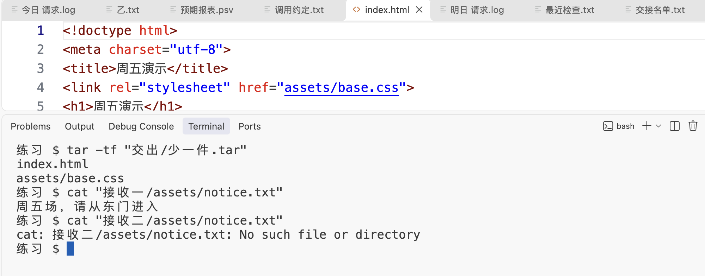

# 支线 1D：在自己的电脑上打开了页面，交给别人还能打开吗

页面明早要演示。你双击本机的 index.html，浏览器显示“周五演示”，蓝色的标题下面还有一个“查看说明”的入口。等同事收到文件，他也看见了标题，蓝色和说明却都没了。要重做的是页面、复制方式，还是验收方法？

这条支线从三份普通文本开始，不用安装服务器。先用 Finder 或文件管理器交一次文件，再用 Shell 重做交付，最后让一份已经交过的包遇上改稿、漏件和传输不完整。读到主线 1.10、会在练习目录里运行脚本并列出归档成员就能开始。阅读约 21～29 分钟，跟做另需约 28～40 分钟。取得第一份能独立打开的包就可以暂停，保留发送目录和收件目录，下次从同一个包继续。

## 双击的是哪一份 index.html

在一个新的空文件夹里建三个并排的目录，取名为“制作台”“交出”“接收一”。用 VS Code 打开外面这一层。在制作台下新建 **index.html**，保存下面这几行。先看其中两个地址，一个写在 link 上，一个写在 a 上；跟文件名有关的线索都在这里。

```html
<!doctype html>
<meta charset="utf-8">
<title>周五演示</title>
<link rel="stylesheet" href="assets/base.css">
<h1>周五演示</h1>
<p><a href="assets/notice.txt">查看说明</a></p>
```

在制作台下建 **assets** 子目录。其中 **base.css** 只写 `h1 { color: #1456a2; }`，**notice.txt** 写一行“周五场，请从东门进入”。用 Finder 双击制作台里的 index.html。在浏览器看到蓝色标题，再点“查看说明”，应读到东门。若只看到源码，先核对文件确实以 .html 结尾，再用浏览器打开；若点击说明后中文显示与编辑器不同，可用编辑器核对这份 UTF-8 文本。此时就有了三个容易认的信号：场次、颜色、入口。留下这一页用作对照。

现在只把 index.html 复制到“接收一”，保持制作台里的三个原件不动。从文件管理器打开接收一里的那份，比较颜色，再点击“查看说明”。看看浏览器地址栏末尾是哪一段目录。两页的标题文字相同，却是从不同位置打开的。浏览器沿第一份页面的相对地址会到制作台下面找 assets；沿接收页的相同地址则去接收一下面找。你在接收一没有放过这个目录，标题当然能出现，因为那句话已经写在 HTML 里；另外两个信号来自另外两份文件。

如果想确认这一点，只在接收一下新建 assets，先只复制 notice.txt，让收件页重新载入。东门回来了，颜色还没回来。补上 base.css，再重新载入，颜色才恢复。这个次序留下了一个比“三个都能复制成功”更实用的判断：今后同事说“页面开了”，你能追问是哪个可观察的部分开了，并用缺掉的那个信号找到该查的文件。在有缓存的浏览器里，重新打开文件仍有疑问时，可以从一个新收件目录打开另一份，以地址栏区分两次取样。

原先那份页面若恰好引用制作台里的绝对路径，在这台机器上可能仍然全都能用。可以复制一份 HTML 供自己试，专门把说明地址改为本机制作台中 notice.txt 的完整文件地址，在同一台电脑打开后点击。页面明明在接收一，地址栏可能又回到了制作台。跨机器后那条绝对地址未必存在。把练习副本留在这儿，后面一直用制作台里写着两个相对地址的原版。验收时点进说明后核对所在目录，这一眼能揭穿“收件人仍在借用作者文件”的假成功。

## 要把什么装进包，同事打开时又从哪里开始

接收一的结果可以通过手动复制得到。问题出在下次：有人多给你一张图片，也有人把排期草稿和临时文件留在制作台。为这次练习另外在制作台根部建立“内部草稿.txt”，只写一个合成标记“练习草稿”，再建一个叫“.配色备忘”的普通文件。让它们和 index.html 平级。收件人需要的是能打开的演示，眼前这个目录还装着编辑过程。把整个目录拖过去很省事，可它表达的是“手边的一切”；你刚才实际验过的交付物只需要三个文件。

先用一个你可以丢开的**草包**看清影响。在最外层目录打开终端，确认 `ls` 能见到制作台、交出和接收一。输入下面两行。当前目录的父子关系是实验的一部分；若试验中断过，用文件树定位最外层再开终端。

```bash
COPYFILE_DISABLE=1 tar -cf "交出/整桌.tar" "制作台"
tar -tf "交出/整桌.tar"
```

先读第二条的输出。能从中找到内部草稿吗？能找到那个平时不一定显示的点文件吗？每个成员名字前又带着什么？把终端列出的头两层和编辑器的树对照，就有理由在真正给别人之前先列一次**包里的**树。只在制作台运行 ls，得到的只是这次打包时你希望它看到的东西。包已经写出来以后，它内部记录的名字才决定解开时要创建什么。`COPYFILE_DISABLE=1` 是只传给这次命令的环境设置，供 macOS 的归档工具跳过随文件单独存放的 Apple 元数据；练习的验收对象是三个普通文件的名字和内容。

用刚才的输出倒读 `tar -cf`：c 请求建立归档，f 后面的参数给出归档文件名，后面列出要装入的成员。读目录时，它会沿着目录往下收内容，所以你没在命令行单独写草稿，草稿仍进了包。第二条用 t 查看成员；从头到尾没有要求它向制作台写回什么。现在请只改交付的那部分：把昨天手工复制成功的三个相对名字交给工具，不把整个制作目录作为成员。

```bash
COPYFILE_DISABLE=1 tar -cf "交出/周五.tar" -C "制作台" index.html assets/base.css assets/notice.txt
tar -tf "交出/周五.tar"
pwd
```

照着输出，在纸上画出接收方从包里能得到的树顶。应直接有 index.html，两个 assets 下的文件也分别在列。包名叫周五，成员名里却不需要再套一层周五或制作台。这里新出现的 `-C` 给 tar 一个寻找后续输入名字的出发点。你在终端执行的 pwd 仍留在外层，写到交出目录的文件也在那里。把它与直接在 Shell 输 `cd 制作台` 比一次：后者会改变随后所有相对路径的含义。一个参数只改变被启动工具读成员的起点，另一个动作改变操作者下条命令的起点，这解释了为什么“我照着文件树找到了，却在另一个目录生成了包”值得回到当时的 pwd 再查。

先别给包加更多开关。把制作台里的“内部草稿”改写一次，再列出已经存在的周五.tar 与整桌.tar。两个列表都没有因为这次保存而变化。归档是在建立时把选定的成员装进去，已经交出去的包不会追着制作台里的编辑继续变。若你只是在 Finder 中给周五.tar 换了个“最新版”的名字，也不会让旧包自动包含新稿。本节后半会让收件人读出一处实际变化，用它来校验版本。

若工作要发的恰好是一整个稳定目录，比如 assets 未来会多出十张经确认的图片，也可以选择整目录作为成员。但先问清是否允许里面临时出现一份不用交付的说明稿。试着在 assets 中建一个“待定配色.txt”，另选一个新包名，把命令末尾两个明确的资源名换成 assets，列出成员，再看这份稿子去了哪里。两种做法都有清晰的适用条件。当前任务把三件东西说得很具体，所以后续沿用明确名单；若名单日后来自真正的构建工具，就连同来源、生成时机一起交接。

## 名单齐了，收件方还缺哪一步

你已经在“接收一”里手工补过两份资源。拿它来试包容易犯一个非常隐蔽的错：即使包里少东西，旧的那份也可能正好还在。为了亲眼看见这个现象，另从外层生成一个故意缺少说明的包，只放 index.html 和 base.css。可以先自己按上面的语法写，再对照：

```bash
COPYFILE_DISABLE=1 tar -cf "交出/少一件.tar" -C "制作台" index.html assets/base.css
tar -xf "交出/少一件.tar" -C "接收一"
```

x 要求取出成员，f 后仍是要读的归档文件，最后的 `-C` 选定放入成员的目录。这个目录必须先建好。先点开接收一的页面，蓝色标题大概照常出现，点击说明也仍然能读到东门。不要急着说这个包什么都不少，换一条不依赖浏览器的证据：用 t 查看“少一件.tar”，看看里面是否真的有 notice.txt。若没有，那句话还有什么来路？回顾你在接收一里亲手做过的事，就能找到另一种解释。

在 Finder 建一个全新的空目录“接收二”，与接收一平级。把上一条的目标换成接收二，在解开之前先点开它确实是空的。完成后沿接收二里的 index.html 再点一次。此时颜色能回来，说明缺失。这两轮用同一个输入包、同一个解包选项，改变的只有接收地点之前是否留有东西。如果明天同事说在他的机器上不行，而你这里一直能跑，除了问系统版本，还能问测试是否在一份真正的空目录上开始。



先读 tar 给出的两行成员，再看两个接收目录的读数。同一个包没有装入 notice.txt；第一处能读到的“东门”来自此前留在那里的文件。

再建“接收三”，这次解开前面列过的完整周五.tar。保留三份目录，分别打开 notice.txt 看内容。在 VS Code 的文件树里，右击制作台中的 notice.txt 选 **Select for Compare（选择以进行比较）**，再右击接收三中同名文件，选 **Compare with Selected（与已选择项比较）**。如果版本没有显示这些菜单，用后面的 cmp 也可做同一核对。两边都写东门；左边标签的父目录与右边不同。这张并排视图的用处，是让你确定自己拿来比的确实是一份工作稿和一份从包中恢复的稿。

可以在外层运行下面两行。第一行没有文字时，第二行读到的应该是 0。它们提供的是同一对文件逐字节相等的证据。

```bash
cmp "制作台/assets/notice.txt" "接收三/assets/notice.txt"
printf '比较状态 %s\n' "$?"
```

现在只在制作台把“东门”换成“南门”，重新保存。VS Code 比较视图应能定位改动的一行。回终端重做 cmp，它通常指出第一个不同的字节和行，状态为 1。这里检查的是字节，编辑器则擅长告诉你人能读懂的差别。如果你在不同编辑器保存同一句话、换行表示却变了，cmp 仍然可能报告有差异。等到交付的是图片或压缩包，虽然已经没有合适的文字行可并排看，字节比较所回答的那个问题依然成立。若一边文件根本读不到，比较本身也没完成，诊断和返回状态能把它跟“读到了，两份不一样”分开。

这时再开接收三的页面，点击说明应该仍是东门。制作台的原件已经是南门，明早接手的人却只能拿到他收到的那一份。若想验证“南门版”，需要以新名字建立归档，解到又一个独立地点，再从那里点进去读。光看脚本最后打印当天日期就说“肯定是新的”，还缺一条能回到实际内容的证据。到这里可以暂停：保留周五.tar、少一件.tar、故意改过的南门制作台，以及确实从周五.tar 解出的东门接收三。下次先比较两个 notice.txt，自己就知道停在了哪一轮。

## 归档和压缩，少了哪一层还读得回来

现在同事希望发一份 `.tar.gz`。刚才我们已经能把三个文件排成一个 tar，并能按原来的名字分开取出。先取**那份内容为东门的周五.tar**做输入，让另一种工具只处理这一份已有的文件。

```bash
gzip -c "交出/周五.tar" > "交出/周五.tar.gz"
gzip -t "交出/周五.tar.gz"
printf '压缩流检查 %s\n' "$?"
gzip -dc "交出/周五.tar.gz" > "交出/往返.tar"
cmp "交出/周五.tar" "交出/往返.tar"
```

第一行把压缩结果送到普通输出，Shell 将它写入新的文件，所以还留有原来的 tar 供比较。第二行用 t 检查 gzip 数据是否能按其格式读完。最后解压的输出写进往返.tar，再用 cmp 验证字节和原件相同。这一来一回里，没有给 gzip 三份成员名字，它只得到了**一串已经组织好的字节**。能按路径恢复目录，是内层归档的能力；让那一串字节通常占更少空间，是外层压缩在做的事。样本很小时格式本身也要占空间，压缩后的每个文件都比原来小并非交付条件。

给同一个周五.tar 单纯再复制一份，起名“只有后缀.tar.gz”。让 `gzip -t` 检查这份副本，并紧接着读状态。文件管理器显示的后缀看起来像，交给真正读 gzip 的工具却过不了；再用 tar 的 t 看原始周五.tar，仍然能找到成员。反过来，如果把“少一件.tar”正常压缩，gzip 的检查应能成功，可是解开的接收目录仍会漏掉说明。这两次改变的层面不同：一个把类型写在名字上却没有实际变换字节，一个确实压缩了，但装进去的内容从一开始就不完整。这样就能理解为什么要先检查可读，再列成员，再在落地以后点开实际交付。

如果你已经能把这两步分开读，就可以方便地写成合起来的形式。在制作台仍为南门的条件下，用一个新的名字建立新包：

```bash
COPYFILE_DISABLE=1 tar -czf "交出/周五-南门.tar.gz" -C "制作台" index.html assets/base.css assets/notice.txt
tar -tzf "交出/周五-南门.tar.gz"
```

z 让本次操作同时使用 gzip。列表应当与旧包的三个成员名一致，但同名成员中的说明内容现在有意不同。用 Finder 新建空目录“收南门”，再执行 `tar -xzf "交出/周五-南门.tar.gz" -C "收南门"`。先从这里读 notice.txt，再用浏览器从这里打开页面并点说明。什么时候需要 t，什么时候必须 x？总目录给出的三条名字已经能反驳“缺了一个文件”，却不能替你断定接手的人会从东门去还是从南门去。选择读取方式，取决于眼前要排除哪一种猜测。

## 两头对账，一份文件叫“收到”时到底收到了什么

实际发送前还可能发生一种不同的失败。中转位置有一份和发送端同名的文件，但只复制了前一部分。我们不需要真的让网络掉线。在练习外层再建“中转”目录。先用 Finder 把“周五-南门.tar.gz”完整复制进去，按前面的办法对两份**归档文件本身**做一次 cmp。接着另造一份只含开头十六字节的练习件，保留正确那份不动：

```bash
head -c 16 "交出/周五-南门.tar.gz" > "中转/中断的副本.tar.gz"
wc -c < "交出/周五-南门.tar.gz"
wc -c < "中转/中断的副本.tar.gz"
gzip -t "中转/中断的副本.tar.gz"
printf '本次读取状态 %s\n' "$?"
```

你知道完整包至少装有三个文件；末尾两行应分别留下诊断和非零状态。若验收方式只看“目标文件存在”、或在前一次失败后又执行了一条打印“传输完成”的命令，可能就给这份十六字节的文件报了成功。查它的长度能解释本次少到什么程度，却不能保证两份同长度的文件内容总是相同。把接收三中的“东门”改为“西门”，两个汉字在 UTF-8 下字节数不变，字数或大小一样的两份说明仍可指向不同入口。试后把接收三的这一处恢复，保留旧版的对照。

两头在同一台练习机时，cmp 可以一口气取得两条实际路径。将来各在一台机器上时，发送端只有甲文件，接收端只有乙文件。可以让两头各自从相同算法取得摘要，再通过独立保存的发送记录核对。Mac 可用 `shasum -a 256`，常见 Linux 系统可用 `sha256sum`；下面写 Mac 的形式。若当前环境只有后一个命令，把两行中的 `shasum -a 256` 都换成 `sha256sum`。

```bash
shasum -a 256 < "交出/周五-南门.tar.gz"
shasum -a 256 < "中转/周五-南门.tar.gz"
```

分别从两处路径读文件，取输出的十六进制摘要比较；同一份完整复制件应相同。把第二行的输入改为“中断的副本.tar.gz”，就得到不同的摘要。这里两次都是**各自读取实际文件**，没有把发送端刚算出的字符串复制给接收端当结果。这个区别很细，可在交接时往往最要紧。发送记录能帮助辨认哪份字节是你先前验过的那份；如果一开始验的是少一件的包，两头的摘要完全相同也只说明少一件的版本被完整复制。若要证明发送者的身份，还得从可信渠道取得作为依据的那份记录。在这次本机练习里，两端都由你亲手制备，只检验内容和副本的一致性。

还有一个常见疑问：制作台里的三份文件内容没变，隔天重新运行打包命令，得到的两个压缩包摘要一定相同吗？归档还记录成员名字、时间和部分元数据，文件顺序也会影响归档字节。可以把打包命令的最后两个输入名字交换，只改成员顺序，用另一个包名再做一次；用 t 看顺序，用空目录解开两包，再逐个 cmp 三个成员。两份压缩文件可以不同，两组解出的演示材料却可以逐字节相同。若接手要求“这就是昨天通过验收的那份包”，应该保存并交出已经核对的那份制品。若问题是“同事能看到相同页面和说明吗”，还需要落地后的内容与使用结果。把这两句话分别写在自己的交接单上，就能决定何时该比较整包，何时要下到成员层面。

## 最后一次换人，留下能重做的入口

如果每周都交一次，反复敲三份文件名也会出错。先只把已经做过的固定动作移进脚本，不把“同事已收到、已打开”这种需要从接收端取得的结论写进脚本。用编辑器在练习最外层新建 **pack-demo.sh**，它跟制作台平级。这份脚本由调用者提供输入目录和一个**已经存在的**输出目录，每次成功会打印本轮新归档的路径。mkdir 与 mktemp 分工：前者适合你决定一个长期位置，后者让程序为每次制作分配从未使用的临时子目录。后者创建失败就停在开始处，前一轮的包还有自己的名字。

```bash
if [ "$#" -ne 2 ]; then
  printf '用法：bash pack-demo.sh 输入目录 输出目录\n' >&2
  exit 2
fi
source_dir=$1
output_dir=$2
run_dir=$(mktemp -d "$output_dir/run.XXXXXX") || exit 1
archive="$run_dir/demo.tar.gz"
if COPYFILE_DISABLE=1 tar -czf "$archive" -C "$source_dir" index.html assets/base.css assets/notice.txt; then
  gzip -t "$archive" || exit 1
  printf '%s\n' "$archive"
else
  result=$?
  printf '这轮没有交付，检查目录 <%s>\n' "$run_dir" >&2
  exit "$result"
fi
```

先在外层运行 `bash pack-demo.sh "制作台" "交出"`。把打印的路径复制下来，用 `tar -tzf` 列它的目录。第二轮故意把制作台的 notice.txt 在 Finder 里改名为 notice.hold，再重复运行。看输出目录里最新建的子目录，里面甚至可能已经有了 demo.tar.gz；那是归档命令在发现后一个输入缺失以前就开始写的。有没有文件仍然回答不了“制作者肯不肯把这个路径交给同事”。这一次脚本应返回非零、给出诊断，**标准输出不得宣布可交付的路径**。用第一轮记下的路径仍能列出三个成员。完成对照后，将 notice.hold 改回 notice.txt。不要从过程目录中挑一个看着最大的文件替代第一轮的交付记录。

实际接这个脚本的人也要在命令替换成功后才使用结果。可以在外层终端试：

```bash
if parcel=$(bash pack-demo.sh "制作台" "交出"); then
  printf '本轮候选 <%s>\n' "$parcel"
  tar -tzf "$parcel"
fi
```

假如你在 pack-demo.sh 的标准输出里临时加一句“开始压缩”，再次执行，变量里就可能有两行。后面的 tar 会把带换行的整段文字当成一个路径，尽管两个环节单独看都“有输出”。要留下进度，用标准错误；作为交付接口的标准输出只留调用者被承诺能拿走的数据。改回脚本再试。现在一旦遇到“文件存在但下游说找不到”，你还能检查接收变量里究竟有一个干净的路径，还是混进了给人看的消息。

最后让一个新需求代替现成答案。展方把说明改成两份：东门和南门各一份，首页必须能分别打开；制作台仍可能有旧稿。先从一个新的制作目录动手，把首页中的两个入口和两个目标文件做出来，再决定打包名单怎么改。封好包后把制作目录在 Finder 里临时改名，从一份**空的接收目录**解出材料，点开两个入口，以实际文字区分它们。若有一个入口仍读到了源目录，你就有办法发现它。最后把制作目录改回原名。能够在没有原制作路径的条件下取得承诺的两份说明，比在发送端多跑一遍 ls 更能回答接手人最初的问题。

## 附录：本支线必要技术点速查

| 手上现有的证据 | 还需要核对什么 |
| --- | --- |
| 制作台有三份文件 | 用 `tar -tf` 或 `tar -tzf` 直接读已制备的包，核对成员名和相对层级。 |
| 压缩文件可完整读取 | `gzip -t` 后仍要核对交付名单，解到新的空目录，再从那里打开首页。 |
| 两份同名文件长度相等 | 在同机用 `cmp` 比字节，分开存放时分别计算摘要，再与已验记录比对。 |
| 生成目录里已经有归档 | 取实际制作者的退出状态，确认本轮真正交出的路径；失败残件保留作诊断。 |
| 页面能显示标题 | 核对页面应用的样式，点击说明入口，核对实际来源与约定内容，尤其排除遗留的旧件。 |

[返回第 1 章](chapter.md) · [返回第一篇](../README.md)
