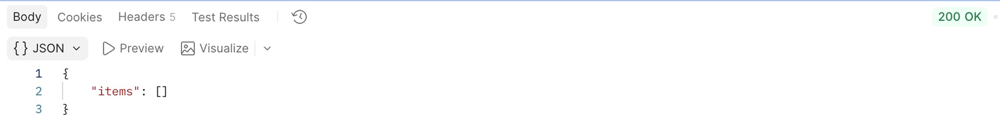
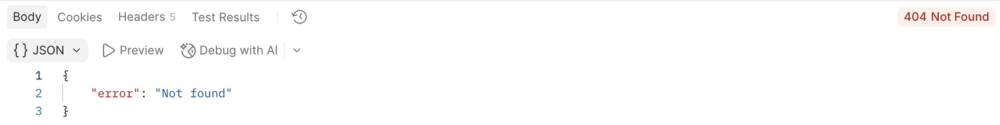
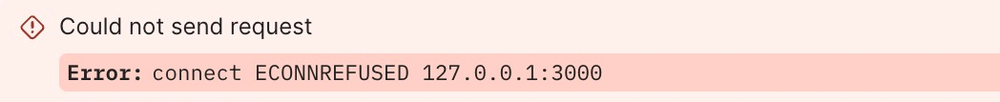

# 第 2 章 完成第一次 HTTP 往返

上一章在文件里读到了模拟的 200 和 404。现在让正在运行的服务真正返回这两种响应。打开一个空列表时，客户端要知道两件事：本机是否有程序接收请求，接收后是否认得这个地址。今天先做一个只认识 `GET /captures` 的服务。先在 Postman 读到空列表，再改错路径、停掉服务，比较这三次结果。

**代码起点**为空项目。主线阅读约 32～40 分钟，建项目、对照请求、改动并恢复路由和复查监听另加约 22～32 分钟，首次安装 Node 的时间另计。可以在语法检查通过后暂停；下一次从项目目录选好 Node 版本，再启动服务。

## 2.1 为项目选定运行版本

### 用 nvm 固定运行版本

同一份项目如果在不同 Node 版本下运行，报错和工具行为可能不同。我们先用 [nvm](https://github.com/nvm-sh/nvm) 管理 Node，并把本章使用的版本固定为 **24.22.1**。这是一个明确的项目版本约定，后续升级时再一起更新配置与操作说明。

以下使用 macOS、Linux 的 Bash 或 Zsh；Windows 读者在 WSL 中执行。本节的 nvm 指 `nvm-sh/nvm`，原生 Windows 的 `nvm-windows` 是另一个项目，不套用这里的安装和 `.nvmrc` 用法。后面的 curl 命令也沿用这一套 shell 引用与续行方式。

先检查当前终端是否已经加载 nvm：

```bash
command -v nvm
```

有输出 `nvm` 就继续下一步。尚未安装时，按 [nvm 官方说明](https://github.com/nvm-sh/nvm#installing-and-updating) 安装，这里固定安装脚本版本为 `v0.40.8`：

```bash
curl -fsSL https://raw.githubusercontent.com/nvm-sh/nvm/v0.40.8/install.sh -o /tmp/nvm-install.sh
bash /tmp/nvm-install.sh
```

安装后重新打开终端，再执行 `command -v nvm`。如果之前安装过却没有输出，先按官方说明检查当前 shell 的启动配置是否加载 `nvm.sh`。nvm 是 shell 函数，不用 `which nvm` 判断是否安装成功。

前端项目里很容易沿用上一个终端已经选好的 Node 版本。此处 Node 还负责接收 HTTP 请求，启动服务用哪一份可执行程序，决定了它能不能识别开发脚本中的参数。设想你在系统终端查到了约定版本，转到 VS Code 的集成终端执行启动命令，却得到“不认识某个选项”的报错。脚本可能根本没有执行到业务文件；先在**报错的那个终端**核对版本才有区分力。在另一个窗口重复看见正确版本，只能说明那个窗口选对了。

现在创建实践项目。已有其他项目目录时，在它旁边选一个空位置操作；若选择直接读本章的配套快照，可打开它已有的项目根目录，从核对文件和版本接着做。下面三行用于从零创建：

```bash
mkdir epp-book-code
cd epp-book-code
mkdir src
```

在项目根目录新建 `.nvmrc`，完整内容只有一行版本号，文件末尾保留换行：

```text
24.22.1
```

然后在同一个目录执行：

```bash
nvm install
nvm use
node --version
npm --version
```

不带版本参数的 `nvm install` 会读取 `.nvmrc`，安装所需版本并切换；已安装时可直接复用。`nvm use` 则选择这个项目约定的版本，`node --version` 应输出 **`v24.22.1`**。npm 使用该 Node 版本随附的版本，不需要另行全局安装。

`.nvmrc` 不会单凭你进入目录就自动改变 Node。每次新开终端后，进入项目先执行 `nvm use`，再运行 npm 命令；已有 Node 安装也按这一步核对，避免实际上仍调用了另一份程序。找不到 `node` 时，先处理 nvm 的加载与版本切换，不要跳到服务代码排错。

可以在 VS Code 用“文件 → 打开文件夹”选中刚建的 `epp-book-code`，在左侧资源管理器确认 `.nvmrc` 和 `src` 位于同一层，再通过“终端 → 新建终端”继续。用 `pwd` 核对当前目录，运行 `nvm use` 后执行下面这条只读命令。它让当下真正执行 JavaScript 的 Node 报出自己的版本、程序位置与工作目录：

```bash
node -p '({version: process.version, executable: process.execPath, project: process.cwd()})'
```

后两项路径因机器而异。目录错了而版本碰巧正确，接下来仍可能把清单写进另一份项目；目录对了而版本不对，则应回到这个终端选版本。两项都对再继续。这里的“切换”作用于接下来从这个 shell 启动的程序；在另一个标签页运行 `nvm use`，已经启动的服务不会中途换掉自己的运行时。后面需要变更运行版本，要结束自己的旧服务，再从确认过的新环境启动。

接下来的文件路径都相对于这个项目根目录。用编辑器新建 `package.json`，完整内容如下：

```json
{
  "name": "epp-book-code",
  "version": "0.1.0",
  "private": true,
  "type": "module",
  "engines": {
    "node": "24.22.1"
  },
  "scripts": {
    "dev": "NODE_ENV=development node --watch --inspect=127.0.0.1:9229 src/server.js",
    "start": "NODE_ENV=production node src/server.js",
    "debug": "NODE_ENV=development node --inspect-brk=127.0.0.1:9229 src/server.js",
    "check": "node --check src/server.js"
  }
}
```

`dev` 是学习时默认的启动入口，会监视源码并开启本机调试。`start` 直接运行同一份服务代码，关闭文件监视与调试。`debug` 用于需要在入口代码执行前暂停的专项排查。`private` 防止这个练习项目被误发布到 npm，`engines.node` 与 `.nvmrc` 保持同一个精确版本。

命令显式设置运行模式：dev/debug 使用 `NODE_ENV=development`，start 使用 `NODE_ENV=production`。模式给程序和依赖判断环境；是否监听文件、开放 Inspector，仍由命令参数控制，设置 production 不会自动移除调试参数。这里采用 macOS、Linux 或 WSL 的 shell 写法。

`engines` 默认只表达版本要求。再在项目根目录新建 `.npmrc`，让 npm 在安装时检查并拒绝不匹配的 Node 版本：

```ini
engine-strict=true
```

这两份配置各有作用：`.nvmrc` 供 nvm 选择版本，`engines` 配合 `.npmrc` 检查安装环境。它们都不会代替终端执行 `nvm use`；遇到 `EBADENGINE`，先切换到项目版本再重试。`.nvmrc`、`.npmrc` 都与项目一起保留。

`type: "module"` 让项目内的 `.js` 文件按 ESM 处理，因此下面可以直接写 `import`。这里先保持一种模块格式；第六章会通过实际运行和报错，展开模块解析与 TypeScript 构建。

现在运行：

```bash
npm install
```

这一步会生成 `package-lock.json`。本章没有第三方依赖，依赖清单里也就没有 `dependencies` 或 `devDependencies`；不需要安装一个名为 `http` 的包，代码要使用的是 Node 内置的 `node:http`。没有第三方包时，不出现 `node_modules` 目录也是正常的。

保留 `package.json` 和锁文件，它们共同描述项目依赖。拿到已经带锁文件的项目时，可以用 `npm ci` 安装并核对清单；第六章再解释它与 `npm install` 的区别。此刻不要为了让命令输出更“像一个项目”，额外安装框架或工具。

在编辑器里对照两份清单，先别急着启动。设想明天把这一目录交给另一位开发者：他能从 `.nvmrc` 知道该选择哪个 Node，从 `package.json` 的 scripts 知道运行哪个文件，从锁文件复现当前安装状态。但这几份文件都不能告诉他你此刻有没有开着服务。安装成功只说明安装步骤完成；一会儿语法检查即使通过，也没有为任何端口建立监听。若这时打开 Postman 得到连接失败，最有用的下一步是查启动命令有没有运行，重新安装同一项目不能使入口自己运行起来。

读 scripts 时尤其留意两个不同的“监听”。开发参数 `--watch` 让 Node 留意文件变化，保存源文件后重新运行程序；接收 HTTP 连接的监听稍后由业务代码调用 `server.listen` 建立。`npm start` 虽然不监视文件，照样要打开 HTTP 端口才能提供服务。调试参数还会申请单独的本机调试入口，默认是 9229。看到调试器就绪的一行，只能说明调试入口的状态，Postman 应该访问的是业务入口打印的地址。三件事都可能发生在同一终端，看清一行输出属于哪一步，才知道接下来可以验证什么。

如果使用 Git，再新建 `.gitignore`：

```gitignore
node_modules/
.env
.env.*
!.env.example
*.log
.DS_Store
```

本章还没有环境变量文件；这几条先把常见的本机产物与配置值排除掉，锁文件则应保留。

## 2.2 让一次 GET 有状态、头部和正文

### Node 收到请求时，究竟把什么交给我们

稍后要处理“接收一条原文”。先从我们熟悉的调用方式反推服务端需要完成的工作：浏览器把一个对象用 `JSON.stringify` 变成文本，放进 HTTP 请求体；服务端收到这段文本，还要把它解析回来，才能读取 `originalText`。

这里容易跨过两步：**收到请求，不等于请求体已经全部到齐；收到请求体，也不等于拿到了一个符合业务要求的对象。** 原生 HTTP 模块只处理 HTTP 层的收发，没有替我们完成 JSON 解析与字段校验。后面出现的读取函数和检查代码，正是为了补上这两步。

为什么 HTTP 模块不等请求体全部收到再调用我们？因为服务可以只根据方法和路径处理 GET，也可以在看到不支持的内容类型时拒绝请求；如果请求体是一个很大的上传文件，还可以边接收边处理。强制先把所有请求体装进内存，会把这些选择都拿走。Node 因此在请求头解析完成后提供请求对象，请求体通过它后续的可读流事件交付。

`createServer` 接收的回调有两个参数。`request` 包含已经解析的方法、地址和头部，同时提供读取请求体的入口；`response` 用于组织要发回去的状态、头部与响应体。每次请求都有自己的一对对象，而服务进程会继续接收下一次请求。

因此，下面这段**只用于说明问题的代码，不加入项目**，无法让客户端收到列表：

```javascript
createServer(() => {
  return { items: [] };
});
```

回调返回值只回到了调用它的 JavaScript 代码，HTTP 模块并没有约定把这个返回值序列化并发送。我们必须通过 `response` 明确完成输出。以后框架可以提供“返回对象即生成响应”的约定，但原生接口没有这层转换。明白这一点，再看框架时才知道它多承担了哪项工作。

先在纸上写出准备支持的唯一操作。它有两个条件：“方法是读取”“请求目标恰好是素材集合地址”。只判断方法，读取任何拼错的地址都会拿到一份貌似成功的空列表，界面可能悄悄展示“目前没有素材”；只判断地址，把同一地址改为 POST 也会得到列表，调用方连创建功能尚未实现都看不出来。因此需要两个条件同时成立。成立时给一个可以读取的集合，顶层对象带 `items`，哪怕数组里没有一项也照样是成功；条件不成立时进入本章统一的未匹配分支。后续章节才把“路径已知但方法不支持”单独处理。

然后倒过来，从客户端期待的结果写发送步骤。界面需要凭状态区分成功与失败，还要知道正文该怎样解释，最后才从正文取字段。于是先确定状态和内容类型，再把所选对象序列化、结束响应。只把头部写成 JSON 并不会替你生成一个 JSON 字符；只发送一段看起来像列表的文本，也不能把错误状态变为成功。两条路径共用一个条件决定状态和正文，有个实际好处：不用在两个地方各猜一遍同一请求是否被认出来。若一个地方认、另一个地方不认，状态可能是成功而正文只有错误字段，前端往往到取 `items` 时才发现不对。

新建 `src/server.js`，写入下面的完整文件。服务只在本机回环地址接受连接。每次调用回调时，先依据方法与地址决定结果，再把状态、内容类型和 JSON 文本写入同一次响应。

```javascript
import { createServer } from 'node:http';

const host = '127.0.0.1';
const port = 3000;
const server = createServer((request, response) => {
  console.log(JSON.stringify({ event: 'http.request', method: request.method }));
  const isList = request.method === 'GET' && request.url === '/captures';
  response.writeHead(isList ? 200 : 404, {
    'Content-Type': 'application/json; charset=utf-8',
  });
  response.end(JSON.stringify(isList ? { items: [] } : { error: 'Not found' }));
});

server.on('error', (error) => {
  if (error.code === 'EADDRINUSE') {
    console.error(`Cannot listen on ${host}:${port}: address already in use`);
  } else {
    console.error(`Server failed: ${error.code ?? 'UNKNOWN'}`);
  }
  process.exitCode = 1;
});
server.listen(port, host, () => {
  console.log(`EPP listening on http://${host}:${port}`);
});
```

在项目目录执行 `npm run check`，它会检查文件语法。再运行 `npm run dev`，保持终端开启，等到 `EPP listening on http://127.0.0.1:3000`。这行日志在监听成功后才输出。响应由 `response.end(...)` 结束，进程可以继续接收下一次请求。

第一次读这份入口文件，可以把它按“两次被调用”来读。启动时，从上到下执行的是创建服务、登记出错时的处理、向操作系统申请监听地址。此时还没有一次 HTTP 请求，回调里的 `isList` 根本没有值。等操作系统允许监听，最后那条成功日志才出现。之后每收到一次请求，先前登记的请求回调才执行一次，方法与目标从这次的 request 上取，结果交给这次的 response。若把“服务已经启动”的提示写在文件第一行，即使地址申请失败，终端也会先给人已经可以联调的错觉。

两次正常 GET 可以由同一个进程接待，第一次运行到 `response.end` 后，第二次仍会产生新的 request 和 response。这里没有向某个共享数组追加或删除任何东西，两次空列表相同，来自每次都构造了同样的值。因而一次成功 GET 能证明读取入口已接通，却不能验证保存素材、数据库连接或重启后读回；这些操作在文件里还无从发生。用只包含本次能力的样本启动，有助于定位后面变化：下一章如果能创建却查不到，至少可以先复用今天的读取请求来核对入口。

把地址 `http://127.0.0.1:3000/captures` 也按执行位置分开读。客户端先用主机与端口找到接收连接的程序；到了本章的请求回调，判断的是方法与 `request.url`，普通列表请求在这里的值是 `/captures`。更换端口会改变向谁建立连接，更换路径则可能仍由原来的回调接待。地址选择回环意味着从运行服务的这台主机访问，不需要开放局域网端口。换一台设备执行完全相同的 URL，回环指向那台设备自己，不能用其连接结果判断这台开发机是否启动成功。

现在服务终端应停留在监听状态；出现成功行后没有退回 shell 提示符，正好可以继续接下一次请求。把它留在原处，Postman 放在旁边；需要敲 curl 时用第二个终端。从此“服务终端”指负责显示监听和请求日志的那一个，“请求终端”只负责发送。否则很容易为了腾出地方执行 curl，先按 Ctrl+C 停掉了正准备验证的对象。

## 2.3 对照 200、404 和连接失败

保持 `npm run dev` 运行，打开 [Postman 桌面客户端](https://www.postman.com/downloads/)。这里选择桌面客户端，让请求直接从本机发往本机服务；使用其他接口工具时，方法、地址、头部和正文仍是同一组输入。客户端负责发送请求、展示响应，进入源码观察变量则由 Chrome 或后续的 VS Code 调试器完成。

先新建一个 HTTP 请求，方法选 GET，地址填 `http://127.0.0.1:3000/captures`，不填写 Body，点击 **Send**。在响应区查看状态应为 200，Body 为 `{"items":[]}`；切到响应 Headers 查看 Content-Type。请求头与响应头是两个方向，不要把服务返回的头误认为自己提交的配置。



看图时先定位响应区的 Body 和右侧状态，再读对象里的 `items`。上方编辑请求也有一个 Headers，下方响应区的 Headers 才列出服务送回来的字段。Body 若用格式化视图把对象展开为几行，和下面 curl 显示的一行文本仍可以表达相同的 JSON 值。这个区分会影响验收：客户端读取的是名为 `items` 的数组，不能仅凭屏幕显示了一对方括号，就把顶层裸数组 `[]` 也当成同一个约定。

同一笔请求在请求终端可以这样发：

```bash
curl -i http://127.0.0.1:3000/captures
```

`-i` 让 curl 同时显示响应头。响应中要观察的是：

```text
HTTP/1.1 200 OK
Content-Type: application/json; charset=utf-8

{"items":[]}
```

这里及后面的响应示例省略了 `Date`、连接管理和传输相关头部；Node 可能自动补上它们，大小写与顺序也不必完全相同。重点是状态码、我们设置的字段和响应体。

服务终端还会出现 `{"event":"http.request","method":"GET"}`。这条简短日志用于判断请求是否进入处理入口，不包含状态码、耗时或请求关联信息；第二篇会在实际需求下完善日志。

把这个 GET 保存为“查看列表”。复制请求，只将路径换为 `/missing`。如果监听的程序认不得路径，预测此时能否在客户端读到状态码，以及终端里是否还会出现请求事件。点击 Send，查看响应中的 404 和 JSON 错误体。



两个响应里都有 JSON，服务终端也都只多了一条方法为 GET 的日志。若只看这一行日志，两次情况完全一样；把它和刚刚发送的实际 URL、响应状态与 Body 对在一起，才知道请求已进入、这次条件没有匹配。此时若把错误对象转换成一个默认空数组供页面渲染，界面又会显示“没有素材”，把本来可定位的地址错误掩盖了。更可靠的做法是先让状态决定是否进入成功分支，再让成功对象里的数组长度决定是否展示空列表。

还有两个常见变式可以用复制的请求试，不改保存好的基线。在正确地址末尾加 `?page=1`，其余保持不动。页面开发中很容易以为“只是多带一个可选参数”，但这版直接拿 `request.url` 与固定字符串比较，查询串也参与比较，所以得到 404。删掉查询串，改为 `/captures/`，多出的尾斜杠也足以让比较失败。最后恢复精确地址，只从方法下拉框改为 POST，Body 仍选 none 再发，请求能到达同一个进程，却不会创建记录，状态也为 404。这里没有任何解析分页或写入数据的代码。若将来决定支持查询参数，先要把“路径是否匹配”和“参数是什么意思”分开，今天先把现行契约观察清楚。

再把方法改回 GET、路径改回 `/captures`，在请求终端运行：

```bash
curl --noproxy '*' -sS -o /dev/null -w 'HTTP=%{http_code}\n' http://127.0.0.1:3000/captures
echo $?
```

这里让 curl 直连本机，丢弃正文，只打印 HTTP 状态。紧接着的 `echo $?` 打印上一条命令的退出码。服务运行时结果应为 `HTTP=200` 和 `0`。改查 `/missing` 可得到 `HTTP=404` 和 `0`，因为这条命令只要求成功完成 HTTP 传输。

回到服务终端按 Ctrl+C，等 shell 提示符回来，在 Postman 重发原来的“查看列表”。随后在请求终端重新执行上面针对 `/captures` 的 curl 命令，紧接着执行 `echo $?`。在没有其他进程接替监听的情况下，Postman 显示连接失败，curl 报无法连接、打印 `HTTP=000`，退出码为 `7`。000 是 curl 没有收到 HTTP 状态码时显示的值。如果停掉当前服务仍收到 200，可跳到下面的端口占用段核对监听进程。



第三幅图里的错误来自客户端尝试连接的过程。地址虽然仍写着同一个路径，服务端却没有运行回调的机会，自然也没有本章定义的错误对象。把这次现象描述成“服务返回错误码零”会让排查从错误的位置开始。对一次发送，先找有没有 HTTP 状态；有状态，再看本次请求是否出现在预期终端；没状态，先核对实际地址和监听进程。连接拒绝是这次直连本机、停服后观察到的具体原因；其他环境里的超时或连接中断要看各自的错误信息，不能一律推成服务没启动。

在原服务终端重新运行 `npm run dev`，看到新的监听成功行，再用保存的 GET 确认原路径恢复 200。现在自己做一次小改动：假设练习的集合路径要临时换成 `/notes`，方法和响应结构保持。先别动 Postman 的“查看列表”，从入口文件找出决定识别范围的条件，只把比较的路径改成新值并保存。等开发终端重新输出监听成功行，先发保存的旧请求，应得到 404，再用副本发新路径，应得到 200 和同一个空列表。只测新路径成功还不够，它无法区分“改名”和“同时支持两个入口”。现在恢复原路径，保存并等再次监听，旧请求应回到 200，新路径回到 404。把程序恢复到这个状态再接下一章。

如果改完后旧请求始终返回 200，先区分两件事。文件是否保存到运行服务的那份项目，可用编辑器的项目根与服务终端启动目录核对；新进程是否已经接手，可用保存后的新监听行与下一次请求日志核对。在 `npm start` 下只保存文件，运行中的进程不会重新加载这段判断；在 `npm run dev` 下保存，也仍须等新程序完成启动后再发。Postman 标签页里原来显示的响应不会因为源码保存就自行更新。只有刚点 Send 得到的新响应，才能拿来判断改动是否生效。

### 区分端口占用和代码没有执行

保持刚才的开发服务运行，在请求终端进入同一项目根目录，执行 `nvm use`，再运行 `npm start`。这个入口同样申请 3000 端口，但不会额外申请调试端口，便于只观察业务监听的争用。第二个进程应无法监听同一地址，输出类似：

```text
Cannot listen on 127.0.0.1:3000: address already in use
```

第一个进程仍然可以处理请求。也就是说，第二次启动失败，并不意味着 `3000` 上没有服务；Postman 此时访问到的还可能是之前的旧进程。修改代码后却一直看到旧结果时，尤其要检查这一点。

最直接的处理方式，是回到自己先前启动服务的终端，用 `Ctrl+C` 停止它，再启动新进程。如果不知道占用者是谁，macOS、Linux 可以先查询：

```bash
lsof -nP -iTCP:3000 -sTCP:LISTEN
```

Windows PowerShell 可以先查询：

```powershell
Get-NetTCPConnection -LocalPort 3000 -State Listen
```

查询结果用于识别进程，不是让我们看到一个 PID 就结束它。先确认它属于自己的这次实践；如果端口由其他工作占用，可以把 `src/server.js` 中的 `port` 改为 `3001`，再同步修改后面所有请求地址。Windows 读者在 WSL 内运行本章服务时，先在同一个 WSL 环境查询；PowerShell 的结果用于核对 Windows 一侧，不能代替 WSL 内的进程归属判断。第四章再把端口变成外部配置，当前先保持启动方式直观。

`EADDRINUSE` 与没有权限监听的 `EPERM`、`EACCES` 是不同原因。后两种需要检查运行环境的限制；重复结束进程并不能解决它们。也不要因为一个端口报错，就直接以管理员权限运行整个项目。

保留项目文件和已保存的请求，停止自己启动的服务。下一章从这个目录继续，实现接收正文和创建记录。

## 附录：本章必要技术点速查

| 名称 | 在哪里用 | 怎样核对 |
| --- | --- | --- |
| `.nvmrc`、`nvm use` | 在项目目录切换到约定的 Node 版本 | 在启动服务的同一终端运行 `node -v`，确认是 `v24.22.1`。 |
| `createServer`、`response.end()` | 从 request 读取方法和路径，用 response 发回状态、头部和正文 | 在 Postman 请求 `GET /captures`，核对 200、Content-Type 和 `{"items":[]}`。响应结束后仍可再次发请求。 |
| 404、连接失败 | 区分未匹配的路径和未监听的端口 | 改错路径时能看到 HTTP 状态码。停掉服务后再请求原地址，客户端无法建立连接。 |
| `EADDRINUSE` | 判断新服务为何没能启动 | 检查谁在监听该端口。若改用 3001，请求地址也要一起改。 |

查阅 Node 的请求、响应和监听接口，可看 [Node.js 24 HTTP 文档](https://nodejs.org/docs/latest-v24.x/api/http.html)。

[上一章：第一次读懂 Unix Shell](../chapter-01-unix-shell/chapter.md) · [下一章：可靠接收请求正文并保存原文](../chapter-03-minimal-service/chapter.md) · [返回第一篇](../README.md) · [返回全书目录](../../README.md)

[本章配套代码](https://github.com/SamChowRock/epp-public/tree/part-01/chapter-02)
