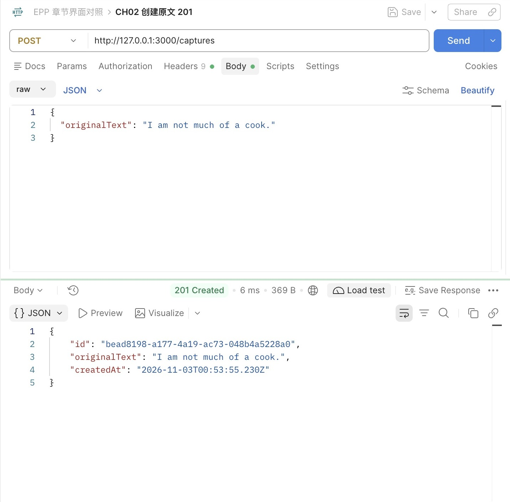
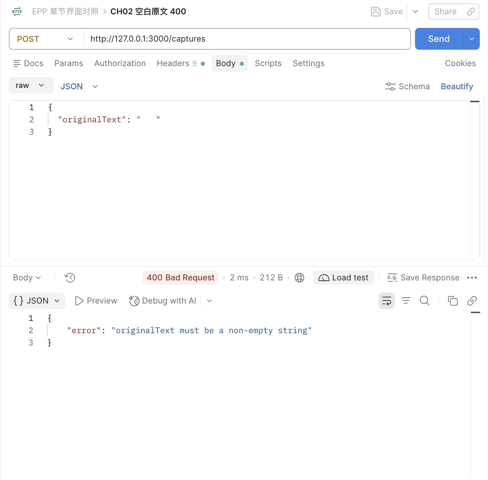

# 第 3 章 可靠接收请求正文并保存原文

从[上章的空列表服务](../chapter-02-first-http/chapter.md)继续。GET 在请求头到达后就能处理；POST 的正文可能还在路上。要在同一个进程里通过列表和详情找回刚创建的记录，应当在什么时刻允许写入？本章逐步加入字节限制、解码、字段校验和内存存储，并通过断点观察失败在哪一步发生。

## 3.1 先确定三个接口和一条记录

### 原文先原样留下来

继续使用上一章的例子：

> I'm not much of cook.

这句话少了冠词，但保存接口此时不负责纠正它。它的职责是接收用户提交的内容，并保留后续整理的起点。因此，接口返回的原文应当与输入一致，不能在保存时偷偷换成润色后的结果。

一条记录先有三个字段：

```json
{
  "id": "服务端生成的唯一标识",
  "originalText": "I'm not much of cook.",
  "createdAt": "2026-10-28T06:00:00.000Z"
}
```

为什么只有原文还不够？因为下一次查看详情时，我们需要指明是哪一次记录。同一句话可以提交两次，原文相同并不代表两次记录相同；把原文当成键会让第二次写入覆盖第一次。我们因此给记录分配独立 ID。当前使用 UUID，方便直接生成标识；递增整数也能标识记录，但需要另外维护分配状态。选 UUID 并没有解决重复提交，它只让两条记录各有身份。

`createdAt` 则回答创建发生在什么时候。它不能兼任 ID，因为多条记录可能在同一时间精度内创建；也不直接接收客户端传来的时钟值，否则不同设备的时钟差异会混入这份服务的记录。我们用服务端时间生成带时区含义的 ISO 字符串，示例中的 `Z` 表示 UTC，之后再由客户端转换显示。时间、标识和内容分别承担不同职责。

中文意图、修订和候选都先不加入。当前保存的是一条只有原文的简化记录，并不表示第一章讨论的完整业务已经实现。第三篇接入数据库时会补上中文意图，并说明已有记录如何进入新结构；修订会在对应章节继续建立。

输入先只接收 `originalText`。由此可以分清两件事：调用方提交一份材料，服务接受这份材料后创建一条记录。即使调用方额外提交 `id` 或 `createdAt`，也不会据此决定新记录的身份和创建时间。这个区别随后会直接决定我们怎样从请求体构造保存对象。

设想页面上只有一个输入框和一个“保存”按钮。小林把同一句练习记在上午和下午，下午想打开上午那次。先用纸代替数据库，把两次按按钮都写下来。纸上有两行，原文列完全相同。如果详情链接带的是句子，两个按钮就指向同一处；如果链接带的是列表下标，前端只要把列表倒序，屏幕上的第一项就换成了下午的记录。能够从任意视图回到上午那一行，需要在创建时给这一行一个标识，放进响应，再由页面带回详情地址。用哪种集合保存，是有了这个访问要求之后的实现选择。

再看“原样”到底要求两端比什么。在输入框中敲两个前导空格、一句英文和一个换行，前端拿到的是一个字符串值。把它交给 `JSON.stringify` 时，换行在 JSON 文本中写成转义；发送请求时，这段文本又会被编码成字节。服务读回的记录应当保留那个换行和两个空格。服务可以把收到的漂亮缩进改成紧凑的 JSON 再返回，只要客户端解析后拿到同样的字符串，就兑现了保存约定。若把整份请求和响应截图逐字比较，新增的标点、字段和转义都会干扰这个判断。

用两个很短的请求就能在纸上辨清这几层。甲在 JSON 的值中写“早”，乙写它的 JSON 转义 `\u65e9`。前者传输时用了三个 UTF-8 字节表示那个汉字，后者用了六个 ASCII 字节表示一个反斜杠、一个字母和四位数字。解析后两者都是同一个字。如果产品要保存的是练习者输入的原文，这两次创建应各得到一行，两行的原文相等。如果未来产品改为存档“上传文件的原始字节”，仅保存这个字段就无法分辨两份文件。要保留的事实不同，接收过程中可以丢掉的信息也不同。

把输入框两端的空格也带进这个判断。一个学习者可能把台词连同段落缩进复制过来，渲染普通 HTML 时看不清前导空格，读取详情时仍应拿到它们。检查“有没有可记录的内容”可以对字符串做一次去空白运算；拿这个运算的结果直接写回去，就把存在性检查变成了编辑操作。本章只有创建和读取，界面上没有一次由用户确认的编辑，因而不能用显示效果推定服务有权修改原文。

从时间字段也能看出哪一端知道哪件事。用户十点开始打字，十点零五才按保存，服务收到完整材料的时刻还要稍晚。当前页面交来的材料没有“开始撰写时间”，服务端能可靠陈述的是自己什么时候构造记录。以后按本地日期做练习日历时，还要决定依据创建时刻还是学习者填写的练习日期。现在将服务产生的时刻和原文一起返回，换一个时区显示只影响呈现，客户端不必为查详情重新计算标识。

### 先让行为有一致的约定

三个接口约定如下：

| 操作 | 方法与路径 | 成功结果 |
| --- | --- | --- |
| 新增原文 | `POST /captures` | `201`，返回新记录；`Location` 指向详情路径 |
| 读取列表 | `GET /captures` | `200`，返回 `{ "items": [...] }` |
| 读取详情 | `GET /captures/:id` | `200`，返回指定记录；不存在时返回 `404` |

路径使用 `captures`，承接上一章的记录概念。现在还没有修订表，也没有额外的“正式表达”集合。

列表从 `{ "items": [] }` 开始，按本进程中的插入顺序返回。暂时不增加分页和筛选；以后要增加总数或游标时，可以在列表对象上扩充字段。详情直接返回一条记录。

空字符串和全空白内容无法形成当前要记录的表达，需要在写入前拒绝。本章先把原文上限定为 2000 个 JavaScript 字符串代码单元，把整个请求体上限定为 16 KiB。它们是两种不同的限制，下一节从实际接收过程说明为什么只检查其中一种还不够。这里的字符串长度沿用 `.length`，例如某些 emoji 占两个代码单元，不能把它当成严格的可见字符计数。

这一版没有去重。同样的原文提交两次，会得到两个不同的 ID；网络重试也可能重复创建。后续讨论幂等时，我们会在已经存在的创建行为上处理这件事。

把三个接口串成一次页面操作，可以倒推出每次响应的最小信息。点保存前，页面只有草稿；收到创建响应后，页面才有可交给路由的标识。点“所有练习”后，需要遍历一组记录，即使一项也没有，循环也应自然结束。点某一项后，要么得到那条记录，要么知道该地址此刻没有对应的记录。若空列表和缺失详情都返回一个空对象，页面就得猜是应显示“开始第一条练习”，还是应提示“这条记录已找不到”。给它们不同的结果，两种界面就有了各自明确的依据。

可以暂时遮住接口表，只写四格，分别记“操作前已有的行、随请求送来的材料、服务实际做的事、下一次读取能看到的行”。从零行开始，第一次提交“早”后得到甲；再提交一次同值后得到乙。读甲时仍得甲，读列表得甲、乙，连续读两次列表依旧有两项。接着送来一个空白字符串，服务需要告诉页面为什么这次不能创建；再读列表还应看到甲、乙。这张草稿可以先于实现写出来，因为它只用到了我们对一次记录的定义。到了调试阶段，如果接口返回值彼此矛盾，用它可以找到最早分歧的一步。

举例说，页面上有两行“早”，能据此断定服务重复创建了吗？先找两行各自携带的标识。两个不同标识且列表响应里确有两条，符合两次创建；两个相同标识但列表响应只有一条，还要看页面是否既追加了刚创建的响应又拼上了完整列表。相反，如果两个创建响应各有标识，列表却只留下后一条，就应查看保存集合用了什么作键。把这三个观察点留在契约里，界面更新问题和服务丢记录就有机会分开定位。

详情路径里的 `:id` 是说明文档中留出的一个位置。生成链接时从响应取真实标识拼进去，也可以直接沿服务给的 `Location` 访问。即便练习者在输入框里用了空格、斜杠或中文，详情路径的这一段仍然只是服务生成的标识。客户端因此不必把原文编进 URL，也不必为内容相同的练习另设跳转规则。创建时返回相对路径还有一个方便之处：调试时沿用刚才发出请求的服务地址，就能准确地问同一份集合。

最后留意“重复”的判断要靠哪条事实。用户确实在两个不同的练习时段各点一次，与第一次可能已成功、页面没有拿到回信而再点一次，从本章接口看都是两份有效材料。用“原文相同就不写”会丢失第一种情况；用“页面还在等待就算失败”又无法识别第二种情况。当前契约只承诺一次通过校验的处理生成一条记录。把这个前提写在自己画的时序旁边，后面遇到响应尚未送达的断点，便知道为什么不能用再按一次保存来探测上一笔的状态。

## 3.2 用原生 Node.js 把服务写出来

沿用上一章的目录、Node 版本、清单和锁文件，先停止旧的开发进程。下面重新写入 `src/server.js`；各段按顺序拼成完整文件，旧的 GET 回调和 listen 不再保留。

如果是接着第二章逐行跟写，在原项目编辑即可；本章完成快照里才新增 Postman 集合和分块示例。使用此前的项目并不会凭空出现这两个文件，第三节可以手工保存同样的请求，支线也给出了分块示例的完整内容。如果是直接用本章完成快照核对，编辑器里已有下面四段服务代码，顺着它们读到启动步骤即可。两条路线使用同一份清单和同一套开发命令。

### 两次请求之间，谁保留那条记录

保存请求结束后，还会有一个独立的列表请求。假如把记录放在保存函数内部的一个局部数组里，下次调用就会重新创建数组；即使创建接口返回成功，列表也读不到刚才的内容。**数据的存活时间必须长于一次请求。**

所以我们先让服务进程持有一份集合，所有请求处理函数都访问它。数组同样能做到这一点；这里选 `Map`，是因为详情接口要按 ID 查找，用 `set(id, record)` 与 `get(id)` 能直接表达这个关系。选 Map 并没有同时获得磁盘保存、跨进程共享或查询语言，这几项能力要分别解决。

另一个需要统一的是响应。列表、详情、创建和错误都要发送 JSON，如果每个分支各写一套头部与序列化，很容易出现一个分支返回 JSON，另一个却把对象当成文本处理。先把相同的 HTTP 输出步骤收在一个小函数里，让各分支只决定“状态码是什么，内容是什么”。

用下面这段替换 `src/server.js` 的内容。后面标明“追加”的代码按顺序接到同一个文件中，完成整个文件后再启动。

```javascript
import { createServer } from 'node:http';
import { randomUUID } from 'node:crypto';

const host = '127.0.0.1';
const port = 3000;
const captures = new Map();
const maxBodyBytes = 16 * 1024;

class HttpError extends Error {
  constructor(statusCode, message) {
    super(message);
    this.statusCode = statusCode;
  }
}

function sendJson(response, statusCode, data, headers = {}) {
  response.writeHead(statusCode, {
    'Content-Type': 'application/json; charset=utf-8',
    ...headers,
  });
  response.end(JSON.stringify(data));
}
```

文件顶层的 `captures` 在本次启动时创建一次，之后的请求共享它。`HttpError` 则让我们区分可以向调用方解释的输入错误与程序意外错误：缺少原文可以明确返回 `400`，内部代码出错则不能假装成同一种输入问题。类里暂时只有状态码，没有建立额外的错误体系。

`sendJson` 中的两步也不能合并理解。`JSON.stringify` 将对象转换成 JSON 文本，`Content-Type` 声明响应内容应按什么格式理解；只写响应头，不会把对象自动变成 JSON。`writeHead` 确定响应的状态与头部，`end` 完成本次响应的应用层写入。

这里结束的是**这一次响应**，服务仍然运行，底层连接也可能被复用。另一个容易混淆的边界是 JavaScript 控制流：调用 `response.end()` 不会替处理函数执行 `return`。如果一个分支发完 `200` 还继续走到末尾的 `404`，就会尝试给同一次请求发送第二份响应。因此，后面的每个完成分支都显式返回。

这里有两种常见的前端写法，搬过来都会改变结果。一种是在渲染函数外放数组，刷新页面时从空数组重新开始；本章同样在模块顶层建立集合，但加载这个模块的是服务进程。另一个浏览器窗口也会从同一集合读取。另一种是在网络请求的回调里建一个对象当作缓存，下一次调用时期待命中。回调的局部变量只属于那一次调用，除非把它交给更长寿的持有者，否则下一个请求没有取得它的途径。看代码时，沿引用寻找持有者，比根据变量名里有没有“缓存”来猜更可靠。

用甲、乙两个标识手算一次集合的读法。写入甲时，键是甲的标识，值是带三个字段的对象。列表要的是对象组成的数组，如果直接对 Map 展开，产生的是一组“键、值”二元组，页面拿第一项的原文字段会得到空缺。如果把 Map 本身交给普通的 JSON 序列化，也不会自动得到记录数组。这里先取 `values()` 再展开，沿插入次序取出记录，才得到与页面循环相配的数据。详情已知键，可以直接取一个值，无须创建全部记录的列表再查找。

再从一次列表响应往回想。发送时数组里的元素仍指向服务内的记录，序列化完成以后，发往客户端的已经是那一刻的文本。服务器随后新增乙，不会修改早先那份响应；浏览器修改自己拿到的甲，也不会沿某根对象引用改到服务的 Map。两边虽然都用 JavaScript，引用关系在传输前就结束了。这样就能解释为什么调试时必须重新请求列表，也解释了为何以后需要显式的修改接口才能更新服务端数据。

### 为什么拿到第一块数据时还不能解析 JSON

假设客户端发送：

```json
{"originalText":"I'm not much of cook."}
```

从应用角度看，这是一份 JSON；从接收过程看，它可能先交付 `{"originalText":"I'm not `，稍后才交付剩余部分。每次 `data` 的边界由实际传输与流缓冲等条件共同决定，与对象、属性和句子的边界没有对应关系。

如果在每个 `data` 回调中调用 `JSON.parse(chunk)`，第一块只是未完成的字符串，就会被当成语法错误。即使在自己电脑上某次恰好只收到一块，也不能据此建立“一个事件就是一个完整请求体”的假设。我们要等待 `end`：它表示这次请求体已经读取结束，才有依据判断完整 JSON 是否能解析。

接着还有编码问题。默认的块是 Buffer，保存字节。例如汉字“我”在 UTF-8 中占三个字节 `E6 88 91`，数据块却可能在这三个字节中间断开。对每块单独调用 `toString('utf8')`，解码器看见不完整字节时可能产生替代字符；后面把字符串拼起来，也找不回已经被替换的内容。

我们采用“先保存 Buffer，全部到齐后合并，再统一解码”。另一条可行路径是让流的文本解码器保留跨块状态，但本章还要按传入字节计量，直接保留 Buffer 更容易把编码与大小限制一起说明。这里的选择来自需要观察的行为，并不是要求所有 Node 服务都用同一种读取写法。

合并只能修正分块边界，不能保证字节本身是合法 UTF-8。例如客户端按错误编码发送文件时，完整请求中仍可能包含非法字节。`Buffer.toString('utf8')` 会把它们替换成 `�`，之后 JSON 仍可能解析成功，服务便把损坏后的文字当作原文保存。为兑现保留原文的约定，我们使用 Node 提供的全局 `TextDecoder`，设置 `fatal: true`：解码失败就抛错，与 JSON 语法错误一起在写入前拒绝。合法 UTF-8 编码的 `�` 本身仍是允许保存的字符，不能靠搜索这个字符判断输入损坏。

可以把一次收件的过程压到纸上，不必等本机网络恰好分块。用最紧凑的 JSON 表示一条只有“英”的原文。开头的左花括号、双引号、十二个字段名字母、双引号、冒号和值的起始双引号一共十七个字节。到这里，读取函数已经看见一个完整的属性名，却还没有一个可交给业务的属性值。接着汉字的三个字节到来，最后是闭引号、右花括号，共二十二字节。若把第一段停在汉字的第一个字节之后，前段十八、后段四，无论运行时实际给出几次事件，总数和能构成的值都应相同。

这也说明为什么不能在“看见闭合花括号”时抢先宣布读取完成。原文里可以堂堂正正地写“示例里的右括号是 }”，解析器会依据引号知道它属于字符串。即使眼前一段碰巧已像一个完整对象，当前 HTTP 消息还可以继续交付尾部空白。应用已经从运行时得到了本次消息结束的通知机制，再自己从标点猜边界，会让合法文本和传输安排牵扯在一起。

在纸上把两个不同请求同时打开，再分别走一遍。甲的第一个块进入甲的数组，乙的整份正文随后通过乙的读取函数先完成，甲的余下部分稍后才到。两份请求可以共用顶层的记录集合，收件用的数组、字节计数、是否超限的标记却都必须随各自的请求新建。在前端，这很像两个同时打开的编辑框各自持有未完成的草稿。一个全局数组即使每次都在结束后清空，也无法保障另外一份仍在接收的请求只包含自己的字节。检查变量定义的位置，就能判断这段实现能否区分两次输入。

### 为什么已经限制原文长度，还要限制请求体

如果只在解析后检查 `originalText.length`，为执行这行检查，我们已经把请求体完整放进内存了。调用方甚至可以提交一条很短的原文，同时附带一个很大的无关字段；原文检查通过，接收成本却已经付出。

因此需要两处限制：接收时限制整份请求的字节量，解析后限制业务字段的长度。前者保护本次收集请求体的内存占用，后者表达当前只接受短文本的业务约定。16 KiB 和 2000 个代码单元都是这个小服务的取值，不是 HTTP 或 Node 规定的标准；需求改成长文章时，要重新考虑两处限制及读取方式。

现在给读取过程定义一个明确结果：在 `end` 后得到一个成功解析的 JSON 值，或者因为超限、读取失败、JSON 损坏而失败。用 Promise 表达这个完成条件，路由便可以等待结果，而不必自己嵌入每一个流事件。

在 `src/server.js` 末尾追加：

```javascript
function readJson(request) {
  return new Promise((resolve, reject) => {
    const chunks = [];
    let bytes = 0;
    let tooLarge = false;

    request.on('data', (chunk) => {
      if (tooLarge) return;
      bytes += chunk.length;
      if (bytes > maxBodyBytes) {
        tooLarge = true;
        chunks.length = 0;
        reject(new HttpError(413, 'Request body is too large'));
        return;
      }
      chunks.push(chunk);
    });

    request.on('end', () => {
      if (tooLarge) return;
      try {
        const text = new TextDecoder('utf-8', { fatal: true, ignoreBOM: true })
          .decode(Buffer.concat(chunks));
        resolve(JSON.parse(text));
      } catch {
        reject(new HttpError(400, 'Request body must be valid UTF-8 JSON'));
      }
    });

    request.on('error', () => {
      reject(new HttpError(400, 'Request body could not be read'));
    });
  });
}
```

沿着一份正常请求走一次：每个 `data` 累加字节数，把 Buffer 放进 `chunks`；`end` 将所有块按原顺序合并、解码，再调用 `JSON.parse`；成功值交给等待它的路由。这个值此时仍可能是 `null` 或数组，读取函数只承诺 JSON 解析完成。

`ignoreBOM: true` 也表达了输入选择。BOM 是可能出现在文本开头的字节顺序标记；这个选项让解码器保留它，不自动移除。若请求体以 UTF-8 BOM 开头，后面的 `JSON.parse` 会拒绝它，延续本章直接解析 JSON 文本的边界。这里选择不接受带 BOM 的请求，而不是引入另一次隐式文字修正；将来若要兼容此类文件，应明确改变接收约定。

再沿着超限请求走一次：超过限制的那一块不再保存，已有块引用从数组中清除，Promise 被拒绝。**拒绝 Promise 并不会自动撤销已经注册的事件监听，也不会让网络输入停止。** 所以还需要 `tooLarge`：后续 `data` 不再收集，后来到达的 `end` 也不再尝试解析截断内容。这个标记控制读取状态，`reject` 通知等待结果的调用方，两者承担不同职责。

解析的 `try/catch` 必须位于 `end` 回调里。注册事件时的函数调用已经结束了，稍后事件执行中的异常不会被包在注册代码外面的一个同步 `try/catch` 自动接住。我们在异常实际发生的位置将它转换为 Promise 拒绝，再交给外层统一回应。

为什么不在超限时直接 `request.destroy()`？因为它可能把承载响应的连接也销毁，调用方只看到连接断开，来不及收到 `413`。本章选择先通过响应出口说明失败，再关闭连接。它只限制了这份缓冲请求体的处理；文件上传、压缩内容和更完整的流量控制仍需要另外的设计。

给两个限额各找一个具体的计数对象。若用户提交的是一个用双引号括起的英文单词，字段值中的每个双引号算一个代码单元，而在 JSON 文本里它需要写成反斜杠加引号。JSON 外层的括号、属性名和结构空白又各自占据字节。若用户改用汉字，外层结构的开销不变，字段里许多代码单元对应三个传输字节。因此从编辑器右下角的“字符数”推算接收器还剩多少空间，既可能高估也可能低估。量字段时取解析后的值，量请求时看送出的整份文本的编码，这两个测量点在执行顺序上隔着一次解析。

把上限写成严格的大于号，有可观察的含义。假设累计到还差四个字节达到上限，一整块恰好四字节就可保存；同样的位置收到五字节，这次要放弃的是整份输入。截取这块的前四字节拿去解析会怎样？即使截断点前恰好是能解析的对象，客户端交来的仍是一份超过本次约定的消息。让业务层得到一个成功值，等于向客户端声称已经接受了它提交的整体。用累计数作决定后清掉块引用，业务层只得到失败，才保住了这层约定。

还有两个看起来像空值的中间状态。刚注册监听时，数组可能仍为空；只有收到了结束通知，此时的空数组才说明输入确实是零字节。零字节交给解码器得到空文本，交给 JSON 解析器不能产生一个值。另一方面，四个字母 `null` 可以产生一个值，接收器便应成功完成，把决定是否符合创建契约的工作交给路由。若读取函数用“结果是假值就当作没有收到”代替这些边界，你会从响应里失去区分两种客户端配置问题的依据。

从头写这段代码时，可以先在纸上标出所有允许交付结果的位置。收到普通块只会改变局部计数和暂存数组，不能给路由一个半成品；收到结束事件时，只有合并、解码、解析都完成才能交付值；读取错误有自己的失败出口。接着反方向检查路由能从哪里取得数据。它只在等待成功以后拿到一个值，拿不到半个 Buffer，也不需要在业务函数里区分收到过几块。以后若替换收件方式，只要保留这个完成条件，判断字段和保存记录的顺序仍然适用。

调试这种代码不要把一次偶然的事件顺序写成断言。在你自己的电脑上，二十二字节很可能一次到齐。看到一个块，只能判断这次交付是这样，不能要求下一次也如此。更能说明问题的检查是把同样的字节在两个不同位置拆开，确认最终解码的原文、累计字节和解析出的字段都相同。支线 3B 把分块搬到一个内存中的短样本，切割点由你决定，既能复查计算，也不用改变服务运行条件。

### 在改变数据之前，必须先确定哪些事

接下来轮到路由把读取结果变成一条记录。先不看代码，沿创建操作排列依赖：只有确定路径和方法对应创建，才需要读入原文；只有输入通过检查，才允许改变集合；只有写入发生后，才有理由返回创建成功。

校验还要分清三件事。`Content-Type: application/json` 是调用方对格式的声明，不能证明内容合法；`JSON.parse` 成功证明文本可以表示一个 JSON 值，不能证明它有 `originalText`；最后的对象、类型、非空白与长度检查，才说明它符合本次创建要求。把这几步压成“拿到 body 就存”，任何一层的失败都会混进正式记录里。

例如 `null` 是合法 JSON，而 `typeof null` 又等于 `'object'`，因此必须单独拒绝；数组也需要排除。`trim()` 只用于判断全空白输入，实际保存仍使用原始字符串。否则，接口一边说保留用户输入，一边在保存时改变内容，业务承诺和实现就发生了偏离。

同样，服务端只从 body 中取 `originalText`，自己生成 ID 和创建时间。直接保存整个 body，意味着调用方可以随意决定当前集合里记录的形状，甚至选择一个已有 ID；明确构造对象，才把“用户提供的材料”和“服务创建的身份”分开。

输入通过之后，剩下的顺序是构造对象、写入 Map、发送 `201`。如果先回应再写入，中间写入失败，客户端已经拿到一份无法兑现的成功。当前代码中，写入与发送之间没有 `await`；后面替换成异步数据库访问时，这一顺序仍然要保持。至于写入后响应丢失，本章还没有重试去重能力，不能靠调换这两行来解决。

列表和详情则读取同一个 Map。路由使用“方法 + 路径”判断操作：同一个 `/captures`，GET 是读取，POST 是创建。`request.url` 还可能含查询字符串，用 `URL` 取 `pathname`，才能让 `/captures?source=demo` 仍匹配列表路径。这里的基准地址供相对 URL 解析使用，构造 URL 不会发起网络访问。

在 `src/server.js` 末尾追加完整的处理函数：

```javascript
async function handleRequest(request, response) {
  let pathname;
  try {
    ({ pathname } = new URL(request.url, 'http://127.0.0.1'));
  } catch {
    throw new HttpError(400, 'Request URL is invalid');
  }

  if (pathname === '/captures') {
    if (request.method === 'GET') {
      sendJson(response, 200, { items: [...captures.values()] });
      return;
    }

    if (request.method === 'POST') {
      const mediaType = request.headers['content-type']
        ?.split(';')[0].trim().toLowerCase();
      if (mediaType !== 'application/json') {
        throw new HttpError(415, 'Content-Type must be application/json');
      }

      const body = await readJson(request);
      if (body === null || typeof body !== 'object' || Array.isArray(body)) {
        throw new HttpError(400, 'Request body must be a JSON object');
      }
      if (typeof body.originalText !== 'string' || !body.originalText.trim()) {
        throw new HttpError(400, 'originalText must be a non-empty string');
      }
      if (body.originalText.length > 2000) {
        throw new HttpError(400, 'originalText must be at most 2000 code units');
      }

      const capture = {
        id: randomUUID(),
        originalText: body.originalText,
        createdAt: new Date().toISOString(),
      };
      captures.set(capture.id, capture);
      sendJson(response, 201, capture, {
        Location: `/captures/${capture.id}`,
      });
      return;
    }

    sendJson(response, 405, { error: 'Method not allowed' }, {
      Allow: 'GET, POST',
    });
    return;
  }

  const detailMatch = /^\/captures\/([^/]+)$/.exec(pathname);
  if (detailMatch) {
    if (request.method !== 'GET') {
      sendJson(response, 405, { error: 'Method not allowed' }, { Allow: 'GET' });
      return;
    }
    const capture = captures.get(detailMatch[1]);
    if (!capture) throw new HttpError(404, 'Capture not found');
    sendJson(response, 200, capture);
    return;
  }

  throw new HttpError(404, 'Route not found');
}
```

现在可以解释每个错误分支为什么在那个位置。路径没有对应操作，返回 `404`；路径存在但方法不被接受，返回 `405` 与 `Allow`；详情路由匹配了，却找不到指定 ID，也返回 `404`，说明这次读取没有目标。它们不能一律返回 `200` 加错误文本，否则调用方必须猜测每个成功响应体的含义，HTTP 层也无法直接区分这些结果。

创建返回的 `Location` 指向刚写入的记录。它和返回体的 ID 一起，让客户端知道这次创建产生了哪个资源，之后可以直接访问它。列表使用对象包住 `items`，是为以后在同一响应上增加总数或游标留下位置；现在不提前实现这些能力。

对照写入行还能得到一个重要结论：本章所有输入检查都在 `captures.set` 之前。无效请求即使已经收到、读完或解析过，也还没有改变集合。接下来故意发送错误请求时，我们会同时检查响应与列表，用实际结果验证这条边界。

现在遮住处理函数，只沿返回结果反推分支怎样排列。一个请求目标可以分为集合地址、详情地址和其余地址。集合可以列出全部内容，也可以新增；详情只支持按标识取一条。因此先选地址，再在这个地址上选择允许的方法，就能在方法不合适时给客户端有意义的 `Allow`。若先把所有非 GET 请求都交给创建逻辑，发往详情地址的普通表单也可能误入正文读取，返回“请检查原文”。调用方即使把原文改对，依旧没有解决方法与目标的搭配问题。

再以两个近似的地址检验判断。集合后面加上 `?source=demo`，提取出来的路径仍是集合，代码没有读取查询参数，返回全部记录。把后缀换成一个斜杠，路径已经多了一段边界，既不严格等于集合地址，详情匹配又要求斜杠后有非空的一段，于是落到未知路由。详情地址中间那一段只要非空且不含斜杠，就会用它查 Map；找不到时收到“记录不存在”。这些都能从路径表达式推出来。开发界面时，若请求从集合突然变成未知路由，先在 Network 的实际地址里找末尾斜杠，再去查数据是否为空。

媒体类型也可以按数据的实际走向判断。Postman 选 raw JSON 时可能带有字符集参数。请求头值先按分号分开，再去除媒体类型两侧空白并转成小写，所以 `application/json; charset=utf-8` 能进入读取器。后面的参数没有用来选择解码器，真正解释字节的地方固定使用 UTF-8。如果客户端从文本模式改为 JSON 模式，应一起确认最终送出的头和值。只改头能改变是否放行，却不会帮忙给字段值补引号，或把本来嵌套在另一个属性下的原文移到顶层。

对输入的检查可以从一份“几乎合格”的材料推出来。页面提交整个表单状态，最外层是对象，原文却在 `draft.originalText`。解析没有失败，最外层的检查也会通过，接下来读取顶层属性得到未定义，所以客户端看到的是字段说明。如果页面多做了一次序列化，外层反而是字符串，里面虽然能看见完整的花括号，业务实际拿到的却不是对象，更早就会被拒绝。前端同事说“我在 Payload 里看见那个字段了”时，一起展开最外层数据类型、看清属性层级，比绕开校验强行读第二层更能找到发生转换的位置。

把校验结果转成记录时还有一次取舍。若表单有一个只在本地显示的草稿标题，当前服务会忽略这个多余字段；它既没有存下这个标题，也没有因此拒绝整份请求。这种只提取已知字段的策略允许页面增加自己的状态，同时也意味着页面把原文字段名拼错时，不能指望服务原样回显来帮忙找回值。创建响应中能找到的只有服务明确构造的字段。以后若契约要严格拒绝多余属性，需要新增检查，并重新考虑已有调用方，光看当前返回体的形状无法推断服务现在已经严格拒绝。

在纸上最后画一条竖线，左边写“还能不影响集合地拒绝”，右边写“记录已存在于进程”。生成标识和时间还在线的左边，因为没有任何列表或详情能凭空取得这个局部对象。执行 `set` 跨过竖线。随后创建响应和后来读取到的记录来自同一份对象，服务不应在构造响应时再生成一套标识或时间。用这一条约束自己检查代码，即便接口回了看似合理的三字段对象，也能发现“返回了一个新标识，Map 却按另一个标识保存”这样只靠查看成功截图发现不了的错误。

### 谁把一个异步错误变成 HTTP 响应

读取失败时，`readJson` 拒绝，`await` 使 `handleRequest` 返回的 Promise 也拒绝；字段检查抛出的 `HttpError` 同样进入这条路径。但 Promise 拒绝只是一种 JavaScript 执行结果，它不会自己决定该写哪个 HTTP 状态码、该把什么内容交给客户端。

因此，还需要在 HTTP 入口把这条错误路径接到 `response`。如果只写 `createServer(handleRequest)`，就把失败后的响应责任悬空了。我们显式调用 `handleRequest(...).catch(...)`，在这里区分可以说明的请求错误与未预期的内部错误。

在 `src/server.js` 末尾追加最后一段：

```javascript
const server = createServer((request, response) => {
  console.log(JSON.stringify({ event: 'http.request', method: request.method }));
  handleRequest(request, response).catch((error) => {
    if (response.destroyed || response.writableEnded) return;
    const statusCode = error instanceof HttpError ? error.statusCode : 500;
    if (statusCode === 500) console.error('Unhandled request failure:', error instanceof Error ? error.name : 'UnknownError');
    sendJson(response, statusCode, {
      error: statusCode === 500 ? 'Internal server error' : error.message,
    }, { Connection: 'close' });
  });
});

server.on('error', (error) => {
  if (error.code === 'EADDRINUSE') {
    console.error(`Cannot listen on ${host}:${port}: address already in use`);
  } else {
    console.error(`Server failed: ${error.code ?? 'UNKNOWN'}`);
  }
  process.exitCode = 1;
});

server.listen(port, host, () => {
  console.log(`EPP listening on http://${host}:${port}`);
});
```

日志从第一条就控制信息范围。记录方法足以确认请求进入；原始 URL 可能带查询原文，异常消息或堆栈也可能带请求数据，不能直接整份输出。因此普通请求只记录事件名和方法，内部失败只记异常类型。需要核对输入时，在 Postman 查看自己发送的内容，在调试器查看局部变量；分享日志与截图前删除敏感信息。后面建立请求关联时再增加有明确用途的字段。

`error instanceof HttpError` 对应我们主动定义的输入失败，保留它的状态码与说明。其他异常返回 `500`，终端只记录异常类型，并没有保留完整原因或调用栈。客户端据此知道操作未正常完成；开发时若要继续定位，在下面第 3.4 节连接调试器，在这个 `.catch((error) => { ... })` 回调内设置断点，重发同一请求并查看 `error`。这样可以检查详细原因，不必把整份异常写进日志。

有时客户端已经断开，读取失败仍会通知到 Promise。检查 `response.destroyed` 和 `writableEnded`，是为了在已经不能回应时停止再次写入；它不会撤回已经做过的业务操作。本章只发送完整的单次 JSON，后续若流式输出一半再出错，还需要单独考虑已发出的头部和数据。

错误出口的 `Connection: close` 也与读取方式有关。例如媒体类型不对时，请求体可能还没读；超限时我们决定不再使用剩余内容。经由这个异常出口发送响应时，服务要求随后关闭这条连接，避免继续在它上面处理下一次请求。直接发出的 405 没有设置这个头，正常响应也可以保留连接。关闭一个请求使用的连接与停止整个服务进程，是两个不同的动作。

还剩下启动失败。`listen` 要向操作系统申请监听一个地址和端口，申请失败时还没有当前业务请求，也就没有可返回 `400` 或 `500` 的响应对象。它走 `server` 的 `error` 事件，由单独的监听函数报告，并用非零退出码表达启动未成功。这解释了为什么一个请求层的 `.catch()` 不能包办所有错误。

服务监听本机回环地址 `127.0.0.1:3000`。`createServer` 先建立处理规则，`listen` 才开始申请接入请求；成功回调执行时才能宣布已经可接受连接。回到项目根目录运行默认开发命令：

```bash
npm run dev
```

监听成功后，应看到：

```text
EPP listening on http://127.0.0.1:3000
```

此时留着这个终端，在另一终端发送请求。`--watch` 监听入口和导入的源码，保存后重启服务；`--inspect` 开启本机 9229 调试入口但不暂停启动。修改后等新的监听日志出现，再次发请求；浏览器页面不会自动刷新，旧 Map 也不会被保留。配置、依赖和环境变量改变时，先停止再重新执行开发命令。接下来我们用请求、断点和重启分别观察输入处理、写入时刻与状态寿命。

跟踪一次失败，可以逆着栈从客户端往回走。比如页面收到原文类型错误，究竟是谁决定了状态？入口的回调手里有本次响应对象，它得知一个带状态码的错误后才写响应；它从哪里得知错误？处理函数的 Promise 已拒绝；它为何拒绝？读取器成功交出了对象，但字段检查抛出异常。沿这条路径，解析阶段不需要知道客户端界面要显示什么，字段检查也不用自己发 HTTP 响应。开发时在错误出口查看错误消息，还要回头找最初做出决定的检查，才知道应修客户端输入还是服务代码。

反过来，若请求方法用错，处理函数在已知路径内就能给出允许的方法，直接调用响应函数并返回。这条路径的 Promise 正常结束，虽然客户端收到的是四百开头的状态码。于是“JavaScript 的任务成功结束”和“用户要创建记录的操作成功”可以同时给出不同的判断。在错误出口设一个断点能解释抛出的字段错误，却观察不到这种已经发送完的响应。先看响应里的 `Allow` 与错误内容，再决定是跟到显式发送处还是跟到错误出口，能省去在一个永远不会命中的断点前重试。

服务日志与这段路径也并非逐步对应。入口记下方法时，路径分支、媒体类型和字段检查都还没运行。同一个 POST 日志可以对应创建成功、媒体类型被拒、路径不存在等多种后续结果。两个客户端同时各发一个 POST，光凭两行相同方法也无法判断哪行对应自己的响应。当前练习一次只发送一笔，先从客户端记录输入和结果，再沿响应内容挑一处断点；暂停时能查看的是那次调用自己的局部变量。这样既利用了早期日志能提供的证据，又不会为了让排错方便而把所有正文写到终端。

### 开发和生产为什么使用两条命令

开发默认用 `npm run dev`，目的是让“修改保存”尽快成为下一次请求实际执行的代码，并允许停在断点检查变量。自动重启仍是销毁旧进程、启动新进程，不能保住当前内存数据，也不会替你重发 POST。

生产运行使用 `npm start`，当前是直接运行 JavaScript，所以没有构建步骤，也不需要开发执行器；它不监听文件、不开放 Inspector。更新生产代码需要有意地替换版本并重启，不能因为文件恰好保存就改变对外服务。后续引入 TypeScript 后，会增加明确的构建与配置复制步骤；长期托管、HTTPS 和恢复仍在部署篇建立。

现在可以修改启动日志里的一处文字并保存，观察终端出现新文字，确认保存触发了重新启动；随后恢复原文字。此时还没有发过创建请求，Map 本来就是空的。下一节创建记录之后，再做同样的修改，列表才会从有记录变为空，能够同时观察代码生效与内存状态重建。不要一边运行 dev，一边用 start 再占同一个端口。

若保存后出现 `SyntaxError`，说明新代码没有完成加载，不能把“文件已保存”当成服务已经可用。保留终端报错，在另一终端进入项目、执行 `nvm use` 和 `npm run check`，按报错的文件与行号修正语法。这个命令使用 `node --check`，只检查语法，不启动第二份服务，也不验证接口行为。修正并保存后，等待新的监听日志，再发已保存的请求；若 watch 命令已经退出，则重新运行 `npm run dev`。能通过语法检查却仍启动失败时，继续看启动错误，例如第 3.4 节的端口占用。

把一次修改分成三个可见时刻会更容易诊断。编辑器先把新内容写入磁盘，watch 发现变动后才重启子进程，新子进程执行监听成功回调后，新的请求才有对照意义。假如只是改变一个响应字符串，已打开的 Postman 响应区还显示旧字样很正常，它保存的是上次取得的字节。先看终端出现这次重启和监听的消息，再点一次对应的请求。如果新的 GET 还没有到入口，去查客户端的目标；如果已经到入口却仍看见旧效果，核对编辑器打开的文件和正在运行的项目路径。两步需要的证据不同。

开发时常会开两个终端。一个保持服务运行，提示符让给了长期工作的 Node；另一个有 shell 提示符，可以在项目根目录运行检查、发请求或进入 Node 交互环境。运行检查的那个进程读磁盘上的源码后就退出，它不会接管正在运行的 Map。接下来的字节计算需要在第二个终端先执行 `nvm use`、输入 `node` 并回车，看到交互提示符以后再粘贴 JavaScript。完成后单独输入 `.exit` 返回 shell，服务终端保留，供下一节观察日志。

### 一个正文限额能保护多少内存

在 Node 里比较 `'英'.length` 与 `Buffer.byteLength('英')`，分别是 1 和 3。把 JSON 的括号、字段名和值一起编码后才得到接收器实际要统计的字节。对同一短原文增加一个无关的 padding 字段，使整个正文恰好达到 16384 字节，再多发一个 ASCII 字符。用下面两次练习请求观察边界，第一笔成功后列表会多一项。

```js
for (const target of [16384, 16385]) {
  const sample = { originalText: '英', padding: '' };
  sample.padding = 'x'.repeat(target - Buffer.byteLength(JSON.stringify(sample)));
  const body = JSON.stringify(sample);
  const response = await fetch('http://127.0.0.1:3000/captures', {
    method: 'POST', headers: { 'Content-Type': 'application/json' }, body
  });
  console.log(Buffer.byteLength(body), response.status, await response.text());
}
```

在 Node 的交互提示符粘贴上段。边界内应为 201，越界应为 413。可以先看计算式，再看列表。空的 padding 已经占了字段名、冒号和一对引号，所以先序列化这份骨架测出字节，再用目标数减去它。补进去的每个 x 恰好增加一个字节，也没有需要额外转义的符号，才可以把差值直接当作重复次数。如果改用“学”补齐，每个新增的汉字占三个字节，即使最后打印的字符串长度看起来接近目标，也可能跨过接收界限。现场检验的量是打印出的整份正文字节数。

这两笔结果还可以反过来说明内存里各自留下了什么。第一笔读完时，暂存块、合并后的字节、解码后的文本和解析后的对象可能同时存在；随后创建对象只保留原文“英”、标识和时间，填充字段不会作为记录字段进入列表。第二笔在收件时就结束了业务处理，即使它也有一个合格的原文字段，服务也不会为它产生记录。每份请求各有自己的缓冲，集合里保存的历史记录又有自己的寿命，将两者相加时不能把一次收件的上限当作整个进程的上限。

输入 `.exit` 退出第二个终端的 Node 提示符。如果两笔都按预期完成，保留服务现状到下一节，第一次 GET 应看见一条原文为“英”的记录。若选择跳过这段可选的精确边界实验，刚启动的进程仍应给出空列表。

## 3.3 让请求结果变得可以观察

### 默认用 Postman 发请求，保存后反复调试

保持 `npm run dev` 运行，打开 [Postman 桌面客户端](https://www.postman.com/downloads/)。这里选择桌面客户端，让请求直接从本机发往本机服务；使用其他接口工具时，方法、地址、头部和正文仍是同一组输入。客户端负责发送请求、展示响应，进入源码观察变量则由 Chrome 或后续的 VS Code 调试器完成。

配套代码的 `requests/epp.postman_collection.json` 已保存本章用到的请求。在客户端选择 **Import** 并导入该文件，即可打开“EPP 本机接口调试”集合。第一次先按下面的操作查看各个输入位置；已有集合时直接使用其中对应的请求，不必重复新建。集合变量 baseUrl 是服务地址，captureId 用来填实际创建结果的 id。导入只建立请求配置，不会启动服务或自动执行请求。

打开集合的“01 查看列表”，或新建 HTTP 请求，方法选 GET，地址填 `http://127.0.0.1:3000/captures`，不填写 Body，点击 **Send**。在响应区应看到 200 和一个包含 items 的对象。刚做过 3.2 的字节实验，这里已有一项“英”；从空进程直接开始则是 `{"items":[]}`。记下眼前的数量和标识，作为接下来创建操作的起点。切到响应 Headers 查看 Content-Type，区分请求和响应两个方向。

再新建一个请求，方法选 POST，地址仍是 `http://127.0.0.1:3000/captures`。在 **Body → raw → JSON** 中填写：

```json
{"originalText":"I'm not much of cook."}
```

选择 JSON 后客户端会设置对应 Content-Type；在请求 Headers 核对它为 application/json，避免另有手工头把它覆盖成 text/plain。点击 Send，观察响应状态201、Body中的三个字段，以及响应 Headers 中的 Location。复制实际返回的 id，新建 GET `http://127.0.0.1:3000/captures/实际id`，发送后应读到刚才的记录。地址中的“实际id”要换成返回值。

若从空白请求开始，建立名为 EPP 的 Collection，把这三条请求分别保存为“创建原文”“查看列表”“查看详情”。复制创建请求，命名为“原文类型错误”，只将 originalText 的值改为数字42；Send后应为400。再点列表请求的Send，确认失败没有新增记录。使用导入集合时，可直接打开“04 原文类型错误”；详情请求中的 `{{captureId}}` 需要先在集合 Variables 中填入实际返回的 id。保存请求保留了输入，保存过的响应则只是那一次的结果；改代码后仍要再次点击Send，不能把旧结果当作当前结果。

后续改变查询条件时，在 Params 中填键和值，由客户端处理URL编码；禁用的参数行不会发出。更换端口时先修改请求地址，再发送。需要长期共用地址时，可把集合变量 baseUrl 设为 `http://127.0.0.1:3000`，请求统一写成 `{{baseUrl}}/captures`；发送前核对变量解析后的实际地址。

这样日常操作就是：选择已保存请求、改字段、Send、看响应；若需要定位内部原因，保持请求不变并设置断点。保存源码触发重启后，再点Send验证。每次POST都可能新增一条记录；当前Map在重启后清空，详情请求中的旧id也可能因此失效。

如果客户端显示连接错误，打开 Postman Console 查看实际请求URL及连接信息，先核对服务监听；收到400则已经有HTTP响应，再检查字段和服务端拒绝位置。客户端发请求成功并不能替浏览器证明跨源配置正确，浏览器相关问题仍要回到Network观察。

下面保留同一组请求的curl表示，便于复制到终端、分享最小复现或观察原始字节；可以直接在Postman中执行对应的方法、地址、头部与正文。它们表达的是同一轮业务操作，重复执行创建会重复写入。

保留三个响应各自能回答的问题。刚点创建，最容易做的是看到绿色状态码就切走。先在响应 Body 中找实际的标识，记作甲；再到响应 Headers 看详情路径的最后一段是不是甲。接着发送详情请求，核对响应自己的标识有没有变成乙。如果甲和乙都是列表里已有的合法记录，错误的详情变量同样会得到绿色的成功状态；只检查状态、或者只检查两条恰好相同的原文，都发现不了页面跳错记录。保存两张相同文字但不同标识的练习卡，正好可以暴露这种联调错误。

再把“查看列表”当成一张当场生成的清单。创建前点一次，按返回顺序记下已有标识；创建后重新点一次，再对照前后的标识序列。若先前有两项，正确的变化是原来两项还在、末尾追加本次创建的那一项。三项这个数字本身太弱，例如旧记录被换掉但碰巧又补入别的记录，数字仍可能正确。在只有少量样本的练习库里，直接展开每项对照标识最省事；看到意外变化，查这期间有没有其他练习请求或 watch 重启，再判断是否需要改保存逻辑。

当集合变量看似已填但返回缺失详情，可对照两个来源取得的路径。一份是创建响应中的 Location，另一份是已保存的详情请求实际发送的 URL。先用前者拼上此次创建所用的服务地址，在新 GET 标签页直接发；同一进程内若它能返回甲，就证明服务按该路径可以查到甲。再看保存的请求是否仍有占位文字、在变量值中误带了双引号、或有一个同名环境变量正在生效。只有两份实际地址、方法都一致时，两次读取的结果才适合拿来推断数据是否改变。核对期间只需 GET，省下再创建一条以后分不清甲乙的麻烦。

### 对照请求与响应：从空列表开始

如果已经完成上面的 Postman 操作，接下来可以只对照 curl 的表示，不必再做一遍。继续沿用同一进程时，列表应包含刚才创建的记录；下面的空列表示例则以新进程为起点，需要先在服务终端停止并重新运行 `npm run dev`。不要为了匹配示例而修改读取逻辑。

先请求列表：

```bash
curl -i http://127.0.0.1:3000/captures
```

`-i` 让 curl 同时显示响应头。响应中要观察的是：

```text
HTTP/1.1 200 OK
Content-Type: application/json; charset=utf-8

{"items":[]}
```

这里及后面的响应示例省略了 `Date`、连接管理和传输相关头部；Node 可能自动补上它们，大小写与顺序也不必完全相同。重点是状态码、我们设置的字段和响应体。

服务终端还会出现 `{"event":"http.request","method":"GET"}`。这条简短日志用于判断请求是否进入处理入口，不包含状态码、耗时或请求关联信息；第二篇会在实际需求下完善日志。

如果 curl 提示连接失败，此时尚未拿到一次 HTTP 响应，先检查服务是否成功监听、地址是否一致；修改 `JSON.parse` 不会让一个尚未建立的连接突然成立。反过来，收到 `400` 与 JSON 错误体，说明已经有服务处理请求并生成了响应。把“连接没有建立”和“应用拒绝输入”分开，才能沿着执行过程排错，而不是从头更换代码。

### 创建一条原文，再把它读回来

Postman 中直接编辑 Body 即可。若选择终端复现，为避免 shell 单引号与英文缩写中的撇号冲突，将请求体放进项目根目录的临时文件 `capture.json`：

```json
{
  "originalText": "I'm not much of cook."
}
```

文件用 UTF-8 保存。然后发送：

```bash
curl -i http://127.0.0.1:3000/captures \
  -H 'Content-Type: application/json' \
  --data-binary @capture.json
```

`--data-binary` 会发送文件内容，并让 curl 使用 POST；这里不需要额外写 `-X POST`。请求文件是本次调用的输入，不是服务的持久存储，也不必提交到代码仓库。

成功响应应类似下面这样；ID 与时间以你实际得到的值为准：

```text
HTTP/1.1 201 Created
Content-Type: application/json; charset=utf-8
Location: /captures/4cb5e1b4-1e0b-4daa-978b-1541c5d2fb5b

{"id":"4cb5e1b4-1e0b-4daa-978b-1541c5d2fb5b","originalText":"I'm not much of cook.","createdAt":"2026-10-28T06:00:00.000Z"}
```

这里既要看 `201`，也要看原文是否保持不变。`201` 表示当前实现完成了一次创建，不表示内容已经写入磁盘，更不表示 AI 已经润色或用户已经采纳。



上半区是请求 Body，下半区是服务器实际返回的 Body。对照 originalText，确认原文逐字保留；id 和 createdAt 由服务器生成，同一条记录之后的读取应沿用创建时的值，时间可能与另一条记录相同。Location 在响应 Headers 中查看，不在 JSON 正文里。

再次执行列表请求，`items` 中应有刚才的记录。再把自己的 ID 放进详情地址：

```bash
curl -i http://127.0.0.1:3000/captures/把这里替换成实际返回的ID
```

不要直接使用示例里的固定 UUID。详情应返回同一个 ID、原文与时间。这样才把“保存成功”和“后续请求能够读回”接成了一条完整路径。

下面只再创建一次相同原文，用这两次创建检验列表有没有覆盖旧记录。

保留第一次创建返回的详情地址甲，重发创建取得乙，把页签甲留在原地址，另用页签乙打开新地址。两页显示的句子可能毫无区别。分别查看两次 GET 的响应标识，甲应继续返回甲，乙应返回乙。再看列表中的相对顺序，甲先于乙。这一轮只要求在同一进程里串行发送，并且在收到上一笔响应后才点下一笔。若两位同事各开一个客户端同时创建，列表的顺序依据实际写入先后，不能用各自按按钮时看到的时钟来推断。

### 故意发错一次，比只看成功更有用

先重新请求列表，记下此时的数量与标识，作为这组拒绝请求共同的起点。保持同一服务运行，先发送合法 JSON，但让原文只包含空格：

```bash
curl -i http://127.0.0.1:3000/captures \
  -H 'Content-Type: application/json' \
  --data '{"originalText":"   "}'
```

应得到 `400`，响应体是：

```json
{"error":"originalText must be a non-empty string"}
```



这份 Body 可以解析为 JSON，但 originalText 只有空格。观察 400 和 non-empty string 错误；随后再试下面的损坏 JSON，比较相同状态码背后的不同失败位置。

然后把 JSON 本身写坏：

```bash
curl -i http://127.0.0.1:3000/captures \
  -H 'Content-Type: application/json' \
  --data '{'
```

仍然是 `400`，但错误变成 `Request body must be valid UTF-8 JSON`。前一个请求已经解析成对象，只是字段不符合要求；后一个在解析阶段就失败了。非法 UTF-8 也使用后一条错误说明：它表示读取结果未能成为合法的 UTF-8 JSON，定位时还需区分字节解码和 JSON 语法。状态码表达同一类失败，错误说明帮助我们继续缩小位置。

再试两个不同阶段的错误：

```bash
curl -i http://127.0.0.1:3000/captures \
  -H 'Content-Type: text/plain' \
  --data '{"originalText":"Hello."}'

curl -i http://127.0.0.1:3000/captures/does-not-exist
```

它们分别应返回 `415` 与 `404`。前者没有满足入口要求的媒体类型，后者请求到了正确的详情路由，但没有这条记录。

如果要看方法不匹配的情况：

```bash
curl -i -X DELETE http://127.0.0.1:3000/captures
```

应收到 `405` 与 `Allow: GET, POST`。再请求列表时，要核对记录数量与失败操作之前相同。这里其实在检查两个独立结果：调用方是否收到正确的失败说明，服务的已有状态是否保持不变。只看到 `400` 并不能证明没有写入；一段先写 Map、再检查空白字符串的错误实现，也可能最终返回 `400`。列表是对写入边界的另一次观察。

如果是由你独立接手这个表单，可以从一个确实成功的请求派生对照，避免同时改动地址、编码和数据形状。先看成功时最外层是对象，复制它，只把原文本身换成数字；HTTP 入口和 JSON 语法仍然合格，所以应该停在字段类型检查。接着恢复成功的输入，这次把整个对象放在数组中。里面仍然看得见原文，但外层变了，应得到“请求体必须是 JSON 对象”的说明。倘若两次错误都被页面转成一个“网络异常”，在 Postman 里仍能依据响应内容分清，是表单在需要字符串的位置交了数字，还是批量提交的封装误进了单条创建入口。

用同样的思路验证字数规则时，最短的分辨办法是造两串肉眼看起来一样长、代码单元数却不同的文本。例如 `'学'.repeat(1001)` 与 `'🙂'.repeat(1001)` 都重复了一个可见符号一千零一次。前者的字段长度是一千零一，后者是两千零二。用紧凑 JSON 包上这一个字段，整份请求都远小于十六 KiB；这次如果被拒，应该是字段长度那条说明。这样设计对照，才不会用一次传输超限的失败去证明业务长度检查有效。

若要实际发这组输入，在第二个终端重新输入 `node` 并回车，进入交互提示符，把下面的代码一起执行。先记下此时的列表，运行后只会为第一串新增一条记录。查看状态和返回的字段长度或错误即可，无须在界面上逐个数表情。先保留交互提示符，还可以在这里测量下面的恰好等于上限的输入。

```js
for (const unit of ['学', '🙂']) {
  const originalText = unit.repeat(1001);
  const body = JSON.stringify({ originalText });
  const response = await fetch('http://127.0.0.1:3000/captures', {
    method: 'POST', headers: { 'Content-Type': 'application/json' }, body
  });
  const result = await response.json();
  console.log(originalText.length, Buffer.byteLength(body),
    response.status, result.originalText?.length ?? result.error);
}
```

若团队决定把界面上的“剩余字数”也按本章实现显示，前端应对准备提交的原始字符串取长度，不能先去空格再数。比如两千个英文字母后跟一个空格，内容检查会通过，长度检查仍会拒绝。反过来，若产品真正希望按读者看到的字符来限长，需要重新定义计数规则和展示文案，服务与客户端一起更新。只把页面提示改成“可再写一个字”，后台仍按现有代码拒绝，会让每一次重发都得到同样的结果。

把这个判断再向边界推进一步。同样是“一千个表情”，有人会填写“屏幕上已经有一千，还能再加一千”，也有人会按当前实现回答“已经满了”。在 Node 提示符里先算 `'🙂'.repeat(1000).length`，正好两千。保持这串不动，只在末尾加一个普通空格，字符串仍有实质内容，所以非空白检查应通过；其长度则多出一个代码单元，超过业务上限。这个变式同时能检出两种实现偏差：如果两千整已经被拒，应检查比较符号是否把等号算进超限；如果末尾加空格也成功，应查看计数前是否意外做了裁剪。两种情况都可以用很小的正常请求判别。

若想从空白请求自己验证这条规则，可以继续在刚才的循环中用“一千个表情”和“同一串加一个空格”作为两份原文，保留同样的序列化、发送与打印步骤。先独立写下要看哪几个量，再发请求。第一笔的整份紧凑正文是四千零十九字节，第二笔只多一个字节，两者离接收上限都很远；第一笔应创建成功并按原标识读回，第二笔只返回字段过长的说明。若看到请求体过大的说明，先核对实际序列化的对象里是不是还留着上一节用过的填充字段。测量点摆对了，一个意外的响应就能反推出哪一个前提没有成立。

### 在浏览器里看同一个响应

curl 方便复制和比较，浏览器开发工具则方便逐项查看请求。打开一个新标签页，访问：

```text
http://127.0.0.1:3000/captures
```

打开 Chrome 开发者工具，切到 **Network**，保持面板开启后刷新页面，选择 `/captures` 对应的请求。不同语言与版本的界面标签可能略有差异，重点是三个位置：

1. **Headers** 中查看请求 URL、方法和状态码，确认访问的是本机的列表接口。
2. 在响应头中找到 `Content-Type`，与代码里的 `sendJson` 对照。
3. 在 **Response** 或 **Preview** 中查看 `items`，核对刚才创建的记录。

地址栏导航发送的是 GET，因此它适合查看列表和详情，不能通过“把 JSON 写进地址栏”完成本章的 POST。若出现 `/favicon.ico` 的 `404`，那是浏览器在寻找图标，与记录接口是否可用没有直接关系。

还可以在**这个列表页面自己的 Console** 中发送创建请求：

```javascript
const result = await fetch('/captures', {
  method: 'POST',
  headers: { 'Content-Type': 'application/json' },
  body: JSON.stringify({ originalText: "I'm not much of cook." }),
});
console.log(result.status, await result.json());
```

此时 Network 面板会出现 POST 请求，可以继续看 **Payload** 与响应头里的 `Location`。这段代码应在确认来源的本机页面上执行；不要关闭浏览器的粘贴保护，也不用在不相关网页上试着执行它。若浏览器限制粘贴，继续在 Postman 中发送已保存的创建请求即可。

为什么强调是这个页面？因为 `/captures` 是相对当前页面来源解析的。我们也没有配置 CORS；从其他网站的控制台调用本机服务，还可能遇到跨来源或本地网络访问限制。先在同一来源观察接口，后续客户端接入时再明确处理相应规则。

还要注意，`fetch` 收到 `400`、`404` 时通常仍会返回一个 Response，而不是像网络中断那样直接拒绝。调用方需要检查 `status` 或 `ok`，再处理响应体。调试接口时，只看到一段 JSON 并不足以判断请求成功。

把浏览器 Network 的一条记录横着读，能同时看到调用方的意图与服务的决定。打开列表页后，下半部预览当前仍是上次导航收到的清单。在 Console 发一次同源 POST，选中新出现的方法为 POST 的那行，Payload 里是这次提交的字段，Response 里是新记录。切回原来方法为 GET 的那行，旧清单依旧只含导航时的数据，这是两条不同的请求记录。再刷新列表页面，当前 GET 的清单才会包含刚才的标识。这里用一次只读刷新就能核对服务是否写入，不需要把 POST 当作刷新按钮再发一遍。

还可以检验一次“原样”的边缘，但不需要肉眼数空格。在 Postman 复制创建请求，在 raw JSON 里把值写成 `"  第一行\n第二行  "`，首尾各有两个空格，字面上的反斜杠和字母 n 合起来是 JSON 文本中的一个转义。只发送一次，留下这笔的新标识。回到刚才的本机列表页，在同一个 Console 中取详情。把下段的占位标识换成这一次的实际值；这次 GET 只检查刚才创建的结果。

```js
{
  const expected = '  第一行\n第二行  ';
  const detail = await fetch('/captures/把这里换成刚创建的标识');
  const record = await detail.json();
  console.log(detail.status, record.originalText === expected,
    JSON.stringify(record.originalText));
}
```

预期状态为二百，相等比较为真，最后显示一个带引号和换行转义的字符串，首尾空格在引号内。若状态是找不到记录，先解决标识或进程问题；若状态成功却比较为假，看返回值在引号内到底是少了空格，还是多了一个反斜杠。输入框的原始字符串、写在 JSON 编辑框里的转义和 Console 对字符串的显示，各有自己的表示方式。用相等比较问“解析后的值是否保持”，再用可见的转义找差异，能避开预览折叠空白造成的错觉。若只用 Postman，可以直接比较创建与详情响应中的原始 JSON 字段，两份都应保留同样的边界空格和换行转义。

从前端代码处理结果时，也要小心两种“已结束”。等待 `fetch` 取得响应后可以读取状态和头部，等待 `result.json()` 以后才有用于渲染的值。读取响应体通常只能消费一次，先在 Console 对同一个响应取过文本，又让组件对它取一次 JSON，后一次读取失败并不说明服务返回了坏 JSON。调试时将解析出来的值存入变量，打印与渲染共用这个值；要同时看线上文本表示，Network 的 Response 面板仍留着那次响应。由此能把“解析客户端已经消费过的响应失败”与“服务端解析收到的请求失败”定位到方向相反的两条数据路径。

## 3.4 暂停一次请求，再停止整个服务

### 在写入之前停下来

现在我们已经知道一次请求的结果，接下来观察它执行到哪一步。保持 `npm run dev` 运行，确认终端已有服务监听日志；这个命令已经通过 `--inspect=127.0.0.1:9229` 开启调试入口，不需要为了断点另起一份服务。

使用 Chrome 打开 `chrome://inspect`，进入 **Devices**，找到指向本机 `9229` 的 Node 目标并点击 **inspect**。若未发现目标，检查 **Discover network targets** 是否启用，以及 **Configure** 中是否包含 `127.0.0.1:9229`，也可以保留已有的 `localhost:9229`。如果终端先报调试端口占用，要先检查之前的调试进程，不能把另一个不相关的目标当成本次服务。

在新开的调试窗口里进入 **Sources**，打开 `src/server.js`，找到：

```javascript
captures.set(capture.id, capture);
```

点击这一行左侧的行号设置断点。在 Postman 打开已保存的创建请求，确认 Body 是合法的非空原文，先把它留在屏幕上。

先判断断点处应该看到什么，再发送请求：此时字段检查应已通过，新对象应已生成，Map 中却不应包含这次写入。发送后 Postman 会等待，调试器停在写入行之前。在 **Scope** 或调试 Console 中观察：

```javascript
request.method
body.originalText
capture.id
captures.size
```

预期分别能看到 `POST`、提交的原文、新生成的 ID，以及当前 Map 的记录数。此时 `capture` 对象已经构造好，但当前这次写入尚未执行。

第一次在服务里单步时，先把调试器里当前选中的调用帧认准。Sources 停在 `handleRequest` 里的写入行，Scope 应当同时能找到请求方法和刚构造的对象；如果选中了较早的外层回调，就可能只看到传入的请求和响应，看不到那个局部对象。回到暂停行所属的帧，在 Watch 里加 `captures.has(capture.id)`。只读这两个量就够：集合里已有多少条、有没有当前这一个标识。别在调试 Console 手工执行暂停行来“看结果”，那本身就是一次写入，会把本来要观察的先后关系改掉。

假设此时已有三条，Watch 先显示三和假。点一次 **Step over** 跨过写入，停在发送响应的位置时，再看相同两个表达式，应当变成四和真。即使原文和某条旧记录完全相同，成员关系也是针对本次新标识，足以说明第四条已进入集合。若实际先看见的是八和假、随后九和真，结论一样成立。以前面边界实验或浏览器创建过几条为理由硬把集合清空，只会打断当前的观测。断点最有价值的是同一请求前后发生了哪一个变化。

把刚才的暂停与 `await readJson` 期间的等待对比。在后者，路由欠着一个值，运行时可以把执行机会交给其他已经就绪的工作；在前者，调试器把执行服务代码的线程停住，直到操作人让它继续。此时再开 Postman 列表请求来验证写入，那个列表请求也需要服务执行代码才能回信，会把两种等待混为一谈。暂停期间用 Watch 取内部证据，恢复后用 GET 取外部证据。两种观察各有适用时刻，不需要让第二个调用方在断点前干等。

继续后，用收到的创建响应和断点里抄下来的标识比一次。移除断点，再按相同输入做一次创建，确认这次无需人工点继续也能收到响应，两个标识各自可读。若第一轮在客户端等待过久，已经看不到最终响应，仍可在恢复服务后用断点里记下来的标识发 GET 判断是否留下记录。这个判断成立，有个前提是服务进程还在；若先保存了源码触发重启，只能从新进程确认“现在找不到”，不能回到上一轮判断当时有没有写入。断点拉长的等待来自观察动作，不应记成接口的正常处理耗时。

若要单独观察模块初始化，先关掉 Inspector 窗口并在服务终端按 `Ctrl+C`，再运行 `npm run debug`。它使用 `--inspect-brk`，在用户代码执行前暂停。通过 `chrome://inspect` 连接新的目标，点击 Continue，才会执行到业务监听日志。看完关闭此调试窗口、停止 debug，再运行 `npm run dev`。两种命令不同时占用业务端口。

若只做主线观察，结束时让暂停的请求继续执行并移除断点，下一轮重启实验便可直接沿用这份终端。

关闭调试窗口会断开 Inspector，服务本身仍可接收请求；若要停服务，在运行它的终端按 `Ctrl+C`。终端若显示正在等待调试器断开，先确认调试窗口已经退出连接。下一轮实验需要服务在运行，已经停止就重新运行 `npm run dev`，看到监听成功再创建。不要把 Inspector 随服务公开。

### 区分端口占用和代码没有执行

如果启动报告 `EADDRINUSE`，按[上一章的监听进程核对步骤](../chapter-02-first-http/chapter.md)辨认端口占用者。确认当前客户端连接到本章进程，再做下面的重启实验。

这里同时用了两个地址，作用不同。业务客户端向三千端口发请求，调试器向九千二百二十九端口连开发进程。Chrome 上出现一个可检查的目标，只证明调试入口存在；还要等终端出现业务监听成功的消息才能发练习请求。反过来，若前面用生产命令启动，列表读取得到响应而找不到开发调试目标，正符合启动脚本给出的参数。先用运行脚本和两处入口解释现象，才能判断此时该检查能否连接服务，还是该回到开发模式。

尤其留意 `--inspect-brk` 的那一轮。调试连接可以先建立，用户代码尚未执行到创建 Map 和申请业务端口的位置。如果只有这一份服务，在它等你继续时发送列表请求，不可能得到这份进程的空列表。点击继续后才应看见监听消息，再到 Postman 重新发送。假如明明还停在入口却已收到完整列表，值得查的是客户端实际访问了哪个进程；继续点单步或修改读取函数，都不会让未执行的业务代码产生之前那份响应。

有时开发终端报告地址占用，另一个窗口里的旧服务仍然愉快地返回空列表，两个事实完全可以并存。用上一章的监听查询取得业务端口的进程号，和你正在调试的进程核对；在已经认准的本机 Node 调试窗口可只读查看 `process.pid`。确认是自己的上一轮实验后，回到它原来的终端停止它，再让本轮服务监听。若业务端口一直能连，但 POST 返回了上一章对未知操作的结果，也要先比较入口脚本和进程身份。取得一个 HTTP 响应只说明某个监听者处理了请求，并不能把它自动归到手边的编辑器。

### 重启后，再找一次原来的 ID

让服务以 `npm run dev` 运行，创建一条记录，记下这次响应的 ID，并确认列表和详情都能读到它。

在终端按 `Ctrl+C` 停止服务。此时再次请求列表，应当连接失败；如果仍返回数据，说明还有别的进程在提供响应，需要先弄清楚访问目标。

然后重新运行：

```bash
npm run dev
```

用同一个列表地址与刚才记下的详情地址再请求一次：列表回到 `{ "items": [] }`，旧 ID 返回 `404`。创建时间和 ID 都没有帮助数据恢复，因为我们只是把它们放进了同一份进程内存。

刷新浏览器页面不会清空 Map，关闭调用接口的终端也不会清空 Map；**结束拥有这份 Map 的服务进程**才使它丢失。重启时顶层的 `new Map()` 再执行，得到一份新集合。把这几种操作分开，后面才容易理解数据到底由谁持有。

`capture.json` 还在磁盘上，为什么不能算记录已经保存？因为它是 curl 发送的材料，而服务中的记录还包括自己分配的 ID 和创建时间。程序既没有把生成的记录写回这个文件，也没有在启动时从它重建 Map。重新提交它只会再创建一条拥有新身份的记录，无法恢复旧 ID 对应的那次创建。

由此也能判断一个看起来很小的修改：如果把 `const captures = new Map()` 移进 `handleRequest`，数据会在每次请求处理时重新开始，根本等不到进程重启才丢失。若同时启动两份服务，各自的顶层 Map 也仍是两份状态。把变量挪到更外层只能延长它在当前程序中的寿命，不能自动变成多个进程共同持有的存储。

第三篇会用 PostgreSQL 解决记录跨进程重启保留的问题。接数据库之前，第四章先解释进程、工作目录和资源边界，第五章观察事件循环，第六章建立 TypeScript 的开发与构建方式。它们继续使用这一份服务，把刚才看到的运行现象逐步解释清楚。

现在再看最初的三个接口，应该已经能把它们还原成一条有条件的执行路径：请求头让我们判断入口；流结束后才能得到完整 JSON；字段检查通过后才允许写入；进程持有的数据供下一次请求读取；响应把这次操作结果交给调用方。条件改变时，也有具体位置可以调整：接受更长内容，要同时重看接收上限与字段限制；要求重启后继续读取，要改变数据由谁持有；要求重试不重复创建，则需要识别同一次操作，单独换一种 ID 算法并不够。

如果今天先停在这里，保留的是项目文件与 Postman 请求配置，不是 Map 中的记录。下次回到项目根目录，执行 `nvm use`、`npm run check`、`npm run dev`，看到监听成功后先发列表请求；新进程需要重新创建记录，再把新 ID 填入详情请求。若继续断点观察，从 `chrome://inspect` 连接当前目标，不用重做项目初始化或重新导入集合。

重启实验还可以解决一次实际的交接争议。假设昨天把详情地址收藏下来，今天按旧地址打开，收到记录不存在。只凭这一个结果，可能是旧标识打错了，也可能是服务已经换了进程。昨天若只留下句子，今天重发同一句再看列表，已经无法区分两种原因；若留下成功的创建响应和当时随后成功的详情响应，就可以排除“当初从来没有写入”这一种解释。此时应先核对今天的实际地址、当前列表和启动记录，了解从上次成功读取到现在中间发生了什么，再决定要不要重新录入。

把停止、启动分开验证，是为了留下两条不同的证据。停止后要看到没有监听者时的连接结果，启动后要看到 HTTP 服务确实回应了旧标识的查询。如果一次按了重启就立刻查看旧页，浏览器可能仍显示昨天已经绘制的内容；如果只检查服务终端打印了监听成功，又没有重新发送详情请求，也看不到新集合对那个标识的回答。按实际发送顺序写下三次结果，“停止前有记录、停止期间没有响应、启动后返回缺失”，就能分辨一次业务读取与页面留存的数据。

在新进程重新录入同一份原文，拿新标识发详情得到成功，再用旧标识读取仍会缺失。两次地址只有最后一段不同，指向同一进程，说明新一轮的创建与读取链路本身可用。这个变式比只看到空列表多了一层含义：服务可以正常工作，同时无法满足“继续引用上次那次创建”的产品需求。要让旧链接恢复，存储端将来需要能重建含原标识的记录和索引关系，单独复制句子或留下上一次成功的网页截图都提供不了服务读取所需的数据。

可用这次实验检查自己能否在空文件里重新安排代码。先画出两次相互独立的调用，在两次之间留下唯一必须共享的集合；给创建调用单独画出接收中的字节、已经解析的值、检查后的记录，在详情调用旁只画目标标识和集合查询。接着为每一项标出什么时候才存在、谁可以读取、最早在哪一步能发成功响应。如果你的图让详情必须等下一份请求体、让一个未通过字段检查的值出现在列表、或让启动终端已经关闭却仍能从同一个 Map 找回标识，回到相应的观察点改图。能把这张图落实成三条路线，再用同一个标识在客户端对账，就有了独立复写服务的依据。

本章对应代码分支：`part-01/chapter-03`。后续章节在此基础上继续演进，本章分支保留这一阶段的实现。

正文阅读约 68～82 分钟。分段拼出服务、核对字节与字段边界、用 Postman 和浏览器对账、单步观察并重启读回，跟做另加约 46～62 分钟。可在 3.2 监听成功后或 3.3 完成详情对照后暂停；若中途停止进程，继续时先建一条新记录并更新详情标识。

延伸查阅：[nvm 版本管理](https://github.com/nvm-sh/nvm#nvmrc)、[Node.js 24.22.1 发布说明](https://nodejs.org/en/blog/release/v24.22.1)、[Node.js HTTP 文档](https://nodejs.org/docs/v24.22.1/api/http.html)、[Node.js 流文档](https://nodejs.org/docs/v24.22.1/api/stream.html)、[Node.js 调试说明](https://nodejs.org/en/learn/getting-started/debugging)。这些文档用于核对 API 与按需查错，正文已经给出本章实现所需的关键代码。

## 本章支线

完成正文后，可以继续沿下面两条支线展开相关机制：

- [3A：Node 怎样接住一个 HTTP 请求](side-01-node-runtime-http.md)：从运行环境、地址监听到 HTTP 消息识别与请求回调，串起请求到达业务代码的过程。
- [3B：从字节到 JSON——Buffer、编码与流](side-02-buffer-encoding-stream.md)：主动切开一个 UTF-8 字符，对照解码结果，再解释流的内存占用与背压。

支线的阅读与操作时间单独列在各自文章中。

## 附录：本章必要技术点速查

以下按本章的使用方式整理，供阅读代码或排查问题时回查。Node.js API 对应项目固定的 `24.22.1` 版本。

### Node.js 与请求处理 API

表中的 `request` 是 HTTP 模块提供的 `IncomingMessage`，`response` 是 `ServerResponse`；它们分别表示收到的请求与正在组织的响应。

| API 或属性 | 本章用途 | 关键注意点 |
| --- | --- | --- |
| `http.createServer(listener)` | 创建服务，为每次请求调用 `listener(request, response)` | 异步处理中的拒绝由本章代码显式捕获并转换为响应。 |
| `server.listen(port, host, callback)` | 监听 `127.0.0.1:3000` | 成功回调执行后才输出启动成功；监听失败通过 `error` 事件处理。 |
| `server.on('error', listener)` | 处理启动等服务错误 | `EADDRINUSE` 表示地址已被占用，不属于业务请求中的输入错误。 |
| `request.method`、`request.url`、`request.headers` | 判断方法、解析路径、检查媒体类型 | `url` 可包含查询字符串；Node 将请求头字段名转为小写。 |
| `request.on(event, listener)` | 分别监听 `data`、`end`、`error`，读取与解析请求体 | 一个数据块不等于一份完整 JSON。 |
| `chunk.length`、`Buffer.concat(chunks)` | 统计字节、合并数据块 | Buffer 长度按字节计；先合并再解码，避免跨块的 UTF-8 字符被拆开。 |
| `TextDecoder('utf-8', { fatal: true, ignoreBOM: true }).decode()` | 严格解码整份请求体 | 非法 UTF-8 抛错；合法的替代字符仍可保存；保留开头 BOM，由 JSON 解析拒绝。 |
| `response.writeHead(statusCode, headers)` | 设置状态码与响应头 | 在响应体发送前设置；本章 JSON 响应统一声明媒体类型。 |
| `response.end(body)` | 写出 JSON 文本并结束响应 | 结束本次响应后，当前分支及时返回。 |
| `response.destroyed`、`response.writableEnded` | 出错时检查是否还能发送响应 | 已销毁或已结束时，本章代码跳过再次写入。 |
| `crypto.randomUUID()` | 为记录生成 UUID | ID 由服务端生成，相同原文可有不同 ID。 |
| `new URL(input, base).pathname` | 从请求地址取路径 | 相对地址需要基准地址；构造 URL 本身不会发送网络请求。 |
| `process.exitCode = 1` | 标记启动失败的退出结果 | 设置非零退出码，不会立即强制结束进程。 |

官方查阅：[HTTP](https://nodejs.org/docs/v24.22.1/api/http.html)、[Buffer](https://nodejs.org/docs/v24.22.1/api/buffer.html)、[TextDecoder](https://nodejs.org/docs/v24.22.1/api/util.html#class-utiltextdecoder)、[Crypto](https://nodejs.org/docs/v24.22.1/api/crypto.html)、[URL](https://nodejs.org/docs/v24.22.1/api/url.html)、[Process](https://nodejs.org/docs/v24.22.1/api/process.html)。

### 数据处理与浏览器调用

| API 或机制 | 本章用途 | 关键注意点 |
| --- | --- | --- |
| `Map.set()`、`get()`、`values()`、`size` | 保存、查找、列出和计数记录 | 数据属于当前进程；本章列表按插入顺序返回。 |
| `JSON.parse()`、`JSON.stringify()` | 在 JSON 文本与 JavaScript 值之间转换 | 合法 JSON 也可能是 `null` 或数组，解析后仍要检查对象与字段。 |
| `String.trim()`、字符串 `.length` | 拒绝全空白原文并限制长度 | 保存原文不调用 `trim()`；长度按 UTF-16 代码单元计。 |
| `new Date().toISOString()` | 生成创建时间字符串 | 结果用 UTC 表示，以 `Z` 结尾。 |
| 浏览器 `fetch()`、`Response.status`、`ok`、`json()` | 从同源页面发送请求并读取结果 | HTTP `4xx` 通常仍返回 Response，调用方要检查状态。 |

这些是 JavaScript 与浏览器 API，可按名称在 [MDN JavaScript 参考](https://developer.mozilla.org/zh-CN/docs/Web/JavaScript/Reference)和 [Fetch API 文档](https://developer.mozilla.org/zh-CN/docs/Web/API/Fetch_API)中查阅。

### HTTP 结果、命令与配置

| 技术点 | 本章用途与注意点 |
| --- | --- |
| `200`、`201` | 分别表示读取成功与创建成功；本章创建成功仍只写入内存。 |
| `400`、`404`、`405`、`413`、`415`、`500` | 分别用于无效输入、未找到、方法不支持、请求体过大、媒体类型不支持与未预期的服务错误。 |
| `Content-Type`、`Location`、`Allow`、`Connection` | 分别声明媒体类型、指向新记录、说明允许的方法，以及控制连接关闭；使用位置见正文请求与响应示例。 |
| `nvm install`、`nvm use`、`.nvmrc` | 按项目文件安装和切换到 `24.22.1`；新终端进入项目后执行 `nvm use`。 |
| `engines.node`、`.npmrc` 的 `engine-strict` | 声明精确 Node 版本，并让 npm 安装时检查；不匹配时先切换版本。 |
| `package.json` 的 `type`、`scripts` | 分别选择 ESM 模块格式，以及定义启动、调试命令。 |
| `npm install`、`npm ci`、`package-lock.json` | 初次生成锁文件，或按已有锁文件安装；锁文件记录项目依赖，不负责切换 Node。 |
| `npm run check` / `node --check` | 只检查源码语法，不启动 HTTP 服务；通过后仍要验证启动与请求行为。 |
| `--watch` / `--inspect=127.0.0.1:9229` | 开发时监听源码并重启 / 开放本机调试入口；修改后等监听成功，再发送请求。 |
| `--inspect-brk=127.0.0.1:9229` | 开启本机调试入口并在用户代码执行前暂停，需先继续执行才能启动监听。 |
| `curl -i`、`-H`、`--data-binary @capture.json` | 分别显示响应头、添加请求头、发送文件中的请求体；最后一个选项默认使 curl 使用 POST。 |
| `lsof -nP -iTCP:3000 -sTCP:LISTEN`、`Ctrl+C` | 前者查询监听进程，后者停止当前终端中的前台服务；先核对进程归属。 |

命令与配置查阅：[nvm](https://github.com/nvm-sh/nvm#usage)、[npm 配置](https://docs.npmjs.com/cli/v10/using-npm/config)、[Node.js 调试](https://nodejs.org/en/learn/getting-started/debugging)、[curl 手册](https://curl.se/docs/manpage.html)。HTTP 状态与响应头可查 [MDN HTTP 参考](https://developer.mozilla.org/zh-CN/docs/Web/HTTP/Reference)。

[上一章：完成第一次 HTTP 往返](../chapter-02-first-http/chapter.md) · [下一章：Node.js 程序究竟运行在哪里](../chapter-04-node-runtime/chapter.md) · [返回第一篇](../README.md) · [返回全书目录](../../README.md)
