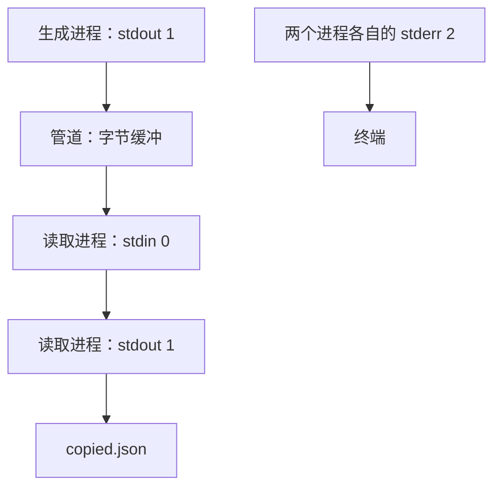

# 支线 3A：输出去了哪里——文件描述符、重定向与管道

第三章把日志分到了 stdout 和 stderr，但如果只记住 `>` 与 `2>`，遇到“错误为什么没进日志”“JSON 文件为什么无法解析”“前面的命令失败，整条命令却成功”时，仍然只能试着换写法。这几个问题可以从同一个机制推出来：进程读写的是已经连接好的通道，shell 负责在启动前安排这些连接。

## 终端不是 console 的固定目的地

一个进程不能拿到一个整数就任意访问系统资源。它需要先获得对应的打开资源；操作系统用进程自己的文件描述符表记录这些关联。描述符是表里的编号，指向内核管理的打开资源。不同进程中的数字 `1` 不必指向同一个目标，同一个进程中的两个编号也可以关联同一份打开资源。

标准输入、标准输出与标准错误约定使用 0、1、2。Node 把它们包装为 `process.stdin`、`process.stdout` 与 `process.stderr`，再由 `console` 提供常用的文本输出方式。我们写 `console.log()`，实质上是经由 stdout 写出内容；至于最终进入终端、文件还是管道，要看编号 1 关联的是什么。

因此，运行 `node src/server.js > server.log` 时，服务没有收到一个叫 `>` 的参数，也没有自己打开 `server.log`。shell 先为重定向准备文件，再让 Node 的 stdout 连接到它。文件名以 shell 当时的工作目录解析。即使程序内部后来调用 `process.chdir()`，已经接好的输出也不会自动挪到另一个目录。

这里已经能推导第一个故障：如果日志目录不存在，重定向本身可能失败，Node 还没运行，应用中的 `try/catch` 就无从接住。看到 shell 提示无法打开日志文件时，应检查启动命令的输出目标，而不是先去改服务的请求处理函数。

## 数据输出与诊断输出为什么要分开

假设一个命令要输出一条 JSON，供另一个程序读取。它同时需要告诉操作者自己正在处理什么。如果把两种内容都送进 stdout，下游拿到的就不再是一份合法 JSON。

新建 `examples/stdio-result.js`：

```javascript
console.error('Preparing one example result');
console.log(JSON.stringify({ originalText: 'A small example.' }));
```

在项目根目录创建一个独立演示目录，并运行：

```bash
epp_stdio_dir=$(mktemp -d)
node examples/stdio-result.js > "$epp_stdio_dir/result.json" 2> "$epp_stdio_dir/progress.txt"
cat "$epp_stdio_dir/result.json"
cat "$epp_stdio_dir/progress.txt"
```

第一份文件应只有 JSON，第二份文件应只有进度说明。这里 stderr 中的文本不是一次失败，进程退出码仍然为 0。stdout 与 stderr 的划分表达输出用途，退出码表达命令结果，不能把 stderr 中出现内容直接解释为失败。

反过来，如果把第一行改成 `console.log()`，再执行同一个命令，进度说明就会混进 `result.json`。代码没有抛异常，shell 也没有报错，但这个命令已经破坏了自己对下游的输出约定。问题发生在通道选择，不发生在 JSON 字段定义。

EPP 的 HTTP 服务目前用 stdout 记录请求，是因为业务响应走 HTTP 连接，日志不会混入响应体；以后若把相同业务能力封装成输出 JSON 的命令，就需要重新安排诊断输出。不能因为某段业务代码相同，就照搬它原来的日志目的地。

## 为什么两个重定向交换顺序就变了

要把两路输出合并，常见写法是：

```bash
node examples/stdio-result.js > "$epp_stdio_dir/combined.txt" 2>&1
```

shell 从左向右处理重定向。先把编号 1 接到文件，再让编号 2 复制编号 1 **此刻指向的资源**。两路输出因此进入同一文件。`2>&1` 不是把字符串 `1` 当作文件名，也不是让 stderr 永久跟踪 stdout 未来的变化。

交换顺序：

```bash
node examples/stdio-result.js 2>&1 > "$epp_stdio_dir/data-only.txt"
```

这次编号 2 先复制原来编号 1 的目标；在普通终端里，那个目标就是终端。随后只有编号 1 被改到文件，所以进度说明仍显示在终端，JSON 进入文件。这种按步骤追踪“编号现在指向哪里”的方法，比把两条命令分别背下来更可靠。

`>` 与 `>>` 的差别发生在打开文件时：前者通常创建或截断文件，后者以追加方式打开。这里使用新建的演示目录，避免覆盖已有内容。追加可以保留旧内容，却不会自动提供日志轮换、磁盘容量限制，或多个进程之间完整记录的排序保证。

## 管道连接的是字节，不是 JavaScript 对象

第三章的 `echo-stdin.js` 可以继续使用：

```javascript
process.stdin.setEncoding('utf8');
for await (const chunk of process.stdin) {
  process.stdout.write(chunk);
}
console.error('stdin ended');
```

运行：

```bash
node examples/stdio-result.js | node examples/echo-stdin.js > "$epp_stdio_dir/copied.json"
```

这条命令的连接关系如下。两个进程没有共享 JavaScript 对象；前者先把对象序列化成文本，后者收到的是字节流解码得到的字符串。



JSON 应进入文件，两个进程的诊断说明留在终端。两条诊断的相对显示顺序不应成为业务判断依据：两个进程各自执行，stdout 与 stderr 又是不同通道，并没有共同的应用级顺序协议。

为什么读取循环会结束？前面的程序写完并退出后，它持有的管道写端关闭；当写端都已关闭、缓冲中的数据也被读完，读端才看到 EOF，也就是输入结束。**某一刻没有数据，不等于输入结束。** 如果生产者仍持有写端，只是暂时没有输出，读取方就应等待，而不是把当前片段当成全部输入。

这也解释了直接运行 `node examples/echo-stdin.js` 为什么可能一直等：它此时从终端读取，终端尚未通知输入结束。在普通终端的行模式下，可以输入一行并回车，看到转发结果；在空行上按 `Ctrl+D` 可以使这次输入读到结束。`Ctrl+D` 表达的是终端输入条件，`Ctrl+C` 通常发送中断信号，它们不是两种等价的“结束命令”。

管道缓冲是有限的，读取方慢下来时，写入方不能无限制地产生数据。Node 的可写流还可能在用户态排队，所以小例子中的连续 `write()` 不能直接推广成大文件转发。文件篇会展开背压与 `pipeline()` 的实现选择；此处应能先判断：等待可能来自输入尚未结束，也可能来自下游处理速度，而不是笼统认为 JavaScript 没有执行。

## 有输出，不等于整条管道成功

还有一个独立问题：shell 最后返回哪个进程的结果？用子 shell 明确设置选项，避免改变当前终端的配置：

```bash
(
  set +o pipefail
  node -e 'process.exitCode = 7' | cat
  echo $?
)
```

在 Bash／Zsh 中，这里应得到 0。前面的 Node 失败了；后面的 `cat` 只是读到一个空输入，然后正常结束。关闭 `pipefail` 时，管道状态取最后一个命令的状态，因此前面的失败被掩盖了。

再运行：

```bash
(
  set -o pipefail
  node -e 'process.exitCode = 7' | cat
  echo $?
)
```

这次应得到 7。开启后，只要管道里有命令失败，整体就不会报告全部成功；有多个非零状态时，取最右侧失败命令的状态。它没有撤销已写出的内容，也不能代替业务结果检查。一个导出命令可能先输出半份数据，再失败；退出码告诉后续流程不能把这半份文件当作完整结果。

现在可以独立处理一个变式：某个工具要求“JSON 输出到文件，进度仍在终端，任何一环失败都不能继续发布导出文件”。这实际包含两项不同决定。输出方面，只把最终结果的 stdout 重定向到文件，诊断留在 stderr；结果方面，启用管道失败传播并检查整条命令的状态。不能只因消费者退出正常就接受文件，也不能只因文件存在就认为导出完整。

回到记录服务，判断日志丢失时先查通道连接，判断启动失败时查退出状态；将来做导入导出命令时，还要明确输出的完整性。它们相互关联，却不能用其中一个信号替代另外两个。

阅读参考（估算）：约 10～12 分钟；执行重定向、管道与退出状态对照另加约 6～8 分钟。依据约 2000 个汉字、30 行代码与命令及一幅通道图估算；操作时间不重复计算阅读，附录按需查阅。

## 附录：本支线必要技术点速查

| 名称 | 本文用途 | 必要注意点 |
| --- | --- | --- |
| 文件描述符 0、1、2 | 标准输入、输出、错误的约定编号 | 编号属于进程；相同数字不代表跨进程共享资源。 |
| `console.log()`、`console.error()` | 区分机器可读结果与诊断说明 | stderr 也可以输出正常进度；失败状态单独表达。 |
| `>`、`>>`、`2>`、`2>&1` | 打开输出目标与复制描述符关联 | 从左到右处理；复制的是当时关联的资源。 |
| 管道、EOF | 连接生产者与消费者 | 字节流无对象／行边界；暂时没有数据不等于 EOF。 |
| `setEncoding()`、`stdout.write()` | 转发小段 UTF-8 输入 | 大量输出还需要处理背压与流错误。 |
| `set -o pipefail`、`set +o pipefail` | 对照管道失败传播 | 只改变状态计算，不回滚已经输出的数据。 |
| `mktemp -d`、`cat` | 使用独立目录观察输出 | 操作结束后删除本次生成的目录；不要把本机路径带入分享材料。 |

官方查阅：[Node Process](https://nodejs.org/docs/v24.22.1/api/process.html)、[Node Stream](https://nodejs.org/docs/v24.22.1/api/stream.html)、[Bash 重定向](https://www.gnu.org/s/bash/manual/html_node/Redirections.html)、[Bash 管道](https://www.gnu.org/software/bash/manual/html_node/Pipelines.html)、[Zsh 重定向](https://zsh.sourceforge.io/Doc/Release/Redirection.html)。

[返回第三章](chapter.md) · [返回第一篇](../README.md)
