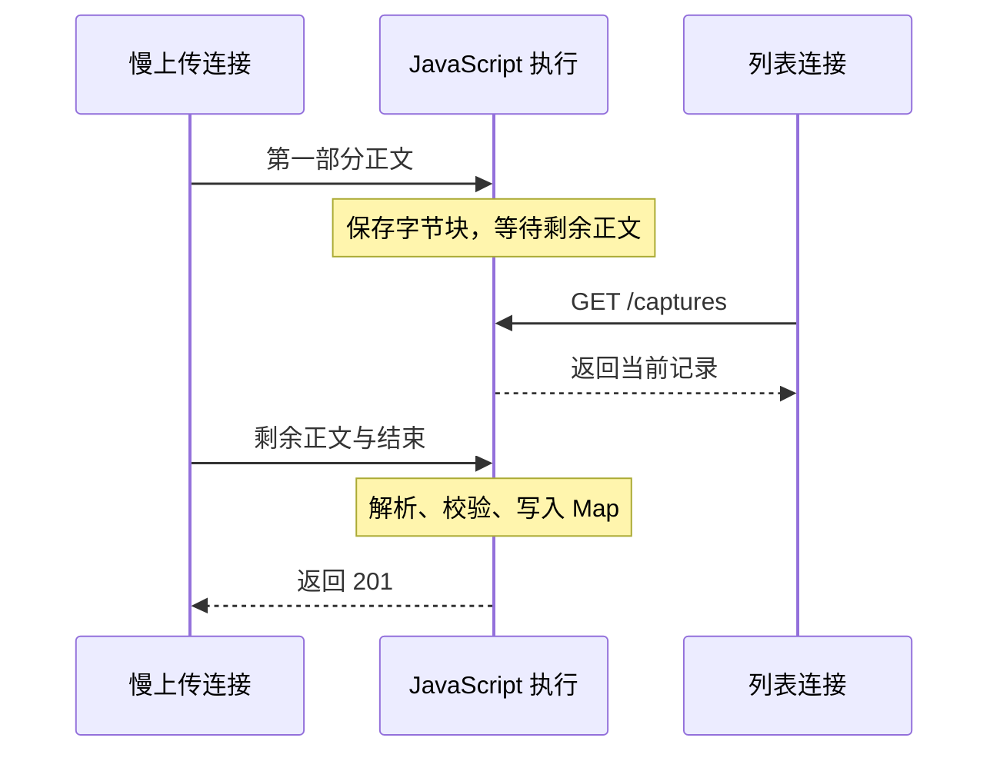

# 第 4 章 事件循环如何影响服务的响应能力

第三章已经把服务的启动条件固定下来：端口先经过校验，默认配置按模块位置读取，进程持有本次运行的记录和监听资源。现在我们可以暂时排除“启动方式不对”，集中看服务启动以后发生什么。

第二章的 `handleRequest()` 是一个异步函数。创建记录时，它会 `await readJson(request)`，然后校验原文、写入 Map、返回响应。这里留下一个重要问题：等待请求体的时候，究竟暂停了什么？如果另一个用户同时查看记录，是否也要等前一个用户上传完？把读取换成一段耗时计算，结果会不会一样？

这些问题决定了如何判断慢请求。一次请求花了两秒，可能是对方迟迟没发完数据，也可能是自己的 JavaScript 连续执行了两秒。两者对其他请求、定时器、取消操作的影响不同，修正方法也不同。仅仅看到函数带着 `async`，无法作出判断。

本章先沿现有记录接口观察真实的网络等待，再用独立程序对照等待、连续计算和分段计算。随后把同一套执行模型用于解释错误传播、超时、取消与并发资源占用，最后区分运行时线程池、Worker Threads 和独立进程。记录接口、字段与内存存储方式延续第三章；观察程序放在 `examples/`，没有给业务接口增加人为耗时的路由。

**代码起点**：第三章完成状态，代码分支 `part-01/chapter-03`。本章完成状态使用 `part-01/chapter-04`。运行版本继续固定为 Node.js `24.22.1`；命令使用 macOS、Linux 的 Bash／Zsh，Windows 使用 WSL。从配套项目根目录运行，先执行 `nvm use`。

## 4.1 一个请求等待 I/O 时，其他请求能否继续

### 等待的是完整请求体

回到 `src/server.js` 的这段代码：

```javascript
const body = await readJson(request);
```

`readJson()` 建立 `data`、`end` 和 `error` 监听后返回 Promise。它没有开一个循环反复检查“数据来了吗”。字节到达时，运行时安排对应的事件处理；没有新字节时，这段 JavaScript 没有工作需要执行。请求对象和已收到的块仍保留着，等待后续事件。

因此，`await` 挂起的是本次 `handleRequest()` 的后续执行。当前调用返回以后，同一条 JavaScript 执行线程可以处理其他已经就绪的工作。等请求体结束，`readJson()` 解析 JSON 并兑现 Promise，挂起位置后面的校验和写入才有机会恢复。这里的“有机会”也很重要：兑现 Promise 不会把正在执行的另一段 JavaScript 强行打断。

可以从一次慢速上传中观察这个过程。终端 A 按第三章的默认配置启动服务：

```bash
npm start
```

先请求一次列表，知道当前基线：

```bash
curl -sS http://127.0.0.1:3000/captures
```

新建 `examples/slow-upload.js`，完整代码如下。它先发送 JSON 的前半段，约 1500 ms 后才补齐剩余内容并结束请求：

```javascript
import { request } from 'node:http';
import { performance } from 'node:perf_hooks';

const start = performance.now();
let finishUpload;
try {
  await new Promise((resolve, reject) => {
    const upload = request('http://127.0.0.1:3000/captures', {
      method: 'POST',
      agent: false,
      headers: { 'Content-Type': 'application/json' },
    }, (response) => {
      response.setEncoding('utf8');
      response.on('data', (chunk) => process.stdout.write(chunk));
      response.on('error', reject);
      response.on('end', () => {
        console.log(`\nstatus=${response.statusCode}, elapsed=${Math.round(performance.now() - start)} ms`);
        if (response.statusCode === 201) resolve();
        else reject(new Error(`Unexpected HTTP status ${response.statusCode}`));
      });
    });
    upload.on('error', reject);
    upload.setTimeout(5000, () => upload.destroy(new Error('Upload idle timeout')));
    upload.write('{"originalText":"I enjoy');
    console.log('First part sent; finishing the body in 1500 ms.');
    finishUpload = setTimeout(() => upload.end(' learning English."}'), 1500);
  });
} catch (error) {
  console.error(error.message);
  process.exitCode = 1;
} finally {
  clearTimeout(finishUpload);
}
```

这里直接使用 `http.request()`，是为了控制同一次请求何时写入、何时结束。`write()` 把前半段交给输出通道，`end()` 才表示这次请求不再发送正文；传输过程中还可能分块，不能据两次调用假设服务端必然收到两个 `data` 事件。我们只要求完整请求体至少在后半段发出后才能结束。

`agent: false` 让这个有限实验使用独立连接。`setTimeout()` 设置的是连接空闲超时；收到超时通知后，代码还主动调用 `destroy()`，否则通知本身不等于终止请求。这个 5 秒保护也不应被误读成整个操作从头到尾的严格期限。响应被读完后 Promise 才完成，上传定时器在成功、失败两条路径上都会清理。

终端 B 执行下面一组命令。`&` 将上传程序放到后台，`$!` 保存它的 PID；稍等片刻后，另一个独立的 curl 请求读取列表：

```bash
node examples/slow-upload.js &
upload_pid=$!
sleep 0.2
curl -sS -w '\nlist total=%{time_total}s\n' http://127.0.0.1:3000/captures
wait "$upload_pid"
curl -sS http://127.0.0.1:3000/captures
```

观察终端 A 已出现 `POST /captures`，而上传客户端还没有输出 `201` 的那段时间。中间的列表应能返回，且不包含这次尚未完成的输入。上传完成后，最后一次列表才应多出 `I enjoy learning English.`。已有记录不需要清空，用新增的文本和返回 ID 区分即可；重复实验会新增多条记录。

`0.2` 秒只是在通常启动速度下创造重叠，不能证明请求已经到达服务端。若列表先于 POST 到达，或电脑繁忙导致列表发得过晚，这轮就没有构成预期对照；先根据服务日志和客户端输出确认时间窗口，再重做。需要更宽窗口时可把客户端的 1500 改成 3000，仍保持小于空闲超时。若你改过服务端口，也要同步修改客户端和 curl 的目标地址。

### 并发不要求两段 JavaScript 同时执行

这里有两个尚未结束的请求，但不需要两段业务 JavaScript 在同一时刻运行。服务先处理上传的一部分，再处理完整的列表查询，最后继续上传后的创建逻辑。多个请求的生命周期重叠，叫作并发；多条执行线程在不同 CPU 核心同时执行，才涉及并行执行。



图中的等待期间没有占着 JavaScript 执行，但仍占着连接、请求对象和已缓冲的数据。这解释了两个看起来矛盾的结论：慢上传可以不拖住另一个小请求；大量慢上传仍可能把服务的资源耗尽。异步解决执行的等待方式，没有消除资源成本。

再观察写入时机。当前代码在 `await readJson()` 之后才构造记录，校验成功后才调用 `captures.set()`。在这些同步语句之间，没有另一个普通请求回调突然插入。于是未上传完的正文不会变成半条记录。但不能据此推广为“Node 没有并发问题”：如果以后把“读取当前状态”和“根据旧状态写回”拆在 `await` 两侧，别的请求就可能在中间改变状态。数据库篇会用这个交错建立并发控制，本章先把交错发生的位置找准。

## 4.2 CPU 密集计算为什么阻塞服务

### 耗时相同，不代表影响相同

等待期间没有 JavaScript 工作，与持续计算期间不让出执行，是两回事。假设某次导入需要检查很多原文，直接用一个长循环完成扫描。循环内部即使没有任何网络访问，也可能让其他用户的查询变慢：这些查询已经到了操作系统，甚至对应字节已经缓冲，但应用层回调尚无机会运行。

为看清这种影响，先建立两个工作函数。新建 `examples/event-loop-work.js`：

```javascript
import { performance } from 'node:perf_hooks';
import { setImmediate as yieldToLoop } from 'node:timers/promises';

export function burnCpu(milliseconds) {
  const start = performance.now();
  let iterations = 0;
  while (performance.now() - start < milliseconds) iterations += 1;
  return iterations;
}

export async function burnInSlices(rounds = 60, sliceMs = 10) {
  let iterations = 0;
  for (let round = 0; round < rounds; round += 1) {
    iterations += burnCpu(sliceMs);
    await yieldToLoop();
  }
  return iterations;
}
```

`burnCpu()` 故意做无业务意义的忙循环。这里按经过时间停止，是为了在不同电脑上制造大致同样长度的阻塞窗口；返回的循环次数没有业务意义，也不能用于比较两种算法完成同一工作量的效率。`performance.now()` 用来测量同一进程中的时间间隔，比用可能被校时调整的日历时间更合适。

`burnInSlices()` 累积执行 60 段约 10 ms 的计算，每段之后等待一次 `setImmediate()` 的 Promise 版本。每次连续占用明显变短，事件循环有机会继续处理其他工作。不过它依旧需要大约 600 ms 的忙计算时间，并额外付出调度成本；总完成时间可能更长。

再新建 `examples/event-loop-server.js`。它使用独立的 `127.0.0.1:3002`，完整内容如下：

```javascript
import { createServer } from 'node:http';
import { performance } from 'node:perf_hooks';
import { setTimeout as delay } from 'node:timers/promises';
import { burnCpu, burnInSlices } from './event-loop-work.js';

async function handle(request, response) {
  const { pathname } = new URL(request.url, 'http://127.0.0.1');
  if (request.method !== 'GET') {
    response.writeHead(405, { Allow: 'GET' });
    response.end();
    return;
  }
  if (!['/quick', '/wait', '/block', '/slice'].includes(pathname)) {
    response.writeHead(404);
    response.end();
    return;
  }

  const start = performance.now();
  console.log(`begin ${pathname}`);
  const probe = setTimeout(() => {
    console.log(`${pathname}: 100 ms timer ran at ${Math.round(performance.now() - start)} ms`);
  }, 100);
  try {
    if (pathname === '/wait') await delay(600);
    if (pathname === '/block') burnCpu(600);
    if (pathname === '/slice') await burnInSlices();
    if (response.destroyed || response.writableEnded) return;
    response.writeHead(200, { 'Content-Type': 'application/json; charset=utf-8' });
    response.end(JSON.stringify({ pathname, elapsedMs: Math.round(performance.now() - start) }));
  } finally {
    // Keep this observation timer: it reports even if /block finishes first.
    // It is finite, and will not start business work or write a response.
    if (pathname === '/quick') clearTimeout(probe);
  }
}

const server = createServer((request, response) => {
  handle(request, response).catch((error) => {
    console.error(error.message);
    if (response.destroyed || response.writableEnded) return;
    if (response.headersSent) {
      response.destroy();
      return;
    }
    response.writeHead(500);
    response.end('Experiment failed');
  });
});
server.on('error', (error) => {
  console.error(`Experiment server failed: ${error.code ?? 'UNKNOWN'}`);
  process.exitCode = 1;
});
server.listen(3002, '127.0.0.1', () => {
  console.log('Event loop experiment: http://127.0.0.1:3002');
});
```

四条实验路由分别是立即返回、等待定时器、连续计算、分段计算。`/wait` 用定时器提供稳定的等待窗口，它本身不是磁盘或网络 I/O；真实的网络等待已经由上一节的慢上传展示。这个替代让对照只改变“等待还是占用执行”，不把外部服务器的速度混进来。

实验没有开放可任意指定的计算时长，避免一次误输制造很长的忙循环；它仍只适合本机观察。响应前检查连接是否已销毁，能避免明知连接不可用时继续写，但不会倒过来取消已经执行的计算。

### 同时观察慢请求和快请求

在终端 C 启动实验服务，等到打印监听地址：

```bash
node examples/event-loop-server.js
```

终端 B 先对照 `/wait`：

```bash
curl -sS -w '\nwait total=%{time_total}s\n' http://127.0.0.1:3002/wait &
slow_pid=$!
sleep 0.1
curl -sS -w '\nquick total=%{time_total}s\n' http://127.0.0.1:3002/quick
wait "$slow_pid"
```

这组命令应让 `/quick` 落在 `/wait` 未完成的窗口内。通常会先看到 quick 的结果，再看到 wait 的结果；wait 自己仍大约等待 600 ms。随后保持命令结构不变，把第一条 URL 换成 `/block`，再换成 `/slice`，每轮都等上一轮完成后再开始。

`/block` 执行时，快请求通常要等它结束后才能得到响应；`/slice` 则允许快请求在计算尚未全部完成时被处理。这里需要核对的是顺序和数量级，不是某个固定毫秒数。操作系统调度、终端输出和同时运行的程序都会影响数值；如果请求没有重叠，就不能用结果说明是否阻塞。

尤其注意 `/quick` 响应 JSON 里的 `elapsedMs`：它可能还是 0，但 curl 的 `time_total` 已经是几百毫秒。前者从 **handle 开始执行** 才计时，排在它前面的等待没被算进去；后者从客户端开始传输到读完响应，更接近用户这次调用经历的时间。服务里的短耗时日志与用户的慢响应并不必然矛盾，首先要比较两者的测量边界。

### async 不搬走计算，分段也不创造更多算力

如果把忙循环写进下面的函数，执行位置不会改变：

```javascript
async function wrappedCalculation() {
  return burnCpu(600);
}
```

调用这个函数时，`burnCpu()` 仍先在当前线程执行，之后才得到表示结果的 Promise。即使调用方写 `await wrappedCalculation()`，也不能撤销已经发生的阻塞。`new Promise(resolve => resolve(burnCpu(600)))` 同样如此：Promise 的执行器立即运行，它不是派遣计算的线程入口。

还有一种更隐蔽的写法：

```javascript
for (let round = 0; round < 60; round += 1) {
  burnCpu(10);
  await Promise.resolve();
}
```

每次 `await` 确实会挂起当前续体，但它把后续安排在微任务中。不断产生的新微任务仍可能先于 I/O 回调被持续处理。这种让出只是在 JavaScript 调度内部挪位置，不构成我们需要的“让事件循环继续服务其他请求”。因此示例明确选择 `await yieldToLoop()`，而不是把任何带 `await` 的写法都视为公平调度。

真正的分段算法需要保存进度：本次处理到哪个索引，下一段从哪里恢复，是否已经超时或取消。一个不可拆分的巨大 `JSON.parse()`，不能靠在前后各加一个 `setImmediate()` 变成可中断操作；它执行的那一段仍然阻塞。第二章限制请求体为 16 KiB，除了内存方面的考虑，也在约束这类同步解析的输入规模。

分段适合可以拆成小步、总量受控，而且确实需要留在当前执行环境的工作。若单步本身很重，或持续计算已接近 CPU 容量，就需要减小工作量、改算法，或换执行位置。把十个 600 ms 计算一起分段，会让它们交替推进，但总 CPU 需求仍然接近六秒；“大家都能动一点”不能代替容量判断。

回到 EPP，当前列表的 `[...captures.values()]` 和 `JSON.stringify()` 也都是同步工作。记录很少时无需为了消除每一行同步代码而拆分；记录无限增长时，列表复制与序列化就会占用更长时间并分配更多内存。应先识别无界输入和无界结果，后续用分页与查询范围解决，而不是给整个列表函数套上 `async`。

## 4.3 定时器、异常、超时与取消

### 100 ms 到了，不代表回调执行了

刚才实验路由在开始时安排了一个 100 ms 的定时器。对 `/wait`，探针通常在请求结束前运行；对 `/block`，它要等约 600 ms 忙循环结束后才有机会输出。程序特意保留这个有限探针，所以即使 block 的响应已经写出，仍能看到探针迟到。`/quick` 则立即清理自己的探针，避免无意义输出。

定时器给的是调度阈值，不能在期限到达时抢占当前 JavaScript。观察到探针延迟，说明它没能及时获得执行机会；忙循环是本例明确制造的原因，但在实际服务中还可能涉及其他长回调、垃圾回收、进程被操作系统暂停等因素。一次探针并不能自动识别所有瓶颈。

这也解释了“给 CPU 循环加 100 ms 超时为什么不起作用”。如果超时回调和循环在同一线程，循环正在占用的正是执行取消动作所需的线程。分段后可以在每段之间检查信号或截止时间；硬要终止不能配合的计算，则需要另一个执行边界来发起停止。第四节会实现合作取消，第五节再把计算放到另一个线程。

### 错误沿执行关系传播，不沿缩进传播

记录服务的监听回调里已经有：

```javascript
handleRequest(request, response).catch((error) => {
  // 将本次请求已返回的 Promise 拒绝转换成错误响应。
});
```

这里依赖一个约定：属于请求的异步工作，必须被 `await`、`return` 或以其他明确方式接回这个 Promise。否则，请求函数可能已经成功返回，真正的工作却在稍后失败；这个 `.catch()` 看不见一条与它无关的异步链。

用独立进程观察，避免故意制造的异常中止记录服务。新建 `examples/async-failure.js`：

```javascript
import { setTimeout as delay } from 'node:timers/promises';

const mode = process.argv[2];
if (!['caught', 'detached', 'callback'].includes(mode)) {
  console.error('Usage: node examples/async-failure.js caught|detached|callback');
  process.exitCode = 2;
} else {
  async function work() {
    await delay(20);
    throw new Error('Demo work failed');
  }
  try {
    if (mode === 'caught') await work();
    if (mode === 'detached') work();
    if (mode === 'callback') {
      setTimeout(() => { throw new Error('Demo callback failed'); }, 20);
    }
  } catch (error) {
    console.error(`caught: ${error.message}`);
    process.exitCode = 1;
  }
}
```

分别执行，每次紧接着查看退出状态：

```bash
node --unhandled-rejections=strict examples/async-failure.js caught
echo $?
node --unhandled-rejections=strict examples/async-failure.js detached
echo $?
node --unhandled-rejections=strict examples/async-failure.js callback
echo $?
```

`caught` 把 `work()` 的拒绝带回当前 `try`，输出 `caught:`，并由程序主动设置退出码 1。`detached` 调用了同一个函数，却丢掉返回的 Promise；稍后拒绝发生，外层 `try` 早已结束。`callback` 则在定时器回调里直接抛异常，那个回调是另一时刻进入的调用栈，不在原来的 `try` 中执行。后两种应出现错误堆栈并以非零状态退出，没有前一种的 `caught:` 前缀。

这里显式使用 `--unhandled-rejections=strict`，把实验中的未处理拒绝策略固定下来。Node 24 的默认模式为 `throw`，但启动参数或监听器可能影响观察。不要把某次运行只显示警告的结果泛化为“遗漏 await 无害”，也不要以为所有失败都应变成进程崩溃：非法输入属于请求可处理的失败；失去所有者的工作失败，暴露的是另一种问题。

给 `process` 加一个 `uncaughtException` 监听器并继续接请求，不能证明状态仍正确。异常可能在一组内存修改的中间发生，继续运行需要恢复依据。常规业务错误应在自己的边界处理；进程级未捕获异常应进入故障退出与外部恢复流程。第十三章建立服务生命周期，第九篇再落实进程托管；当前不要用全局吞错伪造可靠性。

### 超时只描述“谁不再等待”

考虑一个稍后才完成的操作。调用方最多等 100 ms，就把它与一个会拒绝的定时器放进 `Promise.race()`。100 ms 后调用方确实拿到了超时，但另一个 Promise 所代表的工作不会因为输了竞争就自动停止。

新建 `examples/deadline.js` 和 `examples/timeout-cancel.js`。先看负责期限与取消的完整辅助函数：

```javascript
import { performance } from 'node:perf_hooks';

export async function withDeadline(run, milliseconds) {
  if (!Number.isFinite(milliseconds) || milliseconds <= 0 || milliseconds > 2_147_483_647) {
    throw new RangeError('Deadline must be a positive timer duration');
  }
  const controller = new AbortController();
  const deadline = performance.now() + milliseconds;
  const timeoutError = new Error('Operation deadline exceeded');
  timeoutError.name = 'TimeoutError';
  const timer = setTimeout(() => controller.abort(timeoutError), milliseconds);
  try {
    const result = await run(controller.signal);
    if (controller.signal.aborted || performance.now() >= deadline) throw timeoutError;
    return result;
  } catch (error) {
    if (controller.signal.aborted) throw controller.signal.reason;
    throw error;
  } finally {
    clearTimeout(timer);
  }
}
```

再看调用程序的完整内容：

```javascript
import { setTimeout as delay } from 'node:timers/promises';
import { withDeadline } from './deadline.js';

const mode = process.argv[2] ?? 'cancel';
if (!['race', 'cancel', 'fast'].includes(mode)) {
  console.error('Usage: node examples/timeout-cancel.js race|cancel|fast');
  process.exitCode = 2;
} else {
  async function work(signal) {
    try {
      await delay(mode === 'fast' ? 20 : 600, undefined, { signal });
      console.log('work completed');
      return 'result';
    } finally {
      console.log('work cleanup');
    }
  }

  let timer;
  try {
    if (mode === 'race') {
      const timeout = new Promise((resolve, reject) => {
        timer = setTimeout(() => reject(new Error('Caller stopped waiting')), 100);
      });
      await Promise.race([work(), timeout]);
    } else {
      console.log(await withDeadline(work, 100));
    }
  } catch (error) {
    console.log(`caller: ${error.name}: ${error.message}`);
  } finally {
    clearTimeout(timer);
    console.log('caller cleanup');
  }
}
```

先运行 `node examples/timeout-cancel.js race`。预期先出现 `caller: Error: Caller stopped waiting` 和 `caller cleanup`，之后还会出现 `work completed`、`work cleanup`。调用方已经离开等待，那个 600 ms 定时器仍然活着。若把这个操作换成真实外部写入，迟到结果可能带着已经发生的副作用；超时不能作为“对方一定没执行”的证据。

再运行 `node examples/timeout-cancel.js cancel`。这次 100 ms 定时器调用 `controller.abort()`，`work()` 把同一个 signal 传给支持取消的 `delay()`。底层等待因取消而拒绝，先执行 `work cleanup`，再由外层报告 `TimeoutError` 并执行 `caller cleanup`。关键差异是取消通知传到了工作本身，而且外层一直等到工作退出，资源收尾有了明确的所有者。

`fast` 模式把工作缩成 20 ms，应正常输出结果，并清理尚未触发的期限定时器。三种模式是有意安排的观察分支，超时分支在调用处已被处理，因此这个程序不会把预期超时当成未捕获异常。

`withDeadline()` 还有一个容易被忽略的判断：工作完成后检查单调时钟。假如一段同步工作堵住线程，100 ms 的 abort 回调可能还没运行，而工作已经在 600 ms 后返回；只检查 `signal.aborted` 就可能把过期结果当成按时完成。时钟复查能拒绝这样的迟到成功，但不能回收已消耗的时间，更不能撤销其副作用。

## 4.4 把异步能力用于服务端资源管理

### 合作取消需要一条完整的传递路径

上一节的辅助函数有明确适用范围：`run(signal)` 必须接受并遵守取消协议，并在收尾后结束 Promise。这个函数没有暗中另起一场 race；如果 run 忽略信号并永远不结束，外层也会一直等待。这个边界应该写进调用约定，而不是通过函数名猜测它能强制中断任意操作。

顺着程序追踪一次取消：调用者创建控制器；期限到达后控制器改变信号状态；工作把信号传给底层 API；底层停止等待并使 Promise 拒绝；工作的 `finally` 释放它持有的资源；调用者在自己的 `finally` 清理期限定时器。中间少了哪一环，取消就可能只停在表面。

`AbortSignal` 是一条协作通知，不是操作系统发来的杀线程指令。仅把它放进参数对象，甚至只检查一次 `signal.aborted`，都不足以取消之后启动的长期工作。原生 API 若支持 signal，应按其约定传入；自定义可分段算法需要在段与段之间检查；自己注册 abort 监听时，还要处理已经取消的信号，并在成功、失败或取消后移除监听。否则本应结束的请求会通过监听器继续持有闭包和资源。

客户端断开连接也需要这样推导。断开的事实不会自动取消任意函数。服务若决定“客户端已经不需要结果，就停止这次只读计算”，应把连接事件接到该请求拥有的控制器。HTTP 的请求体读完与响应传输完成又是不同边界，不能看到 request 的一个 `close` 事件就认定用户中途离开；对于响应侧，可以结合 response 的 `close` 与 `writableFinished` 判断是否正常完成写出。正常写出仍不等于客户端应用已经处理结果。

对于已经创建记录或已向外部服务发出写入的操作，连接断开也不是自动回滚依据。应分开“停止继续耗费资源”和“判定业务最终结果”。本章的演示工作只有可取消等待，没有跨系统状态；可靠写入、幂等和未知结果会在业务一致性与后台任务篇继续落实。

超时本身也有不同对象。慢上传示例的 5 秒是连接空闲时间；`withDeadline()` 的 100 ms 是从操作开始计算的总预算。只要连接持续产生少量活动，空闲计时就可能不断重置，总时长却继续增加。若一个操作串联三步，每步重新给足两秒，总等待可能达到六秒；若需求是总共两秒，就应保留共同截止时刻，按剩余预算传递，不能把“每步超时”当成“整次请求超时”。

### Promise.all 不负责并发上限

另一个资源问题来自“同时开始”。假设要检查一批记录，写成 `await Promise.all(ids.map(inspect))` 很自然。但实际启动发生在 `map()` 调用每个 `inspect()` 的时候，`Promise.all()` 只聚合结果，不会替我们限制同时打开的连接数或正在执行的任务数。

输入从十项变成十万项时，问题不只是最终数组有多大。十万份异步操作可能同时申请资源、进入线程池或排在下游队列；虽然 JavaScript 没有忙等，内存、连接和排队时间仍持续增加。并发上限必须放在启动之前，而不是等全部 Promise 已经创建好再分组等待。

先做一个简单、足以看清所有权的分批版本。新建 `examples/bounded-batch.js`：

```javascript
import { setTimeout as delay } from 'node:timers/promises';

const ids = [1, 2, 3, 4, 5, 6];
const width = 2;
let active = 0;
let peak = 0;

async function inspect(id) {
  active += 1;
  peak = Math.max(peak, active);
  console.log(`start ${id}, active=${active}`);
  try {
    await delay(id % 2 === 0 ? 80 : 30);
    if (id === 3) throw new Error('Demo item 3 failed');
    return { id, status: 'ready' };
  } finally {
    active -= 1;
    console.log(`finish ${id}, active=${active}`);
  }
}

try {
  for (let offset = 0; offset < ids.length; offset += width) {
    const batch = ids.slice(offset, offset + width);
    const results = await Promise.allSettled(batch.map(inspect));
    const failure = results.find((result) => result.status === 'rejected');
    if (failure) throw failure.reason;
    console.log(JSON.stringify(results.map((result) => result.value)));
  }
} catch (error) {
  console.error(error.message);
  process.exitCode = 1;
} finally {
  console.log(`all accepted work settled: active=${active}, peak=${peak}`);
}
```

运行 `node examples/bounded-batch.js` 后，先看到 1、2 两项；两项都结束后才开始 3、4。第 3 项故意失败，但第 4 项仍会完成；5、6 不会再启动。最后应是 `active=0, peak=2`，进程返回 1。

为什么这里使用 `allSettled()`？我们选择的策略是“当前批次全部收尾后决定是否接受下一批”。`Promise.all()` 在一项拒绝后会较早拒绝，另一项仍可能运行；如果外层此时关闭共用资源，仍在执行的那项就会遇到资源被提前释放的问题。`allSettled()` 给我们完整结果，随后主动检查失败并抛出。只调用 allSettled 而不检查结果，又会把部分失败误报为整体成功。

这个实现有意保留一个代价：每批中快任务完成后，会等同批最慢任务，空出来的位置不会立刻补上新工作。对少量有限数据，这个策略容易解释与维护；对持续吞吐要求高的场景，可以使用固定数量的消费者，让每个空闲消费者再领取一项。但无论选哪种方式，都要在领取前限制数量，并给尚未启动的输入一个容量边界。并发限制与队列容量是两件事；上限为 2、等待队列无限，仍可能耗尽内存。

若改成“发现一项失败就通知同批其他任务取消”，还需要让 inspect 接收信号，并继续等待已启动任务的收尾。发出取消之后立即返回，仍会把生命周期留在调用方背后。这里采用等待同批结束，正是为了在当前小例子中把失败策略讲清，不把取消、重试和吞吐全部混成一个难以解释的辅助库。

### await 的位置表达谁负责收尾

回头看第二章的 `readJson()`、第三章的文件句柄和本章的期限函数，它们共同建立一种结构：启动资源操作的人，要能说明什么时候算结束，失败在哪里被观察，以及哪个 `finally` 负责清理。语法形式类似，但清理对象不同：文件句柄需要关闭，定时器需要清除，连接可能需要销毁，一批已接受工作需要等待或取消后再等待。

`finally` 不是事务回滚。它保证的是控制流离开这段代码时执行清理，不保证业务写入撤销，也不保证进程被强杀时还有机会运行。如果清理本身也是异步操作，就还要等待它；如果清理可能失败，应决定如何保留原始错误，不能无意识地用新的关闭异常掩盖真正原因。第三章的句柄支线给出文件例子，这里把同样的责任延伸到同时在途的工作。

这也说明“不 await，放后台做”为什么不足以实现后台任务。工作仍在同一进程里，仍需要错误处理，退出时仍可能丢失；丢掉 Promise 只让调用者失去追踪，没有得到持久化或恢复能力。第六篇的 Worker 会从已保存的任务事实恢复执行，它解决的是业务生命周期，与第五节马上讨论的 Worker Threads 不是同一概念。

## 4.5 执行到底发生在哪里

### 单线程说的是哪一层

本章反复说“同一条 JavaScript 执行线程”，而没有说“整个 Node 进程只有一条线程”。前者描述当前回调、同步循环与 Promise 续体如何共享执行机会；后者会把运行时内部的 I/O、线程池和额外创建的线程都抹掉。

对网络 socket，操作系统和运行时协作处理就绪通知，通常不是给每个连接安排一个 libuv 工作线程等待。对普通文件系统操作、部分 DNS 操作以及某些加密、压缩 API，Node 会使用 libuv 的线程池执行原生工作。随后，完成通知仍要回到相应事件循环，JavaScript 才能处理结果。具体归属要看 API，不能把所有异步操作都画进同一个池里。

因此，`await readFile()` 等待时能处理其他请求，不代表文件操作不消耗资源；文件读完后的 `JSON.parse()` 也不会自动留在线程池中继续执行。一次业务函数可以先在 JavaScript 中处理参数，再等待池里的工作，最后回到 JavaScript 构造响应。定位慢在哪里，需要沿阶段看执行位置。

### 用一个有限实验看线程池的排队

新建 `examples/thread-pool.js`，用八次异步 `pbkdf2()` 作为可重复的原生计算负载：

```javascript
import { pbkdf2 } from 'node:crypto';
import { performance } from 'node:perf_hooks';

const start = performance.now();
const probe = setTimeout(() => {
  console.log(`100 ms probe at ${Math.round(performance.now() - start)} ms`);
}, 100);

function derive(index) {
  return new Promise((resolve, reject) => {
    pbkdf2('demo-only', `demo-salt-${index}`, 200_000, 32, 'sha256', (error) => {
      if (error) reject(error);
      else resolve({ index, completedMs: Math.round(performance.now() - start) });
    });
  });
}

const results = await Promise.allSettled(Array.from({ length: 8 }, (_, index) => derive(index)));
for (const result of results) {
  if (result.status === 'fulfilled') console.log(result.value);
  else {
    console.error(result.reason.message);
    process.exitCode = 1;
  }
}
// If all work finished quickly, there is no pending responsiveness to observe.
clearTimeout(probe);
```

这里的字符串、盐和迭代次数只服务于调度观察，不是账号密码的保存方案。密码处理的参数与安全选择归入身份篇；本例不把派生值输出，也不接入登录逻辑。

分别以一个线程与四个线程启动两个独立进程：

```bash
UV_THREADPOOL_SIZE=1 node examples/thread-pool.js
UV_THREADPOOL_SIZE=4 node examples/thread-pool.js
```

设置放在启动命令里，因为池可能在应用代码运行前后很早就初始化，在程序运行中修改环境变量不能可靠地重建它。libuv 的默认池大小通常为 4，这里显式指定是为了使对照条件清楚。

先看各项的 `completedMs`。池只有一个工作线程时，多项工作需要排队；四个工作线程可以同时推进更多项，但总时间未必缩成四分之一，实际还受可用 CPU、其他进程和调度影响。输出按输入索引打印，数值才表示各回调实际完成时刻，不能把打印行的顺序当作线程调度轨迹。

100 ms 探针若在计算完成前输出，说明原生计算进行时，主线程仍获得了执行机会。如果机器很快，全部工作在探针之前结束，代码会清除探针；如果机器整体 CPU 紧张，探针也可能迟到。异步原生计算减少的是主线程直接执行这份计算的占用，没有让它免受整机资源竞争。

再想一步：池里的长计算占满位置，另一个使用同一池的轻任务也可能排队。此时 JavaScript 主线程仍能处理 `/quick`，但某个依赖池的请求变慢。这个现象和 `/block` 把所有回调拖住不同。盲目增大池会让更多工作同时争抢 CPU 或内存；先限制提交量、识别慢任务与共享池依赖，再判断是否需要调整。

### Worker Threads 与独立进程分别改变什么

普通 JavaScript 计算不会因为函数返回 Promise 就进入 libuv 线程池。如果要让另一条线程执行它，需要明确使用 Worker Threads。每个 Worker 有自己的 JavaScript 执行环境，可以通过消息交付输入和结果；主线程的 Map 不会自动成为 Worker 直接访问的同一张 Map。

最小的创建入口形如：

```javascript
import { Worker } from 'node:worker_threads';

const worker = new Worker(new URL('./cpu-worker.js', import.meta.url), {
  workerData: { mode: 'worker', note: 'owned by parent' },
});
```

这个入口属于配套的 `examples/worker-boundary.js`。它只说明执行位置如何改变；完整程序还必须处理结果、异常、无结果退出和期限，相关代码与操作在本章支线展开。先把边界与其他选择对照：

| 方式 | 谁执行主要工作 | 状态与成本 | 适用判断 |
| --- | --- | --- | --- |
| 普通异步 I/O | 运行时与系统负责等待，当前线程处理 JS 回调 | 连接、缓冲与下游容量仍被占用 | 原本就支持异步的网络和文件操作优先使用对应 API |
| 分段 JavaScript | 当前线程分次执行 | 同一执行环境，保留进度，增加调度次数 | 单段可控且希望改善其他请求获得执行的机会 |
| libuv 线程池 API | 有限工作线程执行 API 约定的原生工作 | 共享池可能排队；不接受任意 JS 函数 | 按具体 API 的执行机制判断，不能只看 async 关键字 |
| Worker Threads | 同一进程中的其他 JS 线程 | 独立执行环境，消息复制／转移与线程启动成本 | 可隔离的 CPU 密集 JS 任务，长期使用需限制线程与队列数量 |
| 独立进程 | 另一个进程的线程 | 地址空间、启动配置与进程生命周期独立，通信另行安排 | 需要独立部署、退出与故障处理边界的工作 |

Worker Threads 可以显式共享特定内存，但默认消息传递不是任意对象的共享引用；共享内存还会带来同步问题。独立进程也不会自动共享记录 Map，甚至环境变量都是启动输入。第三章已经解释进程资源归属，这里看见它直接影响“把工作搬出去”后的状态设计。

不要给每个 HTTP 请求无上限新建 Worker。线程启动有成本，每个执行环境有内存，多线程还共享同一台机器的 CPU。稳定服务通常复用有限数量的 Worker，并给等待队列设上限；提交者还需关联任务与结果，处理线程失败与重建。这些选择会在性能章节结合负载继续展开。本章用一次性、无副作用的小计算，先建立创建、观察、终止与状态归属的依据。

同样，后台任务消费者不等于 Worker Thread。业务里的 Worker 可以是一个独立 Node 进程，负责从持久化队列领取工作；它不一定使用多线程。反过来，一个 Worker Thread 即使计算成功，也没有因此获得跨进程重启的恢复记录。执行位置、是否脱离请求生命周期、是否可恢复，是三个分别需要设计的问题。

### 换一个需求，再作一次判断

假设 EPP 接下来增加“导入一份包含很多原文的文件”。可以沿本章的机制拆开判断，而不先决定“全改 async”或“直接上多线程”。

如果慢在等待上传，先检查流读取、输入大小、空闲与总时限；本章的慢上传说明这段等待不必占住主线程，但连接和缓冲仍需要边界。如果慢在一次巨大的 JSON 解析，换成 Promise 包装没有帮助，必须限制输入、改变格式与处理方式，或为可隔离的计算选择其他执行位置。如果慢在对每条原文调用一个外部接口，问题变成在途数量与下游容量，需要启动前限并发并定义失败收尾，不能一次建立十万份 Promise。

再增加一个约束：“导入可以在客户端关掉页面后继续，服务重启后也不能丢。”这时取消与请求不再是一对一关系，任务要有独立生命周期和持久化事实；单靠 detached Promise 或 Worker Thread 都不满足要求。这条推导把当前掌握的执行边界，接到了后续后台任务的真实需要。

本章没有改变记录的存储模型，却让我们能沿一条请求路径区分等待、计算、排队和收尾，并据此选择处理方式。第五章继续沿用同一个项目，把开发入口迁到 TypeScript，解释类型检查、模块解析与构建产物怎样进入实际运行。

本章完成代码分支：`part-01/chapter-04`。`src/` 与三个记录接口沿用第三章；本章新增的观察程序均位于 `examples/`，不增加第三方依赖。观察结束后，分别在记录服务与实验服务终端按 `Ctrl+C`。

时间参考（估算）：只阅读约 50～60 分钟；跟做另加约 35～45 分钟，边读边做合计约 85～105 分钟。按正文约 8200 个汉字、约 286 行随文代码与命令估算，阅读包含代码理解和因果推导；跟做包括建立观察程序约 12～15 分钟、慢上传与三组请求对照约 10～12 分钟、异常和取消约 7～10 分钟、分批与线程池观察约 6～8 分钟。不重复计入阅读，不含逐字手敲全部代码、首次环境安装或额外排错。附录按需查阅，支线时间单列。

## 本章支线

以下支线继续展开正文建立的执行边界，入口放在主线之后，便于先把请求路径串起来再追踪调度细节：

- [4A：await 之后轮到谁——微任务、nextTick 与事件循环阶段](side-01-scheduling-and-microtasks.md)：解释“让出”的不同层次、ESM 顶层顺序、I/O 回调中的调度与微任务饥饿，避免把日志题的某次顺序当成通用规则。
- [4B：把计算交给另一个线程——消息、失败与 Worker 的寿命](side-02-worker-lifecycle.md)：完整建立一次计算的输入、结果和退出协议，观察复制语义、异常、无结果退出与主动终止，再判断什么时候需要线程池或独立进程。

支线的阅读与操作时间单列，不并入主线。

## 附录：本章必要技术点速查

本章面向 Node.js `24.22.1`。以下入口供回查 API 契约，原理与取舍见正文及支线。

| 名称 | 本章用途 | 必要注意点 |
| --- | --- | --- |
| `http.request()`、`write()`、`end()` | 分两次发送同一请求的正文 | 写入边界不等于服务端数据块边界；响应要读取完并处理错误 |
| `request.setTimeout()`、`destroy()` | 为慢上传设置空闲保护并主动终止 | timeout 事件不自动中止；空闲超时不同于整次操作预算 |
| `async`、`await`、Promise 续体 | 表达异步完成与错误归属 | 不自动派遣线程，不保证 I/O 公平调度；遗漏关联会产生游离工作 |
| `performance.now()` | 测量间隔、复查截止时刻 | 是相对单调时间；不拿它存业务日期，不跨进程直接比较绝对值 |
| `setTimeout()`、`clearTimeout()` | 探针与期限控制 | 到阈值不等于立即运行；已执行的回调不能靠清除撤销 |
| `timers/promises.setTimeout()` | 提供可取消等待 | 把 signal 传给真正的等待操作，取消产生拒绝 |
| `timers/promises.setImmediate()` | 分段之间给事件循环推进机会 | 不增加 CPU 容量，不保证精确延迟或每轮处理某个特定请求 |
| `queueMicrotask()`、`process.nextTick()` | 观察高优先级续体与饥饿 | 都不是长计算调度器；ESM 顶层与普通回调的相对顺序不同 |
| `Promise.race()` | 对照先获得结果与工作仍继续 | 不取消输掉竞争的工作，也不回滚副作用 |
| `AbortController`、`AbortSignal` | 向支持的操作传播取消 | 合作协议；要传递、响应、清理，并等待收尾 |
| `Promise.all()`、`allSettled()` | 区分较早失败与等待全部结果 | 都不限制启动数量；前者失败不停止同伴，后者仍需检查失败项 |
| `--unhandled-rejections=strict` | 固定遗漏拒绝处理的实验行为 | 不能用全局吞错代替局部错误归属 |
| `pbkdf2()`、`UV_THREADPOOL_SIZE` | 观察原生计算与线程池排队 | 示例参数只用于实验；启动前配置，增加线程不等于增加算力 |
| `Worker`、`workerData`、消息与退出事件 | 明确另一个 JS 执行环境的生命周期 | 消息结果与线程结束不同；完整一次性协议见支线 4B |
| `curl -w '%{time_total}'`、`&`、`wait` | 比较重叠请求的客户端耗时 | 先确认发生重叠；请求回调内部计时会漏掉回调开始前的等待 |

官方查阅：[HTTP](https://nodejs.org/docs/v24.22.1/api/http.html)、[Timers 与 Promise timers](https://nodejs.org/docs/v24.22.1/api/timers.html)、[Performance hooks](https://nodejs.org/docs/v24.22.1/api/perf_hooks.html)、[Process](https://nodejs.org/docs/v24.22.1/api/process.html)、[命令行选项](https://nodejs.org/docs/v24.22.1/api/cli.html)、[AbortController 与全局对象](https://nodejs.org/docs/v24.22.1/api/globals.html)、[Crypto](https://nodejs.org/docs/v24.22.1/api/crypto.html)、[Worker Threads](https://nodejs.org/docs/v24.22.1/api/worker_threads.html)。

执行模型参考：[Node 事件循环](https://nodejs.org/en/learn/asynchronous-work/event-loop-timers-and-nexttick)、[不要阻塞事件循环或工作线程池](https://nodejs.org/en/learn/asynchronous-work/dont-block-the-event-loop)。

[上一章：Node.js 程序究竟运行在哪里](../chapter-03-node-runtime/chapter.md) · [下一章：TypeScript 如何变成可运行的服务](../chapter-05-typescript/chapter.md) · [返回第一篇](../README.md) · [返回全书目录](../../README.md)
