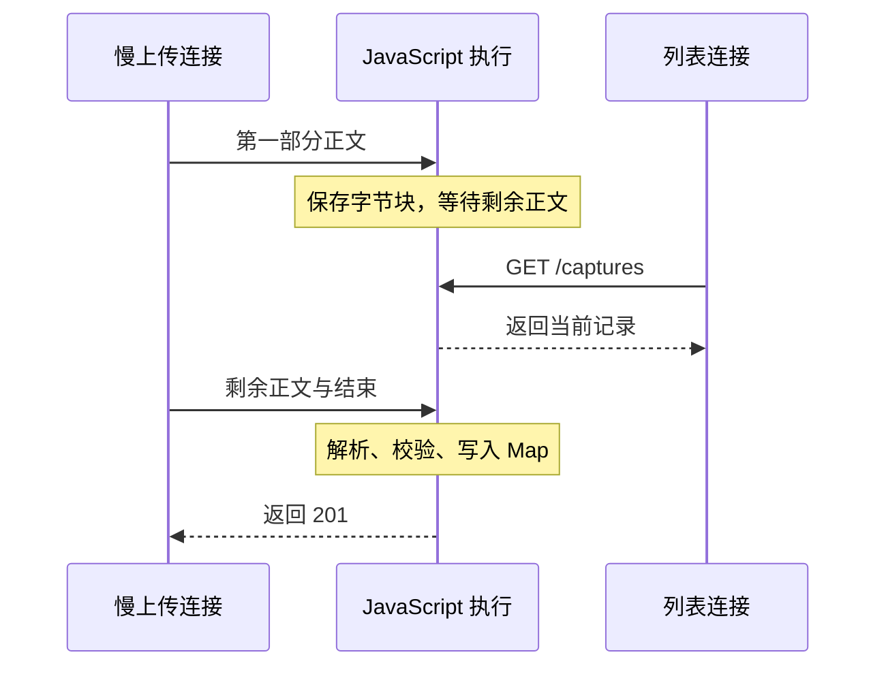

# 第 5 章 事件循环如何影响服务的响应能力

第四章已经把服务的启动条件固定下来：端口先经过校验，默认配置按模块位置读取，进程持有本次运行的记录和监听资源。现在我们可以暂时排除“启动方式不对”，集中看服务启动以后发生什么。

第三章的 `handleRequest()` 是一个异步函数。创建记录时，它会 `await readJson(request)`，然后校验原文、写入 Map、返回响应。这里留下一个重要问题：等待请求体的时候，究竟暂停了什么？如果另一个用户同时查看记录，是否也要等前一个用户上传完？把读取换成一段耗时计算，结果会不会一样？

这些问题决定了如何判断慢请求。一次请求花了两秒，可能是对方迟迟没发完数据，也可能是自己的 JavaScript 连续执行了两秒。两者对其他请求、定时器、取消操作的影响不同，修正方法也不同。仅仅看到函数带着 `async`，无法作出判断。

本章先沿现有记录接口观察真实的网络等待，再用独立程序对照等待、连续计算和分段计算。随后把同一套执行模型用于解释错误传播、超时、取消与并发资源占用，最后区分运行时线程池、Worker Threads 和独立进程。记录接口、字段与内存存储方式延续第四章；观察程序放在 `examples/`，没有给业务接口增加人为耗时的路由。

**代码起点**：第四章完成状态，代码分支 `part-01/chapter-04`。本章完成状态使用 `part-01/chapter-05`。运行版本继续固定为 Node.js `24.22.1`；命令使用 macOS、Linux 的 Bash／Zsh，Windows 使用 WSL。从配套项目根目录运行，先执行 `nvm use`。

## 5.1 一个请求等待 I/O 时，其他请求能否继续

### 等待的是完整请求体

回到 `src/server.js` 的这段代码：

```javascript
const body = await readJson(request);
```

`readJson()` 建立 `data`、`end` 和 `error` 监听后返回 Promise。它没有开一个循环反复检查“数据来了吗”。字节到达时，运行时安排对应的事件处理；没有新字节时，这段 JavaScript 没有工作需要执行。请求对象和已收到的块仍保留着，等待后续事件。

因此，`await` 挂起的是本次 `handleRequest()` 的后续执行。当前调用返回以后，同一条 JavaScript 执行线程可以处理其他已经就绪的工作。等请求体结束，`readJson()` 解析 JSON 并兑现 Promise，挂起位置后面的校验和写入才有机会恢复。这里的“有机会”也很重要：兑现 Promise 不会把正在执行的另一段 JavaScript 强行打断。

可以从一次慢速上传中观察这个过程。终端 A 沿用第四章的开发入口；本实验显式指定 3000，避免本机 `.env` 的端口让客户端连到另一处：

```bash
PORT=3000 npm run dev
```

在 Postman 打开已保存的列表请求，确认实际地址为 `http://127.0.0.1:3000/captures`，发送一次并记住当前条目。等效终端请求如下：

```bash
curl -sS http://127.0.0.1:3000/captures
```

新建 `examples/slow-upload.js`，完整代码如下。它先发送 JSON 的前半段，约 1500 ms 后才补齐剩余内容并结束请求：

```javascript
import { request } from 'node:http';
import { performance } from 'node:perf_hooks';

const start = performance.now();
let finishUpload;
try {
  await new Promise((resolve, reject) => {
    const upload = request('http://127.0.0.1:3000/captures', {
      method: 'POST',
      agent: false,
      headers: { 'Content-Type': 'application/json' },
    }, (response) => {
      response.setEncoding('utf8');
      response.on('data', (chunk) => process.stdout.write(chunk));
      response.on('error', reject);
      response.on('end', () => {
        console.log(`\nstatus=${response.statusCode}, elapsed=${Math.round(performance.now() - start)} ms`);
        if (response.statusCode === 201) resolve();
        else reject(new Error(`Unexpected HTTP status ${response.statusCode}`));
      });
    });
    upload.on('error', reject);
    upload.setTimeout(5000, () => upload.destroy(new Error('Upload idle timeout')));
    upload.write('{"originalText":"I enjoy');
    console.log('First part sent; finishing the body in 1500 ms.');
    finishUpload = setTimeout(() => upload.end(' learning English."}'), 1500);
  });
} catch (error) {
  console.error(error.message);
  process.exitCode = 1;
} finally {
  clearTimeout(finishUpload);
}
```

这里直接使用 `http.request()`，是为了控制同一次请求何时写入、何时结束。`write()` 把前半段交给输出通道，`end()` 才表示这次请求不再发送正文；传输过程中还可能分块，不能据两次调用假设服务端必然收到两个 `data` 事件。我们只要求完整请求体至少在后半段发出后才能结束。

`agent: false` 让这个有限实验使用独立连接。`setTimeout()` 设置的是连接空闲超时；收到超时通知后，代码还主动调用 `destroy()`，否则通知本身不等于终止请求。这个 5 秒保护也不应被误读成整个操作从头到尾的严格期限。响应被读完后 Promise 才完成，上传定时器在成功、失败两条路径上都会清理。

终端 B 执行下面一组命令。`&` 将上传程序放到后台，`$!` 保存它的 PID；稍等片刻后，另一个独立的 curl 请求读取列表：

```bash
node examples/slow-upload.js &
upload_pid=$!
sleep 0.2
curl -sS -w '\nlist total=%{time_total}s\n' http://127.0.0.1:3000/captures
wait "$upload_pid"
curl -sS http://127.0.0.1:3000/captures
```

观察终端 A 已出现 `{"event":"http.request","method":"POST"}`，而上传客户端还没有输出 `201` 的那段时间。当前日志有意不记录原始 URL；本轮只运行这一个 POST 客户端，才可以用这条方法日志确认它已进入服务。中间的列表应能返回，且尚无这次创建的新记录。上传完成后，最后一次列表应多出本次响应 ID 对应的 `I enjoy learning English.`。已有记录不需要清空，用新增的文本和返回 ID 区分即可；重复实验会新增多条记录。

`0.2` 秒只是在通常启动速度下创造重叠，不能证明请求已经到达服务端。若列表先于 POST 到达，或电脑繁忙导致列表发得过晚，这轮就没有构成预期对照；先根据服务日志和客户端输出确认时间窗口，再重做。需要更宽窗口时可把客户端的 1500 改成 3000，仍保持小于空闲超时。若你改过服务端口，也要同步修改客户端和 curl 的目标地址。

这里用 Node 客户端控制分段发送，用 shell 安排重叠，分别是普通图形请求难以精确表达的实验条件；日常列表回查继续用保存的 Postman 请求。测时期间先禁用断点并让程序继续运行，也不要保存服务源码触发重启，否则暂停或换进程会改变本来要观察的执行时序。

把慢上传当作一次跨进程的协作来读。前端向 fetch 传入一个完整对象时，往往是先把它序列化成字符串，再交给网络层，因而在发起者看来文本早已齐全。服务端拿到的是一条连接上的字节流。它已经知道方法、路径和媒体类型，并不意味着请求正文也已经到齐。再看代码里的两个括号：第一个 write 只交出字符串的前一段；第二个 end 补齐引号和右花括号，并告诉接收方这次正文发送结束。服务端能据以开始解析的事实是自己的结束事件。客户端那句“第一部分已发送”只能用来安排观察的起点。

可以先不看任何计时数字，在纸上画四个时刻。第一格是接到请求头，服务能选中创建分支，Map 里还是原来的记录。第二格是收到一部分正文，接收函数的局部数组里已有字节，Map 没变。第三格是正文结束、组成完整缓冲、解码并解析，程序现在才知道 originalText 的实际值。第四格是通过校验，将拥有新编号的记录放进 Map，然后构造响应。把列表读取插在第二格和第三格之间，列表应该等于原来的内容；把读取放到第四格之后，列表应该包含新编号。这个预测只依赖状态变更发生在哪一步，在快机器和慢机器上都成立。

为什么要先收字节，结束时才一起解码？设想正文中间有个“学”字，发送方给的是正常的 UTF-8 文本，接收方的两个数据块却可能恰好在这个字的三个字节之间分开。如果把每个块独立当作完整字符串解码，第一块末尾看起来就像少了字节，第二块开头也缺少前缀。完整输入原本正确，错误却由接收者自己制造出来。当前实现在完整的小缓冲上做一次严格解码，先前则一直按字节累计容量。等将来处理真正的大文件，可以选择有状态的流式解码器跨块保留未完成的字符；仍然不能让网络分块边界替业务决定哪里是字符、记录或一份完整的 JSON。

要从调试器看清这段分工，可以单独做一次不计时的读取。在开发服务的 Sources 中打开 src/server.js，找到 end 监听器里合并 chunks 的语句，用普通 Postman 创建请求命中它。此处看的是收到的总字节数与块数组，尚未取得 handleRequest 中的 body；继续到构造 capture 的位置，才看得到原文和即将保存的对象。源代码中两处停点之间隔着解析、Promise 兑现和校验。变量窗口在哪个函数里能看见哪个值，正好对应先前纸上第三格到第四格的变化。完成后继续运行并禁用这两个断点，再用慢客户端观察重叠；暂停时另一个请求也在等调试器放行，不能把那段时间归给上传。

列表观察还要防止认错记录。前一次练习若已经上传过同一句英文，中间的列表本来就可能显示它。先在 Postman 保存本轮开始时的编号集合，上传期间再取一次列表；等客户端收到创建结果，从响应中抄下这一次的新编号。现在回看中间那份列表，应找不到这个新编号，最后一份里才能找到它。只比较屏幕上有没有那句话，会把上一次的成功当成本次提前写入。若最后列表连基线中的旧编号也没了，先看终端有没有出现新的监听进程号，以及列表地址是否一直指向同一个端口，再讨论写入顺序。

### 并发不要求两段 JavaScript 同时执行

这里有两个尚未结束的请求，但不需要两段业务 JavaScript 在同一时刻运行。服务先处理上传的一部分，再处理完整的列表查询，最后继续上传后的创建逻辑。多个请求的生命周期重叠，叫作并发；多条执行线程在不同 CPU 核心同时执行，才涉及并行执行。



图中的等待期间没有占着 JavaScript 执行，但仍占着连接、请求对象和已缓冲的数据。这解释了两个看起来矛盾的结论：慢上传可以不拖住另一个小请求；大量慢上传仍可能把服务的资源耗尽。异步解决执行的等待方式，没有消除资源成本。

再观察写入时机。当前代码在 `await readJson()` 之后才构造记录，校验成功后才调用 `captures.set()`。在这些同步语句之间，没有另一个普通请求回调突然插入。于是未上传完的正文不会变成半条记录。但不能据此推广为“Node 没有并发问题”：如果以后把“读取当前状态”和“根据旧状态写回”拆在 `await` 两侧，别的请求就可能在中间改变状态。数据库篇会用这个交错建立并发控制，本章先把交错发生的位置找准。

“一个请求正在等待”其实留下了两种不同的东西。控制流留下的是恢复点：等 readJson 的 Promise 结束后，从校验那一行继续。数据留下的是这次请求自己的状态：用来收块的数组、已收字节数和正在监听的那个请求对象。第二个请求到来，会新建一份局部状态，恢复点虽然位于同一行代码，恢复时拿到的 body 却属于各自的调用。把 chunks 移到模块顶层试图“复用一下数组”，就改变了所有权；两条正常连接的数据本应分别组装，任何一条先结束都不能把另一条的半份文本拿走。模块顶层适合本章有意让所有请求共享的 Map，单次读取的缓冲则应随那次调用存活。

再把顺序换一次。甲先发请求头并等待后半段，乙随后发完整的小请求，乙完全可能先得到新编号和成功响应。这里不要求后来的请求排在甲后面，甲乙的业务输入相互独立。若页面按用户开始输入的顺序放置两个“正在保存”的项目，就要让每个返回的编号更新各自的项目，不能来一个响应就拿去填列表中的第一处空白。服务端也不能凭创建时间推断哪个用户最先按按钮，创建时间取在完整输入通过校验之后。并发的意义于是落在可观察的结果上：请求开始顺序、记录写入顺序和调用方看到结果的顺序，是三件需要分别取证的事。

什么时候这种交错会形成真正的业务问题？设想给每份成功输入累计一次字数。若甲先读共享总数十，准备加三，中间等待另一个异步结果；这期间乙读到十、加二并写回十二，最后甲用手里保存的十写出十三。两个回调没有同时运行，按业务要求应得的十五却消失了。反过来，如果等待结束之后才读取当前值并同步加三，乙留下的十二仍在，本轮就得到十五。两种写法都只有一条 JavaScript 执行线程，差异在读和写之间是否留出了别人改变同一状态的窗口。当前创建直接给新编号写入独立记录，不需要为这个假想例子添加锁，能指出共享的究竟是哪一个值才是判断的第一步。

### 让两个请求同时占住接收器

先结束上一轮单次观察。要看见两个正在等待的读取，在本地练习的 src/server.js 里给 readJson 包一层，只临时把调用处改成 `const body = await observeRead(request)`。下列两个计数放在模块作用域，observeRead 则和 readJson 一样是普通函数声明。requestNo 标识这一次读取，后面保存到业务 Map 的记录编号仍由原创建逻辑产生。

```javascript
let nextRead = 0;
let activeReads = 0;

async function observeRead(request) {
  const requestNo = ++nextRead;
  activeReads += 1;
  console.log({ requestNo, phase: 'enter', activeReads });
  try {
    return await readJson(request);
  } finally {
    activeReads -= 1;
    console.log({ requestNo, phase: 'settled', activeReads });
  }
}
```

保存后等 watch 打印新的监听行，重新读取列表作为本轮基线，因为上一次运行的内存记录已经随旧进程退出。两个终端各备好 `node examples/slow-upload.js`，让两次正常上传的等待窗口重叠，再从 Postman 发列表 GET。认准两条不同编号的 enter，第二条显示 activeReads 为二，随后才有第一条 settled。计数围住的是“接收函数的 Promise 尚未结束”这一段，进入它时还未创建记录，离开它时也未必已经写出响应。想核对字节数，可以在 readJson 的 end 监听器内看局部变量 bytes；两次相同输入应有相同总字节数，块数却不必相同。

若 GET 在两笔上传结束前返回，而计数同时达到 2，就能区分两件事：等待网络时事件循环能服务别人，两笔未完请求仍占着各自的缓冲与连接。把实验客户端的间隔改为 2500 毫秒，保持字节与并发不变，再记录从第一次 write 到 end 的时间。每次有数据都重新计时的空闲限时，只能发现中途完全停发。要限制整笔接收的占用时间，应从请求开始保存截止时刻，让后续数据仍受同一时刻约束。保存本轮编号和计数后，恢复原来的 readJson 调用并撤去包装函数和计数器。下一节改用另一进程，对照同步计算期间 GET 与定时器各迟到了多久。

整理双上传结果时，表格的一行应代表一条请求。把两条创建响应的编号写在两行，分别勾出“中间列表缺席、结束后可按编号读回”，另记观察到的最大在途接收数。峰值二意味着某个时刻确有两次接收尚未收尾，不意味着执行了两次 JSON 解析的那个瞬间也是并行的。把网络间隔延长后，若峰值仍为二、每条总字节数也一样，变化的是两份接收状态同时保留的时长。这个区别解释了为什么一个接口看起来仍能很快返回列表，同时维持相同请求量却比先前更久地占用连接。单看最终成功条数，观察不到这种差异。

## 5.2 CPU 密集计算为什么阻塞服务

### 耗时相同，不代表影响相同

等待期间没有 JavaScript 工作，与持续计算期间不让出执行，是两回事。假设某次导入需要检查很多原文，直接用一个长循环完成扫描。循环内部即使没有任何网络访问，也可能让其他用户的查询变慢：这些查询已经到了操作系统，甚至对应字节已经缓冲，但应用层回调尚无机会运行。

为看清这种影响，先建立两个工作函数。新建 `examples/event-loop-work.js`：

```javascript
import { performance } from 'node:perf_hooks';
import { setImmediate as yieldToLoop } from 'node:timers/promises';

export function burnCpu(milliseconds) {
  const start = performance.now();
  let iterations = 0;
  while (performance.now() - start < milliseconds) iterations += 1;
  return iterations;
}

export async function burnInSlices(rounds = 60, sliceMs = 10) {
  let iterations = 0;
  for (let round = 0; round < rounds; round += 1) {
    iterations += burnCpu(sliceMs);
    await yieldToLoop();
  }
  return iterations;
}
```

`burnCpu()` 故意做无业务意义的忙循环。这里按经过时间停止，是为了在不同电脑上制造大致同样长度的阻塞窗口；返回的循环次数没有业务意义，也不能用于比较两种算法完成同一工作量的效率。`performance.now()` 用来测量同一进程中的时间间隔，比用可能被校时调整的日历时间更合适。

`burnInSlices()` 累积执行 60 段约 10 ms 的计算，每段之后等待一次 `setImmediate()` 的 Promise 版本。每次连续占用明显变短，事件循环有机会继续处理其他工作。不过它依旧需要大约 600 ms 的忙计算时间，并额外付出调度成本；总完成时间可能更长。

再新建 `examples/event-loop-server.js`。它使用独立的 `127.0.0.1:3002`，完整内容如下：

```javascript
import { createServer } from 'node:http';
import { performance } from 'node:perf_hooks';
import { setTimeout as delay } from 'node:timers/promises';
import { burnCpu, burnInSlices } from './event-loop-work.js';

async function handle(request, response) {
  const { pathname } = new URL(request.url, 'http://127.0.0.1');
  if (request.method !== 'GET') {
    response.writeHead(405, { Allow: 'GET' });
    response.end();
    return;
  }
  if (!['/quick', '/wait', '/block', '/slice'].includes(pathname)) {
    response.writeHead(404);
    response.end();
    return;
  }

  const start = performance.now();
  console.log(`begin ${pathname}`);
  const probe = setTimeout(() => {
    console.log(`${pathname}: 100 ms timer ran at ${Math.round(performance.now() - start)} ms`);
  }, 100);
  try {
    if (pathname === '/wait') await delay(600);
    if (pathname === '/block') burnCpu(600);
    if (pathname === '/slice') await burnInSlices();
    if (response.destroyed || response.writableEnded) return;
    response.writeHead(200, { 'Content-Type': 'application/json; charset=utf-8' });
    response.end(JSON.stringify({ pathname, elapsedMs: Math.round(performance.now() - start) }));
  } finally {
    // Keep this observation timer: it reports even if /block finishes first.
    // It is finite, and will not start business work or write a response.
    if (pathname === '/quick') clearTimeout(probe);
  }
}

const server = createServer((request, response) => {
  handle(request, response).catch((error) => {
    console.error(error.message);
    if (response.destroyed || response.writableEnded) return;
    if (response.headersSent) {
      response.destroy();
      return;
    }
    response.writeHead(500);
    response.end('Experiment failed');
  });
});
server.on('error', (error) => {
  console.error(`Experiment server failed: ${error.code ?? 'UNKNOWN'}`);
  process.exitCode = 1;
});
server.listen(3002, '127.0.0.1', () => {
  console.log('Event loop experiment: http://127.0.0.1:3002');
});
```

四条实验路由分别是立即返回、等待定时器、连续计算、分段计算。`/wait` 用定时器提供稳定的等待窗口，它本身不是磁盘或网络 I/O；真实的网络等待已经由上一节的慢上传展示。这个替代让对照只改变“等待还是占用执行”，不把外部服务器的速度混进来。

实验没有开放可任意指定的计算时长，避免一次误输制造很长的忙循环；它仍只适合本机观察。响应前检查连接是否已销毁，能避免明知连接不可用时继续写，但不会倒过来取消已经执行的计算。

给这四条路由设计对照时，困难在于把“一件事本来就慢”与“它让别人也慢”分开。只发一个慢请求，你可以测到它持续了多久，却看不出这段时间里服务还能做些什么。再加一个本身几乎不用计算的请求，相当于给同一服务放了第二个观察者。假如两次实验里的慢请求都在六百毫秒左右结束，第二个观察者却一次立刻拿到答复，一次晚了半秒，就不能再仅靠慢请求自身的持续时间解释结果。探针又提供第三种视角，它连网络连接都不经过，可以帮助判断迟到是否也发生在服务进程内部。

在纸上先按一个便于计算的理想时序预测。把实验入口开始处理慢请求记为零，快请求在第一百毫秒到达。如果慢请求在等自己的定时器，第一百毫秒附近主线程有机会接下快请求，快请求返回之后慢请求仍继续等，六百毫秒不是这两次响应都要支付的代价。如果头六百毫秒都由一个循环占用，快请求只需等剩下的约五百毫秒，并非从到达起再等完整的六百毫秒。若快请求到达时已过五百五十毫秒，预期排在循环后面的时间就只剩约五十毫秒。相同代码可以测出差异很大的快请求耗时，判断时要把到达位置也带进去。

分段的情况要画成许多小段。快请求若恰好在一段中途就绪，得等当前这一段退出；段间运行时还可能处理别的已经就绪的回调，轮到它时才真正进入 handle。它通常不用等其余几十段全部算完，也没有“一定只等十毫秒”的保证。特别是普通电脑还在运行浏览器和其他应用，主线程交出执行机会后，操作系统未必立刻把下一个时间片给这个进程。实验用分段来改变长计算的连续性，没要求编写服务的人准确预测每个时间片轮到哪个回调。

### 同时观察慢请求和快请求

慢上传对照结束后，在终端 A 按 Ctrl+C 结束整个开发命令，释放其调试端口。接下来只观察独立实验服务，不需要两份服务一起保活。在终端 C 使用同一套开发参数启动实验入口，等到打印监听地址：

```bash
NODE_ENV=development node --watch --watch-preserve-output --inspect=127.0.0.1:9229 examples/event-loop-server.js
```

`--watch` 继续监听入口及导入模块，保存 `event-loop-work.js` 后会重启实验进程；`--watch-preserve-output` 保留上一轮输出，比较时以新出现的监听日志为界。若改出语法错误，先看终端错误并修正，等新的监听日志出现后再发请求；调试窗口断开时，回到第三章的 `chrome://inspect` 重新选择这个入口。业务端口为 3002，调试端口仍是 9229，两者承担不同用途。

在 Postman 选择 **Import**，导入配套代码的 `requests/event-loop.postman_collection.json`，打开“第5章执行实验”集合。它保存四条无 Body 的 GET 请求，分别使用 `{{experimentBaseUrl}}/quick`、`/wait`、`/block`、`/slice`；集合变量 `experimentBaseUrl` 默认是 `http://127.0.0.1:3002`，发送前检查解析出的完整地址。先逐条 Send，核对状态 200、响应的 `pathname` 和 `elapsedMs`，确认自己访问的是实验服务。若手动创建，就按这四个路径保存请求以便修改后重发；不要修改原记录接口集合的 `baseUrl`，以免之后把 `/captures` 发到 3002。

需要观察分支时，在 Sources 打开 `examples/event-loop-server.js`，在 `const start = performance.now()` 处设断点，发送已保存的请求，查看 `pathname` 后继续执行；它能确认请求选择了哪种工作。完成这项观察后禁用断点，再做下面的计时。图形请求用于日常重复调试；下面使用 curl 的后台运行与 `time_total`，是为了安排可重复的请求重叠并明确客户端计时边界。终端 B 先对照 `/wait`：

```bash
curl -sS -w '\nwait total=%{time_total}s\n' http://127.0.0.1:3002/wait &
slow_pid=$!
sleep 0.1
curl -sS -w '\nquick total=%{time_total}s\n' http://127.0.0.1:3002/quick
wait "$slow_pid"
```

这组命令应让 `/quick` 落在 `/wait` 未完成的窗口内。通常会先看到 quick 的结果，再看到 wait 的结果；wait 自己仍大约等待 600 ms。随后保持命令结构不变，把第一条 URL 换成 `/block`，再换成 `/slice`，每轮都等上一轮完成后再开始。

`/block` 执行时，快请求通常要等它结束后才能得到响应；`/slice` 则允许快请求在计算尚未全部完成时被处理。这里需要核对的是顺序和数量级，不是某个固定毫秒数。操作系统调度、终端输出和同时运行的程序都会影响数值；如果请求没有重叠，就不能用结果说明是否阻塞。

尤其注意 `/quick` 响应 JSON 里的 `elapsedMs`：它可能还是 0，但 curl 的 `time_total` 已经是几百毫秒。前者从 **handle 开始执行** 才计时，排在它前面的等待没被算进去；后者从客户端开始传输到读完响应，更接近用户这次调用经历的时间。服务里的短耗时日志与用户的慢响应并不必然矛盾，首先要比较两者的测量边界。

这里有一组用配套快照在 Node 24.22.1 上取得的本机读数。每轮只发一条慢请求，看到服务端的 begin 后约一百毫秒，从另一条连接发 quick。表内两个“快请求”数字针对的是同一笔调用；最后一列是慢请求自己的探针相对它开始时的读数。可以用它练习解释次序，实际跟做时用自己的读数替换。

| 慢请求 | 慢请求客户端总耗时 | 快请求体内 elapsedMs | 快请求客户端总耗时 | 百毫秒探针实际运行时刻 |
| --- | ---: | ---: | ---: | ---: |
| 等待 | 604 ms | 2 ms | 4 ms | 101 ms |
| 连续计算 | 602 ms | 0 ms | 500 ms | 601 ms |
| 分段计算 | 621 ms | 0 ms | 18 ms | 101 ms |

先只比较第二列。连续计算甚至比等待略早结束，仅凭这两行无法说哪条路由对其他人更友好。然后横着读连续计算那一行：快请求在函数里用时四舍五入为零，客户端却等了五百毫秒，同时一个根本没发网络请求的定时器也迟到约五百毫秒。这正好与手算剩余时间相符。最后看分段，长任务这次多花了约十九毫秒才交付结果，短任务等待却缩短了几百毫秒。前者在讨论完成这一份工作的总时间，后者在讨论同时服务另一个人的响应能力，可以朝相反的方向变化。

实际排查要比这次受控对照谨慎。例如客户端很慢，探针却按时，不能只从两端耗时相减断定所有时间都花在等网络。连接建立、客户端自身的调度、服务进入 handle 之前或之后的其他阶段，也都可能落在差额里。先用同一地址单独发一次 quick，确认没有慢任务时的基线；再按相同的两条连接引入慢任务，看差异是否随处理方式改变。若服务终端既无预期路径的 begin，也无相应探针，先检查目标端口与服务进程。若每种模式的探针都迟到好几秒，则先检查调试器是不是还停在断点，不要用暂停执行的样本来衡量分段效果。

### async 不搬走计算，分段也不创造更多算力

如果把忙循环写进下面的函数，执行位置不会改变：

```javascript
async function wrappedCalculation() {
  return burnCpu(600);
}
```

调用这个函数时，`burnCpu()` 仍先在当前线程执行，之后才得到表示结果的 Promise。即使调用方写 `await wrappedCalculation()`，也不能撤销已经发生的阻塞。`new Promise(resolve => resolve(burnCpu(600)))` 同样如此：Promise 的执行器立即运行，它不是派遣计算的线程入口。

还有一种更隐蔽的写法：

```javascript
for (let round = 0; round < 60; round += 1) {
  burnCpu(10);
  await Promise.resolve();
}
```

每次 `await` 确实会挂起当前续体，但它把后续安排在微任务中。不断产生的新微任务仍可能先于 I/O 回调被持续处理。这种让出只是在 JavaScript 调度内部挪位置，不构成我们需要的“让事件循环继续服务其他请求”。因此示例明确选择 `await yieldToLoop()`，而不是把任何带 `await` 的写法都视为公平调度。

真正的分段算法需要保存进度：本次处理到哪个索引，下一段从哪里恢复，是否已经超时或取消。一个不可拆分的巨大 `JSON.parse()`，不能靠在前后各加一个 `setImmediate()` 变成可中断操作；它执行的那一段仍然阻塞。第三章限制请求体为 16 KiB，除了内存方面的考虑，也在约束这类同步解析的输入规模。

分段适合可以拆成小步、总量受控，而且确实需要留在当前执行环境的工作。若单步本身很重，或持续计算已接近 CPU 容量，就需要减小工作量、改算法，或换执行位置。把十个 600 ms 计算一起分段，会让它们交替推进，但总 CPU 需求仍然接近六秒；“大家都能动一点”不能代替容量判断。

再看素材列表，`[...captures.values()]` 和 `JSON.stringify()` 也都是同步工作。记录很少时无需为了消除每一行同步代码而拆分；记录无限增长时，列表复制与序列化就会占用更长时间并分配更多内存。应先识别无界输入和无界结果，后续用分页与查询范围解决，而不是给整个列表函数套上 `async`。

要把“分段”用到真实代码，还少一个问题：怎样证明让出后没有少处理一条或多处理一条？按时间空转的 burnCpu 不需要保存业务进度，处理数组却需要。先选一个能手算的工作，依次统计五个短字符串的长度，用纯顺序计算得出基准答案，再把“下一项的位置”和“已经累计的结果”放在每一段之外。下面的小实验直接在配套项目终端运行，无需改动记录服务。

```bash
node --input-type=module <<'JS'
import assert from 'node:assert/strict';
import { setImmediate as yieldToLoop } from 'node:timers/promises';

const texts = ['a', 'bb', 'ccc', 'dddd', 'eeeee'];
let next = 0;
let total = 0;
while (next < texts.length) {
  const stop = Math.min(next + 2, texts.length);
  while (next < stop) {
    total += texts[next].length;
    next += 1;
  }
  console.log({ next, total });
  if (next < texts.length) await yieldToLoop();
}
assert.equal(total, texts.reduce((sum, text) => sum + text.length, 0));
JS
```

第一段纳入第一、二项，累计三，下一次从下标二开始。第二段累计到十，下一次从下标四开始。最后剩一项，实际结束位置取数组长度，最终为十五。若把 total 放进外层循环体，每一段都会忘记此前累计；若每次从上一段最后处理的元素恢复，边界元素会被重复计算。先证明结果与顺序版一致，再看是否给了其他事件机会，是检验分段改写的合理顺序。这个小程序工作太少，根本量不出服务延迟；它负责检验计算边界，前面的双请求实验负责检验调度效果。

再改一个条件：数据可能在段间被别的请求更新。示例的五项是这次操作私有的固定数组，下一次恢复时下标仍指向原来那一项。如果直接对一份会插入或删除元素的共享列表保存下标，下一段可能跳过一项；即使最终总数看着合理，算到的也未必是同一批输入。这时先约定是处理启动时已经选定的记录，还是连运行期间新增的记录一起处理。前者可以先取得一份有界的编号序列，再按它推进；后者要规定什么时候停止接收新项。让出一次执行机会改变了别人能在什么时刻介入，不能只改循环语法而忘了数据范围。

## 5.3 定时器、异常、超时与取消

### 100 ms 到了，不代表回调执行了

刚才实验路由在开始时安排了一个 100 ms 的定时器。对 `/wait`，探针通常在请求结束前运行；对 `/block`，它要等约 600 ms 忙循环结束后才有机会输出。程序特意保留这个有限探针，所以即使 block 的响应已经写出，仍能看到探针迟到。`/quick` 则立即清理自己的探针，避免无意义输出。

定时器给的是调度阈值，不能在期限到达时抢占当前 JavaScript。观察到探针延迟，说明它没能及时获得执行机会；忙循环是本例明确制造的原因，但在实际服务中还可能涉及其他长回调、垃圾回收、进程被操作系统暂停等因素。一次探针并不能自动识别所有瓶颈。

这也解释了“给 CPU 循环加 100 ms 超时为什么不起作用”。如果超时回调和循环在同一线程，循环正在占用的正是执行取消动作所需的线程。分段后可以在每段之间检查信号或截止时间；硬要终止不能配合的计算，则需要另一个执行边界来发起停止。本节后半会给一个支持取消的等待设置期限，5.4 再沿调用链检查谁负责收尾。

看探针输出时，把三个时刻分开放。安排定时器时记录起点，起点加一百毫秒是最早应该考虑执行这件事的时刻，日志打印时才是实际获得 JavaScript 执行机会的时刻。若日志显示六百零一毫秒，迟到量约为五百零一毫秒；六百零一既不是定时器回调本身运行了那么久，也不是服务主动睡眠了那么久。回调只做了一次读钟和输出。这个差值能发现一段时间内调度没有及时前进，却不会替你指出是哪一行业务代码占用了这段时间。

若试图靠每个请求都安排一个探针来解释整次请求，又会遇到观察范围的问题。请求可能在探针到点之前已经正常结束，就像 quick 的代码会清除尚未使用的探针，这时没有那行输出很合理；也可能与别的请求共用一次主线程停顿，两条探针都会迟到，却不是发生了两份同样长的计算。比较这个实验时每轮只保留一个慢请求，等探针与响应都出现再换路径。这样看到的迟到才容易和哪一次计算对上，而不会把上一轮迟到的探针算到下一轮头上。

回到前端熟悉的倒计时。若把“回调运行一次”当作“恰好经过一秒”，界面繁忙时倒计时会比真实截止时刻慢。后端遇到同样的问题，只是后果变成了是否接受迟到的结果。保存一个截止时刻，每次实际获得执行时再比较现在与截止时刻，能纠正这个判断。至于时间一到就必须停止占用处理器，则需要另一个能获得执行的参与者。读钟可以判断预算是否已用完，读钟本身不会让刚过去的一段计算退回到期限之内。

### 错误沿执行关系传播，不沿缩进传播

记录服务的监听回调里已经有：

```javascript
handleRequest(request, response).catch((error) => {
  // 将本次请求已返回的 Promise 拒绝转换成错误响应。
});
```

这里依赖一个约定：属于请求的异步工作，必须被 `await`、`return` 或以其他明确方式接回这个 Promise。否则，请求函数可能已经成功返回，真正的工作却在稍后失败；这个 `.catch()` 看不见一条与它无关的异步链。

用独立进程观察，避免故意制造的异常中止记录服务。新建 `examples/async-failure.js`：

```javascript
import { setTimeout as delay } from 'node:timers/promises';

const mode = process.argv[2];
if (!['caught', 'detached', 'callback'].includes(mode)) {
  console.error('Usage: node examples/async-failure.js caught|detached|callback');
  process.exitCode = 2;
} else {
  async function work() {
    await delay(20);
    throw new Error('Demo work failed');
  }
  try {
    if (mode === 'caught') await work();
    if (mode === 'detached') work();
    if (mode === 'callback') {
      setTimeout(() => { throw new Error('Demo callback failed'); }, 20);
    }
  } catch (error) {
    console.error(`caught: ${error.message}`);
    process.exitCode = 1;
  }
}
```

分别执行，每次紧接着查看退出状态：

```bash
node --unhandled-rejections=strict examples/async-failure.js caught
echo $?
node --unhandled-rejections=strict examples/async-failure.js detached
echo $?
node --unhandled-rejections=strict examples/async-failure.js callback
echo $?
```

`caught` 把 `work()` 的拒绝带回当前 `try`，输出 `caught:`，并由程序主动设置退出码 1。`detached` 调用了同一个函数，却丢掉返回的 Promise；稍后拒绝发生，外层 `try` 早已结束。`callback` 则在定时器回调里直接抛异常，那个回调是另一时刻进入的调用栈，不在原来的 `try` 中执行。后两种应出现错误堆栈并以非零状态退出，没有前一种的 `caught:` 前缀。

这里显式使用 `--unhandled-rejections=strict`，把实验中的未处理拒绝策略固定下来。Node 24 的默认模式为 `throw`，但启动参数或监听器可能影响观察。不要把某次运行只显示警告的结果泛化为“遗漏 await 无害”，也不要以为所有失败都应变成进程崩溃：非法输入属于请求可处理的失败；失去所有者的工作失败，暴露的是另一种问题。

给 `process` 加一个 `uncaughtException` 监听器并继续接请求，不能证明状态仍正确。异常可能在一组内存修改的中间发生，继续运行需要恢复依据。常规业务错误应在自己的边界处理；进程级未捕获异常应进入故障退出与外部恢复流程。第十四章建立服务生命周期，第九篇再落实进程托管；当前不要用全局吞错伪造可靠性。

检查一段异步错误处理时，可以先把箭头从里往外画。哪一个具体动作会拒绝？它的 Promise 有没有交给上层等待？上层处理函数返回的又是不是包含这个动作的 Promise？在记录服务中，正文读取会拒绝，handleRequest 等它，服务器监听回调又给 handleRequest 的返回对象接上 catch。从读取到响应有一条连续路径。如果有人把最后一段工作搬进一个定时器，监听回调仍可以完整处理 handleRequest 的拒绝，但定时器的异常已经不在那条路径上。出现堆栈时先找断开的是哪一条箭头，比在每层不加区分地再包一次 try 更有效。

还有一个容易在评审前端代码时略过的区别。异步函数内部直接 return 某个 Promise，调用者最终仍能等待它，失败也可以传到调用者。但如果本层的 try 里只写 return work()，本层 catch 捕捉的是当下求值时抛出的异常，稍后 work 的拒绝并不会重新进入已经离开的 try。若本层确实负责将某类异步错误换成业务结果，就需要在这个 try 内 await 它，让拒绝在本层等待处表现为抛出。若本层只是透传，交给调用方处理就足够。用不用 await 取决于这层究竟要观察结果、转换错误还是承担清理。

据此可以从实际结果区分“错误进了 catch”和“程序以非零状态结束”。示例的三种模式最后都可能返回一，单看退出状态无法分辨有没有局部处理。第一种会输出自己写的前缀，它决定把已处理的失败报告给命令调用者；另外两种返回非零，是未接住的异常或拒绝走到了进程边界。反过来，超时示例会在自己的 catch 打印诊断然后自然结束，退出状态可以为零。阅读命令输出时，先说明这段程序约定了什么才算整次运行失败，再拿退出状态去解释一次局部操作的结果。

### 超时只描述“谁不再等待”

考虑一个稍后才完成的操作。调用方最多等 100 ms，就把它与一个会拒绝的定时器放进 `Promise.race()`。100 ms 后调用方确实拿到了超时，但另一个 Promise 所代表的工作不会因为输了竞争就自动停止。

新建 `examples/deadline.js` 和 `examples/timeout-cancel.js`。先看负责期限与取消的完整辅助函数：

```javascript
import { performance } from 'node:perf_hooks';

export async function withDeadline(run, milliseconds) {
  if (!Number.isFinite(milliseconds) || milliseconds <= 0 || milliseconds > 2_147_483_647) {
    throw new RangeError('Deadline must be a positive timer duration');
  }
  const controller = new AbortController();
  const deadline = performance.now() + milliseconds;
  const timeoutError = new Error('Operation deadline exceeded');
  timeoutError.name = 'TimeoutError';
  const timer = setTimeout(() => controller.abort(timeoutError), milliseconds);
  try {
    const result = await run(controller.signal);
    if (controller.signal.aborted || performance.now() >= deadline) throw timeoutError;
    return result;
  } catch (error) {
    if (controller.signal.aborted) throw controller.signal.reason;
    throw error;
  } finally {
    clearTimeout(timer);
  }
}
```

再看调用程序的完整内容：

```javascript
import { setTimeout as delay } from 'node:timers/promises';
import { withDeadline } from './deadline.js';

const mode = process.argv[2] ?? 'cancel';
if (!['race', 'cancel', 'fast'].includes(mode)) {
  console.error('Usage: node examples/timeout-cancel.js race|cancel|fast');
  process.exitCode = 2;
} else {
  async function work(signal) {
    try {
      await delay(mode === 'fast' ? 20 : 600, undefined, { signal });
      console.log('work completed');
      return 'result';
    } finally {
      console.log('work cleanup');
    }
  }

  let timer;
  try {
    if (mode === 'race') {
      const timeout = new Promise((resolve, reject) => {
        timer = setTimeout(() => reject(new Error('Caller stopped waiting')), 100);
      });
      await Promise.race([work(), timeout]);
    } else {
      console.log(await withDeadline(work, 100));
    }
  } catch (error) {
    console.log(`caller: ${error.name}: ${error.message}`);
  } finally {
    clearTimeout(timer);
    console.log('caller cleanup');
  }
}
```

先运行 `node examples/timeout-cancel.js race`。预期先出现 `caller: Error: Caller stopped waiting` 和 `caller cleanup`，之后还会出现 `work completed`、`work cleanup`。调用方已经离开等待，那个 600 ms 定时器仍然活着。若把这个操作换成真实外部写入，迟到结果可能带着已经发生的副作用；超时不能作为“对方一定没执行”的证据。

再运行 `node examples/timeout-cancel.js cancel`。这次 100 ms 定时器调用 `controller.abort()`，`work()` 把同一个 signal 传给支持取消的 `delay()`。底层等待因取消而拒绝，先执行 `work cleanup`，再由外层报告 `TimeoutError` 并执行 `caller cleanup`。关键差异是取消通知传到了工作本身，而且外层一直等到工作退出，资源收尾有了明确的所有者。

`fast` 模式把工作缩成 20 ms，应正常输出结果，并清理尚未触发的期限定时器。三种模式是有意安排的观察分支，超时分支在调用处已被处理，因此这个程序不会把预期超时当成未捕获异常。

`withDeadline()` 还有一个容易被忽略的判断：工作完成后检查单调时钟。假如一段同步工作堵住线程，100 ms 的 abort 回调可能还没运行，而工作已经在 600 ms 后返回；只检查 `signal.aborted` 就可能把过期结果当成按时完成。时钟复查能拒绝这样的迟到成功，但不能回收已消耗的时间，更不能撤销其副作用。

手算三种模式的结束顺序也能帮助选择期限工具。给工作和调用者各画一条线，在一百毫秒处画一条竖线。竞争模式中，调用者的线到这里可以结束，工作那条线仍一直画到六百毫秒；取消模式中，竖线触发信号，工作从正常等待改走拒绝与清理，调用者等这段清理完成才走自己的出口；快速模式中，两条线都在竖线前正常结束，清掉计时器使它不再产生后续动作。如果“关闭共享资源”写在调用方的出口，第一幅图里工作仍然可能需要它，另外两幅图的完成关系才与这项清理相容。选择 race 还是贯穿到底的取消，实际上也在选择谁承担留在竖线右边的工作。

配套辅助函数还有两个判断时机，可用一次有限的同步工作把它们分开。以下命令直接导入同一份期限函数和忙循环，把预算设为五毫秒，让同步段持续约二十毫秒。不启动服务，也不依赖外部输入。

```bash
node --input-type=module <<'JS'
import assert from 'node:assert/strict';
import { withDeadline } from './examples/deadline.js';
import { burnCpu } from './examples/event-loop-work.js';

let completed = false;
await assert.rejects(withDeadline((signal) => {
  burnCpu(20);
  completed = true;
  console.log('signal at return:', signal.aborted);
  return 'ready';
}, 5), { name: 'TimeoutError' });
console.log('calculation completed:', completed);
JS
```

预测第一行应该为假：同步段运行期间，安排在同一执行线程上的计时回调进不来。第二行应该为真：工作已经走到 return，而且做过的赋值仍在。夹在两行之间的断言却能收到超时，因为辅助函数恢复后重新读取时间，发现不该把这个迟到的成功值交给调用方。三项结果同时成立，正好说明期限策略能拒绝采用结果，却未必阻止计算本身完成。若换成底层主动报告的错误，读一下 catch 的条件：信号已取消时按取消原因报告，否则保留原错误。这里对迟到成功的检查没有把每一种原有故障都涂成超时。

面对正常用户的反馈“我等不到结果，重试有没有用”，现阶段能区分三个已知状态。如果调用根本还没开始，尚无这次业务写入；如果被等待的是支持信号的只读延迟，已经看到工作清理，就知道这份等待收尾了；若创建请求已被服务端接受，但客户端在读响应时离开，则仅靠超时提示无法判断 Map 是否已经写入。用本轮保存的列表和返回编号能够对已知样本作有限对照；没有收到编号时，不能把没有看到回包推成肯定没有记录。本章接口再次提交相同原文可以创建另一条记录，因此“超时就再发一次”本身不是正确性规则。

## 5.4 把异步能力用于服务端资源管理

### 合作取消需要一条完整的传递路径

上一节的辅助函数有明确适用范围：`run(signal)` 必须接受并遵守取消协议，并在收尾后结束 Promise。这个函数没有暗中另起一场 race；如果 run 忽略信号并永远不结束，外层也会一直等待。这个边界应该写进调用约定，而不是通过函数名猜测它能强制中断任意操作。

顺着程序追踪一次取消：调用者创建控制器；期限到达后控制器改变信号状态；工作把信号传给底层 API；底层停止等待并使 Promise 拒绝；工作的 `finally` 释放它持有的资源；调用者在自己的 `finally` 清理期限定时器。中间少了哪一环，取消就可能只停在表面。

`AbortSignal` 是一条协作通知，不是操作系统发来的杀线程指令。仅把它放进参数对象，甚至只检查一次 `signal.aborted`，都不足以取消之后启动的长期工作。原生 API 若支持 signal，应按其约定传入；自定义可分段算法需要在段与段之间检查；自己注册 abort 监听时，还要处理已经取消的信号，并在成功、失败或取消后移除监听。否则本应结束的请求会通过监听器继续持有闭包和资源。

客户端断开连接也需要这样推导。断开的事实不会自动取消任意函数。服务若决定“客户端已经不需要结果，就停止这次只读计算”，应把连接事件接到该请求拥有的控制器。HTTP 的请求体读完与响应传输完成又是不同边界，不能看到 request 的一个 `close` 事件就认定用户中途离开；对于响应侧，可以结合 response 的 `close` 与 `writableFinished` 判断是否正常完成写出。正常写出仍不等于客户端应用已经处理结果。

对于已经创建记录或已向外部服务发出写入的操作，连接断开也不是自动回滚依据。应分开“停止继续耗费资源”和“判定业务最终结果”。本章的演示工作只有可取消等待，没有跨系统状态；可靠写入、幂等和未知结果会在业务一致性与后台任务篇继续落实。

超时本身也有不同对象。慢上传示例的 5 秒是连接空闲时间；`withDeadline()` 的 100 ms 是从操作开始计算的总预算。只要连接持续产生少量活动，空闲计时就可能不断重置，总时长却继续增加。若一个操作串联三步，每步重新给足两秒，总等待可能达到六秒；若需求是总共两秒，就应保留共同截止时刻，按剩余预算传递，不能把“每步超时”当成“整次请求超时”。

对一次包含两个等待步骤的操作，先把期限写成绝对的结束点，再在每一步开始前算余额。假设调用者一共允许两秒，第一步读取资料时先排了四百毫秒，实际读取又花九百毫秒，到第二步开始时只剩约七百毫秒。只记录第一步执行的九百毫秒会错把排队时间排除在用户预算之外；给第二步重新安排一个完整的两秒，又会把它当作一个与第一步无关的新请求。若产品真正想表达的是“每一个子调用各有独立服务时限”，重新分配才有依据。配置项都叫 timeout，也要把起点与受约束的动作一起读出来。

信号传递还要考虑第二步开始的那一刻。第一步可能刚刚成功，用户此时已关掉只读预览。如果第二步每次都自建一个新的控制器，第一步使用过的取消意图便到不了第二步；如果两步共用同一个信号，第二步可以在开始之前发现已经取消，避免做一件明知没有消费者的事情。接下去若仍需为某个底层调用设置自己的短期限，应同时尊重整次操作剩余预算，不能因为创建了内部计时器，就让上层的停止请求失去作用。这里讨论的是合作的两方，所以收到通知后怎样停止、怎样清理，也必须在底层操作的完成约定里有着落。

在调试器中会看到一种反直觉的现象：在取消监听器里暂停，Signal 看上去已经是 aborted，外层 catch 的输出却还没有出现。信号改变、依赖拒绝、工作 finally 完成、调用者继续，分属不同的动作。若清理需要再等一个正常的异步关闭，最后输出还会更晚。判断“取消是否已经成功”要先明确是在确认通知送达，还是确认资源已经可安全复用。在界面上可以立即停止展示过期预览；在服务端想把同一个工作位置交给下一项，就要等前一项不会再占用它。这也引出批处理时最容易弄错的计数。

### Promise.all 不负责并发上限

另一个资源问题来自“同时开始”。假设要检查一批记录，写成 `await Promise.all(ids.map(inspect))` 很自然。但实际启动发生在 `map()` 调用每个 `inspect()` 的时候，`Promise.all()` 只聚合结果，不会替我们限制同时打开的连接数或正在执行的任务数。

输入从十项变成十万项时，问题不只是最终数组有多大。十万份异步操作可能同时申请资源、进入线程池或排在下游队列；虽然 JavaScript 没有忙等，内存、连接和排队时间仍持续增加。并发上限必须放在启动之前，而不是等全部 Promise 已经创建好再分组等待。

先做一个简单、足以看清所有权的分批版本。新建 `examples/bounded-batch.js`：

```javascript
import { setTimeout as delay } from 'node:timers/promises';

const ids = [1, 2, 3, 4, 5, 6];
const width = 2;
let active = 0;
let peak = 0;

async function inspect(id) {
  active += 1;
  peak = Math.max(peak, active);
  console.log(`start ${id}, active=${active}`);
  try {
    await delay(id % 2 === 0 ? 80 : 30);
    if (id === 3) throw new Error('Demo item 3 failed');
    return { id, status: 'ready' };
  } finally {
    active -= 1;
    console.log(`finish ${id}, active=${active}`);
  }
}

try {
  for (let offset = 0; offset < ids.length; offset += width) {
    const batch = ids.slice(offset, offset + width);
    const results = await Promise.allSettled(batch.map(inspect));
    const failure = results.find((result) => result.status === 'rejected');
    if (failure) throw failure.reason;
    console.log(JSON.stringify(results.map((result) => result.value)));
  }
} catch (error) {
  console.error(error.message);
  process.exitCode = 1;
} finally {
  console.log(`all accepted work settled: active=${active}, peak=${peak}`);
}
```

运行 `node examples/bounded-batch.js` 后，先看到 1、2 两项；两项都结束后才开始 3、4。第 3 项故意失败，但第 4 项仍会完成；5、6 不会再启动。最后应是 `active=0, peak=2`，进程返回 1。

为什么这里使用 `allSettled()`？我们选择的策略是“当前批次全部收尾后决定是否接受下一批”。`Promise.all()` 在一项拒绝后会较早拒绝，另一项仍可能运行；如果外层此时关闭共用资源，仍在执行的那项就会遇到资源被提前释放的问题。`allSettled()` 给我们完整结果，随后主动检查失败并抛出。只调用 allSettled 而不检查结果，又会把部分失败误报为整体成功。

这个实现有意保留一个代价：每批中快任务完成后，会等同批最慢任务，空出来的位置不会立刻补上新工作。对少量有限数据，这个策略容易解释与维护；对持续吞吐要求高的场景，可以使用固定数量的消费者，让每个空闲消费者再领取一项。但无论选哪种方式，都要在领取前限制数量，并给尚未启动的输入一个容量边界。并发限制与队列容量是两件事；上限为 2、等待队列无限，仍可能耗尽内存。

若改成“发现一项失败就通知同批其他任务取消”，还需要让 inspect 接收信号，并继续等待已启动任务的收尾。发出取消之后立即返回，仍会把生命周期留在调用方背后。这里采用等待同批结束，正是为了在当前小例子中把失败策略讲清，不把取消、重试和吞吐全部混成一个难以解释的辅助库。

把六项任务写成一张小账单，先不看代码。起点尚未接受任何一项，在途为零。第一批领取一、二号，两个 inspect 一进入函数就在第一个 await 前各加一次，在途从零到二。约三十毫秒后一号离开，finally 把二变为一；此时三号还没有开始，最忙的那一刻仍然是二。约八十毫秒后二号离开，计数回到零，第一批才能通过结果检查。把这个时序与“任一位置空出来就立即领取下一项”的方案放在纸上比较，会发现空着一个位置的那段时间正是当前算法愿意付出的代价。

第二批领取三、四号，三号的失败发生在它自己的等待结束之后。它先执行 finally 把计数减一，聚合结果将来会为这一项保留拒绝原因；四号此时仍能正常完成，之后在途才回到零。这一批虽然只有一个失败项，整个批次不能打印两份成功结果，更不能进入下一轮。外层 catch 把进程状态设为失败，finally 确认已领取的工作都已收尾。若只看屏幕上出现的最后一个 finish 是四号，很容易误报“最后一项成功，所以批处理成功”。要分别核对每项结果、整批策略以及有没有工作遗留，输出里的三个信息各回答一件事。

再改变一个条件来区分“限制开始”和“限制等待”。如果先对六个编号执行 map(inspect)，六次调用在遇到各自第一个 await 前已经全都加过计数。这时手上是六个已开始的 Promise，之后再把这个数组切成三批去等，峰值仍可能早就到了六。正确放置上限的位置是从尚未开始的编号中挑出两项，只有这两项可以调用 inspect；等其收尾才允许下一批跨过这个边界。前端写图片上传或并发预取时也有同样的问题。把已经发出的请求放进一个小数组，改变的只是你检查它们结果的次序。

结果顺序也要单独解释。allSettled 返回的各个位置对应传进去的 Promise 顺序，先完成的那项不一定坐在结果数组的第一个位置。当前奇数比偶数的等待短，若把同一批编号改为先偶后奇，日志里的 finish 顺序可以与输入相反，最终数组仍应先对应偶数。需要在页面恢复原列表位置时，这一性质很方便；需要统计哪一个依赖最晚返回时，就要在每个任务完成处记录自己的时刻，不能反过来用结果数组下标猜。下一节线程池实验也会遇到这个区分。

### await 的位置表达谁负责收尾

回头看第三章的 `readJson()`、第四章的文件句柄和本章的期限函数，它们共同建立一种结构：启动资源操作的人，要能说明什么时候算结束，失败在哪里被观察，以及哪个 `finally` 负责清理。语法形式类似，但清理对象不同：文件句柄需要关闭，定时器需要清除，连接可能需要销毁，一批已接受工作需要等待或取消后再等待。

`finally` 不是事务回滚。它保证的是控制流离开这段代码时执行清理，不保证业务写入撤销，也不保证进程被强杀时还有机会运行。如果清理本身也是异步操作，就还要等待它；如果清理可能失败，应决定如何保留原始错误，不能无意识地用新的关闭异常掩盖真正原因。第四章的句柄支线给出文件例子，这里把同样的责任延伸到同时在途的工作。

这也说明“不 await，放后台做”为什么不足以实现后台任务。工作仍在同一进程里，仍需要错误处理，退出时仍可能丢失；丢掉 Promise 只让调用者失去追踪，没有得到持久化或恢复能力。第六篇的 Worker 会从已保存的任务事实恢复执行，它解决的是业务生命周期，与第五节马上讨论的 Worker Threads 不是同一概念。

用一个可以手动放行的 Promise，能把“结束后再清理”从运行快慢里剥离出来。下面仍用无外部副作用的小样本。held 表示工作位置已被这次调用占用，finish 是下一步可以调用的放行函数。先观察返回给调用者的 Promise 还没完成时 held 的值，再让同一个任务成功并观察计数。代码在项目根目录的终端执行即可。

```bash
node --input-type=module <<'JS'
let held = false;
let finish;
const pending = new Promise(resolve => { finish = resolve; });
async function useSlot() {
  held = true;
  try {
    return await pending;
  } finally {
    held = false;
  }
}
const done = useSlot();
console.log('while pending:', held);
finish('ok');
console.log('after settling:', await done, held);
JS
```

第一行是真，第二行在 ok 后面显示假。现在只把函数内的 return await pending 改为 return pending，其余不动再运行。最后依然能读到 ok，却会在第一行就看到假，因为执行 return 时这层 try 已经把等待对象交出去，随即运行了自己的 finally。异步函数返回的外层 Promise 最终跟随内层完成，并不能把已经执行过的清理延后。若 held 代表一个可复用的连接或有限名额，其他任务此时便可能误以为位置空出来，而老任务还在使用。用同一个最终结果和两个不同的中间状态，就能检验一条看似只影响代码风格的改动。

把这个判断用回读请求：调用方可以选择把结果交给下一层等待，但若同时拥有资源释放责任，必须确保它等待的是全部实际工作。比如文件已打开，处理函数返回了一份以后才会读取文件的 Promise，外层立刻关闭句柄，再交给客户端等待这份 Promise，最后的错误会发生在读取处，看上去像输入文件有问题。沿着“谁打开、哪一步最后一次使用、谁等待那一步、谁关闭”回看，才会找到过早释放的位置。一次性资源与整个服务复用的资源寿命也不同；处理完一个请求可以释放这次借用的名额，不能因此关闭仍供其他请求使用的公共服务。

## 5.5 执行到底发生在哪里

### 单线程说的是哪一层

本章反复说“同一条 JavaScript 执行线程”，而没有说“整个 Node 进程只有一条线程”。前者描述当前回调、同步循环与 Promise 续体如何共享执行机会；后者会把运行时内部的 I/O、线程池和额外创建的线程都抹掉。

对网络 socket，操作系统和运行时协作处理就绪通知，通常不是给每个连接安排一个 libuv 工作线程等待。对普通文件系统操作、部分 DNS 操作以及某些加密、压缩 API，Node 会使用 libuv 的线程池执行原生工作。随后，完成通知仍要回到相应事件循环，JavaScript 才能处理结果。具体归属要看 API，不能把所有异步操作都画进同一个池里。

因此，`await readFile()` 等待时能处理其他请求，不代表文件操作不消耗资源；文件读完后的 `JSON.parse()` 也不会自动留在线程池中继续执行。一次业务函数可以先在 JavaScript 中处理参数，再等待池里的工作，最后回到 JavaScript 构造响应。定位慢在哪里，需要沿阶段看执行位置。

沿一条读取配置文件的调用走一次。第一段是 JavaScript 根据模块位置组成文件路径，阅读堆栈时这里还在应用代码里；第二段把文件读取交给运行时，等待的 Promise 让 JavaScript 暂时离开；第三段是原生工作完成后通知应用，第四段才是应用在自己的执行环境里 JSON.parse、检查字段并决定是否监听。即使第二段与第三段之间经过了很久，也不能从这一点推断 JSON 解析占了很久。反过来，把回调里自己的解析写得很慢，也不能靠增加用于原生工作的线程数加速它。一个函数只有一个 async 前缀，内部仍跨过了执行者、数据表示和错误归属各不相同的几步。

如果要从调用处得到一个数字，先说明起止位置。如在提交读取前记时、在 await 后记第二个时刻，这个间隔可能包括等候池位置、实际文件工作、完成后等 JavaScript 恢复。它能回答“应用为读到这份文件等了多久”，却不能独立拆出磁盘本身用了多少毫秒。解决这类定位问题可以先找一个不使用同一工作池的观察点，如进程内短定时器，再比较同样环境、同一份文件、不同数量的同时提交。若定时器及时而依赖结果很迟，值得继续查这条依赖的排队或工作量；若定时器也明显迟到，则主线程没有及时处理完成通知也可能占了很大部分。这样的对照用来缩小范围，不把任何一种现象当作唯一诊断。

网络连接的数量也不能用来估算池的位置。两个分段上传各自等待新的套接字数据，随后在主线程上合并、解码和解析；连接持续存在的那段时间，没有证据说明有两个池线程专门为它们守候。若上传完成后又调用一个需要工作池的异步 API，才在那一步引入新的容量约束。这个区分使人能读懂这样的组合：记录列表还能正常返回、进程有空打印探针，但另一条需要读文件的请求确实在等。把“还能回答一个请求”直接翻成“所有执行资源都空闲”，就会把共享池中的排队误诊为客户端自己太慢。

### 用一个有限实验看线程池的排队

新建 `examples/thread-pool.js`，用八次异步 `pbkdf2()` 作为可重复的原生计算负载：

```javascript
import { pbkdf2 } from 'node:crypto';
import { performance } from 'node:perf_hooks';

const start = performance.now();
const probe = setTimeout(() => {
  console.log(`100 ms probe at ${Math.round(performance.now() - start)} ms`);
}, 100);

function derive(index) {
  return new Promise((resolve, reject) => {
    pbkdf2('demo-only', `demo-salt-${index}`, 200_000, 32, 'sha256', (error) => {
      if (error) reject(error);
      else resolve({ index, completedMs: Math.round(performance.now() - start) });
    });
  });
}

const results = await Promise.allSettled(Array.from({ length: 8 }, (_, index) => derive(index)));
for (const result of results) {
  if (result.status === 'fulfilled') console.log(result.value);
  else {
    console.error(result.reason.message);
    process.exitCode = 1;
  }
}
// If all work finished quickly, there is no pending responsiveness to observe.
clearTimeout(probe);
```

这里的字符串、盐和迭代次数只服务于调度观察，不是账号密码的保存方案。密码处理的参数与安全选择归入身份篇；本例不把派生值输出，也不接入登录逻辑。

分别以一个线程与四个线程启动两个独立进程：

```bash
UV_THREADPOOL_SIZE=1 node examples/thread-pool.js
UV_THREADPOOL_SIZE=4 node examples/thread-pool.js
```

设置放在启动命令里，因为池可能在应用代码运行前后很早就初始化，在程序运行中修改环境变量不能可靠地重建它。libuv 的默认池大小通常为 4，这里显式指定是为了使对照条件清楚。

先看各项的 `completedMs`。池只有一个工作线程时，多项工作需要排队；四个工作线程可以同时推进更多项，但总时间未必缩成四分之一，实际还受可用 CPU、其他进程和调度影响。输出按输入索引打印，数值才表示各回调实际完成时刻，不能把打印行的顺序当作线程调度轨迹。

100 ms 探针若在计算完成前输出，说明原生计算进行时，主线程仍获得了执行机会。如果机器很快，全部工作在探针之前结束，代码会清除探针；如果机器整体 CPU 紧张，探针也可能迟到。异步原生计算减少的是主线程直接执行这份计算的占用，没有让它免受整机资源竞争。

再想一步：池里的长计算占满位置，另一个使用同一池的轻任务也可能排队。此时 JavaScript 主线程仍能处理 `/quick`，但某个依赖池的请求变慢。这个现象和 `/block` 把所有回调拖住不同。盲目增大池会让更多工作同时争抢 CPU 或内存；先限制提交量、识别慢任务与共享池依赖，再判断是否需要调整。

八项工作的计时都从同一个起点开始，所以看图时应先把数字放在同一条时间轴上。以一次本机运行作例，单个池线程时，最早一项约在第三十六毫秒完成，最晚一项约在第二百零八毫秒完成，一百毫秒探针在第一百零一毫秒得到执行。如果把最后一项的二百零八毫秒全部算成它自己的原生计算时间，就等于认为它不曾排队。事实上，前面的工作已经在用这个唯一位置。把各项完成时刻全部加起来也得不到程序总耗时，很多等待区间彼此重叠；最后一个完成时刻才接近这组任务的端到端时间。

四个池线程的同次对照中，最先返回的一项约二十六毫秒，最后约七十毫秒，正常的百毫秒探针还没到阈值就被清除了。在日志里第三项的完成时刻甚至比排在它前面的第二项更早。若按屏幕行号每四条画成一批，并认定后一批必须等到前四条全部结束才开工，就会把上一节的分批算法强加到原生池上。固定数量的工作线程可以在各自完成后接续别的任务；我们的程序只记录了 JavaScript 收到完成通知的时刻，没有记录原生任务的开始时刻。可以解释四个位置提供了更多并行机会，不能凭八条完成记录还原每个线程的完整工作表。

再手算一个理想情况，专门看池大小和等待的关系。假设两项各需四十毫秒，第三项只需一毫秒，都已经交给只有一个位置的池，且按这个顺序取得位置。在忽略通知成本的模型中，第三项可能到第八十一毫秒才得到结果，尽管自身只需一毫秒。若前两项在两个位置上真正并行，第三项理想地可在约第四十一毫秒结束；若机器只分给进程很少的 CPU 时间，即使位置多了，前两项也可能只是轮流用同一个核心。池的位置数决定同时允许多少原生工作，机器可用的计算资源才决定它们能以怎样的速率推进。用这个模型解释快任务为何也会等待，比按线程数倍增预估机器吞吐更可靠。

### Worker Threads 与独立进程分别改变什么

普通 JavaScript 计算不会因为函数返回 Promise 就进入 libuv 线程池。如果要让另一条线程执行它，需要明确使用 Worker Threads。每个 Worker 有自己的 JavaScript 执行环境，可以通过消息交付输入和结果；主线程的 Map 不会自动成为 Worker 直接访问的同一张 Map。

最小的创建入口形如：

```javascript
import { Worker } from 'node:worker_threads';

const worker = new Worker(new URL('./cpu-worker.js', import.meta.url), {
  workerData: { mode: 'worker', note: 'owned by parent' },
});
```

这个入口属于配套的 `examples/worker-boundary.js`。它只说明执行位置如何改变；完整程序还必须处理结果、异常、无结果退出和期限，相关代码与操作在本章支线展开。先把边界与其他选择对照：

| 方式 | 谁执行主要工作 | 状态与成本 | 适用判断 |
| --- | --- | --- | --- |
| 普通异步 I/O | 运行时与系统负责等待，当前线程处理 JS 回调 | 连接、缓冲与下游容量仍被占用 | 原本就支持异步的网络和文件操作优先使用对应 API |
| 分段 JavaScript | 当前线程分次执行 | 同一执行环境，保留进度，增加调度次数 | 单段可控且希望改善其他请求获得执行的机会 |
| libuv 线程池 API | 有限工作线程执行 API 约定的原生工作 | 共享池可能排队；不接受任意 JS 函数 | 按具体 API 的执行机制判断，不能只看 async 关键字 |
| Worker Threads | 同一进程中的其他 JS 线程 | 独立执行环境，消息复制／转移与线程启动成本 | 可隔离的 CPU 密集 JS 任务，长期使用需限制线程与队列数量 |
| 独立进程 | 另一个进程的线程 | 地址空间、启动配置与进程生命周期独立，通信另行安排 | 需要独立部署、退出与故障处理边界的工作 |

Worker Threads 可以显式共享特定内存，但默认消息传递不是任意对象的共享引用；共享内存还会带来同步问题。独立进程也不会自动共享记录 Map，甚至环境变量都是启动输入。第四章已经解释进程资源归属，这里看见它直接影响“把工作搬出去”后的状态设计。

不要给每个 HTTP 请求无上限新建 Worker。线程启动有成本，每个执行环境有内存，多线程还共享同一台机器的 CPU。稳定服务通常复用有限数量的 Worker，并给等待队列设上限；提交者还需关联任务与结果，处理线程失败与重建。这些选择会在性能章节结合负载继续展开。本章用一次性、无副作用的小计算，先建立创建、观察、终止与状态归属的依据。

同样，后台任务消费者不等于 Worker Thread。业务里的 Worker 可以是一个独立 Node 进程，负责从持久化队列领取工作；它不一定使用多线程。反过来，一个 Worker Thread 即使计算成功，也没有因此获得跨进程重启的恢复记录。执行位置、是否脱离请求生命周期、是否可恢复，是三个分别需要设计的问题。

决定把一段同步计算交给 Worker 之前，先在纸上标出跨边界的最小输入。要统计某批原文中的字数，只需传入选定文本与能将结果对应回去的编号，没有必要把正在监听的服务器、整张 Map、请求对象或响应写入函数一起交过去。计算得到结果时，由父线程决定该响应是否还在等待、这批输入是否仍适用、要不要把结果写回当前记录。若父线程在计算期间已删除或更换了某个条目，子线程手里的输入并不会随之更新。用输入编号认出原记录，必要时再核对它是不是任务开始时那一版，才能避免把正确的计算结果交给错误的对象。本章的纯计算没有共享业务写入，所以可以先单独观察执行位置。

计算时间、移动数据的时间和建立线程的时间也属于不同账目。例如任务本身很短，却每次要克隆一大批原文，主线程光是准备数据就可能占掉本来想留给短请求的执行机会。若任务只需几项已经算好的数字，先在数据产生的地方传这些小值，比把整个数组搬走后再丢掉绝大部分内容更合算。另一方面，若在主线程上“整理输入”已经需要扫描并解析全部数据，那么计算热点可能早于创建 Worker 的那一行。测量时至少分出输入准备、提交到结果、结果返回后输出三个区间，再判断移动哪一段会真正改变用户等待。这也是为什么只比较子线程内部的循环毫秒数不足以决定方案。

线程结束和应用退出是不同的恢复边界。子线程抛错，父线程还能知道某个计算没有产出完整结果，当前示例就把错误转成一次调用失败；如果父进程整体退出，线程、等待结果的 Promise 与内存里的记录都会一起消失。另起一个进程可以让它有自己的启动与退出，但若任务只通过临时消息交给它、结果也只存在内存中，任一方重启后仍要回答上次消息有没有处理。这里需要保存的是业务进度与完成依据，换执行位置本身并没有替它们提供存储。把“主线程能继续响应”“另一项失败能被观察”“重启还能恢复”分别列出来，才能判断需求究竟有哪些已满足。

还可以改变一次任务的成本来反查选择。偶尔对一条很短的英文做一次简单计数，直接同步得到结果，几乎没有必要为消息往返和线程生命周期付费；同一个计数若改成对许多文本反复执行，首先要问是否可以避免重复扫描、缩小实际输入。若总量已经缩小，但单次连续占用仍明显影响列表请求，才有理由比较可保存进度的分段处理与独立计算线程。反过来，若程序用时主要在等另一个服务传回数据，Worker 可能只是多了一处等待，已有的请求并发上限和取消传播才更直接地约束这次成本。选方案的依据是测出来的阶段和实际承诺，不能从“这个函数经常慢”跳到唯一一种技术。

### 换一个需求，再作一次判断

假设用户接下来需要“导入一份包含很多原文的文件”。可以沿本章的机制拆开判断，而不先决定“全改 async”或“直接上多线程”。

如果慢在等待上传，先检查流读取、输入大小、空闲与总时限；本章的慢上传说明这段等待不必占住主线程，但连接和缓冲仍需要边界。如果慢在一次巨大的 JSON 解析，换成 Promise 包装没有帮助，必须限制输入、改变格式与处理方式，或为可隔离的计算选择其他执行位置。如果慢在对每条原文调用一个外部接口，问题变成在途数量与下游容量，需要启动前限并发并定义失败收尾，不能一次建立十万份 Promise。

再增加一个约束：“导入可以在客户端关掉页面后继续，服务重启后也不能丢。”这时取消与请求不再是一对一关系，任务要有独立生命周期和持久化事实；单靠 detached Promise 或 Worker Thread 都不满足要求。这条推导把当前掌握的执行边界，接到了后续后台任务的真实需要。

本章没有改变记录的存储模型，却让我们能沿一条请求路径区分等待、计算、排队和收尾，并据此选择处理方式。第六章继续沿用同一个项目，把开发入口迁到 TypeScript，解释类型检查、模块解析与构建产物怎样进入实际运行。

本章完成代码分支：`part-01/chapter-05`。`src/` 与三个记录接口沿用第四章；本章新增的观察程序均位于 `examples/`，不增加第三方依赖。HTTP 对照做完就可以在终端 C 按 `Ctrl+C` 停止实验服务；从 5.3 的异常示例开始，后面的取消、分批和线程池程序都独立运行，不依赖 HTTP 服务继续存在。中断后回来，先在项目根目录执行 `nvm use`，再运行自己停下处对应的示例和模式，无需重做此前的创建请求。

阅读约 100～120 分钟，跟做另加约 60～80 分钟，合计约 160～200 分钟。可分三次：先做慢上传、列表基线与接收观察（约 15～20 分钟），再比较三组 HTTP 耗时、探针和分段累计（约 15～20 分钟），最后做错误、期限、在途收尾与线程池实验（约 30～40 分钟）。首次安装、逐行手敲和支线另计。

## 本章支线

以下支线继续展开正文建立的执行边界，入口放在主线之后，便于先把请求路径串起来再追踪调度细节：

- [5A：await 之后轮到谁——微任务、nextTick 与事件循环阶段](side-01-scheduling-and-microtasks.md)：解释“让出”的不同层次、ESM 顶层顺序、I/O 回调中的调度与微任务饥饿，避免把日志题的某次顺序当成通用规则。
- [5B：把计算交给另一个线程——消息、失败与 Worker 的寿命](side-02-worker-lifecycle.md)：完整建立一次计算的输入、结果和退出协议，观察复制语义、异常、无结果退出与主动终止，再判断什么时候需要线程池或独立进程。

支线的阅读与操作时间单列，不并入主线。

## 附录：本章必要技术点速查

本章面向 Node.js `24.22.1`。以下入口供回查 API 契约，原理与取舍见正文及支线。

| 名称 | 本章用途 | 必要注意点 |
| --- | --- | --- |
| `http.request()`、`write()`、`end()` | 分两次发送同一请求的正文 | 写入边界不等于服务端数据块边界；响应要读取完并处理错误 |
| `request.setTimeout()`、`destroy()` | 为慢上传设置空闲保护并主动终止 | timeout 事件不自动中止；空闲超时不同于整次操作预算 |
| `async`、`await`、Promise 续体 | 表达异步完成与错误归属 | 不自动派遣线程，不保证 I/O 公平调度；遗漏关联会产生游离工作 |
| `performance.now()` | 测量间隔、复查截止时刻 | 是相对单调时间；不拿它存业务日期，不跨进程直接比较绝对值 |
| `setTimeout()`、`clearTimeout()` | 探针与期限控制 | 到阈值不等于立即运行；已执行的回调不能靠清除撤销 |
| `timers/promises.setTimeout()` | 提供可取消等待 | 把 signal 传给真正的等待操作，取消产生拒绝 |
| `timers/promises.setImmediate()` | 分段之间给事件循环推进机会 | 不增加 CPU 容量，不保证精确延迟或每轮处理某个特定请求 |
| `queueMicrotask()`、`process.nextTick()` | 观察高优先级续体与饥饿 | 都不是长计算调度器；ESM 顶层与普通回调的相对顺序不同 |
| `Promise.race()` | 对照先获得结果与工作仍继续 | 不取消输掉竞争的工作，也不回滚副作用 |
| `AbortController`、`AbortSignal` | 向支持的操作传播取消 | 合作协议；要传递、响应、清理，并等待收尾 |
| `Promise.all()`、`allSettled()` | 区分较早失败与等待全部结果 | 都不限制启动数量；前者失败不停止同伴，后者仍需检查失败项 |
| `--unhandled-rejections=strict` | 固定遗漏拒绝处理的实验行为 | 不能用全局吞错代替局部错误归属 |
| `pbkdf2()`、`UV_THREADPOOL_SIZE` | 观察原生计算与线程池排队 | 示例参数只用于实验；启动前配置，增加线程不等于增加算力 |
| `Worker`、`workerData`、消息与退出事件 | 明确另一个 JS 执行环境的生命周期 | 消息结果与线程结束不同；完整一次性协议见支线 5B |
| `curl -w '%{time_total}'`、`&`、`wait` | 比较重叠请求的客户端耗时 | 先确认发生重叠；请求回调内部计时会漏掉回调开始前的等待 |
| `--watch`、`--watch-preserve-output`、`--inspect` | 为独立 HTTP 实验保留保存重启和断点入口 | 先释放共用 9229；测时前禁用断点，重启后重新发送保存的请求 |

官方查阅：[HTTP](https://nodejs.org/docs/v24.22.1/api/http.html)、[Timers 与 Promise timers](https://nodejs.org/docs/v24.22.1/api/timers.html)、[Performance hooks](https://nodejs.org/docs/v24.22.1/api/perf_hooks.html)、[Process](https://nodejs.org/docs/v24.22.1/api/process.html)、[命令行选项](https://nodejs.org/docs/v24.22.1/api/cli.html)、[AbortController 与全局对象](https://nodejs.org/docs/v24.22.1/api/globals.html)、[Crypto](https://nodejs.org/docs/v24.22.1/api/crypto.html)、[Worker Threads](https://nodejs.org/docs/v24.22.1/api/worker_threads.html)。

执行模型参考：[Node 事件循环](https://nodejs.org/en/learn/asynchronous-work/event-loop-timers-and-nexttick)、[不要阻塞事件循环或工作线程池](https://nodejs.org/en/learn/asynchronous-work/dont-block-the-event-loop)。

[上一章：Node.js 程序究竟运行在哪里](../chapter-04-node-runtime/chapter.md) · [下一章：TypeScript 如何变成可运行的服务](../chapter-06-typescript/chapter.md) · [返回第一篇](../README.md) · [返回全书目录](../../README.md)
