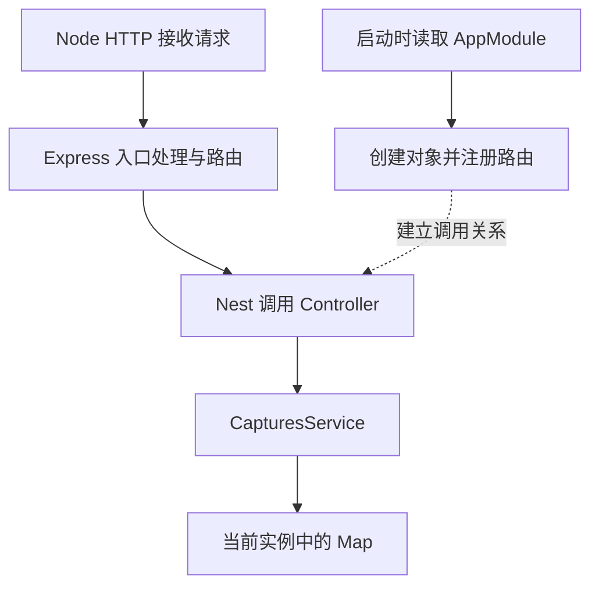

# 第 7 章 从手写服务走向 Nest

第一篇结束时，我们已经能解释一条原文如何经过请求体读取、校验、内存写入和响应，也能把 TypeScript 构建成一份可以搬走的程序。第二篇继续使用这个服务，集中解决另一个问题：当接口和规则变多时，怎样让每一项变化都有明确的落点，并让程序的组装方式可以被理解和维护。

现在的 `src/server.ts` 既负责启动监听，也负责判断路径、读取字节、检查原文、保存记录和输出错误。把这些工作分开，并不必然需要 Nest。我们先推导职责与依赖应该怎样组织，比较继续手写、使用 Express 和采用 Nest 各自承担的工作，再决定本项目为什么选用 Nest。框架的配置和 API 将用来落实前面的选择。

**阅读前提**：完成第一篇第 1～6 章，尤其能解释第五章的构建产物与第六章的输入、状态边界。代码从 `part-01/chapter-05` 继续，第六章没有改变代码；本章完成状态对应 `part-02/chapter-07`。

**本章结果**：三个接口由 Nest 启动并分派给 Controller；保存与查询记录由独立 Service 完成。能从项目约束解释选用 Nest 的理由与代价，沿实际代码说明框架怎样落实职责分离、依赖组装和模块边界，并判断迁移后的行为是否满足已有约定。

记录仍只包含 `id`、`originalText`、`createdAt`，仍保存在一个进程的内存里。没有新表、迁移或回填；更换启动进程会丢失旧 Map 中的内容，这一点不会因为接入框架而改变。

时间参考（估算）：只阅读约 60～70 分钟；跟做另加约 45～55 分钟，合计约 105～125 分钟。首次下载新增依赖另计，附录按需查阅。

## 7.1 从职责拆分到框架选择：为什么引入 Nest

### 先找到需要分开的变化

第五章创建分支里的工作依次是：确认内容类型，读取并解析请求体，检查原文，生成 ID 和创建时间，写入 Map，最后发送 `201` 与 `Location`。一次请求确实要完成这些动作，但它们改变的原因并不相同。

假设我们要增加一条管理命令，也能提交一段原文。命令已经从参数或文件拿到输入，不需要再理解 HTTP 状态码；但它必须遵守相同的原文规则。如果保存操作只能通过 `handleRequest(request, response)` 调用，命令就要么重新发起 HTTP 请求，要么复制其中一段代码。是否强制所有入口走 HTTP 可以是系统选择，但不应该仅仅因为业务逻辑无法单独调用，就被迫作出这个选择。

再考虑把 Map 换成数据库。创建记录仍需要有效原文，客户端仍应收到 ID、原文和创建时间，变化的是读写方式。如果替换存储时还必须重写解析请求与发送响应的代码，就说明这些不同原因的变化绑得太紧。

因此我们先把业务操作的边界确定为：交入一段原文，返回创建结果，或者报告为什么不能创建。HTTP 入口负责把网络消息翻译成这个调用，再把结果翻译回响应。这个划分体现了关注点分离：用变化的原因判断职责，减少一种变化对无关代码的影响。把一个文件剪成三个文件，而三个函数仍然都收发 request／response，并没有建立同样的边界。

也不要把单一职责理解成“每个类只能有一个方法”。记录的创建、查询可以围绕同一组规则协作；反过来，一个只有一个方法的类也可能同时夹带协议、业务和存储配置。边界是否合适，要看改变条件后谁需要跟着改。

### 到这一步，普通 JavaScript 已经足够

完全可以把保存与查询写成普通函数，或者一个持有 Map 的对象，再由 HTTP 处理函数调用。原生 Node 不阻止这样组织代码。我们也可以使用 Express 管理方法、路径和中间件，把自己维护的大段路由判断替换掉，业务对象继续由启动代码手动创建。

如果这个服务长期只有几个接口、依赖很少，维护者能清楚掌握组装关系，这样的实现就可以很好地工作。继续使用它不意味着缺少架构，也没有一个“接口到第十个就必须改 Nest”的门槛。对于短期工具或小型固定服务，多引入一套容器、模块和装饰器，可能增加的理解成本多于节省的维护工作。

所以，“原文件职责混杂”能够说明需要重构，却还不能单独说明必须采用 Nest。框架选择要继续看重构之后，项目准备怎样增长。

### EPP 接下来增长的，是相互协作的能力

按照全书路线，记录之后会出现修订、候选、采纳、用户、投递和练习等能力。同一个业务操作还可能被 HTTP 入口、后台执行者或管理命令使用。这里先拿这些已明确的后续需求判断组织方案，不把尚未实现的模块当成已有代码。

这会带来几类持续的组装问题。业务对象需要哪些依赖，应该由谁创建？哪些消费者复用同一个实例，哪些必须隔离？某项能力可以向外提供什么，内部存储实现能不能被其他模块随意调用？一个服务换成数据库实现后，需要改的是统一的组装位置，还是散布在每个入口里的 `new`？

手动编写启动代码一样可以回答这些问题。我们可以统一创建依赖、用参数传给消费者，再约定模块的公开入口。规模增加后，也可以继续维护这套约定。Express 主要提供 HTTP 层的组织工具，并不会替我们决定全部业务依赖和模块边界；采用 Express 时，这些设计仍由项目负责。

Nest 的价值在于为这些反复出现的组织工作提供一套共同机制：通过 Provider 描述可提供的依赖，通过构造参数表达消费者需要什么，通过 Module 描述这些能力的组织和可见范围，再由框架建立应用。开发者仍负责业务划分，但组装与集成方式有了统一依据。其设计重点也正在这里，而不只是让路由写成 `@Get()`。

对这个项目而言，已经确定的多项业务能力、后续多种入口，以及贯穿全书的 TypeScript 开发方式，使这套组织机制值得采用。它给以后遇到相似问题提供一致的处理位置，也让我们可以沿同一个项目理解后端的依赖、边界与生命周期。**这是针对 EPP 演进路线作出的选择，不是从当前三个接口推导出的唯一答案。**

### 采用约定，也意味着承担约定的成本

选择 Nest 后，读者要理解更多层次。方法明明存在，却可能因为路由没有注册而不可访问；类已经导入，也可能因为没有注册到可见模块而无法注入；源码通过类型检查，编译器没有发出需要的描述时仍可能运行失败。第五章已有的模块与产物判断，要再加上容器、元数据和初始化顺序。

它也会增加依赖、样板声明和调试时的间接调用。启动和请求执行的资源开销需要按实际部署环境衡量，不能仅凭框架名称保证更快、更省内存或更适合所有场景。对于启动预算严格的短任务，或者已有成熟的函数式组装规范，这些成本应当进入选择过程。

框架提供约定，也不会自动保证边界合理。Controller 中仍然能直接操作 Map 或数据库；一个大 Service 仍然能同时承担不相干的业务；把所有 Provider 全局公开，也会让依赖关系重新失去约束。文件后缀与装饰器不能替代设计判断。

读者在这里应能自己作出有条件的结论：需求固定、组装简单时，保留原生 Node 或 Express 加手动组装很合理；像 EPP 这样已有持续演进路线、希望统一管理依赖与模块协作时，Nest 是合适的选择；若选择它，就接受学习和维护这些约定的成本，并继续核对它们有没有服务于当前问题。

接下来先在普通代码中分离业务并手动传入依赖，确认这套设计本身成立，再把组装工作交给 Nest。这样以后换框架时，依然能解释业务边界为什么存在。

## 7.2 将 HTTP 处理与业务规则分开

### 先确定传入什么、返回什么、失败怎样表达

这一节先建立可被不同入口调用的记录操作，暂时不依赖 Nest。我们选择一个类来持有 Map，让状态归属、创建与查询关系直接可见；也可以用工厂函数和闭包返回这些操作。类不是关注点分离的前提，这里采用它，是为了稍后清楚对照 Nest 的类 Provider 组装方式。

创建操作真正需要的业务输入只有原文。我们不把整个请求对象或任意 JSON 对象交给它，也不让调用方传入 ID 和创建时间。即使请求中夹带这些字段，也只取 `originalText`，其余生成规则继续由服务掌握。

新增 `src/captures.service.ts`：

```typescript
import { randomUUID } from 'node:crypto';

export type Capture = {
  id: string;
  originalText: string;
  createdAt: string;
};

export class InvalidCaptureError extends Error {}
export class CaptureNotFoundError extends Error {}

export class CapturesService {
  private readonly captures = new Map<string, Capture>();

  create(originalText: unknown): Capture {
    if (typeof originalText !== 'string' || !originalText.trim()) {
      throw new InvalidCaptureError('originalText must be a non-empty string');
    }
    if (originalText.length > 2000) {
      throw new InvalidCaptureError('originalText must be at most 2000 code units');
    }
    const capture: Capture = {
      id: randomUUID(),
      originalText,
      createdAt: new Date().toISOString(),
    };
    this.captures.set(capture.id, capture);
    return { ...capture };
  }

  list(): Capture[] {
    return [...this.captures.values()].map((capture) => ({ ...capture }));
  }

  find(id: string): Capture {
    const capture = this.captures.get(id);
    if (!capture) throw new CaptureNotFoundError('Capture not found');
    return { ...capture };
  }
}
```

这份文件没有导入 Nest，也没有导入 HTTP 类型。我们稍后会让 Nest 管理它的实例，但“由容器创建”和“必须在 HTTP 请求里才能工作”没有必然关系。现在就可以用 `new CapturesService()` 调用它。

`create()` 仍接收 `unknown`，有意不把参数声明直接当作可靠保证。JSON 的字段、命令行参数、以后外部工具传来的内容，都可能在运行时不满足约定。保存原文之前，Service 自己保证非空白与长度规则。因此另一个入口不能通过绕过 Controller，悄悄存入非法原文。

这不意味着所有校验都挤到 Service。JSON 是否能解析、请求体是不是对象、媒体类型是否受支持，是 HTTP 输入的解释过程；进入保存操作以后，原文是否符合规则，才是这个操作本身的条件。第十一章会用运行时 Schema 组织入口契约，但不会把 TypeScript 类型声明当成输入已经可信的证据。

注意两个看似细小的选择。第一，`trim()` 只用于判断全空白，存入的是原文；否则一次架构调整会顺便篡改用户输入。第二，长度继续使用 JavaScript 字符串的 `.length`，单位仍是 UTF-16 代码单元。框架迁移不是重新定义计数单位的理由。

成功时返回副本，也有实际原因。原来对象只经过 JSON 序列化交给外部客户端，客户端不能直接修改进程里的对象。拆成可调用的 Service 后，如果把 Map 中的原对象交出去，另一个 JavaScript 调用者就可以执行 `capture.originalText = ''`，绕过刚刚建立的校验。当前字段都是字符串，浅复制足以隔开这层引用；如果以后加入数组或嵌套对象，就必须重新判断复制深度与公开返回结构，不能把展开运算符当成通用深拷贝。

`InvalidCaptureError` 表达“原文不满足规则”，`CaptureNotFoundError` 表达“指定记录不存在”。它们不携带 HTTP 状态码。HTTP 入口可以分别映射到 `400` 和 `404`，管理命令可以把同样的失败写到 stderr 并设置退出码。失败含义复用，呈现方式由入口决定。未知异常仍是未知异常，不能为了让响应好看就一律归为用户输入错误。

### 谁使用对象，谁创建对象，可以分别决定

拆出 Service 后，还有一个容易被目录结构掩盖的选择：入口自己创建它，还是由启动位置创建后交给入口？

如果每个入口内部都执行 `new CapturesService()`，创建和查询可能使用不同的 Map。一次写入成功，另一个入口却读不到，并不是异步可见性问题，而是访问了不同对象。若它以后改为需要数据库连接和配置，每个入口还会被迫知道如何准备这些依赖。

我们先采用手动组装。下面这个 `examples/manual-composition.mjs` 使用刚建立的 Service，只观察入口调用与实例的关系；没有启动 HTTP 或命令行服务：

```javascript
import { CapturesService } from '../dist/src/captures.service.js';

function makeEntry(captures) {
  return {
    record: (text) => captures.create(text),
    list: () => captures.list(),
  };
}

const shared = new CapturesService();
const firstEntry = makeEntry(shared);
const secondEntry = makeEntry(shared);
firstEntry.record('I want to explain this clearly.');
console.log('shared entry count:', secondEntry.list().length);

const isolatedEntry = makeEntry(new CapturesService());
console.log('isolated entry count:', isolatedEntry.list().length);
```

`makeEntry()` 要求调用者提供记录能力，自己只负责使用它。最后几行集中决定对象怎样创建和共享，这个位置通常称为组装入口。通过参数从外部提供消费者需要的对象，就是依赖注入；用普通函数也能实现，不必先安装一个注入容器。

完成本章构建后运行：

```bash
node examples/manual-composition.mjs
```

第二个入口应读到第一条记录，而单独组装的入口为空。现在把 `secondEntry` 的参数改成 `new CapturesService()`，再运行，第二个入口也会变空。规则代码没有变，改变的是实例关系。观察后恢复原参数。

本例把两个入口调用放在同一进程中。未来真正独立运行的管理命令不会共享 HTTP 进程的 Map，跨进程数据共享仍需数据库；复用同一份业务代码与共享同一个运行时实例是两件事。

手动组装的好处是关系直接可见，缺点是依赖增加后，需要继续维护创建顺序、共享方式和资源收尾。Nest 容器承担的就是这部分组装工作。当前只有一个 Service，自动组装带来的节省很小；理解手动版本，才能看清以后容器真正承担了什么，而不把依赖注入理解成一种装饰器语法。

回到原来的 HTTP 分支，在模块顶层创建一次 `CapturesService`；保留内容类型、流读取与 JSON 对象检查，把原文规则、对象构造和 Map 写入替换为：

```typescript
const capture = captures.create(
  'originalText' in body ? body.originalText : undefined,
);
sendJson(response, 201, capture, {
  Location: `/captures/${capture.id}`,
});
```

列表调用 `captures.list()`，详情调用 `captures.find(id)`。这些是拆分过程中的替换位置；后面迁入 Nest 时，完整请求分派由 Controller 接替，不保留第二套 `handleRequest()`。HTTP 层知道它要调用记录操作，记录操作不需要反过来知道 HTTP 怎样回应。

目前仍然直接依赖 `CapturesService` 这个具体类。把对象改为外部传入，解决了创建位置的问题，但并没有自动形成可替换的存储契约。第九章会在数据库替换需求下继续建立接口与令牌；不能因为出现“依赖注入”四个字，就声称所有依赖已经解耦。

### 保留已经解释清楚的字节边界

将第五章 `HttpError`、`sendJson()`、`readJson()` 从 `server.ts` 移到 `src/http.ts`，给这三个声明加上 `export`；同时移入 `maxBodyBytes = 16 * 1024`、对应的 `node:http` 类型导入。读取函数本身保持不变：按块累计字节，超过上限后停止保留数据，结束后合并 Buffer 再解码和解析。这里搬的是已有实现，不是重新用字符串长度代替请求大小。

同一文件新增下面的响应边界，并导入 `errorMessage`、`InvalidCaptureError`、`CaptureNotFoundError`：

```typescript
export async function respond(
  response: ServerResponse,
  action: () => void | Promise<void>,
): Promise<void> {
  try {
    await action();
  } catch (error: unknown) {
    if (response.destroyed || response.writableEnded) return;
    const statusCode = error instanceof HttpError ? error.statusCode
      : error instanceof InvalidCaptureError ? 400
      : error instanceof CaptureNotFoundError ? 404 : 500;
    if (statusCode === 500) console.error(error);
    sendJson(response, statusCode, {
      error: statusCode === 500 ? 'Internal server error' : errorMessage(error),
    }, { Connection: 'close' });
  }
}
```

`respond()` 接收一次 HTTP 操作，等待其完成，把已知失败转换为原有的 `{ "error": "..." }`。用 `await action()` 很重要：它让回调返回的 Promise 拒绝也进入当前 `catch`。如果只调用 `action()` 而不等待，异步读取失败就可能越过这个边界。这与第四章的异常归属是同一个问题。

如果对方已经断开或响应已经结束，不再尝试发送第二次响应。未知异常写服务端诊断，客户端只得到通用的 `500`，不把堆栈和内部细节返回出去。与前文一致，失败响应带 `Connection: close`。这段函数只在 HTTP 适配层使用；Service 不应反过来导入它，否则刚拆开的依赖又接回去了。

## 7.3 Nest 怎样把设计原则落实为运行机制

### 从自己调用工具，到把部分控制交给框架

手动版本由启动代码创建对象、登记路由，再在请求到来时调用业务函数。采用 Nest 后，我们描述组件与依赖，由框架完成相应的创建与接入；请求到来时，框架按已建立的关系调用 Controller。对象创建和入口调用的一部分控制，从业务代码移到了框架，这就是这里的控制反转。

它并非第一次出现。第一篇把回调传给 `createServer()`，已经把“请求何时触发处理”交给 Node。Nest 在更多层面采用同样的思路，尤其把“消费者需要哪个对象、怎样完成组装”也纳入运行机制。依赖注入是实现这种控制安排的一种方式，而不等于控制反转的全部含义。

框架接手控制后，开发者还要提供足够明确的描述。Nest 不会因为项目里碰巧存在 `captures.service.ts`，就自动猜出哪些入口应该共享它。接下来 `providers` 登记可用对象，构造函数表达消费关系，Controller 装饰器描述 HTTP 接入；初始化时，框架才据此建立关系。

因此“按约定声明”有实际收益，也有约束。我们不再在每个入口重复写对象创建，但需要正确登记依赖，并理解何时创建、何时调用。遇到问题，应检查描述与组装结果，而不是把容器当成不可解释的黑箱。

### 模块公开的是能力，目录只是存放文件

当记录与练习开始协作时，练习真正需要的通常是“读取符合约定的记录”，而不是任意访问记录模块内部的 Map 或数据库实现。如果大家都可以直接调用内部细节，替换一次存储就可能迫使多个业务模块一起修改。

Nest 的 Module 为此提供可见性机制：模块登记自己的 Provider，选择哪些能力向外导出，其他模块通过导入使用公开的能力。它使“我们承诺提供什么”成为可以检查的依赖关系，支持模块封装。具体的 imports／exports 组合在第十章实现，当前先知道它们为何存在。

这种封装是容器组装层面的约束，不是操作系统权限或 JavaScript 文件访问隔离。程序员仍可能绕过约定，直接导入内部文件并自行创建对象。框架帮我们表达和维护边界，不能替我们决定什么应该公开，也不能让所有越界写法自动消失。

本章只有一组紧密相关的记录能力，因此先用一个 AppModule 就足够。现在就给每个类配一个模块，会增加声明而不增加有意义的封装；后续出现真正的业务协作，再按能力边界拆分。模块数量不等于架构质量。

### 为什么保留 Express，为什么业务仍是普通对象

Nest 组织应用，并通过平台适配器把 HTTP 入口接到 Express 等平台上。使用本章的 Express 适配器时，Node 负责底层 HTTP 接收，Express 负责相应的中间件与路由分派，Nest 负责将已组装的 Controller 接入这些机制。保存原文的规则最终仍由普通 JavaScript 对象执行。



平台适配把框架的应用组织与底层 HTTP 实现分开，使业务能力不必天然绑定某个请求对象。这也是为什么上一节让 Service 接收原文并返回结果，而没有把 Express 的 request／response 继续传进去。保存逻辑可以沿用，协议接入方式可以独立调整。

不过，框架提供适配层不代表所有应用都能无成本换平台。本章为保留旧接口行为，Controller 显式使用 Express 的响应对象；因此这部分适配代码仍与 Express 耦合。它是一项有范围的取舍：先保持接口契约，后面再判断哪些响应交给 Nest 的通用机制处理。框架的能力边界与当前项目实际达到的解耦程度，需要分别检查。

同理，Service 不代表独立进程，也不会让函数自动并行运行。控制反转改变的是谁组织与调用代码，第四章关于事件循环、阻塞和异步等待的机制仍然成立。Nest 也不会通过组装对象自动解决事务、权限或持久化，后面的设计仍要落实各自的条件。

### 用路由描述换取统一接入，同时保留可追踪性

写 `@Get()` 是在方法附近声明它的 HTTP 接入方式，由 Nest 初始化过程读取并注册。直接在 Express 中写 `app.get(path, handler)` 也能表达路由；装饰器本身不是唯一正确形式。Nest 选择把入口描述和组件描述放入一套共同机制，后续才能围绕这些入口接入参数处理和统一行为。

收益是入口与依赖有一致的描述方式，成本是调用关系不再全部表现为手写的直接函数调用。我们需要能沿“声明在哪里—何时被注册—请求最终调用谁”追踪。章末支线 7A 会实际记录并消费路由描述，7B 会观察底层请求分派；这些机制帮助解释框架的选择，而不替代前面的选择理由。

到这里，接下来配置 Module、编译开关与启动入口就各有目的了：登记组装关系、让运行时能够读取必要描述，再把这些关系接入 HTTP 平台。我们开始把它们落实到现有项目。

### 在原项目中加入依赖，而不是重新生成另一个项目

继续在现有代码项目根目录执行 `nvm use`。本章使用 Nest `11.2.5`，`@nestjs/platform-express` 对应 Express 5；保留第五章的 ESM、TypeScript 和构建布局。无需全局安装 Nest CLI，也不执行 `nest new` 覆盖现有文件。

在 `package.json` 增加以下字段；原有开发依赖保留，再加入 `@types/express`：

```json
{
  "dependencies": {
    "@nestjs/common": "11.2.5",
    "@nestjs/core": "11.2.5",
    "@nestjs/platform-express": "11.2.5",
    "reflect-metadata": "0.2.2",
    "rxjs": "7.8.2",
    "express": "5.2.1"
  },
  "overrides": {
    "multer": "2.5.0"
  }
}
```

```bash
npm install
npm install --save-dev --save-exact @types/express@5.0.6
```

这两步用于沿第五章手动演进项目；使用本章完整代码时，直接 `npm ci` 按配套锁文件安装。`overrides` 固定适配器间接引入的 Multer 版本，npm 会据此解析依赖树；本章没有增加上传接口，也不需要调用它。它与本章锁文件一起维护，不能只复制依赖列表却丢掉覆盖项。

`common` 提供装饰器等公共能力，`core` 负责应用创建与容器，`platform-express` 把 Nest 与 Express 接起来。`reflect-metadata` 为运行时读取元数据提供支持，`rxjs` 是 Nest 的运行依赖；本章不因此额外引入响应式业务写法。`@types/express` 只供类型检查，不能代替运行时的 Express。Express 也被显式列为依赖，因为章末独立示例直接导入它，不依赖平台包间接安装的位置。

第五章还没有第三方运行实现，这章开始有了。之后把程序搬到独立目录时，`npm ci --omit=dev` 必须真正装入 Nest 等运行包；仅复制 `dist/` 已不足以运行。这个变化来自依赖内容，构建与交付的判断方法仍沿用第五章。

### 装饰器改变了编译要求

在 `tsconfig.json` 的 `compilerOptions` 中追加：

```json
{
  "experimentalDecorators": true,
  "emitDecoratorMetadata": true
}
```

第一项启用本章 Nest 使用的传统 TypeScript 装饰器转换，包括参数装饰器；第二项让编译器为装饰过的类发出一部分运行时类型元数据。它们是两个不同的开关，不能因为编辑器认识 `@Controller()` 就认为构建已完整。

下面 Controller 的构造函数要求 `CapturesService`。TypeScript 通常会擦除参数类型；启用元数据后，产物可以留下指向这个类的运行时引用，Nest 才能据此查找对应 Provider。接口、泛型等类型不能因此全部恢复，也不会自动获得 JSON 校验能力。

这里要调整第五章的开发命令。`tsx` 不发出这套构造函数类型元数据，不能直接沿用 `tsx watch src/server.ts` 承担当前应用的编译。将 `scripts.dev` 改为：

```json
"dev": "npm run build && npm start"
```

本章有意用同一条 `tsc` 构建路径运行开发代码和交付代码。这个 `dev` 命令不是热更新：修改代码后，在服务终端停止进程，再执行它。第五章的无装饰器独立示例仍可使用 tsx。不要把“某个执行器能处理 TypeScript”推导成“它完整实现了当前项目使用的全部编译语义”。

### 描述组装关系，再建立应用

新增 `src/app.module.ts`：

```typescript
import { Module } from '@nestjs/common';
import { CapturesController } from './captures.controller.js';
import { CapturesService } from './captures.service.js';

@Module({
  controllers: [CapturesController],
  providers: [CapturesService],
})
export class AppModule {}
```

`controllers` 告诉 Nest 哪些类提供 HTTP 入口；`providers` 告诉容器哪些类可以作为依赖创建和查找。两处都使用实际的类值，不是任意字符串名称。文件导入只让 JavaScript 找到类，并不会自动把它注册到容器；反过来，把 Service 误放到 `controllers` 里，也不会让业务方法自然成为正确的依赖。

当前 `CapturesService` 没有构造函数依赖，因此作为类 Provider 注册即可，不需要为了本章添加一个没有实际作用的 `@Injectable()`。Controller 自身有装饰器，其构造参数元数据会被发出。以后 Service 开始依赖其他对象时，第九章会解释 `@Injectable()`、显式令牌和 Provider 形式如何工作。

新增 `src/app.ts`：

```typescript
import 'reflect-metadata';
import { NestFactory } from '@nestjs/core';
import type { NestExpressApplication } from '@nestjs/platform-express';
import { AppModule } from './app.module.js';
import { httpBoundary } from './http-boundary.js';

export async function createApp(): Promise<NestExpressApplication> {
  const app = await NestFactory.create<NestExpressApplication>(AppModule, {
    bodyParser: false,
    abortOnError: false,
  });
  app.use(httpBoundary);
  return app;
}
```

这里先加载 `reflect-metadata`，再加载应用类，让装饰器执行时所需的支持已经存在。`NestFactory.create()` 从根模块出发建立应用与依赖；`listen()` 再完成必要初始化、注册路由并申请端口。只看到对象创建完成的日志，还不能断定端口已经可用。

`NestExpressApplication` 是类型参数，用于说明适配器接口，不负责在运行时选择平台。这里未传入其他适配器，Nest 使用已安装的 Express 平台包。换成 Fastify 不是改一下类型名就完成；本章 Controller 和边界函数直接使用 Express 请求响应对象，迁移平台时也要重新核对这些部分。

`bodyParser: false` 是有意的兼容选择。我们继续用 `readJson()` 消费原始流，因此不能让默认解析器先读走请求体，再让旧代码等待已经发生过的 `end`。它同时保留前文的 16 KiB 字节限制与错误措辞。第八章继续展开请求参数与请求体映射，第十一、十二章再组织契约与统一处理；当前不是把默认解析器关掉后就不管输入了。

`abortOnError: false` 让初始化错误以拒绝形式交给调用方处理，而不是直接由框架终止进程。`app.use(httpBoundary)` 注册的入口函数稍后会在路由前执行，用来保留原来的路径与方法约定；下一节给出完整实现。

最后，将 `src/server.ts` 替换为：

```typescript
import { createApp } from './app.js';
import { loadConfig } from './config.js';
import { errorCode, errorMessage } from './errors.js';

const host = '127.0.0.1';

async function start(): Promise<void> {
  const { port } = await loadConfig();
  const app = await createApp();
  try {
    await app.listen(port, host);
    console.log(`EPP listening on http://${host}:${port} (pid=${process.pid})`);
  } catch (error: unknown) {
    await app.close();
    throw error;
  }
}

start().catch((error: unknown) => {
  if (errorCode(error) === 'EADDRINUSE') {
    console.error('Cannot start EPP: address already in use');
  } else {
    console.error(`Cannot start EPP: ${errorMessage(error)}`);
  }
  process.exitCode = 1;
});
```

`config.ts`、`errors.ts`、默认配置和资源复制脚本不变。仍先校验配置，再创建应用，最后监听 `127.0.0.1`。监听失败时关闭已经创建的应用并传播错误，顶层报告失败并设置非零退出码。这里的失败收尾不等于完整的优雅退出；本章没有接管停止信号，第十三章会在请求与资源生命周期的约束下继续展开。

此时先把下一节的两个文件补齐，再执行构建。入口引用尚未建立的 Controller 或边界文件时，编译失败是正确结果，不需要靠关闭检查绕过。

## 7.4 把第一篇接口迁入 Nest，并验证行为一致

### Controller 负责把协议接到业务操作上

新增 `src/captures.controller.ts`：

```typescript
import { Controller, Get, Post, Req, Res } from '@nestjs/common';
import type { Request, Response } from 'express';
import { CapturesService } from './captures.service.js';
import { HttpError, readJson, respond, sendJson } from './http.js';

@Controller('captures')
export class CapturesController {
  constructor(private readonly captures: CapturesService) {}

  @Get()
  list(@Res() response: Response): Promise<void> {
    return respond(response, () => {
      sendJson(response, 200, { items: this.captures.list() });
    });
  }

  @Post()
  create(@Req() request: Request, @Res() response: Response): Promise<void> {
    return respond(response, async () => {
      const mediaType = request.headers['content-type']
        ?.split(';')[0]?.trim().toLowerCase();
      if (mediaType !== 'application/json') {
        throw new HttpError(415, 'Content-Type must be application/json');
      }
      const body = await readJson(request);
      if (body === null || typeof body !== 'object' || Array.isArray(body)) {
        throw new HttpError(400, 'Request body must be a JSON object');
      }
      const capture = this.captures.create(
        'originalText' in body ? body.originalText : undefined,
      );
      sendJson(response, 201, capture, {
        Location: `/captures/${capture.id}`,
      });
    });
  }

  @Get(':id')
  detail(@Req() request: Request, @Res() response: Response): Promise<void> {
    return respond(response, () => {
      const { pathname } = new URL(request.url, 'http://127.0.0.1');
      const id = pathname.slice('/captures/'.length);
      sendJson(response, 200, this.captures.find(id));
    });
  }
}
```

`@Controller('captures')` 描述共同前缀，`@Get()`、`@Post()` 描述方法和相对路径。它们在类加载时记录描述，Nest 初始化时读取并注册；不是每来一次请求就重新执行装饰器定义。`GET /captures/:id` 的 `:id` 是一个路径段的位置，不要求客户端真的发送冒号。

构造函数接收容器创建的 Service，并把它保存为实例属性。请求进入方法后，`this.captures` 指向那个已经组装好的对象。这里没有 `new CapturesService()`，所以同一个应用中的列表、创建、详情共享当前记录集合。第九章会再改变 Provider 形式，观察实例来自哪里。

`@Req()` 和 `@Res()` 将本次请求响应对象交给方法。类型使用 `import type`，因为这些接口只供检查；`CapturesService` 必须保留普通导入，因为它是构造参数元数据中的运行时依赖。若把它也改成纯类型导入，类型检查“认识这个名字”仍不能保证容器拿到正确的类令牌。

本章显式使用 `@Res()`，由 `sendJson()` 结束响应。这样可以完整沿用 `201`、`Location`、错误 JSON 与现有头部。代价是这些方法暂时依赖平台对象，不能只 `return capture` 就期待 Nest 自动发送它。一次请求只能有一个明确的响应负责人：已由自己 `end()` 的分支，不再让另一段代码重复发送。

详情仍从 URL 的原始路径段取 ID，延续前文查 Map 的方式；当前生成的 ID 是不需要转义的 UUID。第八章会完整讲路径参数提取与编码的差别，再决定哪些输入形式属于接口契约，而不是把 `@Param()` 的默认解码行为偷偷当作旧接口原本就支持的能力。

### 框架默认值也属于迁移范围

只迁移上面三个方法，还不足以证明行为一致。例如，Express 可以把 HEAD 交给 GET 路由；默认路由对大小写和尾斜杠的接受方式，也不等同于此前对 `pathname` 的精确判断。不支持的方法是否返回 `405`、是否带 `Allow`，也不能靠“框架应该会处理”来保证。

为本章这组三个已有接口新增 `src/http-boundary.ts`：

```typescript
import type { Request, Response, NextFunction } from 'express';
import { HttpError, respond, sendJson } from './http.js';

// Preserve the existing path/method contract before Express route matching.
export function httpBoundary(
  request: Request,
  response: Response,
  next: NextFunction,
): void {
  console.log(`${request.method} ${request.url}`);
  void respond(response, () => {
    let url: URL;
    try {
      url = new URL(request.url, 'http://127.0.0.1');
    } catch {
      throw new HttpError(400, 'Request URL is invalid');
    }
    const detail = /^\/captures\/([^/]+)$/.exec(url.pathname);
    const allowed = url.pathname === '/captures' ? ['GET', 'POST']
      : detail ? ['GET'] : undefined;
    if (!allowed) throw new HttpError(404, 'Route not found');
    if (!allowed.includes(request.method)) {
      sendJson(response, 405, { error: 'Method not allowed' }, {
        Allow: allowed.join(', '),
      });
      return;
    }
    // IDs generated here are literal UUIDs. Preserve the former raw-path lookup.
    if (detail?.[1]?.includes('%')) {
      throw new HttpError(404, 'Capture not found');
    }
    request.url = url.pathname + url.search;
    next();
  });
}
```

这就是一个普通的 Express 中间件函数：收到请求后，可以结束响应，也可以调用 `next()` 让后面的路由继续处理。注册在 Nest 初始化路由之前，因此先确定当前路径存在、当前方法允许，再进入 Controller。这里不实现业务写入，也不读取请求体。

路径存在与方法允许分开判断，才能保留 `404` 和 `405` 的差别。`GET /unknown` 是未知路径；`DELETE /captures` 是已知集合上的不支持操作；`POST /captures/unknown` 先按详情入口的方法约束返回 `405`，而 `GET /captures/unknown` 才查询记录并返回不存在。对 HEAD 也按前文返回 `405`，HTTP 层不发送响应正文。OPTIONS 尚未作为 CORS 能力加入，不能为了迁框架而自动扩大接口范围。

保留原始路径的查询方式，还意味着带百分号转义的 ID 不等于原来的字面 UUID。边界中显式返回不存在，避免 Express 先解码路径参数，甚至在遇到错误转义时换成另一种错误响应。`request.url` 使用与旧代码相同的 URL 解析结果整理后继续分派，让路径判断和后面的路由使用同一份路径；查询串继续保留，不加入列表筛选。

这段兼容代码与 Controller 的路由描述有少量重复，需要同时维护。它服务于当前明确的迁移范围，不应该扩展成第二套通用路由框架。以后增加路由时，不能忘记入口白名单也会拦截它；第八章会继续组织路由与方法映射，第十二章在接口数量和重复处理真正增加后统一处理边界。当前要先知道重复为何存在、保护什么约定，再决定怎样收拢。

`respond()` 在中间件中只接住自身解析和判断的失败；`next()` 不是等待所有下游工作的 Promise。Controller 内的异步操作仍由各自返回的 `respond()` 接住。不能误以为在 `next()` 外面写一个 `try/catch`，整个框架请求链上的异步失败就都已归它管理。

### 用同一组观察判断迁移是否成立

完成上述文件与依赖修改后，执行：

```bash
npm run typecheck
npm run build
npm start
```

观察 Nest 的路由日志，应包含 `/captures` 的 GET、POST 和 `/captures/:id` 的 GET；最后还要看到自己的监听地址。前者证明注册了入口，后者表示本次监听已经成功。端口被占用时，不应把路由注册日志当成服务可用的证明。

另开终端，先创建再读取：

```bash
curl -i http://127.0.0.1:3000/captures   -H 'Content-Type: application/json'   --data '{"originalText":"  I want to explain this clearly. 🙂  ","id":"client-id"}'
curl -i http://127.0.0.1:3000/captures
```

创建应返回 `201`，`Location` 指向新 ID；响应 ID 不应是 `client-id`。原文两端空格和表情保留，`createdAt` 仍是 ISO 字符串。复制实际 ID 后请求 `GET /captures/<id>`，详情与列表中的记录一致。再次提交相同原文会创建第二条，迁移没有引入去重或幂等。

随后分别核对失败：

```bash
curl -i http://127.0.0.1:3000/captures   -H 'Content-Type: application/json' --data '{"originalText":42}'
curl -i http://127.0.0.1:3000/captures   -H 'Content-Type: application/json' --data '{"originalText":"   "}'
curl -i http://127.0.0.1:3000/captures   -H 'Content-Type: application/json' --data '{'
curl -i http://127.0.0.1:3000/captures   -H 'Content-Type: text/plain' --data 'hello'
curl -i -X DELETE http://127.0.0.1:3000/captures
curl -i http://127.0.0.1:3000/captures/unknown
curl -i http://127.0.0.1:3000/unknown
curl -I http://127.0.0.1:3000/captures
```

前两项都是业务输入失败，第三项是 JSON 语法失败，状态均为 `400`，但错误信息对应不同原因。文本类型返回 `415`；DELETE 返回 `405` 与 `Allow: GET, POST`；详情不存在与路由不存在均为 `404`，错误分别是 `Capture not found` 和 `Route not found`。HEAD 返回 `405` 和允许的方法，没有响应正文。所有错误请求之后再读取列表，记录数不增加。

原文长度与请求体大小也要分开观察，下面直接生成输入，不需要手动粘贴大段文字：

```bash
node --input-type=module -e 'process.stdout.write(JSON.stringify({originalText:"a".repeat(2001)}))' |
  curl -i http://127.0.0.1:3000/captures     -H 'Content-Type: application/json' --data-binary @-
node --input-type=module -e 'process.stdout.write(JSON.stringify({originalText:"ok",padding:"a".repeat(17000)}))' |
  curl -i http://127.0.0.1:3000/captures     -H 'Content-Type: application/json' --data-binary @-
```

第一条应是 `400`，因为完整 JSON 很小，但原文超过 2000 代码单元。第二条应是 `413`，虽然原文本身只有两个字符，整个请求体仍超过 16 KiB。额外字段没有写入业务对象，不代表它在网络与内存中没有成本。两种失败都不能产生记录。

最后停止并重新启动应用，列表仍应变空；把端口改成 `3001` 后，用新的地址调用，接口行为保持相同；把 `PORT` 改成 `3001oops`，应在监听前失败。若要再次检查交付目录，继续按第五章复制 `package.json`、锁文件、版本约束与 `dist/`，运行 `npm ci --omit=dev` 后启动。这一次必须带上 Nest 的运行依赖。

这里的一致指既有接口的输入规则、成功与错误结果、约定头部以及状态寿命，不要求 Date、连接实现细节或每个自动头部逐字节相同。没有因为框架名称变了，就把之前成立的规则当成可随意变更的实现细节。

### 改变一个条件，检查边界是否真的独立

不启动 HTTP 服务，完成构建后运行：

```bash
node examples/nest-metadata.mjs
```

示例直接创建 Service，保存带空格原文，修改返回对象，再读回原记录；存储中的原文应保持不变。接着尝试保存全空白字符串，应拒绝且记录数仍为一。最后创建第二个 Service，其列表应为空。示例同时打印 Controller 的构造参数元数据，完整机制在章末支线展开。

这些结果回答了三个不同问题：规则是否随业务操作复用，调用方是否拿到了可绕过规则修改存储的引用，状态究竟归哪个实例。再对照 7.2 的手动组装：规则与数据结果不依赖 Nest 才能成立，Nest 负责把这些能力接到统一的应用组织方式中。能够指出两者分别承担什么，才能判断引入框架带来的收益与成本。

再考虑两项变化。若把原文上限从 2000 改成 3000，应修改 Service 的规则与错误说明，HTTP 字节上限仍单独核对；不能因为增加了 1000 个代码单元就把 16 KiB 也加 1000。若希望重启后记录保留，改 Controller 或容器作用域都不够，必须引入进程外存储。第九章准备替换边界，第三篇再实际建立数据库与迁移。

到这里，我们保留了第一篇的运行与接口基础，把业务能力从协议处理中抽出，并让 Nest 负责应用组装与路由注册。第八章继续沿这个 Controller 展开输入、参数与响应映射，不需要另开一个互不相干的示例项目。

本章完成代码分支：`part-02/chapter-07`。

## 继续理解：装饰器、请求处理与最小框架

- [支线 7A：装饰器何时执行，Nest 怎样读懂它](side-01-decorators-and-metadata.md)：亲手记录、注册和分派路由，再从手动构造推导元数据、类令牌与编译产物，解释换执行器或改成接口后为什么会失败。
- [支线 7B：Express 怎样串起一次请求](side-02-express-pipeline.md)：用独立请求观察 next、响应与函数返回、等待与错误传播，以及请求体的单一读取责任。
- [支线 7C：亲手实现一个最小 Nest](side-03-mini-nest.md)：用自定义装饰器、实例容器与路由包装串起完整调用，复用记录业务，再通过失败定位理解框架如何运行。

支线时间单列，不计入本章主线。

## 附录：本章必要技术点速查

| 名称 | 本章用途 | 必要注意点 |
| --- | --- | --- |
| 关注点分离与手动组装 | 根据变化原因划分职责，先独立建立可调用业务能力 | 文件拆分不保证解耦；函数参数也能实现依赖注入 |
| 控制反转与容器 | 将对象创建和入口接入交给统一机制 | 框架需要明确描述，不能替代业务判断或自动解决并发问题 |
| Module 封装与平台适配 | 明确公开能力，分开应用组织与 HTTP 实现 | 容器可见性不是文件安全隔离；显式使用平台对象仍有耦合 |
| `CapturesService` 与业务错误 | 保存、列出、读取记录，表达业务失败 | 不接收请求响应对象；同一实例共享 Map，重启不保留 |
| `@Controller`、`@Get`、`@Post` | 描述三个 HTTP 入口 | 描述在初始化时注册，不会自动保证旧接口全部约定 |
| `@Req`、`@Res` | 使用平台请求响应对象 | 显式 `@Res()` 后由当前代码结束响应 |
| `@Module` 的 controllers／providers | 声明入口与可创建的依赖 | 模块导入和容器注册不是同一步；本章 Service 无构造依赖 |
| `NestFactory.create()`、`listen()`、`close()` | 建立应用、监听端口、失败后释放应用 | 创建成功不等于监听成功；启动失败收尾不等于完整优雅退出 |
| `bodyParser: false` | 继续使用已有 `readJson()` | 必须自己执行大小限制与 JSON 校验，流只由一处消费 |
| `app.use()`、`next()` | 在路由前保留路径与方法边界 | 结束响应后不再 next；next 不表示下游异步工作已完成 |
| `respond()`、`sendJson()` | 转换已知失败并维护响应契约 | 未知错误为 500；Service 不依赖这层适配 |
| `experimentalDecorators`、`emitDecoratorMetadata` | 转换传统装饰器并发出构造依赖描述 | 执行器必须支持；不是运行时输入校验 |
| `reflect-metadata` 与类值导入 | 保存和读取运行时依赖描述 | 类型声明不保证存在可查找的运行时令牌 |
| `npm ci --omit=dev` 与 overrides | 安装锁定的运行依赖树 | 本章开始需要第三方运行实现，覆盖项与锁文件一起维护 |

官方查阅：[Nest 设计定位](https://docs.nestjs.com/#philosophy)、[依赖组装](https://docs.nestjs.com/fundamentals/custom-providers)、[Nest 11 启动](https://docs.nestjs.com/v11/first-steps)、[Controller](https://docs.nestjs.com/v11/controllers)、[Provider](https://docs.nestjs.com/v11/providers)、[Module](https://docs.nestjs.com/v11/modules)、[Express 5 API](https://expressjs.com/en/5x/api/)、[TypeScript 5.9 装饰器说明](https://www.typescriptlang.org/docs/handbook/decorators.html)、[emitDecoratorMetadata](https://www.typescriptlang.org/tsconfig/emitDecoratorMetadata.html)。本文代码固定 Nest 11.2.5 与 TypeScript 5.9.3，官方站点内容可能随版本更新。

[上一章：第一篇回顾](../../part-01-nodejs/chapter-06-review/chapter.md) · [返回第二篇](../README.md) · [返回全书目录](../../README.md)
