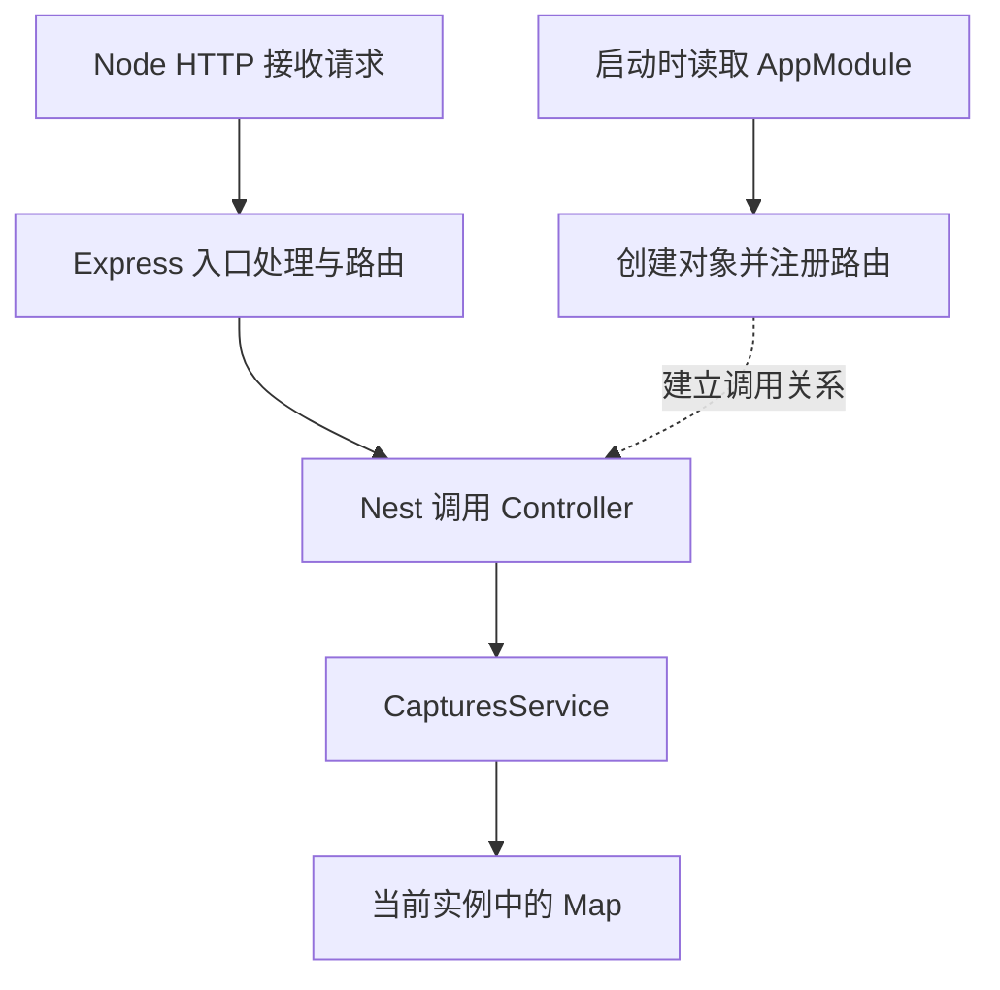
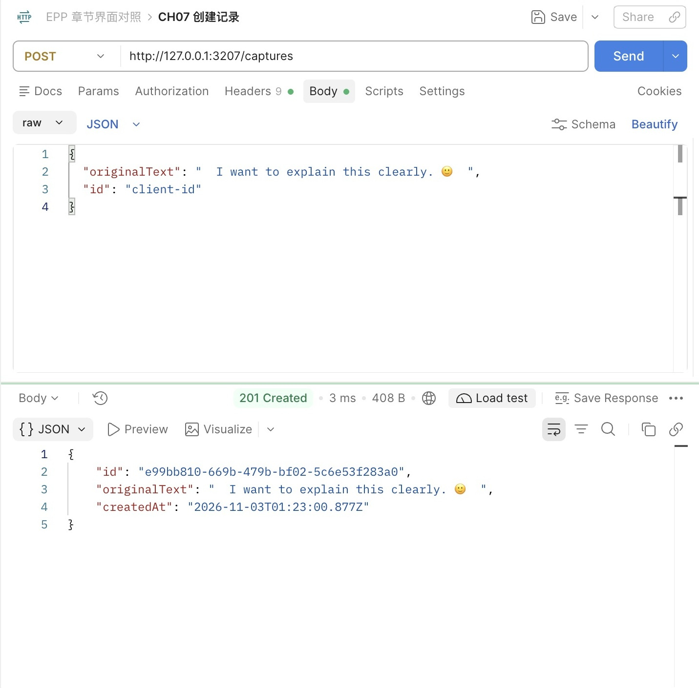

# 第 8 章 从手写服务走向 Nest

第一篇结束时，我们已经能解释一条原文如何经过请求体读取、校验、内存写入和响应，也能把 TypeScript 构建成一份可以搬走的程序。第二篇继续使用这个服务，集中解决另一个问题：当接口和规则变多时，怎样让每一项变化都有明确的落点，并让程序的组装方式可以被理解和维护。

现在的 `src/server.ts` 既负责启动监听，也负责判断路径、读取字节、检查原文、保存记录和输出错误。把这些工作分开，并不必然需要 Nest。我们先推导职责与依赖应该怎样组织，比较继续手写、使用 Express 和采用 Nest 各自承担的工作，再决定本项目为什么选用 Nest。框架的配置和 API 将用来落实前面的选择。

**阅读前提**：完成第一篇第 1～7 章，尤其能解释第六章的构建产物与第七章的输入、状态边界。代码从 `part-01/chapter-06` 继续，第七章来源标签实验不改变主线服务；本章完成状态对应 `part-02/chapter-08`。

**本章结果**：三个接口由 Nest 启动并分派给 Controller；保存与查询记录由独立 Service 完成。能从项目约束解释选用 Nest 的理由与代价，沿实际代码说明框架怎样落实职责分离、依赖组装和模块边界，并判断迁移后的行为是否满足已有约定。

记录仍只包含 `id`、`originalText`、`createdAt`，仍保存在一个进程的内存里。没有新表、迁移或回填；更换启动进程会丢失旧 Map 中的内容，这一点不会因为接入框架而改变。

阅读约 125～150 分钟，跟做另加约 70～90 分钟，合计约 195～240 分钟。可以在 8.2 的手动组装推演后暂停，下一次从编译与应用组装接起；8.4 的创建、详情和拒绝前后对照宜在同一次监听期间完成。首次下载新增依赖另计，附录与章末支线按需查阅。

## 8.1 从职责拆分到框架选择：为什么引入 Nest

### 先找到需要分开的变化

第六章创建分支里的工作依次是：确认内容类型，读取并解析请求体，检查原文，生成 ID 和创建时间，写入 Map，最后发送 `201` 与 `Location`。一次请求确实要完成这些动作，但它们改变的原因并不相同。

假设我们要增加一条管理命令，也能提交一段原文。命令已经从参数或文件拿到输入，不需要再理解 HTTP 状态码；但它必须遵守相同的原文规则。如果保存操作只能通过 `handleRequest(request, response)` 调用，命令就要么重新发起 HTTP 请求，要么复制其中一段代码。是否强制所有入口走 HTTP 可以是系统选择，但不应该仅仅因为业务逻辑无法单独调用，就被迫作出这个选择。

再考虑把 Map 换成数据库。创建记录仍需要有效原文，客户端仍应收到 ID、原文和创建时间，变化的是读写方式。如果替换存储时还必须重写解析请求与发送响应的代码，就说明这些不同原因的变化绑得太紧。

因此我们先把业务操作的边界确定为：交入一段原文，返回创建结果，或者报告为什么不能创建。HTTP 入口负责把网络消息翻译成这个调用，再把结果翻译回响应。这个划分体现了关注点分离：用变化的原因判断职责，减少一种变化对无关代码的影响。把一个文件剪成三个文件，而三个函数仍然都收发 request／response，并没有建立同样的边界。

也不要把单一职责理解成“每个类只能有一个方法”。记录的创建、查询可以围绕同一组规则协作；反过来，一个只有一个方法的类也可能同时夹带协议、业务和存储配置。边界是否合适，要看改变条件后谁需要跟着改。

拿一个联调时真的要做的改动试试。原文输入框允许用户保留句首缩进，产品希望保存之后再打开详情，缩进还在。前端提交的是一个包含字符串的对象，传下去之前有两个看似合理的处理位置。一个在拆请求体字段时顺手裁掉空白，另一个在保存前用去空白后的长度判断是否有内容。两处都能拒绝只打了空格的提交，只有后一个位置能同时保留缩进。这样的区别从类名上看不出来。拿一条两端有空格、中间有字的原文从创建跟到详情，才能知道哪个位置改变了用户的数据。

再换个需求，只想让创建成功的调用方能从响应头打开详情。新地址需要新记录的标识，却不需要改变记录的形状。创建操作只要交回已经确定的标识，入口就能据此拼出地址。若把地址也存进每条记录，改一次接口前缀，旧记录就带着旧地址；同一段文字经命令行保存时，还得凭空决定应该用哪个前缀。顺着这两个变化走，能推导出一条依赖方向：入口认识记录的身份，保存记录时无需认识入口的网址。两段代码会先后使用同一个值，并不足以说明它们应该放在同一个对象里。

拆分的切口也不能只靠寻找重复行。原来的创建分支里只有一次写入，今天还没有第二个调用方可以与它重复，但已经可以说清它独立成立的条件。给一段合格的文字，创建后能凭返回的标识在同一集合读回；给一段全空白的文字，集合保持原状。这两句话都无需提到路径、头部或网络，就已经说明有一个可以单独命名和检查的操作。相反，“成功时带回地址”必须先知道当前对外的路径约定。这种把条件写成可验证句子的办法，比按一百行一个文件切割更能找到合适的边界。

在 VS Code 中读第六章代码时，可以从成功响应倒着追一次。响应需要三项数据，标识在哪里生成，时间在哪里取得，原文来自哪个局部变量？沿着原文继续往回才会碰到解析后的对象，再向前才是缓冲区和请求流。倒读能找到一个很窄的交接处：越过这里后，剩下的规则只依赖一段待判断的值。若一刀切在已经生成好标识和时间之后，另一个调用方创建记录时就必须复制发号和取时的过程；若切在读取流之前，另一个调用方又得伪造流。接口参数本身就能告诉我们，切口是否把不必要的准备工作留给了别人。

### 到这一步，普通 JavaScript 已经足够

完全可以把保存与查询写成普通函数，或者一个持有 Map 的对象，再由 HTTP 处理函数调用。原生 Node 不阻止这样组织代码。我们也可以使用 Express 管理方法、路径和中间件，把自己维护的大段路由判断替换掉，业务对象继续由启动代码手动创建。

如果这个服务长期只有几个接口、依赖很少，维护者能清楚掌握组装关系，这样的实现就可以很好地工作。继续使用它不意味着缺少架构，也没有一个“接口到第十个就必须改 Nest”的门槛。对于短期工具或小型固定服务，多引入一套容器、模块和装饰器，可能增加的理解成本多于节省的维护工作。

所以，“原文件职责混杂”能够说明需要重构，却还不能单独说明必须采用 Nest。框架选择要继续看重构之后，项目准备怎样增长。

可以在纸上先给这个小服务分配三个对象。第一个持有记录集合，第二个认得请求，第三个把前两个接起来并启动程序。第二个只向第一个要一个结果，就能完成请求；第三个知道应该让哪些入口共用第一个对象。用闭包、构造函数或普通对象实现这张图，创建一次再读取的结果都可以相同。这样比较方案才公平。如果拿一个所有逻辑都写在条件分支里的原生服务，与一个已经认真拆过职责的框架服务比较，很容易把整理业务带来的好处全算到框架头上。

假如现在最让人费劲的只是路径匹配，手写版本的改动可以很小。把“收到什么方法和路径时调用哪个函数”交给路由库，函数仍从参数里取得保存能力。作为维护者，每加一个入口就少维护一段匹配判断，却依然要看启动文件才知道保存能力从哪里来。相反，路径只有一条，但有两个对象都需要同一份配置，其中一个还需要另一个的结果，此时增加路由能力对组装几乎没有帮助。先把改动会触及的文件和对象列出来，再判断哪一部分重复到值得交给工具，能避免一个常见的误判：每次联调都在点同一个请求，所以拖慢维护的一定是路由。

保持手动组装还有一个可量出的好处。打开入口文件，一眼能看出先造了几个集合，哪个入口拿到哪一个；还不需要了解任何框架元数据。代价也具体：如果为了增加另一个入口，复制了半个启动文件，再改构造参数时就必须记得两处一起改。此时先问复制的是哪种工作。若只是两个入口都写了一行调用保存，那一行各有协议上下文，保留两份很自然。若复制的是创建依赖、决定何时共享以及何时清理的整段步骤，把它收回一个入口会明显降低漏改的机会。判断点是一次变化需要协调几处决定，并非代码中相同字符的多少。

### EPP 接下来增长的，是相互协作的能力

按照全书路线，记录之后会出现修订、候选、采纳、用户、投递和练习等能力。同一个业务操作还可能被 HTTP 入口、后台执行者或管理命令使用。这里先拿这些已明确的后续需求判断组织方案，不把尚未实现的模块当成已有代码。

这会带来几类持续的组装问题。业务对象需要哪些依赖，应该由谁创建？哪些消费者复用同一个实例，哪些必须隔离？某项能力可以向外提供什么，内部存储实现能不能被其他模块随意调用？一个服务换成数据库实现后，需要改的是统一的组装位置，还是散布在每个入口里的 `new`？

手动编写启动代码一样可以回答这些问题。我们可以统一创建依赖、用参数传给消费者，再约定模块的公开入口。规模增加后，也可以继续维护这套约定。Express 主要提供 HTTP 层的组织工具，并不会替我们决定全部业务依赖和模块边界；采用 Express 时，这些设计仍由项目负责。

Nest 的价值在于为这些反复出现的组织工作提供一套共同机制：通过 Provider 描述可提供的依赖，通过构造参数表达消费者需要什么，通过 Module 描述这些能力的组织和可见范围，再由框架建立应用。开发者仍负责业务划分，但组装与集成方式有了统一依据。其设计重点也正在这里，而不只是让路由写成 `@Get()`。

对这个项目而言，已经确定的多项业务能力、后续多种入口，以及贯穿全书的 TypeScript 开发方式，使这套组织机制值得采用。它给以后遇到相似问题提供一致的处理位置，也让我们可以沿同一个项目理解后端的依赖、边界与生命周期。**这是针对 EPP 演进路线作出的选择，不是从当前三个接口推导出的唯一答案。**

把将来的协作压缩到一个足够小的例子：练习页面要展示用户当时保存的原文。假如练习入口直接取记录集合，再自己按键找对象，它就必须知道集合以什么为键、找不到时拿到什么以及可否直接修改拿到的对象。哪天记录的内部结构多了一层修订，练习代码也得跟着学习。反过来，如果练习只向记录能力提出“凭这个标识给我已保存的内容”，提供方就可以在自己这一侧把内部形状转换成承诺过的结果。这笔收益出现在第二个消费者接入时，前提是第一个能力确实有清楚的输入输出。容器可以让两者相遇，却不会代替我们想清楚什么应该交出去。

共享也要问清楚共享的是什么。练习和记录两个入口可能都叫作“使用记录服务”，各自导入相同的类文件也都能编译。若各自在本地创建对象，它们共享了规则的实现，运行时却各持一份空集合。用户从一边创建，另一边列表仍为空，两个入口单独点开都像是正常工作。把“记录归哪一个活着的对象持有”落实在组装位置后，就能分别验证两个命题。直接调用类的方法可以验证规则；经两个不同入口交叉读写才看得到是否真的接到同一份状态。后续换成外部存储，问题还会变成两份连接是否通往同一个目标，今天建立的判断顺序仍然有意义。

如果产品路线改为只做一个运行后立刻退出的小命令，上面的推导就会得到不同结果。每次运行只读一次文件、产生一份输出，根本没有多个活跃入口要共享对象，也不需要在运行期间管理它们的可见范围。写一段明确的启动函数已经交代了依赖与寿命。此时即使开发者很熟 Nest，仍应说明新增容器具体会接走哪一项原先容易做错的决定。说不出实例、使用者和重复发生的变化，就还没有从项目约束推出框架选择。这个条件一改就能改变答案，也正是我们保留手动版本作对照的原因。

### 采用约定，也意味着承担约定的成本

选择 Nest 后，读者要理解更多层次。方法明明存在，却可能因为路由没有注册而不可访问；类已经导入，也可能因为没有注册到可见模块而无法注入；源码通过类型检查，编译器没有发出需要的描述时仍可能运行失败。第六章已有的模块与产物判断，要再加上容器、元数据和初始化顺序。

它也会增加依赖、样板声明和调试时的间接调用。启动和请求执行的资源开销需要按实际部署环境衡量，不能仅凭框架名称保证更快、更省内存或更适合所有场景。对于启动预算严格的短任务，或者已有成熟的函数式组装规范，这些成本应当进入选择过程。

框架提供约定，也不会自动保证边界合理。Controller 中仍然能直接操作 Map 或数据库；一个大 Service 仍然能同时承担不相干的业务；把所有 Provider 全局公开，也会让依赖关系重新失去约束。文件后缀与装饰器不能替代设计判断。

读者在这里应能自己作出有条件的结论：需求固定、组装简单时，保留原生 Node 或 Express 加手动组装很合理；像 EPP 这样已有持续演进路线、希望统一管理依赖与模块协作时，Nest 是合适的选择；若选择它，就接受学习和维护这些约定的成本，并继续核对它们有没有服务于当前问题。

接下来先在普通代码中分离业务并手动传入依赖，确认这套设计本身成立，再把组装工作交给 Nest。这样以后换框架时，依然能解释业务边界为什么存在。

还有一笔容易漏算的成本是故障出现的位置会移动。手写时忘记把一个对象传给入口，可能在第一次点击创建时才读到空值；改用明确登记的构造依赖后，容器有机会在建立应用时就发现所需对象没有登记。故障提前到启动阶段，对使用者是好事，维护者却需要会读启动日志。若把“浏览器打不开”直接归为创建方法的错误，耗时很可能超过手写版本。迁移成本的一部分就是重新建立这条诊断路径，从能否启动、能否分派，走到是否真正写入，逐层缩小观察范围。

还可以用一次代码评审衡量选择有没有兑现实益。有人提交了“在列表里显示同样的原文”的改动，评审时看到列表处理函数自己再次判断长度、自己格式化创建时间，就要追问记录究竟在何处首次被承认为有效。如果创建成功时已经确定这些事实，读取时重复计算会让历史记录随当前规则变化。框架解决了查找对象的方式，没替代码评审解决事实归属。另一种改动只是在列表响应外面包上一个字段，业务对象与存储都不需要改；若仍得修改所有调用保存方法的地方，就该回看公开结果是不是混入了仅为列表展示准备的外壳。用变化来反查依赖，比在评审里数装饰器更能解释成本花得值不值。

读到这里可以停在第一篇的工作状态。此时成立的是设计判断，手头仍是一套能运行的旧接口。下一段先借普通对象回答“输入什么才能保存，结果归谁”，暂时把启动路径放在一旁。这样做留下了一个可检查的中间状态：哪怕暂时拿掉整个框架，原文规则与实例共享的试验也应该讲得通。日后定位迁移差异时，可以回到这个最小范围，判断差异究竟来自业务规则，还是来自把请求接到规则的过程。

## 8.2 将 HTTP 处理与业务规则分开

### 先确定传入什么、返回什么、失败怎样表达

这一节先建立可被不同入口调用的记录操作，暂时不依赖 Nest。我们选择一个类来持有 Map，让状态归属、创建与查询关系直接可见；也可以用工厂函数和闭包返回这些操作。类不是关注点分离的前提，这里采用它，是为了稍后清楚对照 Nest 的类 Provider 组装方式。

创建操作真正需要的业务输入只有原文。我们不把整个请求对象或任意 JSON 对象交给它，也不让调用方传入 ID 和创建时间。即使请求中夹带这些字段，也只取 `originalText`，其余生成规则继续由服务掌握。

新增 `src/captures.service.ts`：

```typescript
import { randomUUID } from 'node:crypto';

export type Capture = {
  id: string;
  originalText: string;
  createdAt: string;
};

export class InvalidCaptureError extends Error {}
export class CaptureNotFoundError extends Error {}

export class CapturesService {
  private readonly captures = new Map<string, Capture>();

  create(originalText: unknown): Capture {
    if (typeof originalText !== 'string' || !originalText.trim()) {
      throw new InvalidCaptureError('originalText must be a non-empty string');
    }
    if (originalText.length > 2000) {
      throw new InvalidCaptureError('originalText must be at most 2000 code units');
    }
    const capture: Capture = {
      id: randomUUID(),
      originalText,
      createdAt: new Date().toISOString(),
    };
    this.captures.set(capture.id, capture);
    return { ...capture };
  }

  list(): Capture[] {
    return [...this.captures.values()].map((capture) => ({ ...capture }));
  }

  find(id: string): Capture {
    const capture = this.captures.get(id);
    if (!capture) throw new CaptureNotFoundError('Capture not found');
    return { ...capture };
  }
}
```

这份文件没有导入 Nest，也没有导入 HTTP 类型。我们稍后会让 Nest 管理它的实例，但“由容器创建”和“必须在 HTTP 请求里才能工作”没有必然关系。现在就可以用 `new CapturesService()` 调用它。

`create()` 仍接收 `unknown`，有意不把参数声明直接当作可靠保证。JSON 的字段、命令行参数、以后外部工具传来的内容，都可能在运行时不满足约定。保存原文之前，Service 自己保证非空白与长度规则。因此另一个入口不能通过绕过 Controller，悄悄存入非法原文。

这不意味着所有校验都挤到 Service。JSON 是否能解析、请求体是不是对象、媒体类型是否受支持，是 HTTP 输入的解释过程；进入保存操作以后，原文是否符合规则，才是这个操作本身的条件。第十二章会用运行时 Schema 组织入口契约，但不会把 TypeScript 类型声明当成输入已经可信的证据。

注意两个看似细小的选择。第一，`trim()` 只用于判断全空白，存入的是原文；否则一次架构调整会顺便篡改用户输入。第二，长度继续使用 JavaScript 字符串的 `.length`，单位仍是 UTF-16 代码单元。框架迁移不是重新定义计数单位的理由。

成功时返回副本，也有实际原因。原来对象只经过 JSON 序列化交给外部客户端，客户端不能直接修改进程里的对象。拆成可调用的 Service 后，如果把 Map 中的原对象交出去，另一个 JavaScript 调用者就可以执行 `capture.originalText = ''`，绕过刚刚建立的校验。当前字段都是字符串，浅复制足以隔开这层引用；如果以后加入数组或嵌套对象，就必须重新判断复制深度与公开返回结构，不能把展开运算符当成通用深拷贝。

`InvalidCaptureError` 表达“原文不满足规则”，`CaptureNotFoundError` 表达“指定记录不存在”。它们不携带 HTTP 状态码。HTTP 入口可以分别映射到 `400` 和 `404`，管理命令可以把同样的失败写到 stderr 并设置退出码。失败含义复用，呈现方式由入口决定。未知异常仍是未知异常，不能为了让响应好看就一律归为用户输入错误。

具体看一笔创建。用户先输入两个空格，再输入“今天下雨”，最后保留一个空格。进入保存函数时，这七个代码单元仍是同一个字符串的内容。判断类型以后，调用去空白方法得到一个临时字符串，长度为四，因此允许继续；随后检查长度用的是原来的七，构造对象时也取原来的七。如果把临时字符串一直传到最后，输入框重新打开时会少三个位置。再把这个例子推到边界：恰好两千个代码单元，其中有正常文字和首尾空格，可以保存；加一个末尾空格就超限。先裁剪再计数会让同一笔请求得出不同结论。读规则时要问每个表达式的结果被用来做什么，不能看见一次字符串处理就假定后面全在用处理后的值。

对于熟悉表单的读者，另一个容易忽略的点是空值的来源。表单没填可能发空串，客户端漏取字段可能发空对象，解析一个显式填了空值的对象则会取到空值。三者的来源不同，交到保存函数时都没有合格的原文。可以让入口逐项判断并给三种交互提示，前提是接口真有这种区分需求。本章约定的是同一类原文错误，所以入口负责判断外层对象，找不到字段就交一个未定义值，保存函数统一裁决。换成列表作为整个请求体就走不到同一步了，列表本身在入口就被拒绝。两次调用都得到四百，只有辨认最后一个成功的步骤，才能知道该修表单序列化还是该修字段绑定。

记录也不是请求对象加几个默认字段。若直接把客户端的对象展开到结果里，再补上生成的属性，属性覆盖顺序会影响谁有最后决定权，而且所有多余字段都会悄悄成为返回数据。这里反过来从空的记录描述出发，逐个选入服务承诺保存的值。即使用户传了自己界面上的临时编号，它也不会改变保存身份。界面以后可以继续使用临时编号表示待提交项，成功后把服务器给的标识填回那一项；详情链接要用后者。这样一来，前端“这行正在编辑”的身份和后端“这一笔已经保存”的身份都能各自成立，双方无需约定那些界面内部字段是否也要永久保存。

为什么同一段原文提交两次不能在这里自动合并？假设读者今天和明天恰好都记录“下雨了”。这两次采集可能是两个真实事件，文本相同推不出用户只想保存一次。当前函数每调用成功一次就生成一个标识，键是该标识，内容只占记录的一个字段。用原文作键会在第二次写入时覆盖第一次；改用创建时间作键也会把时间的精度误当成唯一性的保证。保持原有的键，还让我们能在列表里用两个不同标识找到这两个事件，逐个点进详情去核对原文。若产品以后要辨认同一次提交的重试，还需要能代表那一次意图的依据，迁移框架不能凭空得到它。

再看读操作的成本。按标识取一项只要把键交给集合；列出全部则要经过每一条，先形成数组，再给每条记录造一个外部可用的副本。只复制数组本身，调用方删掉数组元素不会减少集合里的条数，可是改其中一个对象的文字仍会改到集合里的对象。这两种修改完全可以在同一个界面操作里发生，所以“我返回了新数组”只回答了外层引用的问题。本章每条记录很小而且有明确的三个字符串字段，逐条浅复制的成本可以预期；将来条数很大时，要重新讨论列表一次需要多少条，将来字段里含有可变结构时，则要重新讨论每条如何投影。这是两种不同的变化理由，不宜今天为了可能很大的列表，先放弃保护单条对象。

看完代码再判断一次失败的时序。类型或长度被拒绝时，执行尚未走到生成标识、取时间与写集合的位置，因此无须从集合里删除“半条记录”。找不到详情时只读了一次键，也没有创建默认行。若为了让页面方便而改成“读不到顺便造一个空对象放进去”，一次刷新详情就会改变列表，连空白原文也绕过了创建检查。判断一个处理是否保持数据约定，可以先标出第一处可能改变集合的语句，再看每一条失败路径相对它的位置。这个简单办法也会揭示一个限制：成功写入之后，若客户端没有收到响应，集合已经变了。业务动作成功与消息成功送达是两个时刻，当前实现没有把后一个时刻搬到前面。

### 谁使用对象，谁创建对象，可以分别决定

拆出 Service 后，还有一个容易被目录结构掩盖的选择：入口自己创建它，还是由启动位置创建后交给入口？

如果每个入口内部都执行 `new CapturesService()`，创建和查询可能使用不同的 Map。一次写入成功，另一个入口却读不到，并不是异步可见性问题，而是访问了不同对象。若它以后改为需要数据库连接和配置，每个入口还会被迫知道如何准备这些依赖。

我们先采用手动组装。下面这个 `examples/manual-composition.mjs` 使用刚建立的 Service，只观察入口调用与实例的关系；没有启动 HTTP 或命令行服务：

```javascript
import { CapturesService } from '../dist/src/captures.service.js';

function makeEntry(captures) {
  return {
    record: (text) => captures.create(text),
    list: () => captures.list(),
  };
}

const shared = new CapturesService();
const firstEntry = makeEntry(shared);
const secondEntry = makeEntry(shared);
firstEntry.record('I want to explain this clearly.');
console.log('shared entry count:', secondEntry.list().length);

const isolatedEntry = makeEntry(new CapturesService());
console.log('isolated entry count:', isolatedEntry.list().length);
```

`makeEntry()` 要求调用者提供记录能力，自己只负责使用它。最后几行集中决定对象怎样创建和共享，这个位置通常称为组装入口。通过参数从外部提供消费者需要的对象，就是依赖注入；用普通函数也能实现，不必先安装一个注入容器。

完成本章构建后运行：

```bash
node examples/manual-composition.mjs
```

第二个入口应读到第一条记录，而单独组装的入口为空。现在把 `secondEntry` 的参数改成 `new CapturesService()`，再运行，第二个入口也会变空。规则代码没有变，改变的是实例关系。观察后恢复原参数。

本例把两个入口调用放在同一进程中。未来真正独立运行的管理命令不会共享 HTTP 进程的 Map，跨进程数据共享仍需数据库；复用同一份业务代码与共享同一个运行时实例是两件事。

手动组装的好处是关系直接可见，缺点是依赖增加后，需要继续维护创建顺序、共享方式和资源收尾。Nest 容器承担的就是这部分组装工作。当前只有一个 Service，自动组装带来的节省很小；理解手动版本，才能看清以后容器真正承担了什么，而不把依赖注入理解成一种装饰器语法。

回到原来的 HTTP 分支，在模块顶层创建一次 `CapturesService`；保留内容类型、流读取与 JSON 对象检查，把原文规则、对象构造和 Map 写入替换为：

```typescript
const capture = captures.create(
  'originalText' in body ? body.originalText : undefined,
);
sendJson(response, 201, capture, {
  Location: `/captures/${capture.id}`,
});
```

列表调用 `captures.list()`，详情调用 `captures.find(id)`。这些是拆分过程中的替换位置；后面迁入 Nest 时，完整请求分派由 Controller 接替，不保留第二套 `handleRequest()`。HTTP 层知道它要调用记录操作，记录操作不需要反过来知道 HTTP 怎样回应。

目前仍然直接依赖 `CapturesService` 这个具体类。把对象改为外部传入，解决了创建位置的问题，但并没有自动形成可替换的存储契约。第十章会在数据库替换需求下继续建立接口与令牌；不能因为出现“依赖注入”四个字，就声称所有依赖已经解耦。

读手动示例时，可以暂时把对象画成甲、乙两个方框。执行第一行构造时，甲里是空集合；创建两个入口只是在各自的闭包里保留了通往甲的引用，并没有复制甲。第一个入口调用保存后，甲里有了一项，第二个入口此时才调用列表，所以能看到这一项。第三个入口出现时才创建乙，乙既没有执行过保存，也不会因为甲的类与自己同名而取得甲的数据。把第二个入口的参数换掉，改变发生在创建入口的那一刻，后面执行保存函数再多次也不会让乙突然指回甲。这里既无异步等待也无网络，把读不到的原因缩到了一个表达式上。

还可以只移动一次构造的位置，不改变类和方法名。设想入口工厂里仍然只执行一次构造，但每注册一个入口就调用一次工厂，那么每个入口有自己的集合。若又把这次构造移到处理函数开头，每个请求都有自己的集合，后果更严重：即便连续点击同一个列表请求，也无法读回上一次创建的对象。反方向把集合本身放到文件最外层，则同一模块里的不同服务实例都可能指向同一个集合，刚才的隔离变式也失效了。判断范围需要同时看两个位置，消费者在何时取得服务，服务在何时取得集合。只盯着类前面的修饰词，无法回答两次读写是否会相遇。

假如只想确认创建入口确实把原文原样交给了下层，用手动组装还可以把问题压得更小。对于这里的普通脚本，一个具有创建和列表方法的观察对象就能被传给入口工厂；创建方法把收到的参数记在本地即可。这样能看出入口有没有提前裁剪，确实不必真的写集合。可是这项观察证明不了生产组装共享了正确的实例，也证明不了列表返回的是副本。反过来，直接构造服务保存原文能验证规则，却跳过了入口抽取字段与交回响应的过程。读测试或助手给出的“已通过”结论时，先画出这次实际经过的对象，就能避开用局部结果证明整条路径的错误。这里不要求为两个方法另造一套抽象。

沿第六章手动拆分时还有一个过渡细节。把列表先改用服务、创建仍写旧文件的集合，会得到一个能接受请求、两边却互相看不见的中间版本。详情若仍查旧集合，甚至会出现详情能读、列表没有的组合。此时应该在编辑器里同时找出创建、列表和详情三个分支的集合访问，确认切换在同一版里完成，再用这次创建的新标识验证。旧进程停止以后本来就会丢掉旧集合，用旧标识检查新进程无法区分迁移是否漏掉了某个分支。手动拆分前已有的错误映射也要一起看：原来入口直接抛协议错误，现在服务抛自己的错误，入口需要按本节后面的响应函数翻译。没有接上翻译就先发错误请求，四百变成五百不能说明规则失效，它可能已经正确拒绝，只是入口没认出这类失败。

### 保留已经解释清楚的字节边界

将第六章 `HttpError`、`sendJson()`、`readJson()` 从 `server.ts` 移到 `src/http.ts`，给这三个声明加上 `export`；同时移入 `maxBodyBytes = 16 * 1024`、对应的 `node:http` 类型导入。读取函数本身保持不变：按块累计字节，超过上限后停止保留数据，结束后合并 Buffer 再解码和解析。这里搬的是已有实现，不是重新用字符串长度代替请求大小。

同一文件新增下面的响应边界，并导入 `errorMessage`、`InvalidCaptureError`、`CaptureNotFoundError`：

```typescript
export async function respond(
  response: ServerResponse,
  action: () => void | Promise<void>,
): Promise<void> {
  try {
    await action();
  } catch (error: unknown) {
    if (response.destroyed || response.writableEnded) return;
    const statusCode = error instanceof HttpError ? error.statusCode
      : error instanceof InvalidCaptureError ? 400
      : error instanceof CaptureNotFoundError ? 404 : 500;
    if (statusCode === 500) console.error('Unhandled request failure:', error instanceof Error ? error.name : 'UnknownError');
    sendJson(response, statusCode, {
      error: statusCode === 500 ? 'Internal server error' : errorMessage(error),
    }, { Connection: 'close' });
  }
}
```

`respond()` 接收一次 HTTP 操作，等待其完成，把已知失败转换为原有的 `{ "error": "..." }`。用 `await action()` 很重要：它让回调返回的 Promise 拒绝也进入当前 `catch`。如果只调用 `action()` 而不等待，异步读取失败就可能越过这个边界。这与第五章的异常归属是同一个问题。

如果对方已经断开或响应已经结束，不再尝试发送第二次响应。未知异常写服务端诊断，客户端只得到通用的 `500`，不把堆栈和内部细节返回出去。与前文一致，失败响应带 `Connection: close`。这段函数只在 HTTP 适配层使用；Service 不应反过来导入它，否则刚拆开的依赖又接回去了。

字节边界究竟保护哪一段数据，可以从一条很短的原文算起。用户只想保存一个“雨”字，业务规则看到的是长度为一的字符串；使用通常的直接 UTF-8 编码时，这个字在请求体占三个字节，外面还包着字段名、引号、冒号和花括号。这些都要先经过读取函数，再由解析器还原出字段值。换成 JSON 允许的转义写法，网络上的文本长度会变，解析出的“雨”字却一样。由此就能推导两个上限为什么不能互相代用：一个约束接收这封消息付出的代价，一个约束应用同意保存的内容。即使未来所有入口都只允许一千字，网络入口仍要自行约束读取整封消息。

读流时再多想一个中间状态。第一个数据块到达时，可以知道收到了多少字节，还不一定知道末尾那几个字节是不是一个完整的字。若每块先转字符串再连接，在字符恰好跨块时就可能损坏原文。同样，在第一个块里暂时看不到右花括号不能说明 JSON 写错了，后一个块可能刚好以它结束。配套先累计块与字节，整份消息结束后才统一解码、解析；累计时已经能确定超过限制，则当场拒绝并释放先前攒下的块。后续块到来时只检查超限标志，结束事件也不再尝试解析。这两个提前返回看似多余，其实分别管住了超限后的继续积攒与事后的重复工作。

这段实现不会先根据请求头宣称的长度预留一整块空间。它的判断依据是读取到的块，因此无论正文分成几块，恰好达到上限仍可进入解码，多一个字节才触发过大。注意“可进入解码”还不是“可保存”。即便总量合格，解码、解析、对象形状和原文规则仍有可能在不同位置终止。由此也可反推排错方向：用户说“我只填了几个字”，前端却显示请求过大，先在 Postman 的 Body 看整份消息是不是还包含别的字段，不要一上来提高原文长度。用户说“字符都能显示”，服务器返回原文太长，则要看解析后字符串的代码单元，盯着头部的字节数也解释不了它。

响应函数接到的是待执行的函数，这一点决定它能认领哪些失败。若先在外面完成查找，再把已得到的结果交给一个只负责发送的函数，查找抛出的异常在调用发送函数之前已经离开，里面写得再完整的捕获都无用。将“查找并发送”整体放进回调，才使同步抛错发生在保护范围。异步情况还要多一步，回调必须把尚未完成的工作作为承诺交回来；如果它只是启动异步读取便立即返回，外层等待的只是一个已经结束的空结果。看代码时从最里面的读取往外追，谁在等待它，谁又把等待结果交给框架，比搜索文件里是否出现过一个捕获语句更可靠。

失败时把业务错误翻译成状态码，还有一个维护上的收益。界面要显示“找不到这条记录”，可以从详情错误里得到有意义的信息；开发者若意外写错属性导致运行异常，客户端不能据此提示用户“换段文字重试”。后者无论用户输入什么都可能失败，给出通用服务错误才能把修复责任留在服务侧。配套在这个分支只记录异常类别，查看终端时据此找本次请求附近的服务异常，再借调试器看具体位置。一次写入已经到达集合后，若响应端关闭，尝试补发错误也无法让数据回到写入之前。响应函数检查连接状态解决的是“还能不能回答”，它没有撤销已经完成的业务操作。

本节可以停在三个可彼此独立提问的位置。面对一份输入，读取函数有没有得到可解释的值？拿到原文后，保存函数是否在改集合之前作出了判断？得到结果或错误后，本次入口有没有把它交回调用方？接下来框架只会改变这些函数怎样被找到和接上。手动演进时可以先保留当前代码，等下一节的模块、再下一节的入口文件齐全后统一构建；使用完成快照时，则可以先从编辑器的引用查找看到这三段各自的调用者，再回到正文看它们何时开始生效。

## 8.3 Nest 怎样把设计原则落实为运行机制

### 从自己调用工具，到把部分控制交给框架

手动版本由启动代码创建对象、登记路由，再在请求到来时调用业务函数。采用 Nest 后，我们描述组件与依赖，由框架完成相应的创建与接入；请求到来时，框架按已建立的关系调用 Controller。对象创建和入口调用的一部分控制，从业务代码移到了框架，这就是这里的控制反转。

它并非第一次出现。第一篇把回调传给 `createServer()`，已经把“请求何时触发处理”交给 Node。Nest 在更多层面采用同样的思路，尤其把“消费者需要哪个对象、怎样完成组装”也纳入运行机制。依赖注入是实现这种控制安排的一种方式，而不等于控制反转的全部含义。

框架接手控制后，开发者还要提供足够明确的描述。Nest 不会因为项目里碰巧存在 `captures.service.ts`，就自动猜出哪些入口应该共享它。接下来 `providers` 登记可用对象，构造函数表达消费关系，Controller 装饰器描述 HTTP 接入；初始化时，框架才据此建立关系。

因此“按约定声明”有实际收益，也有约束。我们不再在每个入口重复写对象创建，但需要正确登记依赖，并理解何时创建、何时调用。遇到问题，应检查描述与组装结果，而不是把容器当成不可解释的黑箱。

把“框架会调用”放到时间线上看更容易理解。程序启动时，还没有用户请求，依然有工作可做：确定入口类有哪些、每个入口需要谁、需要的对象能否构造出来。这个阶段即使没有原文也能完成，因为要建立的是对象之间长期存在的关系。请求到来才会出现这一次的消息、字段值和响应对象，它们只属于这次调用。把原文保存在共享服务的实例属性里再等待后续步骤，就把短命的数据放进了长命的对象；若两个请求交错执行，后一个值便可能覆盖前一个。现在的实现把每次输入留在方法参数和局部变量里，只把需要跨请求保留的记录放进集合。选择共享实例之后，更需要区分哪份状态值得共享。

这条时间线也解释了为什么打开文件时很难“转到调用处”。在编辑器里对创建方法查找引用，能够找到控制器对保存方法的直接调用；对控制器处理方法查引用，却可能找不到任何一行普通业务代码在显式调用它。调用关系分成了两截：一截是启动时根据描述把处理方法登记为入口，另一截是请求分派到已经登记的入口后才有的方法执行。要验证前一截，查看模块声明、路由日志；要验证后一截，带着具体请求方法和路径看断点。找不到普通调用表达式，不能推导出该方法未使用，也不能由编辑器显示了装饰器推导出它已经注册成功。

### 模块公开的是能力，目录只是存放文件

当记录与练习开始协作时，练习真正需要的通常是“读取符合约定的记录”，而不是任意访问记录模块内部的 Map 或数据库实现。如果大家都可以直接调用内部细节，替换一次存储就可能迫使多个业务模块一起修改。

Nest 的 Module 为此提供可见性机制：模块登记自己的 Provider，选择哪些能力向外导出，其他模块通过导入使用公开的能力。它使“我们承诺提供什么”成为可以检查的依赖关系，支持模块封装。具体的 imports／exports 组合在第十一章实现，当前先知道它们为何存在。

这种封装是容器组装层面的约束，不是操作系统权限或 JavaScript 文件访问隔离。程序员仍可能绕过约定，直接导入内部文件并自行创建对象。框架帮我们表达和维护边界，不能替我们决定什么应该公开，也不能让所有越界写法自动消失。

本章只有一组紧密相关的记录能力，因此先用一个 AppModule 就足够。现在就给每个类配一个模块，会增加声明而不增加有意义的封装；后续出现真正的业务协作，再按能力边界拆分。模块数量不等于架构质量。

从维护者视角，先分清“源码能找到类”和“应用能提供实例”。在编辑器里从控制器的构造参数跳转到服务声明，成功了，说明这个文件引用能解析。再从根模块的服务清单跳过去，看到同一个声明，才知道启动时有人承诺提供它。如果把第二处登记删掉，第一处跳转依然能成功，编译器也没有理由因为一个普通类没出现在某个数组里就报类型错误。容器组装时才会核对“谁需要这个类”和“在当前模块能找到哪个提供者”。区分这两种可见性，可以避免面对缺少依赖的启动日志时反复调整文件相对路径。

假如未来把记录能力搬到单独目录，但根模块仍登记两个类，目录的移动只改变导入路径，不会自动发生容器隔离。另一种改法保持文件都在原处，却为记录能力划出单独的模块，外部消费者就需要经模块约定取得它。物理位置相同而运行关系可以不同，运行关系相同而物理位置也可以改变。用这种对照读项目结构，看到几个相似后缀时就不会急着比照文件夹复制一套。尤其要留意为“解决找不到服务”而在每个使用者附近各自登记一份的建议，那可能改变实例归属，让启动问题消失的同时引入读写分离的问题。第十一章再实际拆模块时，应拿同一笔创建的标识跨入口读回，才能确认公开的是预期的能力。

### 为什么保留 Express，为什么业务仍是普通对象

Nest 组织应用，并通过平台适配器把 HTTP 入口接到 Express 等平台上。使用本章的 Express 适配器时，Node 负责底层 HTTP 接收，Express 负责相应的中间件与路由分派，Nest 负责将已组装的 Controller 接入这些机制。保存原文的规则最终仍由普通 JavaScript 对象执行。



平台适配把框架的应用组织与底层 HTTP 实现分开，使业务能力不必天然绑定某个请求对象。这也是为什么上一节让 Service 接收原文并返回结果，而没有把 Express 的 request／response 继续传进去。保存逻辑可以沿用，协议接入方式可以独立调整。

不过，框架提供适配层不代表所有应用都能无成本换平台。本章为保留旧接口行为，Controller 显式使用 Express 的响应对象；因此这部分适配代码仍与 Express 耦合。它是一项有范围的取舍：先保持接口契约，后面再判断哪些响应交给 Nest 的通用机制处理。框架的能力边界与当前项目实际达到的解耦程度，需要分别检查。

同理，Service 不代表独立进程，也不会让函数自动并行运行。控制反转改变的是谁组织与调用代码，第五章关于事件循环、阻塞和异步等待的机制仍然成立。Nest 也不会通过组装对象自动解决事务、权限或持久化，后面的设计仍要落实各自的条件。

读图时，沿实线走一次返回方向。服务从集合找到了对象，返回的是普通数据；控制器知道应该把这个对象放在响应体的哪一层，交给发送函数；发送函数把值序列化、写头并结束响应。图里的虚线只说明这几个对象在请求之前已经接好，并没有在每次返回时重新经过根模块。由此能判断一项很实际的迁移成本：若客户端要求列表采用一层对象包装，而详情直接返回单条，只改控制器对结果的组织便能满足。若改的是序列化与头部的共同规则，则应先看两个方法共用的发送函数。想换平台时，最先要查的正是这些实际接触响应对象的方法，而不是只找文件里有没有出现平台名。

同样可以倒着解读一个慢请求。请求体还没有完整到达时，等待发生在读流这一侧，服务甚至没开始判断；开始遍历集合列出记录时，花时间的是进程中正在执行的普通代码；用户已经在 Postman 看到完整响应以后，服务不能再通过那次响应把后来的变化补进去。这三段都可能被简单概括成“框架处理一次请求”，但加一个服务实例既不会让尚未到达的字节提前到达，也不会自动把集合遍历移到另一个线程。先确认等待点与运行位置，才知道应该观察网络、集合规模还是调用次数。

### 用路由描述换取统一接入，同时保留可追踪性

写 `@Get()` 是在方法附近声明它的 HTTP 接入方式，由 Nest 初始化过程读取并注册。直接在 Express 中写 `app.get(path, handler)` 也能表达路由；装饰器本身不是唯一正确形式。Nest 选择把入口描述和组件描述放入一套共同机制，后续才能围绕这些入口接入参数处理和统一行为。

收益是入口与依赖有一致的描述方式，成本是调用关系不再全部表现为手写的直接函数调用。我们需要能沿“声明在哪里—何时被注册—请求最终调用谁”追踪。章末支线 8A 会实际记录并消费路由描述，8B 会观察底层请求分派；这些机制帮助解释框架的选择，而不替代前面的选择理由。

到这里，接下来配置 Module、编译开关与启动入口就各有目的了：登记组装关系、让运行时能够读取必要描述，再把这些关系接入 HTTP 平台。我们开始把它们落实到现有项目。

### 在原项目中加入依赖，而不是重新生成另一个项目

继续在现有代码项目根目录执行 `nvm use`。本章使用 Nest `11.2.5`，`@nestjs/platform-express` 对应 Express 5；保留第六章的 ESM、TypeScript 和构建布局。无需全局安装 Nest CLI，也不执行 `nest new` 覆盖现有文件。

在 `package.json` 增加以下字段；原有开发依赖保留，再加入 `@types/express`：

```json
{
  "dependencies": {
    "@nestjs/common": "11.2.5",
    "@nestjs/core": "11.2.5",
    "@nestjs/platform-express": "11.2.5",
    "reflect-metadata": "0.2.2",
    "rxjs": "7.8.2",
    "express": "5.2.1"
  },
  "overrides": {
    "multer": "2.5.0"
  }
}
```

```bash
npm install
npm install --save-dev --save-exact @types/express@5.0.6
```

这两步用于沿第六章手动演进项目；使用本章完整代码时，直接 `npm ci` 按配套锁文件安装。`overrides` 固定适配器间接引入的 Multer 版本，npm 会据此解析依赖树；本章没有增加上传接口，也不需要调用它。它与本章锁文件一起维护，不能只复制依赖列表却丢掉覆盖项。

本章配套锁文件还把 Express 间接使用的 `qs` 固定为 `6.16.1`，避开旧版本的已知漏洞；业务没有直接导入它，不必再加入 `dependencies`。已有旧锁文件时，仅重跑 `npm ci` 不会升级依赖，需要先取得自己当前章节分支更新后的、与 `package.json` 匹配的锁文件，再重新安装。

`common` 提供装饰器等公共能力，`core` 负责应用创建与容器，`platform-express` 把 Nest 与 Express 接起来。`reflect-metadata` 为运行时读取元数据提供支持，`rxjs` 是 Nest 的运行依赖；本章不因此额外引入响应式业务写法。`@types/express` 只供类型检查，不能代替运行时的 Express。Express 也被显式列为依赖，因为章末独立示例直接导入它，不依赖平台包间接安装的位置。

第六章还没有第三方运行实现，这章开始有了。之后把程序搬到独立目录时，`npm ci --omit=dev` 必须真正装入 Nest 等运行包；仅复制 `dist/` 已不足以运行。这个变化来自依赖内容，构建与交付的判断方法仍沿用第六章。

在 VS Code 的资源管理器里，把清单、锁文件和入口源码并排看。清单描述项目主动要求哪些包；锁文件把这份要求在该快照中解析成一棵确定的树；入口源码里的导入决定这次运行实际需要加载什么。三者各能回答一个不同的问题。业务文件没有导入某个间接包，不能据此从安装目录随手删掉它，上游平台在初始化时仍可能需要；安装树里能找到某个开发工具，也不能据此假定独立交付目录里会有它。前端构建常把运行代码打成少数资源，容易让人误以为这里的编译也把框架打包进了输出。打开编译后的入口，仍然存在指向包名的导入，运行进程还得从自己的安装位置解析它们。

沿旧项目手动安装与从完成快照安装，预期结果也稍有区别。手动安装会按照当时的依赖约束求解，再把结果记入自己的锁文件；直接依照快照锁文件安装，是采用快照里已有的求解结果。即便清单里几个顶层包都固定到具体版本，间接依赖自己的范围仍可能影响新求解的树。所以当某处行为与配套有差异时，先确定使用的是哪一种入口，再比对对应依赖路径与版本。反复重装同一份旧锁文件并不会把它变成章节锁定的树。相反，只为让安装成功就删锁文件重算，可能让机器上的症状消失，却失去判断差异来自哪里的一项依据。

### 装饰器改变了编译要求

在 `tsconfig.json` 的 `compilerOptions` 中追加：

```json
{
  "experimentalDecorators": true,
  "emitDecoratorMetadata": true
}
```

第一项启用本章 Nest 使用的传统 TypeScript 装饰器转换，包括参数装饰器；第二项让编译器为装饰过的类发出一部分运行时类型元数据。它们是两个不同的开关，不能因为编辑器认识 `@Controller()` 就认为构建已完整。

下面 Controller 的构造函数要求 `CapturesService`。TypeScript 通常会擦除参数类型；启用元数据后，产物可以留下指向这个类的运行时引用，Nest 才能据此查找对应 Provider。接口、泛型等类型不能因此全部恢复，也不会自动获得 JSON 校验能力。

第六章已经将主服务的默认开发入口设为 `npm run dev`，由 TypeScript watch 编译并自动重启。现在保持该命令与 `scripts/dev.mjs` 不变，新增的装饰器选项直接参与开发编译；生产仍使用 `npm run build` 与 `npm start`。因此迁入 Nest 后，保存、调试和重发请求的循环不会中断。

这里也需要重新审视工具选择。Nest CLI 的 `nest start --watch --debug 127.0.0.1:9229` 可以编译、重启并开放调试，assets/watchAssets 能复制和监听资源；新建常规 Nest 工程可优先评估这条路径。当前已有 NodeNext 的 ESM 产物、src/config 相对布局、开发 .dev 与交付 dist 隔离，以及“编译失败停掉旧服务”的行为约定，迁移不能只替换命令名。

本次保留已建立的 TypeScript runner，让框架迁移集中在请求与容器机制；这是一项继续维护脚本的选择。若采用 CLI，应将它作为锁定版本的开发依赖，通过 package scripts 调用本地工具，明确入口、tsconfig、资源路径和不同环境的输出目录，再依次验证正常保存、类型错误、修复、配置变化、快速连续保存和 Ctrl+C 后无遗留进程。尤其要观察失败时旧进程是否继续提供旧响应，不能把 CLI 的编译错误提示当成已停服的证据。迁移后的 source map、Inspector 重连与独立产物运行也要保持；满足这些条件才算替换完成。官方命令和资源选项见 [Nest CLI usages](https://docs.nestjs.com/cli/usages)。

`tsx` 不发出这套构造函数类型元数据，不能将当前默认入口换成 `tsx watch src/server.ts`。第六章无装饰器的独立示例仍可用 tsx。TypeScript 能被执行与所需编译语义完整是两件事；选择监听工具时也必须保留这个约束。

这里先在编辑器核对编译选项，把运行观察留到下一节文件齐备之后。构造参数写在源码里，有两种读者。类型检查器据此检查控制器内部的调用；运行中的容器则只能拿到编译器留下的值。假设把参数的类型说明抄在注释里，人能读懂“这里需要记录服务”，运行程序却不会根据注释去创建对象。发出元数据相当于给运行时也保留一份可读取的描述。描述里还必须有一个能查找的身份，写着相同方法签名的两个接口并不会因此各自变成运行时对象。后面独立示例直接比较元数据里的第一项和导入的服务类是否相等，比看打印出来的名字更能说明这层关系。

开发目录和交付目录还会造成一种很像元数据丢失的错觉。保存源码以后，开发监听器更新的是开发输出，独立示例导入的是构建输出。假如昨天构建过一次，今天只运行开发监听，浏览器请求可能已经命中新控制器，独立示例却仍在读取昨天的编译结果。对源码、运行入口与实际加载的文件三者逐个定位，才能判断是编译选项没有生效，还是观察了另一份产物。第六章保留两套目录的好处是日常保存不会改写准备交付的文件，代价是需要有意识地为每次观察选择入口。

### 描述组装关系，再建立应用

新增 `src/app.module.ts`：

```typescript
import { Module } from '@nestjs/common';
import { CapturesController } from './captures.controller.js';
import { CapturesService } from './captures.service.js';

@Module({
  controllers: [CapturesController],
  providers: [CapturesService],
})
export class AppModule {}
```

`controllers` 告诉 Nest 哪些类提供 HTTP 入口；`providers` 告诉容器哪些类可以作为依赖创建和查找。两处都使用实际的类值，不是任意字符串名称。文件导入只让 JavaScript 找到类，并不会自动把它注册到容器；反过来，把 Service 误放到 `controllers` 里，也不会让业务方法自然成为正确的依赖。

当前 `CapturesService` 没有构造函数依赖，因此作为类 Provider 注册即可，不需要为了本章添加一个没有实际作用的 `@Injectable()`。Controller 自身有装饰器，其构造参数元数据会被发出。以后 Service 开始依赖其他对象时，第十章会解释 `@Injectable()`、显式令牌和 Provider 形式如何工作。

新增 `src/app.ts`：

```typescript
import 'reflect-metadata';
import { NestFactory } from '@nestjs/core';
import type { NestExpressApplication } from '@nestjs/platform-express';
import { AppModule } from './app.module.js';
import { httpBoundary } from './http-boundary.js';

export async function createApp(): Promise<NestExpressApplication> {
  const app = await NestFactory.create<NestExpressApplication>(AppModule, {
    bodyParser: false,
    abortOnError: false,
  });
  app.use(httpBoundary);
  return app;
}
```

这里先加载 `reflect-metadata`，再加载应用类，让装饰器执行时所需的支持已经存在。`NestFactory.create()` 从根模块出发建立应用与依赖；`listen()` 再完成必要初始化、注册路由并申请端口。只看到对象创建完成的日志，还不能断定端口已经可用。

`NestExpressApplication` 是类型参数，用于说明适配器接口，不负责在运行时选择平台。这里未传入其他适配器，Nest 使用已安装的 Express 平台包。换成 Fastify 不是改一下类型名就完成；本章 Controller 和边界函数直接使用 Express 请求响应对象，迁移平台时也要重新核对这些部分。

`bodyParser: false` 是有意的兼容选择。我们继续用 `readJson()` 消费原始流，因此不能让默认解析器先读走请求体，再让旧代码等待已经发生过的 `end`。它同时保留前文的 16 KiB 字节限制与错误措辞。第九章继续展开请求参数与请求体映射，第十二、十三章再组织契约与统一处理；当前不是把默认解析器关掉后就不管输入了。

`abortOnError: false` 让初始化错误以拒绝形式交给调用方处理，而不是直接由框架终止进程。`app.use(httpBoundary)` 注册的入口函数稍后会在路由前执行，用来保留原来的路径与方法约定；下一节给出完整实现。

最后，将 `src/server.ts` 替换为：

```typescript
import { createApp } from './app.js';
import { loadConfig } from './config.js';
import { errorCode, errorMessage } from './errors.js';

const host = '127.0.0.1';

async function start(): Promise<void> {
  const { port } = await loadConfig();
  const app = await createApp();
  try {
    await app.listen(port, host);
    console.log(`EPP listening on http://${host}:${port} (pid=${process.pid})`);
  } catch (error: unknown) {
    await app.close();
    throw error;
  }
}

start().catch((error: unknown) => {
  if (errorCode(error) === 'EADDRINUSE') {
    console.error('Cannot start EPP: address already in use');
  } else {
    console.error(`Cannot start EPP: ${errorMessage(error)}`);
  }
  process.exitCode = 1;
});
```

`config.ts`、`errors.ts`、默认配置和资源复制脚本不变。仍先校验配置，再创建应用，最后监听 `127.0.0.1`。监听失败时关闭已经创建的应用并传播错误，顶层报告失败并设置非零退出码。这里的失败收尾不等于完整的优雅退出；本章没有接管停止信号，第十四章会在请求与资源生命周期的约束下继续展开。

此时先把下一节的两个文件补齐，再执行构建。入口引用尚未建立的 Controller 或边界文件时，编译失败是正确结果，不需要靠关闭检查绕过。

从启动代码还能推出几个有区分度的观察结果。配置文件读不到时，端口还没有求出，调用尚未走到创建应用；配置文件里的默认端口本身也必须合法，即使另给了环境变量，加载函数仍先检查默认配置。若这个阶段通过了，才轮到根模块里各项依赖能否被满足。等到路由注册成功，说明框架已经知道该到哪里处理请求，可端口申请仍可能失败。这时另一个旧进程若恰好在原地址提供服务，在 Postman 点一下甚至还能见到熟悉的响应。因此验收新进程不能只看地址上有没有人回答，还要看本次终端的监听成功行与进程号，发送时是否在该终端出现新的请求日志。

为什么监听失败的收尾写在创建应用之后？程序只有取得应用对象以后才有对象可关。如果配置阶段失败，根本没有建立应用；如果创建应用自身拒绝，外层也尚未拿到这个局部变量。这两种失败都会沿顶层等待路径报告，不能期待它们都执行监听分支里的关闭动作。反过来，一旦应用已经建好，监听失败却直接吞掉异常，启动者就可能误把一个没有提供端口的应用当成成功。在阅读任何“初始化后再启动”的函数时，逐句标出到这里已经取得哪些资源、哪一步真正对外可见，就能明白清理和错误传播各自应该放在哪里。

## 8.4 把第一篇接口迁入 Nest，并验证行为一致

### Controller 负责把协议接到业务操作上

新增 `src/captures.controller.ts`：

```typescript
import { Controller, Get, Post, Req, Res } from '@nestjs/common';
import type { Request, Response } from 'express';
import { CapturesService } from './captures.service.js';
import { HttpError, readJson, respond, sendJson } from './http.js';

@Controller('captures')
export class CapturesController {
  constructor(private readonly captures: CapturesService) {}

  @Get()
  list(@Res() response: Response): Promise<void> {
    return respond(response, () => {
      sendJson(response, 200, { items: this.captures.list() });
    });
  }

  @Post()
  create(@Req() request: Request, @Res() response: Response): Promise<void> {
    return respond(response, async () => {
      const mediaType = request.headers['content-type']
        ?.split(';')[0]?.trim().toLowerCase();
      if (mediaType !== 'application/json') {
        throw new HttpError(415, 'Content-Type must be application/json');
      }
      const body = await readJson(request);
      if (body === null || typeof body !== 'object' || Array.isArray(body)) {
        throw new HttpError(400, 'Request body must be a JSON object');
      }
      const capture = this.captures.create(
        'originalText' in body ? body.originalText : undefined,
      );
      sendJson(response, 201, capture, {
        Location: `/captures/${capture.id}`,
      });
    });
  }

  @Get(':id')
  detail(@Req() request: Request, @Res() response: Response): Promise<void> {
    return respond(response, () => {
      const { pathname } = new URL(request.url, 'http://127.0.0.1');
      const id = pathname.slice('/captures/'.length);
      sendJson(response, 200, this.captures.find(id));
    });
  }
}
```

`@Controller('captures')` 描述共同前缀，`@Get()`、`@Post()` 描述方法和相对路径。它们在类加载时记录描述，Nest 初始化时读取并注册；不是每来一次请求就重新执行装饰器定义。`GET /captures/:id` 的 `:id` 是一个路径段的位置，不要求客户端真的发送冒号。

构造函数接收容器创建的 Service，并把它保存为实例属性。请求进入方法后，`this.captures` 指向那个已经组装好的对象。这里没有 `new CapturesService()`，所以同一个应用中的列表、创建、详情共享当前记录集合。第十章会再改变 Provider 形式，观察实例来自哪里。

`@Req()` 和 `@Res()` 将本次请求响应对象交给方法。类型使用 `import type`，因为这些接口只供检查；`CapturesService` 必须保留普通导入，因为它是构造参数元数据中的运行时依赖。若把它也改成纯类型导入，类型检查“认识这个名字”仍不能保证容器拿到正确的类令牌。

本章显式使用 `@Res()`，由 `sendJson()` 结束响应。这样可以完整沿用 `201`、`Location`、错误 JSON 与现有头部。代价是这些方法暂时依赖平台对象，不能只 `return capture` 就期待 Nest 自动发送它。一次请求只能有一个明确的响应负责人：已由自己 `end()` 的分支，不再让另一段代码重复发送。

详情仍从 URL 的原始路径段取 ID，延续前文查 Map 的方式；当前生成的 ID 是不需要转义的 UUID。第九章会完整讲路径参数提取与编码的差别，再决定哪些输入形式属于接口契约，而不是把 `@Param()` 的默认解码行为偷偷当作旧接口原本就支持的能力。

控制器里有两处输入容易混在一起。第一处是用请求头决定怎样解释整份消息。代码取分号之前的媒体类型，再去掉两端空白并转小写，所以一个带常规字符集参数的 JSON 请求可以进入读取阶段。这个分支并没有读取参数后按任意指定编码切换解码器，实际读取仍采用既有的严格 UTF-8 规则。第二处是解释正文已经得到的值。一个可以合法写入 JSON 的字符串，放在最外层仍不能当作本接口的请求对象；一个数组也能被解析，在 JavaScript 里类型甚至也是对象，却不会通过这里对外层形状的检查。两处判断的先后决定了本次返回哪条错误，不能看见正文里有一个合理的字段就跳过前面的条件。

拿一条正常创建沿局部变量走到返回处。进入控制器时已经知道方法与路径允许，却尚不知原文；等待读取后才有整个输入对象；服务返回以后，局部变量里才首次同时具有服务器生成的标识和创建时间。于是发送函数现在可以用同一个标识构造响应体和详情地址。假如为了写起来方便，在构造地址时又单独生成一次标识，状态仍会是创建成功，响应体看似完整，唯独沿响应头打开的详情永远找不到。迁移前端调用时，值得同时比较返回体的标识、地址尾段与详情对象的标识。这三次观察跨过了生成、翻译与查找三个位置，恰好能揭出只看成功响应发现不了的接线错误。

列表还有一个很容易无意中改变的公共形状。业务操作自然返回数组，控制器却把数组放进一个带有列表字段的对象。页面如果一直在取这个字段，即使服务器成功返回二百、数组内容一条都不少，只把数组裸着发出去也会让页面读到未定义。详情响应没有这一层，页面按标识读取后直接拿原文即可。审查迁移建议时，不能因为两个方法都在“返回记录”就把它们机械地改成同一个包装函数；先看两个原调用方怎样取结果，再决定可以共用到哪一步。把传输包装留在控制器，使其他入口以后可以正常消费数组，而不必先剥掉为这一版 HTTP 客户端设计的字段。

### 框架默认值也属于迁移范围

只迁移上面三个方法，还不足以证明行为一致。例如，Express 可以把 HEAD 交给 GET 路由；默认路由对大小写和尾斜杠的接受方式，也不等同于此前对 `pathname` 的精确判断。不支持的方法是否返回 `405`、是否带 `Allow`，也不能靠“框架应该会处理”来保证。

为本章这组三个已有接口新增 `src/http-boundary.ts`：

```typescript
import type { Request, Response, NextFunction } from 'express';
import { HttpError, respond, sendJson } from './http.js';

// Preserve the existing path/method contract before Express route matching.
export function httpBoundary(
  request: Request,
  response: Response,
  next: NextFunction,
): void {
  console.log(JSON.stringify({ event: 'http.request', method: request.method }));
  void respond(response, () => {
    let url: URL;
    try {
      url = new URL(request.url, 'http://127.0.0.1');
    } catch {
      throw new HttpError(400, 'Request URL is invalid');
    }
    const detail = /^\/captures\/([^/]+)$/.exec(url.pathname);
    const allowed = url.pathname === '/captures' ? ['GET', 'POST']
      : detail ? ['GET'] : undefined;
    if (!allowed) throw new HttpError(404, 'Route not found');
    if (!allowed.includes(request.method)) {
      sendJson(response, 405, { error: 'Method not allowed' }, {
        Allow: allowed.join(', '),
      });
      return;
    }
    // IDs generated here are literal UUIDs. Preserve the former raw-path lookup.
    if (detail?.[1]?.includes('%')) {
      throw new HttpError(404, 'Capture not found');
    }
    request.url = url.pathname + url.search;
    next();
  });
}
```

这就是一个普通的 Express 中间件函数：收到请求后，可以结束响应，也可以调用 `next()` 让后面的路由继续处理。注册在 Nest 初始化路由之前，因此先确定当前路径存在、当前方法允许，再进入 Controller。这里不实现业务写入，也不读取请求体。

路径存在与方法允许分开判断，才能保留 `404` 和 `405` 的差别。`GET /unknown` 是未知路径；`DELETE /captures` 是已知集合上的不支持操作；`POST /captures/unknown` 先按详情入口的方法约束返回 `405`，而 `GET /captures/unknown` 才查询记录并返回不存在。对 HEAD 也按前文返回 `405`，HTTP 层不发送响应正文。OPTIONS 尚未作为 CORS 能力加入，不能为了迁框架而自动扩大接口范围。

保留原始路径的查询方式，还意味着带百分号转义的 ID 不等于原来的字面 UUID。边界中显式返回不存在，避免 Express 先解码路径参数，甚至在遇到错误转义时换成另一种错误响应。`request.url` 使用与旧代码相同的 URL 解析结果整理后继续分派，让路径判断和后面的路由使用同一份路径；查询串继续保留，不加入列表筛选。

这段兼容代码与 Controller 的路由描述有少量重复，需要同时维护。它服务于当前明确的迁移范围，不应该扩展成第二套通用路由框架。以后增加路由时，不能忘记入口白名单也会拦截它；第九章会继续组织路由与方法映射，第十三章在接口数量和重复处理真正增加后统一处理边界。当前要先知道重复为何存在、保护什么约定，再决定怎样收拢。

`respond()` 在中间件中只接住自身解析和判断的失败；`next()` 不是等待所有下游工作的 Promise。Controller 内的异步操作仍由各自返回的 `respond()` 接住。不能误以为在 `next()` 外面写一个 `try/catch`，整个框架请求链上的异步失败就都已归它管理。

沿一个常见的联调误会读这段中间件。前端复制详情请求以后，忘了把方法从提交改回读取，地址里又恰好是一个上次启动的旧标识。如果先查集合会猜“旧标识已失效”，但代码先用路径判断这属于详情入口，随后发现方法不在允许集合中，当场写回允许的方法并结束，连查集合的机会都没有。只把方法改对，再发同一地址，才有可能看到记录不存在。此时修复措施也分成了两步：先修请求方法，后核对标识与进程寿命。若先重造一条记录再一起更改地址和方法，眼前的请求也许成功了，却分不清先前到底错在哪里。

另一个例子是列表地址末尾多了一个斜杠。人看起来仍像同一页，原实现用的是完整路径相等判断；而详情要求斜杠后恰有一个非空路径段。多斜杠的地址两边都不满足，边界在路由分派之前就能得出结果。与它相邻的变式是在正确列表路径后附一个普通查询参数，此时路径名本身不变，查询串会继续往后传，当前列表方法也没有读取它来筛选。前一个变式改变了能否进入列表，后一个变式只改变了传入但目前未使用的信息。看到不同地址给出同样的列表，先拆开路径和查询部分，不能直接判断是缓存了旧响应或筛选已经生效。

阅读中间件的分支还要追到控制流的最后一句。方法不允许时已经主动写完响应，紧接着返回，避免走到末尾继续分派；路径不存在时则通过抛出错误离开当前操作，由包在外面的响应函数写回。两条路用的写法不同，结果都是这次请求在控制器之前结束。尤其注意方法拒绝是直接调用发送函数，带的是允许方法的响应头；前面说失败会关闭连接，指经异常映射发送的那些响应，不能据此给这里凭空补一条显式关闭头。对于真正放行的请求，中间件只完成入口判定，后面控制器还会接管自己的异步操作。看见请求日志却没有业务断点时，优先查这个可能已经写完的分支。

### 用同一组观察判断迁移是否成立

完成上述文件与依赖修改后，执行：

```bash
npm run typecheck
npm run dev
```

观察 Nest 的路由日志，应包含 `/captures` 的 GET、POST 和 `/captures/:id` 的 GET；最后还要看到自己的监听地址。前者证明注册了入口，后者表示本次监听已经成功。端口被占用时，不应把路由注册日志当成服务可用的证明。

先在 Postman 复用此前保存的请求；若换用了本章完整代码，就导入 `requests/epp.postman_collection.json`，确认集合变量 `baseUrl` 指向这次监听地址。用“02 创建原文”将 Body 改成下面的合法输入，Send 后观察状态、Body 和 Headers，再把返回的实际 ID 填入集合变量 `captureId`，依次发送“01 查看列表”和“03 查看详情”。同一组请求的终端表示如下：

```bash
curl -i http://127.0.0.1:3000/captures   -H 'Content-Type: application/json'   --data '{"originalText":"  I want to explain this clearly. 🙂  ","id":"client-id"}'
curl -i http://127.0.0.1:3000/captures
```

创建应返回 `201`，`Location` 指向新 ID；响应 ID 不应是 `client-id`。原文两端空格和表情保留，`createdAt` 仍是 ISO 字符串。复制实际 ID 后请求 `GET /captures/<id>`，详情与列表中的记录一致。再次提交相同原文会创建第二条，迁移没有引入去重或幂等。



图中发送了 client-id，返回的却是服务器生成的 UUID；首尾空格与表情仍保留。截图使用 3207 端口，复现时以自己的监听地址为准。继续检查 Location、详情与列表，才能完成迁移前后行为的对照。

完成成功创建后先发一次列表，记下已有标识和原文，作为接下来所有拒绝请求的比较起点。随后复用集合中的原文类型错误、JSON 格式错误、内容类型错误和详情不存在请求。其余情况可复制创建或列表请求，分别修改 Body、方法或路径并保存，按下面的等效请求逐条核对；不必每次重新手敲命令：

```bash
curl -i http://127.0.0.1:3000/captures   -H 'Content-Type: application/json' --data '{"originalText":42}'
curl -i http://127.0.0.1:3000/captures   -H 'Content-Type: application/json' --data '{"originalText":"   "}'
curl -i http://127.0.0.1:3000/captures   -H 'Content-Type: application/json' --data '{'
curl -i http://127.0.0.1:3000/captures   -H 'Content-Type: text/plain' --data 'hello'
curl -i -X DELETE http://127.0.0.1:3000/captures
curl -i http://127.0.0.1:3000/captures/unknown
curl -i http://127.0.0.1:3000/unknown
curl -I http://127.0.0.1:3000/captures
```

前两项都是业务输入失败，第三项是 JSON 语法失败，状态均为 `400`，但错误信息对应不同原因。文本类型返回 `415`；DELETE 返回 `405` 与 `Allow: GET, POST`；详情不存在与路由不存在均为 `404`，错误分别是 `Capture not found` 和 `Route not found`。HEAD 返回 `405` 和允许的方法，没有响应正文。所有错误请求之后再读取列表，记录数不增加。

原文长度与请求体大小也要分开观察，下面直接生成输入，不需要手动粘贴大段文字：

```bash
node --input-type=module -e 'process.stdout.write(JSON.stringify({originalText:"a".repeat(2001)}))' |
  curl -i http://127.0.0.1:3000/captures     -H 'Content-Type: application/json' --data-binary @-
node --input-type=module -e 'process.stdout.write(JSON.stringify({originalText:"ok",padding:"a".repeat(17000)}))' |
  curl -i http://127.0.0.1:3000/captures     -H 'Content-Type: application/json' --data-binary @-
```

第一条应是 `400`，因为完整 JSON 很小，但原文超过 2000 代码单元。第二条应是 `413`，虽然原文本身只有两个字符，整个请求体仍超过 16 KiB。额外字段没有写入业务对象，不代表它在网络与内存中没有成本。两种失败都不能产生记录。

再发一次列表，把两种长度拒绝后的标识和原文也与这轮起点对上。随后停止并重新启动应用，列表应变空；下一组观察改变端口。若要再次检查交付目录，先运行 `npm run build`，继续按第六章复制 `package.json`、锁文件、版本约束与 `dist/`，运行 `npm ci --omit=dev` 后启动。这一次必须带上 Nest 的运行依赖。

这里的一致指既有接口的输入规则、成功与错误结果、约定头部以及状态寿命，不要求 Date、连接实现细节或每个自动头部逐字节相同。没有因为框架名称变了，就把之前成立的规则当成可随意变更的实现细节。

在 Postman 里做迁移前后对照，可以用两个标签页保留不同阶段的响应，核对时不要把响应中本来应变化的部分当作固定样本。两次创建在旧服务和新服务各自发生，标识与时间自然不同；正确的比较是每一边自己的创建标识都能在自己的详情读回，时间字符串前后一致，原文包含的空格也一致。列表中可能还有自己更早保存的素材，寻找本次标识即可。若以“必须是列表里的第一行”作为条件，换一个已经用过的工作目录或同一进程里多点一次创建就会把正确结果判成失败。即便截图中的时间碰巧跟本机一样，也不能代替这项按身份做的对照。

要精确判断拒绝有没有副作用，先在同一进程、同一地址上看一次列表，记下当前标识集合，随后只发送那组应当失败的请求，再回到列表重新发送并比较。这个顺序需要放在重启和成功重试之前。只在全部操作结束后看见空列表，可能仅仅是服务刚刚重启；只记有几条，也无法排除原来的条目被另一条替换。正常的本机单人实践里没有别的写入者，此时原有标识和原文都保持才与代码推导吻合。如果发现记录意外多了一条，先看 Postman 刚刚发送的是哪一项、它的实际响应是什么，再看运行终端有没有重新启动，不要靠重新清空集合来解释差异。

换端口时给观察留一个可靠的起点。先在当前终端停止这次开发监听，设置本次练习端口后重新运行，见到带新地址的监听成功行，再在集合变量里保存新地址并发列表请求。若改变的是开发启动时加载的环境文件，也要重新启动整个开发命令，仅保存环境文件不会让已经运行的父进程重新读入它。使用单次命令前缀如 `PORT=3001 npm run dev` 可以把选择限定在这一轮。检验非法端口时同样先停当前监听，用单次前缀提供非法值，观察配置拒绝后结束开发监听。恢复正常端口并把集合变量改回，再继续断点跟踪。开发监听脚本仍在等下一次文件变化，不代表业务进程已经成功监听；两个进程在一个终端里输出，是出现这种错觉的原因。

### 把同一次请求从 Controller 跟到 Service

默认保持 `npm run dev` 运行，选择 `EPP: attach to npm run dev`，保存后自动重启并重连。需要停在应用组装开始之前时，先停止 dev，再选择 `EPP: build and launch`；或运行 `npm run build`、`npm run debug` 后 attach 并继续到监听。

在 Controller 的 `const body = await readJson(request)` 行和 Service.create 中构造 capture 的位置设置断点，在 Postman 发送刚保存的合法创建请求。第一个暂停点说明路由已经选中创建方法，但正文读取尚未完成；继续到 Service 后，观察 originalText，值应保留输入两端空格。此时再看调用栈，能找到自己的 Controller 与业务调用位置，框架负责了二者之外的分派。

要跟踪数字输入，在发送前先把断点从构造 capture 的位置移到 Service 抛出非字符串错误的那一行，并在 `http.ts` 的 `respond` 捕获分支内设第二个断点。发送一次 originalText 为数字的请求，从读取正文处继续，依次看业务拒绝和异常映射，再放行到 Postman 收到 400。若先前已经发完一次才调整断点，须重发该请求才能观察这条路径。

构造函数断点与请求方法断点也不同：容器在应用组装时创建这些默认共享实例，发送第二条请求并不需要再执行构造函数。若要观察组装，应在启动前设置断点；若要观察一条请求，停在对应方法。后续令牌或模块登记错误导致启动失败时，应用尚未监听，把断点留在业务方法里等待请求不会提供线索。

完成后移除临时断点，恢复正常执行，再核对一次请求。单步暂停会改变等待时间，不能用这次耗时评价接口性能；断点配置、已捕获异常与映射排查方法可回看第六章支线 6B。

若要观察保存后调试器怎样接回新进程，结束上述读写核对，使用开发监听与对应的 attach 配置，记下监听成功行里的进程号。把控制器里的列表发送拆成两行，先用局部变量接收 `this.captures.list()`，再将该数组传入 `sendJson` 的 `items`。保存后等新进程报告监听成功、调试器重连，在第二行调用 `sendJson` 的位置设断点，再发无参数列表请求。停在这里时，上一行的赋值已完成，可以在 Scope 中看见空数组；此时终端进程号也应已变化。点继续，让本次响应完成，再用旧创建响应里的标识查详情，应得到记录不存在。恢复原表达式，等监听就绪并移除临时断点。

如果断点停在读取正文那一行，这时调试器中的局部变量可能还没有值；要在执行完等待之后查看解析对象，最方便的是把下一处停点设在外层对象判断上。若在那里读到了包含原文字段的对象，再进服务看到的却是未定义，就沿控制器取字段的表达式查。若根本没走到对象判断就进入响应函数的捕获，应该查看读取失败的类别。观察时让当前请求继续运行到响应结束，再切到 Postman 发送下一项；整个进程被调试器暂停期间反复点击发送，可能留下多笔合法创建，恢复后看见多条记录就难以对上刚才跟踪的那一次。

### 改变一个条件，检查边界是否真的独立

从第六章项目跟写时，在 `examples/` 新建 `nest-metadata.mjs`，内容如下。使用本章完整快照时，直接打开同名文件核对即可。

```javascript
import 'reflect-metadata';
import { CapturesController } from '../dist/src/captures.controller.js';
import { CapturesService } from '../dist/src/captures.service.js';

const types = Reflect.getMetadata('design:paramtypes', CapturesController);
console.log('constructor dependency:', types?.map((type) => type.name));
console.log('same runtime class:', types?.[0] === CapturesService);

const captures = new CapturesService();
const created = captures.create('  I want to explain this clearly.  ');
created.originalText = 'changed outside';
console.log('stored original:', captures.find(created.id).originalText);
try {
  captures.create('   ');
} catch (error) {
  console.log('rejected:', error.message);
}
console.log('count after rejection:', captures.list().length);
console.log('another instance count:', new CapturesService().list().length);
```

结束前一组请求观察后，在项目根目录运行下面三条命令。第一条生成独立示例要导入的构建产物，第二条补做 8.2 的手动组装对照，第三条检查实际构造参数与业务结果。后两条都不启动 HTTP 服务。

```bash
npm run build
node examples/manual-composition.mjs
node examples/nest-metadata.mjs
```

示例直接创建 Service，保存带空格原文，修改返回对象，再读回原记录；存储中的原文应保持不变。接着尝试保存全空白字符串，应拒绝且记录数仍为一。最后创建第二个 Service，其列表应为空。示例同时打印 Controller 的构造参数元数据，完整机制在章末支线展开。

这些结果回答了三个不同问题：规则是否随业务操作复用，调用方是否拿到了可绕过规则修改存储的引用，状态究竟归哪个实例。再对照 8.2 的手动组装：规则与数据结果不依赖 Nest 才能成立，Nest 负责把这些能力接到统一的应用组织方式中。能够指出两者分别承担什么，才能判断引入框架带来的收益与成本。

再考虑两项变化。若把原文上限从 2000 改成 3000，应修改 Service 的规则与错误说明，HTTP 字节上限仍单独核对；不能因为增加了 1000 个代码单元就把 16 KiB 也加 1000。若希望重启后记录保留，改 Controller 或容器作用域都不够，必须引入进程外存储。第十章准备替换边界，第三篇再实际建立数据库与迁移。

到这里，我们保留了第一篇的运行与接口基础，把业务能力从协议处理中抽出，并让 Nest 负责应用组装与路由注册。第九章继续沿这个 Controller 展开输入、参数与响应映射，不需要另开一个互不相干的示例项目。

本章完成代码分支：`part-02/chapter-08`。

## 继续理解：装饰器、请求处理与最小框架

- [支线 8A：装饰器何时执行，Nest 怎样读懂它](side-01-decorators-and-metadata.md)：亲手记录、注册和分派路由，再从手动构造推导元数据、类令牌与编译产物，解释换执行器或改成接口后为什么会失败。
- [支线 8B：Express 怎样串起一次请求](side-02-express-pipeline.md)：用独立请求观察 next、响应与函数返回、等待与错误传播，以及请求体的单一读取责任。
- [支线 8C：亲手实现一个最小 Nest](side-03-mini-nest.md)：用自定义装饰器、实例容器与路由包装串起完整调用，复用记录业务，再通过失败定位理解框架如何运行。

支线时间单列，不计入本章主线。

### 从 Express 找到业务没有导入的包

在本章配套的独立目录运行 `npm ci`，再执行下列命令。第一条显示 qs 在已安装树中的引入链，第二条列举所有副本及实际版本，第三条查看开发者主动声明的覆盖项。

```bash
npm explain qs
npm ls qs --all
npm pkg get overrides
```

从 qs 向上读到 Express，再查项目清单里是谁直接声明了 Express。一个包可能同时沿几条链进入，同一副本也可能被多处共用。在自己的旧练习副本先保存两条树查询的输出，停止该副本的 dev，再取得章节配套中与项目匹配的 package.json 和 package-lock.json，运行 npm ci 并重查。本章锁定的 qs 应为 6.16.1；若仍有旧版，按 npm ls 显示的路径分别执行 npm explain，查清是哪条链引入它。然后在刚安装依赖的这份目录启动 `npm run dev`，等监听成功，把 Postman 指向该地址，创建一条原文，再比较普通列表与带查询参数的列表。第八章的列表方法尚未读取筛选条件，两次应返回同一条记录。这项观察核对的是重装后的接口行为；qs 的实际安装版本由前面的依赖树给出。[npm explain 文档](https://docs.npmjs.com/cli/v11/commands/npm-explain/)

这里用查询参数做正常回归时，要让结果有区分度。先在本章监听地址上创建两段不同文字，记下两份标识，再给同一路径附一个只出现在其中一段文字里的查询词。按本章控制器，两份标识仍应同时出现在列表中，因为当前实现没有筛选步骤；若只用空列表比较，两次都为空并不能说明已有内容仍能读回。这个观察验证的是依赖安装后旧列表入口仍按原有契约工作。要判断实际装入的间接包版本，仍回到对应安装目录里的依赖树；不能从两条记录都出现反推出某个解析库必定执行过哪条内部分支。

## 附录：本章必要技术点速查

| 名称 | 本章用途 | 必要注意点 |
| --- | --- | --- |
| 关注点分离与手动组装 | 根据变化原因划分职责，先独立建立可调用业务能力 | 文件拆分不保证解耦；函数参数也能实现依赖注入 |
| 控制反转与容器 | 将对象创建和入口接入交给统一机制 | 框架需要明确描述，不能替代业务判断或自动解决并发问题 |
| Module 封装与平台适配 | 明确公开能力，分开应用组织与 HTTP 实现 | 容器可见性不是文件安全隔离；显式使用平台对象仍有耦合 |
| `CapturesService` 与业务错误 | 保存、列出、读取记录，表达业务失败 | 不接收请求响应对象；同一实例共享 Map，重启不保留 |
| `@Controller`、`@Get`、`@Post` | 描述三个 HTTP 入口 | 描述在初始化时注册，不会自动保证旧接口全部约定 |
| `@Req`、`@Res` | 使用平台请求响应对象 | 显式 `@Res()` 后由当前代码结束响应 |
| `@Module` 的 controllers／providers | 声明入口与可创建的依赖 | 模块导入和容器注册不是同一步；本章 Service 无构造依赖 |
| `NestFactory.create()`、`listen()`、`close()` | 建立应用、监听端口、失败后释放应用 | 创建成功不等于监听成功；启动失败收尾不等于完整优雅退出 |
| `bodyParser: false` | 继续使用已有 `readJson()` | 必须自己执行大小限制与 JSON 校验，流只由一处消费 |
| `app.use()`、`next()` | 在路由前保留路径与方法边界 | 结束响应后不再 next；next 不表示下游异步工作已完成 |
| `respond()`、`sendJson()` | 转换已知失败并维护响应契约 | 未知错误为 500；Service 不依赖这层适配 |
| `experimentalDecorators`、`emitDecoratorMetadata` | 转换传统装饰器并发出构造依赖描述 | 执行器必须支持；不是运行时输入校验 |
| `reflect-metadata` 与类值导入 | 保存和读取运行时依赖描述 | 类型声明不保证存在可查找的运行时令牌 |
| `npm ci --omit=dev` 与 overrides | 安装锁定的运行依赖树 | 本章开始需要第三方运行实现，覆盖项与锁文件一起维护 |

官方查阅：[Nest 设计定位](https://docs.nestjs.com/#philosophy)、[依赖组装](https://docs.nestjs.com/fundamentals/custom-providers)、[Nest 11 启动](https://docs.nestjs.com/v11/first-steps)、[Controller](https://docs.nestjs.com/v11/controllers)、[Provider](https://docs.nestjs.com/v11/providers)、[Module](https://docs.nestjs.com/v11/modules)、[Express 5 API](https://expressjs.com/en/5x/api/)、[TypeScript 5.9 装饰器说明](https://www.typescriptlang.org/docs/handbook/decorators.html)、[emitDecoratorMetadata](https://www.typescriptlang.org/tsconfig/emitDecoratorMetadata.html)。本文代码固定 Nest 11.2.5 与 TypeScript 5.9.3，官方站点内容可能随版本更新。

[上一章：第一篇回顾：把服务搬离开发目录](../../part-01-nodejs/chapter-07-review/chapter.md) · [下一章：Controller 定义系统的 HTTP 入口](../chapter-09-controllers/chapter.md) · [返回第二篇](../README.md) · [返回全书目录](../../README.md)
