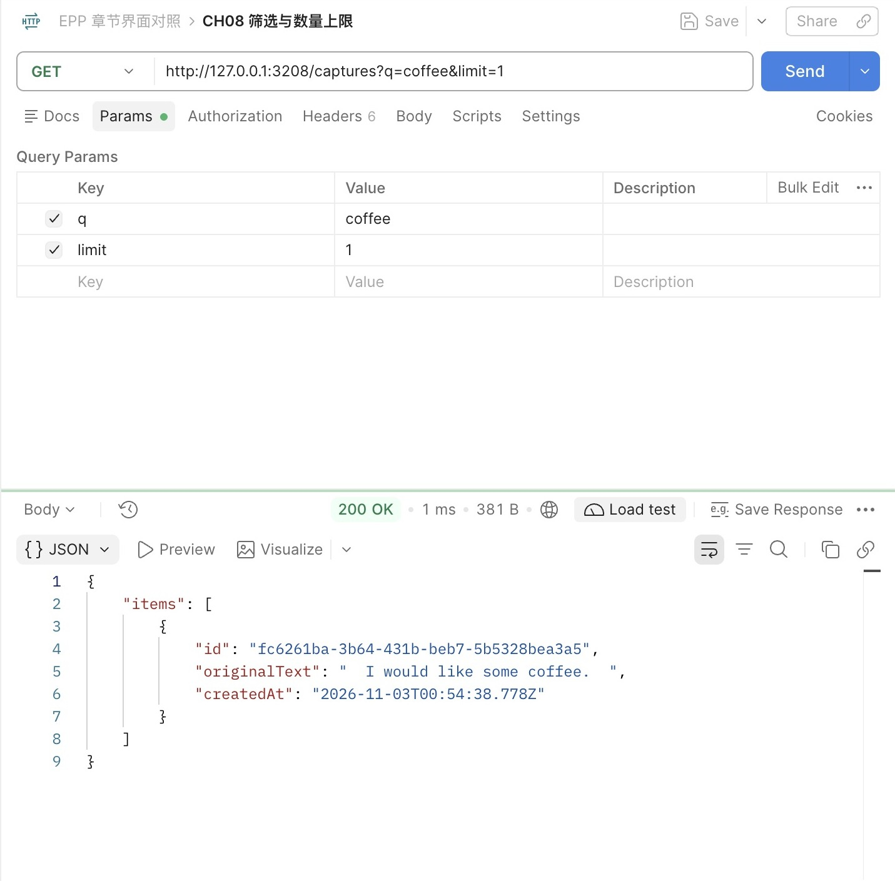

# 第 9 章 Controller 定义系统的 HTTP 入口

第八章把记录操作从请求处理函数里抽了出来，再让 Nest 组装 Service 和 Controller。现在三个接口仍能工作，但 Controller 里还保留着不少手写服务的形状：自己从 URL 截出 ID、读取请求流、调用 `sendJson()`。迁移时这样做，是为了先保证行为不变；接下来要看清哪些工作可以交给框架，以及交出去之后由谁负责。

这一章沿同一组接口继续推进。我们给列表增加按原文片段筛选和限制返回条数的能力，让路径、查询、请求体分别承载不同的输入；同时改用 Nest 的返回值响应方式。实现过程中要始终能回答：这一步是在解释 HTTP，还是在执行业务规则？去掉一个装饰器、换一种输入，究竟哪一层会改变？

**阅读前提**：完成第八章正文。代码从 `part-02/chapter-08` 继续，本章完成状态为 `part-02/chapter-09`。装饰器描述与方法调用的关系可回看支线 8A／8C；流读取和中间件顺序可回看支线 8B。

支线 8C 的最小 Nest 实验到第八章结束。从本章起删除 `examples/mini-nest/`、`requests/mini-nest.postman_collection.json`，并从 `package.json` 的 scripts 中移除 `dev:mini-nest`，避免留下指向已删除文件的启动入口。保留 `scripts/dev.mjs` 的入口与编译配置参数，支线 9B 还会复用它；后续功能使用 Nest 本身实现。若没有跟做 8C，无需创建再删除这些文件；若要重做实验，使用 `part-02/chapter-08` 的代码。

**本章结果**：能组织方法与路径，把外部输入转成明确的业务参数，解释请求体解析与 `@Body()` 的分工，并选择自动响应、手动响应或 passthrough。普通创建、列表和详情保持已有业务结果；列表新增两个可选查询参数，查询总项数增加明确上限，自动响应开始支持 ETag 条件查询的 `304`。

记录字段仍是 `id`、`originalText`、`createdAt`，存储仍在 Service 的 Map 中。没有新增数据库、迁移或回填，也没有提前引入存储接口；第十章再处理可替换依赖。本章使用第八章锁定的 Nest 11.2.5、Express 5.2.1 和 TypeScript 5.9.3，不新增第三方依赖。

阅读约 90～110 分钟，跟做另加约 55～75 分钟，合计约 145～185 分钟。支线另计。可以在 9.1 末尾停下来，此时只需能推演请求怎样到达方法、结果怎样发出。9.2 接完三个方法后再启动完整示例；9.3 的对照需要同一批内存记录，适合连着做。

## 9.1 路由、路径参数、查询参数、请求体与响应映射

### 先确定一次请求在选什么

详情请求 `/captures/某个ID` 选择一个具体记录；列表请求 `/captures?q=coffee&limit=2` 仍然选择记录集合，只是附带筛选与数量条件。创建请求则在 `POST /captures` 的正文中提交原文。它们不是三种互换的装饰器写法，而是三种不同的输入位置。

为什么不把所有内容都放进一个 POST 的 JSON？技术上可以，但那样会把读取和创建混在一个协议入口，调用方无法再从方法与路径判断操作类别。为什么不写成 `/captures/coffee/2`？因为 coffee 不是记录身份，筛选条件还会继续增长；用查询参数能保持集合地址稳定，让各项条件独立表达。这里采用常见的资源式接口组织，同时保留已有调用方式。

| 操作 | HTTP 入口 | 进入业务操作的内容 | 成功结果 |
| --- | --- | --- | --- |
| 创建记录 | `POST /captures` | JSON 中的 `originalText` | `201`，记录与 `Location` |
| 列出记录 | `GET /captures` | 可选的文本片段与数量上限 | `200`，`{ items: [...] }` |
| 查看详情 | `GET /captures/:id` | 一个记录 ID | `200`，单条记录 |

新增条件只影响列表。详情查不到记录仍是 `404`；列表筛选不到是 `200` 与空数组，因为列表操作成功了，只是没有符合条件的记录。不要因为“结果为空”就不分场景地返回同一种状态。

把列表页上的两次操作连起来看。用户在搜索框输入 coffee，页面保存的是“这次想看哪些素材”。点进结果中的第二条，详情页需要保存的则是“刚才点中了哪一条”。如果有两条原文都含 coffee，拿搜索词拼详情地址就无法回答这个问题。如果把第二条在列表中的下标当作地址，下一次放宽条件后，同一个下标也可能指向另一条素材。创建时生成的 ID 正好解决这个歧义。关掉筛选再进详情，服务端仍用那个 ID 找同一条素材。这里的“第二条”只在当次结果中有意义，千万别把它换算成 Map 的第二个键。

这个区别会影响前端怎样解释一次查无结果。原文页已经知道一个 ID，按它读回失败，应保留地址供核对，可以去列表确认记录是否仍在。搜索页只知道筛选条件，收到空数组恰好可以展示当前条件并允许修改。如果把两者统一包装成成功响应里的空对象，详情组件会拿不到必需字段，却又无法区分“记录不存在”和“这次响应少映射了字段”。如果把两者都当错误，搜索一个正常但尚无人记录的词就会走进重试分支。先写出两个界面各自能做的下一步，再决定响应形状，比从“没有就返回空”推断接口更可靠。

创建的响应还连接着第三次操作。用户输入的是原文，服务端接收后决定 ID 和创建时刻，发回已成立的记录。页面可直接用这份结果显示新增项，也可按 Location 转去详情。两个入口提供的是同一次创建的身份。因此核对创建不能只看列表末尾出现了相同的句子，两次提交完全相同的原文也会产生两条不同的素材。要比对的是响应中的 ID、地址最后一段以及按这个地址读回的记录；时间可以相同，不能充当它们的关联键。

### 路由描述如何变成方法调用

类上的 `@Controller('captures')` 提供前缀，方法上的 `@Get(':id')` 提供方法与后缀。Nest 初始化时把它们组合，向底层路由器注册 `GET /captures/:id`。请求到达后，路由器先匹配，再由 Nest 取得参数并调用 Controller 实例的方法。方法名叫 `detail` 还是 `findOne`，并不决定公开地址。

第八章的详情方法自己读取 `request.url`，再用 `slice()` 截出 ID。现在方法可以改为下面的形状；`httpResult()` 稍后实现，负责把业务失败转换成原有 HTTP 错误结构：

```typescript
@Get(':id')
detail(@Param('id') id: string) {
  return httpResult(() => this.captures.find(id));
}
```

`@Param('id')` 描述“把已匹配路径参数中的 id 放到这个形参位置”。它不是从形参名字猜输入来源。把 TypeScript 形参改成 `captureId` 而保留装饰器中的 `'id'`，仍然能工作；把装饰器改成 `'captureId'` 而路由仍写 `:id`，拿到的就不是原来的值。参数名之间的关联是显式契约。

`id: string` 也不会检查 UUID 格式。这里预期的是路由器提供的单个路径字符串；是否存在对应记录由 Service 判断。以后若把详情 ID 改成数字，写 `id: number` 不会把 URL 中的字符串自动变成数字，仍需显式转换和校验。第六章建立的“类型检查不等于运行时检查”在装饰器方法里依然成立。

这一变化还受第八章 `httpBoundary` 的约束。它先拒绝大小写变化、尾斜杠、额外路径段和不允许的方法，并对包含百分号的详情 ID 返回 `404`，然后才进入 Nest 路由。因此本章虽然改用 `@Param()`，仍保留字面 UUID 的路径契约，没有悄悄开放另一套编码形式。对任意字符串标识的新接口不能直接照搬这个限制；支线 9A 会单独解释 URL 编码与解析的边界。

可以在编辑器中沿一次详情读取反向找代码。先看成功响应里的原文是从哪里来的。在 Service 的 find 中，唯一的查找条件是传入的 id。回到它的调用处，实参来自 detail 方法的一个位置参数。再往上找，不会找到一行业务代码显式地写着“接到 GET 就调用 detail”。这段连接在应用启动时由 Nest 根据装饰器完成。启动时已有的是如何找到处理方法的规则，尚无某次请求的 ID。到真正收到请求，匹配结果里才有这次的字符串，再按参数装饰器指明的位置传进去。两次请求可以调用同一个实例方法，却分别携带各自的 ID；不需要在 Controller 实例上留一个“当前 ID”字段。

这也解释了两种看起来毫无差别的改名。在 VS Code 用重命名符号改局部形参，方法体里的引用会一起变化，编译器能检查。路由模板和参数装饰器之间靠字符串键配对，编辑器即使没有报告类型错误，也无法保证两个字符串说的是同一项。排查一次刚改过路由的详情失败时，先在方法入口比对路由声明的键、装饰器选择的键和取得的值，再去找 Map 中是否真的缺那条记录。直接在浏览器中多换几个 ID，解决不了固定取错键的问题。

### 路由顺序不能代替资源设计

如果以后增加 `GET /captures/stats`，它和 `GET /captures/:id` 的形状有重叠：字符串 stats 也能占据 `:id`。在当前 Express 适配器下，应把静态路径处理方法放在动态路径之前，避免先被详情方法接住。不要依赖方法名字、ID 的 TypeScript 类型，或者“stats 看起来不像 UUID”替路由器排除匹配。

更重要的是，当前还有一层先执行的兼容入口。将来若新增 `/captures/:id/history`，不仅要声明新路由，也要同步修改 `httpBoundary` 的路径与方法判定，否则请求会在到达 Controller 前被拒绝。只在 Controller 上加装饰器，不代表所有上游入口都已放行。这个显式清单目前用来维持旧接口，路由增长后要在第十三章请求机制的整理中重新安排它的职责。

这些是新增接口时的推导，本章没有添加 stats 或 history。当前三个入口没有静态／动态冲突；先保持明确范围，不为演示路由 API 增加无需求的业务功能。

### 查询字符串先成为值，再成为业务参数

列表新增的两个参数这样约定：`q` 按大小写敏感的字面子串匹配原文，保留空格，不执行正则，也不做全文搜索；提供时必须是非空白字符串，最多 200 个 UTF-16 代码单元。`limit` 提供时为 1～100 的十进制整数，先筛选，再按现有插入顺序取前若干条。它只是截取结果，不表示已经实现分页。

两个参数都不提供时，继续返回全部记录，以保持原有调用行为。不能顺手把默认值改成 20，再说“只是换了 Controller 写法”。这也保留了原有的无界列表成本；内存示例尚未建立适合大量数据的公开列表策略，第三篇查询与分页会在真实数据量下重新设计默认限制和顺序。显式提供 `limit` 的调用可以先控制这次返回的条数。

在 Express 的 simple 查询解析器下，`?limit=2` 提供的是字符串 `'2'`，不是数字；`?limit=1&limit=2` 则可能提供数组。`?limit=` 是空字符串，不等于没有这个字段。先检查结构，再解释语义，才能区分这些情况。

不过，检查解析结果还有一个前提：解析器没有先丢掉输入。Express 的 simple 解析器使用 Node 的 `querystring.parse()`，默认最多处理 1000 个查询项，超过后会停止解析。如果前面已有 1000 个未知字段，最后一个 `q=coffee` 就可能消失；Controller 看到的会是“没有 q”，从筛选变成全量列表。第二个同名参数落在截断位置后，也会绕过重复值检查。未知字段可以不参与业务，但不能让它们挤掉真正的条件。

我们选择在解析前拒绝超过 1000 项的查询，保留有界输入内的 simple 语义。修改 `src/http-boundary.ts`，在原有 URL 构造的 try/catch 之后、`const detail = ...` 之前插入：

```typescript
    const queryParts = url.search === '' ? 0 : url.search.slice(1).split('&').length;
    if (queryParts > 1000) {
      throw new HttpError(400, 'Query string must contain at most 1000 parameters');
    }
```

其余路径与方法判断保持原样。这一边界针对整个请求，发生在路由匹配和 Controller 参数提取之前；因此即使路径不存在，超限查询也先得到 `400`。计数单位是原始查询中按 `&` 分隔的片段，未知字段、重复字段和空片段都算一项；编码在值中的 `%26` 不会误算成分隔符。没有查询时算零项，至多 1000 项才继续解析。这个数既不是不同字段名的数量，也不是 UTF-8 字节数，更不替代请求体的 16 KiB 上限。

也可以配置自定义解析器，但仍需决定输入预算和超限行为；直接取消解析上限，不能代替资源边界。这里先用明确拒绝避免条件被静默删除，再分别检查已知字段的单值和内容规则。

新增 `src/capture-query.ts`。它引用的 `CaptureListOptions` 会在 9.2 加到 Service 文件里。如果开发监听此时报告缺少这个导出，先接着完成 9.2，再等编译与监听成功后发请求。

```typescript
import type { CaptureListOptions } from './captures.service.js';
import { HttpError } from './http.js';

export function parseListQuery(q: unknown, limit: unknown): CaptureListOptions {
  if (q !== undefined && typeof q !== 'string') {
    throw new HttpError(400, 'q must occur once and be a string');
  }
  if (limit !== undefined &&
      (typeof limit !== 'string' || !/^[1-9]\d{0,2}$/.test(limit))) {
    throw new HttpError(400, 'limit must be a decimal integer from 1 to 100');
  }
  return {
    text: q,
    limit: limit === undefined ? undefined : Number(limit),
  };
}
```

这里把 HTTP 字段 `q` 翻译成业务含义更明确的 `text`。重复的已知参数不是偷偷选第一个或最后一个，而是因为不是单个字符串而返回 `400`。在总项数上限内，本章只读取这两个已知字段，其余查询参数不参与业务；它不是严格拒绝未知字段的完整 Schema。`q[]` 也是另一个未识别的字段名，不会被当成 q 数组展开，不能用它替代 `q`。

先用正则检查数字文本，再用 `Number()` 转换，是为了明确接受范围。直接 `parseInt('2oops')` 会得到 2，`Number('')` 会得到 0，`Number('1e2')` 会得到 100；这些结果都可能悄悄放宽公开输入规则。当前正则拒绝空值、符号、指数、小数、前导零和超过三位的文本。转换后是否位于 1～100，还由 Service 的业务参数约束确认，避免另一个入口绕过限制。

为什么不一开始就把 `@Query('limit') limit: number` 写好？因为类型断言只能让后续代码看起来拿到了数字，既没有排除数组，也没有处理空值。为什么不立刻引入 Pipe？我们先把解析责任和规则解释清楚；第十二、十三章再把相同责任放到可复用的入口机制中。当前这个函数已经可以独立调用，不需要依靠框架才能判断输入是否合法。

把一次搜索从页面还原到函数调用，中间有三个值得单独检查的值。以搜索一段带空格的原文并最多看两条为例，输入框中是用户看得见的字符；发出的 URL 中是客户端编码后的字符；到 parseListQuery 时，q 已经是解析器交付的文本，limit 仍是数字的文本写法。只有最后交给 list 的 limit 才能参加数值比较。断点里看见普通空格而地址栏里看见百分号编码，两处可以同时正确。若此时又给 q 解码一次，搜索含百分号的普通笔记就可能改变含义。选择在哪一处观察，要看你是在查客户端怎样组地址，还是在查服务端拿什么做匹配。

从表单设计倒推一次缺省语义。页面初次打开，数量框显示提示文字“全部”，请求应省略 limit。如果使用者主动填写了一个服务不接受的数，就应让他看到需要修正之处。把所有无法转换的值都替换成默认值，会让页面看似能用，却把限制结果数的请求扩大为全量查询。反过来，若将空输入框总是拼成一个带等号的键，用户第一次打开页面也会遇到数量格式错误。在 Postman 中取消 Params 那一行的勾选和保留勾选但清空 Value，可以直接表示这两种客户端决定。决定空输入的交互含义在页面，决定线上已经收到的空串是否合法在入口；一个决定不能代替另一个。

同样要分清“值是什么”和“能看到多少条”。假定列表目前只有一条，limit 为二和为九十九都会在屏幕上显示一条。仅从这张截图无法证明后端把字符串转成了数，更不能推断最大允许值是一。换成一百零一，即使库里只有一条，本次也应失败。上限检查描述的是允许调用者要求什么，早于读取现有数据；若按当前列表长度把所有过大的数夹到末尾，这个错误就会随素材数量变化而时隐时现。后面在 Service 中先检查选项、再遍历 Map，正是为了使输入是否合法不依赖碰巧保存了哪些记录。

考虑用户同时勾了两行同名的数量条件。选择第一个值和选择最后一个值都能写出运行正常的程序，但只要拖换这两行，业务结果就可能跟着变。接口没有规定同名条件的优先级，因而应该在仍能看见多个值时给出错误。若客户端先把行列表折叠成普通对象，它自己可能已经覆盖了其中一项，服务端只能按实际到达的单值处理。联调双方有争议时，核对 Postman 最终显示的请求地址及方法入口的实际值，比双方各自展示一个构造对象更能说明重复发生在哪里。

### `@Body()` 取的是解析结果

第八章关闭了 Nest 默认请求体解析器，Controller 自己调用 `readJson()`。如果这时只把方法参数改成 `@Body() body`，请求里的字节不会因此自动变成对象。`@Body()` 从请求对象上取 body；把流读完、按 UTF-8 解码、执行 JSON.parse 的工作，必须有其他代码完成。

有两种可行做法：启用框架默认解析器，按它的大小限制、媒体类型与错误方式配置和适配；或者保留已有读取函数，把解析移到路由之前。这一章选后者，因为前文已经建立了 16 KiB 字节限制、JSON 语法错误和 `415` 等约定。目的不是说自写解析器比成熟中间件更适合所有服务，而是避免把入口重构和解析策略更换混在一起。

新增 `src/capture-body.ts`：

```typescript
import type { Request, Response, NextFunction } from 'express';
import { HttpError, readJson, respond } from './http.js';

export function captureBody(
  request: Request,
  response: Response,
  next: NextFunction,
): void {
  // httpBoundary has already accepted the path and method.
  if (request.method !== 'POST') {
    next();
    return;
  }
  void respond(response, async () => {
    const mediaType = request.headers['content-type']
      ?.split(';')[0]?.trim().toLowerCase();
    if (mediaType !== 'application/json') {
      throw new HttpError(415, 'Content-Type must be application/json');
    }
    request.body = await readJson(request);
    next();
  });
}
```

这段代码的位置有前提：`httpBoundary` 已先接受了方法与路径，目前能通过的 POST 只有创建记录，因此这里只需区分 POST。以后增加其他 POST、尤其是文件上传入口时，应按路由和媒体类型重新划分解析范围，不能继续让所有 POST 强制读取 JSON。

`await readJson()` 完成之后才赋值并 `next()`，所以 Controller 看到的是解析结果。如果内容类型或 JSON 语法失败，`respond()` 会结束错误响应，业务方法不执行。JSON 值是否为对象则留在 Controller 判断：`null` 和数组都可以是合法 JSON，但不满足这个接口的对象契约。

随后将 `src/app.ts` 改为：

```typescript
import 'reflect-metadata';
import { NestFactory } from '@nestjs/core';
import type { NestExpressApplication } from '@nestjs/platform-express';
import { AppModule } from './app.module.js';
import { captureBody } from './capture-body.js';
import { httpBoundary } from './http-boundary.js';

export async function createApp(): Promise<NestExpressApplication> {
  const app = await NestFactory.create<NestExpressApplication>(AppModule, {
    bodyParser: false,
    abortOnError: false,
  });
  app.set('query parser', 'simple');
  app.use(httpBoundary);
  app.use(captureBody);
  return app;
}
```

顺序有因果关系：先限制查询项数、筛方法和路径，才为被接受的创建请求消耗读取工作；读完后才交给路由。`query parser` 显式选 simple，让本章的查询结构不依赖隐含配置；前置计数又保证后面的解析不会静默截掉有效条件。`bodyParser: false` 继续保留，否则两套读取逻辑可能争用同一条请求流。请求对象可以被多层访问，请求体字节却不是能任意回放的普通数组。

还有一个容易误会的地方：`next()` 不返回下游执行完成的 Promise。这里的 `respond()` 保护的是当前解析动作，不能代替 Controller 的错误边界。解析成功后，路由中的失败由后面的 `httpResult()` 和 Nest 处理。这正是支线 8B 中“调用 next”和“等下游完成”的区别。

沿一条正常的中文原文看看读取函数究竟保留了什么。从 Postman 的 raw JSON 编辑框按下 Send 后，服务端的 data 事件拿到 Buffer。一次事件可能只有一部分 JSON，也可能已经包含所有正文；事件次数由传输过程决定，与原文有几句无关。若恰好在一个汉字的编码中间分块，把每块单独转成字符串再拼起来，可能在原文字段中读到替换字符。现有 readJson 先累加每块的字节数，保留仍在限额之内的块。等 end 才拼合并按 UTF-8 严格解码，随后解析整份 JSON。这里可以边收边检查的是字节预算，要等完整输入才能判断的是整份文档的语法以及字段的值。

正文大小和原文长度是两个能各自解释失败的条件。先想两份业务字段完全相同的合法 JSON，一份紧凑，一份在字段周围加了缩进或换行。这些排版空白占传输字节，解析后却不会进入 originalText。再把空格移到表示原文的引号内，此时原文字段本身就变长了。服务端按整份请求算字节预算，再按解析后的原文字段算代码单元。看到原文长度没超过两千，只能判断字段长度在业务允许的范围内，不能据此推断请求字节一定在限额之内。媒体类型也从请求头单独读取，编辑框能高亮显示 JSON 并不能证明实际发出的头部正确。

再看一份有换行的笔记。用户希望保存的是两行文字，JSON 编辑框内应使用字符串的换行转义，解析后字段里才是实际的换行字符。若使用 Postman 的 Pretty 视图查看返回的 JSON，序列化又会把换行表示成转义，看起来像服务端又“改回去了”。比较时让请求和响应都先处于同一层次，要么比解析后的字符串，要么比各自序列化的文本。正文缩进、属性间空格都可能和发送时不同，却不影响记录的原文。需要逐字保留的对象是用户提交的字段值，服务没有保存整份传入 JSON 的排版。

读取到合法 JSON 也只有一个中间结果。在 await 完成的那个时刻，request.body 已经有机会赋值，Map 中还没有新记录。中间件既不知道后面是否接受这个对象，也尚未生成 ID。因而这里不能提前设置 Location 或记一笔“创建成功”。如果未来观察日志，看到“正文解析完成”只能排除流读取及语法这段失败。再看有没有进入 Controller、有没有通过原文字段的规则，才有资格判断记录是否成立。

### 返回一个对象之后，谁真正发送响应

第八章使用普通 `@Res()` 注入 Express 响应对象，代码自己调用 `writeHead()` 与 `end()`。这样可以直接控制状态与字节，但每个成功分支也要记得完成响应。现在普通 JSON 结果可以改为 return，由 Nest 等待方法结果，再通过适配器发送；如果返回 Promise，Nest 会等待其成功或失败，而不是把 Promise 对象序列化。

普通 GET 成功默认是 `200`，POST 默认是 `201`。如果接口语义确实需要其他状态，可以用 `@HttpCode()`；但不能为了使用 API 就把本来已经创建完成的记录改成 `202`。202 表达接受了处理请求，适合另有后续处理结果的契约，不会凭空建立后台任务。支线 9B 用独立接口观察状态覆盖，本章创建仍为 201。

自动发送也引入了一项实际的 HTTP 语义变化。Express 默认为 JSON 响应生成 ETag，用它标识这份响应表示。客户端已经保存正文及其 ETag 后，可以在下一次 GET 中用 `If-None-Match` 提交这个标记；当前结果仍匹配时，发送层将响应改成 `304 Not Modified`，不再发送正文，客户端复用已有缓存。没有条件头或标记不匹配时，仍发送 `200` 和完整 JSON。这不是“多了一个头部”而已：Controller 返回同一个对象，客户端也可能收到没有正文的304。

本章接受这个默认行为。304没有 JSON 响应体，当前适配器也会移除 Content-Type；客户端不能把它当成一份空 JSON 再解析。Express 对 GET／HEAD 提供条件响应，但 EPP 主线的 HEAD 仍在 `httpBoundary` 被拒绝为405，不能越过上游约定。支线9B会用独立应用把返回值、缓存条件和最终响应的关系实际走一遍。

动态 `Location` 只有创建出 ID 后才知道，无法用固定头部值表示。这里使用 `@Res({ passthrough: true })`：让 Controller 只设置头部，仍把响应体返回给 Nest。不能再调用 `json()` 或 `end()` 抢先发送；如果采用普通 `@Res()`，又只 return 一个对象，则这条路由的自动发送被关闭，请求可能一直等待。

这几种写法的差异不在“哪种更高级”，而在响应完成责任由谁持有。普通 JSON 接口优先用返回值，有动态头部时用 passthrough；需要深度操作平台响应时可以手动完成，但要把所有成功与失败路径接好。流式输出、文件传输的专门机制会在相应场景展开，不把本章这组 JSON 写法当成所有响应的通用模板。

用一笔创建把“产生记录”和“完成响应”拆开。Service 返回时，新的键值对已经进入当前实例的 Map。Controller 拿到的记录里第一次有了可以填进 Location 的 ID。执行 setHeader 后，响应对象上有待发出的地址，此时还没有因为这次调用就把 JSON 写到客户端。接下来返回记录，由 Nest 等待处理结果并交给适配器，Postman 才能看到状态、头和正文三者组成的一次成功。若你在设置头部前暂停调试，会出现业务已经写入、客户端仍在等的短窗口。放行调试器让这一次调用完成，比再发一次创建更适合确认它走到了哪一步。

这个先后顺序直接影响前端对“重试”的理解。列表请求在没有新写入的情况下可以再发一次查看，创建请求每执行一次都要生成一个新 ID。客户端等待超时只说明它没按时收到结果，既可能还没执行写入，也可能已经写完但响应尚未到达。在当前练习进程可用时先按原文列出候选记录，对照创建时间、已保存的 ID 和发送次数。相同原文只说明内容一样，不能单凭它断定某一条就是刚才那一次。这个接口还没有用同一提交标识找回原结果的机制，所以不要让界面把一次等待自动变成第二次写入。

读操作的完成则多一个比较步骤。以一直停留在同一筛选页的调用者为例，第一次响应需要一份可显示的 items，第二次带上与这份结果配对的标记。服务端仍要知道当下这个查询会表示成什么内容，才有依据决定原正文是否还能用。这里的标记来自发送层计算出的表示，Controller 和 Service 并没有专门的“缓存命中，跳过遍历”分支。因此收到无正文响应可以说明本次免去了重传列表正文，却不能据此声称省掉了 Map 扫描或省掉了组装对象。衡量节约的工作时，要沿真正的代码路径找出在哪一步才得知可以复用。

若前端切换查询，保存标记时要把对应的请求条件和正文一起保存。一个无筛选列表和一个只含茶的列表可能碰巧都有一条数据，也可能一个有三条、另一个只有一条。拿详情页的标记代替当前列表的标记，不能表达“我持有这份列表”。更细一点，如果两份表示的内容碰巧一样，它们甚至可能得到相同标记；标记不是查出资源身份的凭据。前端仍然需要按请求找到自己可以复用的那份正文。后面做条件请求时固定 URL、保留第一次结果，再只换条件头，就是为了把这次比较解释清楚。

## 9.2 Controller 怎样将 HTTP 输入交给业务逻辑，哪些工作应留在 Service

### Service 接收业务条件，不接收查询字符串

此时还不能把 Controller 简化成 `return captures.list(request.query)`。如果 Service 需要识别 `'2'`、数组、`q` 字段名和 Express 对象，它就开始依赖 HTTP 的表达方式。以后管理命令传入数字 2，也要先伪造成查询字符串才能调用。

所以 `parseListQuery()` 交付 `{ text?: string; limit?: number }`。Service 负责这些条件如何作用于记录，以及这个操作接受什么有效值。给 `src/captures.service.ts` 增加类型，并替换原来的 `list()`；创建和详情方法保持原样：

```typescript
export type CaptureListOptions = {
  text?: string;
  limit?: number;
};
```

```typescript
  list({ text, limit }: CaptureListOptions = {}): Capture[] {
    if (text !== undefined &&
        (typeof text !== 'string' || !text.trim() || text.length > 200)) {
      throw new InvalidCaptureError('text must be a non-empty string of at most 200 code units');
    }
    if (limit !== undefined &&
        (!Number.isInteger(limit) || limit < 1 || limit > 100)) {
      throw new InvalidCaptureError('limit must be an integer from 1 to 100');
    }
    const items: Capture[] = [];
    for (const capture of this.captures.values()) {
      if (text !== undefined && !capture.originalText.includes(text)) continue;
      items.push({ ...capture });
      if (limit !== undefined && items.length === limit) break;
    }
    return items;
  }
```

这里先检查参数，再遍历 Map。文本匹配成功才把副本加入结果，达到数量限制后停止。假如先取前两条再过滤，而第三条才含有 coffee，就会漏掉本应返回的匹配项；筛选与截取顺序不是可以随意交换的实现细节。

目前插入顺序来自同一个 Map，且没有修改、删除操作，因此对当前进程里的这批记录可解释。它没有承诺跨重启、数据库导入或相同时间戳下的稳定分页顺序。以后换成 SQL 时，必须把需要的顺序写进查询，不能假设数据库自然返回 Map 的顺序。

返回值仍是副本。若直接把内部对象推到列表，程序内的调用者就可以绕过 `create()` 修改原文，破坏第八章建立的规则。另一方面，这个循环也没有让所有查询都变成常数成本：没有匹配项时需要扫描全部记录；即使 limit=1，也可能扫到最后才找到第一条。输出数量限制与查询计算成本是两个不同约束。

把循环暂时当作手工挑素材来读。桌上按写入顺序放着“茶”“冰咖啡”“热咖啡”三张卡，要求最多交出一张含“咖啡”的卡。读第一张时手里仍是零张，不能因为已经看了一张就停止。读第二张时第一次有东西可交，此时才满足停止条件。若改为最多交两张，经过第二张后还要继续，第三张也可交出。这里有两个始终可能不同的数量，已经检查的记录数，以及已经加入结果的记录数。代码只把后者拿来和 limit 比较。理解这一点之后，即使不用 Map，换成任何可依次读出的集合，也能写出符合相同约定的筛选过程。

再换一个会改变答案的条件。假设产品要的是“最近录入的一张咖啡素材”。眼前循环在第一张匹配时就停，交出来的是冰咖啡；按这个新要求该交热咖啡。给输入增加一个更大的 limit，只会返回更多按原顺序挑出的卡，不能保证第一张成为最近的一张。要先约定“最近”指的是创建时间还是最后一次修改时间，并决定时间相同时如何选定顺序，再在这个顺序上取结果。当前记录只有创建时间，两个 ID 本身也不表示时间先后。本章的条数上限可以独立实现；不要把它对顺序的依赖藏进一个名叫“获取最新”的前端函数。

一行 includes 也代表一次取舍。搜索“咖啡”和搜索“ 咖啡”可能命中不同记录。校验里调用 trim 是为了识别完全没有可见文字的请求，判断完成后仍拿原来的 text 去匹配。若为了复用代码把 text 替换成修剪后的值，搜索词前后有意保留的空格就失去了作用。保存原文同理，判断一句话有内容，不等于可以顺手改写用户录入的排版。对文字学习工具尤其要注意这一点，读者可能正在记录大小写或空格本身。以后若决定提供宽松搜索，应同时说清比较时怎样处理原文和查询，以及展示时是否仍显示原句。

长度边界也能从正常使用中看出来。普通汉字在这里通常占一个代码单元，一个常见的笑脸表情可能占两个。假定筛选词由一百九十九个普通汉字再接一个这样的表情组成，用户肉眼数到两百个符号，字符串 length 却已经是二百零一。这条查询即使能成功编码进地址，仍会触发文本长度错误。把同一串字符当作创建原文，判断适用的却是原文自己的两千单位限额。界面显示“还能输入多少”前先确定在编辑哪个字段、服务用什么单位计数，不能从浏览器渲染宽度倒推出剩余预算。

副本解决的具体问题也可以在纸面上演一遍。设某次查询交出冰咖啡，业务调用者为了画列表，把交出的对象原文改成“已选”。随后另一个调用者按原 ID 查看详情，本应仍看到冰咖啡。如果结果数组虽然是新的，其中装的却全是 Map 内部的同一批对象，两次调用之间就会发生无意的写入。现在扩展运算符在加入结果前各复制一次，修改交出对象的顶层字段只影响这份结果。此处三个字段都是字符串，浅拷贝已经足够。假如以后记录包含可编辑的标签数组，复制外层对象仍会共享内部数组，到那时应重新核对每个可修改值的归属。屏幕上看两份 JSON 长得一样，无法验证这个内存边界，得用同一实例连续调用才能观察。

### 错误含义复用，HTTP 呈现由入口决定

改变成功响应方式后，失败也要接上。如果让 `InvalidCaptureError` 直接抛到 Nest，它不是 Nest 的 HttpException，框架不能仅凭类名知道应返回 `400`。客户端可能收到默认 `500` 或不同的 JSON 形状，尽管业务校验本身完全没变。

不能因此把 Service 里的错误都换成 `BadRequestException`。Service 的原文规则仍要供 HTTP 之外的入口调用；需要的是 HTTP 层翻译已有失败。保留 `HttpError`、`readJson()`、`sendJson()`，在 `src/http.ts` 顶部增加：

```typescript
import { HttpException } from '@nestjs/common';
```

把旧 `respond()` 替换为下面这一组函数，先抽出原来的错误分类，再让手动响应和返回值路径共用：

```typescript
export async function respond(
  response: ServerResponse,
  action: () => void | Promise<void>,
): Promise<void> {
  try {
    await action();
  } catch (error: unknown) {
    if (response.destroyed || response.writableEnded) return;
    const failure = httpFailure(error);
    sendJson(response, failure.statusCode, failure.body, { Connection: 'close' });
  }
}

function httpFailure(error: unknown): {
  statusCode: number;
  body: { error: string };
} {
  const statusCode = error instanceof HttpError ? error.statusCode
    : error instanceof InvalidCaptureError ? 400
    : error instanceof CaptureNotFoundError ? 404 : 500;
  if (statusCode === 500) console.error('Unhandled request failure:', error instanceof Error ? error.name : 'UnknownError');
  return {
    statusCode,
    body: { error: statusCode === 500 ? 'Internal server error' : errorMessage(error) },
  };
}

export async function httpResult<T>(action: () => T | Promise<T>): Promise<T> {
  try {
    return await action();
  } catch (error: unknown) {
    const failure = httpFailure(error);
    throw new HttpException(failure.body, failure.statusCode);
  }
}
```

`httpFailure()` 只决定状态和公开错误体；`respond()` 仍服务于前置中间件，直接写出失败；`httpResult()` 则把分类结果变成 Nest 能识别的异常，由框架完成响应。传给 HttpException 的是对象 `{ error: ... }`，因此保持当前公开结构，不依赖框架对字符串消息生成的默认错误形状。

`return await action()` 也有用途。若后续业务方法返回拒绝的 Promise，await 会让拒绝在当前 try 内发生，再进入 catch。直接 `return action()` 则会让当前函数提前返回那个 Promise，异步失败不会被这个 catch 捕获。它不是为了让同步 Map 操作看起来更“异步”，而是让边界可以接住当前回调声明允许的两种结果。

这个等待只针对回调返回的 Promise，不会递归等待对象属性。当前 list 返回同步数组，所以 `{ items: this.captures.list(...) }` 成立；以后若改成异步数据库查询，必须先 `await this.captures.list(...)` 再组装 items，并把回调改为 async。把一个 Promise 塞进 items 后直接 return 对象，既拿不到实际列表，也无法让这里的 catch 接住那个游离的拒绝。

只有已认识的输入错误和不存在错误会映射为 400／404；其他失败继续为 500，服务端额外记录异常名称。不要写成 catch 后统一返回 400，否则程序 bug、依赖失败也会被说成调用者提交错误。第十三章会讨论如何用框架请求机制统一入口处理；现在先把已存在的错误约定接完整。

成功响应交给适配器后，普通请求仍获得原有成功状态、JSON 内容和媒体类型，创建位置与不支持方法时的 Allow 也保持不变；但带匹配条件的 GET 现在可以得到304，而非200与正文。查询超过1000项也新增明确的400。这两项是本章主动接受的接口变化，需要和普通业务结果分别核对。Content-Length 等自动头部、连接策略也可能变化，错误响应不再统一强制关闭连接；不能把这些变化笼统说成所有状态、JSON和Content-Type都与第八章相同。

可以从调用者该怎样处理失败，反推分类时需要保留哪些信息。页面拿不到详情，若是已知的“这个 ID 没有记录”，就可以回到素材列表重新选择。若是处理详情时某段程序抛出了未预料的异常，页面没有依据宣称素材已经消失。即使两种异常都带有 message，把 message 拼进响应再让前端搜索某个单词也不可靠，描述文字可以改，程序错误也可能出现相同的单词。find 明确抛出的错误类型给了 HTTP 层区分它们的依据。未知错误只向调用者给出通用提示，当前实现向服务端控制台写的是异常名称或后备名称，没有把整份请求或堆栈作为这条日志的内容。

把创建改成一个异步步骤时，尤其容易把错误转换的位置写反。设业务函数返回一个尚未完成的 Promise，回调立即把它交给 httpResult。此时框架还在等，如果它稍后拒绝，await 会让控制流回到当前 try，然后根据拒绝原因选出状态。反过来，如果回调先启动那个任务，自己直接返回一个“已保存”的普通对象，适配器能立即把对象发走；后面任务才知道保存失败，原来的响应已经没有地方可以改成失败。这取决于回调把什么当作完成结果，与函数名里有没有 Async 无关。现在的 Map 写入是同步的，暂时看不到这段时间差，仍可沿返回值判断未来替换存储时会不会提前报成功。

同一个错误类型也可能在不同环节产生。比如前置读取发现正文不合法和 Controller 发现解析结果为 null，都可以构造输入错误；前者还在 Express 中间件中，后者已进入 Nest 调用。若只把统一分类函数写好，却漏接其中一个出口，客户端就会发现有些失败有 error 字段，有些却换了形状。调试时在 httpFailure 看一次传进来的异常，再看调用栈的上一层是 respond 还是 httpResult。这既能定位由谁完成本次响应，也能解释为何改动 Controller 的错误呈现没有改变媒体类型错误。无需在每一层各写一个 catch 然后反复包装同一个异常。

### 把三条入口连起来

现在可以完整替换 `src/captures.controller.ts`：

```typescript
import { Body, Controller, Get, Param, Post, Query, Res } from '@nestjs/common';
import type { Response } from 'express';
import { CapturesService } from './captures.service.js';
import { parseListQuery } from './capture-query.js';
import { HttpError, httpResult } from './http.js';

@Controller('captures')
export class CapturesController {
  constructor(private readonly captures: CapturesService) {}

  @Get()
  list(@Query('q') q: unknown, @Query('limit') limit: unknown) {
    return httpResult(() => ({
      items: this.captures.list(parseListQuery(q, limit)),
    }));
  }

  @Post()
  create(@Body() body: unknown, @Res({ passthrough: true }) response: Response) {
    return httpResult(() => {
      if (body === null || typeof body !== 'object' || Array.isArray(body)) {
        throw new HttpError(400, 'Request body must be a JSON object');
      }
      const capture = this.captures.create(
        'originalText' in body ? body.originalText : undefined,
      );
      response.setHeader('Location', `/captures/${capture.id}`);
      return capture;
    });
  }

  @Get(':id')
  detail(@Param('id') id: string) {
    return httpResult(() => this.captures.find(id));
  }
}
```

三个方法的共同工作是取输入、调用业务、映射结果。创建仍先排除 null、数组和其他 JSON 原始值，再只取 originalText；客户端夹带 id 或 createdAt 不会覆盖服务端生成规则。原文非空白和长度检查仍留在 Service，所以新增一个非 HTTP 入口也不能存入非法记录。

这里没有强行让 Controller 缩成一行。对象形状检查、Location 和列表外层的 items 都属于 HTTP 契约，放在入口有明确理由。反过来，即使过滤循环只有两行，它也决定“哪些记录符合条件”，应留在可复用的业务操作里。判断边界要看改变什么需求会影响它，而不是看代码行数。

还可以用一个变化核对这套划分。若以后客户端把查询参数 q 改叫 keyword，变化在 Controller 的取值位置和 HTTP 说明，Service 的 text 不必跟着改。若筛选改为忽略大小写，变化在业务匹配规则及其约定，所有入口应同时受影响；若只是把响应包成 `{ data: { items } }`，则改变的是公开接口映射。这三种改动不能因为都发生在“列表功能”里就堆到同一层。

回到创建接口，把一份成功输入沿三个对象传一次。第一个是解析后的请求对象，可以有调用者提供的其他字段；第二个是业务记录，只包含服务按自己规则生成或接纳的值；第三个是响应对象，承载头部和状态，序列化时用业务记录作正文。假如有人为了省几行，把整个 body 展开成保存对象，再允许用户值覆盖同名字段，就改变了谁能决定记录身份。在详情接口中 ID 是调用者用来选择既有记录的依据，在创建接口中决定新 ID 的权力仍属于服务。两个请求里都可能出现拼写相同的字段，意义取决于操作。按入口明确挑出允许传给业务的那个值，比在存储完成后尝试从记录上删除多余字段更容易核对。

列表的包裹层则朝另一个方向翻译。直接调用 Service，得到的是可遍历的数组，可以在程序里读长度和元素。HTTP 客户端已经按响应对象的 items 属性取数组，哪怕数组中没有匹配项，这个属性也必须存在。某次重构如果把处理方法缩成直接返回数组，类型检查和业务循环都可能正常，页面却拿不到 items。判断兼容性时分别看容器形状和内部数据；只比较两边都有同样的原文，仍会遗漏调用方式的改变。下节在 Postman 看响应时先辨认最外层，再核对每条记录，正好可以抓住这类变化。

## 9.3 先用请求和响应观察接口行为，再在依赖注入章节替换组件

### 先建立一批能区分规则的数据

完成以上修改后，在代码项目根目录使用默认调试开发模式；保存后自动编译并重启，等待监听成功再请求：

```bash
npm run typecheck
npm run dev
```

在 Postman 导入配套 `requests/epp.postman_collection.json`，复用创建请求，依次把originalText改成下面三条原文并Send；保存为三个请求副本，以后无需重新输入。为便于观察插入顺序，从刚启动的空内存进程开始。下面的curl保留为等效的终端表示，后续日常操作继续在图形客户端完成。

```bash
curl -i http://127.0.0.1:3000/captures \
  -H 'Content-Type: application/json' \
  --data '{"originalText":"I prefer tea."}'
curl -i http://127.0.0.1:3000/captures \
  -H 'Content-Type: application/json' \
  --data '{"originalText":"  I drink coffee.  "}'
curl -i http://127.0.0.1:3000/captures \
  -H 'Content-Type: application/json' \
  --data '{"originalText":"Coffee keeps me awake."}'
```

每次都应是 201。离开这次响应前，记下这句原文和服务端实际返回的 ID；第二次发送后就把它的 ID 填进集合变量 `captureId`。第三次创建不会自动改写这个变量。三笔完成后用“03 查看详情”读回第二句，核对两端空格及 ID。也可以把第二次响应的 Location 接到本次监听地址后做同一项读取。

```bash
curl -i http://127.0.0.1:3000/captures
curl -i 'http://127.0.0.1:3000/captures?limit=1'
curl -i 'http://127.0.0.1:3000/captures?q=coffee&limit=1'
curl -i 'http://127.0.0.1:3000/captures?q=Coffee'
curl -i 'http://127.0.0.1:3000/captures?q=unmatched'
```

在 Postman 复制列表请求，在 Params 中分别保存上述 q、limit 条件，缺省项取消勾选，不把空字符串当作缺省。第一条看到全部三条；第二条只看到 tea；第三条应得到第二条原文，而不是空数组，这检验的是“筛选在截取之前”；第四条只匹配大写 Coffee；第五条是 200 与空 items。URL 用引号包住，避免 shell 把 `&` 当作后台执行符号。带空格或加号的关键词可用 `curl --get --data-urlencode 'q=C++ & Node' URL`，不要自己用字符串拼接猜编码。



勾选的两项进入 URL；下面只返回一条包含小写 coffee 的记录。图示用于辨认 Params 和响应位置；单看这一条结果还不能证明筛选、排序与截取的顺序，仍需按上面的 tea／coffee／Coffee 三条数据逐项比较。端口使用当前启动地址。

先发送无参数列表，留下三个 ID、原文与顺序，供后面的拒绝请求对账。复制这份列表请求，保持 URL 相同，只在副本里加 `If-None-Match`。从刚才无参数响应的 Headers 复制完整 ETag，包括可能出现的 `W/` 和双引号，替换下面的占位文字；这期间先不要创建新记录：

```bash
curl -i http://127.0.0.1:3000/captures \
  -H 'If-None-Match: <复制的完整 ETag 值>'
curl -i http://127.0.0.1:3000/captures \
  -H 'If-None-Match: "not-the-current-tag"'
```

第一条应为 304 且没有正文，第二条应为 200 与完整列表。Postman 中若额外带有 `Cache-Control: no-cache`，先禁用它再核对匹配结果：当前 Express 的新鲜度判断遇到它会返回 false，因而发送完整响应。不要把这个实现行为记成 HTTP 的通则；no-cache 表达的是希望复用缓存前向源站验证，验证成功本身仍可以通过 304 完成，支线 9B 再区分这两层含义。这里 curl 只是展示原始响应，不会替你保存或拼回前一次 JSON；只有调用方已经拥有对应正文，304 才让它有内容可复用。需要重新获取正文时，不携带条件头即可。若插入新记录后再用旧列表标记查询，响应表示已经改变，也应重新得到 200。

导入的集合把主机和端口放在 baseUrl，把单条记录的键放在 captureId。“03 查看详情”的地址模板已经包含 `/captures/`；如果把整个 Location 填进 captureId，展开时就会多拼一段路径。这样的拒绝只能说明地址构造有误。需要回看刚才三笔创建时，可在 Postman 的 History 查看已发送请求及保留的响应。保存请求副本不会发送请求，重复按 Send 则会再生成一条。

把首次列表留下作对照。比数量更有辨别力的是三个 ID 的次序，以及第二条原文两端的空格。假如不小心发送了两次小写 coffee，那两条在 Pretty 视图里会非常相像，只有各自的 ID 能把它们分开。发现基线多了一行，先核对创建次数；为了按这里的三条数据重新比较，可以重启练习进程，从空列表按次序各建一次，并把 Postman 中旧的详情 ID 换掉。如果正在调试这批数据，就先把问题观察完再保存源码，因为一次正常的开发重启也会换掉内存实例。手中的请求示例可继续使用，示例上次收到的响应只代表上一次发送。

用这组数据做一次稍微不同的查询。保留小写 coffee，把数量从一改为二。若这时你期待同时看到第三条，可以回到三条原句逐字查看，第三条首字母大写，放宽数量也无法扩大匹配范围。保持数量二，改搜小写的连续两个字母 ff，这回第二条和第三条都能匹配，第一条仍被略过。再把数量改回一，应该只留下第二条的 ID。改一个条件就先预测保留下来的具体 ID，比单看结果变成一行或两行更容易分辨是大小写规则、截取位置还是初始数据出了偏差。做完把查询留在副本里，原来的无参数列表仍用于对账。

条件读取也可以借这两条记录分清“存储有变化”和“所看的结果有变化”。先在纸上推算，假设下一笔新增的是另一条只含 tea 的原文。无条件全量列表应多出一个 ID。只搜 ff 的结果中却不会多出它，原有两条的字段和顺序也不变。对于后者，原有表示仍然可以匹配先前保存的标记；对于前者，应取得改变后的列表和新的标记。这一推导要求两次比较使用各自同一地址、同一参数且期间没有其他改变。下面的失败实验以三条为基线，暂时不实际新增这第四条。若要在末尾亲手验证，先完成失败对账，再分别保存两份查询的正文和标记，然后才追加。

### 让失败发生在不同位置

接着发起这些请求，并在最后再读一次无参数列表：

```bash
curl -i 'http://127.0.0.1:3000/captures?limit=2oops'
curl -i 'http://127.0.0.1:3000/captures?limit=101'
curl -i 'http://127.0.0.1:3000/captures?limit=1&limit=2'
curl -i 'http://127.0.0.1:3000/captures?q='
curl -i http://127.0.0.1:3000/captures \
  -H 'Content-Type: application/json' --data '{'
curl -i http://127.0.0.1:3000/captures \
  -H 'Content-Type: application/json' --data 'null'
curl -i http://127.0.0.1:3000/captures \
  -H 'Content-Type: application/json' --data '{"originalText":"   "}'
curl -i -X DELETE http://127.0.0.1:3000/captures
curl -i http://127.0.0.1:3000/captures
```

前七条应为 400，但失败层次不同：非法数字文本与重复参数停在查询解析；101 和空白筛选条件由 Service 拒绝；损坏 JSON 停在读取解析；null 停在 Controller 的对象检查；空白原文停在创建规则。DELETE 仍是 405，并含 `Allow: GET, POST`。最后列表仍为原来三条，失败没有留下记录。

查询的总量失败更早发生。保持 dev 终端运行，在另一个终端发送下面的请求：

```bash
query=$(node --input-type=module -e 'console.log(Array.from({length:1000},(_,i)=>`x${i}=0`).concat("q=coffee").join("&"))')
curl -i "http://127.0.0.1:3000/captures?$query"
```

应得到400与 `Query string must contain at most 1000 parameters`，不会把最后的q丢掉后返回全量列表。支线9A继续对照恰好1000项、后置重复q和空片段，区分入口总量限制与字段规则。

还要沿用第八章的错误请求核对：错误媒体类型为 415，超过 16 KiB 为 413，未知路径为 404，错误大小写和尾斜杠不放行。它们都发生在路由的前面；Controller 写法改变不应该使旧边界失效。已有创建数据的字段没有变化，客户端不需要迁移记录或重发原文。

在 Postman 中保留独立的无条件列表请求。上一轮为了看标记而加入的 If-None-Match 只勾在条件读取的副本中，最后对账时取消它，否则正确的三条记录也可能只得到一个没有正文的状态。失败前保存三条 ID，失败后对同一个 baseUrl 再取一次，比较这三个 ID、次序和原文。只检查总数相同还不能说明原有内容仍然一样；只看到一次错误响应也不能说明这批记录没有受影响。如果中间重新启动过进程或另外发送过成功创建，这两次读取就已经不具备相同的初始条件，需要先重建基线再比较。

用集合“04 原文类型错误”和“05 JSON 格式错误”理解两种修正意见。前一份可以完整解析出对象，字段值是数值四十二。界面若提示“不是有效 JSON”，用户无论怎样调整缩进也改不对；应该回去修正发出的字段类型。后一份连一个完整的值都没产生，修改 Service 中对字段的检查也不会让它通过。两次响应的状态都能告诉前端“需要修正请求”，只有对照请求体、公开错误文字以及是否走到了业务调用，才能知道应让谁修正哪一处。集合“06 内容类型错误”则可在不改文字内容的情况下说明第三件事，读取者要先知道该按什么媒体类型接受正文。

详情缺失也适合这样交叉判断。集合“07 详情不存在”采用的是一个形状合法的详情地址，方法是 GET；进入 find 后才因键不存在而失败。同一服务下如果使用多出一段的地址，入口在查询 Map 之前就不能把它归给详情。对一个刚创建的 ID 查不到时，先对照 Location 与实际请求地址，再读无条件列表，检查刚刚复制的 ID 是否还在这个进程里。若三条素材都消失而地址仍正确，一次开发重启就足以解释现象；若列表仍有该 ID，优先检查详情的变量实际展开成什么值，以及有没有发给相同端口。两处都返回相同状态，后续调查需要的证据完全不同。

### 用断点区分“没进方法”和“方法没有完成响应”

需要定位时，保持前面的 `npm run dev` 运行，在 VS Code 选择 `EPP: attach to npm run dev`。分别在 `capture-body.ts` 赋值 body 之后、Controller 方法内部、Service 的 list 循环处打断点，然后在 Postman 发送已保存的请求。保存源码后等自动编译、重启并重连，再发送一次；创建数据与实际ID需要按新进程重新准备。

这里继续调试的是 `.dev` 中的当前产物。`typecheck` 不生成文件，`dev` 也不会更新 `dist`；直接换到 `npm run debug` 可能运行上一章的构建结果。只有需要在启动第一行暂停时，才停止dev，先执行 `npm run build`，再执行 `npm run debug` 并选择对应的debug attach。这个专项入口没有watch，修改后必须重新构建、启动；排查完切回dev。

损坏 JSON 不会到达后两个位置；合法 JSON 的 null 会到达 Controller，却不会到达 create；有效列表请求会看到 q 仍是字符串、转换后的 limit 才是数字。对比 `?limit=1&limit=2`，可以观察查询解析器产生的数组，说明错误不是 TypeScript 编译器发现的。断点位置用于验证因果，不只是确认“代码跑到了这里”。

如果断点命中 Controller，方法也 return 了，但客户端一直等待，优先检查是否用了普通 `@Res()` 却没有发送。若返回了 404 且根本没进方法，先核对 httpBoundary，再看方法／路径与注册；若进入方法后得到 500，再看服务端错误及错误映射。不要一看到 404 就去改数据库，一看到等待就认定 Service 卡住。

给断点选择一个具体的观察时刻。要区分格式错误与合法的 null，应在 captureBody 里紧接赋值的 next() 那一行设断点；停在赋值语句本身时，调试器通常还没有执行该行，不能从此时的 body 推断解析失败。先用创建好的请求副本把输入改为 null，发送后看 Scope 中的 request.body，再继续到 Controller 的对象检查。直到点继续让响应返回，Postman 才会显示拒绝。在这里暂停本身就会造成等待，应先看 VS Code 是否仍显示暂停，再判断程序有没有遗漏发送。正文损坏那一份无法走到成功赋值后的 next()；此时在 readJson 的解析错误分支观察，比反复调整 Controller 的断点更直接。

列表请求不需要从创建中间件的赋值处走。用小写 coffee、数量一发送，在 Controller 暂停时检查 q 与 limit 的实际类型，再单步进入 parseListQuery 看它要返回的对象。进入 Service 的 list 后，先看 text 和 limit，再在循环内看当前记录与 items 的长度。第一次查看茶那条时，结果长度为零；第二条加入后长度才到一。若把断点设在 push 上，未匹配的茶不会在那一行停下来，很容易误以为遍历直接从第二条开始。将断点移到 includes 判断处再发一次同样的读取，才能同时看到被略过和被选中的两步。这里要观测的是循环的决策过程，不必为了打印变量而改源码重启整批数据。

### 换一个入口，核对边界是否真的成立

在 VS Code 另开一个位于代码项目根目录的终端，先运行 `npm run build`，看到构建成功再执行下面的程序。开发服务可以继续运行，独立程序读取这次生成的 dist，使用另一份 Map。

```bash
node --input-type=module <<'JS'
import { CapturesService } from './dist/src/captures.service.js';
const captures = new CapturesService();
captures.create('tea');
captures.create('coffee');
console.log(captures.list({ text: 'coffee', limit: 1 }));
try {
  captures.list({ limit: 0 });
} catch (error) {
  console.log(error.message);
}
JS
```

应先看到 coffee 记录，再看到数量范围错误。没有 request、query 或 response，业务仍然可调用，规则仍然生效；这比只把文件命名为 service 更能说明职责已分开。这个独立程序不会读取正在运行的 HTTP 进程中的记录，复用代码不等于跨进程共享实例。

在上面的独立程序里还可以检验一件通过 Postman 看不出来的事。把后续语句放在同一段 JS 内、结束标记之前，让同一个 captures 实例继续工作。取出第一条匹配 coffee 的记录，保留它的 ID，把这份查询结果上的 originalText 改成 tea，再按保留的 ID 调用 find。读回的原文应仍为 coffee。再执行一次筛选仍能找到这个 ID，说明把结果交给调用者以后，判断是否匹配所用的原文仍由 Service 保管。在 Postman 中改上一次收到的 JSON 无法代替这个检验，因为跨 HTTP 传输本身就已经切断了对象引用，即使 Service 内部错误地泄露了引用，屏幕上的操作也测不到。

如果要判断零条上限在哪一层被拒绝，注意这个程序没有查询字符串。它可以直接向 list 交付数值零，所以这里看到的是范围错误；在 HTTP 中提交文本零，入口的十进制格式规则先将它挡住，根本轮不到 list。要从两个入口抵达同一个数值范围判断，选一百零一更合适，HTTP 接受这三个数字的写法，两边最终都向 Service 传入数值一百零一。找到真正经过同一步的样本，才能判断新入口有没有复用原来的业务规则。

到这里，HTTP 输入已经被翻译成明确的业务调用，成功和失败都能走到完整响应。下一章面对的变化是存储组件替换：Service 当前仍直接持有 Map，需要进一步建立注入令牌、Provider 和替换位置。先把本章这些请求结果固定下来，才能判断后面的组件替换是否保持了入口行为。

本章完成代码状态：`part-02/chapter-09`。

## 本章知识支线

- [支线 9A：URL 中的字符怎样变成参数](side-01-url-inputs.md)：沿空格、加号、百分号、重复参数和片段标识解释编码与解析，再对照查询总项数边界，避免条件被静默截断。
- [支线 9B：return 之后，谁负责结束 HTTP 响应](side-02-response-ownership.md) 先用独立应用对照四种响应方式，再往主服务插入两条素材，预测全量列表和两个筛选列表分别何时返回 304。

如果目前只能凭记忆选择装饰器，先完成这两条支线，再尝试改变输入形式和响应方式。支线时间单列。

## 附录：本章必要技术点速查

| 名称 | 本章用途 | 必要注意点 |
| --- | --- | --- |
| `@Controller`／`@Get`／`@Post` | 组合方法与公开路径 | 方法名字不决定路径；上游边界也必须接受请求 |
| `@Param('id')` | 从匹配结果取得路径字段 | 不校验 UUID，也不因 number 注解自动转数字 |
| `@Query('q')`／`@Query('limit')` | 取得原始查询值 | 缺失、空串、重复值不同；先收窄 unknown |
| simple query parser／查询项数边界 | 固定解析方式，先拒绝超过1000项的请求 | 未知、重复、空片段均计数；允许范围内再处理单值规则，不静默截断 |
| `parseListQuery()` | 解释数字文本并映射 q→text | 文本格式与业务数值范围各有责任 |
| `@Body()`／`captureBody` | 分别取得结果、消费流并解析 | 保持一个读取方；赋值完成后才 next |
| `httpResult()`／`HttpException` | 将业务失败映射到已有错误 JSON | 对象响应保持 `{ error }`；未知失败为 500 |
| 普通返回值／Promise | 交给 Nest 发送 JSON | POST 默认 201，普通 GET 默认 200 |
| ETag／If-None-Match／304 | 用条件GET判断客户端已有表示是否仍可复用 | 匹配时无正文；Content-Type可缺失，客户端必须已有对应缓存 |
| `@HttpCode()` | 明确覆盖默认成功状态 | 状态应由接口语义决定，不会创建后台任务 |
| `@Res()` | 手动持有响应完成责任 | 只 return 值不会恢复自动发送 |
| `@Res({ passthrough: true })` | 只操作头部，仍由框架发送 body | 不再调用 json／end，避免两个发送方 |
| Map 遍历／includes | 实现字面筛选、顺序与数量限制 | 先筛选再截取；无匹配仍可能全量扫描 |
| `curl -i`／`--data-urlencode` | 同时观察状态头部正文、编码查询 | 含 & 的 URL 要加引号；实际 ID 从响应复制 |

官方查阅：[Nest 11 Controller](https://docs.nestjs.com/v11/controllers)、[Nest 11 内置异常处理](https://docs.nestjs.com/v11/exception-filters)、[Express 5 查询行为变更](https://expressjs.com/en/guide/migrating-5/#req.query)、[Express 响应与缓存验证](https://expressjs.com/en/5x/api/response/)、[Node.js 24 URL 与 URLSearchParams](https://nodejs.org/docs/latest-v24.x/api/url.html)、[querystring.parse 的输入上限](https://nodejs.org/docs/latest-v24.x/api/querystring.html#querystringparsestr-sep-eq-options)。框架机制对应本章固定版本；业务查询规则与兼容策略由本章代码明确实现。

[上一章：从手写服务走向 Nest](../chapter-08-enter-nest/chapter.md) · [下一章：Provider 与依赖注入：把组件组装交给容器](../chapter-10-providers/chapter.md) · [返回第二篇](../README.md) · [返回全书目录](../../README.md)
