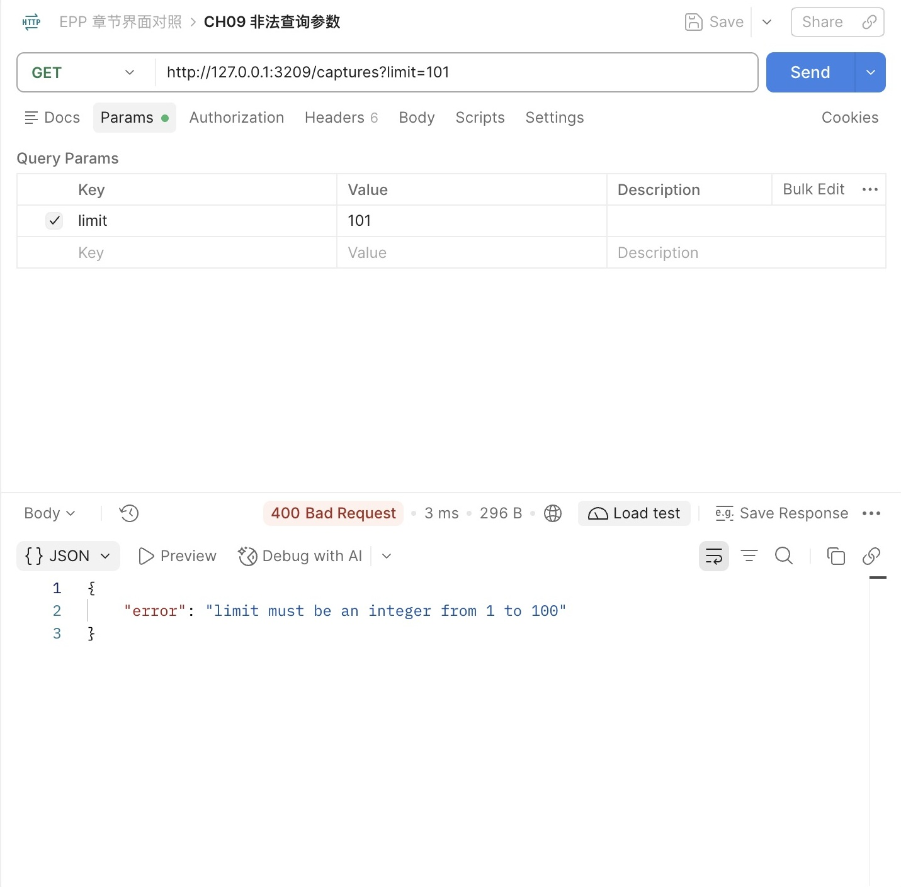

# 第 10 章 Provider 与依赖注入：把组件组装交给容器

第九章的记录服务还把数据存在 Map 里。后面接入数据库时，最直接的办法是打开 CapturesService，把 set、get 和遍历代码改成数据库调用。这个办法能工作；如果存储只换一次、业务也很少，直接修改可能就是成本最低的选择。

但沿着 create 方法看下去，会发现修改范围不只是那一行 set。原文必须先校验，写入成功才能返回，写入失败不能变成“创建成功”；列表还要保持原来的筛选与截取顺序。我们希望更换存储时保住这些判断，也希望单独观察“写入变慢、写入失败”时，能继续调用同一份业务逻辑。

这就给本章一个具体任务：找出 Service 真正需要存储提供什么，把这个位置做成可以替换的依赖，再让已有 Nest 应用继续使用它。先从现在的代码动手，等手动组装确实遇到问题，再引入容器的相应机制。

**阅读前提**：完成第八、九章。代码从 `part-02/chapter-09` 继续，本章完成状态为 `part-02/chapter-10`。沿用已有版本和依赖。

**本章完成后的变化**：业务仍然提供创建、列表和详情，HTTP 输入输出保持第九章约定；存储对象可以从外部提供，业务调用会等待读写完成。记录仍在内存中，没有数据库、迁移或回填，重启仍丢失。

阅读约 95～115 分钟，跟做另加约 65～85 分钟，合计约 160～200 分钟。支线另计。可分三次完成：先做到 10.1 的独立调用，再读 10.2 并做到 10.3 的慢写入对照，最后接着做接口核对与独立预览。

## 10.1 从手动组装对象到构造函数注入，解决真实出现的依赖问题

### 从 create 里找出真正要替换的那一步

第九章的 create 在检查原文后，生成了 capture，接着执行：

```typescript
this.captures.set(capture.id, capture);
return { ...capture };
```

若把整个 create 都交给一个“数据库版 Service”，新实现就得重新承担原文校验、ID 和时间生成。另一份实现很容易漏掉一条规则。当前真正想替换的是保存这个记录的动作，其余判断仍然需要保留。

先将这一步想成一个普通对象的方法：

```typescript
this.store.insert(capture);
return { ...capture };
```

这时还没有必要定义接口、选 Symbol 或写 Nest 配置。先看这个改动带来的结果：create 只把已经准备好的记录交出去，保存动作可以由另一个对象执行。记录怎么形成仍由 Service 决定，保存在哪里才交给存储对象。

查找详情也能按同样的理由分开。存储返回记录或“没有找到”；Service 决定没有找到是否构成这次业务调用的失败。存储本身发生故障时，不能返回 undefined 蒙混过去，否则调用方会收到错误的 404。这个区分来自详情接口的含义，不是从某个 Repository 模板复制出来的。

列表稍有不同。若只把 Map.values 搬出去，再让 Service 过滤所有记录，未来数据库仍得把全部行取回进程。第九章已经明确了 text、limit、大小写敏感匹配和先筛选再截取，可以把这些条件一起交给存储执行。Service 保留条件是否合法的检查，存储承担具体查询。这是我们选择 list(options)，而没有直接照抄 Map API 的原因。

到这里，存储对象需要的三个操作才有了依据：insert、find、list。尚未出现修改或删除需求，因此不用把一套完整 CRUD 接口提前搬进来。

不妨跟着一份有首尾空格的原文走一遍。接收请求时，我们只有调用者给的文字；一旦它通过校验，就有了一份带标识和创建时间的记录。保存动作的输入应选在哪一刻？若让存储只接收原文，每个实现都得决定怎样分配标识，写完再把新标识送回来。若把整个请求体交给存储，它连请求里哪一个字段算原文都要知道。这里选中间那份已经形成的记录：内存实现拿它的标识作键，创建方法用同一标识构造结果，以后由入口据此告诉调用者到哪里读取。这一选择也限定了接口的返回值。存储只需报告写入完成，业务已经持有要返回的字段。

反过来推一次有助于判断边界是否选对。假如产品要求创建时间一律取数据落库的时刻，应用提前填出的时间就不再权威。那时需要让保存动作返回实际生效的时间，创建响应也得从保存结果取值。把这种实现硬塞进今天的接口，即使写入没有报错，也可能出现创建页显示一个时间、随后详情页显示另一个时间。当前三个字段都由应用确定，读写双方才可以只约定“按给定内容完整插入”。先问谁有资格决定值，比先选一个听起来通用的存储接口更容易作出可维护的决定。

还有一条容易从列表消失的数据线索。页面搜不到刚才输入的句子，可能是写入时改变了原文，也可能是查询时改变了匹配规则。详情按标识读取，不经过文本匹配；用同一标识读回原文，就能把两个方向分开。若详情保住了空格和大小写，应检查条件怎样传入以及存储怎样选择记录；若详情里的文本已经变了，就回到输入检查和保存过程。保留两个职责不同的读取操作，也给了我们两个互相校验的观察位置。

### 分出一个对象之后，为什么还要把它传进来

可以先让 Service 自己创建存储：

```typescript
private readonly store = new MemoryCaptureStore();
```

这确实让代码有了分工。不过，一旦要观察写入失败，我们仍然得修改 Service 这一行；换成需要连接参数的实现，Service 还要负责准备连接参数。业务对象仍然掌握着具体实现的选择。

把创建动作移到调用方，问题就变得简单：

```typescript
const store = new MemoryCaptureStore();
const captures = new CapturesService(store);
```

Service 的构造函数只保存传入的对象。换实现时改的是这两行所在的组装位置；调用 create 的流程和原文规则可以继续复用。通过参数把需要的对象交给使用方，这个做法就是依赖注入。它在普通 JavaScript 里已经成立。

也可以传几个函数，而不是传一个对象；或者用闭包生成业务函数。当前存储的写入、查询都需要访问同一份状态，用一个对象把这些操作放在一起，比较容易看清共享关系。选择类是本项目的组织方式，依赖注入本身并不要求用类。

如果项目永远只使用这一个固定存储，Service 内部 new 也未必有问题。这里把创建移出来，是为了完成本章已经提出的替换与失败观察。ID 和时间目前不需要替换，不顺势把每一个函数都抽成 Provider。

手动组装还有一个方便之处：能画清楚究竟是谁拥有数据。给两个入口各建一个业务对象，但把同一个存储传两次。调用第一份业务对象创建后，记录进入存储字段指向的那张表；第二份业务对象通过自己的字段沿引用走，落到的仍是那张表。再单独构造第二份业务对象，这次给它传一个新建的空存储。两个业务对象各只有一个构造参数，变化的是第二次组装用哪个存储。类定义、方法源码、输入文字都相同，结果却会变化。决定可见性的分叉点是两次构造表达式的执行位置。编辑器的“转到定义”会把两处都带到同一份类源码，所以只核对文件路径看不出这个差别，还要看是谁执行了创建表达式。

为什么不用一个模块顶层变量把共享固定下来？对于只跑一次的命令，这也省事。可是一旦同一程序先跑一轮成功创建，再跑一轮空列表演示，第二轮就继承了第一轮的数据。为了得到可重复的结果，只好给存储添一个本来业务用不到的清空方法，还要约定清空发生的时机。此处把所有者交给入口，入口想延续第一轮就保留原对象，想从空状态出发就另建对象。两轮可以同时存在，谁也不必先销毁另一轮的状态。构造参数使这项决定在读程序入口时就能看出来。

### 写入变慢之后，原来的 return 还能表示成功吗

前面那两行替换还有一个漏洞。Map.set 当场完成；将来存储可能需要等待。如果 insert 返回 Promise，而 create 随即 return capture，HTTP 入口就有机会先宣布成功，写入却还没有完成。若稍后写入失败，已经发出的成功响应也无法收回。

因此 create 的完成条件应当改成：校验通过、记录形成，而且存储确认本次写入成功。代码中对应的是：

```typescript
await this.store.insert(capture);
return { ...capture };
```

find 要等到查找结果才能判断是否存在，list 要等到数组才能返回给调用者。我们因此让三个存储方法统一返回 Promise。当前内存实现执行得很快，仍然遵守这个约定；后面换成真正需要等待的实现，调用方不必再从“同步假设”迁移一次。

也可以暂时保留同步接口，到接数据库时再改。那会把等待责任的修改推迟到另一章。这里选择现在完成，是为了马上用慢写入和失败写入核对成功边界。代价是所有调用者都要正确等待；async 不会把 Map 操作搬到其他线程，也不会让查询自动变快。

这里的“完成”最好落到能回答用户的动作上。用户等到创建结果，马上按该标识查详情，在同一存储没有重启、也没有其他修改的条件下，应该能读回原文。在创建尚未完成时发出的另一笔列表查询，则没有这样的先后保证。前端即使先触发了创建按钮、后触发了刷新按钮，也可能在还没收到创建结果时就发起列表请求。要判断列表缺一行究竟是不是缺陷，先看刷新请求是在创建响应之前还是之后发出。只有后一种次序才真的检查到了我们刚才承诺的可读性。

同样要区分“已经分配了标识”和“已经保存”。在等待处暂停，局部变量里能看到完整的标识、时间和原文，甚至能在调试器里展开三个字段。这些值只说明业务准备好了输入，此时还不能发出带详情地址的成功响应。如果存储拒绝，等待表达式会把控制流转向错误处理，下面那次复制不会执行。对调用方来说，持有一个承诺对象仅意味着这次工作有了可等待的结果；拿到履行后的记录才满足刚才的先后要求。这也解释了为何接口返回空的成功值仍然有用：调用者关心写入是否完成，成功载荷可以为空。

### 现在再把已经推导出的约定写成类型

先把第九章已有的 Capture 和 CaptureListOptions 移到 `src/capture.ts`，字段不变。这两份模型接下来由业务和存储共同使用：

```typescript
export type Capture = {
  id: string;
  originalText: string;
  createdAt: string;
};

export type CaptureListOptions = {
  text?: string;
  limit?: number;
};
```

新增 `src/capture-store.ts`，此时只需要接口：

```typescript
import type { Capture, CaptureListOptions } from './capture.js';

export interface CaptureStore {
  insert(capture: Capture): Promise<void>;
  list(options: CaptureListOptions): Promise<Capture[]>;
  find(id: string): Promise<Capture | undefined>;
}
```

这个接口是在记录刚才得出的调用关系。它能阻止把缺少 find 的对象传进来，却不能阻止一个实现忽略 limit，或者什么也没保存就声称 insert 成功。类型没有把我们对操作含义的判断一并证明掉。

因此还要记住这次替换必须保住的行为：同 ID 的插入不能覆盖旧记录；找不到和查找失败分开；列表保持第九章的匹配与顺序；外部调用者不能通过修改对象引用改变内部记录。接下来实现内存存储时，这些条件都有对应代码。

新增 `src/memory-capture.store.ts`：

```typescript
import type { Capture, CaptureListOptions } from './capture.js';
import type { CaptureStore } from './capture-store.js';

export class MemoryCaptureStore implements CaptureStore {
  private readonly captures = new Map<string, Capture>();

  async insert(capture: Capture): Promise<void> {
    if (this.captures.has(capture.id)) throw new Error('Capture ID already exists');
    this.captures.set(capture.id, { ...capture });
  }

  async list({ text, limit }: CaptureListOptions): Promise<Capture[]> {
    const items: Capture[] = [];
    for (const capture of this.captures.values()) {
      if (text !== undefined && !capture.originalText.includes(text)) continue;
      items.push({ ...capture });
      if (limit !== undefined && items.length === limit) break;
    }
    return items;
  }

  async find(id: string): Promise<Capture | undefined> {
    const capture = this.captures.get(id);
    return capture === undefined ? undefined : { ...capture };
  }
}
```

写入前检查重复 ID，是为了让“插入一条记录”不会悄悄变成覆盖。写入和读取都复制对象，是为了隔开调用者与内部 Map 的引用；当前字段只有字符串，浅复制满足这里的要求。

过滤依然先于截取，所以前两条不匹配、第三条才匹配时，limit=1 仍会得到第三条。循环提前结束可以减少部分查询工作，但没有匹配项时仍要遍历所有记录。这份实现兑现的是本章的查询含义，不是大数据量下的性能方案。

把内存中的引用也按写入方向和读取方向分开看。假设直接对存储插入一份记录，插入后调用者又拿原对象试改显示文案。若写入时只保存原对象，连更新方法都没有的存储也会跟着改变。反过来，写入时复制过，查找时却直接把内部对象递出来，详情预览在本地试改文案仍会改到原件。列表只是把同一批内部对象装进一个新数组，也有相同问题；复制数组只能隔开增删数组元素，隔不开修改元素属性。三个方法里的复制分别保护不同的进出口。当前每个属性都是字符串，复制后的属性值足以独立；日后若加入可编辑的标签数组，就需要重新决定嵌套数据的所有权。

在调试器里可以借一对容易混淆的结果理解这个设计。两次按同一标识读详情，各自的对象引用可以不相等，却必须有相同的字段值。反过来，两次直接读取同一个存储依赖，期望共享状态时比较的恰恰是引用是否相等。对于记录，我们希望身份由标识延续，让调用者能自由处理副本；对于管理记录的对象，我们希望两条访问路径真的通向同一份状态。若给所有东西都套同一个“比较对象是否相等”的判断，明明保护了原文的复制反而会被误诊为丢失记录。

随后替换 `src/captures.service.ts`。看这一份文件时，沿三个刚才作出的决定读即可：存储从构造参数进入；业务校验留在操作里；需要结果或后续动作的地方等待存储完成。

```typescript
import { randomUUID } from 'node:crypto';
import type { Capture, CaptureListOptions } from './capture.js';
import type { CaptureStore } from './capture-store.js';

export class InvalidCaptureError extends Error {}
export class CaptureNotFoundError extends Error {}

export class CapturesService {
  constructor(private readonly store: CaptureStore) {}

  async create(originalText: unknown): Promise<Capture> {
    if (typeof originalText !== 'string' || !originalText.trim()) {
      throw new InvalidCaptureError('originalText must be a non-empty string');
    }
    if (originalText.length > 2000) {
      throw new InvalidCaptureError('originalText must be at most 2000 code units');
    }
    const capture: Capture = {
      id: randomUUID(),
      originalText,
      createdAt: new Date().toISOString(),
    };
    await this.store.insert(capture);
    return { ...capture };
  }

  async list({ text, limit }: CaptureListOptions = {}): Promise<Capture[]> {
    if (text !== undefined &&
        (typeof text !== 'string' || !text.trim() || text.length > 200)) {
      throw new InvalidCaptureError('text must be a non-empty string of at most 200 code units');
    }
    if (limit !== undefined &&
        (!Number.isInteger(limit) || limit < 1 || limit > 100)) {
      throw new InvalidCaptureError('limit must be an integer from 1 to 100');
    }
    return this.store.list({ text, limit });
  }

  async find(id: string): Promise<Capture> {
    const capture = await this.store.find(id);
    if (!capture) throw new CaptureNotFoundError('Capture not found');
    return { ...capture };
  }
}
```

list 直接返回存储的 Promise，因为这里没有本地错误转换，也没有依赖结果的后续动作。create 要在写完后返回记录，find 要在读完后判断不存在，因此它们先 await。返回 Promise 和等待后继续执行，各自对应当前方法的责任。

### 先不启动 Nest，直接替换一次存储行为

这几个文件都不依赖 Nest 装饰器。即使 Controller 和模块尚未接好，也能用第六章已有的 tsx 独立运行它们。在项目根目录执行：

```bash
node --import=tsx --input-type=module <<'JS'
import { CapturesService } from './src/captures.service.ts';
import { MemoryCaptureStore } from './src/memory-capture.store.ts';
const store = new MemoryCaptureStore();
const captures = new CapturesService(store);
const record = await captures.create('I drink coffee.');
console.log((await captures.find(record.id)).originalText);
console.log((await new CapturesService(store).list()).length);
console.log((await new CapturesService(new MemoryCaptureStore()).list()).length);
JS
```

应依次得到原文、1 和 0。第二个 Service 使用同一存储，读到了记录；第三个 Service 使用新存储，没有记录。状态现在由存储实例承载，而不是由 Service 的数量决定。以后遇到写入后查不到，可以据此先检查创建与查询拿到的是否为同一份存储。

再把一次写入临时换成失败。下面只创建独立业务对象，不改变应用配置：

```bash
node --import=tsx --input-type=module <<'JS'
import { CapturesService } from './src/captures.service.ts';
let writes = 0;
const store = {
  async insert() { writes++; throw new Error('storage unavailable'); },
  async list() { return []; },
  async find() { return undefined; },
};
const captures = new CapturesService(store);
for (const text of ['   ', 'I drink coffee.']) {
  try { await captures.create(text); }
  catch (error) { console.log(error.message); }
}
console.log('write attempts:', writes);
JS
```

第一条输入仍被原文规则拒绝，第二条才到达写入，所以 writes 应为 1；第二次调用报告存储失败，没有返回成功记录。我们没有复制校验代码，也没有修改 CapturesService 来制造故障。把存储传进来，到这里已经解决了一个能直接观察的问题。

读这两个错误时，注意计数放在什么地方。它放在存储方法的入口，因此数的是业务多少次把记录交给存储。即使执行了一次，真正保存的行数仍可以是零。把计数移到循环外层的调用处，两次输入都会被算作尝试，便失去了区分拒绝位置的能力。只看最后一个总数也不够：如果错误地放过空白却拒绝了正常文本，计数碰巧也是一。把每次错误的含义和对应输入一起看，才知道第一道检查是否放在写入之前。

换一个需要自己作判断的条件：用户连录两次完全相同的句子。当前语义允许独立创建两笔，重复约束针对标识，检查原文内容去重反而会破坏这个行为。在上面第一个独立程序里保留原存储，再创建一次同样的文字，用两个返回标识分别查找。只看列表中的文本，两行像是意外重复；用两个标识核对，每行都对应各自那次创建。如果要检查存储拒绝的是哪种重复，就直接给同一个存储传两份同标识、不同原文的记录，等待第二次插入并捕获拒绝，然后查回第一次的原文。走业务创建不会指定已有标识，适合检验前一种情况；直接调用存储才能有意构成后一种输入。

这里可以暂停，但要记住目前只完成了业务与存储的拆分：原 AppModule 还没有提供构造参数，Controller 也还按同步结果使用这些方法，`capture-query.ts` 的类型导入尚未迁移。独立程序能运行，不代表 HTTP 应用已经接好；此时开发编译报错并停服是待接线的结果。下次从 10.2 继续，到 10.3 更新模块、类型导入和 Controller 后，再检查完整应用，不用可选参数或类型断言把这些遗漏掩盖过去。

## 10.2 Provider、注入令牌，以及类、工厂、值 Provider 的选择

### 手动调用正常，放回 Nest 为什么还缺一步

刚才是我们亲手调用 `new CapturesService(store)`。第九章的 AppModule 却仍写着 `providers: [CapturesService]`，它并没有收到这个 store，也不知道应如何获得它。

尤其当前 Service 保持普通 TypeScript 类，没有构造参数装饰器或可供 Nest 读取的类型元数据。容器可能按空参数创建它，应用先启动，等调用 insert 时才暴露 store 为 undefined。构造函数的 TypeScript 参数要求不会自动变成容器的组装程序。第八章无需构造参数时能用的注册方式，现在已有新的前提。

最直接的接法，是把刚才手动创建的对象交给 Nest。下面是 AppModule 的 providers 替代片段，用来比较组装方式，先不与后面的最终配置混用：

```typescript
providers: [
  {
    provide: CapturesService,
    useValue: new CapturesService(new MemoryCaptureStore()),
  },
]
```

Controller 仍然声明需要 CapturesService，Nest 查到这份登记后，直接把现成对象交给它。provide 表示“用什么键找”，useValue 表示“找到后给出这个值”。这样一份提供依赖的登记，就是 Provider。

对于简单固定应用，这已经可以工作。没有必要因为还没用工厂或 Symbol，就认定它不规范。它的限制也很具体：这次 new 在模块文件求值时发生，同一进程中若创建多个应用容器，可能都收到这份外部对象；存储的创建还嵌在 Service 的创建表达式里，不便让其他消费者复用同一份已登记的存储。

把这份登记从左向右读，恰好能看清两类“相同”。左边的类是一个运行时值，Controller 参数元数据里也保存了这个类，因此能按它找到登记。右边表达式的结果是已经造好的业务对象。容器把这个对象传进 Controller 构造函数后，一笔请求调用的是普通对象的方法。它无需在每次请求里重新解释左边的类，更不会扫描所有已加载的类去猜哪个有同名的创建方法。以后在业务断点看到同一个对象连续被调用多次，是组装产生了可复用的引用，并非容器在每次请求里重新执行了模块文件。

这对开发预览有实际影响。设想一个进程里先后启动两个独立应用上下文，两边都加载同一个已经求值的模块。若把有状态的值直接写进模块元数据，第一边录入一笔后，即使把第一边的上下文关闭，再启动第二边，也可能沿外部保留的引用读到那一笔。若改成两个独立的操作系统进程，即使启动同一份文件，两边也会分别执行创建表达式。于是“重建应用”和“重启进程”在这种配置下有不同结果。排查预览数据串到下一轮时，先弄清代码究竟在哪一层重建了对象，不能只看界面上点的按钮都叫重启。

### 让应用组装时再创建，而不是提前准备对象

如果希望每个应用容器负责创建自己的业务对象，可以把“已创建的值”换成“创建它的函数”：

```typescript
{
  provide: CapturesService,
  useFactory: () => new CapturesService(new MemoryCaptureStore()),
}
```

这就是 useFactory。它的必要性来自创建时机和依赖关系，不来自“工厂模式更高级”。当前这个函数已经把创建动作推迟到容器组装时；但存储仍然由它内部创建。若另一个消费者也要用同一存储，不能在另一个工厂里再 new 一次，否则得到的是另一份 Map。

因此下一步才是单独登记存储，再把容器已有的存储传给 Service 工厂：

```typescript
providers: [
  MemoryCaptureStore,
  {
    provide: CapturesService,
    useFactory: (store: CaptureStore) => new CapturesService(store),
    inject: [MemoryCaptureStore],
  },
]
```

MemoryCaptureStore 这个类登记负责创建存储；inject 声明工厂要哪份依赖。Nest 解析这项登记，把对象作为第一个参数传入工厂。若再增加第二个依赖，inject 的第二项对应第二个实参；参数名字不参与匹配。

类名简写也可以展开成 `{ provide: MemoryCaptureStore, useClass: MemoryCaptureStore }`。useClass 描述由哪个构造函数创建对象。当前类没有构造依赖，容器可以直接创建；有依赖的类仍需要明确的参数描述。

手动写法中的“先创建存储，再传给 Service”并没有消失，只是被这两条登记表达出来。依赖先后由 inject 决定，不能拿 providers 数组排列顺序代替。工厂若要先完成异步准备，可以返回 Promise；依赖该工厂结果的消费者需要等它成功，失败就应沿初始化过程暴露。支线会实际改变这一步观察结果。

可以把模块文件当成一份尚未执行的组装说明，逐项还原这次创建。先看入口在找哪个值，顺着 Controller 找到业务类，再读该类的登记，发现它有一个工厂参数，于是回头解析存储。等存储对象可用，容器才有实参可调用业务工厂；工厂的返回值最终进入 Controller。阅读时从消费者追到来源，建好后沿反方向把实物逐个交回去。如果在编辑器里从上往下只找第一个出现的类名，很容易把“在当前文件被导入”“已经登记成键”“已经创建对象”三件事混为一谈。导入仅使文件可以引用这个类，一个类同时被导入和写进类型注解，也未必有任何实例参与运行。

工厂参数旁的类型标注能让编写者看到哪些方法可用，却不会逐项核实模块配置传进来的值。举例说，将来若给工厂增加一个只读配置参数，调换注入数组两项但保留函数声明，形参名依旧叫存储和配置，运行时收到的却是相反的值。如果构造函数只是把实参记在字段里，它甚至可以顺利返回，等第一次调用查询方法才抱怨对象上没有这个方法。遇到这种现象，应先看工厂被调用时两个实参分别有什么成员，再看返回的业务对象；在业务方法内部加一个空列表兜底只会让配置错误变成看似正常的无数据响应。

再看异步准备发生在哪一层。若工厂要准备一份带初始记录的存储，返回前应等待那笔初始写入，依赖它的读取者拿到对象时才可以假定这条记录可读。若工厂只是发起写入就返回对象，容器依赖解析已经结束，但对象的内容可能尚未就绪。把工厂标成异步函数并不能自动接管没有被等待或返回的工作。和创建接口的道理相通，只是这里承诺的对象变了：一次是在每次业务调用完成后交出记录，另一次是在组装完成时交出可使用的依赖。主线的内存表从空状态就可以工作，所以它的构造过程无需做异步准备。

### 存储换掉时，容器到底应该按什么找

上面的配置仍然可用，但 inject 中出现了 MemoryCaptureStore 这个具体名字。后面提供数据库实现时，可以逐个修改相关消费者的注入配置；也可以继续用 MemoryCaptureStore 作键、把它的 useClass 改成数据库类。后一种在技术上成立，但“用内存类这个名字取得数据库对象”会让配置越来越难读。

我们想表达的是“这里需要记录存储”，而不是“这里必须使用内存类”。TypeScript 已有 CaptureStore 接口，可它在编译后被擦除，不能直接写进运行时 inject 数组。`implements CaptureStore` 也不会告诉容器该选哪个实现。

因此在 `src/capture-store.ts` 的导入之后，新增一个运行时的查找键：

```typescript
export const CAPTURE_STORE = Symbol('CAPTURE_STORE');
```

这个键称为注入令牌。Symbol 不是依赖注入唯一允许的形式，字符串或类值也可以；这里采用单独导出的 Symbol，是为了把存储能力的名字与具体实现分开。所有位置导入同一个值，避免使用方各自创建同描述但不同身份的 Symbol。

对应注册就成为：

```typescript
{ provide: CAPTURE_STORE, useClass: MemoryCaptureStore }
```

Service 工厂中的 inject 改为 `[CAPTURE_STORE]`。这样替换存储时，改的是令牌后面的实现选择；消费者仍表达同一项能力需求。当前只有一个消费者，维护上的节省很小，主要价值是让这个已确定会变化的位置保持明确；这不能推导出所有类都必须额外配一个 Symbol。

可以在 VS Code 里各做一次“查找所有引用”。查接口名会看到存储实现、工厂参数、业务构造参数，这回答“哪些地方按这种形状写代码”；查导出的令牌常量则会看到登记与请求这项依赖的位置，这回答“运行时从哪里取得值”。两组结果本来就不必一致。比如手动组装程序直接把对象传给业务，完全用不到令牌；模块文件需要令牌，即使其中没有一行真正操作记录。看到业务类只导入接口类型、连常量都没有引用，正说明具体的查找工作已交给组装入口。

还可以用一个最小判断区分两类改名。只给导入的常量取一个本地别名，变量拼写虽变，里面仍是原值，查找会成功。若另写一次创建符号的表达式，把描述文字逐字复制，日志中显示的名称相同，两端拿到的值却不同。此时改描述文字、移动登记次序、给内存类补一个同名方法都解决不了问题。在编辑器里分别从登记和注入的变量跳到定义，两处应追到同一条导出声明。类作键也有相似要求，构造函数的显示名称只是提示，真正参与查找的是那个运行时值。

### 如果已有对象，换个名字会不会又创建一份

还有一种容易写错的情况：已经登记了 MemoryCaptureStore，又为了提供 CAPTURE_STORE 添加一条 useClass。两条登记各自创建对象，可能一份有记录，另一份为空。不是容器丢了数据，而是我们要求它创建了两份状态。

若需求是“已有存储再增加一个查找名字”，应当写：

```typescript
providers: [
  MemoryCaptureStore,
  { provide: CAPTURE_STORE, useExisting: MemoryCaptureStore },
]
```

useExisting 指向已有登记，在这里复用相同默认作用域实例。反过来，若确实要两份独立状态，分别 useClass 就是合理选择。主线没有其他地方需要按具体类获取存储，所以直接登记一次 CAPTURE_STORE 即可，不额外添加别名。两种配置的实际对象比较放在支线 10A 中。

为什么有时虽然错误地登记了两份，手工点遍接口却一切正常？本章的创建和列表都经过同一个业务工厂。只要这个工厂始终拿符号这一侧的存储，三个接口就都落在同一张表。另一份按类登记的存储即使一直空着，也不会从这些响应里露出破绽。真正出现分歧的是另一个入口开始按类取存储，例如启动时的准备程序在类这一侧写入一条，业务却从符号这一侧找。两条路径各自工作，连写入次数也都对得上，合起来才显出记录不可见。定位时先确定哪条路径负责写、哪条路径负责读，再问它们最终落在哪一项登记上。

支线里的准备程序提供了一个有区分力的结果。它按符号取存储写入初始行，读取者也按符号取值。若符号和类各自建表，按符号读有一行，按类读有零行；若符号只是类登记的别名，两边都应有一行。不过仅凭两边计数相等还不能反推共享：两份分别装入相同数据的表也可能同时有一行。在单一应用上下文里直接比较取得的两个对象是否严格相等，再从一边写、到另一边按标识读，前者回答引用身份，后者回答业务后果。只有观察手段与问题相配，才知道修正别名到底修了什么。

### 把依赖写在类上，也是另一种可以选择的组织方式

目前工厂已经把需要的参数表达完整。若项目更希望在类附近维护依赖声明，也可以让 Service 使用 Nest 装饰器：

```typescript
@Injectable()
export class CapturesService {
  constructor(@Inject(CAPTURE_STORE) private readonly store: CaptureStore) {}
  // 保留前面已经实现的业务方法。
}
```

这种替代写法需要从 `@nestjs/common` 导入 Injectable、Inject，从存储文件导入令牌值和接口类型；随后 providers 直接登记 Service 类，不再保留它的工厂。Inject 提供运行时令牌，接口负责静态类型，两者各有工作。

好处是依赖描述紧挨着消费者，代价是业务文件引入 Nest。本章沿用普通 TypeScript 业务类，所以继续用工厂。两种写法都能手动 new，也都可以被正确组装；这里没有为了证明某个 API 必须采用而贬低另一个可行方案。

两个组织方式可以用同一项改动来比较维护代价。若下次新增一个必须传入的构造参数，在显式工厂里，编译器能在手写的构造表达式处发现实参数量不足。补齐这个表达式之后，还得让注入数组给工厂提供相应的运行时值。在装饰器方案里，业务类本身声明这个参数的令牌，模块可以少写一次位置对应，但仍须为新令牌登记来源。任何一种都没有代替参数本身的行为检查；一个名字登记成功，只能说明容器可以交出某个值。

本节读到这里，主线需要真正保存在文件里的新增内容只有存储令牌；前面的值、类简写、别名以及带装饰器的业务类都是在比较同一个位置怎么写。下节给出完整模块时，从 Controller 需要的类键开始，用手指依次指到对应工厂、工厂的注入项、该项对应的类登记，最后在内存类里找到真正拥有状态的字段。能连续指出这几处，比记住四个配置属性的名称更接近实际维护：换掉其中一项之后，你会知道应该从哪个方向检查受影响的消费者。

## 10.3 将内存存储放在可替换接口后面，为数据库接入留下边界

### 接回当前应用

现在完整替换 `src/app.module.ts`：

```typescript
import { Module } from '@nestjs/common';
import { CapturesController } from './captures.controller.js';
import { CapturesService } from './captures.service.js';
import { CAPTURE_STORE } from './capture-store.js';
import type { CaptureStore } from './capture-store.js';
import { MemoryCaptureStore } from './memory-capture.store.js';

@Module({
  controllers: [CapturesController],
  providers: [
    { provide: CAPTURE_STORE, useClass: MemoryCaptureStore },
    {
      provide: CapturesService,
      useFactory: (store: CaptureStore) => new CapturesService(store),
      inject: [CAPTURE_STORE],
    },
  ],
})
export class AppModule {}
```

Nest 仍然通过 Controller 的构造参数元数据查找 CapturesService；查到的注册已经从类简写改成工厂。工厂需要的 CAPTURE_STORE 再由 useClass 提供。类令牌与 Symbol 令牌可以出现在同一条依赖链中，不要求整个应用统一用一种令牌。

本章所有提供者仍在同一个模块里。为什么另一个模块不能随意注入它们，imports、exports 如何约束可见性，下一章会通过拆分真实业务模块展开。当前先不增加跨模块配置，避免把一个令牌不存在和一个令牌不可见混在同一轮改造里。

还需要把 `src/capture-query.ts` 中 CaptureListOptions 的类型导入改到 `./capture.js`。它只调整类型来源，查询字符串解析和错误规则保持不变。

最后替换 `src/captures.controller.ts`，把异步结果的完成责任接到底：

```typescript
import { Body, Controller, Get, Param, Post, Query, Res } from '@nestjs/common';
import type { Response } from 'express';
import { CapturesService } from './captures.service.js';
import { parseListQuery } from './capture-query.js';
import { HttpError, httpResult } from './http.js';

@Controller('captures')
export class CapturesController {
  constructor(private readonly captures: CapturesService) {}

  @Get()
  list(@Query('q') q: unknown, @Query('limit') limit: unknown) {
    return httpResult(async () => ({
      items: await this.captures.list(parseListQuery(q, limit)),
    }));
  }

  @Post()
  create(@Body() body: unknown, @Res({ passthrough: true }) response: Response) {
    return httpResult(async () => {
      if (body === null || typeof body !== 'object' || Array.isArray(body)) {
        throw new HttpError(400, 'Request body must be a JSON object');
      }
      const capture = await this.captures.create(
        'originalText' in body ? body.originalText : undefined,
      );
      response.setHeader('Location', `/captures/${capture.id}`);
      return capture;
    });
  }

  @Get(':id')
  detail(@Param('id') id: string) {
    return httpResult(() => this.captures.find(id));
  }
}
```

列表的回调现在是 async，先等待 list 得到数组，再包装 items。创建先等待 create 完成，才读 capture.id、设置 Location 并返回。详情已经直接返回 find 的结果，由 httpResult 等待和转换失败，不需要再包一层相同的 async。

只把存储类型改成 Promise，却漏掉这些调用者，会出现两类问题：把 Promise 塞到 items 里返回，或者从 Promise 对象上读不到 id。Nest 会等待 Controller 返回的 Promise，但不会递归等待任意对象字段。第九章提到的边界，现在成为这次真实改造的一部分。

对照三条路由，等待的具体位置可以由下一步需要什么来推出。列表需要把数组放进对象的一个字段。只把回调标成异步并返回那个对象，外层承诺履行时给出的仍可能是一份内部含承诺的对象；常规 JSON 序列化不会为这个字段订阅完成通知，页面也就拿不到能遍历的数组。详情则把业务承诺直接作为回调的整个结果交出，外层接手等待就够了。创建比详情多了一件必须用结果才能做的事，即从记录读取标识写响应头，所以不能简单照搬详情那一行。以后遇到类似改造，可以逐个圈出需要读取属性、判断结果、组装字段的地方，那些地方通常就是同步假设留下的痕迹。

再在编辑器里打开已有的 `src/http.ts`，看包住回调的那层错误处理。详情查无此行时，业务异步方法会以“记录不存在”的错误拒绝。此时调用回调本身已经返回了承诺，如果只在同步调用外面套捕获，稍晚发生的拒绝可能越过本层。这里在保护范围内等待回调，才能把该业务错误映射成带状态的异常。存储若因故无法查询，也沿同一路径拒绝，但没有被标为记录不存在，最终走内部错误的分支。直接把存储错误全部捕获后返回空值会丢掉这个差异。由此可见，即使后面没有别的计算，有时仍需在本层等待，理由可以是要在这里接住拒绝并分类。

从接口调用方倒推，空列表、详情不存在和服务内部失败分别意味着不同的下一步。列表响应带空数组，表示用给定条件完成了查询，页面可以展示没有匹配项。详情报告找不到，表示这次按指定标识读取没有对象，页面可以核对标识或回到列表。内部失败则不足以推断这条记录已经消失。若为了让预览页面好看，把第三种情况也显示为没有素材，后来即使存储恢复，用户也很难解释为什么“消失”的数据又回来了。保留错误的来源，让展示层有条件作出合适的判断，也是存储边界需要兑现的行为。

### 让存储真的慢一次，再看成功在什么时候发生

10.1 已用失败写入检查规则。现在 Controller 也已等待业务结果，可以进一步观察“拿到 Promise”和“写入完成”的先后。新增 `examples/storage-completion.mjs`：

```javascript
import { setTimeout as delay } from 'node:timers/promises';
import { CapturesService } from '../dist/src/captures.service.js';
import { MemoryCaptureStore } from '../dist/src/memory-capture.store.js';

const mode = process.argv[2] ?? 'slow';
if (!['slow', 'fail'].includes(mode)) throw new Error('Use slow or fail');
const memory = new MemoryCaptureStore();
const store = {
  async insert(capture) {
    console.log('write started');
    await delay(20);
    if (mode === 'fail') throw new Error('write failed');
    await memory.insert(capture);
    console.log('write finished');
  },
  list: (options) => memory.list(options),
  find: (id) => memory.find(id),
};
const captures = new CapturesService(store);
const pending = captures.create('I want to keep this sentence.');
console.log('caller has a Promise, not a saved record');
try {
  await pending;
  console.log('creation succeeded');
} catch (error) {
  console.log('creation failed:', error.message);
}
console.log('stored count:', (await memory.list({})).length);
```

到这里，主线文件已经接好。先检查并构建，再分别运行：

```bash
npm run typecheck
npm run build
node examples/storage-completion.mjs slow
node examples/storage-completion.mjs fail
```

slow 模式先打印 write started，再打印调用者拿到 Promise；20 ms 的等待结束后才出现 write finished 和 creation succeeded，记录数为 1。fail 模式同样先开始写入，但随后进入 creation failed，记录数为 0，没有成功输出。20 ms 只是让等待发生，不把这个数值当成数据库延迟模型。

这里替换的是存储的执行条件，create 的实现没有改变。保住了“写完才成功”之后，Controller 再等待 create，成功响应才能对应同一完成条件。若只在某一层写 async，却把下面尚未完成的工作抛在身后，这条保证就会断掉。

按代码中的观察位置再解释一遍慢写入的输出。调用业务方法时，异步函数会先执行到需要等待的地方，因此写入开始这条消息反而先于调用者手里的承诺提示。此刻创建方法的局部变量和包装层 insert 的形参都指向那条记录，底层 Map 仍为空。只有内层延时结束、成功分支调用 memory.insert，它才会写进表里。成功模式里的写入结束消息放在内存插入完成之后，创建成功消息又放在等待业务结果之后。输出次序对应三段程序之间传递完成结果的方向，不依赖计时器是否恰好在指定毫秒数上唤醒。用断点观察时停了几分钟，也不应因此把计时差值解释成存储性能。

失败模式还有一个精确的限定：它把错误放在写内存之前，因而可以预测最后的计数为零。若在推理中把抛错的位置挪到写内存之后，同样会得到一次业务拒绝，表里却已有一行。等待能保证上层尊重下层报告的完成或失败，不能替下面已经发生的副作用做撤销。这也说明为什么不能看到一次创建报错就自动再发一笔；两次业务创建会分配两个标识。当前实验用一个确定的故障点说明什么情况下确实没有写入，其他存储若存在结果不明确的情形，需要看它自己的写入保证，再决定如何处理。

### 组装成功不等于数据永久保存

当前两个 Provider 都使用默认作用域。对于这份单模块注册，同一个应用容器中的消费者会复用该存储实例。它解决的是“同一次应用运行里使用哪一份对象”，并没有让 Map 获得持久性，也没有让另一个进程共享这份内存。

不要为了“每个请求独立”把 Map 存储改成 request scope：创建和后续读取是两个请求，如果它们各拿到一个新 Map，后一次自然读不到前一次。也不要在默认共享的 Service 字段里保存 currentUser 或某次请求的临时输入；两个异步请求可以在 await 之间交错，单线程不意味着请求互不重叠。

scope 要回答的是这份对象应该由谁共享、活多久；账号数据隔离则需要身份和查询条件，不能用“给每个用户一个 Service”替代。支线 10B 用有限上下文解释默认、request 和 transient 的差异，本章主线继续使用默认作用域。

将共享问题放到两笔请求之间看会更具体。假如有人想给日志附上“正在处理的原文”，把它放进默认业务对象的一个字段。第一笔设置字段后去等写入，第二笔在此期间把同一字段改成自己的原文。第一笔恢复执行时，如果从字段读出原文写日志，就可能把第二笔的文字记到第一笔名下；就算最终列表两条记录都正确，日志也已经误导排查。主线用方法局部的记录跨越等待，第一笔恢复时仍然持有第一笔自己的标识和文字。需要共享的是存储，按次变化的是这次创建的输入，两者在同一个方法里相遇，却需要不同的保存位置。

### 用既有入口确认替换位置没有改变业务

运行：

```bash
npm run typecheck
npm run dev
```

继续使用 Postman 已保存的集合；从本章代码开始时导入 `requests/epp.postman_collection.json`，确认 `baseUrl` 指向开发进程。把“创建原文”的 raw JSON 改成下面的带空格原文，发送后将返回的 id 填入集合变量 `captureId`。接着发送列表与详情；复制列表请求，在 Params 中填入 `q=coffee`、`limit=1`，再复制一份只把 limit 改成 101。创建请求也保留一份只含空白原文的副本。下面的 curl 是这些输入的等效表示，按需用于终端复现：

```bash
curl -i http://127.0.0.1:3000/captures \
  -H 'Content-Type: application/json' \
  --data '{"originalText":"  I drink coffee.  "}'
curl -i http://127.0.0.1:3000/captures
curl -i 'http://127.0.0.1:3000/captures?q=coffee&limit=1'
curl -i 'http://127.0.0.1:3000/captures?limit=101'
curl -i http://127.0.0.1:3000/captures \
  -H 'Content-Type: application/json' --data '{"originalText":"   "}'
```

创建仍为 201，Location 指向实际 ID，原文空格保持。复制该路径请求详情，应得到相同记录；列表和筛选看到新写入，两个错误输入仍是 400，且没有新增记录。最后重启进程再查询，记录消失，说明更换组织方式没有改变当前存储寿命。不是“抽象以后数据丢了”，而是内存实现一直没有持久化。



Params 发送的是文本 101，错误说明指出允许范围 1～100。Provider 重组没有改变这条输入规则；这张响应图不能证明存储对象是否共享，后面还要用断点检查实际实例与调用顺序。端口以当前监听地址为准。

要沿源码核对等待责任，连接 `EPP: attach to npm run dev`，在 `MemoryCaptureStore.insert` 的 `captures.set` 和 Controller 的 `response.setHeader` 两处断下。发送一次合法创建：先到写入，再到 Location；到第二处时，capture 已是记录而非 Promise。保存源码触发重启后，等调试器重连并重新创建数据。这一观察把容器组装正确与调用完成正确分开，前面的慢写入程序则专门验证真实等待发生时的顺序。

如果启动报告无法解析 CapturesService 工厂的依赖，先沿组装链核对：注册里是否有 CAPTURE_STORE，inject 是否引用同一 Symbol。还有一种不同的失败：误删工厂、把没有构造参数元数据的普通 Service 改回类简写，容器可能按空参数创建它，直到第一次调用才发现 store 为 undefined；不能假设所有组装遗漏都会在启动阶段自动暴露。若服务启动正常但查询为空，检查是否重复注册出两份存储，再核对业务条件。缺少依赖是组装问题，不应通过给字段加可选标记、在调用点判空后返回空数组来掩盖。

读筛选结果时，单条咖啡原文还不能分辨筛选与截取的次序。想用普通请求判断实际次序，先取消刚才的两个断点，在开发终端停止并重新启动本次练习服务。等监听提示出现，用 Postman 发送无条件列表请求，确认得到空数组；依次创建三条便于认出的原文，分别是 `Tea today.`、`Coffee today.`、`coffee tomorrow.`，每次等创建成功再发下一笔。最后一条的返回标识留下备用。先在 Postman 的 Params 里只启用小写的 `q=coffee`，再启用 `limit=1`。两次都应读到第三条的标识。若先截第一条才做匹配，就会得到空数组；若擅自把大小写抹平，带限制的结果会变成第二条。现在一个有区分力的样本就能把两种看起来同样像“搜索不对”的改动分开。

再只取消勾选搜索词，保留限制，结果应当回到第一条。取消参数与保留参数但清空它的值是两种输入：前者允许读取全部记录再限量，后者把空文本交给业务检查，会被拒绝。在请求地址预览里先确认是否还有该查询键，再判断空列表到底是无匹配还是根本没能完成查询。若所有结果都对不上，先用无筛选列表取回三条原文和标识，对照插入顺序，并核对进程启动信息；断点暂停、自动重启、复制请求时仍保留上一次的参数，都能改变观察前提。

图中的范围错误也可以拿来找实际作出决定的那一行。先让 VS Code 连接到重启后的开发子进程，在 parseListQuery 检查通过后的 return 行、MemoryCaptureStore.list 遍历记录的循环行各设一个断点。先发 `limit=1`，应依次命中两处；每次都点「继续」，等 Postman 收到响应。这笔正常请求确认调试器确实连到了处理请求的实例。然后取消勾选搜索词，把限制值依次换成十进制文本 `01` 和 `101`，分别发送。前者在解析查询文本时就不符合本章接受的写法，后者能转换成数字，随后才被业务的上界检查拒绝。两次都应得到 400，但错误正文不同。发送 `01` 后应直接收到错误；发送 `101` 时会停在解析函数返回处，点继续才会收到业务错误。两笔都不会进入存储遍历。观察完取消这两个断点。若只把状态码写在联调记录里，下一次业务调整上界时就可能误改解析文本的规则。把进入哪层、交出的值是什么、是否真的遍历了记录写清楚，修正就可以只发生在拥有这项规则的位置。

### 同时维护以前能运行的入口

构造函数和返回类型改变后，本章继续使用的手动组装与元数据示例也是消费者，需要与 HTTP 服务一起更新。将 `examples/manual-composition.mjs` 更新为：

```javascript
import { CapturesService } from '../dist/src/captures.service.js';
import { MemoryCaptureStore } from '../dist/src/memory-capture.store.js';

function makeEntry(captures) {
  return {
    record: (text) => captures.create(text),
    list: () => captures.list(),
  };
}

const store = new MemoryCaptureStore();
const shared = new CapturesService(store);
const firstEntry = makeEntry(shared);
const secondEntry = makeEntry(shared);
await firstEntry.record('I want to explain this clearly.');
console.log('shared entry count:', (await secondEntry.list()).length);
console.log('another service, same store:',
  (await new CapturesService(store).list()).length);

const isolatedEntry = makeEntry(new CapturesService(new MemoryCaptureStore()));
console.log('isolated entry count:', (await isolatedEntry.list()).length);
```

三个计数依次为 1、1、0，与 10.1 中的源文件调用对照一致。nest-metadata 示例也要显式传入 MemoryCaptureStore，并等待 create、find 和 list。Controller 的构造令牌仍是 CapturesService，因此原有元数据观察不变；只有业务组装与调用改为本章形式。

从第九章接着写时，可以在编辑器中打开旧的元数据示例，保留读取构造类型以及比较类值的两行输出。找到第一次创建业务对象的位置，导入和上例相同的内存类，显式把新存储传给业务构造函数。等创建返回再改那份返回对象的原文，随后按其标识等待详情，输出里应仍能看到带首尾空格的原句。在捕获无效输入的那段里也要等待创建，否则保护块会在拒绝发生前就退出。最后把两次列表输出都改成先等待数组再读长度，第二次另建空存储和业务对象。由此得到一个已存记录、另一个实例零记录；读到的参数类型仍与实际导入的业务类严格相等。这几项输出分别对应记录副本、请求失败、存储共享、类值身份，不应合并成一个“示例能运行”的结论。

完成构建后，运行这两个入口，核对共享存储和构造参数元数据：

```bash
node examples/manual-composition.mjs
node examples/nest-metadata.mjs
```

前文的代码讲解对应前文章节分支；这两个仍参与本章的示例随 Service 更新，避免新旧构造方式混用。

### 后面换数据库，还需要兑现哪些条件

这个边界减少了换存储时对业务与 HTTP 的影响，但没有让数据库接入变成“只改一行 useClass”。SQL 仍需明确字段、约束、连接、迁移和查询语义。比如 Map 当前按插入顺序返回，数据库默认结果并无这个保证；后面需要用明确的数据依据和 ORDER BY 保持或有意演进顺序，不能无声换成另一种排序。

再比如数据库查询的大小写匹配、错误分类、重复 ID 约束，都要与当前契约对照。多步业务开始需要事务时，单独的 insert／find 是否还足以表达一次原子操作，也要重新评估；不是有了接口就自动解决一致性。当前契约针对本章的单次读写，未来改变条件时仍要承担相应设计责任。

比如刚才三条饮品原文的对照，若未来存储能在库内完成匹配和限量，调用方仍能用同一查询核对标识和顺序。若产品后来明确改成最近创建的排在最前，原先取消搜索词后该返回第一条的判断也要一起改变。此时先确定创建时间相同的两条怎样分出先后，再考虑查询的写法；否则同一次查询限制一条时，两条同样新的记录都符合“最新”，结果摇摆也很难用类型检查发现。可替换的意义在于调用处只依赖少数明确的行为，行为本身仍要由需求决定，并让调用者知道何时发生了变化。

## 10.4 开发中的依赖替换与 Fake

### 只想稳定观察一条详情时，需要替换到哪里

假设正在调整详情页：每次都希望看到同一条原文，不想启动后先创建记录、再复制随机 ID。可以在页面直接写一个对象，显示效果能先看，但这样不会经过 Service 的详情查询和“记录不存在”判断。也可以预先给内存存储插入一条记录，随后继续使用完整读写行为。

如果这次只需要观察详情调用，另一个更小的办法是给存储的 find 返回固定结果，Service 仍然运行。正文已经把存储作为构造参数传入，现在不需要修改 Service，就能表达这个替换。需要交互式新增和查询时，则直接用已有内存实现，不把固定结果慢慢补成第二套存储。

下面选用一次固定详情演示。find 只认识 demo-capture；其他操作明确失败，防止调用方误以为它能保存数据。Nest 只要把这份现成对象交给 Service 工厂，所以此处 useValue 正好对应需要，而不必新建一个类。

先决定这次预览准备回答哪个问题。若关心的是很长的原文在窄屏里如何换行，直接给页面组件传入展示数据，就能看见需要的像素。若关心的是业务取到的详情究竟有哪些字段，以及未知标识怎样被拒绝，只给组件传对象就跳过了需要观察的代码。本节选择后一个问题，保留业务方法运行，只控制它向下查找时收到的值。因此稍后程序把结果打印到终端即可，页面渲染没有参与，也没有必要为固定预览再开一个 HTTP 端口。若关心的是入口最终给出哪个状态码和错误正文，才应该回到上一节已接好的 HTTP 服务，从 Postman 发请求。

给固定对象准备数据时，标识也要参与判断。一个很诱人的简写是忽略实参，无论找什么都返回固定记录。已知标识那条路径会跑通，然而当详情链接仍带着旧标识时也会显示正常，预览恰好掩盖了页面最需要发现的错误。这里用一个已知标识代表存在，其余普通标识代表没有找到；不需要造一整张表，就能让保留下来的业务逻辑有机会作出两种决定。固定创建时间则有另一个目的：重复运行时易于人工核对同一份字段，并没有给主线的时钟和标识生成器增加配置。

新增 `examples/provider-values/main.ts`：

```typescript
import 'reflect-metadata';
import { Module } from '@nestjs/common';
import { NestFactory } from '@nestjs/core';
import { CAPTURE_STORE } from '../../src/capture-store.js';
import type { CaptureStore } from '../../src/capture-store.js';
import { CapturesService } from '../../src/captures.service.js';

const fixedStore: CaptureStore = {
  async find(id) {
    return id === 'demo-capture' ? {
      id, originalText: 'A fixed example.', createdAt: '2026-01-01T00:00:00.000Z',
    } : undefined;
  },
  async insert() { throw new Error('This example supports find only'); },
  async list() { throw new Error('This example supports find only'); },
};

@Module({
  providers: [
    { provide: CAPTURE_STORE, useValue: fixedStore },
    {
      provide: CapturesService,
      useFactory: (store: CaptureStore) => new CapturesService(store),
      inject: [CAPTURE_STORE],
    },
  ],
})
class PreviewModule {}

const app = await NestFactory.createApplicationContext(PreviewModule, {
  logger: false, abortOnError: false,
});
try {
  console.log(await app.get(CapturesService).find('demo-capture'));
} finally {
  await app.close();
}
```

这份固定对象用 CaptureStore 检查方法形状，注册时通过 useValue 原样提供。没有手写假的 CapturesService：原有 Service 仍运行，所以查不到时转换业务错误的规则继续保留。替换发生在依赖边界，而不是把要观察的业务操作整段绕开。

createApplicationContext 只建立 Nest 应用容器，不监听 HTTP。这里用它取得组装完成的 Service，再直接调用方法；get 只出现在演示程序的入口，不散布到业务代码里。若每个 Service 都自己调用容器 get 去寻找依赖，需求就从构造参数里隐藏起来，也重新依赖了全局查找环境。

沿着这个入口预测第一条输出。建立上下文时，值登记把已经存在的对象交给业务工厂，工厂获得引用并创建业务对象。这时没有执行查找，也没有自动把固定行“预先导入”到什么地方。直到入口调用业务的详情方法，那串标识才抵达固定对象。匹配分支当场构造记录，查找承诺履行，业务取得对象，复制字段交回给入口，打印才发生。即使主线开发进程恰好也开着，两者也没有传递这份数据的步骤。在主线列表里找不到预览文字，符合组装选择。

还可以从源码判断同一预览连续查两次会怎样。固定对象本身由值登记复用，但匹配分支每次都会构造一份记录。第一次返回后就算修改了那份记录上的文字，第二次进入函数体，组成新结果的仍是同一句常量。这样的演示适合核对详情字段，不能用来检验“修改后再读取”是否成功。如果产品操作需要一个前后有因果的变化，例如先创建再从列表选中刚才那笔，拿每个页面各自准备的常量拼一遍，很容易得到画面正确却没有状态传递的流程。切回内存实现，从创建响应取得新标识，再用这一个标识读取，才能观测到这条联系。

新增独立编译配置 `examples/provider-values/tsconfig.json`：

```json
{
  "extends": "../../tsconfig.json",
  "include": ["./*.ts"]
}
```

运行：

```bash
npm exec -- tsc -p examples/provider-values/tsconfig.json
node dist/examples/provider-values/main.js
```

应看到 ID 为 demo-capture、原文为 A fixed example. 的对象。这里的固定 ID 只供程序内演示，不是主线生成规则，也没有写入 HTTP 服务的 Map。finally 中关闭应用，避免演示程序把自己的应用上下文留在不明确的生命周期里；完整资源关闭机制留到第十四章展开。

如果改成调用 create，有效输入会进入固定对象的 insert，随后得到明确错误；这正好说明它没有实现写入。不能为了让更多演示“成功”，把 insert 改成什么也不做就返回，否则写入成功的信号会与实际行为脱节。真正需要交互式创建和查询时，应使用本章已有的内存实现，而不是不断给固定返回补功能。

用这份预览自己走一次缺失路径，可以只改刚才独立程序中调用详情时的标识，例如追加一个字母，保留固定对象认识的原标识。重新执行上面的独立编译与运行；只重复运行旧的编译产物会仍然得到原来的对象。现在存储方法正常返回无匹配，业务方法才抛出记录不存在，最后关闭上下文。因为这里没有请求处理层，终端会看到业务异常，无法在这个入口观察响应状态。若想在调试器中分清“查找根本没执行”和“执行过但没命中”，先在固定对象判断 id 的行和业务方法判断查找结果的行设断点，再从 VS Code 的「JavaScript 调试终端」运行刚编译的 `node --enable-source-maps dist/examples/provider-values/main.js`。这是另一个 Node 进程，连到主服务的调试会话看不到它。第一处核对传入的标识，点继续后在第二处看等待所得的 undefined，再继续让 finally 关闭上下文。做完恢复演示标识，再编译运行，应该重新读到固定原文。

换回写入问题，拒绝的来源还会随输入改变。以空白原文调用创建，业务先判定输入无效，固定对象那个只读演示的报错根本不会发生。以合格原文调用创建，则在形成记录后才走到不支持写入的分支。若把这两种失败都记为“预览不支持创建”，就漏掉了预览还能独立说明的一件事：普通业务规则仍在执行。反过来，如果有人给固定对象的列表方法简单返回一个空数组，调用者就分不清这是查过且没有记录，还是开发者尚未实现查询。这里选用明确的拒绝，使要求超出演示能力的调用可以在第一次就暴露出来。

这也给将来排查“预览能用，应用却不行”一个具体次序。先对比两边走没走同一个业务方法，再对比输入是否代表同一种状态，最后定位从哪里开始走向不同实现。若已知标识在固定对象里存在，在应用中却从未创建，两边结果不同完全合理。若应用已经用创建响应里的标识读回过同一行，而预览从第一步就报组装错误，应检查预览模块的登记和编译入口。只有在两边都通过各自的组装、都以对应的有效标识查询之后，才适合对比返回字段。这样的对照使固定样本承担自己能证明的那部分工作，也让真实应用中的下一次观察有明确目的。

以后接入收费的外部依赖时，同样可以在开发组装处提供有限的固定实现，先检查界面和调用流程，再用少量真实请求核对格式、鉴权、超时、错误与计费行为。是否替换、替换到什么程度，由这次要观察的行为决定；不要把 Fake 的成功记录当作真实接入已经完成的证据。

到这里，可以沿一条完整链解释服务如何工作：Controller 声明需要 CapturesService，容器按工厂创建它，工厂所需的 CAPTURE_STORE 由指定实现提供；调用时先执行业务规则，再等待存储，最后映射 HTTP 结果。下一章会把这组对象放进明确的模块边界，继续回答哪些能力可以被别的模块使用。

本章完成代码状态：`part-02/chapter-10`。

## 本章知识支线

- [支线 10A：令牌怎样找到对象，两个名字是否指向同一实例](side-01-token-identity.md)：通过类／别名、同描述 Symbol、缺少注册和异步工厂观察组装依据与失败位置。
- [支线 10B：对象由谁共享，作用域怎样沿依赖传播](side-02-provider-scopes.md)：用默认、请求上下文与 transient 实例对照，解释状态为什么共享或丢失，以及为何不能用作用域替代数据隔离。

支线入口位于正文之后，时间单列；当你无法解释同一类为何出现两份状态、或一个消费者为什么跟着请求变化时，应完成相应实验再继续拆分模块。

## 附录：本章必要技术点速查

| 名称 | 本章用途 | 必要注意点 |
| --- | --- | --- |
| 构造函数注入 | Service 接收外部存储 | 不用默认 new 掩盖组装遗漏 |
| CaptureStore | 描述当前所需读写能力 | 类型检查不证明行为、顺序与失败语义 |
| CAPTURE_STORE／Symbol | 提供运行时查找身份 | 共享导出值；描述相同不代表同一令牌 |
| provide／useClass | 用指定类满足令牌 | 两份注册不因同一构造函数自动共享实例 |
| useFactory／inject | 显式声明组装函数和依赖 | 按数组顺序传值；异步工厂需要等待完成 |
| useValue | 提供已有对象或配置值 | 不复制对象，不自动检查业务行为 |
| useExisting | 为已有注册提供别名 | 引用已有 Provider，不再创建同类对象 |
| Injectable／Inject | 类 Provider 的依赖描述与显式令牌 | 声明不等于注册；接口类型不能当运行时键 |
| Promise 存储契约 | 统一完成与失败边界 | Controller 等待结果后再包装或设置 Location |
| createApplicationContext／get／close | 独立观察容器组装 | 不监听 HTTP，不自动执行请求管线 |
| 默认作用域 | 当前应用内复用存储 | 不持久化，不跨进程共享，不代替权限条件 |

官方查阅：[Nest 11 自定义 Provider](https://docs.nestjs.com/v11/fundamentals/custom-providers)、[异步 Provider](https://docs.nestjs.com/v11/fundamentals/async-providers)、[作用域](https://docs.nestjs.com/v11/fundamentals/injection-scopes)、[独立应用容器](https://docs.nestjs.com/v11/standalone-applications)、[TypeScript 结构类型兼容](https://www.typescriptlang.org/docs/handbook/type-compatibility.html)。Provider 实验对应本章固定的 Nest 11.2.5，存储行为以本文契约与实际实现为依据。

[上一章：Controller 定义系统的 HTTP 入口](../chapter-09-controllers/chapter.md) · [下一章：Module 建立清楚的业务边界](../chapter-11-modules/chapter.md) · [返回第二篇](../README.md) · [返回全书目录](../../README.md)
