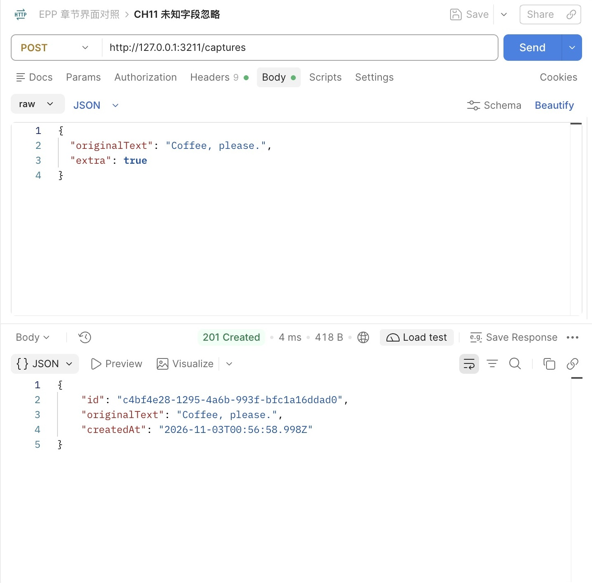
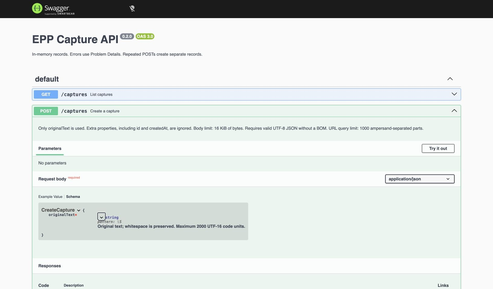

# 第 12 章 建立可信的输入与错误边界

第十一章已经明确了记录组件的归属：CapturesModule 负责组装，其他模块通过 CapturesService 使用记录能力。谁可以取得一个组件，和传给它的值是否可靠，是两件事。这一章继续沿创建、列表与详情三个接口，把调用边界补完整。

先看一个具体的联调问题。调用方提交了 `{"originaltext":"Keep this sentence."}`，服务返回 400。前端知道请求失败，却还要从一句英文错误中猜该标红哪个字段。若换成多传一个 id，当前接口会忽略它；这个行为有没有被明确约定？再往后，存储对象增加了内部字段，Controller 直接返回它，会不会不小心把内部数据带到外面？

这些问题不能只靠把参数类型写得更详细解决。我们需要分别确定：接受什么输入，允许哪些输入进入业务，输出承诺哪些字段，以及失败时客户端能依据什么作出判断。等这些规则明确，再决定用什么机制表达和执行它们。

代码从第十一章的 `part-02/chapter-11` 继续，完成状态为 `part-02/chapter-12`。仍使用内存存储，不新增数据库、登录、业务冲突规则或新业务接口。本章增加运行时 Schema、显式响应映射、Problem Details 错误响应，以及 `/docs` 和 `/openapi.json` 两个文档入口。成功响应、状态码、Location／Allow、GET 的 ETag 条件响应、查询顺序与原文保存规则延续；**错误响应正文改为新结构**，旧客户端读取 `error` 的代码需要同步修改。

阅读约 108～130 分钟，跟做另加约 68～85 分钟，合计约 176～215 分钟。跟做包括字段边界对照、错误定位、文档核对和三条记录的筛选变式。可分三次进行：先完成独立 Schema 调用，再接齐 12.2～12.3 的输入输出与错误映射，最后接入文档并完成联调。首次下载依赖另计，附录按需查阅，支线单列。

## 12.1 从记录接口收到不合法输入出发，解释 TypeScript 类型与 Zod 运行时校验的区别

### 现有检查到底缺了什么

先沿原来的创建路径走一遍：httpBoundary 先限制查询参数数量；captureBody 限制正文的字节数，严格解码 UTF-8 并解析 JSON，Controller 排除 null、数组和非对象，Service 检查 originalText 是否为非空白字符串、是否超过长度上限，然后才保存。

这套检查已经在工作，不能为了引入新库先说它“不安全”。只有一个字段时，手写条件直观、依赖少。继续使用它也是有效方案。当前真正不够集中的是接口契约：请求结构在 Controller，部分规则在 Service，调用说明另写一份，错误只有文本。前端想知道字段位置、我们想生成接口说明时，都要再解释同一套要求。

先尝试最省事的改法，把 `@Body() body: unknown` 改成 `body: { originalText: string }`。这样 IDE 能补全属性，但 JSON 中的数字不会因此变成字符串，也不会被拒绝。第六章已经用类型断言观察过同一件事：类型用于检查程序写法，外部数据到来时仍需执行检查代码。Nest 的 Body 装饰器负责取得值，参数旁边的 TypeScript 类型没有自动变成校验器。

因此我们需要一份运行时也存在的描述：执行它以后，要么得到符合当前输入约定的值，要么得到具体的失败位置。可以继续写一个返回成功／失败结果的解析函数；也可以选用 Schema 库。这里采用 Zod，是因为同一份描述既能执行检查、推导 TypeScript 类型，也能转换出部分接口文档结构。它仍要增加依赖、执行成本与转换边界；不是只要安装了库，数据就自动可信。

新增依赖，在项目根目录执行：

```bash
nvm use
npm install --save-exact zod@4.6.6 @nestjs/swagger@11.4.8
```

本章后面使用 @nestjs/swagger 提供文档页面；真正的输入检查由 Zod 完成。Nest 其他包仍固定 11.2.5，TypeScript 仍为 5.9.3。package.json 和 package-lock.json 一起保存；已有配套依赖清单时按 `npm ci` 安装即可。

### 从一个字段推导 Schema，不先写整个请求模型

先替创建表单做一次交接。页面有一个文本框、一份草稿对象和一次提交动作。文本框当前显示「今天练习停顿」，并不能证明请求把这句话放进了正确的字段。表单适配代码若仍取旧的属性名，浏览器把带有 undefined 属性的对象序列化成 JSON 时就会略去该属性。服务端最后可能收到一个空对象。继续盯着文本框的值看，很难找到双方的分歧。要比的是发送前序列化出来的正文和接收后解析出的对象，再问对象上是否有接口所需的键。

把空对象、只有旧拼写的对象、具有正确键但值为数字的对象并排放在编辑器里。前两种在取 originalText 时都得到 undefined，第三种得到一个实际存在的值。它们都是合法 JSON，都能通过解码和语法解析。若前端收到 originalText 的字段提示，可以根据自己发出的正文进一步区分是漏传、映射时拼错，还是序列化时选错了值。服务端只看见收到的表示，没有理由断言用户「还没有填写」。在表单里把这几种故障都翻译成「请输入内容」，已经输入过文字的人就只能不断点提交。

再把整个正文换成一段带双引号的 JSON 字符串。引号内完全可以是合法原文，解析后却只有字符串，没有承载字段的对象。此时要求改某个字段值没有意义，第一步应恢复对象外形。由外往内检查就能同时解释两种定位结果：外形正确、属性不对时可以指向字段；连外层对象都没有时，只能指向本次输入整体。后面错误结果里的位置数组正是为这个差别准备的。

这里把传进来的值标为 unknown，还有一个对维护者很实际的好处。在编辑器里给处理函数改名、移动取值的位置，很容易看到哪段代码在还没建立前提时就想读取属性。若一开始便把 unknown 断言成创建请求，所有使用它的代码都会按这个承诺继续推导。程序顺利通过类型检查，只说明后面的用法与那句断言相容。把断言删掉，改为从解析成功的分支取得值，编译器此后能帮忙的是维护这条数据流，真正的外部事实仍由当次解析建立。

已有约定并不是“接受任意字符串”。原文至少包含一个非空白字符，长度不超过 2000 个 UTF-16 代码单元，而且要保留用户原始空格。于是新增 `src/capture-contract.ts`，先写字段规则和创建请求：

```ts
import { z } from 'zod';

export const OriginalTextSchema = z.string()
  .regex(/\S/, 'originalText must contain a non-whitespace character')
  .refine(text => text.length <= 2000, 'originalText must be at most 2000 code units')
  .describe('Original text; whitespace is preserved. Maximum 2000 UTF-16 code units.');

export const CreateCaptureSchema = z.object({ originalText: OriginalTextSchema });
export type CreateCaptureInput = z.infer<typeof CreateCaptureSchema>;
```

这里的 regex 检查至少存在一个非空白字符，没有修改字符串；refine 执行我们明确写出的长度条件。不能换成 `trim().min(1)` 后直接使用返回值，否则解析时就把原文首尾空格删掉了。校验一个值与规范化一个值可能同时发生，但是否允许修改必须由业务决定。

长度也不能凭 API 名字猜。当前 Zod 4.6.6 的字符串长度检查按 Unicode 码点计算，原项目用的是 JavaScript 的 `text.length`。一个 😀 是两个 UTF-16 代码单元；2000 个这样的字符如果按码点计数可以通过，按原有约定则超限。因此这里直接写出旧约定的判断，而不是把 `.max(2000)` 视为天然等价。16 KiB 的请求体字节上限是另一层限制，不能拿这两个“长度”相互替代。

CreateCaptureInput 由 Schema 推导而来，减少了类型定义与解析描述两处维护。但是，某个变量标成 CreateCaptureInput，不代表它已经执行过 Schema。只有实际调用 parse 或 safeParse，才建立了这次运行中的检查结果。

先用独立调用观察最小行为，不需要启动 Nest：

```bash
npm run build
node --input-type=module <<'JS'
import { CreateCaptureSchema } from './dist/src/capture-contract.js';
for (const value of [
  { originalText: '  Keep my spaces.  ' },
  { originalText: 7 },
  { originaltext: 'A misspelled field.' },
]) {
  const result = CreateCaptureSchema.safeParse(value);
  console.log(result.success ? result.data : result.error.issues.map(issue => issue.path));
}
JS
```

第一项应保留原始空格；后两项失败，位置都是 originalText。safeParse 返回成功／失败结果，让我们在检查位置作决定；parse 遇到不合法值会抛出 ZodError。两者都执行检查，差别是失败交给调用方的形式，不是一个严格、一个宽松。

这时只新增了字段 Schema，HTTP 路径还没有换用它，是一个可以暂停的完整状态。接下来的 12.2～12.3 会一起修改输入解析、Controller 和错误映射：例如 parseInput 要使用 HttpError 的新增参数，Controller 要向 httpResult 传入 response。中途保存出现参数数量错误时，先核对这几处是否已完成配套修改；不要为让旧签名通过而删掉新参数。等 12.3 接齐并构建后再发 HTTP 请求，最后单独接入 12.4 的文档入口。

### 请求结构与业务规则的责任不同

在接到 Controller 之前，先用编辑器里的独立调用把「非空」拆开看。把样本依次换成空串、两个普通空格、一行缩进后跟一个汉字。第一项没有任何内容，第二项有长度却没有可保存的非空白字符，第三项有要保留的排版。若按长度大于零放行，第二项就会留下没有可读内容的素材；若先剪去两端空白再保存，第三项的缩进又会消失。观察解析结果时，把成功值用 JSON.stringify 显示一次，换行和前导空格比在终端直接打印时容易辨认。判定是否有内容与决定到底存哪些字符，需要两次不同的判断。

长度也可以不用准备一篇长文本就推出来。取九百九十九个 😀，再接两个常用汉字，按这里的计量方式恰好是两千。把最后一个汉字换成同样的表情，眼睛看到的符号个数相同，占用却增加一个单元。前一个应成功，后一个应因长度被拒绝，两者都有非空白字符。把 `'😀'.repeat(999) + '学习'` 和 `'😀'.repeat(999) + '学😀'` 代入上面独立调用中的 originalText，可以在同一处核对预测。若用页面显示的「剩余字符」判断刚好填满了没有，要先查清它用哪一种单位计数，否则页面与接口各自按自己的算法正确运行，用户仍会被卡在提交处。

还有一个不必更换任何字段规则的对照。正文里可以直接写「学」，也可以用 JSON 的 Unicode 转义书写同一个字。解析完成后原文相同，解析前一个占三个 UTF-8 字节，另一个用了反斜线、字母和四位数字，占六个字节。外面的键名、引号、冒号和排版空格也都要经过正文读取器。于是两份表达同一条素材的请求，可以在字段检查处完全相同，却在读取时有不同的体积。前端计算长度若只取文本框内容的字节数，还没有算出这次提交的正文大小。

可以用一个小样本定位这两次计量。在 Node 里把 `{ originalText: '学' }` 用 JSON.stringify 序列化，将这段完整文本传给 `new TextEncoder().encode(...)`，得到 22 字节。对同一文本执行 JSON.parse，取出 originalText 再读 length，得到 1 个 UTF-16 代码单元。换成 `JSON.stringify({ originalText: '学' }, null, 2)` 再算一遍，正文是 27 字节，字段长度仍是 1。这个对照说明为什么正文读取器要累加每批收到的字节，到完整读取后才有字符串可交给字段规则；也说明收到体积错误时，去删前端字段校验里的一条长度规则根本不会改变那次拒绝。

最后换个入口考虑同样的素材。开发脚本可以直接拿记录服务调用 create，把字符串交给它，期间没有路径、正文、字段名，也没有控制器替它执行解析。服务在这里仍需判断原文是否成立；反过来，要求脚本为了保存一句话先伪造一份请求对象，也会把传输层的选择压到业务调用者身上。保留服务自己的检查之后，比较两个入口最值得看的结果是：合法原文逐字相同，非法原文都不会进入 insert，而对外报告失败的形式可以各自适合调用者。这样才能决定将来该抽取的是原文判定条件，还是整套带有字段路径的请求解析。

这里出现一个容易疑惑的重复：Service 已经检查原文，为什么入口还要检查？先分清对象不同。入口检查的是一次 HTTP 请求，字段叫 originalText，失败位置要告诉客户端；Service 维护的是记录业务操作，独立程序同样会调用它，不能因为当前 Controller 检查过就放弃自己的约束。

只有这个小规则时，保持两处条件一致的维护成本可以接受，核对空白、长度和原文保留即可。以后规则变复杂，可以抽取共同的规则函数或值对象；不要为了消除几行重复，让业务类反过来依赖 HTTP 请求体。相同约束可以复用，但 HTTP 字段形状和协议错误不应该成为所有业务调用的前提。

Zod 也没有替代 JSON 读取。非法 UTF-8、正文开头的 BOM 或不符合 JSON 语法的文本都不能进入字段检查，应在 readJson 中失败；超过字节上限应尽早停止收集；Content-Type 不合适应在解析前拒绝。Schema 处理的是已经得到的值。把这些失败都归为一个“字段校验失败”，会丢掉调用方判断请求究竟坏在哪一层所需的信息。

## 12.2 为现有记录定义请求和公开响应，明确哪些字段可由用户修改

### 多传字段时，选拒绝还是忽略

从列表点进详情，再用「以这条素材为基础新建」来设想一位调用者。详情对象上有标识、原文和创建时刻。页面已有这份对象，直接复制它、编辑原文并发送，在前端看来很自然。后端要先决定这次操作的含义：用户只提供新的内容，身份与时间必须由本次创建决定。即便两份原文逐字相同，新建出来的两条素材也应能被分别打开。由此才能推出哪些字段是可写输入，哪些只是页面恰好持有的旧值。请求模型若照抄详情模型，便把「读过某个值」误写成「有权决定下一条的值」。

在纸上给旧记录记作甲，新建结果记作乙。若客户端沿用旧标识，之后按响应里的地址取详情究竟应该打开哪一条？若沿用旧时间，界面按创建时间展示时又会把今天的动作放在哪里？保留额外字段看似给未来留余地，但会让下游每个使用者都得重新判断这些字段是否可用。现有接口可以在一处结束这种歧义：解析时接纳旧客户端提交的对象外形，往下只交出新建所需的原文。这个兼容选择有代价，如果用户把一个可选的附加说明拼错，它也可能被安静地丢弃。决定忽略之前须能解释调用方是否依赖那个字段生效。

观察下面几段代码时，可以把源对象、解析结果、服务方法的实参分三栏记下来。第一栏是调用方实际提交了什么，第二栏是接口解释后认可了什么，第三栏是这次业务操作真的拿到了什么。本章第三栏里连对象都没有，只传字符串。用这个区分来读后面的 Postman 截图：返回三个键可以证明客户端看到的形状；仅凭这张图，既不能证明输入在何处被裁剪，也不能证明存储里绝对没有其他字段。要回答前一个问题，应去比较解析前后的值；要回答后一个问题，应去看 insert 收到并复制的记录。一次观察能证明哪段路径，由观察点的位置决定。

现在向创建请求添加 `id: 'client-id'`。我们有三个合理选项：拒绝未知字段、接收但移除未知字段、接收并保留未知字段。它们分别适合希望尽早发现拼写错误、需要兼容调用方额外数据、明确接受可扩展内容的场景，没有一种能脱离契约被称为普遍正确。

前文接口只取 originalText，其余字段都被忽略。本章保留这一行为，使用 Zod 默认的 object：解析结果只留下声明的字段。若改为 strictObject，会让之前成功的“合法原文加额外字段”变成 400；这是收紧契约，需要明确迁移，不能只作为代码风格调整。

关键在于**使用解析结果**。假如只检查 `safeParse(body).success`，随后仍把原始 body 展开交给业务，多余字段还在原始对象里。解析成功证明的是 result.data 满足描述，不是说原始对象被原地清洗了。

新增 `src/input-validation.ts`，将请求解析失败转成我们自己的输入错误：

```ts
import { z } from 'zod';
import { HttpError } from './http.js';

export function parseInput<T>(schema: z.ZodType<T>, value: unknown): T {
  const result = schema.safeParse(value);
  if (!result.success) {
    const issues = result.error.issues.map(issue => ({
      path: issue.path.map(part => typeof part === 'number' ? part : String(part)),
      message: issue.message,
    }));
    throw new HttpError(400, 'Request validation failed', 'VALIDATION_ERROR', issues);
  }
  return result.data;
}
```

HttpError 在下一节增加 code 与 issues 参数。这里把问题位置转换成字符串／数字数组，并只带出位置与提示，不把完整请求值或库的内部错误对象交给客户端。调用方可用 `['originalText']` 标记字段，用 `['items', 2, 'name']` 表示数组项；空数组表示整个输入。message 用于阅读，程序分支依据后面约定的稳定 code，不依赖 Zod 当前版本的英文措辞。

接入 Controller 时，原来的对象判断和字段提取替换为：

```ts
const input = parseInput(CreateCaptureSchema, body);
const capture = await this.captures.create(input.originalText);
```

id 与 createdAt 不在输入 Schema 中，也没有传给 Service，由服务端继续生成。未知字段被忽略不意味着允许客户端修改这些字段。反过来，即使把一个 userId 写进 Schema 并通过字符串检查，也没有证明调用者可以访问那个用户的数据；权限判断将在身份篇建立。



请求包含 extra: true，响应仍为 201，公开对象只包含 id、originalText 与 createdAt。它展示本章“接受并移除未知字段”的约定；是否在进入 Service 前就移除了 extra，还可在 parseInput 返回处观察解析结果。端口以当前启动地址为准。

### 查询参数先检查表示，再转换数值

先想清楚列表筛选框的「清空」要怎样落到请求上。用户删掉关键词后希望恢复所有记录，页面应该移除查询参数。若仍拼接一个有等号、右侧为空的 q，服务端收到的是用户显式给出的空串。可选表示可以省略，一旦给出仍要满足内容要求。这个细小区别在 Postman 的 Params 里很直观：取消某一行的勾选，会把该项从最终地址中移除；勾选着只删 Value，则应检查地址中是否还留着该键。判断依据是最终发出的 URL，表格里两眼望去都是空白并不足够。

设本次内存实例依次收进三句原文「把书放好」「先读两页」「读完再记」。暂且用纸面推导，等本章代码接齐后才发请求。查询 q 为「读」、limit 为一，第一条没有命中，不占用名额；第二条进入结果，此时名额用完，第三条不用继续检查。若先截取第一条再筛选，就会返回空数组。换成 q 为「读完」时，正确结果应从第二条变为第三条；这点能区分程序到底在按新关键词查找，还是页面一直显示上一次的结果。复做时用本次练习独有的词或新的内存实例，以免前一次插入的匹配项排在前面。

跟着这个例子看参数会怎样改变形状。地址中的 limit 是文本，在应用入口还能看见用户采用了哪种写法；交给存储时只剩下整数一，存储只需比较已选中多少条。如果提前转换，写作一位数字和补了一个前导零都会得到同一个数，后面再用整数范围检查已经无法恢复原来的区别。反过来，如果一直不转换，把文本留给需要数字的列表方法，服务自己的整数检查会拒绝。转换位置正好位于表示已经认可、业务计算尚未开始的那一刻。

查询词也有类似取舍。正文要求非空白，搜索的是保留下来的字面片段。把关键词「读」改成前后都有空格的「 读 」，仍含有非空白字符，却未必匹配同样的句子。空数组在这里可以是一次完全正确的成功响应。先检查请求里的空格，再对照原文里有没有这段连续字符；若页面希望在搜索前自动去掉误输入的边缘空格，可以在发出前显示实际采用的关键词。把这个界面选择偷偷移进服务，会改变已经有意搜索带空格片段的调用者所见的结果。

第九章已经区分了 URL 中的字符串与业务需要的整数。本章保持那套约定：q 与 limit 至多出现一次，q 是非空白的字面子串，limit 是 1～100 的十进制文本，不接收空格、正号、前导零或指数形式。没有 limit 时仍返回全部匹配记录。

在 `src/capture-contract.ts` 增加：

```ts
export const ListQuerySchema = z.object({
  q: z.string().regex(/\S/, 'q must contain a non-whitespace character')
    .refine(text => text.length <= 200, 'q must be at most 200 code units')
    .describe('Literal, case-sensitive substring; maximum 200 UTF-16 code units.').optional(),
  limit: z.string().regex(/^(?:[1-9]\d?|100)$/)
    .describe('One decimal integer from 1 to 100; no signs, spaces or leading zeros.').optional(),
});
```

再修改 `src/capture-query.ts`：

```ts
import type { CaptureListOptions } from './capture.js';
import { ListQuerySchema } from './capture-contract.js';
import { parseInput } from './input-validation.js';

export function parseListQuery(q: unknown, limit: unknown): CaptureListOptions {
  const parsed = parseInput(ListQuerySchema, { q, limit });
  return {
    text: parsed.q,
    limit: parsed.limit === undefined ? undefined : Number(parsed.limit),
  };
}
```

为什么不直接写 `z.coerce.number()`？因为它使用数值转换，而我们还要约束请求中允许的写法。空字符串可能被转成 0，`1e1` 被转成 10；转换成功并不代表表示符合接口约定。先对字符串使用完整正则，再 Number，转换才能承接已成立的条件。

重复查询键会由当前 Express simple 查询解析器形成数组。Schema 要求字符串，所以数组被拒绝；未知查询键继续忽略，因为 Controller 只提取 q 与 limit。`q[]=x` 在当前解析器中是另一个键，不会自动成为 q。这些行为来自“解析器怎样表示输入”与“Schema 接受什么”的组合，不能仅凭最终业务类型为 string 就推导。

这里继续依赖第九章建立的查询数量边界：非空查询串按 `&` 分隔后最多 1000 项，未知键与空片段也计数，超过上限由 httpBoundary 返回 400。本章给这条失败增加 QUERY_TOO_LARGE 错误码。这个检查发生在 Express 解析之前，否则 simple 解析器只保留前 1000 项，排在后面的重复 q 或 limit 可能消失，Schema 根本看不到完整输入。未知键忽略只是业务字段策略，不表示它们可以绕过整个请求的数量限制；详情与 POST 上携带的查询串也接受同一检查。

### 返回类型不会帮我们删除内部字段

把输出边界按使用方式拆开就能看出一个维护问题。创建页保存成功后立即用响应更新列表，详情页稍后按地址重新读取，重新进入列表又会遍历多条记录。假设只在详情接口删除内部备注，另外两条路径仍可能把备注发往页面。若三处各自手列一次字段，新增公开字段时又容易只改其中两处。当前三条路都回到同一个「把一条记录变成一个公开对象」的函数；列表的额外工作是将每一条变换后的对象放进 items，空列表则返回空数组。这样改一条记录的公开形状才有明确入口。

有个常见的判断误区：看到映射后的 id 与输入记录相同，以为已经验证了它的来历。输出检查能判断字符串是否符合规定格式，无法证明标识确实取自这次创建。若手误取了另一条真实素材的标识，两者都可能通过格式检查。判断关联是否正确，用创建时返回的 Location 读取详情，把返回的标识、原文、时间与创建结果逐一对应；再用另一段不同的原文创建第二条，以免两个对象内容过于相似，把串行错误掩盖了。结构成立与值来自正确的那一笔，是联调时两种独立的证据。

列表里的单项映射失败也值得推一下。假如第一条能形成公开对象，第二条的日期失效，数组映射会在第二次调用时抛出异常，整个列表方法没有交给 Nest 一个完整的成功值。第一条虽然在内存里已经映射好，客户端并没有先收到半个数组。直接跳过坏行会让用户把「有一条无法表示」误读成「只有这些记录符合条件」，改变了接口对完整结果的承诺。要查这种差异，先对比单条详情与包含多条的列表，再定位具体出错的记录和字段，不能因为列表返回系统错误就断言所有原文都坏了。

还要区分本章两种复制。内存存储在写入和取出时复制对象，避免调用方改动自己手里的这份记录时顺手改掉 Map 中那份。输出投影也构造新对象，但它决定的是哪些字段可以经过 HTTP 传出去。当前记录只有三个标量，浅复制足以隔开这里的修改；将来若增加数组或嵌套对象，展开外层对象仍可能共享里面的引用。检查输出时因此要先问改的是哪一份值，再问新字段是否被选进公开结果。从「改了返回值没影响当前存储」推不出任意深度的数据都已经隔离。

输入已有明确字段，再看输出。当前 Capture 只有 id、originalText、createdAt，直接 return 看起来没有问题。若以后内部对象增加 internalNote，函数返回类型即使仍标成原来的公开类型，JavaScript 对象也可能带着多余字段。类型检查不是序列化投影。

我们先决定对外承诺这三个字段，再在 `src/capture-contract.ts` 增加响应描述和映射函数：

```ts
import type { Capture } from './capture.js';

export const CaptureResponseSchema = z.object({
  id: z.uuid(),
  originalText: OriginalTextSchema,
  createdAt: z.iso.datetime(),
});
export const CaptureListResponseSchema = z.object({
  items: z.array(CaptureResponseSchema),
});
export type CaptureResponse = z.infer<typeof CaptureResponseSchema>;

export function toCaptureResponse(capture: Capture): CaptureResponse {
  return CaptureResponseSchema.parse({
    id: capture.id,
    originalText: capture.originalText,
    createdAt: capture.createdAt,
  });
}
```

显式构造新对象让字段去向一目了然。再执行响应 Schema，能发现内部实现没有兑现公开承诺，例如 createdAt 变成无法使用的字符串。只生成类型不会发现这种运行时偏差；只删除几个已知内部字段，也容易漏掉后续新增字段。

这次 parse 失败属于服务端错误，不能告诉客户端“你的请求不合法”。因此只在 parseInput 中把失败标成输入错误；不能在最外层把所有 ZodError 都映射为 400。写入结果、第三方返回值和外部请求都可能用 Zod 检查，但责任方不同。

完整的 `src/captures.controller.ts` 如下。三个入口都明确等待业务结果，再映射公开响应；错误仍在入口附近转换：

```ts
import { Body, Controller, Get, Param, Post, Query, Res } from '@nestjs/common';
import type { Response } from 'express';
import { CapturesService } from './captures.service.js';
import { parseListQuery } from './capture-query.js';
import { httpResult } from './http.js';
import { CreateCaptureSchema, toCaptureResponse } from './capture-contract.js';
import { parseInput } from './input-validation.js';

@Controller('captures')
export class CapturesController {
  constructor(private readonly captures: CapturesService) {}

  @Get()
  list(
    @Query('q') q: unknown,
    @Query('limit') limit: unknown,
    @Res({ passthrough: true }) response: Response,
  ) {
    return httpResult(async () => ({
      items: (await this.captures.list(parseListQuery(q, limit))).map(toCaptureResponse),
    }), response);
  }

  @Post()
  create(@Body() body: unknown, @Res({ passthrough: true }) response: Response) {
    return httpResult(async () => {
      const input = parseInput(CreateCaptureSchema, body);
      const capture = await this.captures.create(input.originalText);
      const result = toCaptureResponse(capture);
      response.setHeader('Location', `/captures/${capture.id}`);
      return result;
    }, response);
  }

  @Get(':id')
  detail(@Param('id') id: string, @Res({ passthrough: true }) response: Response) {
    return httpResult(async () => toCaptureResponse(await this.captures.find(id)), response);
  }
}
```

response 的 passthrough 保留 Nest 自动发送成功值，只让我们设置 Location 或错误的媒体类型；第九章的响应责任没有改变。创建时先完成响应映射，再设置 Location，避免一个无法形成正常公开结果的操作先留下成功响应头。

等下一节的错误映射接好并重新构建后，运行 `node examples/response-boundary.mjs`，可以看到公开对象只有三个键；把 createdAt 故意改成非法值后，错误会归为 500，同时已保存的记录仍为一条。响应校验发生在写入之后，不能回滚已经发生的业务动作。客户端遇到 500 不能据此断言“服务端一定没保存”，更不能无条件重复 POST；可靠重试需要后续的幂等机制。

## 12.3 校验失败、业务冲突、权限错误与系统故障的错误契约；权限类型先说明含义，身份篇再落地

### 从客户端要采取的动作决定错误信息

原来的 `{ "error": "..." }` 便于人阅读，但客户端若用英文字符串做判断，修改措辞或升级校验库就可能破坏分支。只看 400 也不够：JSON 语法坏了与 originalText 缺失，修正位置并不相同。

我们先确定需要区分的动作。字段错误要让调用方修改输入；记录不存在要让它停止展示这条记录；系统故障应给出可控提示并保留诊断线索。响应不应直接包含异常堆栈、SQL、内部路径或依赖凭据。于是除了 HTTP 状态，我们还需要稳定的应用错误码，输入错误还可以带字段位置。

可以在旧结构旁增加 code 和 issues，这样旧客户端仍能读 error。另一种选择是采用已有的 Problem Details 格式。本章选择后者，让基础字段采用明确的通用含义，同时把 code 与 issues 作为本项目扩展；这是一次有意的错误契约升级。若已有必须持续服务的旧客户端，可以先保留 error 作为过渡字段，或者安排版本迁移，不能静默删掉它后要求调用方自己发现。

一份缺少 originalText 的响应将具有这样的结构，具体字段提示不作为固定措辞：

```json
{
  "type": "about:blank",
  "title": "Bad Request",
  "status": 400,
  "detail": "Request validation failed",
  "code": "VALIDATION_ERROR",
  "issues": [
    { "path": ["originalText"], "message": "Invalid input: expected string, received undefined" }
  ]
}
```

HTTP 状态行仍为 400，Content-Type 改为 `application/problem+json`。status 是正文中的状态信息，不应与状态行冲突；客户端仍以实际 HTTP 状态为基础。title 是状态的简短说明，detail 说明这一次失败，code 才承担应用内稳定分类。type 使用标准的 about:blank，表示这里未为每种业务错误定义单独的问题类型 URI；不要把它当成我们已经发布了一套问题说明网站。

issues 是本项目约定，不是每个 Problem Details 服务都会返回的标准字段。客户端应允许没有 issues，也应允许未来出现未知 code，退回通用提示，而不是遇到新错误码就崩溃。我们暂不增加 instance 或请求追踪 ID，后面建立请求关联时再明确它们的来源与用途。

### 先完成一处明确映射，再接到不同失败位置

先以页面的提交状态为例，把错误信息用起来。用户点保存后，按钮暂时禁用，草稿仍留在编辑区。收到字段错误时，页面需要恢复编辑、保留原文，并把提示放在相应控件附近。此时如果前端仅取 issues 的第一条，假定 path 的第一项一定是字段名，遇到整个请求外形不对时就找不到控件。可以先准备一处表单级提示，再把能辨认的字段提示分配给对应控件。即使将来多了本页还不认识的字段，用户仍知道保存失败，草稿也不会因界面解释失败而消失。

用两份输入检验这种处理。一个是带正确键但没有可读内容的对象，一个是整个正文为 null。前者需要改原文，后者通常要修发送正文的组装代码；用户继续在文本框里打字未必有帮助。两者状态相同，应用错误码也可以相同。第一份提示可以落在原文控件，第二份位置为空，应在整个提交动作旁提示。数组路径之所以要保持为分段数据，也是同样原因：将来某个位置若包含数组下标，数字零表示第一项，不该在去掉「空值」时被过滤掉。现在不必写一个通用表单框架，只需要让这两种当前输入都能给人看得懂的反馈。

再看详情页。用户按保存时的地址打开，得到记录不存在，需要考虑是不是打开了另一份内存实例、或者刚刚重启过。若响应说路由不存在，先比请求地址与集合里的路径，关注多出或缺少的路径段。两个都返回 404，若页面一律展示「这条素材已被删除」，就把可定位的地址错误和进程寿命问题都归咎于用户操作。本章根本没有删除接口，提示宜说当前地址没有取得记录。让页面根据足够的事实选择动作，比把每一种状态翻译成一句很确定的原因更可靠。

有时界面提示「响应格式错误」，开发者却在 Postman 里看见结构完整。沿浏览器 Network 展开这次请求，先核对状态行和响应媒体类型，再看实际正文。旧封装可能只在类型恰为 application/json 时解码，新的问题正文使用另一种 JSON 媒体类型，带字符集参数的情况也要识别；也可能已经解出了对象，却仍去读旧字段 error。前一种卡在表示解释，后一种卡在字段映射。两种情况下服务器都已经给出了可用提示，应改的位置相差一层。联调时把这两个检查分开，避免在服务端重复生成同一条错误文案来补客户端解析缺口。

扩展 `src/http.ts` 中的 HttpError：

```ts
export class HttpError extends Error {
  readonly statusCode: number;

  constructor(
    statusCode: number,
    message: string,
    readonly code = `HTTP_${statusCode}`,
    readonly issues?: Array<{ path: Array<string | number>; message: string }>,
  ) {
    super(message);
    this.statusCode = statusCode;
  }
}
```

它表达已确认可以公开的协议错误。普通 Error 不能因为 message 看起来很友好就直接公开。保持业务错误类型独立，在 HTTP 边界映射为公开结果：

```ts
import { STATUS_CODES } from 'node:http';

export type Problem = {
  type: string;
  title: string;
  status: number;
  detail: string;
  code: string;
  issues?: Array<{ path: Array<string | number>; message: string }>;
};

export function httpFailure(error: unknown): {
  statusCode: number;
  body: Problem;
} {
  const statusCode = error instanceof HttpError ? error.statusCode
    : error instanceof InvalidCaptureError ? 400
    : error instanceof CaptureNotFoundError ? 404 : 500;
  if (statusCode === 500) console.error('Unhandled request failure:', error instanceof Error ? error.name : 'UnknownError');
  const code = statusCode === 500 ? 'INTERNAL_ERROR'
    : error instanceof InvalidCaptureError ? 'INVALID_CAPTURE'
    : error instanceof CaptureNotFoundError ? 'CAPTURE_NOT_FOUND'
    : error instanceof HttpError ? error.code : 'INTERNAL_ERROR';
  return {
    statusCode,
    body: {
      type: 'about:blank',
      title: STATUS_CODES[statusCode] ?? 'Error',
      status: statusCode,
      detail: statusCode === 500 ? 'Internal server error' : errorMessage(error),
      code,
      ...(error instanceof HttpError && error.issues ? { issues: error.issues } : {}),
    },
  };
}
```

InvalidCaptureError 对应业务输入不成立；CaptureNotFoundError 对应不存在；其余未识别异常统一为 500，公开正文不使用原始 message。普通存储错误不能自动归为 409，因为程序失败不等于发现了可由调用方解决的业务冲突。输出 Schema 的 ZodError 也走未知故障路径，所以不会误报成输入失败。

本章保留了现有 console 错误记录位置，用于开发时定位内部异常；第十四章会统一日志和请求关联。对外正文与内部诊断不能混成一份对象，后续记录日志时也要继续约束秘密和原始请求数据的进入范围。

然后修改 httpResult，让 Controller 使用 Nest 的异常响应，同时明确媒体类型：

```ts
export async function httpResult<T>(
  action: () => T | Promise<T>,
  response: ServerResponse,
): Promise<T> {
  try {
    return await action();
  } catch (error: unknown) {
    const failure = httpFailure(error);
    response.setHeader('Content-Type', 'application/problem+json; charset=utf-8');
    throw new HttpException(failure.body, failure.statusCode);
  }
}
```

这里仍然使用 `return await action()`，把异步失败留在这个 try／catch 的范围内。只返回 Promise 却不等待，会让后续拒绝绕过这段转换。没有给正常响应套额外外壳，返回值仍由 Nest 发送；传入 response 只用于发生错误时设置头部。

readJson 和 captureBody 发生在 Controller 之前，它们用的是 respond，不能指望 Controller 的 try／catch 捕获。将 respond 的 catch 中发送部分改为：

```ts
const failure = httpFailure(error);
sendJson(response, failure.statusCode, failure.body, {
  'Content-Type': 'application/problem+json; charset=utf-8',
  Connection: 'close',
});
```

原来检查 response 已销毁或结束的条件保留。sendJson 的默认 JSON 头可以被这里显式传入的头覆盖，因此发送的是相同的 Problem 结构与正确媒体类型。两条处理路径调用同一个错误映射函数，避免字节读取错误和 Controller 错误各长成一种格式。

为读取与路径判断的错误增加明确 code，修改对应 new HttpError 调用的第三个参数：

| 失败位置 | 状态与 code | 客户端应理解什么 |
| --- | --- | --- |
| readJson：严格 UTF-8 解码或 JSON.parse 失败 | 400／INVALID_JSON | 非法编码、BOM 或 JSON 语法错误，尚未进入字段检查 |
| readJson：请求流读取失败 | 400／BODY_READ_FAILED | 正文没有完整取得 |
| readJson：超过字节上限 | 413／BODY_TOO_LARGE | 缩小整个正文，字段长度不是唯一原因 |
| captureBody：媒体类型不符 | 415／UNSUPPORTED_MEDIA_TYPE | 使用本接口接受的请求表示 |
| httpBoundary：URL 不合法 | 400／INVALID_URL | 请求地址无法按约定解释 |
| httpBoundary：查询串超过 1000 项 | 400／QUERY_TOO_LARGE | 缩小查询串；未知键与空片段也占用数量 |
| httpBoundary：未匹配路径 | 404／ROUTE_NOT_FOUND | 这个业务路由不存在 |
| httpBoundary：方法不支持 | 405／METHOD_NOT_ALLOWED | 查看 Allow，不能任意换方法 |
| 详情不存在或保留的编码边界 | 404／CAPTURE_NOT_FOUND | 没有可返回的记录 |

`src/http-boundary.ts` 在 URL 构造成功后、路由判断前的数量检查保留原位置，只补上错误码：

```ts
const queryParts = url.search === '' ? 0 : url.search.slice(1).split('&').length;
if (queryParts > 1000) {
  throw new HttpError(400, 'Query string must contain at most 1000 parameters', 'QUERY_TOO_LARGE');
}
```

readJson 保留严格解码，并将这两种解析失败归到同一公开错误码。`src/http.ts` 中 end 处理函数里的 try／catch 为：

```ts
try {
  const text = new TextDecoder('utf-8', { fatal: true, ignoreBOM: true })
    .decode(Buffer.concat(chunks));
  resolve(JSON.parse(text));
} catch {
  reject(new HttpError(400, 'Request body must be valid UTF-8 JSON', 'INVALID_JSON'));
}
```

fatal 拒绝非法字节，不把它们替换成另一个合法字符；ignoreBOM 保留开头的 BOM 字符，随后由 JSON.parse 拒绝，维持当前不接受 BOM 的契约。即使字段 Schema 可以接受替换后的字符串，也不能据此更改用户提交的原文字节所表达的内容。

例如 captureBody 中现在是：

```ts
throw new HttpError(415, 'Content-Type must be application/json', 'UNSUPPORTED_MEDIA_TYPE');
```

方法不支持的分支不再单独发送旧的 error 对象。保留 Allow，然后交给同一错误路径：

```ts
if (!allowed.includes(request.method)) {
  response.setHeader('Allow', allowed.join(', '));
  throw new HttpError(405, 'Method not allowed', 'METHOD_NOT_ALLOWED');
}
```

查询数量检查通过后，当前业务路径的 HEAD 仍返回 405 和 Allow，但响应没有正文；不能因为采用 Problem Details 就要求所有错误一定有可解析的 JSON。客户端也可能收到代理生成的 HTML 错误，或者在根本没有响应时遭遇网络异常。因此读取错误正文时要容许解析失败，保留 HTTP 状态与通用提示；fetch 收到 400／500 通常仍正常返回 Response，它们和网络异常的判断分支不同。

### 什么时候才是 409、401 或 403

把前面两条错误发送路径各自走到结束。读取器从请求流累加数据，结束时把解析出来的值交还给 captureBody，只有拿到这个值才继续放行。如果读取器返回的承诺遭到拒绝，外层 respond 有机会把已经确认的错误写到这次响应；若连接已经销毁，运行代码可以知道失败了，对面的调用者却可能连状态行都收不到。这也解释了为什么应用内部记录了读取失败，页面上仍可能只有一个网络异常。错误契约约束的是能够发送出去的响应，无法保证一条已经断开的连接送达消息。

另一条从 Controller 开始。合法的创建输入通过以后，存储返回一个承诺，失败可能在稍后才发生。设想 action 已经返回这个尚未完成的承诺，此刻普通同步语句没有抛错。若处理函数在 try 里直接把它交还给上层，当前这层的同步执行已经离开，后续拒绝不会跳回已经退出的 catch。用 await 在此等待，拒绝会在等待处恢复为异常，才能沿本章的映射形成一致的正文。这与浏览器端封装 fetch 时捕获异步异常的道理相通，只是在这里漏接后，客户端会直接感受到错误格式改变。

检查控制权还能避免一种容易写出的双重响应。中间件若已通过 sendJson 结束错误响应，继续调用 next 就可能让后续处理器再次操作同一响应。Controller 这边则交由 Nest 处理抛出的 HttpException，本段只负责选择公开对象、状态和类型。若先手动结束响应再抛异常，上层处理异常时已经没有一份尚待发送的响应。读代码时沿每一条分支追到「谁最后发送」即可：正常路径继续，失败路径由当前约定的发送者收尾。共享错误分类函数并不要求所有位置使用同一种发送手段。

现在再考虑一次保存两次点击。如果用户的意思确实是收集两条相同的句子，当前存储会根据两个新标识接受两次写入；如果用户只想收集一条，前端禁用正在发送的按钮可以减少同一页面上的误触，却无法在响应中断时判定服务端有没有完成第一次。若服务端简单按原文查重，连有意保存相同句子的正常调用也会被拒绝。真正要引入冲突，得先写清楚究竟哪种业务事实不能并存、依据哪个标识判定、发生冲突后客户端能怎样恢复。只因为前端担心重复就给第二条原文返回冲突，会把尚未约定的产品决定埋进错误处理器。

当前记录允许重复原文，每次 POST 都生成新 ID，所以“这段原文已经出现过”现在不是冲突。只有业务真正规定了互斥条件，例如后续某个版本只能被采纳一次，才需要在条件不满足时表达业务冲突。一个请求结构正确、字段值也合法，仍可能因为当前资源状态而无法执行；409 描述的正是这类需结合状态理解的问题，不是字段 Schema 的另一种写法。

同样，401 与 403 不能靠检查 userId 是否是字符串实现。401 表达缺少有效认证凭据，并涉及相应的认证挑战；403 表达服务器拒绝执行这个请求。身份与资源授权建立后，要根据所选认证方式、调用者及资源条件决定响应。某些场景会用 404 隐藏资源是否存在，也必须是明确策略，而不是捕获异常时随机改状态。

本章不增加虚构的 ConflictError、登录 Guard 或测试账号来凑齐状态码。先建立分类依据，等真实的业务约束、身份与权限落地，再在同一错误契约中增加具体错误码。Schema 能回答输入是否符合描述，不能替我们判断并发状态与权限。

## 12.4 生成并使用现有接口的 OpenAPI／Swagger 文档，观察调用方如何定位字段和错误

### 文档要描述什么，哪些内容不能从类型里猜

想象现在接手页面的人只拿到接口文档，要写「保存成功后打开刚保存的素材」。她首先要知道发送哪个方法和路径，正文应装在哪种媒体类型下；保存成功后，到哪里找到新记录的地址；打开详情时，路径中的占位符该用什么替换。如果文档只给一张包含三个字段的记录表，完全可以写出类型正确却把三个字段都提交、用列表地址打开详情的客户端。因此先把这个用户动作拆成创建与按标识读取两次独立操作，再分别写它们的输入和可观察结果。方法和路径合起来才选中一次操作，同一路径的读和写必须能在文档中区分。

把原文放在查询参数还是正文，也要写在字段定义之外。列表里的 q 是可省的字符串，创建的 originalText 是必需字符串。前者写在 URL 里，影响这次挑出哪些旧记录；后者是写入的数据，JSON 里没有它就无法完成新建。假如调用者把原文当作一个查询参数提交，字段描述纵然写得很准确，服务端仍取不到正确的正文。为每个操作读一遍「从哪里取值」，比单看组件页的类型更接近真实调用。路径参数还要有位置与占位符相对应，只有取回某条真实记录的标识代进去，才有可能读到那次创建的结果。

文档中的例子也有职责范围。一个正确的请求样本能让人立即试用，却无法告诉她把原文换成全空格后会怎样；一份错误样本带有 issues，也不能因此把所有错误的 issues 声明成必填。要判断必填项，应沿生成该对象的每条路径核对：未知异常只产生通用详情和分类，已知字段错误才可能携带字段位置。若文档生成的客户端把这个可选数组当成必有值，在显示系统错误时反而可能因读不到数组再抛一次异常。组件定义要覆盖所有已承诺的结果，例子只代表其中一次具体选择。

现在的接口已有清楚的运行时边界，但调用方还需要找到方法、路径、请求表示、成功结果与失败结果。OpenAPI 用一个可交换的文档描述这些约定；Swagger UI 将文档呈现为可浏览、可发请求的页面。页面本身不参与 Service 的业务判断，也不会让未校验的请求突然安全。

可以手写整个 OpenAPI 文档；也可以用装饰器描述每个 DTO 和响应，让 Nest 扫描生成。本章已经选择 Zod 表达字段，若再手写一套 class-validator 或 Swagger DTO，就重新引入两份字段规则。我们采用折中：**字段结构从 Zod 转换，方法、路径、状态和头部由明确的文档代码组装**。

这意味着并非所有内容都“自动同步”。路径和响应状态修改以后，仍须同步文档；一些 JavaScript 条件也无法无损转换成 JSON Schema。把自动生成的范围说清楚，比只看到 Swagger 页面出现就认为接口描述完整更重要。

在 `src/capture-contract.ts` 增加 Problem 的 Schema，用于描述现有错误结果，而不是把每个 Error 对象直接序列化：

```ts
export const ProblemSchema = z.object({
  type: z.literal('about:blank'),
  title: z.string(),
  status: z.number().int().min(400).max(599),
  detail: z.string(),
  code: z.string(),
  issues: z.array(z.object({
    path: z.array(z.union([z.string(), z.number().int()])),
    message: z.string(),
  })).optional(),
});
```

新增 `src/openapi.ts`。开头导入各 Schema，并准备三个小的组装函数：

```ts
import { z } from 'zod';
import type { OpenAPIObject, SchemaObject, ResponseObject, ParameterObject } from '@nestjs/swagger';
import {
  CreateCaptureSchema, ListQuerySchema, CaptureResponseSchema,
  CaptureListResponseSchema, ProblemSchema,
} from './capture-contract.js';

function schema(value: z.ZodType, io: 'input' | 'output'): SchemaObject {
  return z.toJSONSchema(value, { target: 'openapi-3.0', io }) as SchemaObject;
}
function jsonResponse(name: string, description: string): ResponseObject {
  return { description, content: {
    'application/json': { schema: { $ref: `#/components/schemas/${name}` } },
  } };
}
function problem(description: string): ResponseObject {
  return { description, content: {
    'application/problem+json': { schema: { $ref: '#/components/schemas/Problem' } },
  } };
}
```

这里选择 OpenAPI 3.0 的 Schema 表达，输入用 io 为 input，响应用 output。创建请求默认移除额外字段，所以输入描述允许额外属性；输出只包含公开字段，输出描述可以封闭属性范围。把同一份对象 Schema 的输出描述误当成请求描述，会让文档声称“额外字段不允许”，实际接口却接受它。

转换函数返回的 JSON 描述在这个固定目标下按 SchemaObject 使用，类型断言并没有执行校验。转换之后仍要核对内容，特别是原文的 UTF-16 长度条件：refine 中的 JavaScript 函数不会变成等价的标准 maxLength。本文用 description 明确这个限制，服务端继续执行原有检查。不能为了让文档生成漂亮，就删掉运行时约束或把无法表达的规则悄悄改成允许任意值。

文档的三层关系需要接起来：顶层 openapi 和 info 说明格式与接口身份，paths 描述每个 HTTP 操作，components.schemas 保存被重复引用的字段结构。`$ref` 是文档内部的引用地址，不是导入 TypeScript 类型，也不会替服务端执行校验。把下面的完整代码接在三个辅助函数之后，构成可导出的 `src/openapi.ts`：

```ts
const etagHeaders = {
  ETag: { description: 'Validator for this representation; send back with If-None-Match.', schema: { type: 'string' as const } },
};
const ifNoneMatch: ParameterObject = {
  name: 'If-None-Match', in: 'header', required: false, schema: { type: 'string' },
  description: 'A matching ETag, or *, can produce 304 without a body. Use a stored response for that URL; omit this header if no cached response is available.',
};
const notModified: ResponseObject = {
  description: 'Not modified. No response body; reuse the cached representation.',
  headers: etagHeaders,
};

export function createOpenApiDocument(): OpenAPIObject {
  return {
    openapi: '3.0.3',
    info: {
      title: 'EPP Capture API', version: '0.2.0',
      description: 'In-memory records. Errors use Problem Details. Repeated POSTs create separate records.',
    },
    paths: {
      '/captures': {
        get: {
          operationId: 'listCaptures', summary: 'List captures',
          description: 'Insertion order; filter before limit. No limit means all matching records. At most 1000 ampersand-separated query parts, including unknown keys and empty parts. Unknown query keys within that bound are ignored; repeated q or limit is rejected.',
          parameters: [ifNoneMatch, ...['q', 'limit'].map(name => ({
            name, in: 'query', required: false,
            schema: schema(name === 'q' ? ListQuerySchema.shape.q.unwrap() : ListQuerySchema.shape.limit.unwrap(), 'input'),
          } as ParameterObject))],
          responses: {
            '200': { ...jsonResponse('CaptureList', 'Matching records'), headers: etagHeaders },
            '304': notModified,
            '400': problem('Invalid query; code VALIDATION_ERROR or QUERY_TOO_LARGE'),
            '500': problem('Unexpected failure; code INTERNAL_ERROR'),
          },
        },
        post: {
          operationId: 'createCapture', summary: 'Create a capture',
          description: 'Only originalText is used. Extra properties, including id and createdAt, are ignored. Body limit: 16 KiB of bytes. Requires valid UTF-8 JSON without a BOM. URL query limit: 1000 ampersand-separated parts.',
          requestBody: { required: true, content: { 'application/json': {
            schema: { $ref: '#/components/schemas/CreateCapture' },
            example: { originalText: 'I want to explain this clearly.' },
          } } },
          responses: {
            '201': { ...jsonResponse('Capture', 'Saved record'), headers: {
              Location: { description: 'Relative URL of the new record', schema: { type: 'string' } },
            } },
            '400': problem('Malformed UTF-8/JSON or invalid input/query; code INVALID_JSON, VALIDATION_ERROR or QUERY_TOO_LARGE'),
            '413': problem('Body exceeds 16 KiB; code BODY_TOO_LARGE'),
            '415': problem('Expected application/json; code UNSUPPORTED_MEDIA_TYPE'),
            '500': problem('Unexpected failure; code INTERNAL_ERROR'),
          },
        },
      },
      '/captures/{id}': {
        get: {
          operationId: 'findCapture', summary: 'Find a capture',
          parameters: [ifNoneMatch, { name: 'id', in: 'path', required: true, schema: { type: 'string' },
            description: 'Use the literal ID returned by creation. Unknown IDs return 404.' }],
          responses: {
            '200': { ...jsonResponse('Capture', 'Saved record'), headers: etagHeaders },
            '304': notModified,
            '400': problem('Query exceeds 1000 parts; code QUERY_TOO_LARGE'),
            '404': problem('No such record; code CAPTURE_NOT_FOUND'),
            '500': problem('Unexpected failure; code INTERNAL_ERROR'),
          },
        },
      },
    },
    components: { schemas: {
      CreateCapture: schema(CreateCaptureSchema, 'input'),
      Capture: schema(CaptureResponseSchema, 'output'),
      CaptureList: schema(CaptureListResponseSchema, 'output'),
      Problem: schema(ProblemSchema, 'output'),
    } },
  };
}
```

先沿 GET /captures 看一次参数是怎样生成的。`ListQuerySchema.shape.q` 取得 q 对应的 Schema；这个 Schema 外层有 optional，表示整个查询字段可以缺失。OpenAPI 用参数的 `required: false` 表达这一点，参数内部的 schema 则描述“出现时值是什么”，所以先 unwrap，再以 input 模式转换。limit 同样保留为数字文本，而不是把文档改成任意 JSON number；真正的数值转换仍由输入解释负责。

响应中的 `$ref` 指向下方组件，例如 CaptureList。每个响应还需要说明媒体类型、状态和头部，单靠字段 Schema 无法知道列表返回200、创建返回201或成功时需要Location。id 是必需路径参数，但仍描述为普通字符串；不能为了让文档看上去更严格就添加服务端没有采用的UUID输入拒绝规则。未知id继续返回404。

两个 GET 都加入 If-None-Match、200的ETag及不含content的304。条件响应在实际发送层产生，不能复用带JSON正文的jsonResponse来描述304。先取完整正文和标签，再发条件请求；只保存标签却没有正文时，去掉条件头重新获取。列表还要说明插入顺序、先筛选后截取、缺少limit返回全部、重复已知键拒绝和未知键忽略，这些语义不会从字段类型自动生成。

QUERY_TOO_LARGE可能出现在三个操作之前，所以每个操作都保留400；未支持方法仍返回405和Allow，未知路径仍为404，不需要为这些错误额外发明可调用操作。现在从函数入口到三个路径及四个字段组件都已接齐，导出时可以实际检查这些关系。

用以下脚本导出一份可以单独查看的文档，新增 `scripts/export-openapi.mjs`：

```js
import { writeFile } from 'node:fs/promises';
import { createOpenApiDocument } from '../dist/src/openapi.js';

await writeFile(new URL('../dist/openapi.json', import.meta.url),
  JSON.stringify(createOpenApiDocument(), null, 2) + '\n');
console.log('Wrote dist/openapi.json');
```

```bash
npm run build
node scripts/export-openapi.mjs
```

打开 dist/openapi.json，先查 CreateCapture 的 required，应该只有 originalText；再查 Capture 的字段，应该只有三个公开字段；最后看 POST 的 201 是否描述了 Location，400 是否使用 application/problem+json；两个 GET 是否包含 If-None-Match、ETag 和没有 content 的 304，详情是否也列出了 QUERY_TOO_LARGE 对应的 400。这样能在页面接入之前先检查文档究竟承诺了什么。

### 把文档接入应用，再用它发出真实请求

先在 VS Code 里展开刚导出的 JSON，沿 paths 找创建操作，再从请求的引用跳到 components 下对应的键。对同一条操作重复一次，这回从成功响应的引用出发。前一次到达的对象要求原文，后一次到达的对象还要求标识和创建时间。假如两个位置误引向同一个组件，单看组件本身都可能觉得字段写得很好，却会把调用方没有的信息列为创建前提，或者把调用方保存后需要的信息漏掉。检查引用要从使用者所在的位置往下读，读到终点再问这组必需字段此时是否已经有来源。

再沿列表走一次，查询参数是描述参数的数组，返回的列表却是一项名叫 items 的属性，里面装公开记录数组。空结果的正确表示是带有空数组的对象；若客户端直接对响应调用数组方法，在数据为空时容易被误判成「服务器没数据」。从文档先定位哪一层才是集合，再用无匹配关键词取得一个成功的空结果，就能在有数据之前核对页面的空态分支。响应的项目结构可能直接展开在嵌套位置，不能要求每一项都得写成相同形式的引用才能算字段一致。

条件读取则需要两次响应合起来理解。页面第一次读列表时没有副本，正常取得表示后，把这次地址、完整正文与服务器返回的验证标签保存在一起。下次仍取同一地址并带上该标签，如果服务返回未修改，就沿已保存的关系取出原正文。现在改变查询词，新地址可能代表另一组素材，即使两份列表碰巧都有一行，也不能把旧地址的正文直接当作新结果。调试某个空白页面时要区分「本次响应按约定没有正文」与「本次有正文且 items 为空」，两者在 Network 的响应体积和状态上有不同证据，页面上却都可能什么也没画。

这个选择还能解释为何文档里的未修改响应只列头部和说明。如果给它附上一份列表对象示例，生成客户端的人很可能对每次读取都先调用 JSON 解码，再判断状态；读取空正文时会抢先报解析失败。顺序应当倒过来，先根据状态判断有没有新的表示，再决定使用缓存或读取正文。如果调试工具只保留了上回的标签，没有保留实际正文，去掉条件头发一次普通读取便能重新建立这组对应关系。这个修复动作取决于本地是否持有完整副本，只深入研究字段 Schema 推不出来。

文档页面也是应用入口。开发需要 Try it out，生产不应仅因安装了 Swagger 就自动开放它。先新增 `src/http-options.ts`，把模式与显式开关在创建应用前验证：

```ts
export function readHttpOptions(env: NodeJS.ProcessEnv = process.env) {
  const mode = env.NODE_ENV ?? 'development';
  if (!['development', 'test', 'production'].includes(mode)) {
    throw new Error('NODE_ENV must be development, test or production');
  }
  const rawDocs = env.DOCS_ENABLED;
  if (rawDocs !== undefined && rawDocs !== 'true' && rawDocs !== 'false') {
    throw new Error('DOCS_ENABLED must be true or false');
  }
  return { docsEnabled: rawDocs === undefined ? mode === 'development' : rawDocs === 'true' };
}
```

development 默认开放，test/production 默认关闭。显式 `DOCS_ENABLED=true` 或 `false` 覆盖默认值，其他字符串立即失败；不能把字符串 "false" 当作 truthy 值转换。npm 脚本已经指定 NODE_ENV，直接调用 Node 时也要明确模式。开发的 `.env` 可以设置开关，修改后重新启动；生产由目标环境注入，不读取本机开发文件。

修改 `src/app.ts`：

```ts
import 'reflect-metadata';
import { NestFactory } from '@nestjs/core';
import type { NestExpressApplication } from '@nestjs/platform-express';
import { AppModule } from './app.module.js';
import { captureBody } from './capture-body.js';
import { httpBoundary } from './http-boundary.js';
import { SwaggerModule } from '@nestjs/swagger';
import { createOpenApiDocument } from './openapi.js';
import { readHttpOptions } from './http-options.js';

export async function createApp(): Promise<NestExpressApplication> {
  const { docsEnabled } = readHttpOptions();
  const app = await NestFactory.create<NestExpressApplication>(AppModule, {
    bodyParser: false,
    abortOnError: false,
  });
  app.set('query parser', 'simple');
  if (docsEnabled) {
    SwaggerModule.setup('docs', app, createOpenApiDocument(), {
      jsonDocumentUrl: 'openapi.json', raw: ['json'],
      swaggerOptions: { validatorUrl: null },
    });
  }
  app.use(httpBoundary);
  app.use(captureBody);
  return app;
}
```

日常保持 `npm run dev`，访问 `/docs` 与 `/openapi.json`。要核对生产行为，在另一终端执行 `npm run check`，再用 `PORT=3001 npm start` 运行产物。Postman 的产物集合指向 3001：两个文档路径应为 404，正常业务接口仍能响应。显式设置 `DOCS_ENABLED=true PORT=3001 npm start` 后才开放文档；开启文档本身不提供身份校验，是否允许外部访问需要单独决定。验证时先结束同端口的旧进程，避免误判配置没有生效。静态 OpenAPI 导出不依赖 HTTP 文档开关，关闭页面仍可导出契约供内部使用。

文档路由在现有 httpBoundary 之前注册。第九章的边界只接受记录路径，若先让它拦截所有请求，/docs 和文档静态资源会被判为未知路由。这里为文档保留明确的注册位置，没有让所有陌生路径绕过业务边界；访问 /docs-unrelated 仍应失败。

这条顺序来自我们现有 Express 接入方式，下一章再系统追踪 Nest 请求过程。现在不需要为了显示文档就引入全局过滤器或自定义 Pipe。

对照两个端口时，可以在 Postman 中分别保留一份只读列表请求和一份文档请求。先发同一端口的列表，确认确有应用在回应，再取该端口的机器可读文档。列表正常、文档返回未匹配路由，符合开关关闭时的预期；连列表也无法建立连接，就还没到判断文档开关的阶段，应回到启动终端核对监听地址和启动是否成功。如果列表里找不到刚才保存的素材，也要先核对端口。两个进程各有自己的存储，用一个进程返回的标识去另一个进程请求详情，即使路径和字段完全正确也可能找不到。

若磁盘上的导出文件存在，浏览器里的文档版本却对不上，沿两条生产路径找原因。导出脚本导入 dist 里的已编译模块，并把结果写进 dist 目录。开发服务取的是开发编译目录里的模块，启动时调用文档工厂生成交给 Swagger 的对象。编辑磁盘上的 JSON 文件不会改变开发服务已经注册的文档；反过来，开发服务重新编译成功也不会替你重跑静态导出。这里的 build 会先清理构建目录，做完后若要再看导出文件，需要重新执行导出脚本。用编辑器搜索本次改动的说明文字，再与同一端口实际返回的文档逐项对照，就能判断更新工作停在哪一步。

也可以把开发工具打开到 Network，仅观察读取文档和执行创建这两类动作。展开某个操作、翻看字段说明不会产生新的记录，只有确实发出创建请求才有对应的写入。若按过按钮却找不到预期响应，先看是否出现目标 POST、请求去了哪个地址、正文和媒体类型是什么，再决定该查页面还是应用。一个可交互的文档页把说明和执行放得很近，容易把预览中的样本标识当成已保存的记录标识；用响应头给出的实际地址读回一次，才能把这次执行和后续读取连起来。

完成文档导出后运行默认开发入口 `npm run dev`，打开 `http://127.0.0.1:3000/docs`。Swagger UI 资源由依赖包提供；页面请求当前服务，示例禁用了外部 validator。先展开 POST /captures，查看 originalText 的说明，再用 Try it out 提交带首尾空格的原文。执行会真正创建记录，多点一次就多一条，不是文档页中的虚拟演示。



展开 POST /captures，在 Request body 下选择 Schema，再展开 originalText。星号表示必填；这里能看到字符串类型、非空白模式及 2000 个 UTF-16 单元的文字说明。此图是文档描述，尚未执行请求；点击 Try it out 并 Execute 后，要看 Server response，不能把 Example Value 当作真实响应。

核对状态 201、Location 和返回字段，先用不带条件头的 GET 列表记下此时的标识，再回到创建操作，把 originalText 改成数字，再执行。应得到 400，code 为 VALIDATION_ERROR，issues 中出现 originalText 的位置。最后在同一进程、没有其他写入的情况下重取列表，对照前后标识，确认失败请求没有产生记录。若浏览器预先阻止了某种输入，用下面的 curl 检查服务端；浏览器控件不是接口可信边界。

```bash
curl -i http://127.0.0.1:3000/captures \
  -H 'Content-Type: application/json' \
  --data '{"originalText":7}'
curl -i 'http://127.0.0.1:3000/captures?limit=01'
curl -i http://127.0.0.1:3000/captures/missing
curl -i -X DELETE http://127.0.0.1:3000/captures
curl -s http://127.0.0.1:3000/openapi.json
```

依次观察字段错误、表示错误、记录不存在、方法不支持与机器可读文档。不要只核对 HTTP 状态，还要看媒体类型、code、字段位置和 Allow 是否与语义一致。当前文档页用于本机实践；它没有为服务增加认证与权限，后面部署时还须决定文档访问范围。

## 12.5 此章先在入口直接校验并返回明确错误；下一章再用 Nest 请求机制统一接入

现在沿一次创建请求，可以明确说出每一步完成了什么：先判断路径与方法，再确认媒体类型并限制、解析正文；Controller 使用 Schema 得到允许的输入，调用 Service；Service 再维护业务规则，等待存储；Controller 将结果投影为公开响应，设置成功头部。每一步的失败都有对应的责任位置，不能拿最后一份 TypeScript 类型概括整条链。

这一章刻意保留 Controller 中的 parseInput、httpResult 和响应映射调用。规则刚建立时，明确写在调用位置便于看出先后关系；如果马上换成多个装饰器和全局机制，容易把“规则是什么”与“框架在什么时候执行规则”混成同一个问题。下一章会在这些行为已经明确后，处理重复调用与统一接入。

现在把前面纸面推过的列表变式接到真实调用上。在 Postman 确认基础地址指向当前开发实例，先确认列表里没有含「读」的素材。若已有匹配项又想保留开发进程里的记录，可以在另一终端用刚完成的构建启动 `PORT=3002 npm start`（选一个空闲端口），等到监听提示，把整组 Postman 请求指向该地址。这个产物进程独占自己的 Map，不需要再开一个共用 .dev 目录和 Inspector 的开发监听。再用创建请求依次提交「把书放好」「先读两页」「读完再记」，每次等到创建完成，把返回标识记在对应句子旁边。做完三次创建后保持同一进程，以免中途丢掉刚建立的事实。

先用没有条件头的列表请求确认三个标识按预期顺序出现，再在 Params 里选中 q 和 limit，分别填入「读」与一位数字 1，检查唯一结果的标识。随后只把 q 改为「读完」，让第二项让位给第三项。若第一次就看到空列表，回到无参数那次响应确认三句原文是否确实保存在这个地址；若两次都是同一项，看 Postman 生成的最终地址是否真的换了关键词；若有多项，查看限量参数是否处于勾选状态。排查到这一步才有必要进服务代码，看 parseListQuery 交给 list 的 text 和 limit。用同一组数据逐次改变一个条件，比不断创建更多样本更能区分请求没变与筛选顺序错误。

保留第二次请求的关键词，取消限量，预期仍只剩第三条。这个结果本身不能证明删除限量成功，因为原本就只有一条匹配；把关键词恢复为「读」，才应同时看到两条。这里需要一个能让两种实现给出不同答案的输入。如果总拿只有一条数据的列表验证分页，哪怕处理器完全忽略了限量，也会看似通过。若开了专用产物进程，先保存请求和响应，结束练习后在它的终端按 Ctrl+C。今后把参数检查移入框架、重启到新的内存实例时，先重新创建这三句并记下当轮标识，再重放只读请求，用当轮标识比较选中的记录、顺序和状态。这样既能查出整条请求被拒绝，也能发现框架接线时丢了一个可选字段而导致的「成功但数据不对」。

错误格式的迁移则可以用同一个初始界面推演。假设使用旧版封装的页面刚保存成功，进入详情也正常，随后提交一份缺少原文的草稿。只有这一步会用到旧的 error 字段，先前两次成功并没有验证错误分支。升级调用方时，可先让它在问题媒体类型下识别新的公开字段，对仍在服务的旧接口保留旧格式读取，在两者都没有可用提示时根据状态退回通用说明。等实际需要兼容的服务全部切换，才有依据删除旧分支。调用方和服务端分别发布时，这样的先后能解释为什么服务端的一个小字段改名也会变成一次需要协调的改动。

在这个迁移过程中还要保住用户的草稿。以输出映射失败为例，若页面在请求发出时就清空输入，失败后只剩一条通用提示，用户连要核对哪段文字都记不清。可以在等待期间保留编辑内容，收到完整的创建结果后才使用返回的标识切换页面。若只有系统错误，留住此次内容并显示保存结果待确认；在本章的小型内存实例，可以查看同一进程里的列表做人工核对。但即便找到相同原文，也可能是先前有意创建的另一条。没有这次操作的稳定标识时，单凭文本相等无法下结论，更不能据此替用户删除「重复」记录。

最后看一次重构时应留下什么依据。以字段错误为例，现阶段先在创建方法回调里的 `const input = parseInput(CreateCaptureSchema, body)` 这行设断点，再通过连接了调试器的开发实例发送字段错误的请求。暂停时这行还没有执行，可以直接在局部变量中看到收到的 body；继续执行就会在解析时拒绝。若断点落在下一行的业务创建，恰好会错过这次输入；下一章若在进入方法前完成校验，同样的拒绝可能再也不会命中这个断点。若把「必须在这里暂停」视为正确性标准，合理的重构也会被误判。较稳定的判断是此次输入的公开错误码与位置是否仍可用，服务写入有没有发生。对于正常请求，再检查原文空格、生成的标识和按地址读回的结果；对于读取错误，确认尚未把残缺正文当作一个业务对象。外部证据确定需要守住的行为，内部断点用来解释某个版本是怎样实现它的，两者各有用途。

换几个条件，检查是否知道该改哪里。若未知请求字段必须立即报错，应收紧请求对象 Schema，同时更新客户端兼容策略与文档；不能去改存储。如果响应要增加一个允许公开的字段，需要同时决定数据来源、显式映射和输出 Schema，不能仅修改返回类型。若 limit 需要接受新的表示，应先改变输入表示规则，再核对转换与文档；不是直接放宽 Number 的使用。

另一个条件是未来记录规则改变。若原文允许 4000 个代码单元，HTTP Schema、Service 约束与文档说明要一起核对，同时检查请求体字节上限是否仍能容纳目标输入。16 KiB 并不等于 4000 个任意字符。这种跨层一致性需要实际输入来确认，不能因为代码里搜索到所有 2000 都已替换就认为完成。

本章的兼容边界也需要准确交代。合法请求仍产生同样的成功字段，原文空格、严格 UTF-8 JSON 读取、UTF-16 长度、未知字段忽略、1000 项查询数量上限、查询顺序、默认全量行为与状态码继续保持。GET 的条件响应仍可能是无正文的 304，不能把所有成功读取都理解为返回 JSON。错误正文不再有 error 字段，媒体类型也改变；客户端应改为读取 Problem 的 detail／code／issues，并容许未知错误。没有数据库迁移或旧数据回填，内存寿命也没有改变。

只检查能否成功创建记录还不够。能够解释错误来自哪一层、为什么输入失败与输出失败要走不同状态、哪些文档内容无法自动生成，才有依据在新字段或新入口出现时继续维护这个边界。

本章完成代码状态：`part-02/chapter-12`。

## 本章知识支线

- [支线 12A：Schema 的输入、输出与转换边界](side-01-schema-boundaries.md)：用缺失／null／空串、未知字段、数值转换、Unicode 长度与文档生成，解释“解析成功”究竟保证了什么。

- [支线 12B：用接口工具和断点追完一次失败请求](side-02-request-debugging.md)：使用 Swagger、Network、Postman 与 curl 固定请求，分别定位两类 400，再观察一次已写入但输出失败的 500。

- [支线 12C：服务升级时，旧页面还能告诉用户哪里填错了吗](side-03-client-server-compatibility.md) 将同一个 400 交给两代页面，再判断新增的可选字段是否兑现了调用方的业务意图。

## 附录：本章必要技术点速查

| 名称 | 本章用途 | 必要注意点 |
| --- | --- | --- |
| unknown | 标记尚未核对的外部值 | 类型断言不会执行检查 |
| z.object／strictObject／looseObject | 决定额外字段的处理 | 移除、拒绝与保留是不同契约 |
| safeParse／parse | 执行运行时描述 | 应使用返回的数据；失败归属取决于检查位置 |
| regex／refine | 约束表示与已有长度规则 | 不默认转换输入；任意函数无法完整成为 JSON Schema |
| z.infer／input／output | 从 Schema 取得静态类型 | 类型不证明某次解析已经执行 |
| 显式响应映射 | 限定公开字段 | 返回类型不是运行时字段删除器 |
| TextDecoder 的 fatal／ignoreBOM | 保留严格 UTF-8 JSON 读取契约 | 非法字节不替换，BOM 保留后由 JSON.parse 拒绝 |
| 查询数量边界 | 在解析前拒绝超过 1000 项的查询串 | 未知键和空片段计数，避免解析器静默截断 |
| ETag／If-None-Match／304 | 描述已有 GET 条件响应 | 304 无 JSON 正文，需结合调用方保存的表示 |
| Problem Details | 组织错误基础字段 | application/problem+json；状态行与正文状态一致 |
| code／issues | 本项目错误分类与字段定位 | 扩展字段，不是标准保证；不依赖英文 message 分支 |
| HttpException／httpResult／respond | 在两种调用位置转换失败 | Controller 之前的读取失败不进入 Controller 的 catch |
| z.toJSONSchema | 生成可表达的字段描述 | 区分 input／output 和目标规范；补充无法转换的约束 |
| OpenAPI／SwaggerModule.setup | 描述接口并提供调用页面 | 文档不执行校验；Try it out 会产生真实业务操作 |
| export-openapi.mjs | 从构建产物生成文档 | 构建后运行，不依赖监听端口 |

官方查阅：[Zod Schema API](https://zod.dev/api)、[Zod JSON Schema 转换](https://zod.dev/json-schema)、[Nest 11 OpenAPI](https://docs.nestjs.com/v11/openapi/introduction)、[OpenAPI 3.0.3](https://spec.openapis.org/oas/v3.0.3.html)、[RFC 9457 Problem Details](https://www.rfc-editor.org/rfc/rfc9457.html)、[RFC 9110 HTTP 状态语义](https://www.rfc-editor.org/rfc/rfc9110.html)。本章代码固定 Zod 4.6.6、@nestjs/swagger 11.4.8；通用文档的新版本功能不自动成为当前项目行为。

[上一章：Module 建立清楚的业务边界](../chapter-11-modules/chapter.md) · [下一章：请求经过 Nest 时发生了什么](../chapter-13-request-pipeline/chapter.md) · [返回第二篇](../README.md) · [返回全书目录](../../README.md)
