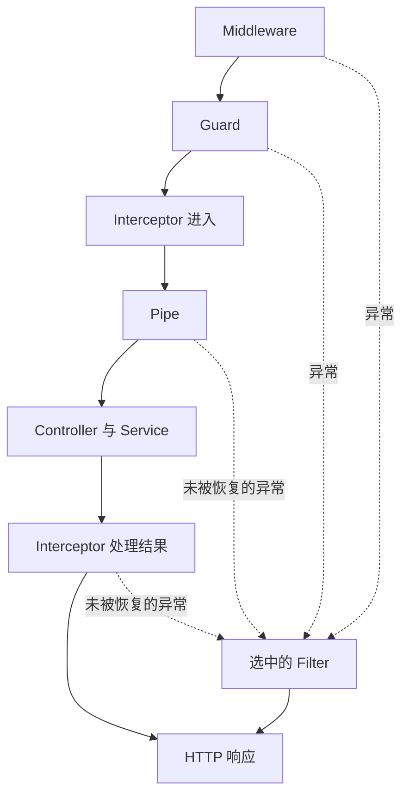

# 第 12 章 请求经过 Nest 时发生了什么

第十一章已经明确了输入、公开输出和错误契约。现在发一次合法的创建请求，可以得到 201、Location 和三个公开字段；输入错误得到 Problem Details。接下来要解决的是：这些规则怎样在增加接口时继续可靠地执行。

目前每个 Controller 方法都要记得套上 `httpResult`，创建方法自己调用 `parseInput`，列表自己调用查询解析与响应映射。Controller 之前还有两个中间件，用另一层 `respond` 完成错误响应。若新增方法时忘记其中一步，类型检查不一定报错，但接口边界已经不同。我们要把这些共同责任接入 Nest 的执行位置，同时保留业务操作本身的独立性。

本章从[第十一章](../chapter-11-contracts/chapter.md)的 `part-02/chapter-11` 开始，完成状态为 `part-02/chapter-12`。仍只有创建、列表、详情三个业务接口，使用同一份内存存储；不新增登录、数据库或业务权限。Nest、RxJS、Zod 版本沿用锁文件。

学习默认运行 `npm run dev`，在 Postman 导入或继续使用 `requests/epp.postman_collection.json`，VS Code 连接 `EPP: attach to npm run dev`。保存源码后等待重新编译、服务监听和调试器重连，再点击 Send。重启会清空 Map，旧详情 ID 需要重新取得。生产仍先构建、准备仅含运行依赖的交付目录，再执行 `npm start`；生产不运行 dev 或 debug，具体交付步骤沿用第五章。

时间参考（估算）：只阅读约 50～60 分钟；跟做另加约 40～50 分钟，合计约 90～110 分钟。按约 6700 个汉字、260 行代码与命令，以及边界迁移、主线失败定位、九组顺序实验和一条请求断言估算，尚未经过读者实测。支线单列，附录按需查阅。

## 12.1 从重复处理推导执行位置

### 为什么不继续包一层函数

`httpResult` 已经比在三个方法里分别写 try/catch 好。只有少数入口时，普通函数完全可以承担这些工作。问题出现在调用覆盖范围：它必须由方法主动调用，Controller 还没执行就发生的失败也不归它捕获。继续给每个位置再加包装函数，会让“有没有接入”成为每个开发者都要记住的约定。

Nest 已经负责路由调用，因此可以在调用前后执行统一逻辑。但统一不意味着把所有事情塞进一个回调。读取字节需要原始请求流，判断当前操作是否允许执行需要知道路由，字段检查需要刚提取的参数，输出检查则必须等业务返回。选择机制，首先要回答“现在拿到了什么，接下来要保证什么”。

我们的 `httpBoundary` 要在 Express 路由匹配前保留路径、方法和查询总量规则；`captureBody` 要在参数提取前把请求流读成值。这些职责继续留在 Middleware。Middleware 的 `next()` 是把控制权交给后面的 Express 层，`next(error)` 是转入错误处理。它没有一个保证等到 Controller 完成才返回的 Promise；在 next 后面写一行日志，不能据此断言业务已经完成。

当一个决定依赖“将要调用哪个类、哪个方法”时，Guard 更合适。它获得 `ExecutionContext`，可以读取 `getClass()`、`getHandler()` 和 HTTP 请求，从已识别的身份及路由元数据判断是否允许进入。返回 true 才继续，返回 false 时 Nest 产生拒绝异常。若要表达不同失败，可抛明确异常。Guard 解决的是操作准入；字段能否转成业务输入仍是下一层的责任。

当前记录服务没有身份要求，也没有新的准入规则，因此不在主线塞入一个永远返回 true 的 Guard。12.3 用独立实验观察它如何截断调用，身份篇再用真实调用者与资源权限落地。自定义请求头只能控制这个实验，不能作为已经认证的身份。

Pipe 位于参数提取之后、Controller 调用之前。`@Body()` 从 request.body 取值，Pipe 接到这个值，检查后返回真正要交给形参的数据。它可以把查询中的 limit 从字符串转成整数；也可以因为非法字段而抛错，使 Controller 根本不执行。读取 JSON 字节与检查 JSON 对象是两个阶段，不能把 Schema Pipe 当作请求体解析器。

Interceptor 包围的是后续调用：进入时已经通过 Guard，调用 `next.handle()` 得到后续结果流，可以在返回结果上做映射，或观察里面抛出的错误。这里“后续”包含 Pipe 和 Controller，所以 Pipe 失败也可能被 Interceptor 观察到。反过来，Guard 在它之前失败，Interceptor 根本没有运行，谈不上记录这次失败。

Filter 接到没有被前面处理掉的异常，决定 HTTP 错误如何返回。它不是每个成功请求最后都会经过的一站，也不是另一个响应包装器。成功返回值交给正常响应流程；异常才交给选中的过滤器。当前目标是让两条路径都只由一个明确的地方完成响应。

### 一条顺序里有分支，也有返回方向

下面只画已匹配到 Nest 路由时的核心关系。Middleware 也能提前结束请求或转入异常；成功的正常返回不经过 Filter。



如果同时有全局、Controller 和方法级的 Guard，按从广到窄的范围进入。Interceptor 同样从外向内进入，正常结果反向穿过：方法级先处理，Controller 级再处理，全局最后处理。把“数据包装”放在不同位置，外层看到的对象会不同，因此不能只看两个拦截器各自是否正确，还要看它们组合后的顺序。

Pipe 要按参数理解。同一个参数会先经过适用的全局、Controller、方法级 Pipe，再经过参数自己声明的 Pipe；一串 Pipe 的返回值交给下一项。不同参数不是一条可以共享临时状态的流水线。当前版本的 `RouterExecutionContext.createPipesFn` 会用 `Promise.all` 等待各参数解析，不能靠某个参数上的异步 Pipe 先完成，给另一个参数准备数据。跨字段判断应接收同一个对象，或放到取得完整输入后的业务调用中。

Filter 的选择又不一样：优先查较局部的匹配过滤器，再向 Controller、全局寻找。一个过滤器接手后，不会再把它生成的响应逐层交给其他过滤器；在过滤器里重新 throw 也不是“交给外层 Filter”的协议。12.3 会改变过滤器作用域，实际看到谁取得了响应责任。

这些是围绕一次路由调用的机制。Swagger 直接登记的 Express 文档路由、未匹配的地址、独立 CLI 中对 Service 的调用，都不能机械套上同一张顺序表。判断某段逻辑能否覆盖它们，要看实际注册与调用关系。

## 12.2 把已有契约接到正确的边界

### 输入 Pipe 返回可信值，Service 继续守住业务规则

新增 `src/schema.pipe.ts`，只负责把上一章的输入解析接到 Nest：

```typescript
import type { PipeTransform } from '@nestjs/common';
import type { z } from 'zod';
import { parseInput } from './input-validation.js';

export class SchemaPipe<T> implements PipeTransform<unknown, T> {
  constructor(private readonly schema: z.ZodType<T>) {}

  transform(value: unknown): T {
    return parseInput(this.schema, value);
  }
}
```

这里没有重新发明字段规则。`parseInput` 仍使用 safeParse，把 issues 转成上一章的字段路径，并抛出 code 为 VALIDATION_ERROR 的 400。构造器接收 Schema，是因为不同参数有不同输入约定；TypeScript 泛型只告诉编辑器返回值类型，真正执行的是 transform 中的解析。

创建接口只对 Body 应用这个 Pipe，不把它注册成全局 Pipe。否则同一个创建 Schema 还可能被用于查询或路径参数，合法的详情 ID 也会被要求具有 originalText。全局适合对所有目标参数都成立的策略，具体业务 Schema 应绑定到具体输入。

查询需要多一步：客户端提交 q、limit，Service 接收 text、数值 limit。将原来的 `parseListQuery` 改成 `src/capture-query.ts` 中的 Pipe：

```typescript
import { Injectable } from '@nestjs/common';
import type { PipeTransform } from '@nestjs/common';
import type { CaptureListOptions } from './capture.js';
import { ListQuerySchema } from './capture-contract.js';
import { parseInput } from './input-validation.js';

@Injectable()
export class CaptureListQueryPipe implements PipeTransform<unknown, CaptureListOptions> {
  transform(value: unknown): CaptureListOptions {
    const parsed = parseInput(ListQuerySchema, value);
    return {
      text: parsed.q,
      limit: parsed.limit === undefined ? undefined : Number(parsed.limit),
    };
  }
}
```

这里一次接收整个 query 对象，重复的 q 或 limit 在 simple parser 中成为数组，仍被 Schema 拒绝；未知键仍忽略。`Number()` 发生在字符串语法检查之后，`01`、空串、指数写法不会因为能转成数字就被放行。查询总量检查仍在原始 URL 阶段，防止解析器先截断后再让 Pipe 检查到一个残缺对象。

`@Injectable()` 使这个类可以参与容器组装；在 CapturesModule 的 providers 中加上 `CaptureListQueryPipe`。SchemaPipe 使用 `new SchemaPipe(CreateCaptureSchema)`，因为只有一份不可变的 Schema 配置，不依赖容器服务。将来需要注入组件时，应提供由容器创建的类或工厂，而不是期待手工 new 自动注入。

Pipe 返回的数据不会反向证明 Service 可以删除自身约束。HTTP 是其中一个调用入口；脚本或未来的后台任务可以绕过 Controller。Service 继续检查 originalText 和查询条件，是为所有业务调用保证规则。HTTP Pipe 额外承担输入表示、字段路径和错误契约，两者责任有交集，但调用覆盖范围不同。

### 输出校验包围业务结果，不接管 HTTP 发送

上一章用 `toCaptureResponse` 手工选字段，再用 Schema 检查。现在三个路由统一使用已经明确的公开响应 Schema：

```typescript
import type { CallHandler, ExecutionContext, NestInterceptor } from '@nestjs/common';
import { map } from 'rxjs';
import type { Observable } from 'rxjs';
import type { z } from 'zod';

export class ResponseSchemaInterceptor implements NestInterceptor {
  constructor(private readonly schema: z.ZodType) {}

  intercept(_context: ExecutionContext, next: CallHandler): Observable<unknown> {
    return next.handle().pipe(map(value => this.schema.parse(value)));
  }
}
```

`next.handle()` 返回 Observable，不是最终对象。`pipe(map(...))` 把“值出现以后执行解析”接到流上，Nest 负责订阅、等待结果并写响应。不能在这里直接 `return this.schema.parse(next.handle())`，那是在检查 Observable 本身；也不能先 subscribe 一次观察结果，再把同一个流返回给 Nest，后者可能再次订阅并重复执行创建。

当前的 `CaptureResponseSchema` 和 `CaptureListResponseSchema` 都是默认移除未知字段的 `z.object`。因此 parse 返回的是按公开字段描述构造的结果，内部字段被移除，非法公开字段导致异常。这个 Schema 现在同时承担字段白名单与运行时检查。若把它换成保留未知字段的 looseObject，公开边界会随之改变；返回类型不会补上这个保护。

输入与输出不能共用 `parseInput`。客户端把 originalText 发成数字应为 400；服务在处理成功后却返回非法 createdAt，是服务违反自己的承诺，应为 500。这里保留 Schema 抛出的异常，让统一 Filter 将未知内部失败处理成 INTERNAL_ERROR。主线也不再同时调用旧映射器，避免两次检查同一份响应；`toCaptureResponse` 留给上一章的独立边界示例。

Interceptor 不给所有结果套 `{ data: ... }`，因为那会改变公开协议。它也不调用 response.json：正常输出继续由 Nest 和 Express 发送，原有 201、Location、GET 的 ETag 及条件响应行为保留。

### 一个 Filter 统一错误格式

新增 `src/problem.filter.ts`：

```typescript
import { Catch } from '@nestjs/common';
import type { ArgumentsHost, ExceptionFilter } from '@nestjs/common';
import type { Response } from 'express';
import { httpFailure, sendJson } from './http.js';

@Catch()
export class ProblemFilter implements ExceptionFilter {
  catch(error: unknown, host: ArgumentsHost): void {
    const response = host.switchToHttp().getResponse<Response>();
    if (response.destroyed || response.writableEnded) return;
    if (response.headersSent) {
      console.error('Late request failure:', error instanceof Error ? error.name : 'UnknownError');
      response.destroy();
      return;
    }
    // A failed response must not advertise the success-only resource location.
    response.removeHeader('Location');
    const failure = httpFailure(error);
    sendJson(response, failure.statusCode, failure.body, {
      'Content-Type': 'application/problem+json; charset=utf-8',
    });
  }
}
```

`@Catch()` 没有列异常类，表示它接收这个作用范围内尚未被处理的异常。`ArgumentsHost` 提供调用参数；这里明确选 HTTP 并取得 Express Response，所以这是 HTTP 过滤器，不是可以原样搬到 WebSocket 或消息消费者的通用错误发送器。

httpFailure 继续负责“错误对应什么公开问题”，Filter 负责“现在如何回应”。之前已有的 InvalidCaptureError、CaptureNotFoundError、HttpError 映射保持不变。额外补上 Nest 自己产生的 4xx，例如 Guard 返回 false 后的 ForbiddenException：

```typescript
export function httpFailure(error: unknown): {
  statusCode: number;
  body: Problem;
} {
  const nestStatus = error instanceof HttpException ? error.getStatus() : undefined;
  const clientStatus = nestStatus !== undefined && nestStatus >= 400 && nestStatus < 500
    ? nestStatus : undefined;
  const statusCode = error instanceof HttpError ? error.statusCode
    : error instanceof InvalidCaptureError ? 400
    : error instanceof CaptureNotFoundError ? 404 : clientStatus ?? 500;
  if (statusCode === 500) console.error('Unhandled request failure:', error instanceof Error ? error.name : 'UnknownError');
  const code = statusCode === 500 ? 'INTERNAL_ERROR'
    : error instanceof InvalidCaptureError ? 'INVALID_CAPTURE'
    : error instanceof CaptureNotFoundError ? 'CAPTURE_NOT_FOUND'
    : error instanceof HttpError ? error.code : `HTTP_${statusCode}`;
  return {
    statusCode,
    body: {
      type: 'about:blank',
      title: STATUS_CODES[statusCode] ?? 'Error',
      status: statusCode,
      detail: statusCode === 500 ? 'Internal server error'
        : error instanceof HttpException ? STATUS_CODES[statusCode] ?? 'Request failed'
        : errorMessage(error),
      code,
      ...(error instanceof HttpError && error.issues ? { issues: error.issues } : {}),
    },
  };
}
```

这些 Nest 4xx 的 code 使用 `HTTP_${statusCode}`，detail 使用 Node `STATUS_CODES` 中的通用短语；不把任意 `getResponse()` 对象直接作为公开正文。已有显式业务错误仍保留原 code 和 detail，Nest 5xx 与未知错误统一为 500／INTERNAL_ERROR，内部异常继续在服务端记录。若未来需要稳定的权限原因，应显式设计错误映射，不能依赖英文提示文字分支。

发送前先检查响应状态。连接已经销毁或响应已经结束时，不能再发送另一份 JSON。headersSent 为 true 表示状态与头已经发出，也不能再把原来的成功改成完整 Problem；本章选择记录后中止这条未完成连接。主线 JSON 在发送前完成检查，正常不会走到这里；文件流和长响应需要自己的错误与中断策略，不能依赖 catch-all 撤回已发字节。

创建方法可能已经设置成功时的 Location，随后输出检查才失败。Filter 因此移除这个成功专用头，避免 500 仍宣称某个资源地址；Allow 这样的错误所需头继续保留。移除头不是撤回写入。Service 若已经完成 insert，响应检查失败后 Map 中仍有数据，直接重试 POST 可能重复创建。

当前所有 Problem 通过 sendJson 直接结束响应，不对错误生成 Express 的自动 ETag；成功返回仍走 Express。既有错误体、状态和媒体类型保持，读者不应把框架碰巧附加的错误缓存标签当成业务契约。

在根模块登记全局 Filter：

```typescript
import { Module } from '@nestjs/common';
import { APP_FILTER } from '@nestjs/core';
import { ProblemFilter } from './problem.filter.js';
import { CapturesModule } from './captures.module.js';

@Module({
  imports: [CapturesModule],
  providers: [{ provide: APP_FILTER, useClass: ProblemFilter }],
})
export class AppModule {}
```

为什么用 APP_FILTER，而不是在每个 Controller 写 `@UseFilters`？我们要覆盖的是整个 HTTP 应用的错误协议，包括还没进入 Controller 的中间件失败。根模块 providers 中的登记让容器创建实例；以后需要注入日志组件时，仍遵守第九、十章的依赖可见性。也可以在启动处 `app.useGlobalFilters(new ProblemFilter())`，但手工构造不经过容器依赖注入。这里只保留一种登记方式，避免重复配置带来不明确的覆盖关系。

### 把 Middleware 的失败交回 Nest

注册全局 Filter 不会追踪所有 detached Promise。必须把错误交到它能接到的调用路径上。保留 `app.ts` 中的 `bodyParser: false`、simple query parser、Swagger 注册及两个 app.use 的相对顺序，只改变 Middleware 的错误出口。

`httpBoundary` 原来在 respond 回调里执行路径、方法和查询数量检查。现在移除这层包装，使用 try/catch，成功仍调用一次 next，失败出口改为：

```typescript
  } catch (error: unknown) {
    response.setHeader('Connection', 'close');
    next(error);
  }
```

失败分支不再自己写响应。当前 Express 适配器把 next(error) 交到 Nest 登记的错误处理层，再调用全局 Filter。Controller 的局部过滤器此时没有已选中的路由上下文，不能替代全局协议。Connection: close 保留原有早期拒绝策略，避免在请求体尚未消费完成时把这个连接继续复用。

`captureBody` 的异步读取要显式连接拒绝路径，完整实现如下：

```typescript
import type { Request, Response, NextFunction } from 'express';
import { HttpError, readJson } from './http.js';

export function captureBody(
  request: Request,
  response: Response,
  next: NextFunction,
): void {
  // httpBoundary has already accepted the path and method.
  if (request.method !== 'POST') {
    next();
    return;
  }
  const mediaType = request.headers['content-type']
    ?.split(';')[0]?.trim().toLowerCase();
  if (mediaType !== 'application/json') {
    response.setHeader('Connection', 'close');
    next(new HttpError(415, 'Content-Type must be application/json', 'UNSUPPORTED_MEDIA_TYPE'));
    return;
  }
  void readJson(request).then(body => {
    request.body = body;
    next();
  }).catch((error: unknown) => {
    response.setHeader('Connection', 'close');
    next(error);
  });
}
```

这段仍只有一个请求体读取方。它返回 void，内部启动的 readJson Promise 不是“框架会自动替我们 await”的返回值，所以 catch 中的 next(error) 是实际错误通道。只写 `void readJson(request)` 不会消除拒绝，更不会自动生成 Problem。已知 media type 不正确时，把异常交出去后立即 return，不能再继续读流并调用第二次 next。

同样，Controller 里启动却没有返回或等待的异步任务，以及稍后独立触发的 timer 回调，都不自动属于这条异常链。请求的过滤器只能处理实际交给它的失败，不能作为进程级兜底；第四章与支线 7B 已区分这类异步归属。

完成接入后，删除 http.ts 中的 respond 与 httpResult，保留 readJson、sendJson、httpFailure、HttpError 和 Problem。错误映射没有复制到三个地方；早期失败与路由内部失败都使用同一 Filter。

### Controller 剩下什么

完成后的 `src/captures.controller.ts` 如下：

```typescript
import { Body, Controller, Get, Param, Post, Query, Res, UseInterceptors } from '@nestjs/common';
import type { Response } from 'express';
import { CapturesService } from './captures.service.js';
import type { CaptureListOptions } from './capture.js';
import { CaptureListQueryPipe } from './capture-query.js';
import { CaptureListResponseSchema, CaptureResponseSchema, CreateCaptureSchema } from './capture-contract.js';
import type { CreateCaptureInput } from './capture-contract.js';
import { SchemaPipe } from './schema.pipe.js';
import { ResponseSchemaInterceptor } from './response-schema.interceptor.js';

@Controller('captures')
export class CapturesController {
  constructor(private readonly captures: CapturesService) {}

  @Get()
  @UseInterceptors(new ResponseSchemaInterceptor(CaptureListResponseSchema))
  async list(@Query(CaptureListQueryPipe) options: CaptureListOptions) {
    return { items: await this.captures.list(options) };
  }

  @Post()
  @UseInterceptors(new ResponseSchemaInterceptor(CaptureResponseSchema))
  async create(
    @Body(new SchemaPipe(CreateCaptureSchema)) input: CreateCaptureInput,
    @Res({ passthrough: true }) response: Response,
  ) {
    const capture = await this.captures.create(input.originalText);
    response.setHeader('Location', `/captures/${capture.id}`);
    return capture;
  }

  @Get(':id')
  @UseInterceptors(new ResponseSchemaInterceptor(CaptureResponseSchema))
  detail(@Param('id') id: string) {
    return this.captures.find(id);
  }
}
```

列表只接收已经转换好的业务选项，创建只传原文并设置 HTTP 资源地址，详情返回查找结果。框架机制并没有替业务决定如何筛选或如何保存，它只是确保指定的边界围绕路由调用执行。

创建保留 `@Res({ passthrough: true })`，因为我们只设置 Location，响应正文仍由 Nest 发送。若换成普通 `@Res()` 并手动 json，响应映射就无法保证在发送前接管那个对象；不要把两种完成方式混用。默认 GET 仍是 200，POST 仍是 201，省略路由装饰器上的响应状态并不意味着所有返回值都是 200。

本章也没有加 `ParseUUIDPipe`。当前详情对任意未找到的路径 ID 返回 404；直接增加 UUID Pipe 会把一部分请求改成 400，这是协议变化，不能伪装成只整理代码。输入边界的选择必须以现有契约为依据。

最后核对 CapturesModule 已加入查询 Pipe，运行 `npm run check`。开发进程使用 .dev，检查构建使用 dist，可以并行；生产产物另用 3001 端口及 Postman 的产物集合验证，避免将开发响应误认为交付结果。

## 12.3 沿失败的位置选择断点，再改变执行条件

### 先追主线中的两类 400

在 `SchemaPipe.transform`、`CapturesController.create`、`ResponseSchemaInterceptor` 的 map 回调和 `ProblemFilter.catch` 设置断点。Postman 选择集合里的“04 原文类型错误”，保留合法 JSON，Send。请求应进入 SchemaPipe 并抛出输入异常，Controller 和输出 map 不执行，最后停在 Filter；外部得到 VALIDATION_ERROR。调用栈用于确认当前是谁调用了 transform，不要因为 Inspector 里显示了 rxjs 调度帧就把错误归给 RxJS。

再发送“05 JSON 格式错误”，正文只有一个左花括号。它应在 readJson 的 end 回调中失败，经 captureBody 的 catch 交给 next(error)，到 Filter。SchemaPipe、Controller 和输出 map 都不会运行。如果 Filter 收到了错误而业务断点没有命中，这恰好符合错误发生的位置。

第三次发送合法创建。按顺序观察 Pipe 返回值、Service 的 insert、Controller 返回对象、输出 map。Map 写入与 HTTP 结果出现仍是不同时间点。若改变输出 Schema 或存储返回值制造输出失约，应看到内部错误被转换成 500，而不是又一次输入错误；详情与列表能帮助判断写入是否已经发生。

每次只改变一个条件，先保留失败请求，再修改源码。保存引发重启后先等监听日志与调试重连，再重发；请求变量里的旧 id 不会随着新进程自动更新。没有收到 HTTP 响应时先检查连接与进程，不要先改 Schema。

### 用独立应用看主线没有理由增加的机制

完整请求顺序实验位于 `src/labs/request-pipeline.ts`，启动入口是 `src/labs/request-pipeline-server.ts`，不导入主线 AppModule。它不增加记录接口，也不复活第七章的简易 Nest；这里运行的就是当前依赖中的 Nest。

先停止主线 dev，再执行：

```bash
npm run dev:pipeline
```

实验使用 3006 端口，调试端口仍为 9229。VS Code 继续使用同一个 attach 配置。在 Postman 导入 `requests/pipeline.postman_collection.json`，逐条点击 Send。已有普通集合的 baseUrl 保持 3000；实验集合使用自己的 labUrl，避免来回改动业务请求。

为了沿用保存即编译、重启与重新连接，开发脚本只增加可选入口参数：

```javascript
const entry = process.argv[2] ?? '.dev/src/server.js';
```

spawn 的参数列表中，把原先固定的 `.dev/src/server.js` 换成 entry。package.json 新增：

```json
{
  "dev:pipeline": "NODE_ENV=development node --env-file-if-exists=.env scripts/dev.mjs .dev/src/labs/request-pipeline-server.js"
}
```

独立入口还需要对应独立的交付范围。实验放进 src/labs 后，如果生产继续编译整个 src，虽然路由没有挂到主线，实验文件仍会进入交付目录。新增 `tsconfig.build.json`，继承相同编译规则，只排除这组机制实验：

```json
{
  "extends": "./tsconfig.json",
  "exclude": ["src/labs/**"]
}
```

把 build 命令调整为 `npm run clean && tsc -p tsconfig.build.json && node scripts/copy-assets.mjs`。typecheck 使用 tsconfig.json，开发监听使用继承它的 tsconfig.dev.json，保证实验也接受类型检查；生产构建先清理旧目录，再生成业务产物。构建后检查 dist/src 中没有 labs，而 server、app 和配置仍完整。exclude 控制项目发现的文件，不能阻止业务代码显式 import 一个实验文件，所以 AppModule 与业务模块也不能导入这组实验。

普通 `npm run dev` 的默认入口不变。两个命令不要同时启动；即使业务端口不同，它们仍共享调试端口与 .dev。结束实验用 Ctrl+C，再运行主线 dev。这个实验没有独立生产部署目标；主线生产启动始终是 `npm start`。

实验 Middleware 记录进入，并监听 response 的 finish 与 close。正常 next 之后是 Guard。Guard 核心代码为：

```typescript
canActivate(context: ExecutionContext): boolean {
  record('guard');
  const request = context.switchToHttp().getRequest<Request>();
  return request.headers['x-demo-block'] !== '1';
}
```

实验工厂每次创建独立的应用，把 record 函数留在这份演示的闭包里。关键绑定如下；DemoPipe 检查 value 并返回解析结果，TraceFilter 在记录名称后调用同一 ProblemFilter：

```typescript
@Controller('pipeline')
@UseGuards(DemoGuard)
@UseInterceptors(new TraceInterceptor('inner'))
class PipelineController {
  @Post()
  run(@Body(new DemoPipe()) input: Value) {
    record('handler');
    if (input.value === 'fail') throw new Error('demonstration failure');
    if (input.value === 'bad-output') return { value: 7 };
    return { value: input.value, internalNote: 'not public' };
  }

  @Post('local-filter')
  @UseFilters(new TraceFilter('route'))
  localFilter(@Body(new DemoPipe()) input: Value) {
    record('handler');
    throw new HttpError(409, `Demonstration conflict: ${input.value}`, 'LAB_CONFLICT');
  }
}
```

应用创建后再登记外层与全局错误出口：

```typescript
app.useGlobalInterceptors(new TraceInterceptor('outer'));
app.useGlobalFilters(new TraceFilter('global'));
```

同一请求还有外层全局 Interceptor、内层 Controller Interceptor、Body Pipe 与 Controller 方法。正常输入为 `{"value":"hello"}`；方法返回的 internalNote 由输出 Schema 移除。实验日志只记录阶段标签，方便短时逐条对照，下一章再建立可用于并发排查的结构化日志与请求关联。

正常请求应看到以下阶段先后出现：Middleware、Guard、outer:before、inner:before、Pipe、Handler，然后是 inner:next、outer:next，之后流收尾，再看到 finish:201。进入顺序与结果方向相反，这就是外层可以观察内层处理后结果的原因。

不要把所有标签当成同一条同步调用栈。请求读取回调、Promise 恢复、Observable 通知与响应事件会跨异步边界发生。断点可以看“这一次暂停的当前帧与变量”；先后事件还需要结合逐条请求的阶段记录。已结束的 Middleware 回调不会因为后来发生错误而重新出现在普通同步栈中。

### 失败的发生位置，决定哪些观察者有机会运行

集合把实质条件分开保存，先预测缺少哪些阶段，再发送观察：

| 请求 | 改变的条件 | 应看到的结果与关键缺席 |
| --- | --- | --- |
| 02 Middleware 拒绝 | x-demo-middleware-error=1 | 400／LAB_MIDDLEWARE；没有 Guard、Interceptor、Pipe、Handler |
| 03 Guard 拒绝 | x-demo-block=1 | 403／HTTP_403；没有两个 Interceptor、Pipe、Handler |
| 04 Pipe 拒绝 | value 为数字 7 | 400／LAB_INPUT；两个 Interceptor 观察到 error，Handler 不运行 |
| 05 Handler 抛错 | value 为 fail | 500／INTERNAL_ERROR；Pipe 和 Handler 已运行，输出的 next 不出现 |
| 06 输出失约 | value 为 bad-output | Handler 返回数字字段；输出检查失败为 500 |

实验中的普通 Nest 4xx 被统一映射，所以 Guard 的默认 ForbiddenException 不会突然返回另一种 JSON 格式。若删掉全局 Filter，这个差异就会重新出现。对于未知异常，响应不包含内部堆栈；终端诊断与公开错误分别服务于维护者和调用者。

Middleware 与 Guard 的错误虽然都能到达全局 Filter，却没有进入 Interceptor。因此单靠 Interceptor 统计所有 HTTP 失败会漏掉它们，也会漏掉直接完成响应的文档路由。下一章安排入口与响应事件日志，是由这个覆盖范围推导出来的，不能仅因为 Interceptor 有前后两个位置就把它当作全流量计时器。

### catchError、短路和局部过滤器会改变结果

实验内层 Interceptor 的正常路径使用下面这组操作：

```typescript
return next.handle().pipe(
  map(value => this.name === 'inner' ? ValueSchema.parse(value) : value),
  tap({
    next: () => record(`${this.name}:next`),
    error: () => record(`${this.name}:error`),
  }),
  catchError((error: unknown) => {
    if (this.name === 'inner' && request.headers['x-demo-recover'] === '1') {
      record('inner:recover');
      return of({ value: 'recovered' });
    }
    return throwError(() => error);
  }),
  finalize(() => record(`${this.name}:finalize`)),
);
```

先发“05 Handler 抛错”，再发“07 转为恢复值”。输入同样是 fail，后者多了恢复头。原来的异常被 catchError 替换成正常值，外层看到 next，Filter 不再运行；POST 的默认状态仍是 201。一次真实失败可以这样被包装成看起来成功的 HTTP 响应。因此“统一错误处理”不能简单写成捕获后返回 `{ error: ... }`。要继续失败，返回 throwError；只有业务确实定义了可接受的替代结果，才应恢复成值。

恢复值从 catchError 的位置继续向后，不会倒回前面的 map 再检查一次。当前演示返回固定合法值；若改成来自另一份外部数据，必须明确它是否也通过公开输出检查。操作符位置会改变覆盖范围，而不只是改变代码排列。

“08 短路不调用下游”在内层进入时直接返回 `of({ value: 'short-circuit' })`，没有调用 next.handle。即使 Body 里的 value 是数字，这次也得到 201，Pipe 和 Handler 都不运行，外层仍能观察到返回值。这里没有内层 finalize 标签，因为它连下面那段 pipe 都没有建立。缓存拦截器经常利用短路；采用前要检查哪些验证或副作用会被跳过，不能把“经过 Guard”理解成“所有业务条件都已确认”。

“09 路由过滤器接手”在方法上登记局部 TraceFilter。方法抛出 LAB_CONFLICT 后应只有 filter:route，没有 filter:global。局部过滤器继承同一 ProblemFilter，所以格式仍相同；若局部实现自行发送另一种格式，全局 Filter 不会在后面再替它修正。绑定范围既影响谁能看见异常，也决定哪个组件拥有最终响应。

### 流结束、响应发送与业务完成不是一件事

finalize 在 Observable 完成、失败或取消订阅时执行，它不是成功回调，也不是 HTTP 发送完成通知。这个实验里，失败请求的 finalize 可能先于 Filter 发送 Problem；正常请求的 finalize 也早于 response 的 finish。若在 finalize 里读取 response.statusCode 来统计最终失败，可能还看到尚未被 Filter 改写的默认状态。

response 的 finish 表示服务端已把最后一段头和正文交给底层发送，不表示客户端已经解析或采纳；close 也可能发生在正常结束后，应结合 writableFinished 判断，不能把每次 close 都算成客户端中断。再向业务层看，数据库提交、外部请求成功与客户端收到响应又是不同完成条件。第十一章的“写入后输出失败”仍然成立，Interceptor 的收尾没有赋予回滚能力。

如果 next.handle、订阅、map 和 finalize 的差异还只能靠记名字区分，读完正文后继续支线 12A。它用独立程序把重复订阅、错误恢复和超时后继续写入展开，说明这些差异如何直接影响接口正确性。

## 12.4 用一个最小请求断言留下回归证据

日常仍然先用 Postman 与断点定位。自动化有价值的地方是：一个曾经修好的边界，在下次移动代码后可以快速确认没有失效。本章最值得保留的是“非法 JSON 在 Controller 之前失败，却仍走统一 Problem，且没有写入”。只检查创建方法的返回值看不到这个错误出口，所以用一次真正发向应用的 HTTP 调用。

新增 `test/captures.test.mjs`，使用 Node 自带的测试入口与 assert，不安装测试框架：

```javascript
import test from 'node:test';
import assert from 'node:assert/strict';
import { createApp } from '../dist/src/app.js';

test('invalid JSON returns a Problem and does not create a capture', async t => {
  const app = await createApp();
  t.after(() => app.close());
  await app.listen(0, '127.0.0.1');
  const baseUrl = await app.getUrl();
  const failure = await fetch(`${baseUrl}/captures`, {
    method: 'POST',
    headers: { 'Content-Type': 'application/json' },
    body: '{',
    signal: AbortSignal.timeout(3000),
  });
  assert.equal(failure.status, 400);
  assert.match(failure.headers.get('content-type'), /^application\/problem\+json/);
  assert.equal((await failure.json()).code, 'INVALID_JSON');
  const list = await fetch(`${baseUrl}/captures`, { signal: AbortSignal.timeout(3000) });
  assert.equal(list.status, 200);
  assert.deepEqual(await list.json(), { items: [] });
});
```

测试创建自己的一份应用和内存存储，用端口 0 让系统选择可用端口，而不是连到你正在调试的服务。t.after 负责收尾，避免失败后遗留监听。断言同时核对 HTTP 状态、媒体类型、稳定 code 和没有新增数据，不依赖英文错误消息或随机 ID。它证明的是这一条行为；通过一个断言文件不能推出所有接口正确。

package.json 增加 `"test": "npm run build && NODE_ENV=test node --test test/*.test.mjs"`。可以保持 dev，在另一终端执行：

```bash
npm test
```

命令先构建再运行，避免误测旧 dist。若已经构建且源码未变化，也可以用 `NODE_ENV=test node --test test/captures.test.mjs` 只运行这个文件。读输出时区分构建错误、端口启动失败、请求超时和断言不符；尚未监听就失败，与收到错误状态码不是同一个问题。测试模式默认关闭文档，应用使用独立内存和随机端口，不会清空开发服务的数据。完成后继续图形客户端的修改循环。

这里不扩展测试分层、覆盖率目标或整套模拟工程。以后修复回归时，选择一个能观察到外部差异的最小断言：例如失败不写入、重复提交不重复扣减、权限变化后不能读取旧资源。实际需求引入哪个责任，再保留相应证据，避免只为实现里的每个函数复制一份相同条件。

本章完成后，输入与输出规则仍来自第十一章的 Schema，业务约束仍在 Service，字节与路径边界仍在 Middleware。变化是调用覆盖由路由接入机制保证，错误出口集中到一个 Filter。下一章会继续处理当前还缺少的运行问题：配置是否在启动前完整可用，依赖何时就绪，请求如何关联，退出时谁负责收尾。

本章完成代码状态：`part-02/chapter-12`。

## 本章知识支线

- [支线 12A：Observable 的订阅、错误与收尾边界](side-01-observable-boundaries.md)：用重复订阅、恢复值与超时后的底层工作，解释 Interceptor 为什么不能按普通函数的直觉使用。

## 附录：本章必要技术点速查

| 名称 | 本章用途 | 必要注意点 |
| --- | --- | --- |
| Middleware／next(error) | 保留字节、URL 边界并转交失败 | next 不是等待后续完成的 Promise |
| CanActivate／ExecutionContext | 判断能否进入已匹配的操作 | 在 Pipe 与 Interceptor 之前，不依赖已转换的形参 |
| PipeTransform／transform | 检查并返回 Controller 参数 | 同参数串联，不同参数不依赖异步完成顺序 |
| @Body／@Query 的 Pipe 参数 | 对明确输入绑定 Schema | 类型注解不会自动建立 Zod 解析 |
| NestInterceptor／CallHandler | 包围后续调用并处理结果流 | 不手动订阅，不重复调用下游 |
| map／tap | 变换值／观察通知 | map 中抛错进入错误通道；tap 不替换原值 |
| catchError／throwError／of | 继续失败或改成正常值 | 恢复后不再进 Filter，状态码不会自动变成失败 |
| finalize | 流收尾观察 | 不代表成功、HTTP 发送完成或事务回滚 |
| @Catch／ExceptionFilter | 将未处理异常写成 Problem | 成功不经过 Filter，已发送响应无法改写 |
| APP_FILTER | 由容器登记全局 Filter | 全局覆盖与依赖可见性是两件事 |
| @Res 的 passthrough | 只设置 Location，保留自动正文发送 | 手动 json 会绕过返回值的发送责任 |
| response.finish／close | 观察传输侧完成与关闭 | 不证明调用方收到，不将所有 close 视为异常 |
| node:test／assert | 保留一条跨 HTTP 边界的回归 | 独立应用、随机端口、显式收尾；先构建 dist，开发使用 .dev |

官方查阅：[Nest 请求生命周期](https://docs.nestjs.com/faq/request-lifecycle)、[Middleware](https://docs.nestjs.com/middleware)、[Guard](https://docs.nestjs.com/guards)、[Pipe](https://docs.nestjs.com/pipes)、[Interceptor](https://docs.nestjs.com/interceptors)、[Filter](https://docs.nestjs.com/exception-filters)、[RxJS Observable](https://rxjs.dev/guide/observable)、[Node HTTP 响应事件](https://nodejs.org/docs/latest-v24.x/api/http.html#class-httpserverresponse)、[Node 测试入口](https://nodejs.org/docs/latest-v24.x/api/test.html)。代码以项目锁定的 Nest 11.2.5、RxJS 7.8.2 为准；框架内部文件用于核对行为，不作为应用依赖的私有 API。

[上一章：建立可信的输入与错误边界](../chapter-11-contracts/chapter.md) · [返回第二篇](../README.md) · [返回全书目录](../../README.md)
