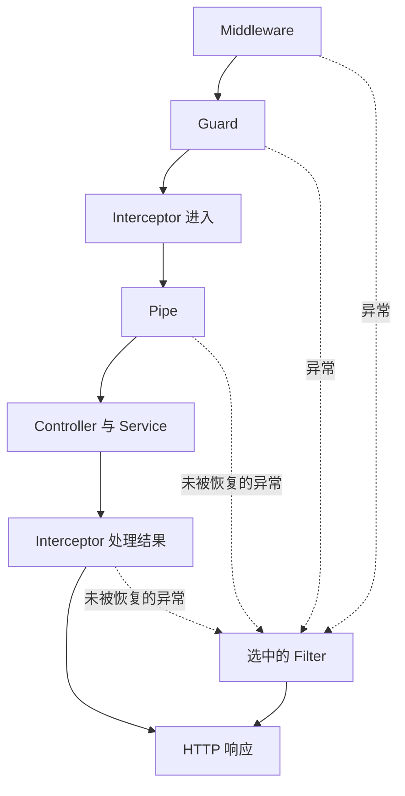
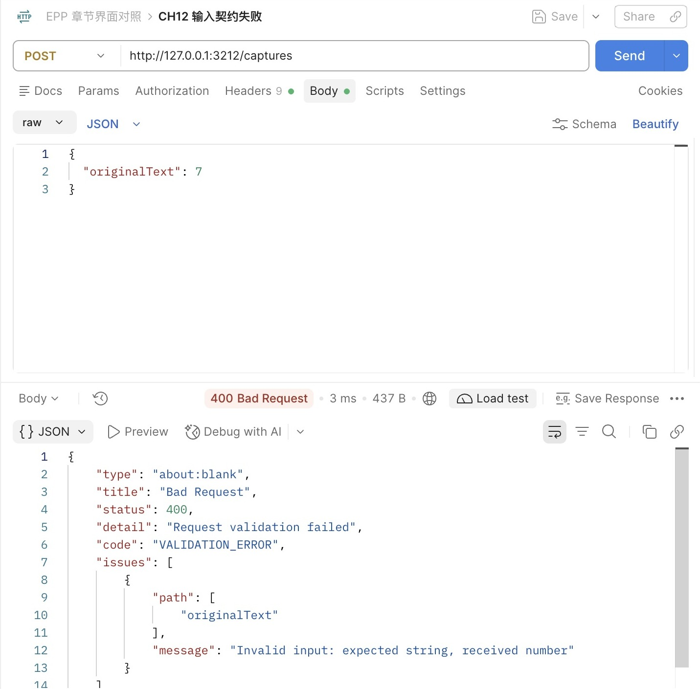

# 第 13 章 请求经过 Nest 时发生了什么

第十二章已经明确了输入、公开输出和错误契约。现在发一次合法的创建请求，可以得到 201、Location 和三个公开字段；输入错误得到 Problem Details。接下来要解决的是：这些规则怎样在增加接口时继续可靠地执行。

目前每个 Controller 方法都要记得套上 `httpResult`，创建方法自己调用 `parseInput`，列表自己调用查询解析与响应映射。Controller 之前还有两个中间件，用另一层 `respond` 完成错误响应。若新增方法时忘记其中一步，类型检查不一定报错，但接口边界已经不同。我们要把这些共同责任接入 Nest 的执行位置，同时保留业务操作本身的独立性。

本章从[第十二章](../chapter-12-contracts/chapter.md)的 `part-02/chapter-12` 开始，完成状态为 `part-02/chapter-13`。仍只有创建、列表、详情三个业务接口，使用同一份内存存储；不新增登录、数据库或业务权限。Nest、RxJS、Zod 版本沿用锁文件。

学习默认运行 `npm run dev`，在 Postman 导入或继续使用 `requests/epp.postman_collection.json`，VS Code 连接 `EPP: attach to npm run dev`。保存源码后等待重新编译、服务监听和调试器重连，再点击 Send。重启会清空 Map，旧详情 ID 需要重新取得。生产仍先构建、准备仅含运行依赖的交付目录，再执行 `npm start`；生产不运行 dev 或 debug，具体交付步骤沿用第六章。

阅读约 80～100 分钟，跟做另加约 55～75 分钟，合计约 135～175 分钟。可在 13.2 查询对照完成后暂停，也可在 13.3 同进程核对完创建结果、恢复源码后再转入独立实验。支线另计。

## 13.1 从重复处理推导执行位置

### 为什么不继续包一层函数

`httpResult` 已经比在三个方法里分别写 try/catch 好。只有少数入口时，普通函数完全可以承担这些工作。问题出现在调用覆盖范围：它必须由方法主动调用，Controller 还没执行就发生的失败也不归它捕获。继续给每个位置再加包装函数，会让“有没有接入”成为每个开发者都要记住的约定。

Nest 已经负责路由调用，因此可以在调用前后执行统一逻辑。但统一不意味着把所有事情塞进一个回调。读取字节需要原始请求流，判断当前操作是否允许执行需要知道路由，字段检查需要刚提取的参数，输出检查则必须等业务返回。选择机制，首先要回答“现在拿到了什么，接下来要保证什么”。

我们的 `httpBoundary` 要在 Express 路由匹配前保留路径、方法和查询总量规则；`captureBody` 要在参数提取前把请求流读成值。这些职责继续留在 Middleware。Middleware 的 `next()` 是把控制权交给后面的 Express 层，`next(error)` 是转入错误处理。它没有一个保证等到 Controller 完成才返回的 Promise；在 next 后面写一行日志，不能据此断言业务已经完成。

当一个决定依赖“将要调用哪个类、哪个方法”时，Guard 更合适。它获得 `ExecutionContext`，可以读取 `getClass()`、`getHandler()` 和 HTTP 请求，从已识别的身份及路由元数据判断是否允许进入。返回 true 才继续，返回 false 时 Nest 产生拒绝异常。若要表达不同失败，可抛明确异常。Guard 解决的是操作准入；字段能否转成业务输入仍是下一层的责任。

当前记录服务没有身份要求，也没有新的准入规则，因此不在主线塞入一个永远返回 true 的 Guard。13.3 用独立实验观察它如何截断调用，身份篇再用真实调用者与资源权限落地。自定义请求头只能控制这个实验，不能作为已经认证的身份。

Pipe 位于参数提取之后、Controller 调用之前。`@Body()` 从 request.body 取值，Pipe 接到这个值，检查后返回真正要交给形参的数据。它可以把查询中的 limit 从字符串转成整数；也可以因为非法字段而抛错，使 Controller 根本不执行。读取 JSON 字节与检查 JSON 对象是两个阶段，不能把 Schema Pipe 当作请求体解析器。

Interceptor 包围的是后续调用：进入时已经通过 Guard，调用 `next.handle()` 得到后续结果流，可以在返回结果上做映射，或观察里面抛出的错误。这里“后续”包含 Pipe 和 Controller，所以 Pipe 失败也可能被 Interceptor 观察到。反过来，Guard 在它之前失败，Interceptor 根本没有运行，谈不上记录这次失败。

Filter 接到没有被前面处理掉的异常，决定 HTTP 错误如何返回。它不是每个成功请求最后都会经过的一站，也不是另一个响应包装器。成功返回值交给正常响应流程；异常才交给选中的过滤器。当前目标是让两条路径都只由一个明确的地方完成响应。

拿列表做一次纸上联调。需求是“在含有『草稿』的素材里取一条”。当浏览器或 Postman 发出请求，线路上传的是带查询串的地址。入口能看见调用者用了哪一种方法、写了几个参数、是否命中了集合路径，却还没有取出供业务使用的选项。到参数提取时，一个名为 q 的键才和它的值一起出现在对象上，limit 此时仍是文字。等查询 Pipe 返回，业务才可以要求上限参加整数比较。最后从存储拿到的是若干条记录，要包成带 items 的列表，才能作为一次列表操作的结果返回。沿途至少有四种表示；把一个地方观察到的形状当作全程都成立，调试器里的变量就会处处显得“不对”。

比如需求中说“一条”，入口据此能判断上限文字是否在约定范围，却无法判断应该返回哪一条。必须知道哪些原文包含关键词才能截取结果。反过来，让存储判断查询串是不是出现了两次同名参数也太迟了，转成业务选项时可能已经丢掉第二个值。当你觉得两处都能放同一项检查时，试着把两种理应得到不同答复的输入沿途写下来。若到了某一层，两者已经变成同一个值，那一层就无法独立作判断。若在某一层，还缺少作判断所需的事实，则应让下一层接手。

把同一方法用于创建。到达服务器的是一串字节，假如正文只写了半个对象，这时连字段名都未必取得，谈不上指出某个字段类型错误。读到一个完整对象后，才有条件告诉编辑表单“原文栏需要文字”。即便两种问题在界面上都叫保存失败，用户接下来能做的事却不同。前一种要看发出的原始正文，后一种要看从表单状态构造请求的代码。由此可以推回错误出口的设计：保留产生错误的原因，集中决定发给客户端的格式。如果把所有失败先改写成一句“提交失败”，后面再统一包装也找不回这些差别。

还有一项容易放错地方的决定：谁确定这份输入可以成为一条新素材？假如明天有一个本地导入程序，直接把已经分好行的文字交给 Service，它根本没有查询串、状态码或响应头。要求它先造一个假的 HTTP 请求才能检查原文，说明业务条件绑在了传输方式上。保留 Service 的原文规则后，导入程序与网页都能守住同一条约束，而“错误落在哪个控件上”仍由网页使用的输入契约解释。这个假设不用实现新入口就能帮助我们辨认现有职责。

从前端组件的经验看，给按钮的点击回调包一层函数，只能观察到回调确实被调用之后的事。表单在提交前拦下了输入，点击回调里的计数就回答不了“有多少次没有提交出去”。这里也一样。围住 Controller 的函数很适合观察业务用了什么输入，却不能统计多少请求连路径都没通过。若只为改变返回对象的形状，围得太广又会把没有业务返回值的请求也算进来。覆盖面应由要回答的问题决定；先把想观察的那一笔请求画出来，再选可见那一步的机制。

### 一条顺序里有分支，也有返回方向

下面只画已匹配到 Nest 路由时的核心关系。Middleware 也能提前结束请求或转入异常；成功的正常返回不经过 Filter。



如果同时有全局、Controller 和方法级的 Guard，按从广到窄的范围进入。Interceptor 同样从外向内进入，正常结果反向穿过：方法级先处理，Controller 级再处理，全局最后处理。把“数据包装”放在不同位置，外层看到的对象会不同，因此不能只看两个拦截器各自是否正确，还要看它们组合后的顺序。

Pipe 要按参数理解。同一个参数会先经过适用的全局、Controller、方法级 Pipe，再经过参数自己声明的 Pipe；一串 Pipe 的返回值交给下一项。不同参数不是一条可以共享临时状态的流水线。当前版本的 `RouterExecutionContext.createPipesFn` 会用 `Promise.all` 等待各参数解析，不能靠某个参数上的异步 Pipe 先完成，给另一个参数准备数据。跨字段判断应接收同一个对象，或放到取得完整输入后的业务调用中。

Filter 的选择又不一样：优先查较局部的匹配过滤器，再向 Controller、全局寻找。一个过滤器接手后，不会再把它生成的响应逐层交给其他过滤器；在过滤器里重新 throw 也不是“交给外层 Filter”的协议。13.3 会改变过滤器作用域，实际看到谁取得了响应责任。

这些是围绕一次路由调用的机制。Swagger 直接登记的 Express 文档路由、未匹配的地址、独立 CLI 中对 Service 的调用，都不能机械套上同一张顺序表。判断某段逻辑能否覆盖它们，要看实际注册与调用关系。

读图时还要给箭头分辨方向。入口这半程主要回答“接下来允许谁执行”，回程这半程主要回答“已完成的那一层交出来什么”。假定里层负责把记录裁成公开字段，外层只数结果里有几个字段。进入外层时尚无记录，提前计数只能数到请求内容。让外层在返回方向计数，才会数到里层已经裁好的对象。现在只调换两者的登记范围，公开响应可能长得完全相同，计数却可能包含内部字段。仅看客户端最后拿到的正文，无法推断观察者看见的就是那份正文。

错误也有方向。假定字段检查在参数阶段抛出异常，包在外面的拦截器可以观察到一次错误，但没有拿到可供正常映射的素材。它可以让错误继续传播，这时才有过滤器取得响应责任。假如拦截器把错误变成普通值，外层从此沿着成功方向处理，不能再从“全局也注册了过滤器”推出客户端会收到错误。这两种结果的分界在于哪一层仍保留错误通道，与最后返回的对象里有没有一个叫 error 的键无关。

再看范围与实例的区别。一份查询 Pipe 可以为许多次列表请求服务，某一笔请求的原始 q 和转换后的选项却只属于那次调用。若把“上一个参数解析的结果”存在 Pipe 的实例属性上，然后期待详情或另一个参数来读取，哪怕单步调试时看起来恰好相邻，第二笔请求也可能先写入同一位置。把解析值作为返回值交给这一笔调用的形参，既保持对应关系，也省去清理实例状态的工作。类似地，全局登记描述哪些调用可以经过同一组件，并不说明这些调用可以共享临时业务数据。

可以把图读到两次交接就暂停。第一次交接是业务开始前：如果此刻停止，调用方究竟交出了一段尚未读完的正文、一个未检查的对象，还是已经可以传给 Service 的值？第二次交接是业务返回后：存储、Controller、框架、客户端分别握有什么证据？比如存储里已经有了记录，Controller 手里有对象，但负责输出的那一层还在核对时间字段。此时说“保存完成”对存储成立，对正在等待可显示结果的调用者仍早了一步。下面把每个接点落实到这个项目的代码上。

## 13.2 把已有契约接到正确的边界

### 输入 Pipe 返回可信值，Service 继续守住业务规则

新增 `src/schema.pipe.ts`，只负责把上一章的输入解析接到 Nest：

```typescript
import type { PipeTransform } from '@nestjs/common';
import type { z } from 'zod';
import { parseInput } from './input-validation.js';

export class SchemaPipe<T> implements PipeTransform<unknown, T> {
  constructor(private readonly schema: z.ZodType<T>) {}

  transform(value: unknown): T {
    return parseInput(this.schema, value);
  }
}
```

这里没有重新发明字段规则。`parseInput` 仍使用 safeParse，把 issues 转成上一章的字段路径，并抛出 code 为 VALIDATION_ERROR 的 400。构造器接收 Schema，是因为不同参数有不同输入约定；TypeScript 泛型只告诉编辑器返回值类型，真正执行的是 transform 中的解析。

创建接口只对 Body 应用这个 Pipe，不把它注册成全局 Pipe。否则同一个创建 Schema 还可能被用于查询或路径参数，合法的详情 ID 也会被要求具有 originalText。全局适合对所有目标参数都成立的策略，具体业务 Schema 应绑定到具体输入。

查询需要多一步：客户端提交 q、limit，Service 接收 text、数值 limit。将原来的 `parseListQuery` 改成 `src/capture-query.ts` 中的 Pipe：

```typescript
import { Injectable } from '@nestjs/common';
import type { PipeTransform } from '@nestjs/common';
import type { CaptureListOptions } from './capture.js';
import { ListQuerySchema } from './capture-contract.js';
import { parseInput } from './input-validation.js';

@Injectable()
export class CaptureListQueryPipe implements PipeTransform<unknown, CaptureListOptions> {
  transform(value: unknown): CaptureListOptions {
    const parsed = parseInput(ListQuerySchema, value);
    return {
      text: parsed.q,
      limit: parsed.limit === undefined ? undefined : Number(parsed.limit),
    };
  }
}
```

这里一次接收整个 query 对象，重复的 q 或 limit 在 simple parser 中成为数组，仍被 Schema 拒绝；未知键仍忽略。`Number()` 发生在字符串语法检查之后，`01`、空串、指数写法不会因为能转成数字就被放行。查询总量检查仍在原始 URL 阶段，防止解析器先截断后再让 Pipe 检查到一个残缺对象。

`@Injectable()` 使这个类可以参与容器组装；在 CapturesModule 的 providers 中加上 `CaptureListQueryPipe`。SchemaPipe 使用 `new SchemaPipe(CreateCaptureSchema)`，因为只有一份不可变的 Schema 配置，不依赖容器服务。将来需要注入组件时，应提供由容器创建的类或工厂，而不是期待手工 new 自动注入。

Pipe 返回的数据不会反向证明 Service 可以删除自身约束。HTTP 是其中一个调用入口；脚本或未来的后台任务可以绕过 Controller。Service 继续检查 originalText 和查询条件，是为所有业务调用保证规则。HTTP Pipe 额外承担输入表示、字段路径和错误契约，两者责任有交集，但调用覆盖范围不同。

逐行想一遍一次列表调用。Postman 的 Params 表中填 q 为“草稿”、limit 为“2”，两行均勾选。此时最早能知道的是地址里有两项。提取后，Pipe 收到的对象中有两个字符串；经过 Schema 后仍然是两个字符串，因为这里的表达式描述的是十进制文字允许怎样写。返回时才把 q 改作 text，把第二个值变成数值二。Service 无需记住网页的键名，也无需猜测调用者用哪种文字表示二。将来就算查询界面给控件改了显示名称，只要线路上的键保持一致，业务层完全不必跟着改名。

“没有指定上限”和“指定了一个不合法的上限”在界面上相隔很近。在 Params 中取消 limit 的勾选，发出的地址没有这一项，解析结果允许缺省，存储可以遍历所有匹配行。勾选这一项而把值框留空，会传来一个实际存在的空字符串。此时缺省分支不成立，字符串规则不通过，整个列表请求应被拒绝。若用取整加上一个兜底值，两个动作可能都变成同一个数字，用户就无法从响应发现自己提交了空值。核对这类问题应展开 Postman 最终生成的地址，不能只看灰色的输入框里还显示着什么。

查询词也有容易忽略的细节。规则要求至少一个非空白字符，并没有说要替用户裁掉首尾空格。假设有两条原文“草稿甲”和“我的 草稿乙”，查询词仅为“草稿”时两条都符合；若词的第一个字符是一个空格，只有后一条含有整个字面片段。把判断用的 trim 结果直接当作搜索词，会悄悄扩大匹配范围。创建原文时同样应区分“用什么办法判断全为空白”和“通过以后实际保存哪段文字”。对用户而言，缩进可能就是原文的一部分；对 Service 而言，判断通过后仍交出原字符串才符合约定。

还可以从报表为空倒推接线错误。若 Pipe 错把 q 原名交给只读取 text 的 Service，缺省查询词本来就合法，调用很可能成功，状态仍是二百。只建一条恰好含关键词的素材，看不出筛选失效。想区分“筛选后取一条”和“直接取第一条”，应让最先保存的素材不含词、第二条才含词，再同时传入词和上限一。正确结果只能是第二条。若得到第一条，说明曾经有一处丢掉了筛选条件；若得到空列表，则要区分词是否原样交接、是不是先取了一条再筛选。断在 Service 接到 options 的第一行，可以直接分开 HTTP 转换和存储筛选这两段。

创建时候选输入是整个对象。Schema 通过后返回解析出的对象，未知键随解析去掉；如果实现只检查成功与否却把原对象原封不动返回，断点里依然可能看见调用者多带的键。本章创建方法只取 originalText，所以单看本次成功响应未必看得出错误。把手指放在 Controller 的形参上问“这里允许有哪些值”，比看最终 JSON 更能定位这个差别。泛型提供的自动补全和编辑器里的字段列表，都不能替运行时回答这个问题。

### 输出校验包围业务结果，不接管 HTTP 发送

上一章用 `toCaptureResponse` 手工选字段，再用 Schema 检查。现在三个路由统一使用已经明确的公开响应 Schema：

```typescript
import type { CallHandler, ExecutionContext, NestInterceptor } from '@nestjs/common';
import { map } from 'rxjs';
import type { Observable } from 'rxjs';
import type { z } from 'zod';

export class ResponseSchemaInterceptor implements NestInterceptor {
  constructor(private readonly schema: z.ZodType) {}

  intercept(_context: ExecutionContext, next: CallHandler): Observable<unknown> {
    return next.handle().pipe(map(value => this.schema.parse(value)));
  }
}
```

`next.handle()` 返回 Observable，不是最终对象。`pipe(map(...))` 把“值出现以后执行解析”接到流上，Nest 负责订阅、等待结果并写响应。不能在这里直接 `return this.schema.parse(next.handle())`，那是在检查 Observable 本身；也不能先 subscribe 一次观察结果，再把同一个流返回给 Nest，后者可能再次订阅并重复执行创建。

当前的 `CaptureResponseSchema` 和 `CaptureListResponseSchema` 都是默认移除未知字段的 `z.object`。因此 parse 返回的是按公开字段描述构造的结果，内部字段被移除，非法公开字段导致异常。这个 Schema 现在同时承担字段白名单与运行时检查。若把它换成保留未知字段的 looseObject，公开边界会随之改变；返回类型不会补上这个保护。

输入与输出不能共用 `parseInput`。客户端把 originalText 发成数字应为 400；服务在处理成功后却返回非法 createdAt，是服务违反自己的承诺，应为 500。这里保留 Schema 抛出的异常，让统一 Filter 将未知内部失败处理成 INTERNAL_ERROR。主线也不再同时调用旧映射器，避免两次检查同一份响应；`toCaptureResponse` 留给上一章的独立边界示例。

Interceptor 不给所有结果套 `{ data: ... }`，因为那会改变公开协议。它也不调用 response.json：正常输出继续由 Nest 和 Express 发送，原有 201、Location、GET 的 ETag 及条件响应行为保留。

跟着创建的返回值走一趟，比背下操作符名称容易。Service 先生成标识、原文和创建时间，再等待存储完成插入。内存实现存入一份浅拷贝，Service 返回的也是一个新对象。本章记录的三个字段都是字符串，两个对象足够独立。Controller 得到的是可用于构造 Location 的业务记录。到 map 时才能拿到要向调用者公开的值；如果这次插入就已经抛错，Controller 连设置 Location 的那一行都到不了，正常映射也无值可用。由此可以在同样的五百响应背后，划出“插入未完成”和“插入后转换失败”两个需要不同处置的位置。

公开 Schema 对单条记录同时回答两个问题。其一，内部多出来的字段是否应出现在界面上？假如为了诊断给返回对象临时附了一段说明，三个已承诺字段都合法，解析会交出只有公开键的对象。其二，三个字段自身是否满足约束？若时间键存在却是普通日期文字，前端仍能把它显示成一行字，但这个服务已经无法兑现可按约定解释的时间格式。这里让整次输出失败，使维护者能发现不一致。简单地挑三个键，只解决了前一个问题；调用方写一个接口类型，只描述了它期望看见什么。二者都无法代替对实际值的检查。

列表比详情多一层容器。假设 store 给出两条素材，第一条完整、第二条缺了创建时间。Controller 包成的对象确实有 items，数组长度也对，但检查要深入每个元素，第二条出错就无法交付整个合格列表。悄悄过滤掉坏行会让界面以为存储里只有一条，下次翻查数据时更难定位。若同一进程里的第一条详情可读，不能据此判定列表路由接错；可以先在返回映射处展开数组，分清是外层缺了 items，还是某个元素的公开字段异常。这两种错误的修复位置相差一层。

一个实际的取舍是把三个方法的响应形状显式写在路由上。创建和详情都交单条记录，列表交集合。若把单条 Schema 全局应用，列表包装完全正常也会被当作缺少标识的坏记录。反过来，若每个方法自己做映射，方法提前返回的一个新分支就可能逃过检查。现在同一路由的普通返回路径都经过绑定的拦截器，但新增第四个路由时仍要决定它承诺什么并绑定相应 Schema。阅读代码时应沿路由声明找这个决定，不能从“项目中已有一个拦截器”得出所有接口都受同一约束。

### 一个 Filter 统一错误格式

新增 `src/problem.filter.ts`：

```typescript
import { Catch } from '@nestjs/common';
import type { ArgumentsHost, ExceptionFilter } from '@nestjs/common';
import type { Response } from 'express';
import { httpFailure, sendJson } from './http.js';

@Catch()
export class ProblemFilter implements ExceptionFilter {
  catch(error: unknown, host: ArgumentsHost): void {
    const response = host.switchToHttp().getResponse<Response>();
    if (response.destroyed || response.writableEnded) return;
    if (response.headersSent) {
      console.error('Late request failure:', error instanceof Error ? error.name : 'UnknownError');
      response.destroy();
      return;
    }
    // A failed response must not advertise the success-only resource location.
    response.removeHeader('Location');
    const failure = httpFailure(error);
    sendJson(response, failure.statusCode, failure.body, {
      'Content-Type': 'application/problem+json; charset=utf-8',
    });
  }
}
```

`@Catch()` 没有列异常类，表示它接收这个作用范围内尚未被处理的异常。`ArgumentsHost` 提供调用参数；这里明确选 HTTP 并取得 Express Response，所以这是 HTTP 过滤器，不是可以原样搬到 WebSocket 或消息消费者的通用错误发送器。

httpFailure 继续负责“错误对应什么公开问题”，Filter 负责“现在如何回应”。之前已有的 InvalidCaptureError、CaptureNotFoundError、HttpError 映射保持不变。额外补上 Nest 自己产生的 4xx，例如 Guard 返回 false 后的 ForbiddenException：

```typescript
export function httpFailure(error: unknown): {
  statusCode: number;
  body: Problem;
} {
  const nestStatus = error instanceof HttpException ? error.getStatus() : undefined;
  const clientStatus = nestStatus !== undefined && nestStatus >= 400 && nestStatus < 500
    ? nestStatus : undefined;
  const statusCode = error instanceof HttpError ? error.statusCode
    : error instanceof InvalidCaptureError ? 400
    : error instanceof CaptureNotFoundError ? 404 : clientStatus ?? 500;
  if (statusCode === 500) console.error('Unhandled request failure:', error instanceof Error ? error.name : 'UnknownError');
  const code = statusCode === 500 ? 'INTERNAL_ERROR'
    : error instanceof InvalidCaptureError ? 'INVALID_CAPTURE'
    : error instanceof CaptureNotFoundError ? 'CAPTURE_NOT_FOUND'
    : error instanceof HttpError ? error.code : `HTTP_${statusCode}`;
  return {
    statusCode,
    body: {
      type: 'about:blank',
      title: STATUS_CODES[statusCode] ?? 'Error',
      status: statusCode,
      detail: statusCode === 500 ? 'Internal server error'
        : error instanceof HttpException ? STATUS_CODES[statusCode] ?? 'Request failed'
        : errorMessage(error),
      code,
      ...(error instanceof HttpError && error.issues ? { issues: error.issues } : {}),
    },
  };
}
```

这些 Nest 4xx 的 code 使用 `HTTP_${statusCode}`，detail 使用 Node `STATUS_CODES` 中的通用短语；不把任意 `getResponse()` 对象直接作为公开正文。已有显式业务错误仍保留原 code 和 detail，Nest 5xx 与未知错误统一为 500／INTERNAL_ERROR，内部异常继续在服务端记录。若未来需要稳定的权限原因，应显式设计错误映射，不能依赖英文提示文字分支。

发送前先检查响应状态。连接已经销毁或响应已经结束时，不能再发送另一份 JSON。headersSent 为 true 表示状态与头已经发出，也不能再把原来的成功改成完整 Problem；本章选择记录后中止这条未完成连接。主线 JSON 在发送前完成检查，正常不会走到这里；文件流和长响应需要自己的错误与中断策略，不能依赖 catch-all 撤回已发字节。

创建方法可能已经设置成功时的 Location，随后输出检查才失败。Filter 因此移除这个成功专用头，避免 500 仍宣称某个资源地址；Allow 这样的错误所需头继续保留。移除头不是撤回写入。Service 若已经完成 insert，响应检查失败后 Map 中仍有数据，直接重试 POST 可能重复创建。

当前所有 Problem 通过 sendJson 直接结束响应，不对错误生成 Express 的自动 ETag；成功返回仍走 Express。既有错误体、状态和媒体类型保持，读者不应把框架碰巧附加的错误缓存标签当成业务契约。

在根模块登记全局 Filter：

```typescript
import { Module } from '@nestjs/common';
import { APP_FILTER } from '@nestjs/core';
import { ProblemFilter } from './problem.filter.js';
import { CapturesModule } from './captures.module.js';

@Module({
  imports: [CapturesModule],
  providers: [{ provide: APP_FILTER, useClass: ProblemFilter }],
})
export class AppModule {}
```

为什么用 APP_FILTER，而不是在每个 Controller 写 `@UseFilters`？我们要覆盖的是整个 HTTP 应用的错误协议，包括还没进入 Controller 的中间件失败。根模块 providers 中的登记让容器创建实例；以后需要注入日志组件时，仍遵守第十、十一章的依赖可见性。也可以在启动处 `app.useGlobalFilters(new ProblemFilter())`，但手工构造不经过容器依赖注入。这里只保留一种登记方式，避免重复配置带来不明确的覆盖关系。

把 Filter 的几个判断按时间展开。Controller 调用 setHeader 后，这个头先暂存在响应对象里。这时调试器可以从对象上取到 Location，而客户端的 Headers 面板还没有任何最终结果。只要头还没送出，就可以取回这项成功承诺，写入错误状态与正确的媒体类型。把暂存头理解成已发送，会误以为输出失约后只能关闭连接；把真正已经发送的头理解成还能随意编辑，又容易在处理第一次异常时引出第二次异常。response 对象上这些状态之所以分开，正是为了让错误处理在仍有机会时给出一份完整答复。

同样的删除动作不能应用到所有响应头。一次对集合使用不支持的方法，入口已经判明路径存在，因而知道有哪些方法可用。它把允许列表暂存到 Allow，再交给错误处理层。这个头描述的恰好是本次拒绝的原因，若 Filter 为了“干净”而重新建一份空头部，调用方会拿到四百零五，却失去下一步选择方法的线索。看一个头应留还是应删，可以把它读成对客户端的一句话：这里是否创建了可以沿地址查找的资源？这个路径接受哪些方法？哪一句仍由当前的响应支持，就保留哪一句。

再考虑客户端要如何消费这份 Problem。字段检查的失败带有字段路径，表单可以把提示放到原文输入处。路径不存在时，没有任何一个表单字段可以修改来解决路由拼错的问题，调用方需要看地址。服务返回了自身无法兑现的时间格式时，使用者更不应该被要求修改原文。对这三种情形，状态能决定大方向，稳定的 code 能区分同一大类下的操作，issues 只在确有字段可指出时提供。调试页面可以显示 detail 帮人阅读，但靠匹配一段英文提示决定跳转或重提，一旦改写提示就会改变程序行为。

### 把 Middleware 的失败交回 Nest

注册全局 Filter 不会追踪所有 detached Promise。必须把错误交到它能接到的调用路径上。保留 `app.ts` 中的 `bodyParser: false`、simple query parser、Swagger 注册及两个 app.use 的相对顺序，只改变 Middleware 的错误出口。

`httpBoundary` 原来在 respond 回调里执行路径、方法和查询数量检查。现在移除这层包装，使用 try/catch，成功仍调用一次 next，失败出口改为：

```typescript
  } catch (error: unknown) {
    response.setHeader('Connection', 'close');
    next(error);
  }
```

失败分支不再自己写响应。当前 Express 适配器把 next(error) 交到 Nest 登记的错误处理层，再调用全局 Filter。Controller 的局部过滤器此时没有已选中的路由上下文，不能替代全局协议。Connection: close 保留原有早期拒绝策略，避免在请求体尚未消费完成时把这个连接继续复用。

`captureBody` 的异步读取要显式连接拒绝路径，完整实现如下：

```typescript
import type { Request, Response, NextFunction } from 'express';
import { HttpError, readJson } from './http.js';

export function captureBody(
  request: Request,
  response: Response,
  next: NextFunction,
): void {
  // httpBoundary has already accepted the path and method.
  if (request.method !== 'POST') {
    next();
    return;
  }
  const mediaType = request.headers['content-type']
    ?.split(';')[0]?.trim().toLowerCase();
  if (mediaType !== 'application/json') {
    response.setHeader('Connection', 'close');
    next(new HttpError(415, 'Content-Type must be application/json', 'UNSUPPORTED_MEDIA_TYPE'));
    return;
  }
  void readJson(request).then(body => {
    request.body = body;
    next();
  }).catch((error: unknown) => {
    response.setHeader('Connection', 'close');
    next(error);
  });
}
```

这段仍只有一个请求体读取方。它返回 void，内部启动的 readJson Promise 不是“框架会自动替我们 await”的返回值，所以 catch 中的 next(error) 是实际错误通道。只写 `void readJson(request)` 不会消除拒绝，更不会自动生成 Problem。已知 media type 不正确时，把异常交出去后立即 return，不能再继续读流并调用第二次 next。

同样，Controller 里启动却没有返回或等待的异步任务，以及稍后独立触发的 timer 回调，都不自动属于这条异常链。请求的过滤器只能处理实际交给它的失败，不能作为进程级兜底；第五章与支线 8B 已区分这类异步归属。

早期失败与路由内部失败现在可以共用一份错误映射。http.ts 中的 readJson、sendJson、httpFailure、HttpError 和 Problem 仍有调用方。

观察读取正文时，可以在 VS Code 分别停在调用 readJson 之前和赋给 request.body 的那一行。前者只能确认方法和媒体类型已经通过，后者才说明完整字节已经解码且整段文字能解析成一个值。此处的 body 可以是合法的数字、空值或数组；成功解码并不承诺它有 originalText。把“读取完毕”和“可创建”混作同一个布尔标记，后面只要看见读取成功就可能跳过字段检查。反过来，若在还没取得完整值时就访问其属性，报告出来的字段缺失也会误导表单开发者。

正文读取有两把不同的尺。收块时累加的是传输字节数，限制的是这一次读取愿意接收多少数据；原文规则量的是解析后字符串里的 UTF-16 码元，限制的是素材内容。JSON 的引号、键名和缩进会占字节，却不属于 originalText。两种排版完全不同的短请求经解析可以给出相同的原文，所以字段 Pipe 既不该从请求总字节数推算文字个数，也不必关心传输被分成几块。反过来，原始读取方还没看见完整字符串，就不能靠一次 data 回调的内容判断字段是否完整。读完仍有下一步解析，这也是关闭默认解析器、保留单一读取方的实际理由。

从上一章迁移时可以在 VS Code 用“查找所有引用”分别查看旧包装函数的调用位置。先把新 Filter、Pipe 和 Interceptor 以及模块登记准备好，再替换 Middleware 的错误出口和下一段的 Controller 方法，最后才移除无人引用的旧函数。开发监听可能在保存中间文件时立即编译，报告找不到旧名字；先看尚未迁移的引用，等成套修改都保存后再联调。若误把早期的直接发送保留在 catch 中，之后又 next(error)，错误处理层看到的便可能是已经结束的响应。客户端收到了一份 Problem，并不足以说明这条路径已经统一经过 Filter，在 Filter 第一行停一次才能分辨。

### Controller 剩下什么

完成后的 `src/captures.controller.ts` 如下：

```typescript
import { Body, Controller, Get, Param, Post, Query, Res, UseInterceptors } from '@nestjs/common';
import type { Response } from 'express';
import { CapturesService } from './captures.service.js';
import type { CaptureListOptions } from './capture.js';
import { CaptureListQueryPipe } from './capture-query.js';
import { CaptureListResponseSchema, CaptureResponseSchema, CreateCaptureSchema } from './capture-contract.js';
import type { CreateCaptureInput } from './capture-contract.js';
import { SchemaPipe } from './schema.pipe.js';
import { ResponseSchemaInterceptor } from './response-schema.interceptor.js';

@Controller('captures')
export class CapturesController {
  constructor(private readonly captures: CapturesService) {}

  @Get()
  @UseInterceptors(new ResponseSchemaInterceptor(CaptureListResponseSchema))
  async list(@Query(CaptureListQueryPipe) options: CaptureListOptions) {
    return { items: await this.captures.list(options) };
  }

  @Post()
  @UseInterceptors(new ResponseSchemaInterceptor(CaptureResponseSchema))
  async create(
    @Body(new SchemaPipe(CreateCaptureSchema)) input: CreateCaptureInput,
    @Res({ passthrough: true }) response: Response,
  ) {
    const capture = await this.captures.create(input.originalText);
    response.setHeader('Location', `/captures/${capture.id}`);
    return capture;
  }

  @Get(':id')
  @UseInterceptors(new ResponseSchemaInterceptor(CaptureResponseSchema))
  detail(@Param('id') id: string) {
    return this.captures.find(id);
  }
}
```

列表只接收已经转换好的业务选项，创建只传原文并设置 HTTP 资源地址，详情返回查找结果。框架机制并没有替业务决定如何筛选或如何保存，它只是确保指定的边界围绕路由调用执行。

创建保留 `@Res({ passthrough: true })`，因为我们只设置 Location，响应正文仍由 Nest 发送。若换成普通 `@Res()` 并手动 json，响应映射就无法保证在发送前接管那个对象；不要把两种完成方式混用。默认 GET 仍是 200，POST 仍是 201，省略路由装饰器上的响应状态并不意味着所有返回值都是 200。

本章也没有加 `ParseUUIDPipe`。当前详情对任意未找到的路径 ID 返回 404；直接增加 UUID Pipe 会把一部分请求改成 400，这是协议变化，不能伪装成只整理代码。输入边界的选择必须以现有契约为依据。

最后核对 CapturesModule 已加入查询 Pipe，运行 `npm run check`。开发进程使用 .dev，检查构建使用 dist，可以并行；生产产物另用 3001 端口及 Postman 的产物集合验证，避免将开发响应误认为交付结果。

现在可以把前面那笔列表推导落到界面上了。保持同一开发进程，在 Postman 连续创建“十三章校样甲”和“十三章待选乙”，各自记下创建响应里的标识。回到列表，先不设上限，q 填“十三章待选”，确认只有乙命中；若之前已有同样原文，换本次独有的词重新取样。再把上限勾上并设为一，预期仍是乙的同一个标识。若得到甲，停在查询 Pipe 的返回处看 text；若是空数组，先核对原文与词是否包含额外空格，再进 store.list 看循环在何处停止。一次只改变上限，才能用前一步的匹配结果解释后一步。

接着保留 q，取消上限的勾选并发送一次，再勾选上限、清空数值并发送一次。前一次应返回匹配项，后一次应在输入阶段得到带字段路径的 Problem。把上限填回一，确认同一笔乙仍可检索，再取消这两个参数的勾选，供后面的完整列表读回使用。到这里，即使暂时离开，重新开始时也能用一条合法创建和一次列表查询确认接的是哪一份服务。

## 13.3 沿失败的位置选择断点，再改变执行条件

### 先追主线中的两类 400

在 `SchemaPipe.transform`、`CapturesController.create`、`ResponseSchemaInterceptor` 的 map 回调和 `ProblemFilter.catch` 设置断点。Postman 选择集合里的“04 原文类型错误”，保留合法 JSON，Send。请求应进入 SchemaPipe 并抛出输入异常，Controller 和输出 map 不执行，最后停在 Filter；外部得到 VALIDATION_ERROR。调用栈用于确认当前是谁调用了 transform，不要因为 Inspector 里显示了 rxjs 调度帧就把错误归给 RxJS。



请求 JSON 合法，但 originalText 为数字。响应 issues.path 指向 originalText，message 说明期望字符串、实际为数字。用这个外部结果对照断点：不能仅因看见 400 就推断 Controller 是否执行。图中端口对应当前服务。

再发送“05 JSON 格式错误”，正文只有一个左花括号。它应在 readJson 的 end 回调中失败，经 captureBody 的 catch 交给 next(error)，到 Filter。SchemaPipe、Controller 和输出 map 都不会运行。如果 Filter 收到了错误而业务断点没有命中，这恰好符合错误发生的位置。

第三次发送合法创建。在 Postman 的 Body 中保留一段有辨识度的原文，按顺序观察 Pipe 返回值、Service 等待 insert 完成、Controller 取得记录、输出 map 解析记录。对照响应头的 Location 与正文的 id，沿这个位置读取详情。如此先确定成功的一次调用中，哪一个对象被保存，哪一个对象被拿去生成响应。

现在只把 create 方法最后的 `return capture` 临时换成 `return { ...capture, createdAt: 'invalid' }`。保存、等待开发服务重启和调试重连；新进程中先查看列表作为基线。再用另一段好认的合法原文只创建一次。在设置 Location 处记下这次的 capture.id 和合法的创建时间；继续到输出 map，比较此刻的时间字段。展开运算新建了一个对象，覆盖的只是准备返回的那份时间。Filter 应送出 500／INTERNAL_ERROR，Postman 响应头中没有 Location。此刻保持源码原样，服务进程必须还是刚刚处理创建的那一个。

在同一个 Postman 环境打开列表，按这次原文找到新增项，再用它的 id 手填详情地址。列表与详情都应给出先前记下的合法时间。手填是因为失败响应没有可供提取的新 id，沿用上次成功请求留下的变量会读错对象。两次读回复核后再恢复 `return capture` 并保存；若提前保存，监听重启会清掉这笔数据。这里既没有修改已存记录，也没有修改共用的输出 Schema，所以两个读接口仍能提供独立证据。

每次只改变一个条件，先保留失败请求，再修改源码。保存引发重启后先等监听日志与调试重连，再重发；请求变量里的旧 id 不会随着新进程自动更新。没有收到 HTTP 响应时先检查连接与进程，不要先改 Schema。

### 用独立应用看主线没有理由增加的机制

从第十二章继续跟写时，先取得本章的实验文件与请求集合。在当前项目根目录执行，资料目录使用一个尚不存在的名字：

```bash
git clone --single-branch --branch part-02/chapter-13 \
  https://github.com/SamChowRock/epp-public.git ../epp-chapter-12-materials
```

克隆成功后，仍在当前项目根目录复制：

```bash
test ! -e src/labs && cp -R ../epp-chapter-12-materials/src/labs src/
cp -n ../epp-chapter-12-materials/requests/pipeline.postman_collection.json requests/
```

第一条仅在 `src/labs` 不存在时复制，第二条的 `-n` 保留同名文件。已有资料时复用并核对章节分支；已有实验时对照资料补齐，不覆盖自己的修改。克隆失败先处理原因，不继续复制。这里只取实验与集合，主线代码仍沿本章步骤编写。

确认 `src/labs/request-pipeline.ts`、`src/labs/request-pipeline-server.ts` 和 `requests/pipeline.postman_collection.json` 都已存在。实验入口不导入主线 AppModule，但复用本章的 HttpError 与 ProblemFilter；应先完成前面的错误边界修改。它不增加记录接口，也不复活第八章的简易 Nest；这里运行的就是当前依赖中的 Nest。

沿用第九章支线已经支持的开发入口参数；scripts/dev.mjs中的entry读取第一个参数，configFile读取第二个参数，缺省分别为主线输出入口和tsconfig.dev.json。这次实验位于src/labs，默认开发配置已经包含它，所以只传新的入口，不重复声明entry，也不改掉其他实验的配置选择。package.json新增：

```json
{
  "dev:pipeline": "NODE_ENV=development node --env-file-if-exists=.env scripts/dev.mjs .dev/src/labs/request-pipeline-server.js"
}
```

独立入口还需要对应独立的交付范围。实验放进 src/labs 后，如果生产继续编译整个 src，虽然路由没有挂到主线，实验文件仍会进入交付目录。新增 `tsconfig.build.json`，继承相同编译规则，只排除这组机制实验：

```json
{
  "extends": "./tsconfig.json",
  "exclude": ["src/labs/**"]
}
```

把 build 命令调整为 `npm run clean && tsc -p tsconfig.build.json && node scripts/copy-assets.mjs`。typecheck 使用 tsconfig.json，开发监听使用继承它的 tsconfig.dev.json，实验仍接受类型检查。复制好实验、保存脚本和构建配置后，在当前项目根目录重新执行 `npm run check`。等类型检查、清理、编译和资源复制全部成功，再在 VS Code 的资源管理器展开 dist，核对 `dist/src/server.js`、`dist/src/app.js`、`dist/config/service.json` 均存在，且没有 `dist/src/labs`。只有本次构建完成后，这个目录才代表刚刚修改的交付范围。

只检查实验目录消失，会把“清理成功但后续编译失败”也误认作正确交付。两个业务入口说明业务脚本仍生成，配置文件说明资源复制也走完。若检查全过却出现实验目录，先核实 build 确实指向新的配置，再从业务模块向下查 import。exclude 控制编译器最初发现哪些文件，显式依赖的实验文件仍可能被纳入。

文件、脚本和构建配置准备好后，先停止主线 dev，再执行：

```bash
npm run dev:pipeline
```

实验使用 3006 端口，调试端口仍为 9229。VS Code 继续使用同一个 attach 配置。在 Postman 导入 `requests/pipeline.postman_collection.json`，逐条点击 Send。已有普通集合的 baseUrl 保持 3000；实验集合使用自己的 labUrl，避免来回改动业务请求。

普通 `npm run dev` 的默认入口不变。两个命令不要同时启动；即使业务端口不同，它们仍共享调试端口与 .dev。结束实验用 Ctrl+C，再运行主线 dev。这个实验没有独立生产部署目标；主线生产启动始终是 `npm start`。

实验 Middleware 记录进入，并监听 response 的 finish 与 close。正常 next 之后是 Guard。Guard 核心代码为：

```typescript
canActivate(context: ExecutionContext): boolean {
  record('guard');
  const request = context.switchToHttp().getRequest<Request>();
  return request.headers['x-demo-block'] !== '1';
}
```

实验工厂每次创建独立的应用，把 record 函数留在这份演示的闭包里。关键绑定如下；DemoPipe 检查 value 并返回解析结果，TraceFilter 在记录名称后调用同一 ProblemFilter：

```typescript
@Controller('pipeline')
@UseGuards(DemoGuard)
@UseInterceptors(new TraceInterceptor('inner'))
class PipelineController {
  @Post()
  run(@Body(new DemoPipe()) input: Value) {
    record('handler');
    if (input.value === 'fail') throw new Error('demonstration failure');
    if (input.value === 'bad-output') return { value: 7 };
    return { value: input.value, internalNote: 'not public' };
  }

  @Post('local-filter')
  @UseFilters(new TraceFilter('route'))
  localFilter(@Body(new DemoPipe()) input: Value) {
    record('handler');
    throw new HttpError(409, `Demonstration conflict: ${input.value}`, 'LAB_CONFLICT');
  }
}
```

应用创建后再登记外层与全局错误出口：

```typescript
app.useGlobalInterceptors(new TraceInterceptor('outer'));
app.useGlobalFilters(new TraceFilter('global'));
```

同一请求还有外层全局 Interceptor、内层 Controller Interceptor、Body Pipe 与 Controller 方法。正常输入为 `{"value":"hello"}`；方法返回的 internalNote 由输出 Schema 移除。实验日志只记录阶段标签，方便短时逐条对照，下一章再建立可用于并发排查的结构化日志与请求关联。

正常请求应看到以下阶段先后出现：Middleware、Guard、outer:before、inner:before、Pipe、Handler，然后是 inner:next、outer:next，之后流收尾，再看到 finish:201。进入顺序与结果方向相反，这就是外层可以观察内层处理后结果的原因。

不要把所有标签当成同一条同步调用栈。请求读取回调、Promise 恢复、Observable 通知与响应事件会跨异步边界发生。断点可以看“这一次暂停的当前帧与变量”；先后事件还需要结合逐条请求的阶段记录。已结束的 Middleware 回调不会因为后来发生错误而重新出现在普通同步栈中。

用这份集合先校准自己读日志的办法。只发第一笔，看到 finish 后再发下一笔。看 before 到 handler 这一段，可以回答方法是否真的拿到了通过检查的值。看 handler 到两个 next 这一段，可以回答内部返回是否转成了可向外传的值。看 finalize 到 finish 这一段，可以回答负责流的那部分和负责写 HTTP 的那部分是不是各自走到了终点。若把两笔请求同时发送，两笔都可以输出同名标签；这个实验没有关联标识，一行 handler 恰好跟在另一行 pipe 后面并不能构成同一笔请求的证据。

在正常请求中暂停到 return 所在行，先在变量窗看 input，再比较即将构造的返回对象。前者只有本次允许的输入字段；后者显式多带一个内部说明。继续到内层 map，单步越过解析，再在外层 map 的 value 处看一次，此时公开值应该只剩 value。最后到 Postman 响应查看它是否仍然只有一个键。这样能区分三种实现：方法根本没有返回过说明，方法返回了说明但中途裁掉，或者客户端展示时自己隐藏了说明。三种界面都可能看起来只有一行文字，只有观察中间值才能说裁剪责任真的落在服务端的输出层。

如果命中了内层 before，却一直等不到内层 next，应把断点放在两个不同位置。先看参数转换有没有正常返回，再看 handler 有没有交出值。参数阶段抛错时，外层与内层拦截器都已经建立，所以两者都可以报告错误；方法内部的日志自然不会出现。方法返回了一个值也不保证出现 next，因为本例把 tap 排在 map 之后。中间的输出解析还没通过，tap 可能只观察到错误。读一行“未见 next”，最多能说这个观察点没收到正常值，不能直接推出方法没运行。

### 失败的发生位置，决定哪些观察者有机会运行

集合把实质条件分开保存，先预测缺少哪些阶段，再发送观察：

| 请求 | 改变的条件 | 应看到的结果与关键缺席 |
| --- | --- | --- |
| 02 Middleware 拒绝 | x-demo-middleware-error=1 | 400／LAB_MIDDLEWARE；没有 Guard、Interceptor、Pipe、Handler |
| 03 Guard 拒绝 | x-demo-block=1 | 403／HTTP_403；没有两个 Interceptor、Pipe、Handler |
| 04 Pipe 拒绝 | value 为数字 7 | 400／LAB_INPUT；两个 Interceptor 观察到 error，Handler 不运行 |
| 05 Handler 抛错 | value 为 fail | 500／INTERNAL_ERROR；Pipe 和 Handler 已运行，输出的 next 不出现 |
| 06 输出失约 | value 为 bad-output | Handler 返回数字字段；输出检查失败为 500 |

实验中的普通 Nest 4xx 被统一映射，所以 Guard 的默认 ForbiddenException 不会突然返回另一种 JSON 格式。若删掉全局 Filter，这个差异就会重新出现。对于未知异常，响应不包含内部堆栈；终端诊断与公开错误分别服务于维护者和调用者。

Middleware 与 Guard 的错误虽然都能到达全局 Filter，却没有进入 Interceptor。因此单靠 Interceptor 统计所有 HTTP 失败会漏掉它们，也会漏掉直接完成响应的文档路由。下一章安排入口与响应事件日志，是由这个覆盖范围推导出来的，不能仅因为 Interceptor 有前后两个位置就把它当作全流量计时器。

第五和第六笔最适合拿来拆开一个常见的误判。把两次响应并排放，状态、公开 code、通用 detail 都一样。再看阶段记录，两笔甚至都出现 handler、两个 error 和全局 Filter。仅凭这些标签仍分不出“方法里抛出异常”和“方法返回后，输出映射抛出异常”。这是观察精度的限制。把断点移动到内层 map 的入口，第五笔没有可传入的值；第六笔有一个带数值字段的对象。此时无需改变公开错误格式，就能把检查范围缩到方法内部或结果转换。终端记录的异常类型可以帮助找入口，随后仍要回到真正抛出的语句确认。

第二和第四笔又呈现另一种关系。外部同为四百，第二笔在最外面的普通 Middleware 就已拒绝，所以两个 before 都缺席；第四笔直到检查 value 的类型才拒绝，两个 before 都存在。假设有人只在 Controller 第一行增加失败计数，在这两笔中会得到零；假如只在拦截器的 error 分支计数，则会得到一。HTTP 客户端却确实收到了两次四百。三个数字之所以不同，是三处观察的位置各自回答了“到达我这里的有多少”。排查统计差异应先对齐分母，不能直接把少算的一笔补成重复日志。

### catchError、短路和局部过滤器会改变结果

实验内层 Interceptor 的正常路径使用下面这组操作：

```typescript
return next.handle().pipe(
  map(value => this.name === 'inner' ? ValueSchema.parse(value) : value),
  tap({
    next: () => record(`${this.name}:next`),
    error: () => record(`${this.name}:error`),
  }),
  catchError((error: unknown) => {
    if (this.name === 'inner' && request.headers['x-demo-recover'] === '1') {
      record('inner:recover');
      return of({ value: 'recovered' });
    }
    return throwError(() => error);
  }),
  finalize(() => record(`${this.name}:finalize`)),
);
```

先发“05 Handler 抛错”，再发“07 转为恢复值”。输入同样是 fail，后者多了恢复头。原来的异常被 catchError 替换成正常值，外层看到 next，Filter 不再运行；POST 的默认状态仍是 201。一次真实失败可以这样被包装成看起来成功的 HTTP 响应。因此“统一错误处理”不能简单写成捕获后返回 `{ error: ... }`。要继续失败，返回 throwError；只有业务确实定义了可接受的替代结果，才应恢复成值。

恢复值从 catchError 的位置继续向后，不会倒回前面的 map 再检查一次。当前演示返回固定合法值；若改成来自另一份外部数据，必须明确它是否也通过公开输出检查。操作符位置会改变覆盖范围，而不只是改变代码排列。

“08 短路不调用下游”在内层进入时直接返回 `of({ value: 'short-circuit' })`，没有调用 next.handle。即使 Body 里的 value 是数字，这次也得到 201，Pipe 和 Handler 都不运行，外层仍能观察到返回值。这里没有内层 finalize 标签，因为它连下面那段 pipe 都没有建立。缓存拦截器经常利用短路；采用前要检查哪些验证或副作用会被跳过，不能把“经过 Guard”理解成“所有业务条件都已确认”。

“09 路由过滤器接手”在方法上登记局部 TraceFilter。方法抛出 LAB_CONFLICT 后应只有 filter:route，没有 filter:global。局部过滤器继承同一 ProblemFilter，所以格式仍相同；若局部实现自行发送另一种格式，全局 Filter 不会在后面再替它修正。绑定范围既影响谁能看见异常，也决定哪个组件拥有最终响应。

### 流结束、响应发送与业务完成不是一件事

finalize 在 Observable 完成、失败或取消订阅时执行，它不是成功回调，也不是 HTTP 发送完成通知。这个实验里，失败请求的 finalize 可能先于 Filter 发送 Problem；正常请求的 finalize 也早于 response 的 finish。若在 finalize 里读取 response.statusCode 来统计最终失败，可能还看到尚未被 Filter 改写的默认状态。

response 的 finish 表示服务端已把最后一段头和正文交给底层发送，不表示客户端已经解析或采纳；close 也可能发生在正常结束后，应结合 writableFinished 判断，不能把每次 close 都算成客户端中断。再向业务层看，数据库提交、外部请求成功与客户端收到响应又是不同完成条件。第十二章的“写入后输出失败”仍然成立，Interceptor 的收尾没有赋予回滚能力。

如果 next.handle、订阅、map 和 finalize 的差异还只能靠记名字区分，读完正文后继续支线 13A。它用独立程序把重复订阅、错误恢复和超时后继续写入展开，说明这些差异如何直接影响接口正确性。

把第七笔和第八笔的成功响应一起看，两个都是二百零一，来源却截然不同。第七笔的 handler 已经执行并失败，内层记录了 error 和 recover，外层收到的是替代值。第八笔的内层在进入时就交出固定对象，甚至没有建立对下游的订阅。若界面把每个二百零一都显示为“新素材已保存”，这两笔都不足以支持那句话。实验接口本来就没有存储，状态由 POST 路由默认值决定，替代值和短路值都不附带一次实际创建的凭据。回到主线，前端可以显示服务器返回的素材，却不能凭一个成功状态自己编造资源地址。

从回调的归属再看同一笔正常请求。Middleware 一进入就给 response 登记两个一次性监听器，然后放行。到终端输出 finish 时，最早登记监听器的那段代码早已退出；触发监听器的是响应对象稍后发出的事件。因而一次请求可以既留下“拦截器没有进入”的证据，又留下“响应已经结束”的证据。特别是第二笔，在 next(error) 之前就已挂好监听器，所以即使 Guard、Pipe、Handler 全部缺席，仍可在同一笔日志末尾见到 finish:400。这个小例子足以解释为什么下一章把响应观察安在入口，而没有把它硬塞进业务方法。

至此可以退出独立实验。用启动它的终端按 Ctrl+C，再回到主线项目运行 `npm run dev`，等业务端口开始监听且调试器重新附加。Postman 切到普通集合，先发送列表确认拿到带 items 的对象，再做下面的路径对照。若仍向实验端口发主线地址，拿到的路由错误描述的是另一份应用；就算状态也是四百零四，也无法说明业务中间件作出了什么判断。

### 控制器断点为什么没有停

在正常业务 API 上，给 src/http-boundary.ts 中的 `if (!allowed)`、`if (!allowed.includes(request.method))` 和详情控制器入口各加一个断点。用 Postman 依次发送 GET /unknown、DELETE /captures、GET /captures/missing。记下每次进入了哪些位置、错误码和 Allow 响应头。为了不把调试停顿当成超时，每次停下后立即继续。

第一笔没有匹配本项目承认的路径，404 应带 ROUTE_NOT_FOUND。第二笔有集合路径，允许方法是 GET 和 POST，405 应带 METHOD_NOT_ALLOWED 与 Allow。两笔都从 Middleware 的 catch 走 next(error)，控制器没有机会运行。第三笔的路径和方法都合法，会到详情方法后才因查无记录而返回 404。再用 curl 的 `--path-as-is` 发 GET /captures/%61，检查拒绝原始编码段的分支。它也能返回 CAPTURE_NOT_FOUND，却可以发生在控制器之前。因此定位依据要同时保留实际路径、方法、错误码以及最后到达的断点。

对照这三笔，先在名为 allowed 的局部变量上停一下。第一笔没有得到允许列表，拒绝的理由是这个地址根本没有被识别。第二笔可以展开一个非空列表，说明路径已经识别成功；现在只是方法不在里面，因而能够准确构造 Allow。第三笔得到详情路径的允许列表，方法也在里面，然后才会把路径段交给详情方法。此时再看 Service 的 find，才有“存储是否有这个标识”的问题。早期两笔既未询问存储，清空或重新填充 Map 都不会改变结论。后一笔若换成当前进程真实存在的标识，则应进入同一方法，取得记录并走正常输出。

如果详情断点一直没有停，先从这一组取一个肯定存在的对照。在现在运行的主线创建一条普通素材，把响应里的 Location 原样用作下一笔详情的路径。能在该方法停下，便排除了“此进程里所有详情断点都无效”的解释，再回去比较报错请求的地址和方法。若连这笔也不停，但 Postman 清楚地显示了刚创建的同一条原文和标识，就先检查调试器连接的进程和断点是否已经绑定。对同一个现象，增加一个能区分原因的正常对照，通常比在所有层同时增加十个断点更快。

## 13.4 用一个最小请求断言留下回归证据

日常仍然先用 Postman 与断点定位。自动化有价值的地方是：一个曾经修好的边界，在下次移动代码后可以快速确认没有失效。本章最值得保留的是“非法 JSON 在 Controller 之前失败，却仍走统一 Problem，且没有写入”。只检查创建方法的返回值看不到这个错误出口，所以用一次真正发向应用的 HTTP 调用。

新增 `test/captures.test.mjs`，使用 Node 自带的测试入口与 assert，不安装测试框架：

```javascript
import test from 'node:test';
import assert from 'node:assert/strict';
import { createApp } from '../dist/src/app.js';

test('invalid JSON returns a Problem and does not create a capture', async t => {
  const app = await createApp();
  t.after(() => app.close());
  await app.listen(0, '127.0.0.1');
  const baseUrl = await app.getUrl();
  const failure = await fetch(`${baseUrl}/captures`, {
    method: 'POST',
    headers: { 'Content-Type': 'application/json' },
    body: '{',
    signal: AbortSignal.timeout(3000),
  });
  assert.equal(failure.status, 400);
  assert.match(failure.headers.get('content-type'), /^application\/problem\+json/);
  assert.equal((await failure.json()).code, 'INVALID_JSON');
  const list = await fetch(`${baseUrl}/captures`, { signal: AbortSignal.timeout(3000) });
  assert.equal(list.status, 200);
  assert.deepEqual(await list.json(), { items: [] });
});
```

测试创建自己的一份应用和内存存储，用端口 0 让系统选择可用端口，而不是连到你正在调试的服务。t.after 负责收尾，避免失败后遗留监听。断言同时核对 HTTP 状态、媒体类型、稳定 code 和没有新增数据，不依赖英文错误消息或随机 ID。它证明的是这一条行为；通过一个断言文件不能推出所有接口正确。

package.json 增加 `"test": "npm run build && NODE_ENV=test node --test test/*.test.mjs"`。可以保持 dev，在另一终端执行：

```bash
npm test
```

命令先构建再运行，避免误测旧 dist。若已经构建且源码未变化，也可以用 `NODE_ENV=test node --test test/captures.test.mjs` 只运行这个文件。读输出时区分构建错误、端口启动失败、请求超时和断言不符；尚未监听就失败，与收到错误状态码不是同一个问题。测试模式默认关闭文档，应用使用独立内存和随机端口，不会清空开发服务的数据。完成后继续图形客户端的修改循环。

沿这个小文件读一遍，先留意两次 fetch 用的是同一个 baseUrl。启动一次应用，就有了这一次专用的容器和存储。第一笔以创建为目标，正文故意没有构成完整对象；第二笔去同一应用查看列表，两者之间没有关闭或重新创建应用。这样“空列表”才与上一步的错误有关。假如为了让每个请求看起来更独立，在两笔之间重新启动应用，那么即便上一笔错误地写入了数据，第二笔也照样看到空数组。测试会通过，最想守住的业务条件却没有受到检查。

构造第一笔时还有个与前端封装有关的细节。这里把一个左花括号直接作为原始正文交给 fetch，Content-Type 则明确写为 JSON。若套用习惯中的请求助手，让它对所有输入先执行一次 JSON.stringify，发送出去的内容就变成一个合法的 JSON 字符串。解析器能正常取得字符串，随后才会在输入 Schema 处发现它并非期望的对象。此时同样得到四百，也同样没有数据，但错误 code 应当改变。要覆盖“连解析都没完成”的回归，检查请求正文的实际字节含义和响应的稳定 code，缺一项都容易测成另一个问题。

第二笔读回也有一个重要前提。这个快照中新建的内存仓储起始为空，列表请求没有传 q 或 limit，因此所有记录都可见。若照搬到已积累数据的开发服务，空数组就不再是正确的预期。手工对照时，在发送失败创建之前先读一次不带筛选的列表，保留当时各项的标识；发送后在同一进程用同一查询读回，两组标识应该相同。假如只比较带关键词的列表，错误写入的记录恰好没有命中词，也会出现“两边看起来一样”。自动断言之所以可以写得短，靠的是起始状态和可见范围都已确定。

看到失败输出时，顺着最先没满足的条件决定下一次去哪里看。状态码不符，先核对路径、方法与请求头，确认抵达想要的分支。状态符合而媒体类型变成普通 JSON，说明服务器确实应答了，这时应沿错误发送路径检查有没有绕过 ProblemFilter。类型也对但 code 不符，应回到请求读取与字段检查之间看究竟在哪里抛出。前三项都对而最终 items 里有记录，问题才落在“错误与业务状态能否同时成立”上；这时保留那条记录比笼统说接口坏了更有价值。独立应用里可以直接展开它的原文和标识，再和创建路径逐步核对。

这里不扩展测试分层、覆盖率目标或整套模拟工程。以后修复回归时，选择一个能观察到外部差异的最小断言：例如失败不写入、重复提交不重复扣减、权限变化后不能读取旧资源。实际需求引入哪个责任，再保留相应证据，避免只为实现里的每个函数复制一份相同条件。

本章完成后，输入与输出规则仍来自第十二章的 Schema，业务约束仍在 Service，字节与路径边界仍在 Middleware。变化是调用覆盖由路由接入机制保证，错误出口集中到一个 Filter。下一章会继续处理当前还缺少的运行问题：配置是否在启动前完整可用，依赖何时就绪，请求如何关联，退出时谁负责收尾。

本章完成代码状态：`part-02/chapter-13`。

## 本章知识支线

- [支线 13A：Observable 的订阅、错误与收尾边界](side-01-observable-boundaries.md)：用重复订阅、恢复值与超时后的底层工作，解释 Interceptor 为什么不能按普通函数的直觉使用。

## 附录：本章必要技术点速查

| 名称 | 本章用途 | 必要注意点 |
| --- | --- | --- |
| Middleware／next(error) | 保留字节、URL 边界并转交失败 | next 不是等待后续完成的 Promise |
| CanActivate／ExecutionContext | 判断能否进入已匹配的操作 | 在 Pipe 与 Interceptor 之前，不依赖已转换的形参 |
| PipeTransform／transform | 检查并返回 Controller 参数 | 同参数串联，不同参数不依赖异步完成顺序 |
| @Body／@Query 的 Pipe 参数 | 对明确输入绑定 Schema | 类型注解不会自动建立 Zod 解析 |
| NestInterceptor／CallHandler | 包围后续调用并处理结果流 | 不手动订阅，不重复调用下游 |
| map／tap | 变换值／观察通知 | map 中抛错进入错误通道；tap 不替换原值 |
| catchError／throwError／of | 继续失败或改成正常值 | 恢复后不再进 Filter，状态码不会自动变成失败 |
| finalize | 流收尾观察 | 不代表成功、HTTP 发送完成或事务回滚 |
| @Catch／ExceptionFilter | 将未处理异常写成 Problem | 成功不经过 Filter，已发送响应无法改写 |
| APP_FILTER | 由容器登记全局 Filter | 全局覆盖与依赖可见性是两件事 |
| @Res 的 passthrough | 只设置 Location，保留自动正文发送 | 手动 json 会绕过返回值的发送责任 |
| response.finish／close | 观察传输侧完成与关闭 | 不证明调用方收到，不将所有 close 视为异常 |
| node:test／assert | 保留一条跨 HTTP 边界的回归 | 独立应用、随机端口、显式收尾；先构建 dist，开发使用 .dev |

官方查阅：[Nest 请求生命周期](https://docs.nestjs.com/v11/faq/request-lifecycle)、[Middleware](https://docs.nestjs.com/v11/middleware)、[Guard](https://docs.nestjs.com/v11/guards)、[Pipe](https://docs.nestjs.com/v11/pipes)、[Interceptor](https://docs.nestjs.com/v11/interceptors)、[Filter](https://docs.nestjs.com/v11/exception-filters)、[RxJS Observable](https://rxjs.dev/guide/observable)、[Node HTTP 响应事件](https://nodejs.org/docs/latest-v24.x/api/http.html#class-httpserverresponse)、[Node 测试入口](https://nodejs.org/docs/latest-v24.x/api/test.html)。Nest 链接固定在 v11 文档，避免当前版本的新 API 混入本章；代码以项目锁定的 Nest 11.2.5、RxJS 7.8.2 为准；框架内部文件用于核对行为，不作为应用依赖的私有 API。

[上一章：建立可信的输入与错误边界](../chapter-12-contracts/chapter.md) · [下一章：配置与生命周期：让应用可靠地启动和退出](../chapter-14-configuration-lifecycle/chapter.md) · [返回第二篇](../README.md) · [返回全书目录](../../README.md)
