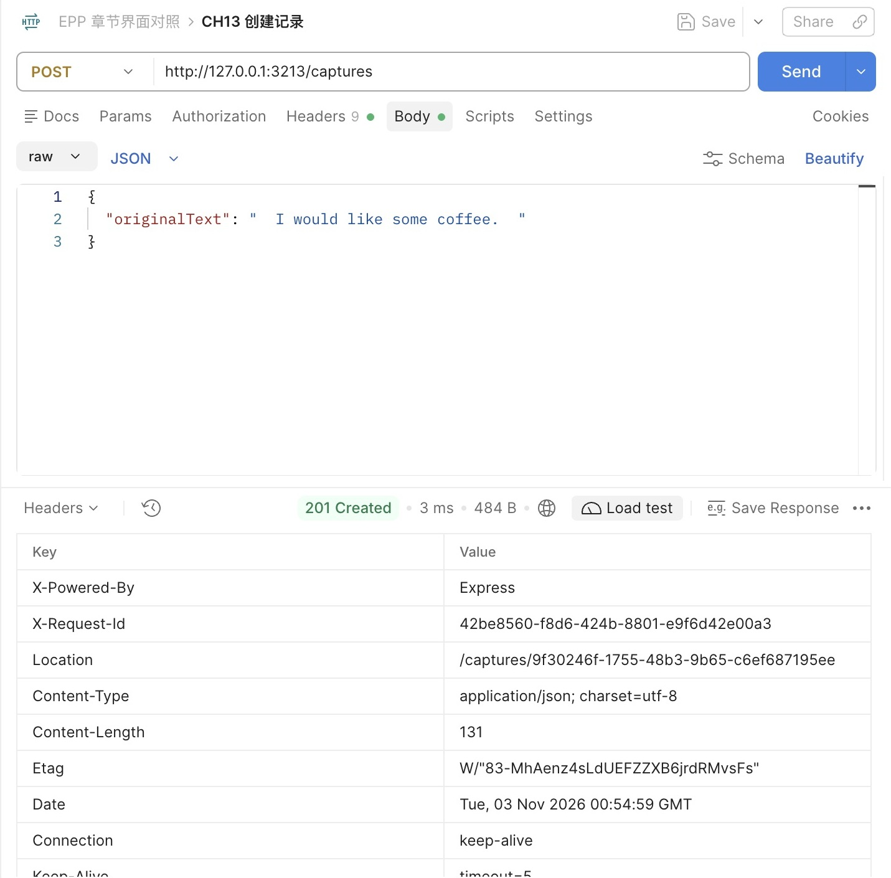
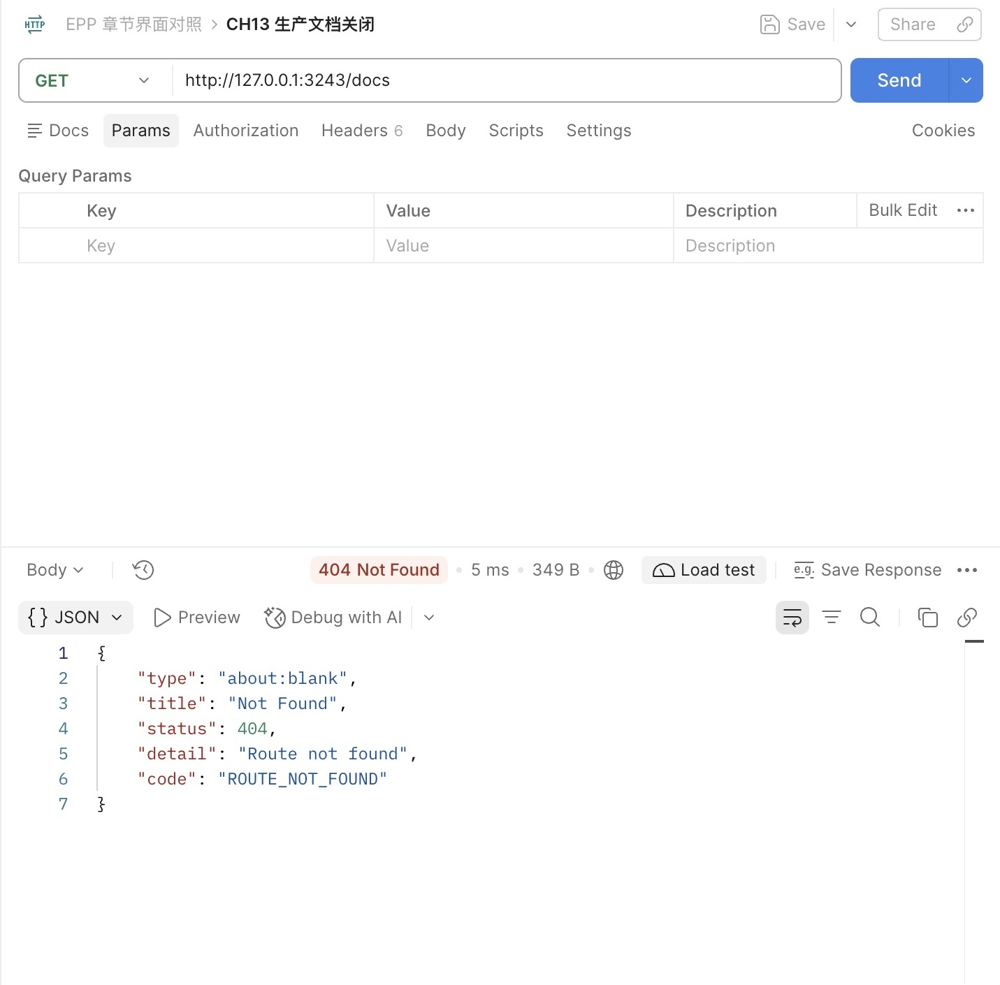

# 第 14 章 配置与生命周期：让应用可靠地启动和退出

第十三章让请求的输入、输出与错误各有归属。现在保存一条记录，可能先经过 Middleware、Pipe、Controller、Service 和存储，最后由 Interceptor 或 Filter 决定响应。可是，当这个请求做到一半时按下 Ctrl+C，前面的职责划分并不能自动回答：请求还会不会完成，下一条请求是否继续进入，存储连接应在什么时候释放？

配置也有同样的问题。第四章让端口在启动前校验，第十二章给文档入口加了开关，但它们由不同函数读取 process.env。如果以后一个 Provider 读到修改前的变量，另一个读到修改后的变量，同一进程就可能依据两份配置工作。到处补一个默认值只会把这种分歧藏得更深。

本章从 `part-02/chapter-13` 继续，完成三件相互关联的事：启动时产生唯一、有效的配置快照；关闭时按正在进行的工作决定收尾顺序；请求出错时用日志还原它经历的边界。业务仍是内存版三个记录接口。数据库将在第三篇接入，因此资源实验使用独立应用和真实文件句柄，不提前把模拟数据库塞进主线。

日常继续 `npm run dev`，Postman 使用已有集合，VS Code 选择 `EPP: attach to npm run dev`。保存会重新编译到 .dev 并重启，不保留 Map；交付使用 dist 与 `npm start`。第十四章代码分支为 `part-02/chapter-14`。

从第十三章跟做时，按正文完成三个可暂停的阶段：14.1 验证配置解析；14.3 接通请求日志并验证正常、失败请求；14.4 接入关闭协调后再做资源实验。每个阶段都能类型检查、构建并运行，不必先把整章接齐。修改一组相互依赖的文件时先停止 dev，完成该阶段检查后再启动。

各阶段都有完整源码，供完成自己的实现后对照：

| 停点 | 可直接运行的源码分支 | 此时具备的能力 |
| --- | --- | --- |
| 14.1 | [codex/reference/chapter-14-configuration](https://github.com/SamChowRock/epp-public/tree/codex/reference/chapter-14-configuration) | 统一解析配置，尚未接入后两阶段 |
| 14.3 | [codex/reference/chapter-14-observation](https://github.com/SamChowRock/epp-public/tree/codex/reference/chapter-14-observation) | 保留配置，并接通请求日志 |
| 14.4 | [part-02/chapter-14](https://github.com/SamChowRock/epp-public/tree/part-02/chapter-14) | 完整关闭协调与资源实验 |

需要直接运行某阶段时，沿第七章的独立克隆方法，把 `--branch` 换成表中的完整分支名，并选尚不存在的目录。停止原开发服务后，在新目录执行 `nvm use`、`npm ci`、`npm run check`，再启动 `npm run dev`。每个目录已经是该阶段完整项目；自己的未完成改动继续保留在原目录。各阶段的检查与预期结果紧接在对应实现后，配套 `examples/chapter-13-stages/README.md` 也列出这些入口。

## 14.1 把启动输入变成一份可注入的配置

### 配置读取结束以后，谁可以继续作决定

考虑 `PORT=3001oops`。端口必须在监听前拒绝，这一点第四章已经建立。现在再考虑 `DOCS_ENABLED=false`：如果某处使用 Boolean(raw)，字符串仍为真，文档会意外开放。TypeScript 的 boolean 类型不能替我们解释环境变量字符串。

我们需要的路径是：取得文件和进程环境，校验各自表示，按明确的优先级合并，生成内部类型，交给需要它的组件。组件接收到的是已经解释过的值，不再各自读取 process.env。配置快照不会因另一段代码修改环境对象而改变。

可以继续使用普通函数返回对象，再通过构造参数传递；Nest 的 `@nestjs/config` 也提供加载与注入能力，适合多组命名配置、模块化配置工厂和较复杂的加载需求。它仍需要我们确定校验和秘密边界，不能仅靠安装包得到正确配置。当前只有五个运行参数，已经有 Node 的 env-file 加载、Zod 和 Provider，我们使用这些既有能力集中解析；配置数量或来源增长后，再评估 ConfigModule。不要同时让 Node 与另一加载器按照不同规则重复读取同一份 .env。

替换 `src/config.ts`。公开默认文件仍是 `config/service.json`，内容仍为 `{"port":3000}`；即使环境中已有 PORT，默认文件也必须有效，避免漏交资源被某台机器上的变量掩盖。

```ts
import { readFile } from 'node:fs/promises';
import { z } from 'zod';

export const APP_CONFIG = Symbol('APP_CONFIG');
export type AppConfig = Readonly<{
  port: number;
  mode: 'development' | 'test' | 'production';
  docsEnabled: boolean;
  logLevel: 'debug' | 'info' | 'warn' | 'error';
  shutdownTimeoutMs: number;
}>;
export class ConfigError extends Error {
  constructor(readonly field: string) { super(`Invalid configuration: ${field}`); }
}
const DefaultsSchema = z.object({ port: z.number().int().min(1).max(65535) });
const decimal = (max: number) => z.string().regex(/^[0-9]+$/)
  .transform(Number).pipe(z.number().int().min(1).max(max));
const EnvironmentSchema = z.object({
  PORT: decimal(65535).optional(),
  NODE_ENV: z.enum(['development', 'test', 'production']).default('development'),
  DOCS_ENABLED: z.enum(['true', 'false']).optional(),
  LOG_LEVEL: z.enum(['debug', 'info', 'warn', 'error']).default('info'),
  SHUTDOWN_TIMEOUT_MS: decimal(30000).default(5000),
});

export function parseConfig(defaults: unknown, env: NodeJS.ProcessEnv): AppConfig {
  const file = DefaultsSchema.safeParse(defaults);
  if (!file.success) throw new ConfigError('config/service.json.port');
  const parsed = EnvironmentSchema.safeParse(env);
  if (!parsed.success) {
    // Only a schema-owned field name is reported, never its value or Zod dump.
    throw new ConfigError(String(parsed.error.issues[0]?.path[0] ?? 'environment'));
  }
  const value = parsed.data;
  return Object.freeze({
    port: value.PORT ?? file.data.port,
    mode: value.NODE_ENV,
    docsEnabled: value.DOCS_ENABLED === undefined
      ? value.NODE_ENV === 'development' : value.DOCS_ENABLED === 'true',
    logLevel: value.LOG_LEVEL,
    shutdownTimeoutMs: value.SHUTDOWN_TIMEOUT_MS,
  });
}

export async function loadConfig(env: NodeJS.ProcessEnv = process.env): Promise<AppConfig> {
  let text: string;
  try { text = await readFile(new URL('../config/service.json', import.meta.url), 'utf8'); }
  catch { throw new ConfigError('config/service.json: unreadable'); }
  let defaults: unknown;
  try { defaults = JSON.parse(text); }
  catch { throw new ConfigError('config/service.json: invalid JSON'); }
  return parseConfig(defaults, env);
}
```

这里有几处刻意的限制。PORT 先匹配十进制字符串再转数字，因此空字符串、空格和科学计数法不会被宽松转换成看似有效的端口。NODE_ENV 只接受三个已支持的模式；DOCS_ENABLED 必须写出 true 或 false。关闭期限以毫秒表示，必须是 1～30000 的整数；它有确定上界，后面才能给开发进程管理器留出更大的外层期限。

EnvironmentSchema 的输入是整个环境对象，它会忽略无关系统变量；不能用 strict 模式把 PATH 等正常变量当成应用配置错误。失败时只报告由 Schema 定义的字段名，不输出输入值、整份 process.env 或 Zod 错误对象。`PORT` 配错与数据库密码配错，定位时都需要知道字段，通常都不需要把原值写进日志。

返回对象只包含标量，Object.freeze 足以阻止这里的属性被改写；Readonly 则在编译阶段约束调用者。如果以后包含嵌套对象，浅冻结不会自动保护内层，要重新考虑复制和不可变边界。它也不是动态配置系统：更改 .env 或部署变量后仍需重启，不能期待一个启动快照自动追踪文件变化。

先保留第十二章的 `src/http-options.ts` 与原入口。新的 loadConfig 仍含 port，所以旧 server.ts 可以继续解构端口；其余字段在 14.3 组装时接入，届时再删除旧解析文件。现在先验证解析器本身，避免同时改容器和请求路径而无法判断错误来自哪里。

沿一次开发启动，把端口从编辑器追到监听调用。磁盘上的 JSON 数字已经有数值类型，环境中的端口却是文本。两者都写三千，看起来相同，进入函数的第一步就不同。配置文件里把数字加上双引号，得到的是合法 JSON，却过不了默认文件的数字校验。反过来，在终端写端口时加不加 shell 引号，传给 Node 的都是字符串。看到字段错误，先问它来自哪一份输入，再判断应该在哪一层改表示。改 TypeScript 里的属性标注不会重写这两份外部数据。

可以把解析想成从两张单据生成一张开工单。第一张单据是项目随包交付的默认端口，缺少它说明交付目录不完整。第二张是这次启动选择的运行条件，允许不填端口，也允许换一个有效端口。假设开发机指定三千零一，文件里的值却是字符串。先选环境端口、只检查胜出的值，会让这台机器顺利启动，换到依赖默认值的机器才出错。本章选择先检查每张必需单据，再选值，因而两台机器都能在启动处发现同一份交付错误。代价是即使运行时不用默认端口，也必须带上有效文件。这个代价可以从构建脚本检查，后面会看到它怎样随产物交付。

再看环境中的三种空缺。完全没有端口键，表示交给默认文件决定；端口键存在而内容为空，表示提供了一项不能解释的指令；提供了字符串零，则能解释成数字，却超出产品接受的范围。这三种输入最后只有第一种会走默认分支。数字转换若摆在文本检查之前，空白也可能转成零，报错原因会与显式填写零混在一起。再用“假值就回退”的写法，两种错误都会静默变成默认端口。前端联调时看到服务能打开，会以为改端口已经生效，实际上访问的仍可能是原进程。

布尔开关要多走一步。先决定有没有明确表态，再解释表态内容。开发模式的缺省意图是能看文档，因此在开发模式下显式填写小写的假，恰好是最能检查实现的一组条件。如果先转成布尔值，再用逻辑或补开发默认值，一个合法的关闭指令会被重新打开。生产模式显式开启则从另一方向验证优先级。可以在纸上列出两列，左列只换模式，右列固定写关闭。左列在没有覆盖时应随模式变化，右列始终关闭。这样设计例子，开关凑巧等于默认结果时也不会误判实现正确。

关停期限与端口都使用十进制整数，却有不同的范围和消费者。把五秒写成数字五会通过语法和范围检查，内部含义却是五毫秒。解析器只能核对接口约定，无法从一个合法数值猜测填写者的时间单位。字段名带毫秒、日志里的耗时也写毫秒，后文才能把一次等待和它的预算放在同一尺度上比较。另一方面，三万零一毫秒即使表示清楚也应拒绝。这一阶段的五千毫秒默认值和三万毫秒上限还只是配置，旧入口尚未使用它们。到 14.4 接入 serve，才会在收到停止请求时按本次配置启动定时器；同一步还要把开发管理进程等子进程退出的窗口从两秒调到三十五秒，使它长于应用允许的最大预算。若以后放宽上限，只改一个校验数字还会留下外层更早杀进程的问题。

配置对象生成后，观察其中没有任何文件路径和读取函数。一个组件拿到端口就能安排监听，拿到文档开关就能决定要不要登记路由，它们不必知道开发者从哪儿启动程序。单独测试这类决定时，也不必在测试前改全局环境、结束后再猜原来有没有这个键。两个测试可以把不同的小对象传给同一个解析器，各自得到结果。若把读环境留在业务方法里，调用者明明传入完全相同的原文，行为却可能受上一条测试改动影响；失败只在成组运行时出现，定位成本会高得多。

### 阶段一：配置可以单独验证，旧接口仍可运行

```bash
npm run check
node --input-type=module <<'JS'
import assert from 'node:assert/strict';
import { parseConfig, ConfigError } from './dist/src/config.js';
const config = parseConfig({ port: 3000 }, { NODE_ENV: 'production', DOCS_ENABLED: 'false' });
assert.equal(config.port, 3000);
assert.equal(config.docsEnabled, false);
assert.ok(Object.isFrozen(config));
for (const [field, value] of [['PORT', '3001oops'], ['DOCS_ENABLED', 'FALSE'], ['SHUTDOWN_TIMEOUT_MS', '0']]) {
  assert.throws(() => parseConfig({ port: 3000 }, { [field]: value }),
    error => error instanceof ConfigError && error.field === field);
}
console.log('configuration checkpoint passed');
JS
```

这里刻意传入小环境对象，不受终端已有变量干扰。应看到通过提示，三种错误都被拒绝且指出字段。随后运行 `npm run dev`，在 Postman 读取 `/captures`，仍应为 200。此阶段仍由旧入口启动和停止，尚未接入请求编号与关闭等待；今晚可停在这里，下次从 14.2 继续。

读这段检查时可以把三个断言各自遮住，分别预测。关闭文档的断言取决于模式与显式开关，取得默认端口取决于环境里没有端口，冻结检查只关心对象能否被改写。三个结果恰好同时为真，不表示一个能推出另一个。把小环境改为只含开发模式和显式关闭文档，端口与冻结应保持，文档仍应关闭；接着只删开关键，文档应打开。这两次调用之间不用关服务，因为这里执行的是普通函数，每次都重新计算。与稍后修改文件后等待新服务生效，是两种时间范围。

另一个值得单独预测的组合是默认文件端口不合法，环境端口也不合法。当前实现先检查文件，因此第一次只能报告文件字段。修复文件再启动，才会看见环境字段。一次失败只报告一个诊断所带来的好处是输出短，代价是修第一项不会保证下次启动成功。排查记录应写“修正后到了哪一步”。若以前是文件不可读，现在改报端口字段，实际上已经跨过了读取和解码这两步，不必再从检查文件是否存在开始。

此处还可以把接口冒烟与函数检查联起来想。请求列表成功只能证明某个监听者能回应一个请求；离开刚才的解析断言，无法从这个响应反推五项配置全部正确。反方向也成立，解析器在内存里得到有效对象，操作系统仍可能拒绝绑定已经占用的端口。从解析到真正服务之间，还有资源复制、应用组装和监听几道边界。下一阶段发现接口行为不符时，先把问题放回它发生的那一步，每一步都能用比重新安装项目更小的动作检查。

## 14.2 环境、秘密与诊断信息各有边界

### 开发方便，不意味着沿用开发启动条件交付

现在的配置来源可以明确写出：命令启动时的进程环境优先于开发 .env；缺少 PORT 时使用公开默认文件；NODE_ENV 由 npm 脚本明确指定。dev/debug 加载 .env，start 不加载。新的 `.env.example` 如下：

```dotenv
# Local development only. Production injects environment variables.
PORT=3000
LOG_LEVEL=debug
SHUTDOWN_TIMEOUT_MS=5000
# Optional override; development defaults to true, test/production to false.
# DOCS_ENABLED=false
```

第一次使用时复制为 .env；已经有个人 .env 时，只补入需要的新字段，不覆盖自己的设置。要临时提高日志详细程度，可执行 `LOG_LEVEL=debug npm run dev`。更改依赖、启动脚本或环境文件后手动重启；保存 TypeScript 文件则继续由 watch 处理。

开发、测试和生产可以运行同一份业务代码，但输入不同。用开发模式观察变量，用测试模式运行最小请求断言，用生产模式验证交付目录、运行依赖和默认关闭的文档。不要把“线上不方便，所以先跑 dev”当成部署方案：Inspector 允许执行进程内代码，文件监听也不是生产进程托管。

本章仍只绑定 127.0.0.1。production 模式代表使用交付入口与环境策略，不表示已经开放公网或可以长期保存用户记录；Map 在退出时消失这一事实没有变化。公网入口、HTTPS、持久化与托管会按各自章节建立。

从熟悉的前端构建过程类比，有些项目在打包时就把变量替换成常量，发布后再改终端变量也不会改变页面。本项目的端口走另一条路径。构建把 TypeScript 变成可以执行的文件，同时把公开的默认配置复制到交付目录；运行入口每启动一次，再读一次自己这份资源和当次进程环境。因此同一份已经构建的程序可以先在三千零一端口启动，结束后换到另一个可用端口，期间无须为了改端口重新编译。反过来，只编辑源码旁的默认文件并执行生产启动，原先构建好的副本仍是旧内容。这类“明明改了配置”的现象，先检查改的是哪一份文件。

在 VS Code 的资源管理器展开项目里的三个位置。源码旁边的配置目录是编辑入口，开发编译目录中也有配置目录，交付构建完成后交付目录里还有一份。打开复制脚本，看它从源码旁取出哪一个文件，再打开配置加载器，看模块自身的位置如何决定相对路径。这里选择相对模块查找资源，使工作目录变化后仍能找到随包文件。若报告文件不可读，核对运行入口旁的实际副本以及当前进程的读取权限；若报告无效 JSON，程序已经拿到文本，排查应移到该副本的内容；若报告端口字段，文本解码已经通过。只在编辑器看一眼源码文件正常，并不能跳过对实际副本的核对。

开发时还有父子两层。启动命令让 Node 给开发管理进程加载本地环境文件，管理进程编译后再启动服务子进程，子进程继承这一次的环境。代码保存引起的新子进程仍由原管理进程启动。即使子进程的进程号已经更换，父进程手里的环境也不会因此从磁盘刷新。这解释了为什么改环境文件要停掉整个开发命令再起，而改公开默认文件时，管理脚本对该文件的监听会触发重新复制和启动。两类文件看起来都叫配置，真正决定更新时机的是谁读、谁监听、下一次从哪里取值。

假定个人环境文件写着调试级别，终端早先却导出了普通信息级别。在当前配置阶段，即使解析出了 debug，旧应用也还没有产生 store.completed 的包装器。先用上一节的 parseConfig 检查级别。等 14.3 接通日志后，若发正常列表请求仍看不到存储完成事件，才要考虑即使父子都重启，也可能仍受这个终端值覆盖。先看实际启动命令中是否显式设置了该项，再只检查所关心的非秘密字段是否在当前终端已有设置。改环境文件的副本、重建依赖、给业务方法再加打印，都绕开了冲突发生的位置。一次性在命令前写级别，可以让这一次启动的意图可见；这次退出后，同一终端以后执行的命令仍要按它们各自的输入判断。

文档开关尤其容易成为混淆进程的线索。浏览器还能看到原先打开的文档页面，只能说明页面曾经加载过。换成 Postman 在当前目标重新读一次文档定义，再在同一目标读取素材列表，前一个请求检查当前开关，后一个请求确认业务路由仍在服务。若两者都没有建立连接，先去查启动或端口。若一个返回找不到路由而另一个成功，才值得对照模式、显式开关与监听进程。接下来的生产检查会用两个不同的集合目标保存这个区别，不要用浏览器标签标题猜正在访问哪个实例。

### 秘密不等于一个叫 .env 的文件

当前这五个参数都不是秘密，不应为了展示秘密管理而提前添加没有消费者的 TOKEN。后面接数据库时，连接串中的密码才形成真实秘密需求。机制仍可先判断清楚：配置文件决定值从哪里读，文件权限决定谁可以读，日志策略决定值是否被再输出；把变量放进 .env，并不会自动解决后两件事。

例如本机 .env 有实际秘密时，可使用 `chmod 600 .env`，让文件所有者具有读写权限，并沿第四章核对父目录的访问条件。这不能阻止同一账号下的其他进程读取，也不能撤销已经提交、复制或截图的内容。生产应由目标运行环境注入秘密，或以服务账号可读的受控文件提供；不要把真实秘密写进 shell 示例、Git、构建资源复制或 Postman 共享集合。

发现泄漏时，仅从当前文件删除还不够。先撤销或轮换旧凭据，确认依赖使用新凭据恢复，再处理历史、日志和分享范围。隐藏一张截图不能让已经泄漏的凭据重新可信。具体平台如何发放和轮换，会在引入该依赖时展开。

诊断同样需要选择信息。原文可能进入 body，也可能出现在查询 q 或异常消息；只删除名为 password 的字段不能解决原文泄漏。本章日志只从固定字段中取方法、静态路由标签、状态、稳定错误码和耗时，不接收 request、response、异常或配置对象。请求编号由服务端生成，后面可以把错误响应与日志关联起来，不需要保存原文。

考虑一次普通的联调求助。前端同事说查询返回空列表，想把完整请求和服务端日志贴出来。对当前问题有用的是哪次请求、是否走到列表方法、服务器给了什么状态、筛选条件在界面上是否开启。搜索框里的原文片段本身可能来自私人笔记。如果诊断依赖把完整地址抄进日志，每一次正常查找都会顺带产生一份原文副本，还可能随日志被另一批人读取。固定路由标签让开发者能数清列表操作；要判断筛选逻辑，用自己编的两条可区分样本，在 Postman 比较有无条件的结果即可，无需索取对方的实际笔记。

同样的取舍出现在启动错误。配置文件缺失时，构建目录和资源复制顺序决定能不能启动，其他环境变量对这个判断没有帮助。某个字段表示错误时，知道字段名已经能让有权限的操作者回到自己的配置界面核对。服务端保存整份输入会把普通故障调查变成一次不必要的数据复制。以后连接串包含多个部分，打印“连接哪台机器”也要先确定只取了允许公开的部分。本章让错误对象只携带已知字段，正常输出函数只取登记过的诊断字段，这样新增配置时，旧日志不会因为对象多了一个属性就自动收到它。

把本地文件、交付物与运行进程顺着传递方向看，还能问出三件不同的事。能从项目仓库重新构建的人应当拿得到公开默认值；能启动服务的账号在运行时才需要对应环境的实际值；接手排错的人常常只需要字段名和错误分类。如果三人都靠同一份带实际值的文档协作，任何一次复制或截图都把读取范围扩大。项目里保留示例文件，给出拼写、单位与默认行为，可以满足第一种需要。环境本身负责把值交给进程，日志则服务于第三种需要。共享请求集合时同样看实际保存的地址、请求体与头，即使本地环境文件从来没进仓库，也不能据此判断另一份文件适合分享。

这也解释了为什么暂时不加一个“以后可能会用”的秘密字段。没有真正的消费者，就无法回答哪一个进程需要它、启动时缺失应否失败、替换后怎样确认新操作使用新值。假造一个字段只会逼所有读者填入无意义的字符串。等第三篇有了真实数据依赖，成功条件就可以写成在指定目标上执行一次允许的读写，到那时配置的可用性才能通过业务调用继续核对。眼下能确定的事情已经足够具体：公开值随包走，环境覆盖在启动时解释，诊断里留下足以定位的字段名与请求编号。

## 14.3 沿同一次请求找到耗时与失败

接下来先把一次请求、它的存储工作和日志连起来。请求响应结束不保证工作已经结束，所以先建立工作计数，再加日志上下文，最后一起登记进容器。14.4 的关闭协调会复用同一个计数器。

### HTTP 连接结束了，业务工作也可能还在执行

Node 的 server.close 停止接受新连接，并等待现有 HTTP 连接收尾；Node 24 会处理空闲 keep-alive 连接。但客户端主动断开后，连接可能已经消失，先前启动的异步写入却仍在执行。第十三章已经看到，响应失败与取消等待都不意味着回滚。

因此需要同时观察两个事实：传输是否收尾，已经开始的依赖操作是否结束。新增 `src/application-state.ts`：

```ts
export class ApplicationState {
  draining = false;
  private pending = 0;
  private readonly waiters = new Set<() => void>();
  get active(): number { return this.pending; }

  async track<T>(work: () => Promise<T>): Promise<T> {
    this.pending++;
    try { return await work(); }
    finally {
      this.pending--;
      if (this.pending === 0) {
        for (const resolve of this.waiters) resolve();
        this.waiters.clear();
      }
    }
  }
  whenIdle(): Promise<void> {
    if (this.pending === 0) return Promise.resolve();
    return new Promise(resolve => this.waiters.add(resolve));
  }
}
```

track 在执行 work 前增加计数，在成功或失败的 finally 中减少。whenIdle 等待当前被追踪的工作归零，不靠每隔一段时间猜测。draining 只是应用入口的状态，不能靠它取消已经开始的 Promise。

当前主线所有异步存储操作通过 ObservedCaptureStore 进入 track，稍后同时用它记录耗时。它覆盖当前三个接口的存储调用；未来新增队列消费者、外部请求或脱离请求继续执行的任务时，需要把相应工作也纳入拥有者的生命周期，不能认为这个计数器会自动发现整个 Node 进程里的所有 Promise。

不要在每个 store 调用里看到 draining 就拒绝：信号到来前已经接收的请求可能还需要完成后面的步骤。是否接收新请求应在最前面的 HTTP 入口判断；已接受工作则按原有约定完成。在请求完成后才另行启动的后台工作需要独立接收规则，当前服务没有这种工作。

把时间停在两个请求同时使用同一个资源的那一刻。第一个工作进来，计数从零变一；第二个工作进来，从一变二。第一个先完成，即使它成功写出结果，计数也只是从二变一。若用一个“正在处理”的布尔值，在第一个完成时就改回空闲，会把第二个仍在使用的句柄关掉。计数器所记录的是每次开始与每次结束之间的差额。最后一个工作即使失败也必须减一，否则协调者永远等不到空闲，把一次已处理的业务错误拖成整进程的关闭超时。

这里的 `return await work()` 值得拆开读。先执行函数取得 Promise，等待它兑现或拒绝，再离开受保护范围并执行 finally。若在 try 中直接返回还在等待的 Promise，外层异步函数最后同样能把结果交给调用者，局部的 finally 却可能在依赖操作结束前就执行了。只断言最后的返回值，看不出计数提前减少。能区分两种实现的是中间状态：让资源保持等待，这时查看计数应当仍为一，释放等待之后才回零。这里多写一个 await 决定了资源能用到什么时候。

再把 `whenIdle()` 的含义说得窄一点。它能告诉等待者“所追踪的集合刚刚为空”，不能锁住未来不再有工作进入。若一边不断接收新请求，一边在某个空隙等到零，下一瞬仍可能有工作开始。因此排空还需要入口的配合以及对已接受请求传输的等待。反过来，只看 HTTP 连接数也会漏掉客户端已经离开、资源仍在工作的那一段。后面的实验会分别改变传输与工作中的一个条件，使这两个平时几乎同时结束的动作在时间上分开。

### 先确定日志要回答的问题

多个请求交错运行时，连续几行日志不一定属于同一个请求。给每个请求分配编号并在异步调用中保留，才能回答“这次响应为何失败”和“时间主要耗在哪一层”。编号不表示身份或权限，也不是幂等键；再次发送相同正文会得到新编号和新的记录。

我们始终在服务端生成 UUID，不直接相信客户端传来的 X-Request-Id。这样日志里的关联值长度与格式可控，调用者不能通过重复编号把两次请求伪装成一次。以后接可信代理或分布式 tracing，需要显式定义传播协议与信任边界，再决定如何接收外部 trace 标识。

Nest 自带 ConsoleLogger 支持 JSON 输出，先用它承担序列化和输出，不自制日志传输系统。需要高吞吐、采样、脱敏规则或远程采集时，可以评估 Pino 等成熟方案；换日志库仍不会替我们决定哪些数据可以记录。新增 `src/app-logger.ts`：

```ts
import { AsyncLocalStorage } from 'node:async_hooks';
import { ConsoleLogger } from '@nestjs/common';
import type { AppConfig } from './config.js';

type Level = AppConfig['logLevel'];
type Event = 'http.started' | 'http.completed' | 'http.aborted' | 'http.failed'
  | 'store.completed' | 'store.failed' | 'app.ready' | 'app.start_failed'
  | 'app.draining' | 'app.stopped' | 'app.stop_failed' | 'app.stop_timeout'
  | 'resource.opened' | 'resource.closed' | 'resource.used';
type Fields = {
  method?: string; route?: string; status?: number; code?: string;
  operation?: string; durationMs?: number; signal?: string;
  port?: number; active?: number; field?: string;
};
const priority: Record<Level, number> = { debug: 10, info: 20, warn: 30, error: 40 };

export class AppLogger {
  private readonly context = new AsyncLocalStorage<{ requestId: string }>();
  private readonly output = new ConsoleLogger('EPP', { json: true, colors: false });
  constructor(private readonly level: Level) {}

  withRequest<T>(requestId: string, action: () => T): T {
    return this.context.run({ requestId }, action);
  }
  write(level: Level, event: Event, fields: Fields = {}): void {
    if (priority[level] < priority[this.level]) return;
    const { method, route, status, code, operation, durationMs, signal, port, active, field } = fields;
    const message = {
      event, requestId: this.context.getStore()?.requestId,
      method, route, status, code, operation, durationMs, signal, port, active, field,
    };
    if (level === 'info') this.output.log(message);
    else this.output[level](message);
  }
  onApplicationShutdown(): void { this.context.disable(); }
}
```

JSON 输出中，pid 和 timestamp 在外层，业务字段位于 message。INFO 对应 ConsoleLogger 的 log 级别，debug 用于正常依赖细节，warn 表示被拒绝或中断的请求，error 表示内部失败和异常关闭。LOG_LEVEL=info 会省略 store.completed，但保留 store.failed；需要定位延迟时临时提高到 debug，不能因为缺少一行 debug 就断言没有调用存储。

withRequest 使用 Node 的 AsyncLocalStorage.run 建立异步上下文。它不是把编号放进一个全局 currentId 变量；两个交错请求的 Promise 和计时回调能各自取到创建它们时的编号。存储包装层无需新增 requestId 参数，业务 Service 也不因此依赖 Express Request。上下文只在当前进程中传播，不会自动跨网络或消息队列。更细的机制与事件回调边界放在章末支线。

想象两个浏览器标签同时刷新列表，开发者的终端里先出现甲的入口，再出现乙的入口，随后甲的存储和响应才完成。按日志相邻关系拼链，会把甲的查询耗时算到乙的头上。按时间戳排序也解决不了归属问题，因为时间只给先后，不给因果。请求编号在进入时分配，在这次异步执行中沿用，恰好提供了缺的一维。两次读取完全相同的列表仍应有两个编号；若从响应头复制同一个编号去筛选，留下的应当是一次尝试的各个边界，再按事件名理解它们的顺序。

再比较两个有意不带编号的时刻。应用就绪时还没有任何来访者；收到停止信号时也无须把整次退出归给恰好在等待的一名来访者。这时取不到请求上下文是合理的。要把某次关闭和正在处理的请求放到同一张时间线上，可先按应用进程号和运行时段找启动与关闭，再在这段中按编号读各次请求。假如开发工具自动重启过，端口相同并不能说明日志来自同一代内存存储。用新进程去读上一个进程的记录时，后来的查询可以完全正常地执行，然后返回找不到素材。

可以从一个更小的故障看出为什么日志对象也得共用。假如入口在第一个日志对象上开启上下文，存储却在第二个对象上取当前编号，两个对象的最低级别即使一样，第二个对象的上下文仍是空的。结果会是终端里确有存储日志，按响应编号搜索却总缺这一行。排查时先看有没有这一次操作，再看它有没有关联字段；若完全没有记录，先核对级别和分支；若有操作却没编号，再追查对象从哪里构造。盲目把所有日志提升到错误级别，只能排除第一类过滤原因。

### 把同一份配置放进容器，而不是重复加载

接口和日志组件都需要运行时设施，但它们不应各自建立一份配置或日志上下文。新增 `src/runtime.module.ts`：

```ts
import { Module } from '@nestjs/common';
import type { DynamicModule } from '@nestjs/common';
import { APP_CONFIG } from './config.js';
import type { AppConfig } from './config.js';
import { AppLogger } from './app-logger.js';
import { ApplicationState } from './application-state.js';

@Module({})
export class RuntimeModule {
  static register(config: AppConfig, logger: AppLogger): DynamicModule {
    return {
      module: RuntimeModule,
      global: true,
      providers: [
        { provide: APP_CONFIG, useValue: config },
        { provide: AppLogger, useValue: logger },
        ApplicationState,
      ],
      exports: [APP_CONFIG, AppLogger, ApplicationState],
    };
  }
}
```

register 是我们定义的静态方法，名字本身没有框架魔法。它返回带有 module、providers 和 exports 的动态模块描述，允许调用者把启动前得到的值填进登记。useValue 交出同一个对象，不重新读文件；APP_CONFIG 是对象的运行时令牌，AppConfig 只是编译时类型。

这里有意将 RuntimeModule 设为 global，且每个应用只在根部登记一次。它只公开配置、日志和工作计数这三项进程基础设施，业务 Service 与存储仍按第十一章的模块边界导出。全局模块省掉重复 imports，也会使依赖来源不如显式 imports 直观，因此不能把所有业务模块都照搬成 global，更不能在多个子模块分别 register 不同配置。

AppLogger 与 ApplicationState 现已定义，接着把它们放入根模块，替换 `src/app.module.ts`：

```ts
import { Module } from '@nestjs/common';
import type { DynamicModule } from '@nestjs/common';
import { APP_FILTER } from '@nestjs/core';
import { ProblemFilter } from './problem.filter.js';
import { CapturesModule } from './captures.module.js';
import { RuntimeModule } from './runtime.module.js';
import type { AppConfig } from './config.js';
import { AppLogger } from './app-logger.js';

@Module({})
export class AppModule {
  static register(config: AppConfig, logger: AppLogger): DynamicModule {
    return {
      module: AppModule,
      imports: [RuntimeModule.register(config, logger), CapturesModule],
      providers: [{ provide: APP_FILTER, useClass: ProblemFilter }],
    };
  }
}
```

需要配置的 Provider 使用 `@Inject(APP_CONFIG)`，参数声明为 AppConfig；14.4 的资源实验会实际使用它。直接 `app.get(APP_CONFIG)` 适合启动编排，不应变成每个业务方法随意查容器的方式。业务对象应继续通过构造参数暴露依赖。

独立的 Nest 应用上下文也是一个新的容器，不会继承另一个 HTTP 应用的 global 模块。因此当前分支中，第十一章消费 CapturesModule 的三个独立示例也在自己的根模块登记 RuntimeModule；第十一章快照仍保持当时的实现。手动 `new CapturesService(store)` 不经过容器，仍可使用原来的构造参数。

在 `examples/module-consumer/main.ts`、`examples/module-workflow/main.ts` 和 `examples/module-workflow/cycle.ts` 各自新增 `../../src/config.js` 的 parseConfig、`../../src/runtime.module.js` 的 RuntimeModule、`../../src/app-logger.js` 的 AppLogger 导入；把 `RuntimeModule.register(parseConfig({ port: 3000 }, { NODE_ENV: 'test' }), new AppLogger('error'))` 加入各自根模块原 imports 数组。原模块和导出规则不变。

回到阶段二的过渡入口，在编辑器并排打开 server.ts 与 app.ts。旧入口从一次加载结果中只取端口，调用无参的 createApp；后者收到空参数，走默认分支再加载配置，建立日志对象，再把这些值交给容器。因此此时“容器内拿到同一份值”已经成立，“整次启动只读了一次文件”还没有成立。只要文件和环境保持一致，两个对象的端口很可能相等，比较数值无法查出这次重复读取。要亲眼看见两次读取，先完成下文阶段二的文件与构建检查，停掉开发服务。在 VS Code 的 loadConfig 函数首条可执行语句设断点，再从「运行和调试」启动 `EPP: build and launch`。第一次停住看调用堆栈中的 server.ts，继续到第二次看 app.ts，随后继续到旧入口输出监听地址。普通 dev 已监听后才 attach，会错过这两次启动调用。观察完取消断点、停止这次 launch，再按下文启动记录请求日志的 dev。

等到 14.4 的主入口持有完整配置，会从它取日志级别，把同一份配置和同一个日志对象同时传给协调者与应用工厂。这时可选参数的默认分支只服务于未显式提供参数的其他调用者。保留无参创建能力，使原有测试或独立示例可以照常构造应用；正式入口显式传值，则让启动早期故障与应用运行中的事件走同一个输出策略。理解这个接缝后，即使以后把文件读取换成别的实现，也知道应该替换启动端的输入来源，业务模块里无需重新搭一个加载器。

### 观察入口必须早于可能失败的处理

只在 Controller 的 Interceptor 里记录入口，会漏掉 Middleware 的非法 JSON、方法拒绝和文档资源请求。因此观察 Middleware 要放在 Swagger 与已有边界之前。新增 `src/request-observation.ts`：

```ts
import { randomUUID } from 'node:crypto';
import type { RequestHandler } from 'express';
import { AppLogger } from './app-logger.js';
import { ApplicationState } from './application-state.js';
import { HttpError } from './http.js';

export function requestObservation(logger: AppLogger, state: ApplicationState, knownPaths: readonly string[] = []): RequestHandler {
  return (request, response, next) => {
    const requestId = randomUUID();
    const started = performance.now();
    const method = ['GET', 'POST', 'HEAD', 'PUT', 'PATCH', 'DELETE', 'OPTIONS'].includes(request.method)
      ? request.method : 'OTHER';
    const path = request.url.split('?')[0] ?? '';
    // Route labels are constants, never raw paths or resource IDs.
    const route = knownPaths.includes(path) ? path : path === '/captures' ? '/captures'
      : /^\/captures\/[^/]+$/.test(path) ? '/captures/:id'
      : path === '/openapi.json' || path === '/docs' || path.startsWith('/docs/') ? 'docs' : 'unmatched';
    response.setHeader('X-Request-Id', requestId);
    logger.withRequest(requestId, () => {
      logger.write('info', 'http.started', { method, route });
      let reported = false;
      const complete = (aborted: boolean) => {
        if (reported) return;
        reported = true;
        logger.withRequest(requestId, () => logger.write(aborted ? 'warn' : 'info',
          aborted ? 'http.aborted' : 'http.completed', {
            method, route, status: aborted ? undefined : response.statusCode,
            durationMs: Math.round(performance.now() - started),
          }));
      };
      response.once('finish', () => complete(false));
      response.once('close', () => complete(!response.writableFinished));
      if (state.draining) {
        response.setHeader('Connection', 'close');
        next(new HttpError(503, 'Service is shutting down', 'SERVICE_DRAINING'));
      } else next();
    });
  };
}
```

我们记录固定的 `/captures/:id` 标签而不是实际 id，更不会把 q 的内容记下来。未知路径统一为 unmatched；实验可以显式提供已知固定路径。标签只用于定位入口，不决定路由是否有效，原有 httpBoundary 仍负责方法、路径与查询数量规则。

finish 说明服务端已经把响应数据交给底层发送，不证明客户端读到并理解了内容。close 也会出现在正常完成之后，不能遇到 close 就记录失败；这里通过 writableFinished 区分，并用 reported 保证只记一次完成事件。回调显式捕获 requestId 并重新进入上下文，避免依赖事件发出位置恰好保留了同一个上下文。

state.draining 时返回可识别的 SERVICE_DRAINING，Connection: close 提示结束当前连接。这个判断在正文读取与业务写入之前，避免接受了新工作才发现要停服。所有能走到此 Middleware 的应用请求都有 X-Request-Id；如果 HTTP 报文在 Node 解析阶段就非法，应用根本没有收到 Request，不能承诺它也带应用编号。

`src/app.ts` 的组装顺序如下：

```ts
import 'reflect-metadata';
import { NestFactory } from '@nestjs/core';
import type { NestExpressApplication } from '@nestjs/platform-express';
import { AppModule } from './app.module.js';
import { captureBody } from './capture-body.js';
import { httpBoundary } from './http-boundary.js';
import { SwaggerModule } from '@nestjs/swagger';
import { createOpenApiDocument } from './openapi.js';
import { loadConfig } from './config.js';
import type { AppConfig } from './config.js';
import { AppLogger } from './app-logger.js';
import { ApplicationState } from './application-state.js';
import { requestObservation } from './request-observation.js';

export async function createApp(
  config?: AppConfig,
  logger?: AppLogger,
): Promise<NestExpressApplication> {
  config ??= await loadConfig();
  logger ??= new AppLogger(config.logLevel);
  const app = await NestFactory.create<NestExpressApplication>(AppModule.register(config, logger), {
    logger: false,
    bodyParser: false,
    abortOnError: false,
  });
  app.set('query parser', 'simple');
  app.use(requestObservation(logger, app.get(ApplicationState)));
  if (config.docsEnabled) {
    SwaggerModule.setup('docs', app, createOpenApiDocument(), {
      jsonDocumentUrl: 'openapi.json', raw: ['json'],
      swaggerOptions: { validatorUrl: null },
    });
  }
  app.use(httpBoundary);
  app.use(captureBody);
  return app;
}
```

此时 app.ts 已不再导入 readHttpOptions，可以删除 `src/http-options.ts`。开发默认开文档、生产默认关闭的规则现在只由 config.ts 解释。

框架自动启动日志在这里关闭，由同一套 JSON 事件记录应用生命周期；这让 app.ready 具有明确的监听成功含义，也避免把未筛选的框架异常信息直接混入应用日志。关闭框架日志意味着初始化故障的细节需要开发调试器补充：在启动前使用 build/launch 或 debug，开启已捕获异常暂停，查看抛出位置，分享时仍清理敏感变量。

把观察中间件的先后关系映射到前端的三次普通读取。列表读取从入口走到业务控制器；文档定义在开关开启时由文档组件直接响应；开关关闭时，同一条文档路径继续往后，由路径边界返回找不到路由。三次都应当有编号，只有列表读取需要查询素材存储。因而日志中出现文档标签，只能说明入口识别了一个属于文档路径族的请求，不能说明文档已经启用。要判断文档是否成功交付还得看实际响应状态与类型。若把观察器登记在文档组件后面，开启时恰好看不见成功读取，关闭时反而看得见失败，这样的采样会让人误以为文档总是出错。

读回一条记录时也有相似的两个阶段。入口从路径形状给它贴上详情标签，那时还不知道这条记录存不存在；只有接下来的业务查询能确定存在性。用同一个详情标签归集不同记录的耗时，本意是比较一种业务操作的表现。把标签里的占位符当成实际请求地址粘贴进 Postman，会查询字面上的另一个标识；应当从刚刚创建的响应 Location 取得真实路径，把日志里的编号用于查询执行轨迹。一个放在地址栏，一个放进日志搜索框，谁也替代不了另一个。

响应发送与响应读取的差别会直接改变前端的重试决定。服务端即使写了完成事件，前端也可能已经离开页面，未把结果放进列表状态。遇到创建结果不确定，先用自己这一轮独有的合成原文查询并检查返回记录，再决定是否需要重新创建。确认查询仍指向同一内存进程，才有对照意义。第二次点击发送会发起新的创建，当前接口不会按相同原文去重。请求编号的价值是把这两次尝试分开排查，保留同一个请求体或重用前端状态都不能改变服务端的创建语义。

### 依赖耗时与响应耗时不能混为一谈

不把日志塞进每个业务方法，我们在第十章的 CaptureStore 边界外包一层。`src/observed-capture.store.ts`：

```ts
import type { CaptureStore } from './capture-store.js';
import type { Capture, CaptureListOptions } from './capture.js';
import { AppLogger } from './app-logger.js';
import { ApplicationState } from './application-state.js';

export class ObservedCaptureStore implements CaptureStore {
  constructor(
    private readonly inner: CaptureStore,
    private readonly logger: AppLogger,
    private readonly state: ApplicationState,
  ) {}
  private async call<T>(operation: string, work: () => Promise<T>): Promise<T> {
    const started = performance.now();
    return this.state.track(async () => {
      try {
        const value = await work();
        this.logger.write('debug', 'store.completed', {
          operation, durationMs: Math.round(performance.now() - started),
        });
        return value;
      } catch (error) {
        this.logger.write('error', 'store.failed', {
          operation, code: 'STORE_FAILURE', durationMs: Math.round(performance.now() - started),
        });
        throw error;
      }
    });
  }
  insert(capture: Capture): Promise<void> {
    return this.call('insert', () => this.inner.insert(capture));
  }
  list(options: CaptureListOptions): Promise<Capture[]> {
    return this.call('list', () => this.inner.list(options));
  }
  find(id: string): Promise<Capture | undefined> {
    return this.call('find', () => this.inner.find(id));
  }
}
```

包装层只观察操作名与耗时，传递原结果、重新抛出原错误；它不把失败变成空数组，也不把写入成功提前。计时使用 performance.now 的单调时钟，不用两个可能因校时跳变的日期相减。durationMs 包含该调用内的等待，不是数据库服务器纯执行时间，更不能据此推断连接池等待或网络各占多少；后续接真实依赖时再细分。

在 `src/captures.module.ts` 导入 `./observed-capture.store.js` 的 ObservedCaptureStore、`./app-logger.js` 的 AppLogger 和 `./application-state.js` 的 ApplicationState。保留 MemoryCaptureStore 实例，用下面的工厂替换原 CAPTURE_STORE 登记；其余 providers 与 exports 保持：

```ts
MemoryCaptureStore,
{
  provide: CAPTURE_STORE,
  useFactory: (store: MemoryCaptureStore, logger: AppLogger, state: ApplicationState) =>
    new ObservedCaptureStore(store, logger, state),
  inject: [MemoryCaptureStore, AppLogger, ApplicationState],
},
```

删除 `src/http-boundary.ts` 原有的 `console.log(JSON.stringify(...))` 请求日志和 `src/http.ts` 中 `httpFailure` 的 `console.error(...)`；现在由新的观察入口和 ProblemFilter 统一记录稳定字段。`httpFailure` 只做转换，不再自行打印。这样不会把同一个异常的任意 message 和 stack重复输出。更新后的 `src/problem.filter.ts`：

```ts
import { Catch, Inject } from '@nestjs/common';
import type { ArgumentsHost, ExceptionFilter } from '@nestjs/common';
import type { Response } from 'express';
import { httpFailure, sendJson } from './http.js';
import { AppLogger } from './app-logger.js';

@Catch()
export class ProblemFilter implements ExceptionFilter {
  constructor(@Inject(AppLogger) private readonly logger: AppLogger) {}
  catch(error: unknown, host: ArgumentsHost): void {
    const response = host.switchToHttp().getResponse<Response>();
    if (response.destroyed || response.writableEnded) return;
    if (response.headersSent) {
      this.logger.write('error', 'http.failed', { code: 'RESPONSE_ALREADY_STARTED' });
      response.destroy();
      return;
    }
    // A failed response must not advertise the success-only resource location.
    response.removeHeader('Location');
    const failure = httpFailure(error);
    this.logger.write(failure.statusCode >= 500 ? 'error' : 'warn', 'http.failed', {
      status: failure.statusCode, code: failure.body.code,
    });
    sendJson(response, failure.statusCode, failure.body, {
      'Content-Type': 'application/problem+json; charset=utf-8',
    });
  }
}
```

一次依赖失败可能同时出现 store.failed 与 http.failed：前者说明失败发生在存储调用，后者说明 HTTP 最终如何回应；它们不是两次业务失败。响应已经开始后再抛错，只能记录 RESPONSE_ALREADY_STARTED 并中止连接，不能改写成一个看似完整的 500 JSON。

构造参数改变后，还要适配第十三章的独立管线实验。`src/labs/request-pipeline.ts` 中的 TraceFilter 继承了 ProblemFilter，原来的 `super()` 现在缺少 Logger，类型检查会失败。在该文件导入 `AppLogger`，并将 TraceFilter 的构造器改为：

```ts
constructor(private readonly name: string) { super(new AppLogger('info')); }
```

导入路径是 `../app-logger.js`。这个实验手工创建 Filter，只观察阶段顺序，因此显式提供自己的 Logger；它没有接入本章的 requestObservation，不能期待阶段日志自动具有请求编号。主应用仍由 RuntimeModule 提供同一份 Logger，并由容器注入 ProblemFilter，不能把实验的手工构造方式复制回主应用。

在已有 `test/captures.test.mjs` 的错误响应检查后补一行 `assert.match(failure.headers.get('x-request-id'), /^[0-9a-f-]{36}$/)`，让最小回归也核对关联头。

OpenAPI 也要描述 X-Request-Id 响应头及 503／SERVICE_DRAINING。在 `src/openapi.ts` 的 `createOpenApiDocument` 中，把原来的 `return { ... }` 改为 `const document: OpenAPIObject = { ... }`，保留已有路径和组件定义，然后在函数末尾加入：

```ts
  for (const path of Object.values(document.paths)) {
    for (const operation of [path.get, path.post]) {
      if (!operation?.responses) continue;
      operation.responses['503'] = problem('Shutdown in progress; code SERVICE_DRAINING');
      for (const response of Object.values(operation.responses)) {
        if (!response || '$ref' in response) continue;
        response.headers = { ...response.headers, 'X-Request-Id': {
          description: 'Server-generated correlation ID; not an idempotency key.',
          schema: { type: 'string', format: 'uuid' },
        } };
      }
    }
  }
  return document;
```

这段遍历当前已有的 GET 和 POST 操作，先增加 503，再给各响应补关联头；展开原 headers 是为了保留 Location 与 ETag。`$ref` 指向的响应没有内联字段，不能直接当作 ResponseObject 修改；当前各响应都以内联对象定义，后续若提取为引用，需要在引用目标上补齐。重新构建并导出文档，核对 201、400、304 和 503 都保留各自原有含义并声明关联头。文档声明不会替应用生成头，真正的设置仍在 requestObservation。

成功 JSON 和 Problem 的字段没有因此改变，条件 GET 仍可返回无正文的 304；请求编号仍随这次响应产生，不要把它当作记录 ID 或缓存内容。

用一条语法正常、当前进程里却不存在的记录标识，可以推导另一种看似矛盾的日志组合。详情方法把标识交给 Service，存储查 Map 后正常返回空缺，包装层在调试级别记录一次查找完成。随后 Service 发现没有记录，抛出业务错误，Filter 转成找不到素材，传输仍可正常送出这个错误响应。因此同一编号下既有依赖完成，也有请求失败，最后还有传输完成。三者依次回答“存储有没有正常给答复”“业务能否提供所求资源”“这份答复是否在服务端发送完”。把三个事件都压成一个成功率，会让正常的未命中看起来像存储故障。

和这个例子相对的是地址本身没有对应路由。它同样可以给出四百零四，错误码和存储足迹却不同。入口只识别到未匹配路径，路径边界直接拒绝，通常见到的是路由不存在的错误码，根本不需要查 Map。判断时要选形状正确的详情地址与完全不在路由表的地址，若把详情路径中正常的记录标识换成另一个普通标识，仍在走同一个详情路由。这样就能训练一种比“看四百零四去查后端有没有数据”更准确的判断：先读错误码判断问的是地址还是资源，再用对应编号查实际有没有走到依赖层。

耗时也需要沿这些层次解释。假设一份日志的整次请求是十八毫秒，内部查找是两毫秒。若这是正常送完响应的一次详情读取，查找在收到请求之后开始，又在响应完成之前结束，两段区间有包含关系，不能相加成二十毫秒。若日志是 http.aborted，传输计时可能先结束，而依赖仍在工作，那一笔就不能作下面的减法。剩下的大约十六毫秒发生在这次被测查找以外，可能在进入控制器之前，也可能在得到结果之后；仅凭这两个数无法把差额分给其中一方。再假设两处都显示零，源码是在取差之后四舍五入，极短操作有可能都落在零毫秒档，不能据此判定跳过了存储。要判断是否调用，读取有无同编号的操作事件。要判断哪里花时间，再比较同类请求的区间，而且先让调试器继续运行。

这些读法也说明为何包装层遇错要原样重新抛出。若为了让日志“处理完异常”就返回空值，查找的上层会把基础设施错误当成普通的无记录；列表若返回空数组，前端还可能展示成用户没有保存过素材。这样的接口甚至能通过只检查数据形状的前端校验，却改变了业务语义。让日志附在原调用的成功或失败路径上，原来的业务判断才能继续区分可以正常显示的空结果和需要提示稍后再试的失败。

### 阶段二：先让请求日志形成闭环

到这里完成配置、状态、日志、模块、请求观察、存储包装与 Filter，原 `src/server.ts` 暂时保留第十三章入口。运行 `npm run check` 后再启动 dev。此时启动仍输出旧的 `EPP listening`，14.4 接入 serve 后才会变成 app.ready；收到停止信号仍按旧入口结束，不把这一阶段的退出当成排空验证。下面用两次请求核对新日志，完成后可以暂停，再进入关闭实现。

### 保存失败事实，再决定用日志还是断点

若阶段二的 dev 已经启动，先在原终端按 Ctrl+C，等管理进程退出。然后用下面的命令重新启动并保存输出，等 `EPP listening` 出现再发请求。本节最后一次断点核对完成后，点继续让响应结束，停用断点并正常结束 dev，然后再改阶段三的入口。这样下一轮就不会有旧进程占用端口或同时写入开发编译目录。

```bash
mkdir -p logs
LOG_LEVEL=debug npm run dev 2>&1 | tee logs/dev.log
```

这些命令沿用本书的 macOS、Linux 或 WSL shell。文件中会有 npm 和编译器的非 JSON 行，也有应用的 JSON 行；这不表示所有终端输出都满足一个 JSON 文件格式。日志保存在本机，分享前仍检查内容，长期采集与轮转不靠无限增长的 tee 文件解决。

在 Postman 的创建请求点击 Send，查看响应 Headers 的 X-Request-Id。复制编号，在编辑器打开 logs/dev.log 搜索；应关联 http.started、store.completed(insert) 和 http.completed(201)。将 Body 改为 `{"originalText":7}` 后再发一次，取得新的编号；应有 VALIDATION_ERROR 和完成状态400，没有对应的 store.completed(insert)。把 Body 改成非法 JSON，又会在更早的读取边界失败。这里不是凭“没看到写入”下结论，而是结合已启用 debug、稳定的编号和入口/出口证据判断。



响应区左侧下拉从 Body 切到 Headers，找到服务端生成的 X-Request-Id，再复制到日志搜索。Location 中的是记录 ID，X-Request-Id 是这一次请求的编号；重复创建会同时得到新的记录 ID 和请求编号。截图端口以当前启动地址为准。

需要精确筛选时，使用配套 `examples/filter-logs.mjs`，把响应中的编号作为第一个参数：

```bash
node examples/filter-logs.mjs 00000000-0000-0000-0000-000000000000 < logs/dev.log
```

示例中的全零编号不会匹配真实请求，运行时替换成刚才复制的值。脚本逐行解析 JSON，跳过编译器文本，只保留 message.requestId 精确相等的行；它不会通过原文搜索来猜测请求身份。也可以继续在编辑器按编号查找，日常无需为了查看几行日志安装平台。

若 HTTP 总耗时明显高于存储耗时，先看客户端是否正在慢速发送正文、调试器是否暂停、输出校验或序列化是否占用时间，再增加有目的的观测点。不要根据一条内存存储的毫秒值认定生产数据库也会同样快。需要查看具体分支和局部变量时，在 requestObservation、SchemaPipe、ObservedCaptureStore.call 与 ProblemFilter.catch 设置断点；断点会改变请求时序，不适合测量正常延迟或判断关闭期限。

日志适合在不暂停的情况下重建交错顺序，断点适合观察一次执行中的值。修复后用同一份保存请求复验，取得新的编号，比较错误码、状态和调用边界是否按推导变化。不要在断点停住十秒后，用超时日志指责五秒关闭期限“不可靠”。

## 14.4 让停止接收、完成工作和释放资源按顺序发生

### 构造完成、初始化完成、监听成功不是一件事

构造函数适合建立对象关系。把异步连接丢进构造函数，又不让容器等待，注入成功时资源可能还没有准备好。可以使用异步 Provider 工厂，等待后再提供值；也可以由拥有资源的 Provider 在 onModuleInit 中初始化。前者影响依赖实例何时可获得，后者适合实例建立后统一准备资源，但调用者必须等待应用初始化完成。

在当前 Nest 11 中，create 建立容器；app.init 会完成模块初始化与应用启动钩子；app.listen 必要时先初始化，然后真正绑定端口。只有 listen 成功后，才应该记录 app.ready。onApplicationBootstrap 已执行，不代表操作系统已经允许监听目标端口。

可以先运行一个不需要 HTTP 的对照。`examples/lifecycle-order.mjs`：

```js
import 'reflect-metadata';
import { Module } from '@nestjs/common';
import { NestFactory } from '@nestjs/core';

class Resource {
  onModuleInit() { console.log('resource: init'); }
  onApplicationBootstrap() { console.log('resource: bootstrap'); }
  onModuleDestroy() { console.log('resource: destroy'); }
  beforeApplicationShutdown() { console.log('resource: before shutdown'); }
  onApplicationShutdown() { console.log('resource: after shutdown'); }
}
class Root {}
Module({ providers: [Resource] })(Root);
const app = await NestFactory.createApplicationContext(Root, { logger: false });
console.log('caller: context ready (no HTTP listener)');
await app.close();
console.log('caller: close complete');
```

它应依次输出 init、bootstrap、调用者确认上下文可用，再输出 destroy、before shutdown、after shutdown，最后是 close complete。createApplicationContext 的 ready 只是容器初始化完成，没有创建 HTTP 监听。显式 await app.close 会等待钩子返回的 Promise；只调用不等待，则无法证明资源已释放。

Nest 也提供 enableShutdownHooks，让 SIGINT、SIGTERM 等信号触发关闭。适合使用框架默认关闭顺序的应用，可以采用这一路径。需要注意，默认 app.close 的大致顺序是 onModuleDestroy、beforeApplicationShutdown、适配器关闭连接、onApplicationShutdown；模块内部的多个 Provider 钩子也不能被当成任意业务依赖的串行执行表。

这就产生了一个实际风险：如果在 onModuleDestroy 关闭数据库连接，而 HTTP 请求还在使用连接，请求会在“优雅退出”期间失败。钩子的名字不保证“现在已经没有用户”。我们必须先建立停止接收与等待的边界，再让资源拥有者执行释放。

按资源拥有者的视角，构造时最容易被忽视的状态是“别人已经能拿到这个对象，我还没有可用的句柄”。在前端组件里可以把加载中显示成占位内容，可在后端，拿到注入对象的方法往往会立刻执行读写。若初始化没被启动流程等待，第一批请求是否成功就取决于资源准备与请求到来的先后。把初始化放进能返回 Promise 的工厂或钩子，才把这个竞争改成明确的前置条件。后面的资源实验里，拿到目录还不算准备结束，打开文件句柄也只是中间一步，初始化整段顺利返回之后才允许进入监听阶段。

还有一种中间状态恰好相反：资源已经可用，应用却不能对外提供服务。比如目标端口已有其他实例，初始化资源可以全程成功，最后一步绑定端口才失败。此时只在“成功启动以后”登记清理逻辑就晚了，失败的实例也持有应释放的东西。另一方面，浏览器在该端口可能一直读到正常页面，那是原实例提供的响应。对新实例是否可用，先看本次进程的启动结果，再把进程号、端口和客户端读回放在一起解释。浏览器的成功与新实例的失败可以同时为真。

假如关闭时有甲乙两个资源，乙的最后一次写入需要用甲，逐个给它们写析构钩子，并没有自动表达这次依赖。仅凭文件先后、类名或装饰器书写顺序猜谁先释放，组件一换模块就难以维护。本章把仍在使用资源的工作全部等到完成，再交还拥有者释放；实验只有一个文件拥有者，因此这道边界足以说明顺序。以后确实有互相依赖的释放动作时，要由知道依赖关系的那一层显式等待，不能从这个单资源例子推出框架会替任意一组资源排好次序。

### 一次关闭由一个协调者负责

新增 `src/serve.ts`，主线与资源实验共用相同的关闭流程：

```ts
import type { INestApplication } from '@nestjs/common';
import type { Server } from 'node:http';
import type { AppConfig } from './config.js';
import { AppLogger } from './app-logger.js';
import { ApplicationState } from './application-state.js';

export async function serve(
  config: AppConfig,
  logger: AppLogger,
  create: () => Promise<INestApplication>,
): Promise<void> {
  let app: INestApplication | undefined;
  let stopping = false;
  let closing: Promise<void> | undefined;
  let boot: Promise<void>;
  const stop = (signal: string): Promise<void> => {
    if (closing) return closing;
    stopping = true;
    if (app) app.get(ApplicationState).draining = true;
    logger.write('info', 'app.draining', { signal });
    const deadline = setTimeout(() => {
      logger.write('error', 'app.stop_timeout', { active: app?.get(ApplicationState).active });
      (app?.getHttpServer() as Server | undefined)?.closeAllConnections();
      // The hard deadline covers hung work AND hung resource cleanup.
      process.exit(1);
    }, config.shutdownTimeoutMs);
    closing = (async () => {
      await boot.catch(() => {});
      if (app) {
        const state = app.get(ApplicationState);
        state.draining = true;
        const server = app.getHttpServer() as Server;
        await new Promise<void>((resolve, reject) => {
          server.close(error => {
            if (error && (error as NodeJS.ErrnoException).code !== 'ERR_SERVER_NOT_RUNNING') reject(error);
            else resolve();
          });
        });
        // A disconnected HTTP client does not cancel an accepted store operation.
        await state.whenIdle();
        await app.close();
      }
      logger.write('info', 'app.stopped', { signal });
    })().catch(() => {
      logger.write('error', 'app.stop_failed');
      (app?.getHttpServer() as Server | undefined)?.closeAllConnections();
      process.exit(1);
    }).finally(() => {
      clearTimeout(deadline);
      process.off('SIGINT', onInt);
      process.off('SIGTERM', onTerm);
    });
    return closing;
  };
  const onInt = () => { void stop('SIGINT'); };
  const onTerm = () => { void stop('SIGTERM'); };
  process.on('SIGINT', onInt);
  process.on('SIGTERM', onTerm);
  boot = (async () => {
    app = await create();
    if (stopping) return;
    await app.init();
    if (stopping) return;
    await app.listen(config.port, '127.0.0.1');
    if (!stopping) logger.write('info', 'app.ready', { port: config.port });
  })();
  try { await boot; }
  catch (error) {
    const code = (error as NodeJS.ErrnoException | undefined)?.code;
    logger.write('error', 'app.start_failed', { code: code === 'EADDRINUSE' ? code : 'START_FAILURE' });
    process.exitCode = 1;
    await stop('startup-failure');
  }
}
```

信号处理器先登记，再开始创建和初始化应用。信号如果到在初始化中间，stopping 会让启动流程不再继续监听，关闭流程等待已开始的初始化交出资源；初始化本身卡住时，外层期限仍会到期。重复信号返回同一个 closing Promise，避免对同一资源同时执行两次 close。正常收尾让进程自然结束，退出码为0；启动失败、关闭失败与期限耗尽则以1表示失败。注册处理器后，不能再套用未处理 SIGINT 的默认退出状态来解释结果。

我们主动处理了信号，因此这里不再调用 enableShutdownHooks，否则两套处理器会同时组织关闭。app.close 使用公共接口触发资源钩子；本实现的信号名记录在 app.draining 中，不依赖手动 close 向钩子传递信号参数。

有 HTTP 应用时，先标记 draining，再停止接受连接并等待传输结束，再等待已追踪工作，最后 app.close 释放资源。readiness 的外部摘流、负载均衡宽限期和多实例发布尚不在这个本机应用中；接入它们时，需要在这个顺序前增加摘流协调，不能仅复制一个 SIGTERM 回调就声称完成无损发布。

关闭期限覆盖整个流程，包括资源自己的关闭钩子。超时用 closeAllConnections 中止仍在连接上的请求，随后以非零状态强制结束进程。这里允许丢失最后的响应或日志，是为了不给卡住的进程无限等待；不能称其为正常完成，更不能推断已经发生的写入被撤销。JavaScript 线程被同步代码阻塞时，定时器也不能准时执行，因此正式部署仍需进程托管器的外层期限和强制终止能力。

主入口改成 `src/server.ts`：

```ts
import { createApp } from './app.js';
import { ConfigError, loadConfig } from './config.js';
import { AppLogger } from './app-logger.js';
import { serve } from './serve.js';

try {
  const config = await loadConfig();
  const logger = new AppLogger(config.logLevel);
  await serve(config, logger, () => createApp(config, logger));
} catch (error) {
  new AppLogger('error').write('error', 'app.start_failed', {
    field: error instanceof ConfigError ? error.field : undefined,
    code: error instanceof ConfigError ? 'CONFIG_INVALID' : 'START_FAILURE',
  });
  process.exitCode = 1;
}
```

配置不合法时，还没有创建应用，直接给出安全的字段信息与非零退出码。创建或监听失败时，serve 会尝试释放已取得的应用；如果异步工厂在返回对象之前就申请了资源，然后抛错，它仍需要自己清理尚未移交的资源。不能只依赖“容器最终会关掉一切”。

开发 runner 的停止兜底也必须配套修改：`scripts/dev.mjs` 中 SIGKILL 定时器由 2000 改为 35000 毫秒，留出大于配置最大 30000 毫秒的外层窗口。它只在子进程没有正常退出时触发，普通保存不需要等 35 秒。否则应用明明配置五秒排空，开发工具却在两秒时杀掉它，实验会得出错误结论。

顺着协调者画两条时间线会比背钩子表更容易理解。第一条是启动的承诺，创建应用可能还没返回，初始化可能已经走到一半，监听也可能已经发起。第二条从停止请求算起，标记退出意图，启动一个期限，等待前一条交出它手里的应用，再释放这个应用持有的资源。若启动途中收到信号就立刻按“应用对象为空”宣告停止，创建动作随后成功时会出现无人管理的应用。相反，若等初始化全部完成才记录退出意图，启动流程可能继续监听并宣告就绪。因此一个标记让启动知道哪里该停，一个等待让关闭知道何时可以接手，两者都有实际用途。

顺着代码推一次“初始化已开始，但还没有监听”。停止标志先变为真，若已取得容器就把它标为排空。初始化一旦返回，启动流程在监听前检查标志并返回。关闭方等待的启动承诺到此完成，可以继续尝试关闭服务器；因为这个服务器可能还没运行过，特定的未运行错误在这里可以接受，资源钩子仍然要执行。放过这一种状态，依据是知道自己的启动曾经停在监听之前；将所有关闭错误一律吞掉，却会连真正的释放错误也掩盖。最后的正常退出事件得等整条释放路径顺利走完才能记录。

再推一次“监听失败引发收尾”。启动承诺此时已经拒绝，协调者会记录启动失败、设置非零退出状态，然后调用与收到信号时相同的关闭逻辑。关闭路径等待启动时吸收这个已处理的拒绝，否则会在释放前再次因为同一个错误跳出。即便随后成功记录停止，也只说明失败后的收尾完成，这一轮启动的退出状态仍是失败。读日志时若只看最后一行，容易把一次端口冲突解读为用户主动关闭；向前看这次排空的原因，才能决定是修改端口重新启动，还是回到客户端检查请求。

期限从接到停止请求时开始，所有阶段共用同一份预算。举例说，若请求收尾用掉约四秒，而总预算五秒，留给资源关闭的大致只有余下的一秒。把每一步各自设置五秒，会使整个退出持续时间随着等待步骤增加，外层管理器将无法按原先承诺判断何时强制结束。反过来，一看到计数为零就撤掉定时器也不对，因为文件句柄的关闭还可能挂住。本实现等所有阶段完成才清除期限。普通关闭几乎立即返回，五秒给的是允许等待的上界，不能把没有等满五秒当作跳过清理的证据。

还可以从开发时的一次保存看这两个预算怎样配合。管理进程发现新编译结果后，先要求旧子进程退出，等旧进程的退出事件，再决定是否启动当前这一版。如果编译接连完成两次，脚本会核对请求的修订序号，较旧的那次不能越过最新状态重新拉起一个服务。因此编辑器提示编译成功、旧进程开始排空、新进程最终就绪，是可以各自观察的三个时刻。刚保存就从 Postman 连续发送请求，短暂无法连接并不证明新代码的路由有错；先等新一代进程的就绪事件，再核对端口和响应。

### 阶段三：接入关闭后再核对启动与退出

`serve.ts`、新 `server.ts` 和开发 runner 接好以后，执行 `npm run check` 与 `npm test`。后者在独立端口检查 HTTP 错误出口，并关闭应用，不需要业务数据库。再运行主线 dev：先看到 app.ready，创建原文并得到 201，按 Ctrl+C 后应看到 app.draining 和 app.stopped。前一阶段的请求日志仍存在；退出计数和资源先后则用下面的慢请求实验进一步验证。

### 用错误配置验证启动边界

当前配置、日志、入口与关闭已经接齐，先运行 `npm run check`，它完成类型检查与交付构建。在另一个终端尝试：

```bash
PORT=3001oops npm start
DOCS_ENABLED=FALSE npm start
SHUTDOWN_TIMEOUT_MS=0 npm start
```

三次都应在监听前失败，日志为 app.start_failed，code 为 CONFIG_INVALID，field 分别指出对应字段，退出码为 1。看到“构建通过”不能证明运行配置有效；这是两个不同输入边界。不要用一个失败配置后不断重试请求，因为根本没有一个可接收请求的新进程。

用 `PORT=3001 npm start` 核对正常产物，Postman 的产物集合指向 3001，开发集合仍指向 3000。创建和查询照常工作；生产的 `/docs` 与 `/openapi.json` 默认 404。只有有意提供 `DOCS_ENABLED=true` 才改变文档入口，开文档不附带身份校验。验证完结束该进程，不要让下一次检查误连仍在运行的旧产物。



图中请求独立生产进程的 /docs，返回 ROUTE_NOT_FOUND。复现时使用自己产物进程的端口，并先确认同一进程的 /captures 正常；不能把所有路径都访问失败、甚至没有监听，误认为文档开关生效。

到这里可以把端口不可用与配置错误真正分开。前者允许端口值本身完全合法，只是当前机器不能把相同地址交给新监听者；后者在准备创建应用之前就拒绝了某项表示。若日志含地址占用，应该检查自己是否仍开着前一次的开发或产物终端，优先从那个终端正常结束属于自己的进程，或者明确选择另外一个可用端口，并同步改 Postman 目标。若日志是配置无效，换端口试探没有意义，除非错误字段恰好就是端口。把无关进程关掉也不能让写成大写的文档开关自动变成合法输入。

诊断还受日志阈值影响。若给生产进程设置只输出错误，成功运行时可能看不到普通信息级的就绪事件。为复现本节的观察条件，可以在这次产物启动命令前显式加上 `LOG_LEVEL=info`，确认没有显式开启文档，再用同一目标读列表和文档。该设置影响能否看到事件，不改变端口能否绑定。实践中收到响应却没看到启动提示，与连不上且明确报启动失败，需要分别核对输出策略与实际运行结果。结束验证时在产物终端观察退出，在 Postman 保留该集合目标，后面的资源实验使用自己的集合。

### 用真实资源观察关闭中的请求

主线的 Map 写入很快，不适合靠手速碰关闭时机。独立实验放在 `src/labs/lifecycle.ts`，使用临时目录和真实文件句柄。除了资源本身，还要交代谁接收请求、谁追踪工作、哪些对象属于同一个应用，否则“等待资源再释放”只是一句承诺。下面是这个文件的完整实现：

```ts
import 'reflect-metadata';
import { Body, Controller, Inject, Injectable, Module, Post } from '@nestjs/common';
import { APP_FILTER, NestFactory } from '@nestjs/core';
import { mkdtemp, open, rm } from 'node:fs/promises';
import type { FileHandle } from 'node:fs/promises';
import { tmpdir } from 'node:os';
import { join } from 'node:path';
import { setTimeout as delay } from 'node:timers/promises';
import { z } from 'zod';
import { APP_CONFIG } from '../config.js';
import type { AppConfig } from '../config.js';
import { RuntimeModule } from '../runtime.module.js';
import { ApplicationState } from '../application-state.js';
import { AppLogger } from '../app-logger.js';
import { ProblemFilter } from '../problem.filter.js';
import { requestObservation } from '../request-observation.js';
import { parseInput } from '../input-validation.js';

const Input = z.object({
  delayMs: z.number().int().min(0).max(15000).default(1500),
  fail: z.boolean().default(false),
});
export type LabMode = 'normal' | 'init-fail' | 'close-hang';

export async function createLifecycleApp(config: AppConfig, logger: AppLogger, mode: LabMode) {
  @Injectable()
  class Resource {
    private directory?: string;
    private handle?: FileHandle;
    constructor(
      @Inject(APP_CONFIG) private readonly config: AppConfig,
      @Inject(AppLogger) private readonly log: AppLogger,
    ) {}
    async onModuleInit(): Promise<void> {
      this.directory = await mkdtemp(join(tmpdir(), 'epp-lifecycle-'));
      try {
        this.handle = await open(join(this.directory, 'events.log'), 'wx', 0o600);
        if (mode === 'init-fail') throw new Error('Demonstration initialization failure');
        this.log.write('info', 'resource.opened', { port: this.config.port });
      } catch (error) {
        await this.release();
        throw error;
      }
    }
    async use(ms: number, fail: boolean): Promise<void> {
      await delay(ms);
      if (fail) throw new Error('Demonstration resource failure');
      if (!this.handle) throw new Error('Resource already closed');
      await this.handle.writeFile('completed\n');
      this.log.write('info', 'resource.used');
    }
    private async release(): Promise<void> {
      await this.handle?.close();
      this.handle = undefined;
      if (this.directory) await rm(this.directory, { recursive: true, force: true });
      this.directory = undefined;
    }
    async onModuleDestroy(): Promise<void> {
      if (mode === 'close-hang') await new Promise<void>(() => {});
      await this.release();
      this.log.write('info', 'resource.closed');
    }
  }
  @Controller('lifecycle')
  class LifecycleController {
    constructor(
      @Inject(Resource) private readonly resource: Resource,
      @Inject(ApplicationState) private readonly state: ApplicationState,
    ) {}
    @Post('work')
    async work(@Body() body: unknown) {
      const value = parseInput(Input, body);
      await this.state.track(() => this.resource.use(value.delayMs, value.fail));
      return { completed: true };
    }
  }
  @Module({
    imports: [RuntimeModule.register(config, logger)],
    controllers: [LifecycleController],
    providers: [Resource, { provide: APP_FILTER, useClass: ProblemFilter }],
  })
  class LifecycleModule {}
  const app = await NestFactory.create(LifecycleModule, { logger: false, abortOnError: false });
  app.use(requestObservation(logger, app.get(ApplicationState), ['/lifecycle/work']));
  return app;
}
```

createLifecycleApp 的 config、logger 和 mode 由本次启动传入。Resource定义在这个工厂内部，因此它读取的是该应用选定的mode；每次创建独立应用都有自己的资源类型和容器。RuntimeModule登记配置、Logger和ApplicationState，Controller与观察中间件取得的是同一个状态对象，不是在各自文件里新建计数器。

请求先经过requestObservation，建立编号并在排空时拒绝新工作。Controller解析输入后，关键调用是 `await this.state.track(() => this.resource.use(value.delayMs, value.fail))`。track覆盖整个延迟与写入Promise，而不是只包住创建定时器的瞬间；即使客户端取消等待，这个Promise没有因此结束，工作计数就不会提前归零。serve可以先等待传输关闭，再等whenIdle，最后app.close触发资源释放。这里把观察、接收、工作完成和资源拥有者连成了一条可检查的关系。

初始化失败时，资源还没有交付给请求，catch立即释放已经打开的句柄和临时目录；正常关闭由拥有者的onModuleDestroy调用release。release允许部分初始化后的清理，也允许失败清理后再次调用，不能假定初始化每一步都成功。init-fail与close-hang分别改变初始化、释放条件，不把它们混成同一种超时。

这个模块只登记Resource、实验Controller和ProblemFilter；没有导入业务AppModule，也没有把实验路由加入主服务。实验采用Nest自带JSON解析，主线依旧保留严格字节边界。临时文件只写固定字符串，不保存业务原文；生产构建排除整个src/labs。

实验的入口文件为 `src/labs/lifecycle-server.ts`，它解析实验模式并复用同一个 serve：

```ts
import { ConfigError, loadConfig } from '../config.js';
import { AppLogger } from '../app-logger.js';
import { serve } from '../serve.js';
import { createLifecycleApp } from './lifecycle.js';

try {
  const mode = process.env.LAB_MODE ?? 'normal';
  if (mode !== 'normal' && mode !== 'init-fail' && mode !== 'close-hang') {
    throw new ConfigError('LAB_MODE');
  }
  const config = await loadConfig({ ...process.env, PORT: process.env.PORT ?? '3007' });
  const logger = new AppLogger(config.logLevel);
  await serve(config, logger, () => createLifecycleApp(config, logger, mode));
} catch (error) {
  new AppLogger('error').write('error', 'app.start_failed', {
    field: error instanceof ConfigError ? error.field : undefined,
    code: error instanceof ConfigError ? 'CONFIG_INVALID' : 'START_FAILURE',
  });
  process.exitCode = 1;
}
```

package.json 的 scripts 增加以下属性；PORT 放在命令环境中，会覆盖本机 .env 的端口，避免把实验误启在主线目标上：

```json
{
  "dev:lifecycle": "NODE_ENV=development PORT=3007 node --env-file-if-exists=.env scripts/dev.mjs .dev/src/labs/lifecycle-server.js"
}
```

阶段三检查通过后，结束主线 dev，执行：

```bash
npm run dev:lifecycle
```

命令固定开发端口 3007，沿用 .dev、Inspector 和自动重启。导入 `requests/lifecycle.postman_collection.json`，VS Code 继续 attach 到 dev。主线、管线实验和生命周期实验共享 9229 与 .dev，一次只开一个。

先从 app.ready 日志取得 **服务子进程 pid**，在另一个终端准备好 `kill -TERM <pid>`，暂不执行；将占位符换成实际数字，不要选 npm 或 watcher 的 pid。再发送“01 正常收尾”，看到 http.started 后执行准备好的停止命令。要观察到带工作排空，应看到 app.draining 早于 resource.used。1500 毫秒的工作随后应出现 resource.used，HTTP 完成，再出现 resource.closed 和 app.stopped。Postman 应收到 201。若发信号前已出现 http.completed，这次只观察到了空闲关闭，需要重新运行再对照。开发父进程会等待下一次源码变化，所以杀掉子进程后终端没有返回提示符，并不代表资源仍未关闭；观察 app.stopped 和子进程状态。

用 Ctrl+C 结束仍在等待源码变化的开发父进程，再运行 `npm run dev:lifecycle`，从新的 app.ready 取得这一次的子进程 pid。下一轮要让客户端先离开，再观察资源与服务退出的次序。之后每次重新启动也要取得新 pid。

要看取消之后仍在工作的窗口，可以把“01”的延迟临时改为四千毫秒，沿用五千毫秒的默认关闭期限。先让 Postman 发出请求，服务端出现入口事件后稍等片刻，在等待响应时取消，随即向本轮子进程发停止信号。入口事件本身只证明到过中间件；真正能支持“取消时已接下工作”的证据，是同一编号先报告传输中断，随后资源才报告已使用。如果再能从同一进程的日志读到排空在使用之前、释放在使用之后，才同时看见了关闭等待。如果取消得太早，工作可能未开始；停得太晚，则只能看见工作已经结束后的普通关闭。根据这一轮事件说明观察到了哪一段即可，复现结束把延迟改回集合原值。

停止仍在等待的管理进程，用同一命令重新启动实验，等新一轮 app.ready，从该行顶层的 pid 记下新子进程号，留给稍后的“03”使用。发送“02 资源失败”，响应应为 500／INTERNAL_ERROR，日志保留同一请求编号和 http.failed，实验错误消息不进入响应或日志。它与初始化失败不同：应用已可用，失败只属于这次请求，不应因此直接关闭整个进程。

保持这个进程，再从集合发送“04 立即完成”。它把等待改成零并使用正常路径，响应应为创建成功，并带有完成标记。先失败再成功的两次请求应各有一个编号，但进程号相同。这样可以排除一个看似合理的解释：后一个成功只是因为开发工具自动重启并换了资源。再看实现，失败请求在延迟之后、写文件之前抛出异常，工作计数在外层 finally 归还；正常请求则经过同一个已打开的句柄写入固定文本。实验没有经过业务存储包装，因此此处找的是资源使用事件，无须去日志里寻找并不存在的存储插入事件。

“03 超过关闭期限”会执行 15 秒。发送后向子进程发 SIGTERM，默认五秒期限内无法结束，应出现 app.stop_timeout，进程失败退出，Postman 可能看到连接断开，不能要求它一定得到 503。503 只适用于关闭期间仍在已有连接上到达、并被入口明确拒绝的新请求；停止接受连接后，新连接通常直接失败。

“03”的十五秒是从工作开始算，关闭期限却从协调者收到信号才算。如果请求已经执行了十二秒才要求退出，它只剩约三秒，有机会在五秒预算内正常收尾。要把这轮超时归因于那项十五秒工作，应在它开始后尽快发信号。如果 app.stop_timeout 的 active 为一，结合该请求尚未出现 resource.used，可以定位到工作还未完成；如果 active 为零，则还要查传输关闭或资源释放占用的时间。定时器覆盖整个关闭过程，工作本身先结束也可能遇到超时。也要检查这一次的期限是否被个人环境改大。若资源先被使用、然后正常释放，优先核对信号到达时刻与实际预算；若没有任何排空事件，则先看选中的进程号、输出级别和服务进程是否还活着。单凭在客户端等待了多久，无法倒推出关闭协调者等了多久。

两种资源生命周期失败不需要修改业务代码。停止当前开发父进程后分别运行下面两条命令。第一轮观察完用 Ctrl+C 结束管理进程，再启动第二轮；第二轮等到就绪后向这次服务子进程发送停止信号：

```bash
LAB_MODE=init-fail npm run dev:lifecycle
LAB_MODE=close-hang npm run dev:lifecycle
```

init-fail 在打开句柄后主动失败，应释放已申请资源、没有 app.ready，并让服务子进程以非零状态结束；watcher 仍等待修复或重新启动。close-hang 可以正常启动，但关闭钩子故意永不返回；收到信号后应在期限到达时失败退出。强制结束不会执行后续 finally，这次实验的临时目录可能留下；仅在确定实验进程已结束后，检查系统临时目录中本实验创建的 `epp-lifecycle-*` 目录并按准确路径清理，不使用宽泛通配删除。结束实验恢复 LAB_MODE，再回到主线 `npm run dev`。

本章完成状态保存在 `part-02/chapter-14`。检查继续使用 `npm run check`，最小 HTTP 断言继续用 `npm test`；需要验证真实网络时必须看到客户端收到响应，进程日志不能替代它。生产产物不含 labs，开发资源实验不能混进交付接口。下一章将沿一次完整请求回顾第二篇，并改变配置与执行条件检验这些职责能否接起来。

可分三次完成。第一次读到 14.2 末尾，能从两份输入推算端口、文档开关及生效时机；第二次在 14.3 保存一次成功与一次失败的请求轨迹；第三次再改启动入口，比较连接已断但工作仍在进行、工作已结束但释放仍在等待这两种状态。隔天接续时保留请求集合和选定的阶段代码，重新启动后用新进程号和新建的合成记录对照。

阅读约 135～160 分钟，配置对照、请求日志与分轮关闭实验另加约 80～100 分钟，合计约 215～260 分钟。首次安装和选读支线另留时间。

## 本章知识支线

- [支线 14A：请求编号为什么不会串到另一个请求](side-01-async-context.md)：从全局变量错误开始，解释异步资源继承、事件触发位置、绑定与上下文寿命，再判断后台任务应如何传递身份。

## 附录：本章必要技术点速查

| 名称 | 本章用途 | 必要注意点 |
| --- | --- | --- |
| Zod safeParse／transform | 把启动字符串变成有效配置 | 转换前验证表示；错误不回显原值 |
| DynamicModule／useValue | 注入已解析的唯一配置 | register 是自定义方法；同应用只登记一次 |
| global 模块 | 共享少量运行基础设施 | 不自动跨容器，不推广到所有业务模块 |
| onModuleInit／onApplicationBootstrap | 初始化资源和应用 | 完成不代表 HTTP 已监听；失败要清理已申请部分 |
| onModuleDestroy／关闭钩子 | 由资源拥有者释放资源 | 默认关闭顺序不保证请求已结束 |
| server.close／closeAllConnections | 正常排空和超时中止 | 后者会中断活动请求；不取消已经完成的副作用 |
| SIGINT／SIGTERM | 请求停止进程 | 只保留一个协调者；强制结束不能保证 finally |
| AsyncLocalStorage.run／getStore | 在异步链内关联请求 | 不跨进程；全局变量与事件注册不是同一机制 |
| ConsoleLogger JSON | 结构化事件输出 | 应用字段在 message；不记录原文、凭据和原始异常 |
| performance.now | 测量本进程经过时间 | 包含等待，不等于依赖服务端纯执行时间 |
| X-Request-Id | 从响应找到日志 | 服务端生成；不用于权限、幂等或去重 |

官方查阅：[Nest 配置](https://docs.nestjs.com/v11/techniques/configuration)、[动态模块](https://docs.nestjs.com/fundamentals/dynamic-modules)、[生命周期](https://docs.nestjs.com/fundamentals/lifecycle-events)、[日志](https://docs.nestjs.com/techniques/logger)、[Node 24 HTTP](https://nodejs.org/docs/latest-v24.x/api/http.html)、[异步上下文](https://nodejs.org/api/async_context.html)、[进程信号](https://nodejs.org/docs/latest-v24.x/api/process.html#signal-events)。实现以项目锁定的依赖为准；读取框架内部顺序用于判断行为，不把内部方法变成应用 API。

[上一章：请求经过 Nest 时发生了什么](../chapter-13-request-pipeline/chapter.md) · [下一章：第二篇回顾：沿一次请求解释职责与生命周期](../chapter-15-review/chapter.md) · [返回第二篇](../README.md) · [返回全书目录](../../README.md)
