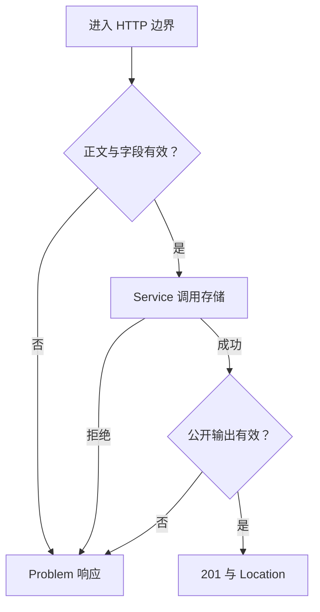

# 第 14 章 第二篇回顾：沿一次请求解释职责与生命周期

**阅读前提：先完成第 7～13 章。** 本章从第十三章的可运行服务出发，综合使用请求边界、模块与依赖、契约、日志和关闭流程。第七章的最小 Nest 只用于理解机制，本章不再扩建或依赖它。

第七章开始时，我们面对的是一份已经能接收请求的 Node 程序。迁入 Nest 后，同样的三个接口被放进了不同组件。现在要判断的不是能否说出每个装饰器的名字，而是面对变化时，能否决定改哪里、保留什么、怎样取得证据，并把新的产物交给另一个运行环境。

本章安排一个完整的小改造：只对新建记录收紧长度规则，保留此前合法记录的读取能力；再换一种内存存储表示，核对替换没有改变行为。它会触及第十一章的输入与输出区分、第九章的存储契约和第十三章的观测，而不是再增加一个业务路由。

配套分支为 `part-02/chapter-14`。主服务沿用 `part-02/chapter-13`；本章的变更只在个人隔离工作目录中实现，参考补丁和请求集合随第十四章提供。第三篇继续接入数据库时，主线仍使用原来的 2000 单元规则和 Map 存储，不要求带入这次练习。

## 14.1 从启动到响应，重建一条有证据的执行路径

### 先确认观察的是哪个进程

在第十四章配套代码目录运行 `nvm use`、`npm run check`，然后以 `LOG_LEVEL=debug npm run dev` 启动。Postman 先复用已有基础集合，目标保持 `http://127.0.0.1:3000`；VS Code 选择 `EPP: attach to npm run dev`。

app.ready 日志说明配置与应用初始化已经完成，而且这个子进程已监听成功；Build succeeded 只说明 TypeScript 编译完成。日志外层的 pid 指向服务进程，终端里的 npm 和 watcher 则负责组织启动。把这几项身份分开，才能解释“代码已经保存，怎么还像旧版本”和“为什么停止服务后终端仍没返回提示符”。

沿启动反推，配置先在容器外校验为快照，再由 RuntimeModule 的 useValue 交给同一个应用。Module 描述哪些 Provider 可以被谁找到，Provider 决定对象如何产生与共享；这些动作并不是每收到一次请求就重新执行。CapturesService 持有 CAPTURE_STORE 对应的对象，而不是每个方法都根据字符串去寻找一种存储。

如果收到请求前已经失败，应先查配置、依赖组装或端口申请。给 Controller 多加一条日志不能让不存在的服务开始监听；构造器断点也不会因为每次 Send 而重复命中。只有这次运行成功建立了请求入口，后面的请求排查才有对象。

### 用同一份创建请求对照两种失败

在 Postman 创建一条虚构原文，观察201、Location和 X-Request-Id。根据响应编号筛选日志，应看到入口、存储成功与响应完成。然后在同一进程依次改变输入，保留每次实际请求与响应：

- 把 Body 改成无法解析的 JSON，例如只保留左花括号。它会在读取边界返回 INVALID_JSON，字段 Pipe 和 Service 都不应执行。
- 把 Body 改成 `{"originalText":7}`。JSON 已经合法，SchemaPipe 才能拒绝字段类型，返回 VALIDATION_ERROR；依然不应进入写入。
- 恢复合法字符串，再在写入前暂停。可以看到已经通过前面边界的输入、由 Service 创建的记录，以及即将接收它的存储对象。

这些事实串起来，才能解释执行顺序。观察 Middleware 先分配请求编号，httpBoundary 保留方法、路径与查询数量约定，captureBody 负责一次性读取正文，Pipe 解析字段，Controller 适配 HTTP，Service 执行业务规则，存储完成操作，输出 Interceptor 检查公开表示。途中未处理的异常由 Filter 转成 Problem。GET 的查询 Pipe 与创建正文的 Pipe 不同，但它们都不负责存储。

下面只画创建请求的主要分歧，避免把启动生命周期和每次请求混成一条线：



输出失败也进入 F，但 C 可能已经完成。错误状态只能证明这次 HTTP 结果失败，不能独自说明数据有没有改变。这是后面判断重试、事务与幂等的前提。

### 框架接管了什么，仍由谁负责

Nest 负责按声明组装对象、匹配路由、提取参数、调用管线并发送常规返回值。它不会从业务类型推导“什么原文允许保存”，也不会从 CaptureStore 接口推导列表顺序、返回副本和失败时是否写入。我们仍需明确定义这些行为，再把实现放到对应边界。

相同道理，注册一个关闭钩子不代表已接收的请求全部结束；把对象设为默认作用域也不代表它的数据跨进程共享。框架提供调用机制，实际完成条件由应用建立。能够指出这一层分工，才有办法在框架行为与自己代码之间定位故障，而不是把所有问题归为“生命周期顺序不对”。

## 14.2 改变输入规则，并证明存储仍可替换

### 先读需求，自己决定修改范围

现在假设产品决定：**从本次改造起，新建 originalText 最多1200个 UTF-16 代码单元；此前按2000单元规则接收的记录仍须能够完整读取和返回。** 原文仍保留首尾空白，但纯空白仍非法。字节上限继续是16 KiB，列表查询、排序、详情、不存在和错误结构都不改变。

这是一项收紧输入的变更。原来发送1500单元能成功的客户端，升级后会收到400；不能把它称为对所有旧请求完全兼容。我们保留的是旧记录的可读性，以及仍满足新规则的调用方式。实际发布时，需要同步调用方提示和接口文档，并明确切换时间；这里用隔离练习观察这个区别。

同时，将 Map 实现替换成另一种遵守 CaptureStore 的实现。参考采用数组，目的是让内部表示确实变化，并核对行为约定是否被保留；这不是性能优化。按 ID 查询会从 Map 的查找变成数组扫描，不能因为 TypeScript 接口相同，就声称成本也相同。

在阅读参考实现前，先独立说明自己的修改点。尤其要决定：输入与输出能否继续使用完全相同的 Schema；绕过 HTTP 直接调用 Service 时适用什么限制；哪些组件会知道底层从 Map 改成数组；日志和关闭计数是否会因替换而消失。自己选几条能推翻错误实现的输入，而不只选一条“hello”。

### 给独立实现一个清楚的起点

先停止正在运行的开发服务。在第十四章配套代码根目录执行：

```bash
git status --short
review_root=$(pwd)
git worktree add -b practice/chapter-14 ../epp-chapter-14-practice part-02/chapter-13
```

review_root 保存最初目录的位置，只在当前 shell 中保留；后续对照参考继续使用这个终端，另一个终端负责运行 dev。确认创建成功后再进入新目录。分支或目录已存在时，先核对它保存的工作，换一个新名字；不要强制覆盖，也不要把别人的练习清掉重来。

如果分两次完成练习，重开终端后先进入任一已有代码工作目录，用 `git worktree list` 找回最初的第十四章目录和自己的练习目录；回到前者重新执行 `review_root=$(pwd)`，再进入后者继续。不必再次执行 worktree add，已有修改仍在练习目录中。恢复时先核对当前目录、`git status --short` 和启动端口，避免把参考补丁应用到自己的未完成实现上。

```bash
cd ../epp-chapter-14-practice
nvm use
npm ci
npm run check
PORT=3008 LOG_LEVEL=debug npm run dev
```

新目录使用第十三章基线，原目录的未提交文件不会被带过来。用 VS Code 打开这个练习目录再 attach，避免源码映射指向另一份文件。业务端口改成3008后，调试端口仍为9229，所以不能同时开着原目录的 dev。

从最初的第十四章目录导入 `requests/review.postman_collection.json`；它不在第十三章基线目录中。集合已经保存普通输入、1200/1201单元、600/601个表情、纯空白、列表和详情八条请求，baseUrl 默认3008，不需要手敲长字符串或 curl。成功创建后，将响应 id 填入此集合的 captureId，详情请求才会读取刚创建的记录。

先完成自己的第一版，再对照下面的推导。参考补丁的作用是帮助找出遗漏的边界，不是替代第一次独立判断。

### 收紧输入为什么不能顺手收紧输出

第十三章的 OriginalTextSchema 同时用于创建输入与公开响应。如果直接把里面的2000改成1200，1500单元的旧记录虽然可能还在存储里，读取时却会被响应 Interceptor 判为内部失约，变成500。写入规则的变化意外破坏了读取，这比新建接口返回400更难被调用方理解。

所以这里保留原输出范围，只建立新的创建规则。先新增 `src/capture-policy.ts`：

```ts
export const MAX_NEW_ORIGINAL_TEXT_LENGTH = 1200;
```

在 `src/capture-contract.ts` 导入这个常量，将原来 CreateCaptureSchema 的定义替换为：

```ts
export const NewOriginalTextSchema = OriginalTextSchema
  .refine(text => text.length <= MAX_NEW_ORIGINAL_TEXT_LENGTH,
    `originalText must be at most ${MAX_NEW_ORIGINAL_TEXT_LENGTH} code units`)
  .describe(`New original text; whitespace is preserved. Maximum ${MAX_NEW_ORIGINAL_TEXT_LENGTH} UTF-16 code units.`);
export const CreateCaptureSchema = z.object({ originalText: NewOriginalTextSchema });
```

OriginalTextSchema 与 CaptureResponseSchema 保持第十三章的定义。新输入在原有字符串、非空白和2000单元检查之上增加更严格的创建限制；公开响应仍承诺能表示旧规则接受的数据。

接着修改 CapturesService.create，导入同一个常量，把长度检查替换为：

```ts
if (originalText.length > MAX_NEW_ORIGINAL_TEXT_LENGTH) {
  throw new InvalidCaptureError(`originalText must be at most ${MAX_NEW_ORIGINAL_TEXT_LENGTH} code units`);
}
```

两处检查承担不同责任。HTTP Schema 负责给调用方稳定的字段错误，Service 保护脱离 HTTP 的业务调用。共享业务常量可以防止数值漂移，但不需要让 Service 依赖 Controller 或读取请求对象。HTTP 输入非法仍返回 VALIDATION_ERROR；直接调用 Service 会抛 InvalidCaptureError，这不是两套规则互相冲突。

在练习目录运行 `npm run check` 与 `node scripts/export-openapi.mjs`，打开生成的 `dist/openapi.json`。OpenAPI 已经从 Schema 生成输入与输出组件，所以重新导出后，CreateCapture 的 originalText 描述应出现1200，Capture 的 originalText 描述仍是2000。自定义 refine 不会自动变成所有文档消费者都能执行的长度约束，文字必须写清 UTF-16 单元；不能把刷新 Swagger 当成服务器已经执行了新规则。

### 接口相同，还要保留哪些行为

数组实现可以很短，但它必须保留插入顺序、先筛选再截取、同一 ID 不重复插入、未找到返回 undefined，以及输入和输出副本。新增 `src/array-capture.store.ts`：

```ts
import type { Capture, CaptureListOptions } from './capture.js';
import type { CaptureStore } from './capture-store.js';

// Alternative in-memory representation for the isolated chapter-14 practice.
export class ArrayCaptureStore implements CaptureStore {
  private readonly captures: Capture[] = [];

  async insert(capture: Capture): Promise<void> {
    if (this.captures.some(item => item.id === capture.id)) {
      throw new Error('Capture ID already exists');
    }
    this.captures.push({ ...capture });
  }
  async list({ text, limit }: CaptureListOptions): Promise<Capture[]> {
    const result: Capture[] = [];
    for (const capture of this.captures) {
      if (text !== undefined && !capture.originalText.includes(text)) continue;
      result.push({ ...capture });
      if (limit !== undefined && result.length === limit) break;
    }
    return result;
  }
  async find(id: string): Promise<Capture | undefined> {
    const capture = this.captures.find(item => item.id === id);
    return capture === undefined ? undefined : { ...capture };
  }
}
```

如果先取前一个元素再筛选，前一条不匹配而第二条匹配时，会错误地返回空列表。若 find 直接返回内部对象，调用者修改一次查询结果，就会改掉存储。只运行“插入后按 ID 读回”的成功路径，抓不到这两类问题。

这里浅复制足够，是因为 Capture 当前只有字符串字段；以后增加嵌套数组或对象时，必须重新检查引用是否仍能泄漏。数组和 Map 两种实现都在当前同步段内检查 ID 并写入，中间没有 await；将来接数据库时，先查重再异步插入会遇到新的并发条件，不能把这段实现的安全性直接搬过去。

在 CapturesModule 中，改用数组组件，但继续把它放在 ObservedCaptureStore 里面：

```ts
ArrayCaptureStore,
{
  provide: CAPTURE_STORE,
  useFactory: (store: ArrayCaptureStore, logger: AppLogger, state: ApplicationState) =>
    new ObservedCaptureStore(store, logger, state),
  inject: [ArrayCaptureStore, AppLogger, ApplicationState],
},
```

同时将原 MemoryCaptureStore 的 import 和 providers 登记替换为 ArrayCaptureStore。Controller、CapturesService 的构造参数及 CAPTURE_STORE 令牌都不需要改名。ObservedCaptureStore 仍负责日志和工作计数；若直接将 CAPTURE_STORE 绑定到数组类，业务可能仍能跑通，但第十三章建立的诊断与关闭责任会被悄悄丢掉。

不需要创建第二个全局存储，也不需要把数组作为模块导出。业务消费者继续依赖 CapturesService，模块内部再决定它使用哪个存储对象。这一次替换的价值，是让调用边界保持稳定，并把有变化的选择留在组装处。

### 用旧记录与直接业务调用补上 HTTP 看不到的事实

内存服务自动重启会清空数据，不能拿“重启后没有旧记录报错”证明读取兼容。我们需要在同一进程中放入一条此前合法的1500单元记录，再通过 Service 和公开响应投影读取它。在自己的练习目录新增 `examples/review-contract.mjs`；参考补丁也包含同一脚本：

```js
import { randomUUID } from 'node:crypto';
import { ArrayCaptureStore } from '../dist/src/array-capture.store.js';
import { MemoryCaptureStore } from '../dist/src/memory-capture.store.js';
import { CapturesService } from '../dist/src/captures.service.js';
import { CreateCaptureSchema, toCaptureResponse } from '../dist/src/capture-contract.js';

console.log('input 1200:', CreateCaptureSchema.safeParse({ originalText: 'x'.repeat(1200) }).success);
console.log('input 1201:', CreateCaptureSchema.safeParse({ originalText: 'x'.repeat(1201) }).success);
for (const Store of [MemoryCaptureStore, ArrayCaptureStore]) {
  const store = new Store();
  const service = new CapturesService(store);
  const legacy = { id: randomUUID(), originalText: 'x'.repeat(1500), createdAt: new Date().toISOString() };
  // Model a record accepted by the old rule; this is not a migration or an HTTP route.
  await store.insert(legacy);
  legacy.originalText = 'caller changed its own input';
  const found = await service.find(legacy.id);
  console.log(Store.name, 'old response length:', toCaptureResponse(found).originalText.length);
  found.originalText = 'caller changed its own result';
  console.log('stored copy length:', (await service.find(legacy.id)).originalText.length);
  const before = (await service.list()).length;
  try { await service.create('x'.repeat(1201)); }
  catch (error) { console.log('direct create rejected:', error.constructor.name); }
  console.log('invalid create changed count:', (await service.list()).length !== before);
  await service.create('no match');
  await service.create('match first');
  await service.create('match second');
  console.log('filter before limit:', (await service.list({ text: 'match ', limit: 1 })).map(x => x.originalText));
  const list = await service.list();
  list[0].originalText = 'changed list item';
  list.length = 0;
  console.log('list mutation changed stored value:', (await service.find(legacy.id)).originalText.length !== 1500);
}
```

构建后运行 `node examples/review-contract.mjs`。两种存储都应读回1500单元的旧记录；修改原输入、find 返回值或列表元素后，存储仍保留自己的值。1200输入通过，1201输入失败；直接 create 被 InvalidCaptureError 拒绝，数量不变；带 limit=1 的筛选得到 match first。

该脚本是一个独立进程，它的旧记录不会出现在另一个 dev 服务的 Postman 列表里。直接插入旧记录只是在受控例子里建立旧数据条件，不是数据迁移，更不能为真实服务增加“跳过校验”的 HTTP 路由。主线没有数据库，本次也没有修改记录结构；以后有真实历史数据时，兼容与迁移要在那批数据上完成。

### 对照参考，同时保留自己的成果

如果需要运行参考实现，回到最初的代码目录，另建一个目录，不在自己的实现上直接叠加补丁：

```bash
cd "$review_root"
git worktree add -b practice/chapter-14-reference ../epp-chapter-14-reference part-02/chapter-13
```

创建成功后执行：

```bash
cd ../epp-chapter-14-reference
git apply --check "$review_root/examples/chapter-14-review.patch"
git apply "$review_root/examples/chapter-14-review.patch"
nvm use
npm ci
npm run check
node examples/review-contract.mjs
PORT=3008 LOG_LEVEL=debug npm run dev
```

先停止自己那份开发服务，再启动参考；两者的调试端口与业务端口相同。只有 apply --check 成功后才执行 apply；检查失败时先核对基线与本地改动，不跳过检查继续启动。apply --check 只检查补丁能否应用，不证明行为正确；后面的构建、直接调用和图形请求各自提供不同证据。如果自己的方案不同，只对照结果与责任划分，不必把文件名和实现细节改成一模一样。

使用图形集合逐条 Send。普通原文、1200单元和600个表情应成功；1201单元、601个表情和纯空白应失败。失败后查看列表，数量不应增加。已有有效原文的空格应保留，Location、X-Request-Id 与详情仍正常。保存源码会重启清空内存，比较数量前先建立这次新进程的基线，不拿上一次运行的数据作对照。

## 14.3 用日志、故障与交付产物核对同一套判断

### 一条500，可能发生在写入前，也可能发生在写入后

输入失败已经在14.1与14.2观察过。现在暂时在隔离练习的数组存储 insert 开头加入 `throw new Error('review storage failure')`，保存并等待重启。先确认列表为空，再发送普通合法创建请求。应得到500／INTERNAL_ERROR，同一编号下依次出现 store.failed、http.failed 与响应完成；列表不增加记录。原因是存储在写入前拒绝，Service 的 await 也没有成功完成。

移除这条故障，等开发服务恢复。接下来只改 CapturesController.create 的返回值，保留前面的 Service 调用和 Location 设置：

```ts
return { ...capture, createdAt: 'not-a-date' };
```

再发送一次合法创建。应得到500／INTERNAL_ERROR，但日志这次应先出现 store.completed(insert)，然后才是 http.failed。错误响应不应保留成功专用的 Location。不要保存或重启，立即发送列表请求，刚才的记录应已经存在，createdAt 也应仍是有效时间；因为修改的是 Controller 返回副本，存储中的记录没有被那行代码改写。

这次观察把错误转换、输出校验和副作用重新接到一起：Filter 能给调用方一致错误，不能替存储回滚；没有拿到201，也不能直接重试创建并假定不会重复。当前 POST 每次都生成新 ID，自动重放会产生第二条记录。后面讨论事务与幂等时，要解决的是这个实质问题，而不只是给错误加一个更漂亮的消息。

恢复 Controller，等待重启，再用保存的请求复验正常201。两次临时故障都不保留到参考补丁、主线分支或交付产物。日志不记录故障异常里的任意 message，诊断依赖稳定事件和请求编号；需要查看异常细节时用开发断点，不把原始对象写到共享日志里。

### 启动失败与请求失败的观察入口不同

继续用第十三章的生产入口做配置对照：`PORT=3001oops npm start` 应在创建应用前输出 CONFIG_INVALID 和字段 PORT，退出码为1，没有 app.ready。此时没有可复制的响应编号，因为不存在一次已经进入应用的请求。查看终端的启动事件，比反复点 Postman Send 更接近原因。

改回有效端口以后，若是端口占用，失败发生在监听阶段，应出现 EADDRINUSE。先从已有服务的 app.ready 找 pid；macOS/Linux 可以使用 `lsof -nP -iTCP:3008 -sTCP:LISTEN` 核对这个端口的进程，不要因为怀疑占用就结束所有 Node 进程。该命令显示的是当前系统的监听者，不证明它一定对应你正在编辑的目录。

容器组装错误则更早。比如更换数组类以后漏改工厂的 inject，Controller 尚未可用，请求日志自然不会出现。回到构建/启动调试，在初始化处观察令牌和所属模块；不要把修复方式变成“随手把同一个 Provider 在每个模块再登记一次”，否则可能产生不同存储实例。第十章的可见性与第九章的实例身份在这里共同决定结果。

### 处理中停止，观察资源是否真的最后释放

要观察关闭顺序，复用第十三章的独立生命周期应用。结束练习 dev，运行 `npm run dev:lifecycle`，导入生命周期集合，目标为3007。发送正常延迟请求后，向 app.ready 中的服务子进程 pid 发 SIGTERM。

先预测三件事：停止以后是否还应接受新工作，已接收的操作是否继续，文件句柄何时释放。再核对 app.draining、resource.used、HTTP 完成、resource.closed 和 app.stopped。正常结果应让已有工作完成后再释放；新的连接可能直接连不上，已有连接上到达的新请求才可能收到 SERVICE_DRAINING。不能要求所有客户端都看到相同的503。

接着取消一个进行中的客户端请求，再停止服务。http.aborted 并不代表 resource.use 已被取消；工作计数仍要等到它真正结束，才能关闭句柄。如果只按 HTTP 连接数量判断“都结束了”，就会在取消请求以后过早释放正在使用的资源。

最后用集合中的15秒请求观察默认五秒期限：超时退出是失败状态，不能当作“优雅关闭完成”。LOG_LEVEL、调试器暂停与启动环境都可能影响观察；不要停在断点上测期限。故意让关闭钩子挂起时，复用 `LAB_MODE=close-hang`，确认期限也覆盖释放阶段。结束后恢复实验模式，切回业务应用。

本章不再实现一套关闭器。这次要能从日志解释是哪一层还没有结束，知道何时继续等待、何时达到期限，以及强制结束后哪些事实仍然未知。

### 真正运行一次独立产物

恢复所有临时故障，在自己或参考的练习目录执行 `npm run check`。开发使用 .dev，构建使用 dist，可以并行；独立产物改用3009。复制的是刚才完成检查的代码对应产物：

```bash
release_dir=$(mktemp -d)
cp package.json package-lock.json .npmrc .nvmrc "$release_dir/" &&
cp -R dist "$release_dir/dist" &&
(
  cd "$release_dir" &&
  npm ci --omit=dev &&
  PORT=3009 LOG_LEVEL=debug npm start
)
```

保留这次 shell 中的 release_dir，必要时先在编辑器或文件管理器确认它指向新建的临时运行目录。这里不复制源码、开发 .env、.dev、请求集合或生命周期实验。运行目录安装 Nest、Zod 等运行依赖，但不需要 TypeScript 才能执行现有 JavaScript；它不能在现场重新构建。

在 Postman 复制练习集合，将副本命名为“第十四章产物核对”，baseUrl 改成3009。重新创建数据，逐条核对成功、长度拒绝、列表与详情；不要复用开发进程的 captureId。生产默认关闭 Swagger，直接图形请求仍能调用业务接口。若3008成功而3009行为不同，先比较产物来源、变量与请求目标，而不是假设生产应该另有一套业务规则。

最后向产物服务发停止信号，确认 app.stopped 与服务退出，再重新运行，列表应为空。这份程序的可交付布局和停止流程成立，并没有因此获得持久化能力。只在确认目录就是本次临时目录、进程已结束且不再需要保留后，才清理该目录；不清理自己的练习工作树或源码目录。

## 14.4 带着已有边界进入数据库篇

### 替换组件的能力，与持久化能力分开判断

数组和 Map 都满足当前存储接口，进程退出后也都会消失。把它们包装成 Provider、加 await、记录耗时，改变的是组织与调用方式，不是数据所在的位置。即使文件资源实验写过一次临时文件，它也没有定义记录格式、查询、恢复或并发写入协议，不能被当作数据库实现。

第三篇将保留已有三个接口与记录模型，再把存储移出服务进程。那时会出现新的完成条件：连接什么时候可用，写入何时真正提交，进程退出后哪个系统仍保存数据，以及查询排序能否继续满足现在的约定。Promise 返回只说明调用契约允许等待；具体等待的是什么，需要根据数据库行为重新建立。

这次练习已经暴露了值得带过去的要求：旧记录不能因新输入规则收紧而突然无法读取；查询必须先筛选再限制数量；返回对象不能允许调用者偷偷修改存储；失败响应不能直接证明写入没发生；释放连接要晚于已接受工作的结束。数据库驱动和 ORM 能帮助表达操作，但不会替我们决定这些承诺。

还会有当前内存代码没有承担的责任。默认作用域只能在一个 Nest 应用中共享对象，两个服务进程不会共享 Map；数据库中的唯一性、事务和隔离也不能靠同一段 JavaScript 暂时没有 await 来保证。这些将在真实表、连接和数据上展开，不在总结章用术语列表替代实现。

### 如何判断自己已经能独立承担这一阶段的工作

回到自己的改造，不看参考，说明为什么长度常量同时影响创建 Schema 和 Service，却没有改掉旧记录的输出上限；指出存储替换的登记位置，证明没有丢掉观测包装；拿出一条失败请求的编号，解释写入前失败与输出失败的不同证据；再说明自己的产物由哪些文件和环境组成，停止时按什么顺序完成。

如果某个判断仍只能回答“因为参考就是这样写的”，应回到缺少机制的地方。输入与公开输出的分离在第十一章，作用域和实例身份在第九章，模块可见性在第十章，错误位置在第十二章，关联和收尾在第十三章。这里的回看应带着一个具体的反例，例如“旧记录1500单元为什么变500”，而不是从头背一遍装饰器名称。

能够完成本章，意味着可以独立组织当前这个单进程、内存版 Nest 服务，并在输入、依赖和运行条件变化时维护它的承诺。完整的数据库维护、发布恢复与长期运行能力还需要后续篇章的实际工作；本篇建立的边界会继续作为它们的起点。

保留自己的实现、排错记录与参考对照；需要移除练习 worktree 时，先保存工作并确认其中没有运行的服务，再用 Git 的 worktree 管理命令处理，不强制删除未提交成果。回到主代码目录后，第十四章主线依旧是第十三章的接口与运行行为。下一章先建立 PostgreSQL 运行环境，掌握实例、连接身份和启停管理；随后再建表并接入存储。安装好数据库不会自动让当前三个接口获得持久化能力。

时间参考（估算）：阅读约45～55分钟；独立修改、请求排错、关闭与产物核对另加约50～65分钟，合计约95～120分钟。按正文约 6200 个汉字、110 行代码与命令，以及独立改造和故障对照估算，尚未经过读者实测；复用已安装的环境与前章实验，不重复计算首次安装、依赖下载或无目标的排错时间。

## 附录：本章必要技术点速查

| 名称 | 本章用途 | 必要注意点 |
| --- | --- | --- |
| git worktree add | 建立有明确基线的个人练习 | 不自动带入原目录未提交文件；目录与分支不强制覆盖 |
| git apply --check／apply | 对照隔离参考改造 | 可应用不等于行为正确；不叠在个人成果上 |
| 创建 Schema／响应 Schema | 分别表达新输入与已有数据 | 收紧写入不应无意破坏读取；文档同步体现差异 |
| CAPTURE_STORE／useFactory | 替换实现并保留观测包装 | 方法签名相同不保证排序、副本、失败与成本一致 |
| X-Request-Id／结构化事件 | 对照一次请求中的存储与响应 | 没有响应编号的启动失败要查进程事件 |
| .dev／dist／npm ci --omit=dev | 区分调试文件与交付运行目录 | 交付不复制开发秘密或实验产物 |
| app.draining／app.stopped | 判断停止接收与收尾完成 | 客户端取消不等于业务取消；期限耗尽是失败 |

官方查阅：[Git worktree](https://git-scm.com/docs/git-worktree)、[Git apply](https://git-scm.com/docs/git-apply)、[Nest Provider](https://docs.nestjs.com/fundamentals/custom-providers)、[Nest 生命周期](https://docs.nestjs.com/fundamentals/lifecycle-events)。本章是在既有机制上改变条件；具体接口解释与实现位置见相应前章。

[上一章：配置与生命周期](../chapter-13-configuration-lifecycle/chapter.md) · [下一章：PostgreSQL 运行环境](../../part-03-postgresql/chapter-15-postgresql-environment/chapter.md) · [返回第二篇](../README.md) · [返回全书目录](../../README.md)
