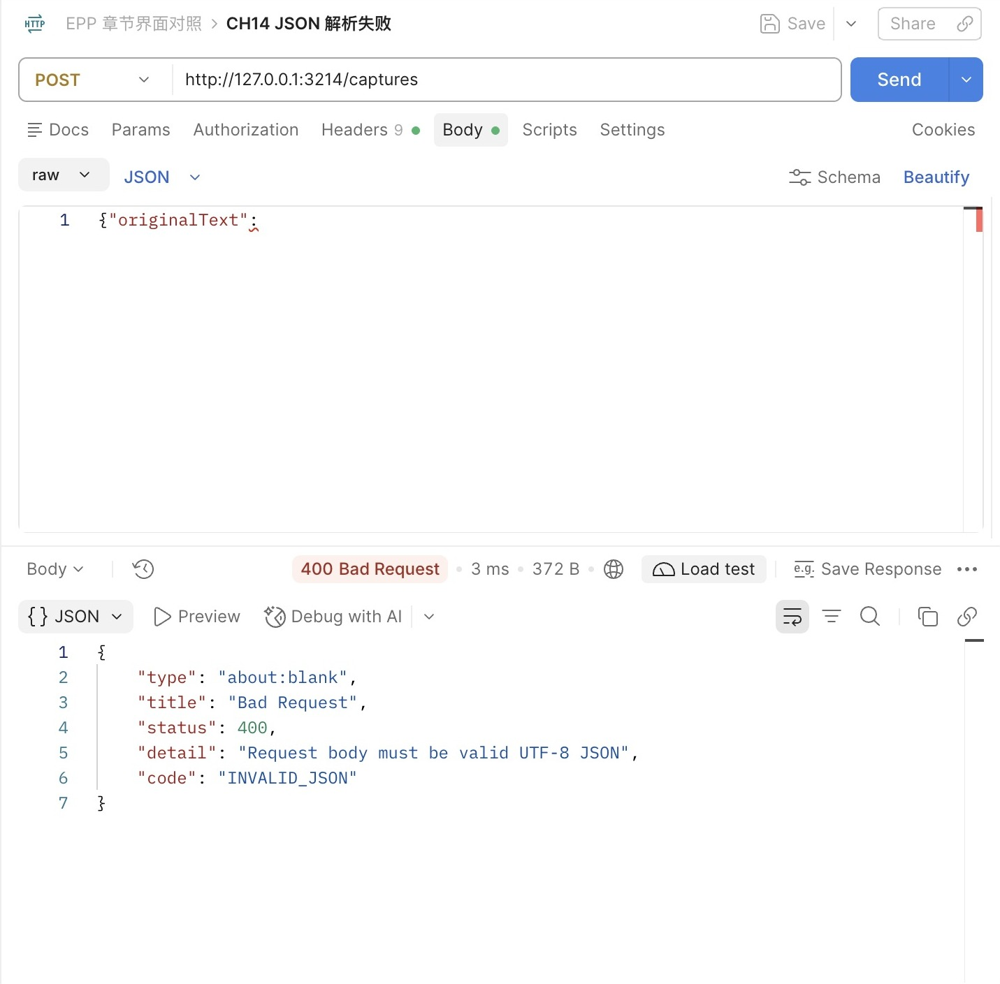
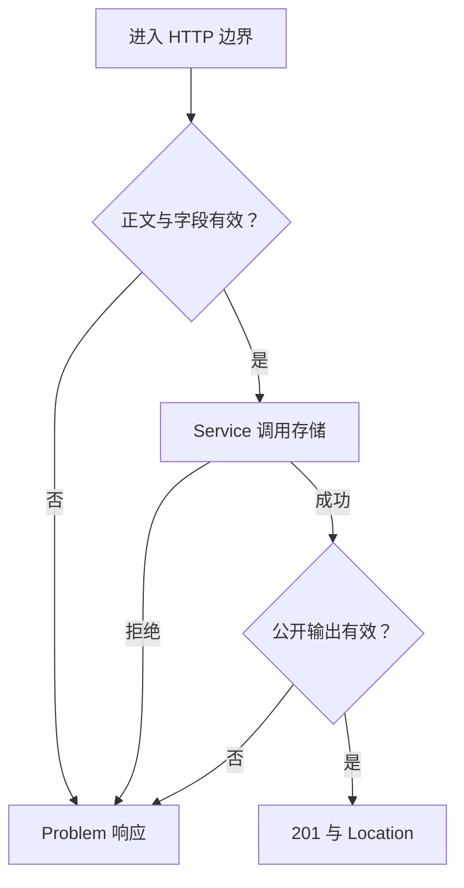

# 第 15 章 第二篇回顾：沿一次请求解释职责与生命周期

**阅读前提：先完成第 8～14 章。** 本章从第十四章的可运行服务出发，综合使用请求边界、模块与依赖、契约、日志和关闭流程。第八章的最小 Nest 只用于理解机制，本章不再扩建或依赖它。

第八章开始时，我们面对的是一份已经能接收请求的 Node 程序。迁入 Nest 后，同样的三个接口被放进了不同组件。现在要判断的不是能否说出每个装饰器的名字，而是面对变化时，能否决定改哪里、保留什么、怎样取得证据，并把新的产物交给另一个运行环境。

现在收紧新建记录的长度限制。旧记录里可能已经有更长的原文，读取它们仍应成功。改完输入校验，再换一种内存存储方式，用原来的请求和日志检查行为是否一致。

配套分支为 `part-02/chapter-15`。主服务沿用 `part-02/chapter-14`；本章的变更只在个人隔离工作目录中实现，请求集合随第十五章提供，完整参考源码另有独立分支。第三篇继续接入数据库时，主线仍使用原来的 2000 单元规则和 Map 存储，不要求带入这次练习。

## 15.1 从启动到响应，重建一条有证据的执行路径

### 先确认观察的是哪个进程

先用刚完成的第十四章目录。第十五章主服务的源码与它相同，新的练习集合到 15.2 才用。若从第十五章完整快照开始，也可在该目录操作。运行 `nvm use`，新检出、尚无依赖的目录先执行 `npm ci`，再运行 `npm run check`。用 `LOG_LEVEL=debug npm run dev` 启动，等本次 `app.ready`，在 Postman 基础集合里把 `baseUrl` 对准它的端口（默认 `http://127.0.0.1:3000`），VS Code 选择 `EPP: attach to npm run dev`。

app.ready 日志说明配置与应用初始化已经完成，而且这个子进程已监听成功；Build succeeded 只说明 TypeScript 编译完成。日志外层的 pid 指向服务进程，终端里的 npm 和 watcher 则负责组织启动。把这几项身份分开，才能解释“代码已经保存，怎么还像旧版本”和“为什么停止服务后终端仍没返回提示符”。

沿启动反推，配置先在容器外校验为快照，再由 RuntimeModule 的 useValue 交给同一个应用。Module 描述哪些 Provider 可以被谁找到，Provider 决定对象如何产生与共享；这些动作并不是每收到一次请求就重新执行。CapturesService 持有 CAPTURE_STORE 对应的对象，而不是每个方法都根据字符串去寻找一种存储。

如果收到请求前已经失败，应先查配置、依赖组装或端口申请。给 Controller 多加一条日志不能让不存在的服务开始监听；构造器断点也不会因为每次 Send 而重复命中。只有这次运行成功建立了请求入口，后面的请求排查才有对象。

### 用同一份创建请求对照两种失败

试着把启动与请求画成两条不同的时间线。第一条始于运行命令，止于端口已经可以接收请求，中间由配置快照、模块注册和对象构造决定“接下来由谁处理”。第二条始于一次请求到达，止于这次响应完成或连接中断，中间由路由、参数转换、业务调用和结果表示决定“这一次发生了什么”。它们的交点是同一个已经组装好的应用，而不是执行了一次就丢弃的 Controller。第一次发送和第二次发送通常会经过同一个 Service 对象，却有各自的输入、响应和请求编号。只要沿这两条线追一次，就能解释为什么改请求体不需要重启服务，而改构造器注入的实现却不能指望下一次 Send 自动替换现有对象。

如果代码改过了，结果却还是昨天的样子，先找一个不会被两种解释同时满足的观察。举例说，编辑器显示改动已保存，但终端最后一次编译失败；此时看见旧结果不证明新逻辑也有同样的错误。即使编译成功，也还要看新一轮服务启动是否完成，再核对 Postman 实际使用的地址。一个指向另一个目录、另一个端口的进程可以诚实地返回成功。把终端中最近的 ready、请求实际 URL、这次响应带回的编号连在一起，比在新代码里多打三处断点更能首先确认观察对象。只有确定请求到达正确进程，断点未命中才有解释价值。

反过来，还有一种不是启动出错的“看不见数据”：在一个进程里成功创建素材，再编辑一行代码触发自动重启，同一个详情请求随后找不到它。这一变化完全可能发生在接口和存储算法一行未改的情况下。第一个 Service 持有第一份内存对象，新进程的容器构造了第二份；复用的是启动配方，不是已经写入的对象。此时用原 ID 去查第二份存储，未找到是正确结果。直接再发创建请求会生成新 ID，把这一次的“重启丢失”和“我是否查对了记录”混在一起。要研究同一进程中的读写契约，就不要在创建和读回之间保存会引发重载的文件。

在 Postman 创建一条虚构原文，观察201、Location和 X-Request-Id。根据响应编号筛选日志，应看到入口、存储成功与响应完成。然后在同一进程依次改变输入，保留每次实际请求与响应：

- 把 Body 改成无法解析的 JSON，例如只保留左花括号。它会在读取边界返回 INVALID_JSON，字段 Pipe 和 Service 都不应执行。
- 把 Body 改成 `{"originalText":7}`。JSON 已经合法，SchemaPipe 才能拒绝字段类型，返回 VALIDATION_ERROR；依然不应进入写入。
- 恢复合法字符串，再在写入前暂停。可以看到已经通过前面边界的输入、由 Service 创建的记录，以及即将接收它的存储对象。



上半区缺少字段值与结束花括号，下半区为 INVALID_JSON；与上一章数字原文的 VALIDATION_ERROR 对比，可以先区分正文解析和字段规则两类失败。具体经过哪些函数，继续结合断点和同一请求编号核对。端口使用自己的监听地址。

这些事实串起来，才能解释执行顺序。观察 Middleware 先分配请求编号，httpBoundary 保留方法、路径与查询数量约定，captureBody 负责一次性读取正文，Pipe 解析字段，Controller 适配 HTTP，Service 执行业务规则，存储完成操作，输出 Interceptor 检查公开表示。途中未处理的异常由 Filter 转成 Problem。GET 的查询 Pipe 与创建正文的 Pipe 不同，但它们都不负责存储。

下面只画创建请求的主要分歧，避免把启动生命周期和每次请求混成一条线：



输出失败也进入 F，但 C 可能已经完成。错误状态只能证明这次 HTTP 结果失败，不能独自说明数据有没有改变。这是后面判断重试、事务与幂等的前提。

### 框架接管了什么，仍由谁负责

把刚才的失败请求停在不同的位置看，会发现“输入”也有好几种形态。Postman 发出的是 HTTP 正文的字节；正文解析器从字节读出 JSON 值；字段 Pipe 接收一个尚未证明能用于业务的值，成功后才把符合契约的数据交给控制器。同样一个数字七，写在结构合法的 JSON 里时可以被成功解析，却不能成为要求字符串的原文。因此 JSON 工具显示语法正确，只回答了第一类问题，不会替你检查字段。若某一次失败时连字段断点都没有机会命中，不妨先问“这层的参数是谁产生的，它产生了吗”，而不急着把 Pipe 挪到更早的位置。

创建成功时也有两种容易混淆的身份。响应里的素材 ID 用于下次按身份读取，Location 给出了该资源的相对地址；请求编号用于从日志里串起这一次调用，不是资源地址。把 Location 的末段和此次正文里的 id 对上，再用同一服务的地址发送 GET。这个 GET 是对同一份业务事实的第二次观察，却是一次独立 HTTP 请求。不能拿第一次 POST 的请求编号去期待它也标记这次 GET。若有两个内容相同的素材，按 ID 才能检查到底读回哪一份；反过来，两条日志里原文相同也不能代替请求编号去判断它们是不是同一次调用。项目刻意不把原文写进常规日志，正是因为关联操作并不需要暴露内容。

读管线图时注意箭头有来有回。一个 Interceptor 可以在调用处理器以前取得执行上下文，真正检查输出的工作却要等处理器给出结果；不能把它粗略背成“在 Controller 前”或“在 Controller 后”。异常路径则会绕开后续的正常结果处理：如果正文已经被判为无效，这次请求根本没有新建素材的返回值可供投影。要画准确，可以只问两件事：此刻这层**拿得到什么值**，它失败时**哪些操作可能已经完成**。这样既能从损坏 JSON 推出不应有存储成功事件，也能从输出校验失败推断写入可能早已完成，而不必死背一串组件名字。

这条路径怎样帮助分配职责？假设前端想把输入字段在请求里改成另一个名字，但素材在业务上仍然只是一条原文。变化发生在 HTTP 表示，应先处理兼容的输入映射；没有理由让存储对象开始解析请求体。反过来，若产品允许素材本身接受更长的文字，即使某个调用者完全不经 HTTP，规则也要对它生效，这就不能只改 Controller。再比如列表必须保持某种顺序，这不是“把数组序列化为 JSON”能决定的，必须由查询契约及其实现给出。换一个具体需求，沿值从哪里进来、在哪里成为事实、要向谁公开这三步定位，比给每个类预先配一句抽象的职责说明更有用。

Nest 负责按声明组装对象、匹配路由、提取参数、调用管线并发送常规返回值。它不会从业务类型推导“什么原文允许保存”，也不会从 CaptureStore 接口推导列表顺序、返回副本和失败时是否写入。我们仍需明确定义这些行为，再把实现放到对应边界。

相同道理，注册一个关闭钩子不代表已接收的请求全部结束；把对象设为默认作用域也不代表它的数据跨进程共享。框架提供调用机制，实际完成条件由应用建立。能够指出这一层分工，才有办法在框架行为与自己代码之间定位故障，而不是把所有问题归为“生命周期顺序不对”。

## 15.2 改变输入规则，并证明存储仍可替换

### 先读需求，自己决定修改范围

现在假设产品决定：**从本次改造起，新建 originalText 最多1200个 UTF-16 代码单元；此前按2000单元规则接收的记录仍须能够完整读取和返回。** 原文仍保留首尾空白，但纯空白仍非法。字节上限继续是16 KiB，列表查询、排序、详情、不存在和错误结构都不改变。

这是一项收紧输入的变更。原来发送1500单元能成功的客户端，升级后会收到400；不能把它称为对所有旧请求完全兼容。我们保留的是旧记录的可读性，以及仍满足新规则的调用方式。实际发布时，需要同步调用方提示和接口文档，并明确切换时间；这里用隔离练习观察这个区别。

同时，将 Map 实现替换成另一种遵守 CaptureStore 的实现。参考采用数组，目的是让内部表示确实变化，并核对行为约定是否被保留；这不是性能优化。按 ID 查询会从 Map 的查找变成数组扫描，不能因为 TypeScript 接口相同，就声称成本也相同。

在阅读参考实现前，先独立说明自己的修改点。尤其要决定：输入与输出能否继续使用完全相同的 Schema；绕过 HTTP 直接调用 Service 时适用什么限制；哪些组件会知道底层从 Map 改成数组；日志和关闭计数是否会因替换而消失。自己选几条能推翻错误实现的输入，而不只选一条“hello”。

### 给独立实现一个清楚的起点

先在纸上列出三份原文，不急着碰代码。第一份刚好一千二百单元，第二份一千二百零一单元，第三份是昨天在旧规则下已保存的一千五百单元。把它们分别放进“今天新建”和“今天读取”两个动作中判断。第一份新建能通过，若保存成功也能读取；第二份今天不能新建，但若它早已存在，今天仍应能读；第三份也是如此。没有任何一份记录要因为今天收紧了输入就被原地缩短。这张小表同时给出了一个反例：如果把所有涉及原文的地方一律改为一千二百，新建测试可能全部通过，读取第二、第三份时却会破坏承诺。

为什么不只取很大的越界值？如果用一篇明显超过正文总字节数的文章做测试，可能先被 HTTP 正文边界拒绝，根本没走到长度规则。挑一个只比新上限多一的值，就能让旧规则、本次规则和正文容量给出不同的预测。若还把它做成纯空格，长度与非空白两道规则又会同时拒绝；无法从拒绝一次判断究竟哪条生效。把示例做小，并不是为了让练习简单，而是为了每次只改变一个会影响决定的条件。集合里那两组相邻长度就是这样来的。

单位也需要证据。六百个普通汉字是六百个 UTF-16 单元，六百个单独的 😀 则是一千二百个单元，两者显示出来的符号个数接近，送入 JavaScript 的 length 却不同。若前端用逐个码点遍历的计数器提示“还可以输入很多”，服务端用 length 判断，就可能出现前端认为没到上限、提交时却被拒。解决办法是对齐公开契约的计量方式，而不是让服务端把较长值悄悄截掉。截断不仅会改掉用户原文，按代码单元切割还可能切开一个代理对。当前变更只收紧新建的可接受范围；不是一次内容清洗。

先停止正在运行的开发服务，保留自己跟写或克隆的原项目。沿第七章的方法，另建资料目录；这一步取得本章请求集合和练习说明，不假定原项目已经有它们：

```bash
git clone --single-branch --branch part-02/chapter-15 \
  https://github.com/SamChowRock/epp-public.git ../epp-chapter-14-materials
```

克隆成功后继续；失败或目录已存在时先处理原因，不继续下一条。已有练习按下文恢复，不重新建立参考目录。

```bash
cd ../epp-chapter-14-materials
review_root=$(pwd)
git fetch origin refs/heads/part-02/chapter-14:refs/remotes/origin/part-02/chapter-14
git worktree add -b practice/chapter-14 ../epp-chapter-14-practice origin/part-02/chapter-14
```

显式 fetch 成功后才创建 worktree；`origin/part-02/chapter-14` 是本机保存的远程章节记录，不依赖本地同名分支。下面的准备命令在这个终端执行，保留其中的 `review_root` 供后面对照参考。构建成功后，另开一个以练习目录为当前目录的终端，执行 `nvm use` 和下面最后一行启动命令；原终端可继续构建和运行独立脚本。分支或目录已存在时，先核对它保存的工作，换一个新名字，不覆盖原练习。

如果分两次完成练习，重开终端后先进入本次保留的资料或练习目录，用 `git worktree list` 找回第十五章资料目录和自己的练习目录；回到前者重新执行 `review_root=$(pwd)`，再进入后者继续。不必再次执行 worktree add，已有修改仍在练习目录中。恢复时先核对当前目录、`git status --short` 和启动端口，避免进入另一份项目后误改自己的实现。

```bash
cd ../epp-chapter-14-practice
nvm use
npm ci
npm run check
PORT=3008 LOG_LEVEL=debug npm run dev
```

新目录使用第十四章基线，原目录的未提交文件不会被带过来。用 VS Code 打开这个练习目录再 attach，避免源码映射指向另一份文件。业务端口改成3008后，调试端口仍为9229，所以不能同时开着原目录的 dev。

从第十五章资料目录导入 `requests/review.postman_collection.json`；它不在第十四章基线目录中。集合已经保存普通输入、1200/1201单元、600/601个表情、纯空白、列表和详情八条请求，baseUrl 默认3008，不需要手敲长字符串或 curl。成功创建后，将响应 id 填入此集合的 captureId，详情请求才会读取刚创建的记录。

先完成自己的第一版，再对照下面的推导。参考源码的作用是帮助找出遗漏的边界，不是替代第一次独立判断。

### 收紧输入为什么不能顺手收紧输出

第十四章的 OriginalTextSchema 同时用于创建输入与公开响应。如果直接把里面的2000改成1200，1500单元的旧记录虽然可能还在存储里，读取时却会被响应 Interceptor 判为内部失约，变成500。写入规则的变化意外破坏了读取，这比新建接口返回400更难被调用方理解。

所以这里保留原输出范围，只建立新的创建规则。先新增 `src/capture-policy.ts`：

```ts
export const MAX_NEW_ORIGINAL_TEXT_LENGTH = 1200;
```

在 `src/capture-contract.ts` 导入这个常量，将原来 CreateCaptureSchema 的定义替换为：

```ts
export const NewOriginalTextSchema = OriginalTextSchema
  .refine(text => text.length <= MAX_NEW_ORIGINAL_TEXT_LENGTH,
    `originalText must be at most ${MAX_NEW_ORIGINAL_TEXT_LENGTH} code units`)
  .describe(`New original text; whitespace is preserved. Maximum ${MAX_NEW_ORIGINAL_TEXT_LENGTH} UTF-16 code units.`);
export const CreateCaptureSchema = z.object({ originalText: NewOriginalTextSchema });
```

OriginalTextSchema 与 CaptureResponseSchema 保持第十四章的定义。新输入在原有字符串、非空白和2000单元检查之上增加更严格的创建限制；公开响应仍承诺能表示旧规则接受的数据。

接着修改 CapturesService.create，导入同一个常量，把长度检查替换为：

```ts
if (originalText.length > MAX_NEW_ORIGINAL_TEXT_LENGTH) {
  throw new InvalidCaptureError(`originalText must be at most ${MAX_NEW_ORIGINAL_TEXT_LENGTH} code units`);
}
```

两处检查承担不同责任。HTTP Schema 负责给调用方稳定的字段错误，Service 保护脱离 HTTP 的业务调用。共享业务常量可以防止数值漂移，但不需要让 Service 依赖 Controller 或读取请求对象。HTTP 输入非法仍返回 VALIDATION_ERROR；直接调用 Service 会抛 InvalidCaptureError，这不是两套规则互相冲突。

在练习目录运行 `npm run check` 与 `node scripts/export-openapi.mjs`，打开生成的 `dist/openapi.json`。OpenAPI 已经从 Schema 生成输入与输出组件，所以重新导出后，CreateCapture 的 originalText 描述应出现1200，Capture 的 originalText 描述仍是2000。自定义 refine 不会自动变成所有文档消费者都能执行的长度约束，文字必须写清 UTF-16 单元；不能把刷新 Swagger 当成服务器已经执行了新规则。

### 接口相同，还要保留哪些行为

在运行替换前，可以先给每层准备一个“不应知道的细节”。控制器知道成功创建要返回资源地址，但不该知道数组要 push、Map 要 set。业务服务知道新输入必须合法，但不必知道怎样遍历数组。存储知道如何按身份取一条素材，但不应该为了返回 HTTP 404 而导入响应对象。运行日志关心某次操作何时开始和结束，不应成为每个实现都得重抄的一段数组操作。这些边界可以用一次改动验证：如果只是换内部表示，结果却要同时改路由装饰器、请求集合和错误响应格式，先查是否把不该向外公开的细节变成了调用约定。

“替换”至少有三层含义。第一层是编译器确认方法名、参数和返回类型可以接上；第二层是调用者在相同输入序列下观察到相同的成功值和失败；第三层是在给定数据量与使用方式下，实际付得起成本。第一层不推出第二层，例如一个永远返回空数组的列表方法，类型完全可能正确；第二层也不推出第三层，每次凭 ID 遍历所有记录与按键查找，在三条样本上看不出体感差异。这个练习故意让第三层发生变化，借此检验第二层究竟规定了什么。它没有提出性能目标，也没有测量真实负载，因此不能用“请求很快”论证数组更合适。

把“先筛选、再限量”写成两个输入序列，就会发现为什么不能只测一个数组。序列一第一条已经匹配，错误的“先取一条再筛”也能返回正确结果；序列二第一条不匹配，第二条才匹配，要求最多一条，错误实现就返回空。再加第三条也匹配的输入，可以分辨实现是找第一条就停，还是找齐后不小心按不同顺序截取。对于当前只承诺结果的接口，边走边停和先筛完再截断都可能正确，但两者在匹配很少或应用了不同排序时成本不同。讨论是否该提前停止之前，要先确定后面的候选还能不能改变已选中结果的位置。

数组实现可以很短，但它必须保留插入顺序、先筛选再截取、同一 ID 不重复插入、未找到返回 undefined，以及输入和输出副本。新增 `src/array-capture.store.ts`：

```ts
import type { Capture, CaptureListOptions } from './capture.js';
import type { CaptureStore } from './capture-store.js';

// Alternative in-memory representation for the isolated chapter-14 practice.
export class ArrayCaptureStore implements CaptureStore {
  private readonly captures: Capture[] = [];

  async insert(capture: Capture): Promise<void> {
    if (this.captures.some(item => item.id === capture.id)) {
      throw new Error('Capture ID already exists');
    }
    this.captures.push({ ...capture });
  }
  async list({ text, limit }: CaptureListOptions): Promise<Capture[]> {
    const result: Capture[] = [];
    for (const capture of this.captures) {
      if (text !== undefined && !capture.originalText.includes(text)) continue;
      result.push({ ...capture });
      if (limit !== undefined && result.length === limit) break;
    }
    return result;
  }
  async find(id: string): Promise<Capture | undefined> {
    const capture = this.captures.find(item => item.id === id);
    return capture === undefined ? undefined : { ...capture };
  }
}
```

如果先取前一个元素再筛选，前一条不匹配而第二条匹配时，会错误地返回空列表。若 find 直接返回内部对象，调用者修改一次查询结果，就会改掉存储。只运行“插入后按 ID 读回”的成功路径，抓不到这两类问题。

这里浅复制足够，是因为 Capture 当前只有字符串字段；以后增加嵌套数组或对象时，必须重新检查引用是否仍能泄漏。数组和 Map 两种实现都在当前同步段内检查 ID 并写入，中间没有 await；将来接数据库时，先查重再异步插入会遇到新的并发条件，不能把这段实现的安全性直接搬过去。

在 CapturesModule 中，改用数组组件，但继续把它放在 ObservedCaptureStore 里面：

```ts
ArrayCaptureStore,
{
  provide: CAPTURE_STORE,
  useFactory: (store: ArrayCaptureStore, logger: AppLogger, state: ApplicationState) =>
    new ObservedCaptureStore(store, logger, state),
  inject: [ArrayCaptureStore, AppLogger, ApplicationState],
},
```

同时将原 MemoryCaptureStore 的 import 和 providers 登记替换为 ArrayCaptureStore。Controller、CapturesService 的构造参数及 CAPTURE_STORE 令牌都不需要改名。ObservedCaptureStore 仍负责日志和工作计数；若直接将 CAPTURE_STORE 绑定到数组类，业务可能仍能跑通，但第十四章建立的诊断与关闭责任会被悄悄丢掉。

不需要创建第二个全局存储，也不需要把数组作为模块导出。业务消费者继续依赖 CapturesService，模块内部再决定它使用哪个存储对象。这一次替换的价值，是让调用边界保持稳定，并把有变化的选择留在组装处。

### 用旧记录与直接业务调用补上 HTTP 看不到的事实

副本语义不止关系到一次详情查询。把一条新对象交给 insert 后，调用者手里还握着原对象；把列表返回给调用者以后，调用者拿到了外层数组，以及数组里每一条记录的引用。这是三个不同的修改机会。只在返回时复制而在写入时保留原引用，调用者改掉最初传入的对象就能改库；只复制数组而不复制元素，清空返回数组不影响存储，但改第一条原文却会影响存储。要分清两条路径，在改变其中一个对象后重新按 ID 读回，而不是再去看已经握在手里的那份对象有没有变化。HTTP 的 JSON 序列化天然会构造新的表示，跨一次网络往返通常看不见这种同进程引用泄漏，所以它值得专门在直接调用里测试。

另一个不易发现的差别是重复身份。两段原文相同、ID 不同，在本书的模型里允许分别保存；相同 ID 再插入一条，却不应产生两份可供选择的详情。不能随手用“数组里没有这段文字”作为查重条件，否则用户今天再收集昨天的一句话会被拒。也不能让重复 ID 直接覆盖旧对象，否则业务以为新建成功，旧记录的创建时间和原文却已经变了。HTTP 路径每次由服务生成新 ID，很少会碰到同一键的两次插入；要检验存储自身的规则，用明确指定的合成记录分别调用两次插入，观察第二次是否拒绝，再按原 ID 读回第一份内容。这与随机点两次 Postman 的新建按钮回答的是不同的问题。

内存服务自动重启会清空数据，不能拿“重启后没有旧记录报错”证明读取兼容。我们需要在同一进程中放入一条此前合法的1500单元记录，再通过 Service 和公开响应投影读取它。在自己的练习目录新增 `examples/review-contract.mjs`；完整参考源码也包含同一脚本：

```js
import { randomUUID } from 'node:crypto';
import { ArrayCaptureStore } from '../dist/src/array-capture.store.js';
import { MemoryCaptureStore } from '../dist/src/memory-capture.store.js';
import { CapturesService } from '../dist/src/captures.service.js';
import { CreateCaptureSchema, toCaptureResponse } from '../dist/src/capture-contract.js';

console.log('input 1200:', CreateCaptureSchema.safeParse({ originalText: 'x'.repeat(1200) }).success);
console.log('input 1201:', CreateCaptureSchema.safeParse({ originalText: 'x'.repeat(1201) }).success);
for (const Store of [MemoryCaptureStore, ArrayCaptureStore]) {
  const store = new Store();
  const service = new CapturesService(store);
  const legacy = { id: randomUUID(), originalText: 'x'.repeat(1500), createdAt: new Date().toISOString() };
  // Model a record accepted by the old rule; this is not a migration or an HTTP route.
  await store.insert(legacy);
  legacy.originalText = 'caller changed its own input';
  const found = await service.find(legacy.id);
  console.log(Store.name, 'old response length:', toCaptureResponse(found).originalText.length);
  found.originalText = 'caller changed its own result';
  console.log('stored copy length:', (await service.find(legacy.id)).originalText.length);
  const before = (await service.list()).length;
  try { await service.create('x'.repeat(1201)); }
  catch (error) { console.log('direct create rejected:', error.constructor.name); }
  console.log('invalid create changed count:', (await service.list()).length !== before);
  await service.create('no match');
  await service.create('match first');
  await service.create('match second');
  console.log('filter before limit:', (await service.list({ text: 'match ', limit: 1 })).map(x => x.originalText));
  const list = await service.list();
  list[0].originalText = 'changed list item';
  list.length = 0;
  console.log('list mutation changed stored value:', (await service.find(legacy.id)).originalText.length !== 1500);
}
```

数组类接好后，在练习目录的命令终端再执行 `npm run check`，然后运行 `node examples/review-contract.mjs`。dev 的自动编译写入 `.dev`，这个脚本却从 `dist` 导入新类。两种存储都应读回 1500 单元的旧原文；修改传入记录、业务详情或列表元素后，再查仍是同一原文。1200 输入通过，1201 输入失败；直接 create 被 InvalidCaptureError 拒绝，数量不变；带 limit=1 的筛选得到 match first。

有一项判断只能从更靠里的位置验证。脚本改的是 `service.find` 返回的对象，Service 自己还会复制一次记录。即使底层 `store.find` 错把内部对象交出来，外层复制也可能让这一项通过。要单独验证存储的详情契约，可在同一个循环内、插入旧行之后，用 `const copy = await store.find(legacy.id)` 取得详情，修改 `copy.originalText`，再用同一标识直接调 `store.find`。第二次读出的应是原来的 1500 单元。这里的两次调用都绕过 Service，才能把结果归到正在比较的存储实现。

该脚本是一个独立进程，它的旧记录不会出现在另一个 dev 服务的 Postman 列表里。直接插入旧记录只是在受控例子里建立旧数据条件，不是数据迁移，更不能为真实服务增加“跳过校验”的 HTTP 路由。主线没有数据库，本次也没有修改记录结构；以后有真实历史数据时，兼容与迁移要在那批数据上完成。

### 对照参考，同时保留自己的成果

读上面的独立脚本时，留意搜索片段 `'match '` 的末尾有一个空格。原文 `no match` 虽然带有相同的五个字母，却在它们后面就结束了；`match first` 和 `match second` 才含有完整片段。因此参考输出应该是第一条带尾随空格匹配的原文，而不是看起来也有 match 的前一条。如果调试时把搜索词 trim 后再传给存储，原本合法的字面筛选就改变了。用于判断“是不是纯空白”的临时比较，不等于有权去掉有效输入的首尾空格。做搜索和保存原文都要辨认这两个动作。

脚本为什么直接用存储构造旧行，却坚持让新建走 Service？要验证旧行可读，得先让旧行确实存在。若用新规则去创建这条样本，前置条件会先被拒，随后得到未找到，并不是输出契约拒绝长值。反之，要验证新写入是否真的被挡住，就必须经过对业务调用作决定的那条路径；直接在存储层拒绝所有长行，会让“模拟旧事实”和“接收新事实”混成一件事。这里把两条路径分开不是变通做假，而是精确控制被检验的前提。只要不把存储构造旧行说成真实上线前留下的生产数据，读者就能清楚这份证据的边界。

先在自己的练习服务上验收。对准当前 3008 服务，先读一次列表，依次发送普通原文、1200 单元和 600 个表情三份成功输入；保留三次响应的 ID，核对 Location、X-Request-Id、原文与返回顺序，将其中一个 ID 填入 captureId 读详情。再发列表作为拒绝前的基线，发送 1201 单元、601 个表情和纯空白输入后，重新读列表与基线逐条比较。比较期间保持同一个服务子进程运行。

如果需要运行参考实现，先停止自己那份开发服务，再回到资料目录，另建一个完整参考目录：

```bash
cd "$review_root"
git clone --single-branch --branch codex/reference/chapter-15-array-store \
  https://github.com/SamChowRock/epp-public.git ../epp-chapter-15-reference
```

目标目录须尚不存在；克隆成功后执行：

```bash
cd ../epp-chapter-15-reference
nvm use
npm ci
npm run check
node examples/review-contract.mjs
PORT=3008 LOG_LEVEL=debug npm run dev
```

[参考源码](https://github.com/SamChowRock/epp-public/tree/codex/reference/chapter-15-array-store)已经接通数组存储和新的输入规则。自己的成果仍在原练习目录；两份服务的 Inspector 和业务端口相同，不能同时启动。构建、直接调用和图形请求各自提供不同证据。如果自己的方案不同，只对照结果与责任划分，不必把文件名和实现细节改成一模一样。

参考服务 ready 后，可以用同一组输入再验收一次。从这份进程新建的记录取详情 ID，分别保存两套结果供对照。

## 15.3 用日志、故障与交付产物核对同一套判断

### 一条500，可能发生在写入前，也可能发生在写入后

若刚才运行了参考服务，先在其 dev 终端按 Ctrl+C，切回自己的练习工作树，重新以 `PORT=3008 LOG_LEVEL=debug npm run dev` 启动；编辑器也打开这份工作树。接下来两次临时修改都在自己的练习文件中完成。先在数组存储 insert 开头加入 `throw new Error('review storage failure')`，保存并等待新的 app.ready。确认列表为空，再发送普通合法创建请求。应得到500／INTERNAL_ERROR，同一编号下依次出现 store.failed、http.failed 与响应完成；列表不增加记录。原因是存储在写入前拒绝，Service 的 await 也没有成功完成。

移除这条故障，等开发服务恢复。接下来只改 CapturesController.create 的返回值，保留前面的 Service 调用和 Location 设置：

```ts
return { ...capture, createdAt: 'not-a-date' };
```

保存 Controller，等这一轮 app.ready，先发无条件列表确认新进程为空，再发送一次合法创建。应得到500／INTERNAL_ERROR，但日志这次应先出现 store.completed(insert)，然后才是 http.failed。错误响应不应保留成功专用的 Location。保持这一进程运行，立即发送列表请求，刚才的记录应已经存在，createdAt 也应仍是有效时间；因为修改的是 Controller 返回副本，存储中的记录没有被那行代码改写。

这次观察把错误转换、输出校验和副作用重新接到一起：Filter 能给调用方一致错误，不能替存储回滚；没有拿到201，也不能直接重试创建并假定不会重复。当前 POST 每次都生成新 ID，自动重放会产生第二条记录。后面讨论事务与幂等时，要解决的是这个实质问题，而不只是给错误加一个更漂亮的消息。

恢复 Controller，等待重启，再用保存的请求复验正常201。两次临时故障都不保留到参考源码、主线分支或交付产物。日志不记录故障异常里的任意 message，诊断依赖稳定事件和请求编号；需要查看异常细节时用开发断点，不把原始对象写到共享日志里。

### 启动失败与请求失败的观察入口不同

把两次内部错误的记录摊开，不要把每一行日志都当成一份同等强度的证据。入口事件说明某个编号的请求已进入应用，不能证明正文正确；存储完成事件要看 operation 是 insert、list 还是 find，不能拿随后刷新列表的成功去证明刚才的插入；响应结束事件说明这个响应在服务器侧怎样结束，不等于客户端已经读完正文，更不代表接收者已按它更新了页面。只要把请求编号和操作名这两个条件加上，“我好像看见一个 completed”才能变成可复核的判断。如果日志级别没有打开调试事件，缺少一行存储成功也不是“程序肯定没写”的证据；先核对这次启动的配置是否允许那一事件出现在输出里。

在第一个故障里，错误正好发生在写入之前，所以“列表数量没变”符合预期。但不能把所有 store.failed 都翻译成“绝对没有写进去”。想象另一种实现，先修改内部数组，随后在构造返回结果时出错，同样可能让外层等待得到拒绝。观测包装知道的是被包装的方法返回还是抛错，并不知道内部每一步留下了什么。结论要缩小到本次插入开头放置的那条 throw，以及你随后对同一进程状态的实际读取。若将来存储换成外部系统，两者之间的距离只会更大，而不是靠统一错误码就能消失。

第二个故障则可以从对象的来路推出一个更细的结果。控制器先拿到 Service 新建的素材，存储里已有自己的副本；为了实验，返回时用展开语法构造一个新的对象，只改这个对象的时间字符串。因而在同一进程中重新 GET 列表，已保存素材的时间仍应合法。如果你误把故障放到构建素材的地方，传给存储的时间本身就错，后续列表也可能无法通过响应校验。这是两个十分不同的故障：一个只影响这次创建的返回路径，一个把不符合公开契约的状态留给未来读取者。先说清楚自己改的是哪一份对象，再用列表中该条素材而不是整个请求的状态码去判断。若确实发生了后者，不能通过放宽所有输出规则让页面“先能打开”，否则原来的承诺已被悄悄取消。

再想一个调用方会遇到的选择。界面显示发送失败，用户问“现在要不要再按一次”。我们知道是受控实验，所以可以通过列表和之前为空的基线找出只新增的那一条；在多人共用和原文可重复的环境中，同一段文字出现一次不一定就属于这次失败请求。客户端拿不到成功响应里的资源 ID，请求编号也不是一个可用于查询素材的业务键。此时能诚实地告诉用户的是结果尚待核对，而不是自动重放就一定安全。反过来，把所有重试一律禁止也不解决问题：一次根本没进入处理器的失败，纠正输入后理应允许重新发送。判断依据是失败边界和可取得的结果证据，不是“凡是 500 都如何”的通则。

继续用第十四章的生产入口做配置对照：`PORT=3001oops npm start` 应在创建应用前输出 CONFIG_INVALID 和字段 PORT，退出码为1，没有 app.ready。此时没有可复制的响应编号，因为不存在一次已经进入应用的请求。查看终端的启动事件，比反复点 Postman Send 更接近原因。

改回有效端口以后，若是端口占用，失败发生在监听阶段，应出现 EADDRINUSE。先从已有服务的 app.ready 找 pid；macOS/Linux 可以使用 `lsof -nP -iTCP:3008 -sTCP:LISTEN` 核对这个端口的进程，不要因为怀疑占用就结束所有 Node 进程。该命令显示的是当前系统的监听者，不证明它一定对应你正在编辑的目录。

容器组装错误则更早。比如更换数组类以后漏改工厂的 inject，Controller 尚未可用，请求日志自然不会出现。回到构建/启动调试，在初始化处观察令牌和所属模块；不要把修复方式变成“随手把同一个 Provider 在每个模块再登记一次”，否则可能产生不同存储实例。第十一章的可见性与第十章的实例身份在这里共同决定结果。

### 处理中停止，观察资源是否真的最后释放

把启动与运行中的故障放到同一张时间轴，还有一个实用收益：能认出已有旧进程正在替失败的新进程“回答”。若你改了端口配置，新服务在监听前退出，而旧服务没有关，Postman 对旧地址发出的请求仍可能得到 200。这只说明那个地址上有一个能响应的进程，并不能推翻终端里的启动失败。先记录有效配置指向的端口，看启动事件的进程号与监听者是否对应，再发一个可识别的合成请求，用这次的请求编号在目标进程日志中找。若新的应用根本没启动，就不会有它自己的入口事件。不要因为客户端收到了内容就开始调整没有被执行到的业务代码。

容器解析失败也需要找“缺的是哪种身份”，不是见到类名就多注册一次。举例说，工厂声明第一个参数需要数组存储，但 inject 仍指向旧实现；编译器能检查工厂函数里怎样使用这个变量，不能据此让运行时自动更换 inject 数组中的查找令牌。如果必须把数组存储类注册为 Provider，还要看它对组装这个工厂的模块是否可见。为使启动通过而在另一个模块创建第二份存储，可能让写入者和读取者各握一份数据，最后变成“服务都正常，刚写的 ID 却查不到”。先核对谁请求、请求哪个令牌、由谁提供，再区分需要改 import、exports 还是一个工厂登记，这才是组装错误的处理顺序。

要观察关闭顺序，结束练习 dev，在同一练习目录运行 `npm run dev:lifecycle`，导入 `requests/lifecycle.postman_collection.json`，确认目标为 3007。等 `app.ready` 后在另一个终端备好 `kill -TERM <pid>`，把占位符换成本轮 ready 的服务子进程号。在 Postman 发送“01 正常收尾”，看到该请求的 `http.started`、响应仍在等待时发信号。若已经出现 `resource.used` 和响应完成，这次就没有测到处理中停止。

先预测三件事：停止以后是否还应接受新工作，已接收的操作是否继续，文件句柄何时释放。再核对 app.draining、resource.used、HTTP 完成、resource.closed 和 app.stopped。正常结果应让已有工作完成后再释放；新的连接可能直接连不上，已有连接上到达的新请求才可能收到 SERVICE_DRAINING。不能要求所有客户端都看到相同的503。

子进程退出后，开发监听器会显示 waiting for changes。后面每一轮都先在监听终端按 Ctrl+C 结束该监听器，重新运行 `npm run dev:lifecycle`，等新的 `app.ready`，换用新的 pid。第二轮发正常延迟请求，在工作已开始、响应尚未完成时点 Postman 的 Cancel，看到 `http.aborted` 后立即向本轮子进程发 SIGTERM。`http.aborted` 并不代表 resource.use 已取消；观察随后出现的 `resource.used` 和 `resource.closed`，才能核对释放顺序。

第三轮重新启动后发“03 超过关闭期限”，在 15 秒工作仍在进行时发 SIGTERM；默认五秒期限到达应记录 `app.stop_timeout`、子进程退出 1。最后结束监听器，以 `LAB_MODE=close-hang npm run dev:lifecycle` 重新启动，等 ready 后直接向新 pid 发 SIGTERM。这轮没有在途请求，超时的是释放阶段。观察期限时解除调试器暂停；收尾时结束监听器，回到普通业务目录和默认模式。

本章不再实现一套关闭器。这次要能从日志解释是哪一层还没有结束，知道何时继续等待、何时达到期限，以及强制结束后哪些事实仍然未知。

### 真正运行一次独立产物

可以把等待关闭想成移交一间还在使用的工作室。入口不再发放新的工作许可，只解决“不会再增加新工作”；门口没人等，并不证明里头没有一份尚未完成的工作。对应到程序，监听端口、HTTP 连接、存储或文件操作与资源句柄分别有自己的寿命。准备退出时，要先停止接收新的工作，等待已接下的工作走到成功或失败的终点，再关闭它们正在使用的共享资源。把关闭句柄提前到停止接收的瞬间，会让原本能正常完成的请求在最后一次操作时失败；把等待写成永远等下去，则一项不能完成的操作就能阻止整个进程退出。期限不是成功条件，而是在无法再等待时对失败作出明确处理。

取消请求时，按三方分别推演一遍：客户端不再等待结果；服务器负责这次 HTTP 响应的一侧可能发现连接已经断开；之前启动的异步文件操作是否停止，要看实现有没有把取消信号传进去，以及实际操作是否支持取消。第三件事不会因为前两件事发生就自动成立。若只用“响应已关闭”作为工作完成事件，计数很快变为零，日志可能看上去十分干净，却会在资源仍被使用时关闭它。你可以在延迟工作完成前取消，再保持观察，不要立即重启；等待它本来就该出现的资源事件，才有机会看到客户端观察与服务端工作的分离。若恢复操作时只看 Postman 那个取消标志，中间这段差异恰好被略掉了。

最后检查完成顺序时，也不要把“发出停止信号”和“服务已经停止”写成同一行记录。前者是操作者向进程提出请求，后者是应用完成排空和资源释放，或因期限耗尽而退出，两种结果的运维含义不同。如果还停在调试器断点，计时与调度会受到观察手段影响；这时暂停适合看对象与调用栈，不适合用来测是否满足几秒内退出的承诺。用断点弄清哪种工作在等待，解除后重跑同样输入观察正常时序。产物交接时别人可以复验后面这一轮，而不必猜作者当时在哪行停过。

恢复所有临时故障，在自己或参考的练习目录执行 `npm run check`。开发使用 .dev，构建使用 dist，可以并行；独立产物改用3009。复制的是刚才完成检查的代码对应产物：

```bash
release_dir=$(mktemp -d)
cp package.json package-lock.json .npmrc .nvmrc "$release_dir/" &&
cp -R dist "$release_dir/dist" &&
(
  cd "$release_dir" &&
  npm ci --omit=dev &&
  PORT=3009 LOG_LEVEL=debug npm start
)
```

保留这次 shell 中的 release_dir，必要时先在编辑器或文件管理器确认它指向新建的临时运行目录。这里不复制源码、开发 .env、.dev、请求集合或生命周期实验。运行目录安装 Nest、Zod 等运行依赖，但不需要 TypeScript 才能执行现有 JavaScript；它不能在现场重新构建。

在 Postman 复制练习集合，将副本命名为“第十五章产物核对”，baseUrl 改成3009。重新创建数据，逐条核对成功、长度拒绝、列表与详情；不要复用开发进程的 captureId。生产默认关闭 Swagger，直接图形请求仍能调用业务接口。若3008成功而3009行为不同，先比较产物来源、变量与请求目标，而不是假设生产应该另有一套业务规则。

最后向产物服务发停止信号，确认 app.stopped 与服务退出，再重新运行，列表应为空。这份程序的可交付布局和停止流程成立，并没有因此获得持久化能力。只在确认目录就是本次临时目录、进程已结束且不再需要保留后，才清理该目录；不清理自己的练习工作树或源码目录。

## 15.4 带着已有边界进入数据库篇

### 替换组件的能力，与持久化能力分开判断

数组和 Map 都满足当前存储接口，进程退出后也都会消失。把它们包装成 Provider、加 await、记录耗时，改变的是组织与调用方式，不是数据所在的位置。即使文件资源实验写过一次临时文件，它也没有定义记录格式、查询、恢复或并发写入协议，不能被当作数据库实现。

第三篇将保留已有三个接口与记录模型，再把存储移出服务进程。那时会出现新的完成条件：连接什么时候可用，写入何时真正提交，进程退出后哪个系统仍保存数据，以及查询排序能否继续满足现在的约定。Promise 返回只说明调用契约允许等待；具体等待的是什么，需要根据数据库行为重新建立。

这次练习已经暴露了值得带过去的要求：旧记录不能因新输入规则收紧而突然无法读取；查询必须先筛选再限制数量；返回对象不能允许调用者偷偷修改存储；失败响应不能直接证明写入没发生；释放连接要晚于已接受工作的结束。数据库驱动和 ORM 能帮助表达操作，但不会替我们决定这些承诺。

还会有当前内存代码没有承担的责任。默认作用域只能在一个 Nest 应用中共享对象，两个服务进程不会共享 Map；数据库中的唯一性、事务和隔离也不能靠同一段 JavaScript 暂时没有 await 来保证。这些将在真实表、连接和数据上展开，不在总结章用术语列表替代实现。

### 如何判断自己已经能独立承担这一阶段的工作

想象下周把这个服务交给另一位开发者。他不信“数组可以和 Map 互换”，拿到的第一条证据是什么？不是文件名相似，而是同一批合成输入送进去后，两种实现都按相同规则拒绝重复身份、都保留合法原文、都把第一条符合条件的素材放在相同位置、都不会在修改返回对象后改变存储。如果其中一项失败，应能从输入、预期和实际三者还原原因，不必先阅读整个容器的源码。这种与实现无关的检查才有继承价值。第三篇把存储逐步换成数据库时，可以沿用其中的业务承诺；如果为了新的可解释顺序有意改变行为，则要明确告诉原来的调用者哪一项不再相同，不能把所有变化都藏在“只是换个实现”之下。

哪些证据绝不能沿用？第一是确认时点。本章内存写入在本进程中完成，承诺只持续到这份对象的寿命结束；将来的数据库写入可能还有连接、提交和提交确认的边界。第二是复制方式。当前记录字段都是字符串，浅复制可以隔开调用者与内部对象；若未来记录含有关系集合，不能因为返回了新的外层对象就断言其中内容也互不干扰。第三是唯一性条件。当前同一对象内的同步检查没有暂停点；另一个进程独立执行相同 JavaScript 时，它并不受这个检查保护。辨认哪些判断依赖当前实现，和辨认哪些属于长期业务契约同样重要。前者要在换环境后重新验证，后者才是替换时要守住的要求。

不妨让接班人提一个不在参考操作顺序里的问题：“读详情正常，新建也返回成功，但停止时看不见任何存储收尾，是否表示这次改造完全没影响？”先看这段操作有没有正在进行的工作。如果只做几次很快完成的内存插入，在发停止信号之前早就没有活跃任务，即使包装层被绕开也可能正常退出，不能用这个样本证明接线正确。回到启动注册，检查 Service 实际拿到的是包装对象还是内部数组；再用一笔可以留在途中的受控工作验证工作结束和资源释放的相对顺序。反过来，独立生命周期实验成功，只说明那套跟踪机制在该实验里有效，也不能替业务模块证明数组替换后仍然经过它。把结构证据和能区分两种实现的运行证据接起来，才回答了接班人的问题。

再问一个验收时很容易答错的问题：“先让旧服务保存一千五百单元，停掉它，启动新服务，不就能测旧记录还能不能读了吗？”在这个项目里恰好不能。你同时改变了读取规则和保存记录的那份内存，新进程查不到 ID，连旧值能否通过新响应校验的机会都没有。独立脚本特意给新进程的存储放入带原值的合成记录，才把两个变量拆开。等第三篇真的把记录保存到进程外，才适合换一种验证：让老版本实际写入，保存它给出的原 ID，停老程序，启动连向同一份数据的新程序，再按原 ID 读回。给接班人讲清为什么现在采用前者、将来才有条件做后者，比简单交付两份“绿色”结果更有价值。

回到自己的改造，不看参考，说明为什么长度常量同时影响创建 Schema 和 Service，却没有改掉旧记录的输出上限；指出存储替换的登记位置，证明没有丢掉观测包装；拿出一条失败请求的编号，解释写入前失败与输出失败的不同证据；再说明自己的产物由哪些文件和环境组成，停止时按什么顺序完成。

如果某个判断仍只能回答“因为参考就是这样写的”，应回到缺少机制的地方。输入与公开输出的分离在第十二章，作用域和实例身份在第十章，模块可见性在第十一章，错误位置在第十三章，关联和收尾在第十四章。这里的回看应带着一个具体的反例，例如“旧记录1500单元为什么变500”，而不是从头背一遍装饰器名称。

能够完成本章，意味着可以独立组织当前这个单进程、内存版 Nest 服务，并在输入、依赖和运行条件变化时维护它的承诺。完整的数据库维护、发布恢复与长期运行能力还需要后续篇章的实际工作；本篇建立的边界会继续作为它们的起点。

保留自己的实现、排错记录与参考对照；需要移除练习 worktree 时，先保存工作并确认其中没有运行的服务，再用 Git 的 worktree 管理命令处理，不强制删除未提交成果。回到主代码目录后，第十五章主线依旧是第十四章的接口与运行行为。第 16 章先用文件双写检查存储完成条件，第 17 章再建立 PostgreSQL 运行环境，掌握实例、连接身份和启停管理；随后再建表并接入存储。安装好数据库不会自动让当前三个接口获得持久化能力。

阅读约 90～112 分钟，独立修改、请求排错、关闭服务和核对产物另加约 65～85 分钟，合计约 155～197 分钟。可以在独立脚本已经读回旧记录、还未加入临时故障时暂停；两次故障对照各自在同一进程中完成。沿用前章的环境，首次安装、下载依赖和额外排错另留时间。

## 本章知识支线

- [支线 15A：两次写入同一个 ID，存储还能兑现承诺吗](side-01-overlapping-writes.md) 在 15.2 的参考实现上给查重与写入之间加一个暂停点，再用两个调用的结果、列表和详情检验存储是否仍可替换。

## 附录：本章必要技术点速查

| 名称 | 本章用途 | 必要注意点 |
| --- | --- | --- |
| git worktree add | 建立有明确基线的个人练习 | 不自动带入原目录未提交文件；目录与分支不强制覆盖 |
| 独立克隆参考源码 | 对照数组存储与契约改造 | 运行结果与责任划分都要核对；保留个人成果 |
| 创建 Schema／响应 Schema | 分别表达新输入与已有数据 | 收紧写入不应无意破坏读取；文档同步体现差异 |
| CAPTURE_STORE／useFactory | 替换实现并保留观测包装 | 方法签名相同不保证排序、副本、失败与成本一致 |
| X-Request-Id／结构化事件 | 对照一次请求中的存储与响应 | 没有响应编号的启动失败要查进程事件 |
| .dev／dist／npm ci --omit=dev | 区分调试文件与交付运行目录 | 交付不复制开发秘密或实验产物 |
| app.draining／app.stopped | 判断停止接收与收尾完成 | 客户端取消不等于业务取消；期限耗尽是失败 |

官方查阅：[Git worktree](https://git-scm.com/docs/git-worktree)、[Git apply](https://git-scm.com/docs/git-apply)、[Nest Provider](https://docs.nestjs.com/fundamentals/custom-providers)、[Nest 生命周期](https://docs.nestjs.com/fundamentals/lifecycle-events)。本章是在既有机制上改变条件；具体接口解释与实现位置见相应前章。

[上一章：配置与生命周期：让应用可靠地启动和退出](../chapter-14-configuration-lifecycle/chapter.md) · [下一章：两次都写成功，JSON 文件里为什么少了一条素材](../../part-03-postgresql/chapter-16-json-file/chapter.md) · [返回第二篇](../README.md) · [返回全书目录](../../README.md)
