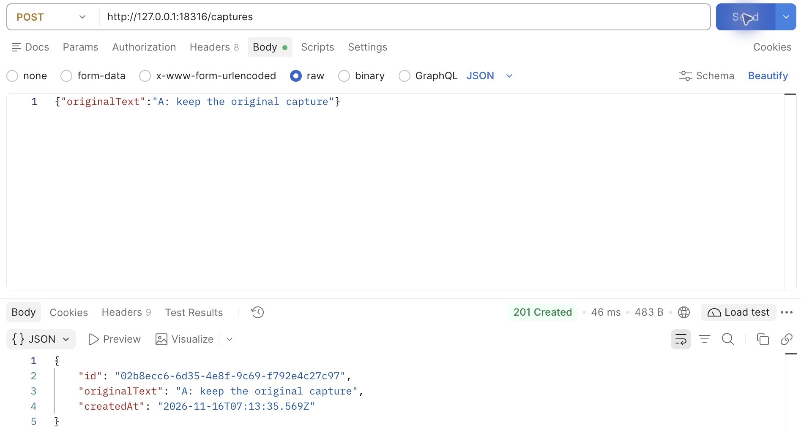
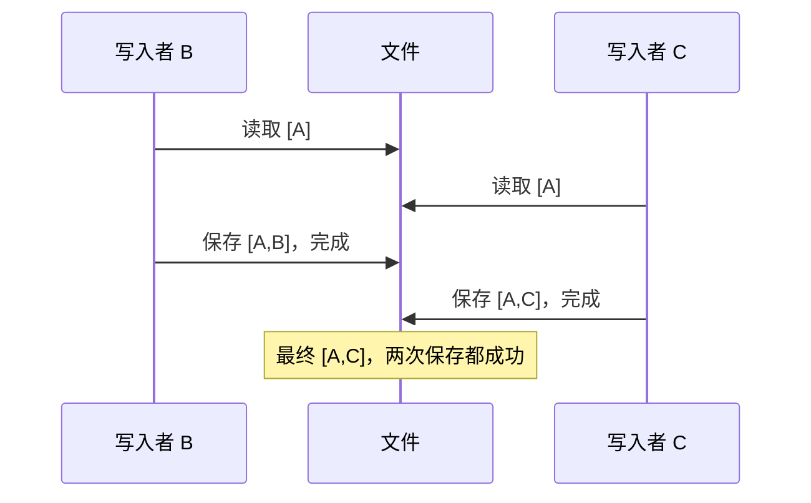

# 第 16 章 两次都写成功，JSON 文件里为什么少了一条素材

第十五章已经把存储接口换成另一种实现，同时保留请求契约、观测和关闭流程。这次再换一处：把素材数组写进 JSON 文件。我们关心的不是文件能不能保存数据，而是一个更具体的承诺：两个调用者都拿到成功结果以后，它们各自的记录是否还在？

文件格式完整、一次写入完成、两次修改都被保留，是三件不同的事。我们会保留每次输入的 ID，用两个可以手动放行的 Node 进程制造确定的执行顺序，再检查最后留下了什么。这里建立的判断方法，随后用于检查数据库代码，而不是看到“换成 PostgreSQL”便自动放心。

代码从[第十五章主线](https://github.com/SamChowRock/epp-public/tree/part-02/chapter-15)继续，原文上限仍为 2000 个 UTF-16 单元，不带入上一章的 1200 单元练习。新实验放在 `src/labs/json-file/` 和 `examples/json-file/`，原服务继续使用 Map；第十七章也从这条主线接起。文件实现用于研究失败边界，不承担多人使用的素材服务。

## 16.1 给素材仓储换一份可以重开的文件

### 先确定替换范围

`CaptureStore` 的三个方法没有变化：`insert` 保存一条记录，`list` 先筛选再限量，`find` 按 ID 查详情。ID 和时间仍由 Service 产生；Controller 的 201、Location、输入校验以及公开输出保持原状。文件只存 `id`、`originalText`、`createdAt`，不把请求对象或日志写进去。

这个实现每次重新读取完整数组。好处是容易看清一次修改使用了哪份数据；代价是每次操作都读全文件，追加还要重写全文件。数据量增加时，磁盘读写、JSON 解析和序列化都会增长，其中解析与序列化仍占用 JavaScript 执行时间。它适合这次很小的实验，不能把异步文件 API 当作成本消失。

在前章项目的独立练习副本中新增 `src/labs/json-file/store.ts`。先写读取函数，沿用前章 Zod 与响应字段规则：

```ts
import { readFile, writeFile, rename } from 'node:fs/promises';
import { randomUUID } from 'node:crypto';
import { z } from 'zod';
import { CaptureResponseSchema } from '../../capture-contract.js';
import type { Capture, CaptureListOptions } from '../../capture.js';
import type { CaptureStore } from '../../capture-store.js';

export async function readRows(file: string): Promise<Capture[]> {
  const rows = z.array(CaptureResponseSchema.strict())
    .parse(JSON.parse(await readFile(file, 'utf8')));
  if (new Set(rows.map(row => row.id)).size !== rows.length) {
    throw new Error('Duplicate ID');
  }
  return rows;
}
```

这里有三个不同的拒绝位置：读取文件失败，字节不能解析成 JSON，JSON 虽能解析但记录不满足格式。`[]` 是空仓储，`{}` 不是；重复 ID 也应拒绝。不能把它们全捕获后返回空数组，否则下一次成功写入会把损坏现场覆盖掉。读取失败先核对 JSON_FILE 指向的绝对路径；语法错误用编辑器定位截断处；能解析而格式错误则核对数组、字段和重复 ID。检查副本，保留原字节，不能只删除报错那一行再宣称恢复。校验已有数据沿用当前 2000 单元规则；以后收紧创建规则，仍要像上一章那样重新判断旧数据的读取契约。

初版保存函数很直接。把它接在同一文件中，16.3 再增加替换方式：

```ts
export async function saveRows(file: string, rows: Capture[]) {
  await writeFile(file, JSON.stringify(rows, null, 2) + '\n');
}

export class JsonFileStore implements CaptureStore {
  constructor(private readonly file: string) {}
  async insert(capture: Capture): Promise<void> {
    const rows = await readRows(this.file);
    if (rows.some(row => row.id === capture.id)) throw new Error('Duplicate ID');
    rows.push({ ...capture });
    await saveRows(this.file, rows);
  }
  async list({ text, limit }: CaptureListOptions): Promise<Capture[]> {
    const rows = await readRows(this.file);
    return rows.filter(row => text === undefined || row.originalText.includes(text))
      .slice(0, limit);
  }
  async find(id: string): Promise<Capture | undefined> {
    return (await readRows(this.file)).find(row => row.id === id);
  }
}
```

每次解析产生新对象，因此调用方修改一次查询的结果，不会直接改掉另一请求的内存仓储。数组顺序保留写入时的顺序，`filter` 在 `slice` 之前，文本仍用区分大小写的字面子串匹配。方法签名相同之外，这些行为也需要保持。

### 在独立入口组装，启动前验证文件

沿用第十四章的实验组织方法：复制 `src/app.ts`、`app.module.ts`、`captures.module.ts`、`server.ts` 到 `src/labs/json-file/`，其中 `app.module.ts` 命名为 `module.ts`。四个文件之间的导入指向同目录；其他原有组件从 `../../` 导入。只在实验的 `captures.module.ts` 中，把 MemoryCaptureStore 的导入、Provider 和注入项替换成 JsonFileStore。新增的异步工厂如下：

```ts
import { resolve } from 'node:path';
import { JsonFileStore, readRows } from './store.js';

// providers 数组中的文件仓储 Provider
{
  provide: JsonFileStore,
  useFactory: async () => {
    if (!process.env.JSON_FILE) throw new Error('JSON_FILE required');
    const file = resolve(process.env.JSON_FILE);
    await readRows(file);
    return new JsonFileStore(file);
  },
}
```

`CAPTURE_STORE` 的工厂仍返回 `new ObservedCaptureStore(store, logger, state)`，只把其参数类型与 inject 数组的第一项换成 JsonFileStore。这样存储失败日志和停止时的在途计数都还在。异步 Provider 拒绝时，Nest 无法完成应用创建，外层沿用 `app.start_failed` 和非零退出，不先监听再等第一条请求发现坏文件。

路径在启动时转成绝对路径；相对路径以启动目录为准。换一个目录启动可能选中另一份文件，所以本章命令总传绝对路径。不要把运行数据放在 `.dev` 或 `dist`：它们属于可以重新生成的代码产物。

在 `package.json` 的 scripts 增加独立开发入口：

```json
"dev:json-file": "NODE_ENV=development PORT=3016 node --env-file-if-exists=.env scripts/dev.mjs .dev/src/labs/json-file/server.js"
```

它复用 TypeScript 监听、源码映射和回环 Inspector 9229。先停妥前章开发服务，再启动本章，避免调试端口冲突。`npm run build` 的配置继续排除 `src/labs/**`，`npm start` 不会启用文件仓储。这里没有新增系统软件，Node、VS Code 与 Postman 的准备见[环境入口](../../environment-setup.md#第-16-章在独立目录观察文件写入)。

### 先单写一条，再按原 ID 读取

以下命令在练习项目根目录执行。`mktemp -d` 创建新的私有目录；先保存终端打印的目录路径，下次恢复时使用原路径，不再创建一个同名空实验。

```bash
nvm use
npm ci
npm run check
lab_dir=$(mktemp -d)
node -e 'require("node:fs").writeFileSync(process.argv[1], "[]\n", {flag:"wx",mode:0o600})' "$lab_dir/captures.json"
printf '%s\n' "$lab_dir"
JSON_FILE="$lab_dir/captures.json" LOG_LEVEL=debug npm run dev:json-file
```

`wx` 表示目标必须不存在，已有文件会失败；初始化是人的明确操作，不是运行时错误的兜底。若遇到权限、路径或已有文件错误，先核对目录，不把参数改成覆盖写来“修好”。

在 Postman 导入前章 `requests/epp.postman_collection.json`，另存本章集合，把 `baseUrl` 设为 `http://127.0.0.1:3016`，检查环境变量是否覆盖它。创建请求 Body 设为 `{"originalText":"A: keep the original capture"}`。保存响应中的完整记录为旁边的 `A.json`，把实际 ID 填入 `captureId`；确认 201、Location 和详情 200。终端 Ctrl+C，等服务完成关闭，再用原命令启动。重发详情，比较 **同一个 ID、原文与时间**，不要再次 POST 后把新记录当成恢复成功。完成本节后可暂停；保留实验目录路径和 A.json，下次先 inspect 原文件再启动。

下面两图来自同一条素材的创建与重启读取。图中使用独立端口 18316；跟做时保留自己的端口。比较响应中的 ID、原文和 createdAt，不只比较状态码。




VS Code 沿用 attach 配置，断在 `await saveRows(this.file, rows)`，发一次创建请求可查看已经读取并追加新项的数组。继续执行后再取消断点重发，避免把暂停时间误当作文件性能。这个断点适合观察单请求；下一节用独立进程的明确等待点组织顺序，不依赖手速。


图中断在第 31 行，黄色高亮语句还没有执行。在 Debug Console 输入 `JSON.stringify(rows.map(({originalText}) => originalText))`，可看到旧 A 与新 D；此时从另一个读取者打开磁盘文件，仍只有 A。继续后本次请求才得到 201。图中其余行号采用编辑器的相对行号显示，设置断点时以语句为准。断点会显著拉长请求时间，取消后另发一次正常请求，不把暂停时间当作文件写入耗时。

完成单写后停妥服务，保留 A 的文件作为基线。另建坏文件，不能破坏唯一的基线：

```bash
node -e 'require("node:fs").writeFileSync(process.argv[1], "[{", {flag:"wx"})' "$lab_dir/broken.json"
JSON_FILE="$lab_dir/broken.json" npm run dev:json-file
```

应看到 `app.start_failed`，服务子进程非零退出，watcher 仍等待源码变化，不等于 API 已可用。Ctrl+C 停止 watcher，在 VS Code 打开 broken.json，确认仍是 `[{`；不能变成 `[]`。如果收到旧 API 的响应，先查端口是否被另一进程占用。修复路径应从保留的副本开始；不要让程序猜测坏文件里原来有哪些记录。

## 16.2 把两次修改停在读完旧文件的位置

### 保存输入，再启动写入者

正常顺序点击两次 Send，往往看不见丢失，因为后一次可能读到了前一次的结果。我们要固定另一个顺序：**两边都读到只有 A 的文件，随后 B 写完，再让 C 写。** 两次磁盘写入甚至不用重叠。

配套 `examples/json-file/lab.mjs` 负责初始化、排他复制、生成输入、查看记录以及控制写入。它导入开发构建中的同一个 `readRows/saveRows`。在原目录完成一次 `npx tsc -p tsconfig.dev.json`，再运行；后续修改 store.ts 后同样先编译。CLI 不需要常驻 watcher，两个终端各运行一个进程，也不争用 Inspector。

等待点的关键代码如下，放在 lab.mjs 中。其余命令分派只负责选文件和保存输入：

```js
import { createInterface } from 'node:readline/promises';
async function gate(stage, id) {
  const input = createInterface({ input: process.stdin, output: process.stdout });
  console.log(JSON.stringify({ stage, id }));
  try { await input.question('Press Enter to continue: '); }
  finally { input.close(); }
}

// capture 从事先保存的输入文件读取并按记录 Schema 校验。
const rows = await readRows(file);
if (rows.some(row => row.id === capture.id)) throw new Error('Duplicate ID');
rows.push(capture);
await gate('read-ready', capture.id);
await saveRows(file, rows);
console.log(JSON.stringify({ stage: 'saved', id: capture.id }));
```

<details>
<summary>完整 lab.mjs：保存输入、复制基线与控制写入</summary>

将以下内容保存为项目根目录下的 `examples/json-file/lab.mjs`。它导入刚编译的 `.dev` 产物；命令失败时保留原文件并以非零退出。

```js
import { readFile, writeFile, copyFile, constants } from 'node:fs/promises';
import { resolve } from 'node:path';
import { randomUUID } from 'node:crypto';
import { createInterface } from 'node:readline/promises';
import { readRows, saveRows } from '../../.dev/src/labs/json-file/store.js';

const [command, target, argument, mode = 'direct'] = process.argv.slice(2);
if (!target) throw new Error('Provide command and file');
const file = resolve(target);
async function gate(stage, id) {
  const input = createInterface({ input: process.stdin, output: process.stdout });
  console.log(JSON.stringify({ stage, id }));
  try { await input.question('Press Enter to continue: '); }
  finally { input.close(); }
}
try {
  if (command === 'init') {
    await writeFile(file, '[]\n', { flag: 'wx', mode: 0o600 });
  } else if (command === 'copy') {
    if (!argument) throw new Error('Destination required');
    await copyFile(file, resolve(argument), constants.COPYFILE_EXCL);
  } else if (command === 'inspect') {
    const rows = await readRows(file);
    console.log(JSON.stringify({ count: rows.length, rows }, null, 2));
  } else if (command === 'input') {
    if (!argument) throw new Error('Text required');
    await writeFile(file, JSON.stringify({ id: randomUUID(), originalText: argument,
      createdAt: new Date().toISOString() }) + '\n', { flag: 'wx', mode: 0o600 });
  } else if (command === 'write') {
    if (!argument || !['direct', 'replace', 'before-rename', 'serial'].includes(mode)) throw new Error('Invalid write arguments');
    const capture = JSON.parse(await readFile(resolve(argument), 'utf8'));
    // Validate the saved input with the same format used for stored records.
    const { CaptureResponseSchema } = await import('../../.dev/src/capture-contract.js');
    CaptureResponseSchema.strict().parse(capture);
    const rows = await readRows(file);
    if (rows.some(row => row.id === capture.id)) throw new Error('Duplicate ID');
    rows.push(capture);
    if (mode !== 'serial') await gate('read-ready', capture.id);
    await saveRows(file, rows, mode === 'replace' || mode === 'before-rename',
      mode === 'before-rename' ? () => gate('temp-ready', capture.id) : undefined);
    console.log(JSON.stringify({ stage: 'saved', id: capture.id }));
  } else throw new Error('Unknown command');
} catch (error) {
  console.error(error instanceof Error ? error.name : 'Failure');
  process.exitCode = 1;
}
```

</details>

`ready` 表示读完并在本进程内追加，尚未保存；`saved` 在等待写入完成以后输出。B、C 的输入文件先生成，保留原文、UUID 与创建时间，后面恢复时才有可核对的依据。它们是这次故障实验的已知输入，不是应用已经具备的审计日志。

```bash
npx tsc -p tsconfig.dev.json
node examples/json-file/lab.mjs copy "$lab_dir/captures.json" "$lab_dir/base.json"
node examples/json-file/lab.mjs input "$lab_dir/B.json" 'B: saved by writer one'
node examples/json-file/lab.mjs input "$lab_dir/C.json" 'C: saved by writer two'
node examples/json-file/lab.mjs copy "$lab_dir/base.json" "$lab_dir/direct.json"
node examples/json-file/lab.mjs inspect "$lab_dir/direct.json"
```

检查基线确实只有 A。若断点练习又创建了记录，另建一轮只有 A 的实验再保存基线，不偷偷删除已有记录来凑结果。复制命令拒绝覆盖目标；重复实践用新文件名。

新开两个终端，都进入同一练习项目并执行 `nvm use`，各自把 `lab_dir` 设置为刚才打印的绝对路径。终端一运行 B，终端二运行 C：

```bash
# 终端一
node examples/json-file/lab.mjs write "$lab_dir/direct.json" "$lab_dir/B.json" direct
# 终端二
node examples/json-file/lab.mjs write "$lab_dir/direct.json" "$lab_dir/C.json" direct
```

两个窗口都出现 `read-ready` 后才继续。先在 B 窗口按 Enter，等 `saved` 和命令结束，立即执行 `echo $?`，记录 0；再在 C 窗口做同样操作。不要先在同一窗口执行别的命令，否则 `$?` 已经变成另一条命令的状态。

最后用 inspect 查看 direct.json，按三个实际 ID 查找。结果应为 A、C，B 缺失。再打开 B.json，确认它的 ID 与 B 的 saved 一致，而不是误记了另一次请求。



这叫**丢失更新**：C 使用自己的旧快照覆盖了 B 已完成的修改。交换放行顺序，最终会是 A、B；ID 不冲突，JSON 完整，程序也可以全部退出 0。排查对象因此从“写文件是不是报错”变成“读、修改、写这整个操作有没有共同协调”。

JavaScript 单线程不会消除这个问题。两个进程各有自己的堆；即使只有一个进程，两个异步调用也可能在 await 读取文件期间交错。只保证每个调用内部先读后写，不保证不同调用之间排队。

## 16.3 完整替换文件能保住两次写入吗

### 先分开两种失败

直接 `writeFile` 会重写目标，写入未完成时中止可能留下空文件或部分内容。这与上一节的“完整文件里少一条”不同。现在把保存函数改成先写同目录临时文件，再改名替换目标：

```ts
export async function saveRows(
  file: string, rows: Capture[], replace = false,
  beforeRename: () => Promise<void> = async () => {},
) {
  const data = JSON.stringify(rows, null, 2) + '\n';
  if (!replace) { await writeFile(file, data); return; }
  const temp = `${file}.${randomUUID()}.tmp`;
  await writeFile(temp, data, { flag: 'wx', mode: 0o600 });
  await beforeRename();
  await rename(temp, file);
}
```

临时文件名各自唯一，`wx` 防止误覆盖。临时文件位于目标同目录，以免跨文件系统改名失败。这里考察 Mac／Linux 本地文件系统上的同目录替换：按路径重新打开目标的读者看到完整旧版本或完整新版本；先前已经打开旧文件的句柄可能继续读旧内容，不能把改名理解成改写所有读者手里的对象。网络文件系统或其他平台的行为要按实际环境另行核验。

这还不是断电持久性保证。写入 Promise 返回、改名完成、机器断电后仍保留，具有不同的完成条件。文件同步、目录项同步及存储设备也参与持久性；本实验没有做断电测试。Node 的 [文件 API 文档](https://nodejs.org/docs/latest-v24.x/api/fs.html#fspromiseswritefilefile-data-options)区分写入与同步选项，不能仅加一次 rename 就宣布实现了数据库提交。

### 在改名前停止，检查旧文件和遗留物

编译修改后，用 base.json 复制出新的 interrupted.json。运行下面的模式：

```bash
npx tsc -p tsconfig.dev.json
node examples/json-file/lab.mjs copy "$lab_dir/base.json" "$lab_dir/interrupted.json"
node examples/json-file/lab.mjs write "$lab_dir/interrupted.json" "$lab_dir/B.json" before-rename
```

先在 `read-ready` 按 Enter。出现 `temp-ready` 后，说明临时文件已经写完、rename 还没执行；此时 Ctrl+C。随后 inspect interrupted.json，应仍只有 A。用 VS Code 打开实验目录，可以看到以 interrupted.json 开头、以 .tmp 结尾的文件，其中是 A、B。不要把临时文件存在当作已经发布，也不要按修改时间自动挑一个覆盖正式文件。

本程序刻意保留中止现场。真正维护时，应先停妥所有写入者、保存现场、确认临时文件归属和正式文件内容，再决定删除或恢复；“所有 tmp 都没用”在另一个进程还工作时并不成立。如果改名已经完成，但进程来不及打印 saved 就消失，目标可能已经是新版本，所以没有成功输出也不能反推没有写入。

### 再放行两个完整替换

从 base.json 新复制 replace.json。两个终端分别运行 B、C，把上一节命令的 `direct.json` 换成 `replace.json`，最后的 `direct` 换成 `replace`。两边均 read-ready 后，仍先放行 B 并等其成功，再放行 C。

结果仍是 A、C，B 缺失。临时文件保护的是**一次发布的文件完整性**，没有规定两次修改如何合并。rename 不知道数组中的 ID，更不知道 C 的数组缺少的是一条刚提交的记录，而非用户有意删除的内容。

进程内队列可以修复一部分条件：把“读取—修改—保存”整体排队，后一项读取前一项完成后的结果。只把 saveRows 排队仍会保存旧快照。下面是整体排队的形状，tail 必须由同一个仓储实例共享：

```ts
private tail: Promise<void> = Promise.resolve();
insert(capture: Capture): Promise<void> {
  const current = this.tail.then(async () => {
    const rows = await readRows(this.file);
    if (rows.some(row => row.id === capture.id)) throw new Error('Duplicate ID');
    rows.push({ ...capture });
    await saveRows(this.file, rows, true);
  });
  this.tail = current.catch(() => {});
  return current;
}
```

吞掉的只是 tail 的拒绝，目的是不让后续队列永久停住；调用者拿到的 current 仍会拒绝。这个方案成立的前提是所有写入都经由同一个实例。第二个 API 进程、手工脚本或管理员直接改文件都会绕过它。

把队列扩展成跨进程锁，还要规定锁住的范围、持有人崩溃时如何处理，以及怎样防止旧持有人恢复后继续写入。简单检查“锁文件不存在”再创建有竞争；排他创建能解决争抢入口，却没有自动解决锁遗留和持有人身份。改成追加日志也要承担记录边界、部分尾记录、恢复与压缩。文件并非不能作为存储，只是需要一个明确的协议来承担这些责任。

## 16.4 把丢失的 ID 带到数据库篇

### 恢复依靠原始输入，不依靠猜测

先停止全部写入者，保留 direct.json、replace.json 和两次 saved 的记录。复制基线到新的 recovered.json，再按单写者顺序重放两个已知输入：

```bash
node examples/json-file/lab.mjs copy "$lab_dir/base.json" "$lab_dir/recovered.json"
node examples/json-file/lab.mjs write "$lab_dir/recovered.json" "$lab_dir/B.json" serial
node examples/json-file/lab.mjs write "$lab_dir/recovered.json" "$lab_dir/C.json" serial
node examples/json-file/lab.mjs inspect "$lab_dir/recovered.json"
```

`serial` 跳过人工等待，仍每次重新读文件；这里只能前一条退出成功后执行后一条，不能把两条放到后台。恢复结果应包含原 A、B、C，各 ID、原文和时间与三份输入相同。重复放入 B 会因 ID 已存在而失败，不能靠再生成一个 ID 掩盖重复。

如果只剩最终 [A,C]，就不能恢复 B 的原文、时间和原 ID。知道“丢了一条”不等于知道丢的内容；备份 [A] 也没有保存之后的 B。恢复需要写入历史或另一份可信输入。练习中的 B.json 正是这份依据，实际系统是否保存这种证据需要单独设计。

### 数据库要承担什么，应用仍要判断什么

本章得到三个可以带走的判断。先检查读取和修改是否作为一个整体协调；再区分完整发布与持久保存；最后在未知结果面前保留可核对的身份和输入。不要用“文件还是合法 JSON”证明没有丢更新，也不要用“客户端没收到成功”决定直接重试。

SQLite 为单机应用提供成熟事务能力，可以避免自己实现文件协议；PostgreSQL 作为独立服务，适合后续 API、后台进程与管理工具共同访问数据，同时增加实例、连接、账号和维护责任。本书接下来选择后者。并不是因为 JSON 格式天然错误，而是我们要练习由一个共同的数据系统处理约束、事务与并发访问。

把整个数组存进数据库的一个 JSON 字段，然后照旧先读再覆盖，仍可能重演本章的问题。数据库提供机制，应用需要选择合适的操作和隔离方式；默认隔离也不等于所有业务操作自动串行。相关行为见 [PostgreSQL 18 事务隔离](https://www.postgresql.org/docs/18/transaction-iso.html)。第十九章用真实连接观察提交与可见性，第四篇继续用同一笔业务解释竞争和恢复。

下一章先准备 PostgreSQL 的实例、身份与连接，应用仍沿用第十五章主线。本章文件不是需要迁入数据库的正式业务数据。保留实验目录即可；离开前停止 API、watcher 和等待输入的两个 CLI，断开调试器。恢复阅读时，先查看保存的文件和进程状态，再决定从哪个新副本开始。

时间参考（估算）：阅读约 50～65 分钟，编码与单写、双写、停止和恢复对照约 50～70 分钟。按约 4250 个汉字、关键代码及可展开的完整 CLI、一个时序图和四组实验估算，首次依赖下载另计，尚未经过读者实测。

## 附录：本章必要技术点速查

| 名称 | 本章用途 | 必要注意点 |
| --- | --- | --- |
| readFile／JSON.parse／Schema | 从字节恢复记录 | 缺失、损坏、格式不符均拒绝，不自动清空 |
| writeFile 的 wx | 明确创建新文件 | 已存在就失败；运行时初始化不能吞掉读取错误 |
| rename | 发布写完的同目录临时文件 | 不会合并旧快照，不单独保证断电持久性 |
| readline.question | 手动放行写入者 | ready 不等于 saved；两边都 ready 后才继续 |
| Promise 队列 | 同实例内串行整个修改 | 第二个进程不共享这条队列 |
| 原 ID 与已知输入 | 检查丢失和恢复 | 新建一条相似内容不能证明原记录恢复 |

官方查阅：[Node 24 文件系统](https://nodejs.org/docs/latest-v24.x/api/fs.html)、[readline](https://nodejs.org/docs/latest-v24.x/api/readline.html)。

本章完成代码：[part-03/chapter-16](https://github.com/SamChowRock/epp-public/tree/part-03/chapter-16)，实验入口见其中的 `examples/json-file/README.md`。

[上一章：第二篇回顾](../../part-02-nestjs/chapter-15-review/chapter.md) · [下一章：PostgreSQL 运行环境](../chapter-17-postgresql-environment/chapter.md) · [返回本篇](../README.md) · [全书目录](../../README.md)
