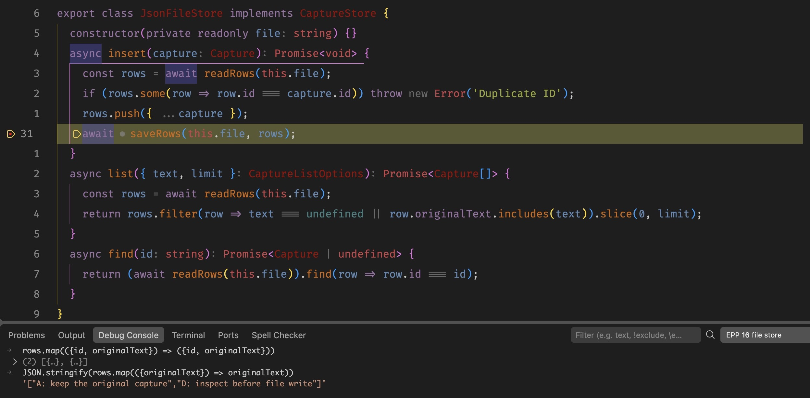
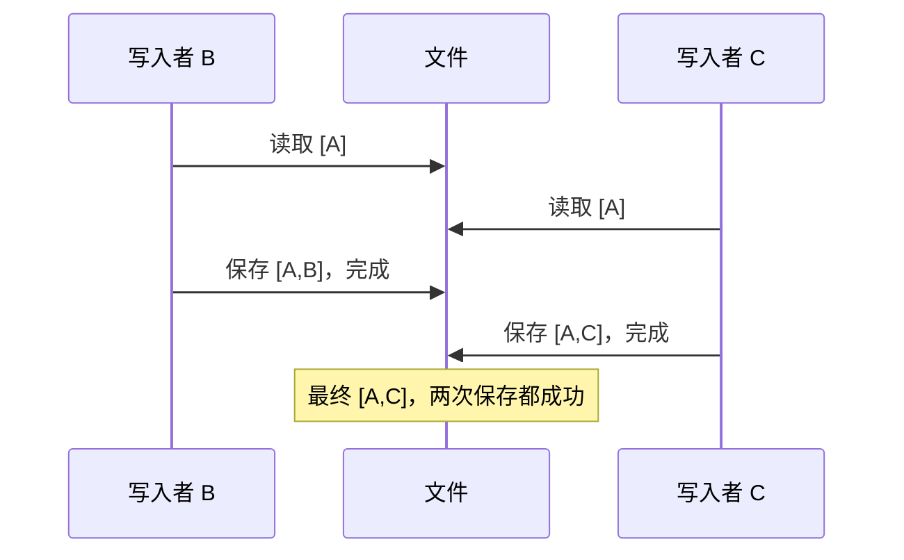

# 第 16 章 两次都写成功，JSON 文件里为什么少了一条素材

第十五章已经把存储接口换成另一种实现，同时保留请求契约、观测和关闭流程。这次再换一处：把素材数组写进 JSON 文件。我们关心的不是文件能不能保存数据，而是一个更具体的承诺：两个调用者都拿到成功结果以后，它们各自的记录是否还在？

文件格式完整、一次写入完成、两次修改都被保留，是三件不同的事。我们会保留每次输入的 ID，用两个可以手动放行的 Node 进程制造确定的执行顺序，再检查最后留下了什么。这里建立的判断方法，随后用于检查数据库代码，而不是看到“换成 PostgreSQL”便自动放心。

代码从[第十五章主线](https://github.com/SamChowRock/epp-public/tree/part-02/chapter-15)继续，原文上限仍为 2000 个 UTF-16 单元，不带入上一章的 1200 单元练习。新实验放在 `src/labs/json-file/` 和 `examples/json-file/`，原服务继续使用 Map；第十七章也从这条主线接起。文件实现用于研究失败边界，不承担多人使用的素材服务。

## 16.1 给素材仓储换一份可以重开的文件

### 先确定替换范围

`CaptureStore` 的三个方法没有变化：`insert` 保存一条记录，`list` 先筛选再限量，`find` 按 ID 查详情。ID 和时间仍由 Service 产生；Controller 的 201、Location、输入校验以及公开输出保持原状。文件只存 `id`、`originalText`、`createdAt`，不把请求对象或日志写进去。

先从一张创建成功的详情页倒推这三个方法之间的关系。页面拿着服务器返回的地址打开详情，地址里的 ID 就是查找条件。随后用户再收藏一句一模一样的原文，应该得到另一个地址，两份详情各自可读。因此仓储要区分的是两次收藏产生的两条记录。原文可以完全相等，时间碰巧相同也合理。若为了节省空间按原文去重，即使接口返回的对象看起来都合乎格式，用户也会有一个地址找不到，或者两个地址指向同一次收藏。这里决定存什么的依据来自调用者下一步要做的事。

再看已有记录的身份由谁解释。服务把一份带 ID 和创建时间的完整记录交给仓储时，已经作出了决定。仓储重新生成时间，详情页就可能显示比创建响应更晚的时刻。若在每次读文件时重新生成 ID，列表虽然每次都有相同条数，收藏夹里的旧地址却会全部失效。因而替换存储时，需要把成功响应里的字段原样取回来。测试一次创建再读同一地址，比对着一份新列表检查字段类型更能看出这种差异。

这个实现每次重新读取完整数组。好处是容易看清一次修改使用了哪份数据；代价是每次操作都读全文件，追加还要重写全文件。数据量增加时，磁盘读写、JSON 解析和序列化都会增长，其中解析与序列化仍占用 JavaScript 执行时间。它适合这次很小的实验，不能把异步文件 API 当作成本消失。

在前章项目的独立练习副本中新增 `src/labs/json-file/store.ts`。先写读取函数，沿用前章 Zod 与响应字段规则：

```ts
import { readFile, writeFile, rename } from 'node:fs/promises';
import { randomUUID } from 'node:crypto';
import { z } from 'zod';
import { CaptureResponseSchema } from '../../capture-contract.js';
import type { Capture, CaptureListOptions } from '../../capture.js';
import type { CaptureStore } from '../../capture-store.js';

export async function readRows(file: string): Promise<Capture[]> {
  const rows = z.array(CaptureResponseSchema.strict())
    .parse(JSON.parse(await readFile(file, 'utf8')));
  if (new Set(rows.map(row => row.id)).size !== rows.length) {
    throw new Error('Duplicate ID');
  }
  return rows;
}
```

这里有三个不同的拒绝位置：读取文件失败，字节不能解析成 JSON，JSON 虽能解析但记录不满足格式。`[]` 是空仓储，`{}` 不是；重复 ID 也应拒绝。不能把它们全捕获后返回空数组，否则下一次成功写入会把损坏现场覆盖掉。读取失败先核对 JSON_FILE 指向的绝对路径；语法错误用编辑器定位截断处；能解析而格式错误则核对数组、字段和重复 ID。检查副本，保留原字节，不能只删除报错那一行再宣称恢复。校验已有数据沿用当前 2000 单元规则；以后收紧创建规则，仍要像上一章那样重新判断旧数据的读取契约。

这段代码先后回答两个层次的问题。一条记录单独取出，合法的标识、原文与时间能够组成一份详情。把两条各自合法、标识相同而原文不同的记录并排放回去，按照同一个地址查详情该给哪条？交换它们在数组里的位置就会改变答案。集合大小与数组长度的比较在此处有明确含义，每出现一次已有的标识，集合大小就少增长一次。长度只差一也足以让仓储拒绝整份输入，不能挑顺眼的那一行保留。反过来，少了一条记录的文件仍完全可能通过这两层校验。要判断缺失，还需要文件以外的参照。

严格检查字段也有维护代价。设想接手者为方便辨认，在某条记录上手工加了一个“备注”字段。编辑器能正常折叠数组，原文和标识都在，重启却失败。可以在副本里挑出这一条，把实际键名与读取函数所引用的响应格式逐个对上。严格模式会拒绝多出的键；这能阻止旧程序不理解新格式却继续整份重写。若产品以后确实需要备注，先要决定旧程序能否读、再次保存会不会抹去备注，再安排格式演进。直接放宽校验只解除了启动时的拒绝，尚未回答下一次写入的问题。

初版保存函数很直接。把它接在同一文件中，16.3 再增加替换方式：

```ts
export async function saveRows(file: string, rows: Capture[]) {
  await writeFile(file, JSON.stringify(rows, null, 2) + '\n');
}

export class JsonFileStore implements CaptureStore {
  constructor(private readonly file: string) {}
  async insert(capture: Capture): Promise<void> {
    const rows = await readRows(this.file);
    if (rows.some(row => row.id === capture.id)) throw new Error('Duplicate ID');
    rows.push({ ...capture });
    await saveRows(this.file, rows);
  }
  async list({ text, limit }: CaptureListOptions): Promise<Capture[]> {
    const rows = await readRows(this.file);
    return rows.filter(row => text === undefined || row.originalText.includes(text))
      .slice(0, limit);
  }
  async find(id: string): Promise<Capture | undefined> {
    return (await readRows(this.file)).find(row => row.id === id);
  }
}
```

为什么只取一条详情也要解析整个数组？ID 在对象里，文件没有记录“这个 ID 从第几个字节开始”。而且读到目标以后，数组后面仍可能有重复 ID；只返回第一个匹配项会绕过 `readRows` 对整份文件的检查。写入的代价还会累积：假设各条素材大小接近，从空文件连续新增三条，三次保存分别输出 1、2、3 条记录的内容。第 n 次只增加一条素材，却要把前 n−1 条再写一遍。

可以估算一次导入的工作量。假设一百条记录差不多大，逐条新增，从第一份文件写到第一百份，把写出的记录数首尾配对，一加一百、二加九十九，每对都是一百零一，共五十对。为新增一百条，累计输出五千零五十条记录的内容，还没算每次先读取的旧记录。这个估计忽略缩进、标点和原文长短，适合比较增长趋势，不能换算成具体毫秒数。如果一次读入一百条、组好以后只保存一次，写出量会下降，但应用何时才有资格确认第一条成功也随之改变。批量导入可以等整批结果，单条收藏的调用者却在各自等待确认，不能默默用一种契约替掉另一种。

同样是“取一条”，列表的限制和详情的标识解决不同问题。假设旧记录是中文原文，新记录含有英文单词，按那个单词筛选并把条数限制为一。先截取数组头一行再筛，会交付空列表；先筛选才会把新记录交给调用方。结果只有一条，读取函数依然要处理两条的字节。接手人看到列表很短却耗时增加，可以分别看原文件大小和响应大小，前者才接近本实现每次读取的工作量。

每次解析产生新对象，因此调用方修改一次查询的结果，不会直接改掉另一请求的内存仓储。数组顺序保留写入时的顺序，`filter` 在 `slice` 之前，文本仍用区分大小写的字面子串匹配。方法签名相同之外，这些行为也需要保持。

### 在独立入口组装，启动前验证文件

沿用第十四章的实验组织方法：复制 `src/app.ts`、`app.module.ts`、`captures.module.ts`、`server.ts` 到 `src/labs/json-file/`，其中 `app.module.ts` 命名为 `module.ts`。四个文件之间的导入指向同目录；其他原有组件从 `../../` 导入。只在实验的 `captures.module.ts` 中，把 MemoryCaptureStore 的导入、Provider 和注入项替换成 JsonFileStore。新增的异步工厂如下：

```ts
import { resolve } from 'node:path';
import { JsonFileStore, readRows } from './store.js';

// providers 数组中的文件仓储 Provider
{
  provide: JsonFileStore,
  useFactory: async () => {
    if (!process.env.JSON_FILE) throw new Error('JSON_FILE required');
    const file = resolve(process.env.JSON_FILE);
    await readRows(file);
    return new JsonFileStore(file);
  },
}
```

`CAPTURE_STORE` 的工厂仍返回 `new ObservedCaptureStore(store, logger, state)`，只把其参数类型与 inject 数组的第一项换成 JsonFileStore。这样存储失败日志和停止时的在途计数都还在。异步 Provider 拒绝时，Nest 无法完成应用创建，外层沿用 `app.start_failed` 和非零退出，不先监听再等第一条请求发现坏文件。

路径在启动时转成绝对路径；相对路径以启动目录为准。换一个目录启动可能选中另一份文件，所以本章命令总传绝对路径。不要把运行数据放在 `.dev` 或 `dist`：它们属于可以重新生成的代码产物。

在 `package.json` 的 scripts 增加独立开发入口：

```json
"dev:json-file": "NODE_ENV=development PORT=3016 node --env-file-if-exists=.env scripts/dev.mjs .dev/src/labs/json-file/server.js"
```

它复用 TypeScript 监听、源码映射和回环 Inspector 9229。先停妥前章开发服务，再启动本章，避免调试端口冲突。`npm run build` 的配置继续排除 `src/labs/**`，`npm start` 不会启用文件仓储。这里没有新增系统软件，Node、VS Code 与 Postman 的准备见[环境入口](../../environment-setup.md#第-16-章在独立目录观察文件写入)。

### 先单写一条，再按原 ID 读取

以下命令在练习项目根目录执行。`mktemp -d` 创建新的私有目录；先保存终端打印的目录路径，下次恢复时使用原路径，不再创建一个同名空实验。

```bash
nvm use
npm ci
npm run check
lab_dir=$(mktemp -d)
node -e 'require("node:fs").writeFileSync(process.argv[1], "[]\n", {flag:"wx",mode:0o600})' "$lab_dir/captures.json"
printf '%s\n' "$lab_dir"
JSON_FILE="$lab_dir/captures.json" LOG_LEVEL=debug npm run dev:json-file
```

`wx` 表示目标必须不存在，已有文件会失败；初始化是人的明确操作，不是运行时错误的兜底。若遇到权限、路径或已有文件错误，先核对目录，不把参数改成覆盖写来“修好”。

在 Postman 导入前章 `requests/epp.postman_collection.json`，另存本章集合，把 `baseUrl` 设为 `http://127.0.0.1:3016`，检查环境变量是否覆盖它。创建请求 Body 设为 `{"originalText":"A: keep the original capture"}`。保存响应中的完整记录为旁边的 `A.json`，把实际 ID 填入 `captureId`；确认 201、Location 和详情 200。终端 Ctrl+C，等服务完成关闭，再用原命令启动。重发详情，比较 **同一个 ID、原文与时间**，不要再次 POST 后把新记录当成恢复成功。完成本节后可暂停；保留实验目录路径和 A.json，下次先 inspect 原文件再启动。

这时若详情返回找不到，先留着原来的请求标签页。点开这次实际发送的地址，对照创建响应里的标识，再对照终端打印的实验目录，在编辑器里打开那里的文件查这个标识。若文件里有，先追读取方究竟连到了哪个端口、启动时选了哪份文件。若文件里也没有，而另一个同名副本里有，创建和读取可能各自成功地访问了不同的仓储。把服务切到正确副本后重发原详情，可以让这个判断接受检验。立刻再点创建只会多出一条相似记录，使第一次的去向更难追。

集合里“03 查看详情”的原说明提到重启后重新创建，那对应主线的内存仓储。在 Postman 保留第一次取得的 captureId，只重发 03。如果误发了 02，从第一次响应的 Location 找回原标识，先查原地址，同时保留含有两次创建结果的原文件。下面的恢复步骤只用于这次误操作。

停妥实验服务，在 VS Code 并排打开第一次保存的 `A.json` 和原来的 `captures.json`。用原标识定位数组里对应的对象，逐值核对它与第一次响应的 ID、原文及创建时间。在原终端记下旧目录，再建一个全新的实验目录：

```bash
previous_lab_dir="$lab_dir"
lab_dir=$(mktemp -d)
printf '%s\n' "$lab_dir"
```

在新目录另存一份已核对的 `A.json`，再新建 `captures.json`，填入一对方括号，把这份 A 对象完整复制到括号内作为数组唯一元素。用新目录中的文件作为 `JSON_FILE` 重启，发列表请求核对只有一条，再用原 captureId 发 03，核对三项值都与第一次响应相同。这样后文复制基线时仍能使用同一组命令，原来含两条记录的文件也保存在 `previous_lab_dir` 指向的目录里。

下面两图来自同一条素材的创建与重启读取。图中使用独立端口 18316；跟做时保留自己的端口。比较响应中的 ID、原文和 createdAt，不只比较状态码。


想在 VS Code 看一次保存前的数组，可以先停服务，在同一终端执行 `cp -n "$lab_dir/captures.json" "$lab_dir/debug.json"`，使用这个新副本作为 `JSON_FILE` 启动实验服务。首次使用尚不存在的 debug.json；若已有同名副本，换一个新名字。沿用 attach 配置，断在 `await saveRows(this.file, rows)`，从 Postman 发一次创建请求。这样 D 只会写进调试副本，下一节仍能用只有 A 的 captures.json 作基线。



图中断在第 31 行，黄色高亮语句还没有执行。在 Debug Console 输入 `JSON.stringify(rows.map(({originalText}) => originalText))`，可看到旧 A 与新 D；此时从另一个读取者打开磁盘文件，仍只有 A。继续后本次请求才得到 201。图中其余行号采用编辑器的相对行号显示，设置断点时以语句为准。断点会显著拉长请求时间，取消后另发一次正常请求，不把暂停时间当作文件写入耗时。

停妥服务，保留 captures.json 中的 A 作为基线。另建坏文件观察启动失败：

```bash
node -e 'require("node:fs").writeFileSync(process.argv[1], "[{", {flag:"wx"})' "$lab_dir/broken.json"
JSON_FILE="$lab_dir/broken.json" npm run dev:json-file
```

应看到 `app.start_failed`，服务子进程非零退出，watcher 仍等待源码变化，不等于 API 已可用。Ctrl+C 停止 watcher，在 VS Code 打开 broken.json，确认仍是 `[{`；不能变成 `[]`。如果收到旧 API 的响应，先查端口是否被另一进程占用。修复路径应从保留的副本开始；不要让程序猜测坏文件里原来有哪些记录。

## 16.2 把两次修改停在读完旧文件的位置

### 保存输入，再启动写入者

正常顺序点击两次 Send，往往看不见丢失，因为后一次可能读到了前一次的结果。我们要固定另一个顺序：**两边都读到只有 A 的文件，随后 B 写完，再让 C 写。** 两次磁盘写入甚至不用重叠。

这里的“同时”需要一个可以观察的定义。两个窗口在同一分钟启动，或者两个响应的耗时区间重叠，都可能只是第一个请求在返回途中，而第二个请求才刚刚读文件。那样两次读到的内容不同，结果完全正确。真正要控制的是后一人取依据的时刻相对前一人发布的时刻。只要两人都已取得旧依据，却都还没有把自己的修改发布，后面即使留出一整分钟让磁盘空闲，也不会让内存里的依据自动变新。

为何还要绕开 HTTP 单独开两个写入者？从页面到响应还经过输入转换、生成标识、服务调度等环节，用两次点击很难指定暂停在哪一行。这个程序把已生成的输入直接交给与仓储相同的读写函数。在人工等待处停一天也能从同一位置继续，所以观察者有时间重新打开文件。这样的对照回答“存储算法允许哪种结果”。它没有给出实际服务每千次请求会遇到几次，更没有测出网络快慢与丢失概率的关系。一次合法执行已经足以反驳“两次成功一定留下两条”，估算日常发生频率则是另一个问题。

如果从上一节逐行跟写，当前保存函数只接收文件和数组两个参数。下面完整的 CLI 是 JavaScript，调用时多给的参数不会改变初版函数的行为，所以本节只运行 direct。到下一节把保存函数换成支持临时文件和等待回调的版本，再编译一次，第二个等待点才会生效。直接查看本章完成快照的读者已经能在 store.ts 里找到这两个参数。

配套 `examples/json-file/lab.mjs` 负责初始化、排他复制、生成输入、查看记录以及控制写入。它导入开发构建中的同一个 `readRows/saveRows`。在原目录完成一次 `npx tsc -p tsconfig.dev.json`，再运行；后续修改 store.ts 后同样先编译。CLI 不需要常驻 watcher，两个终端各运行一个进程，也不争用 Inspector。

等待点的关键代码如下，放在 lab.mjs 中。其余命令分派只负责选文件和保存输入：

```js
import { createInterface } from 'node:readline/promises';
async function gate(stage, id) {
  const input = createInterface({ input: process.stdin, output: process.stdout });
  console.log(JSON.stringify({ stage, id }));
  try { await input.question('Press Enter to continue: '); }
  finally { input.close(); }
}

// capture 从事先保存的输入文件读取并按记录 Schema 校验。
const rows = await readRows(file);
if (rows.some(row => row.id === capture.id)) throw new Error('Duplicate ID');
rows.push(capture);
await gate('read-ready', capture.id);
await saveRows(file, rows);
console.log(JSON.stringify({ stage: 'saved', id: capture.id }));
```

<details>
<summary>完整 lab.mjs：保存输入、复制基线与控制写入</summary>

将以下内容保存为项目根目录下的 `examples/json-file/lab.mjs`。它导入刚编译的 `.dev` 产物。捕获到错误时，CLI 输出错误类型并以非零状态退出；若直接写入已经开始，失败后目标文件是什么状态，还要重新检查。

```js
import { readFile, writeFile, copyFile, constants } from 'node:fs/promises';
import { resolve } from 'node:path';
import { randomUUID } from 'node:crypto';
import { createInterface } from 'node:readline/promises';
import { readRows, saveRows } from '../../.dev/src/labs/json-file/store.js';

const [command, target, argument, mode = 'direct'] = process.argv.slice(2);
if (!target) throw new Error('Provide command and file');
const file = resolve(target);
async function gate(stage, id) {
  const input = createInterface({ input: process.stdin, output: process.stdout });
  console.log(JSON.stringify({ stage, id }));
  try { await input.question('Press Enter to continue: '); }
  finally { input.close(); }
}
try {
  if (command === 'init') {
    await writeFile(file, '[]\n', { flag: 'wx', mode: 0o600 });
  } else if (command === 'copy') {
    if (!argument) throw new Error('Destination required');
    await copyFile(file, resolve(argument), constants.COPYFILE_EXCL);
  } else if (command === 'inspect') {
    const rows = await readRows(file);
    console.log(JSON.stringify({ count: rows.length, rows }, null, 2));
  } else if (command === 'input') {
    if (!argument) throw new Error('Text required');
    await writeFile(file, JSON.stringify({ id: randomUUID(), originalText: argument,
      createdAt: new Date().toISOString() }) + '\n', { flag: 'wx', mode: 0o600 });
  } else if (command === 'write') {
    if (!argument || !['direct', 'replace', 'before-rename', 'serial'].includes(mode)) throw new Error('Invalid write arguments');
    const capture = JSON.parse(await readFile(resolve(argument), 'utf8'));
    // Validate the saved input with the same format used for stored records.
    const { CaptureResponseSchema } = await import('../../.dev/src/capture-contract.js');
    CaptureResponseSchema.strict().parse(capture);
    const rows = await readRows(file);
    if (rows.some(row => row.id === capture.id)) throw new Error('Duplicate ID');
    rows.push(capture);
    if (mode !== 'serial') await gate('read-ready', capture.id);
    await saveRows(file, rows, mode === 'replace' || mode === 'before-rename',
      mode === 'before-rename' ? () => gate('temp-ready', capture.id) : undefined);
    console.log(JSON.stringify({ stage: 'saved', id: capture.id }));
  } else throw new Error('Unknown command');
} catch (error) {
  console.error(error instanceof Error ? error.name : 'Failure');
  process.exitCode = 1;
}
```

</details>

`ready` 表示读完并在本进程内追加，尚未保存；`saved` 在等待写入完成以后输出。B、C 的输入文件先生成，保留原文、UUID 与创建时间，后面恢复时才有可核对的依据。它们是这次故障实验的已知输入，不是应用已经具备的审计日志。

```bash
npx tsc -p tsconfig.dev.json
node examples/json-file/lab.mjs copy "$lab_dir/captures.json" "$lab_dir/base.json"
node examples/json-file/lab.mjs input "$lab_dir/B.json" 'B: saved by writer one'
node examples/json-file/lab.mjs input "$lab_dir/C.json" 'C: saved by writer two'
node examples/json-file/lab.mjs copy "$lab_dir/base.json" "$lab_dir/direct.json"
node examples/json-file/lab.mjs inspect "$lab_dir/direct.json"
```

检查基线确实只有 A。若断点练习又创建了记录，另建一轮只有 A 的实验再保存基线，不偷偷删除已有记录来凑结果。复制命令拒绝覆盖目标；重复实践用新文件名。

新开两个终端，都进入同一练习项目并执行 `nvm use`，各自把 `lab_dir` 设置为刚才打印的绝对路径。终端一运行 B，终端二运行 C：

```bash
# 终端一
node examples/json-file/lab.mjs write "$lab_dir/direct.json" "$lab_dir/B.json" direct
# 终端二
node examples/json-file/lab.mjs write "$lab_dir/direct.json" "$lab_dir/C.json" direct
```

先在纸上留三列，分别记两个窗口手中的记录和正式文件里的记录。手中一列只有进程越过读取语句后才开始填，文件一列只有在重新读取时才标为已观察。刚启动第二个窗口，还没看到它的提示，就把它手中的内容写成 A，会把希望出现的顺序误当成发生过的顺序。两个提示都停稳以后，对照各自打印的标识与输入文件。如果两个提示打印了同一标识，说明两边选了同一份输入；这会把“两个独立新增”换成“重复交付同一笔”，应换新目标重新安排。提示里没有目标文件名，路径要回到刚才各自执行的命令确认。

为什么要保存输入中的时间？两个输入是在竞争开始前分别制作的。即使反过来先放行后制作的输入，记录上的创建时间仍保持原值。用时间排序可以整理业务记录，却还原不出这两个进程到底谁最后一次改写了文件。终端里“我看见对方已经结束，才在本窗口按回车”提供的是直接的先后依据。跨窗口复制几行日志拼在一起时，保留这次人为放行的位置，比按记录时间给日志重新排序更可靠。

两个窗口都出现 `read-ready` 后才继续。先在 B 窗口按 Enter，等 `saved` 和命令结束，立即执行 `echo $?`，记录 0。暂时让 C 等着。稍后放行 C 时也紧接着查退出码；执行别的命令以后，`$?` 就指向那条命令了。

在 B 已退出、C 还停在提示符时，用刚空出来的 B 终端 inspect 一次 direct.json，应读到 A、B。现在 C 手中是什么？它早已越过 readRows，回车后会从等待点向下执行 saveRows，手中仍是 A、C。放行 C 后再 inspect，按 B.json 的 ID 查找，刚才能读到的 B 已消失。这两次观察能区分“B 从未写进去”和“B 写入后又被覆盖”。



现在可以逐列解释中间输出。第一次 inspect 的 count 从一变成二，对应的是保留下来的旧标识和新增的那个标识。第二次 inspect 的 count 仍然是二，表面上文件既没缩短一行也没多出一行；展开 rows，比两次的标识集合，才会发现移出一条、移入一条。若只记数量的变化，第二次写入甚至像一次什么都没做的保存。再回到 C 的实现，它执行的是把手中的整个数组编码后交给文件系统，代码中从来没有“删除 B”这个操作。删除的业务效果来自保存范围大于修改范围：想表达的是加入一条，实际交付的是此后全部记录应当长成什么样。

也可以让对照更严一些。重新从同一基线复制到一个新名字，这次只启动第一个窗口，等它保存退出后才启动第二个。先不看终态，按读取语句的位置推算：第二个窗口抵达等待点时，正式文件已有两条，它手里应有三条；此刻检查正式文件仍只能看到两条。放行第二个窗口以后再比较三份输入。如果原来缺失的那条这次留了下来，两轮的输入、写入函数、放行的先后都相同，改变的是第二个窗口何时取得依据。这个条件能把调查范围从磁盘是否写得够快缩小到读取是否过早。

这叫**丢失更新**：C 使用自己的旧快照覆盖了 B 已完成的修改。交换放行顺序，最终会是 A、B；ID 不冲突，JSON 完整，程序也可以全部退出 0。排查对象因此从“写文件是不是报错”变成“读、修改、写这整个操作有没有共同协调”。

假如这两次新增依次完成，B 先做会留下 [A,B,C]，C 先做会留下 [A,C,B]。顺序可以不同，两个结果却都保留三个 ID。实际的 [A,C] 对不上其中任何一种。只承诺新增、期间没有删除的仓储，不能用“并发时顺序不确定”解释一个已经成功新增的 ID 消失。

JavaScript 单线程不会消除这个问题。两个进程各有自己的堆；即使只有一个进程，两个异步调用也可能在 await 读取文件期间交错。只保证每个调用内部先读后写，不保证不同调用之间排队。

还有一种容易误诊的结果：两次命令都结束，终态恰好只有 A 和 B。若已有中间读数证明 C 曾出现，再由 B 最后覆盖，这是同一种丢失更新换了方向。如果 C 根本没有到达等待点，应该回看它的退出状态与输入校验；如果两边都保存了，但各自重新打开各自的目标总能读到自己的记录，就比较绝对路径。单凭最后这两条记录，三种经历都解释得通。因此接手人最值得争取的一次观察，是仍有一个窗口停着的时候检查另一个窗口刚发布的目标。过了这个时刻，可以在副本重建可能的经过，却不能把重建过程当作原现场已经留下的事实。

## 16.3 完整替换文件能保住两次写入吗

### 先分开两种失败

直接 `writeFile` 会重写目标，写入未完成时中止可能留下空文件或部分内容。这与上一节的“完整文件里少一条”不同。现在把保存函数改成先写同目录临时文件，再改名替换目标：

```ts
export async function saveRows(
  file: string, rows: Capture[], replace = false,
  beforeRename: () => Promise<void> = async () => {},
) {
  const data = JSON.stringify(rows, null, 2) + '\n';
  if (!replace) { await writeFile(file, data); return; }
  const temp = `${file}.${randomUUID()}.tmp`;
  await writeFile(temp, data, { flag: 'wx', mode: 0o600 });
  await beforeRename();
  await rename(temp, file);
}
```

临时文件名各自唯一，`wx` 防止误覆盖。临时文件位于目标同目录，以免跨文件系统改名失败。这里考察 Mac／Linux 本地文件系统上的同目录替换：按路径重新打开目标的读者看到完整旧版本或完整新版本；先前已经打开旧文件的句柄可能继续读旧内容，不能把改名理解成改写所有读者手里的对象。网络文件系统或其他平台的行为要按实际环境另行核验。

把文件名当作读者每次来取书时查的目录，会更容易理解这段程序。开始时，正式名字能找到旧内容。写临时文件期间，有两个名字，旧名字仍通向旧内容，新名字下面逐渐形成候选内容。改名完成后，再拿正式名字查，就通向候选内容。把切换集中在这一步，才能给按路径重新打开文件的读者划出清楚的前后界限。若改成先删除旧文件再把临时文件移过去，两个操作之间可能有人按正式名字查找，得到文件不存在。这已经改变了读取契约，哪怕两次操作都很快，窗口也仍然存在。

对照一下直接覆盖的读者。直接保存时，打开目标进行重写，可以先把原长度截短，再填入新的内容。此时另一人读取失败，重新打开却又能读取成功，并不矛盾。相反，在这里的同目录替换条件下，若新旧两个版本各自都能解析，且所有写入者都遵守相同协议，单靠发布的那一步解释不了读到半截数组。应当检查写入入口中是否还混着直接覆盖，例如实验仓储的 insert 默认仍走直接保存，只有 CLI 的相应模式会要求替换。换了保存函数的实现，并没有让所有调用自动采用同一选项。

这还不是断电持久性保证。写入 Promise 返回、改名完成、机器断电后仍保留，具有不同的完成条件。文件同步、目录项同步及存储设备也参与持久性；本实验没有做断电测试。Node 的 [文件 API 文档](https://nodejs.org/docs/latest-v24.x/api/fs.html#fspromiseswritefilefile-data-options)区分写入与同步选项，不能仅加一次 rename 就宣布实现了数据库提交。

### 在改名前停止，检查旧文件和遗留物

编译修改后，用 base.json 复制出新的 interrupted.json。运行下面的模式：

```bash
npx tsc -p tsconfig.dev.json
node examples/json-file/lab.mjs copy "$lab_dir/base.json" "$lab_dir/interrupted.json"
node examples/json-file/lab.mjs write "$lab_dir/interrupted.json" "$lab_dir/B.json" before-rename
```

先在 `read-ready` 按 Enter。出现 `temp-ready` 后，说明临时文件已经写完、rename 还没执行；此时 Ctrl+C。随后 inspect interrupted.json，应仍只有 A。用 VS Code 打开实验目录，可以看到以 interrupted.json 开头、以 .tmp 结尾的文件，其中是 A、B。不要把临时文件存在当作已经发布，也不要按修改时间自动挑一个覆盖正式文件。

看见两份可解析的文件后，很自然会想选行数多的那份。这里只有一个暂停的进程，候选文件确实多一条，所以这个办法看起来有效。换到上节的两个窗口，假设一份候选含 A、B，另一份含 A、C，两份一样长。要是正式文件已经发布了其中一份，再拿另一份替上去就会冲掉刚才的成果。即使行数不等也一样，一份较长的旧候选可能多带几条无关记录，却缺少刚发布的标识。可以核对候选里是否有正在找的那笔输入，但“含有我要找的记录”和“整份可以接管正式文件”各自需要不同的证据。

按下中断键的位置也影响诊断。在第一个提示中断，代码还没有调用保存，不能预期出现本进程的临时文件；在第二个提示中断，临时文件的写入已经返回，按正式名字打开应当仍读到旧数组。若在第二次回车以后才试图中断，改名可能先一步完成。这时应同时看正式文件中的标识和当时记录的阶段，不能仅凭“刚才按过中断”把结果归到第二个提示。对下一位维护者而言，说明是在哪个提示停住、回车是否已经按下，是能直接改变恢复判断的交接信息。

本程序刻意保留中止现场。真正维护时，应先停妥所有写入者、保存现场、确认临时文件归属和正式文件内容，再决定删除或恢复；“所有 tmp 都没用”在另一个进程还工作时并不成立。如果改名已经完成，但进程来不及打印 saved 就消失，目标可能已经是新版本，所以没有成功输出也不能反推没有写入。

### 再放行两个完整替换

从 base.json 新复制 replace.json。两个终端分别运行 B、C，把上一节命令的 `direct.json` 换成 `replace.json`，最后的 `direct` 换成 `replace`。两边均 read-ready 后，仍先放行 B 并等其成功，再放行 C。

结果仍是 A、C，B 缺失。临时文件保护的是**一次发布的文件完整性**，没有规定两次修改如何合并。rename 不知道数组中的 ID，更不知道 C 的数组缺少的是一条刚提交的记录，而非用户有意删除的内容。

进程内队列可以修复一部分条件：把“读取—修改—保存”整体排队，后一项读取前一项完成后的结果。只把 saveRows 排队仍会保存旧快照。下面是整体排队的形状，tail 必须由同一个仓储实例共享：

```ts
private tail: Promise<void> = Promise.resolve();
insert(capture: Capture): Promise<void> {
  const current = this.tail.then(async () => {
    const rows = await readRows(this.file);
    if (rows.some(row => row.id === capture.id)) throw new Error('Duplicate ID');
    rows.push({ ...capture });
    await saveRows(this.file, rows, true);
  });
  this.tail = current.catch(() => {});
  return current;
}
```

吞掉的只是 tail 的拒绝，目的是不让后续队列永久停住；调用者拿到的 current 仍会拒绝。这个方案成立的前提是所有写入都经由同一个实例。第二个 API 进程、手工脚本或管理员直接改文件都会绕过它。

顺着队列代码追一次失败，能看清为什么要返回两份不同的承诺。第一项在读取时发现重复标识，抛错后本次调用者需要收到失败。如果把已经捕获错误的队尾返回给它，外层等待结束可能照常生成成功响应，用户会拿着根本没有新增的地址离开。如果反过来把未处理的失败直接当成队尾，第二项通过 then 接在它后面，前项拒绝便会跳过第二项真正的读取和保存。代码让一次操作的结果归发起人，让能继续安排下一项的承诺归仓储。后续请求得到执行机会，不代表故障已被修复；若磁盘上的内容一直损坏，下一项仍应在自己的读取处失败。

这段队列可以把第二项的读取延后，也把等待成本转移给第二位调用者。假设第一项处理一份大数组，花掉大部分时间，第二项即使只想新增一句短原文，也要等前项完成后再读一次更大的文件。队列里越积越多的请求可以全部保持正确，却让响应越来越迟。把等待时间从写入耗时里扣掉，容易低估用户感受到的延迟。若为缩短等待把队列移到每个请求对象里，每条队列确实都变短了，但两个请求又会同时取得旧数组。共享队列的放置位置因此是正确性条件，调整并发数前要先说明谁共享同一份状态。

如果不想让每个人从读取开始就排队，能不能在发布前发现自己的依据过期了？设 B、C 都从版本 7 起草，B 先把版本推进到 8。此时 C 若以“当前仍是 7”为条件提交，就应该得到冲突，再读版本 8，把自己的新增合进去。但在 Node 里先读一次版本号、然后再 rename，中间仍容得下另一人提交。比较版本与发布必须由共同的协调机制作为一个不可分割的动作执行，单独给 JSON 加上版本字段解决不了竞争。

把队列扩展成跨进程锁，还要规定锁住的范围、持有人崩溃时如何处理，以及怎样防止旧持有人恢复后继续写入。简单检查“锁文件不存在”再创建有竞争；排他创建能解决争抢入口，却没有自动解决锁遗留和持有人身份。改成追加日志也要承担记录边界、部分尾记录、恢复与压缩。文件并非不能作为存储，只是需要一个明确的协议来承担这些责任。

设想采用“等太久就接管锁”的办法。原持有人可能只是停在断点，还拿着基于旧内容制作的数组。新的持有人把等待当作崩溃，取得写入权并完成保存。原持有人恢复运行后，如果最后一步仍是无条件改名，两人就都能发布。仅在开始时检查过身份，也无法证明发布时权利仍有效。这说明跨进程协调的难处：要让过期写入在实际发布处被拒绝，还要给正常的中断安排恢复路径。对只有一个写入者、数据很小、可以从输入重新生成的本地导出，保留旧版本并完整替换已经很合适；对多个进程都能确认用户新增成功的仓储，保护旧文件只解决了其中一个故障窗口。

## 16.4 把丢失的 ID 带到数据库篇

### 恢复依靠原始输入，不依靠猜测

先停止全部写入者，保留 direct.json、replace.json 和两次 saved 的记录。复制基线到新的 recovered.json，再按单写者顺序重放两个已知输入：

```bash
node examples/json-file/lab.mjs copy "$lab_dir/base.json" "$lab_dir/recovered.json"
node examples/json-file/lab.mjs write "$lab_dir/recovered.json" "$lab_dir/B.json" serial
node examples/json-file/lab.mjs write "$lab_dir/recovered.json" "$lab_dir/C.json" serial
node examples/json-file/lab.mjs inspect "$lab_dir/recovered.json"
```

`serial` 跳过人工等待，仍每次重新读文件；这里只能前一条退出成功后执行后一条，不能把两条放到后台。恢复结果应包含原 A、B、C，各 ID、原文和时间与三份输入相同。重复放入 B 会因 ID 已存在而失败，不能靠再生成一个 ID 掩盖重复。

为什么从基线开始，而不直接往事故文件末尾粘贴缺的那条？在这个实验里，基线是一份已知只有 A 的完整状态，两个独立输入说明从那个时刻以后允许发生哪两次新增。在新副本上应用它们，任何一步失败都还能回到原始依据；事故文件则保留了用来检验解释的反例。手工补入原文很容易把字符串补对却漏掉原来的时间，或者误将刚生成的标识当作原标识。表面上列表再次出现三行，之前已经交给调用者的详情地址仍会失效。

具体核对可以在编辑器里并排打开输入和 inspect 的结果。先取 A.json 的标识在结果中定位，沿同一个对象比较原文与创建时间，再分别用两个写入窗口事前保存的标识定位另外两行。只搜原文的一段会误中另一条相同收藏，分开全局搜索时间和标识也可能分别命中两行。逐个标识对应到同一对象以后，还要看总数。如果三个原标识都在，总数却是四，说明还混入一条额外记录；如果总数为三而一个标识查不到，另外一条填上了它的位置。数量和身份互相补足，合起来才能检验这次恢复的目标。

中途接手的情况稍微不同。若前一位只说“我已经开始重放”，先检查恢复副本，再决定下一次输入。如果里面只有 A、B，并且 B 的三个字段逐个吻合，可以从 C 接续。若 B 的标识在、原文却不同，就算重放命令返回重复标识，也无法证明 B 已经正确恢复。先在新的基线副本按已知输入重建，再比较这两个恢复候选，把差异留给能够判断哪份输入可信的人。重复拒绝所能证明的是这个名字已经占用，拒绝路径没有替维护者检查占用者的其余内容。

如果只剩最终 [A,C]，就不能恢复 B 的原文、时间和原 ID。知道“丢了一条”不等于知道丢的内容；备份 [A] 也没有保存之后的 B。恢复需要写入历史或另一份可信输入。练习中的 B.json 正是这份依据，实际系统是否保存这种证据需要单独设计。

再回到 Postman。B.json 里有 ID，是因为实验在写前保存了输入。真实的创建请求只带 originalText，ID 由服务端生成。若 201 已抵达，可以沿 Location 查详情；若保存后响应丢失，客户端可能连该查哪个 ID 都不知道。按原文搜索也无法识别这一次请求，因为相同原文本来就允许保存两次。此时再点一次 Send 会发起一次新的创建。要支持这种情况下的可靠重试，就需要调用方在首发与重试时带回同一个操作标识，并由服务端可靠地保存它与创建结果的对应关系。

从调用方的记录再推一步。前端保留了发送的原文，超时后刷新列表，恰好看见一条相同原文。可能刚才的创建已经生效，也可能那条是昨天留下来的，而今天的请求根本没到。即使给列表增加按时间倒序，两条来自不同窗口的相同收藏依旧可能很接近。若业务允许收藏两次，服务端也不能擅自把相同正文当作“上一次再试”。重试的身份必须在发起动作时就确定，之后用户明确发起第二次收藏，应当能得到另一个身份。这还能解释为什么恢复时保留输入标识有用，却不能把实验里的办法直接照搬给现有网页：网页首发时并没有实验预先生成的记录标识。

可靠的重试还涉及两个事实能否一起留下。设想服务先保存素材，再单独写一条“本次操作对应此素材”的登记，两步之间中断。素材已经存在，后来重试却查不到登记，服务很可能再创建一条。若调换顺序，先登记再写素材，中断后则可能返回一个指向空处的地址。于是设计问题从“给请求多加一个字段”变成“让操作身份的占用、素材的创建和可重用结果一道生效”。对于同一个操作身份又带来不同原文的情况，还得保留足够依据指出两次意图冲突，不能把另一笔内容的成功响应交给这次调用。

### 数据库要承担什么，应用仍要判断什么

本章得到三个可以带走的判断。先检查读取和修改是否作为一个整体协调；再区分完整发布与持久保存；最后在未知结果面前保留可核对的身份和输入。不要用“文件还是合法 JSON”证明没有丢更新，也不要用“客户端没收到成功”决定直接重试。

SQLite 为单机应用提供成熟事务能力，可以避免自己实现文件协议；PostgreSQL 作为独立服务，适合后续 API、后台进程与管理工具共同访问数据，同时增加实例、连接、账号和维护责任。本书接下来选择后者。并不是因为 JSON 格式天然错误，而是我们要练习由一个共同的数据系统处理约束、事务与并发访问。

把整个数组存进数据库的一个 JSON 字段，然后照旧先读再覆盖，仍可能重演本章的问题。数据库提供机制，应用需要选择合适的操作和隔离方式；默认隔离也不等于所有业务操作自动串行。相关行为见 [PostgreSQL 18 事务隔离](https://www.postgresql.org/docs/18/transaction-iso.html)。第十九章用真实连接观察提交与可见性，第四篇继续用同一笔业务解释竞争和恢复。

可以不写复杂查询，先从应用想表达的动作推导数据形状。两位用户分别收藏时，每次创建都有自己的记录标识，增加一条只需要提供这一条的字段，原有记录的内容无需从客户端带回来。如果让一条数据库记录代表整个素材集合，那么两位调用者修改的是同一个值；让一行代表一条素材，新增就有了更小的写入范围。两个不同标识的新增可以各自落到自己的行上，同一个标识被再次使用时，由存储端的唯一约束在共同入口判断能否接受。这样，保存另一条收藏时，应用手里即使留着旧列表，也没有理由把旧列表送回去当作新状态。

行的边界缩小以后仍会出现需要协调的业务。比如未来规定每人最多保留十条，已有九条时，两次创建即使用不同标识，都可能在各自读取时数到九，各自计算九加一符合上限，最终却有十一条。标识唯一只能回答“是不是同一个标识”，无法回答“这个人现在还有没有一个名额”。这个例子不要求现在选隔离级别，它指出日后检查事务时该追哪一步：用于批准新增的计数，能否在另一个创建完成后仍被当作有效依据？本章观察两次读取的办法可以带过去，预期结果则要按新业务重新推导。如果允许无限次收藏，两条不同标识都留下才叫正确；若只剩一个名额，还要能向其中一位调用者解释为什么不能成功。

下一章先准备 PostgreSQL 的实例、身份与连接，应用仍沿用第十五章主线。本章文件不是需要迁入数据库的正式业务数据。保留实验目录即可；离开前停止 API、watcher 和等待输入的两个 CLI，断开调试器。恢复阅读时，先查看保存的文件和进程状态，再决定从哪个新副本开始。

阅读约 85～110 分钟，包括推算整份重写的代价、辨认两次读取的先后和判断恢复依据。编写 CLI、分次观察写入现场、改用先后读取作对照并逐个核对恢复记录，约需 62～88 分钟。首次下载依赖另留时间。

## 附录：本章必要技术点速查

| 名称 | 本章用途 | 必要注意点 |
| --- | --- | --- |
| readFile／JSON.parse／Schema | 从字节恢复记录 | 缺失、损坏、格式不符均拒绝，不自动清空 |
| writeFile 的 wx | 明确创建新文件 | 已存在就失败；运行时初始化不能吞掉读取错误 |
| rename | 发布写完的同目录临时文件 | 不会合并旧快照，不单独保证断电持久性 |
| readline.question | 手动放行写入者 | ready 不等于 saved；两边都 ready 后才继续 |
| Promise 队列 | 同实例内串行整个修改 | 第二个进程不共享这条队列 |
| 原 ID 与已知输入 | 检查丢失和恢复 | 新建一条相似内容不能证明原记录恢复 |

官方查阅：[Node 24 文件系统](https://nodejs.org/docs/latest-v24.x/api/fs.html)、[readline](https://nodejs.org/docs/latest-v24.x/api/readline.html)。

本章完成代码：[part-03/chapter-16](https://github.com/SamChowRock/epp-public/tree/part-03/chapter-16)，实验入口见其中的 `examples/json-file/README.md`。

[上一章：第二篇回顾](../../part-02-nestjs/chapter-15-review/chapter.md) · [下一章：PostgreSQL 运行环境](../chapter-17-postgresql-environment/chapter.md) · [返回本篇](../README.md) · [全书目录](../../README.md)
