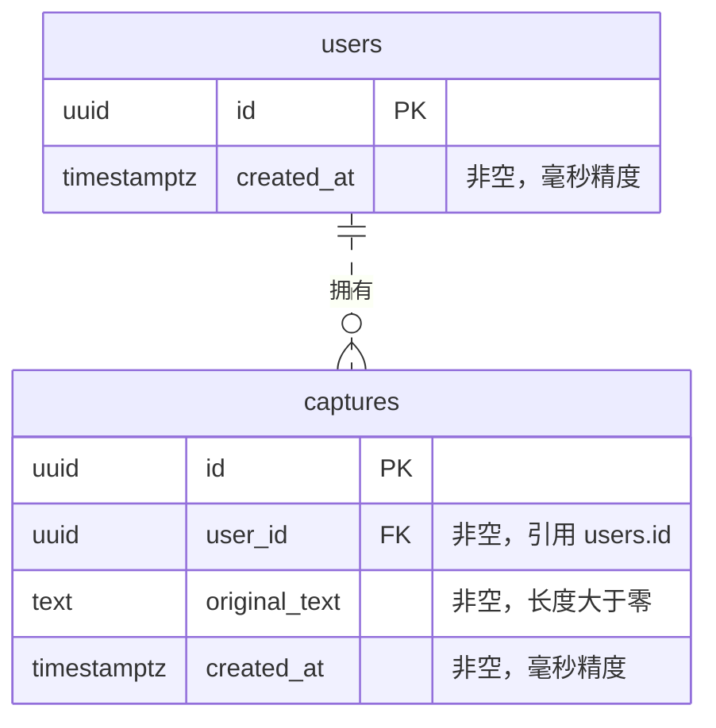
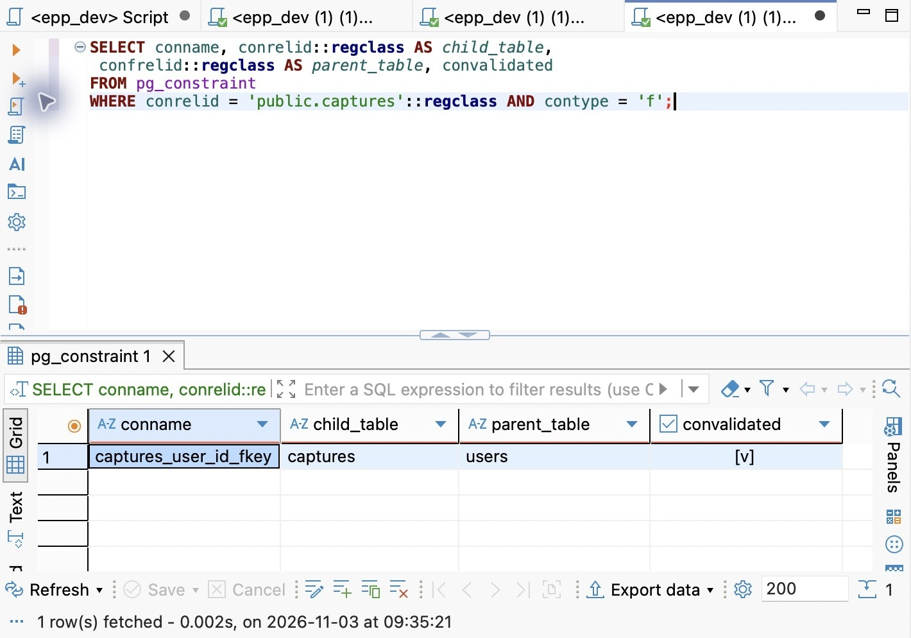
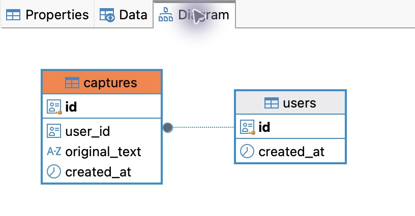
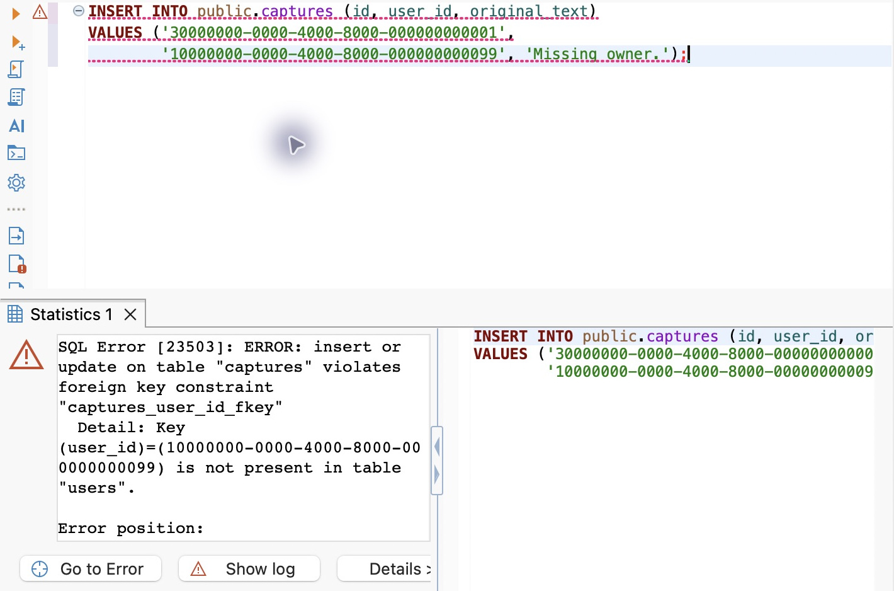
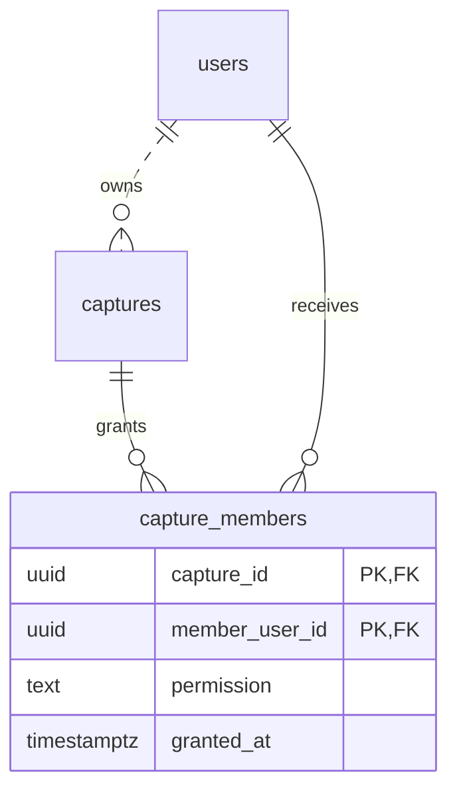
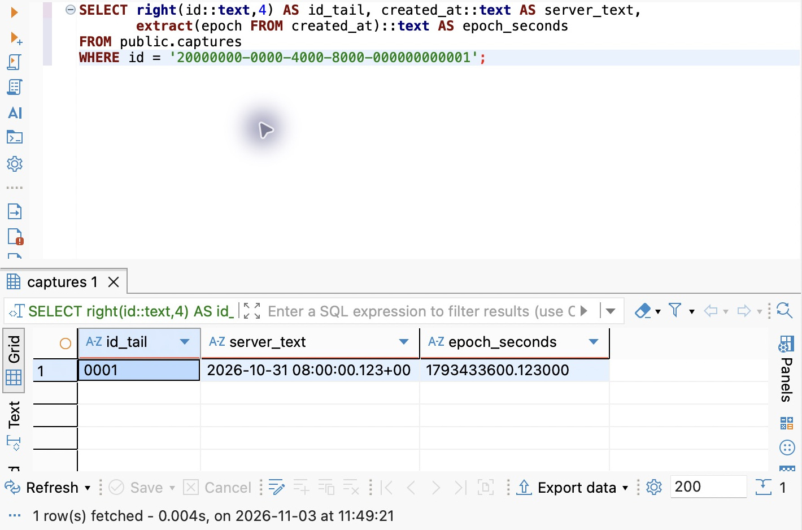

# 第 16 章 关系建模：为已有记录设计第一组表

上一章已经得到一个可以明确定位的 PostgreSQL 18 开发环境：`127.0.0.1:55432` 上的 `epp_dev`，由 `epp_owner` 管理。本章开始决定里面保存什么，以及哪些错误应该在写入时被拒绝。

现有记录只有 `id`、`originalText`、`createdAt`。直接把 TypeScript 属性翻译成三列不难，真正需要判断的是：记录归谁、两个内容相同的记录是否算重复、删除用户时记录怎么办、数据库里的时间怎样回到原来的 JSON。表结构一旦开始承载数据，这些决定就会影响查询、接口和后续迁移。

本章的重点是形成设计依据：从需求确定一行代表什么、哪些事实应放在一起、关系如何表达、哪些规则必须由数据库守住，再考虑查询和演进成本。建表与界面操作用来检查这些判断。学完后，换成收藏、订单明细或成员关系，也应能说明自己为什么这样分表，而不只是照抄 users 和 captures。

本章从 `part-03/chapter-15` 继续，配套分支为 `part-03/chapter-16`。推导完成后建立两张表，写入一个固定开发用户和两条示例记录，观察数据库拒绝哪些写入，再用两个会话时区读取同一个时间点。Nest 主服务仍使用 Map，第十九章才接入数据库；因此本章默认在 DBeaver Community 的图形界面操作，不是调用 `/captures`。psql 作为终端复现的备用工具；SQL 编辑、执行、结果查看与结构检查都可以在 DBeaver 中完成。数据库中的示例记录会保留到后面的 SQL、Prisma 和迁移章节。

## 16.1 从记录归属推导最小模型

### 从业务动作走到模型，中间需要作哪些决定

拿到“让用户保存原文，以后可以查找和删除”这样的需求，先别打开建表对话框。它没有回答重复提交算几条、用户删除后原文是否保留，也没有回答原文修改是覆盖还是新增历史。数据库无法替产品补这些语义；默认接受工具生成的结构，只是把未作出的决定隐藏起来。

先把已有行为写成具体事实。本项目每次成功创建都产生新 ID，相同原文可以保存两次；因此 captures 的一行代表**一次保存形成的记录**，而不是“一段全局唯一的英语文本”，也不是“某个用户的全部原文”。这个“一行代表什么”称为行的粒度。粒度不同，重复、计数、修改与删除的含义都会改变。

接着区分身份、属性和关系。记录有长期不变的身份 id；original_text 描述记录内容；user_id 描述记录与拥有者的关系。接口把这些字段一起返回，不意味着数据库必须把所有相关信息放进一行。页面需要“记录、作者昵称、记录数”，那是一次读取所需的表示；昵称属于用户，记录数可由记录集合计算，各自的修改责任不同。

然后对关系分别问两个方向。一个用户可以没有记录，也可以有很多条；一条记录必须有且只有一个拥有者。这里既有数量上限，也有是否允许不存在的下限。只写“一对多”会遗漏用户是否必须先有记录、记录是否允许暂时无人认领。这些答案稍后分别落到主键、外键、非空和唯一约束上。

最后把生命周期和访问方式带进来：删除用户时是否连带删除记录，列表按谁筛选和排序，原文修改后是否保留旧值。先判断哪些状态合法，再为已知的查询选择索引。若为了某个页面少写一次关联就复制当前昵称，必须同时回答用户改名后怎样同步；不能只计算读取变简单的收益。

这几步对应三种设计视角：**概念模型**说明用户、记录及它们的业务关系；**逻辑模型**决定表、属性、键与约束；**物理设计**选择 PostgreSQL 类型、索引等具体实现。可以来回校正，但不要因为 ORM 容易生成某种关系，或数据库支持 JSON，就倒过来改变业务含义。下面沿这个过程逐步做出当前模型，而不是先给一张“标准答案”表。

### 先区分记录本身与记录的拥有者

回看现有创建结果：

```json
{
  "id": "20000000-0000-4000-8000-000000000001",
  "originalText": "  I am not much of a cook.  ",
  "createdAt": "2026-10-31T08:00:00.123Z"
}
```

这是接口的表示，字段来自已有行为：每次创建产生新 ID，原文连同两端空格一起保存，创建时间表示这次记录发生的时间点。用户两次提交相同原文，当前会得到两个 ID。数据库不能为了“避免重复”擅自给原文加唯一约束，否则同一个 HTTP 请求在新旧存储下会有不同含义。

上一章还确定了记录必须有归属。这里需要三个可以分别回答的问题：某个用户是否存在，一条记录的拥有者是谁，当前请求者能不能操作它。前两个可以先落成数据，第三个需要可信身份和权限判断。

因此引入 `users` 与 `captures`：每条用户行有稳定 ID；每条记录行通过 `user_id` 指向一条用户行。用户名、邮箱和昵称可能更改，不适合用来维持记录的长期归属。以后增加密码登录或外部身份，是把登录方式接到这个稳定身份上，不是给每一种登录方式重新分配一批记录。

本章的用户表只放 `id` 和 `created_at`。这不表示一个真实账号只需要这两个字段，而是当前尚未定义注册、邮箱唯一性、密码或账号冻结的行为。此时先放一个 `password` 或 `status`，反而需要凭空规定它们的合法值和生命周期。身份篇会在明确需求后追加结构，原有用户 ID 和记录归属继续保留。

### 为什么不把用户资料复制到每条记录里

设想给 captures 直接放 `user_email`：同一个人保存了三百条记录，更改邮箱就要改三百处。漏改一处，会出现同一个用户在不同记录里“拥有不同邮箱”的情况。若用邮箱本身识别用户，更改邮箱还会改变用来连接记录的身份。

根源不是字符串太长，而是把“这个用户的当前邮箱”这一份事实复制成了三百份。用稳定 `user_id` 保存关系，用户自己的事实以后留在 users 或相应身份表，记录只保存记录自己的事实，修改的责任就清楚了。这是规范化在当前问题中的实际收益。

还可以沿新增和删除看同一个问题：如果只用记录表保存用户资料，一个尚未保存任何记录的用户就没有合适的落点；删除他的最后一条记录，又会顺带丢掉用户资料。分别称为插入异常和删除异常；改三百份邮箱却漏一份，是更新异常。这里的“异常”不一定报 SQL 错误，它可能是每句 SQL 都成功，数据含义却已经失真。

为什么拆成 users 与 captures 能解决？因为我们承认两条不同的决定关系：记录 ID 决定这条记录的原文、创建时间和拥有者；用户 ID 决定这个用户的当前资料。把这类“相同的 X 应对应相同的 Y”称为**函数依赖**，记作 X → Y。它来自需求允许的所有合法状态，不是看眼前三行碰巧相同就推断出来。

假设把当前邮箱塞进 captures，就出现 capture_id → user_id → current_email：邮箱随用户而定，却被放进每条记录重复维护。把它移到用户侧之后，修改只发生在一处，读取时再通过 user_id 关联。注意“只存一次”指一份业务事实有明确的权威位置，并不是禁止多个用户恰好使用相同的字符串。也不意味着把每一个重复单词都抽成字典表。

**拆表还必须能正确接回去。** users.id 的唯一性保证每条记录按 user_id 找到至多一个用户，非空外键保证它确实能找到一个；于是关联不会凭空多出另一位拥有者，也不会丢掉原来的归属。若拆分时把 user_id 一起丢了，仅凭相同昵称重接，重名用户就可能把记录互相串在一起。规范化的目标包含避免错误组合，不是把宽表切得越碎越好。

不过，也不能因此规定所有重复值都要拆表。如果将来需要保留“发送邮件时实际使用的收件地址”，那是一次发送的历史事实，不是用户当前邮箱的副本。即使用户改了邮箱，历史发送地址也不应跟着改。建模先问这列描述谁、描述哪个时刻，再决定是否与另一个字段共享同一份事实。

现在的字段映射如下。SQL 采用小写下划线命名，应用继续使用驼峰；后面由映射层衔接，不把数据库命名泄漏给调用方。

| 数据库列 | 当前含义 | 与现有接口的关系 |
| --- | --- | --- |
| users.id | 稳定的业务用户身份 | 当前没有登录接口，不对外新增用户字段 |
| users.created_at | 这条用户记录的创建时间 | 用户表自身的事实，不替代记录创建时间 |
| captures.id | 一次记录的稳定标识 | 对应 id，仍允许同一原文创建多条记录 |
| captures.user_id | 这条记录的拥有者 | 新增内部归属，不允许客户端自行指定权限 |
| captures.original_text | 用户提交的完整原文 | 对应 originalText，不修剪或自动润色 |
| captures.created_at | 这条记录的创建时间点 | 对应 createdAt，公开表示仍用 ISO UTC 字符串 |

PostgreSQL 会把未加双引号的标识符折叠为小写：写 `originalText` 实际得到 `originaltext`。可以使用 `"originalText"`，代价是以后每次引用都要正确加双引号。本篇统一 `original_text`，查询时需要驼峰别名再写 `AS "originalText"`。单引号包字符串值，双引号包标识符，两者不能互换。

### 固定开发用户放在哪里

本章用初始化 SQL 写入固定用户 `10000000-0000-4000-8000-000000000001`。它是无个人资料的开发数据，不是 PostgreSQL 登录角色 `epp_owner`，也不是所有访问者都应该共享的正式账号。

两种“用户”处在不同边界：epp_owner 决定当前连接能否建表、读写数据库；users 中的行表达产品里的数据归属。一个 API 数据库连接可以服务许多业务用户，连接账号本身不能告诉数据库这次 HTTP 请求来自谁。

固定用户 ID 不设成 `captures.user_id` 的数据库默认值。否则，任何忘记传归属的脚本都可能写入这个用户，表面成功却留下错误归属。每次写入必须明确提供 user_id；第十九章的开发适配会从受控的服务端配置取得固定身份，第五篇再换成认证结果。对浏览器开放一个可任意填写的 userId 参数，不是这条演进路线。

## 16.2 让类型和约束分别承担明确的责任

### UUID 表达身份，主键负责拒绝重复

现有服务使用 `randomUUID()`，因此数据库选择原生 `uuid`。它保存 128 位标识，读取时可以表示为标准 UUID 字符串；没有必要仅因 JSON 中是字符串，就在数据库中使用 `varchar(36)`。后者仍可能装入任意 36 字符文本，类型本身不能说明它是一个有效 UUID。

自增整数也是合理选择，尤其在数据库统一分配 ID 的系统中，索引更紧凑；选择 UUID 则方便应用在写入前拿到 ID，并延续现有接口。UUID 的随机性有存储与索引局部性的代价，不代表所有场景都比整数好。这里根据已有协议选择，不借建表改掉整个 ID 策略。

本章不给 id 设置数据库默认生成器：业务沿用应用生成，初始化 SQL 明确指定演示 ID。PostgreSQL 可以生成 UUID，但生成位置是另一项决定；不能让数据库重新生成一个 ID，而响应还返回应用生成的另一个 ID。

即使生成算法让碰撞概率很低，表仍要有 `PRIMARY KEY`。类型只判断“是不是 UUID”，主键判断“这张表里能否已经有同样的身份”，并禁止 NULL。PostgreSQL 会为主键建立唯一索引，不要再手工为 id 建一份相同索引。原文相同可以是两条记录，id 相同则不能是两条不同记录；这两个判断必须分开。

### 技术主键之外，还要找业务上的唯一性

给每张表加一个 id，只解决了“每行怎么称呼”，没有自动解决“哪两行代表同一件事”。假设未来保存共享成员，每次都生成新 UUID，那么“同一记录、同一成员”仍能插入两行；两个 id 不同，主键不会报错。但如果业务规定一人只能在一条记录上拥有一份当前授权，就需要额外保证 `(capture_id, member_user_id)` 这对值唯一。

这对字段也可以直接作为组合主键，表示关系本身就是身份；若另外使用 UUID 主键，仍需为这对字段加组合唯一约束。独立 ID 方便其他对象引用某次关系，组合键直接表达身份，但会让后续引用携带多列。决定依据是这条关系是否需要独立身份和引用，而不是“所有表必须有一列叫 id”。

更一般地，能唯一识别一行、且不能再去掉任何一列的一组属性叫**候选键**；从候选键中选一个作为主键，其他业务唯一性仍要落实。基于业务值的键常称自然键，额外分配的 UUID／序号常称代理键。代理键稳定，却不会消除原有业务重复规则。本章 captures.id 是代理键，原文没有唯一要求，因此不额外约束原文。

唯一性还必须带着范围理解。“同一用户下标签名不能重复”和“全站标签名不能重复”是两种产品规则，分别需要 `(user_id, name)` 与 `name` 的唯一性；大小写、空格是否等价又是规则的一部分。不能仅凭“名称看起来应该唯一”添加约束。必填业务键的列还要非空，避免把 NULL 的处理留给默认行为。PostgreSQL 普通 UNIQUE 默认允许多个 NULL，不能把它直接当成“最多一个缺失值”。

这种规则不能只靠应用先查一次。两个请求可能都查到“还没有这份授权”，随后各插入一行；如果没有组合唯一性，它们就都能成功。数据库唯一约束会把这个规则放到写入的竞争点上，冲突请求需要按业务处理失败。普通索引仅帮助查找，不承担拒绝重复的职责。事务与重试后面继续展开，但模型此时就应明确哪些重复必须被拒绝。

### text 保存原文，不偷偷改成另一套长度规则

原文用 `text`。当前接口的上限是 **2000 个 JavaScript UTF-16 代码单元**，不是“数据库最多 2000 个字符”。例如 `😀` 在 JS 的 `.length` 中是 2，在 UTF8 数据库的 `char_length` 中是 1；`varchar(2000)` 因而不能复制现有校验。

`text` 并非不占空间，也不是省掉所有输入控制。它让列本身不强行采用另一套长度定义；API 的 16 KiB 请求体限制、2000 单元上限、非全空白规则继续由已有入口和业务逻辑负责。数据库另用 `NOT NULL` 与 `CHECK (char_length(original_text) > 0)` 拒绝缺失和空字符串。这是较宽的存储底线，**不等于完整输入契约**：全空白以及超过 2000 单元的文本仍可能经直接 SQL 写入。

为什么不简单加 `trim` 与正则就宣布两端相同？两种运行环境的空白集合、字符计数和编码边界需要逐一对齐。当前先明确分工：受控 SQL 只写本章给出的合法示例；未来导入入口必须复用同一业务校验，不能因为表接受就认为接口也接受。如果要求每个直接数据库写入者都受同一规则限制，应先统一规则，再设计数据库函数或约束及其迁移，不能用一个相似的表达式冒充等价实现。

这个选择还涉及可表示性：PostgreSQL text 不接受零字符 U+0000，也不能原样保存 JS 中孤立的 UTF-16 代理项。现有 JSON／字符串校验与数据库字符域并不完全一致。第十九章在切换实际入口前必须明确拒绝这些输入并给出输入错误，不能让编码替换或数据库异常静默改变原文。本章的字符串支线会用可运行对照把这些差异拆开，当前业务接口仍保持前文状态。

### NOT NULL、DEFAULT、CHECK 各自补上哪一个缺口

缺值和默认值不是一回事。`created_at` 的默认值可以在 INSERT **省略该列**或显式写 `DEFAULT` 时产生；显式传 NULL 不会触发默认值。要拒绝 NULL，必须另外声明 `NOT NULL`。

同样，`text NOT NULL` 仍允许 `''` 和 `' '`。空字符串有值，只是长度为零；空白字符串有字符，只是未包含当前业务需要的内容。后面的 CHECK 只负责拒绝前者，不能用列名或约束名暗示它还保证了非全空白。

CHECK 还有一个容易从 JS 经验误判的地方：表达式结果为 false 时拒绝，结果为 true 或 SQL 的 unknown 时通过。NULL 参与 `char_length(original_text) > 0` 得到 unknown，不能靠这条 CHECK 拒绝 NULL。这就是为什么同一列同时保留 `NOT NULL` 和 CHECK：两者有各自的职责。

主键与 CHECK 都是数据库写入时检查的规则。用户界面的校验能改善交互，业务层能生成清楚的错误，而数据库约束可以覆盖经过不同程序的写入；不过覆盖哪些条件，取决于实际声明了哪些约束。检查一张表时，要读定义，不能只看界面上是否有“约束”分类。

### 时间列保存时间点，精度与应用相接

`created_at` 选择 `timestamptz(3)`，也就是 `timestamp(3) with time zone`。这里的 3 表示秒后保留三位，与当前 JS Date 的毫秒表示一致。PostgreSQL 默认能处理更高的微秒精度；直接默认六位，再把时间交给只保留毫秒的应用，往返后可能丢失精度。

“带时区”并不是额外保存一个 `Asia/Shanghai` 字段。timestamptz 将输入解释成时间点，输出按当前会话时区显示；原来输入的时区名称不会被保留下来。若未来业务是“每个工作日上午九点提醒”，需要另外保存当地时间、时区和重复规则，一列创建时间不能表达完整计划。

为什么不用普通 timestamp？它保存没有时区解释的日期和钟表读数；同一个 `2026-10-31 16:00:00`，放在北京与伦敦可以表示不同时间点。记录发生在某一刻，需要确定时间点；本章写入时始终带 Z 或明确偏移，避免会话默认时区替我们猜。

默认值选择 `CURRENT_TIMESTAMP`。它表示当前事务开始的时间，同一事务里创建多条记录可能拿到同一个值；它不是每次调用都读取墙上时钟，也不是提交时间。应用后续传入已有 createdAt 时会覆盖默认值，因此仍保持“由业务创建记录时确定时间”的来源。默认值只是省略列时的约定，不强迫应用改用数据库时间。

### 把当前两张表放进 ER 图

把前面的决定汇成实体关系图（ER 图），再进入建表。每个框表示一张表，框内列出字段；这张图对应本章实际要建立的 `public.users` 与 `public.captures`，也作为第十七章查询和第十八章迁移基线的结构起点。



PK 表示主键，FK 表示外键。users 一端的 `||` 表示每条记录必须对应且只对应一个用户；captures 一端的 `o{` 表示一个用户可以对应零条或多条记录。这里“零条”允许用户尚未创建记录，不表示一条记录可以没有拥有者。

虚线表示非标识关系：记录由自己的 id 标识，user_id 不参与 captures 的主键。虚线不表示外键可以省略，也不表示允许 NULL；必须有拥有者仍由 `user_id NOT NULL` 与外键共同保证。user_id 上没有唯一约束，所以同一用户可以拥有多条记录。

图让身份和关系一眼可见，完整规则还要落实到下一节的 DDL：两列 created_at 都使用 `timestamptz(3)` 和 CURRENT_TIMESTAMP 默认值；original_text 用 NOT NULL 与 CHECK 分别拒绝 NULL 和空字符串；外键更新、删除动作均为 RESTRICT；user_id 另有普通索引。关系线本身不表达级联删除、查询性能或访问权限。

## 16.3 建表、写入，再确认留下了什么

### 在 DBeaver 准备本章工作台

沿用第十五章已经运行的实例和保存的 `EPP · DEV · 55432 · epp_dev` 连接。尚未创建连接时，在 **Database → New Database Connection** 选择 PostgreSQL，填写 Host `127.0.0.1`、Port `55432`、Database `epp_dev`、Username `epp_owner`，输入自己的开发密码并测试连接。安装与连接失败的定位仍见上一章。

选中该连接，通过 **SQL Editor → New SQL Editor** 新建脚本；不同版本也可能显示 New SQL Script。编辑器上方确认选中的数据源，不因左侧选中了一个库就默认所有旧编辑器都切到了它。主界面的分工是：左侧导航树看数据库对象，中间编辑器写 SQL，下方结果页看数据、执行统计或错误。

打开配套 `database/chapter-15/03-inspect.sql`，或把内容复制进这个编辑器。这里的“打开文件”是打开 SQL 文本，不是向数据库导入数据。选中第一条 SELECT，通过 **SQL Editor → Execute SQL Statement** 执行，在下方结果页核对 epp_dev、epp_owner、127.0.0.1 和 55432；再执行其余只读查询。展开左侧 **Schemas → public → Tables**，首次到达本章时尚无业务表；已做过本章则先核对现状，不重复初始化。

单条执行与整份执行要明确区分：**Execute SQL Statement** 用于当前或选中语句；**Execute SQL Script** 按顺序执行脚本，若有选区则可能只执行选区。下面的完整初始化文件应取消选区后执行整份。不要选名字相似的 **Execute SQL Script natively**，它依赖外部客户端；也不使用把各条语句放入独立线程的并行执行动作。快捷键随系统与个人配置变化，先按菜单动作确认。操作依据见 [SQL 编辑器](https://dbeaver.com/docs/dbeaver/SQL-Editor/)与[执行方式](https://dbeaver.com/docs/dbeaver/SQL-Execution/)。

本章 SQL 已显式包含 BEGIN、COMMIT 或 ROLLBACK，因此先在没有未完成工作的会话中设置：工具栏事务模式为 **Auto-commit**，关闭 Smart commit；在偏好设置 **Editors → SQL Editor → SQL Processing → Scripts** 中，将 Commit type 设为 **No commit**、Error handling 设为 **Stop + rollback**，让脚本自己的语句决定提交边界，执行器不额外逐句提交。No commit 不会忽略文件里显式写出的 COMMIT。启用 Fetch query results 才能看到只读脚本各条查询的结果；事务中不要开启每次执行前重新连接的选项。这里采用这一组明确配置，避免客户端设置改变实验含义。

### 先核对目标，再执行一份完整的建表文件

确认目标后，在新脚本中编写下面的结构定义，或打开配套文件。若看到来源不明的表，先检查环境和既有进度，不删除对象来凑成空白起点。

将下面内容保存为 `database/chapter-16/01-create-tables.sql`：

```sql
BEGIN;

CREATE TABLE public.users (
  id uuid CONSTRAINT users_pkey PRIMARY KEY,
  created_at timestamptz(3) NOT NULL DEFAULT CURRENT_TIMESTAMP
);

CREATE TABLE public.captures (
  id uuid CONSTRAINT captures_pkey PRIMARY KEY,
  user_id uuid NOT NULL,
  original_text text NOT NULL,
  created_at timestamptz(3) NOT NULL DEFAULT CURRENT_TIMESTAMP,
  CONSTRAINT captures_original_text_nonempty CHECK (char_length(original_text) > 0),
  CONSTRAINT captures_user_id_fkey
    FOREIGN KEY (user_id) REFERENCES public.users (id)
    ON DELETE RESTRICT ON UPDATE RESTRICT
);

CREATE INDEX captures_user_id_idx ON public.captures (user_id);

COMMIT;
```

两张表放在 public，明确限定 Schema，避免 search_path 让建表和后续查询指向不同对象。先创建 users，因为 captures 的外键需要引用已经存在的表。给主键、外键和 CHECK 起明确名字，是为了报错时可以从 `captures_user_id_fkey` 回到具体规则，不依赖系统自动命名来理解规则。

外键这段的意思是：captures.user_id 的非 NULL 值必须能在 users.id 中找到。被引用的 users.id 是主键，一个 ID 只对应一个用户；一条记录因此不会同时指向两条用户行。user_id 自己没有 UNIQUE，同一用户才能有多条记录。删除或改动正在被引用的用户 ID 时，这里选择 RESTRICT，具体取舍在 16.4 展开。

`captures_user_id_idx` 是另建的普通索引。外键会检查父记录是否存在，但 PostgreSQL **不会自动为引用端 user_id 建索引**。按用户找记录、删除用户时检查还有没有引用，都可能需要按 user_id 查找。这里明确建立它；它不会让 user_id 唯一，也不保证返回行的顺序。当前几行数据即使不用索引也很快，这个索引是根据访问方式选择的初始结构；复合索引和执行计划在查询与性能章节根据实际条件继续调整。

最外层 BEGIN 与 COMMIT 将本次建表和索引创建放在一个事务内：都成功才一起提交，中途失败则可以整体撤销。这里用的是允许在事务中的普通 CREATE TABLE／CREATE INDEX，不能照搬到上一章的 CREATE DATABASE。第十七章会用两条连接展开提交可见性；现在先掌握执行和恢复这一条完整路径。

在 DBeaver 中确认此编辑器仍关联开发连接，取消文本选区，选择 **Execute SQL Script**。在下方执行统计／输出中核对所有语句完成，确认最后的 COMMIT 成功；没有查询结果网格是正常的，因为这些语句没有 SELECT。不要只看见第一张表出现就认为全部完成。

若中途报错，选择停止执行，不忽略错误继续。前面的 Stop + rollback 会尝试回滚；如果是逐条执行或状态不确定，在**同一个 SQL 编辑器、同一连接**单独选中并执行：

```sql
ROLLBACK;
```

然后查明原因，再重试。事务失败后继续查询通常只会看到 `current transaction is aborted`；这个错误是在提醒尚未退出失败事务，不是表已经坏了。已经自动回滚时，再执行 ROLLBACK 可能提示当前不在事务中；这不意味着需要重新初始化。不要另开一个可能使用不同连接的编辑器来回滚原事务。

文件没有 `IF NOT EXISTS`。已经存在的同名表可能少了列或约束，跳过创建不等于结构正确。若遇到 relation already exists，先回滚，再用下一段结构查询核对；若确认已完整完成本章，直接进入读取。若是从别处手动建立的部分结构，保留它并分析差异，不通过删表或编辑初始化文件反复重放来冒充迁移。

### 用数据库里的实际定义核对模型

在 DBeaver 的导航树中对 public 的 Tables 选择 **Refresh**，双击 users 或 captures 打开对象编辑器，在 **Properties** 中查看 Columns、Constraints、Foreign Keys、Indexes。users.id、captures.id 应是 uuid 主键，时间列应为带时区、精度 3、非空且有默认值；captures.user_id 非空，普通索引和外键分别存在。继续比较外键的删除动作，不只数表的数量。

同一个对象编辑器中的 **Data** 页用于查看行。导航树 Refresh 更新的是对象列表，Data 页 Refresh 才重新读取数据；两者都不是提交按钮。此时表应为空，下一步写入后再回到 Data 页刷新。

需要核对界面显示的依据时，也可以在 DBeaver SQL 编辑器直接运行下面的查询。第一条从信息 Schema 看列，第二条从 PostgreSQL 系统目录读约束定义：

```sql
SELECT table_name, column_name, data_type, udt_name,
       is_nullable, column_default, datetime_precision
FROM information_schema.columns
WHERE table_schema = 'public' AND table_name IN ('users', 'captures')
ORDER BY table_name, ordinal_position;

SELECT conrelid::regclass AS table_name, conname,
       convalidated, conenforced,
       pg_get_constraintdef(oid) AS definition
FROM pg_constraint
WHERE conrelid IN ('public.users'::regclass, 'public.captures'::regclass)
ORDER BY table_name, conname;
```

`information_schema.columns` 提供列元数据，不是业务行。`udt_name` 能看到 uuid、text、timestamptz 这样的底层类型名，datetime_precision 应是 3。`regclass` 把表名解释成数据库中的对象引用，`pg_get_constraintdef` 将已保存的约束还原成可读定义。这里按两张表限定范围，不需要记住整个系统目录；理解它们查询的是服务器现状，就能用它们检查工具生成的结构。

再看 convalidated 与 conenforced：本章新建的约束均应为 true。前者说明已有数据已通过约束验证，后者说明约束处于执行检查的状态。PostgreSQL 18 可以在部分约束上表达尚未验证或不执行的状态；只看到名字和定义，不能认定完整性保证已经成立。本章不使用这些特殊状态，后续迁移核对也需要保留这一判断。



这张查询把范围缩小为 captures 的外键（contype = 'f'），child_table 与 parent_table 分别显示 captures、users，convalidated 勾选表示已验证。引用的具体列、删除动作和执行状态仍用上面的完整定义查询核对；只看到两个表名不能替代这些细节。

配套 `03-inspect-model.sql` 保存了这两条查询，并补充索引与数据读取。此时表为空，可以运行来查看结构，数据结果应为零行。不要把仓库里的 CREATE TABLE 文件当作已经应用到数据库的证据。

### 用关系图检查设计，用属性确认图的含义

双击 captures，在对象编辑器切换到 **Diagram**；也可以双击 public 或其 Tables 节点查看 Schema 的关系图，具体入口见 [DBeaver 关系图说明](https://dbeaver.com/docs/dbeaver/ER-Diagrams/)。将实际结构与上一节 ER 图对照：两张表、六个字段，以及 captures.user_id 到 users.id 的关联是否一致；再回到 Properties 检查引用列、非空与删除动作。如果图没显示关联，先 Refresh 并查看 Foreign Keys 是否存在，不靠手动画一根线修复数据库。不同工具的线形和布局可以不同，核对的是键、引用与数量约束。



实际 Diagram 中，captures 有四列，users 有两列，连线来自数据库已存在的外键。图上的线不能单独说明删除行为或每端允许的数量；继续用前面的非空、唯一性与外键定义逐项解释。

把图与前面的需求逐条对应：记录端为什么必须有拥有者，由 user_id 的非空和外键回答；用户端为什么能有多条记录，由引用端没有唯一约束回答；用户为什么可以还没有记录，由 users 不依赖 captures 回答。图能帮助看到结构，但必须结合这些属性，才能确认数量边界。

此处只浏览已有结构，保持图的只读模式。布局移动不改变数据库规则；进入结构编辑模式后的修改则可能生成需要执行的 DDL。保存图形布局、在客户端定义虚拟关系、真正向服务器添加外键是不同动作，最终仍以 Properties 和系统目录中的定义为准。不要为了让图“连起来”就改动后续章节要使用的结构。

### 写入一个开发用户，再写入他的两条记录

保存 `database/chapter-16/02-seed-development.sql`：

```sql
BEGIN;

INSERT INTO public.users (id)
VALUES ('10000000-0000-4000-8000-000000000001');

INSERT INTO public.captures (id, user_id, original_text, created_at)
VALUES
  ('20000000-0000-4000-8000-000000000001',
   '10000000-0000-4000-8000-000000000001',
   '  I am not much of a cook.  ',
   '2026-10-31T08:00:00.123Z'),
  ('20000000-0000-4000-8000-000000000002',
   '10000000-0000-4000-8000-000000000001',
   'I''m learning to cook.',
   '2026-10-31T08:00:00.123Z');

COMMIT;
```

用户插入省略了 created_at，所以采用事务开始时间；两条记录明确给出同一个时间点，便于后面复现时区与排序问题。固定时间只是演示数据，不是把所有未来记录都写成这一时刻。

INSERT 的列清单与 VALUES 按位置对应，因此即使以后表增加列，这份语句仍然清楚地说明自己写入了哪些字段。第一条原文两端各有两个空格，应原样留下。第二条的 `I''m` 使用 SQL 字符串字面量中的双单引号表示一个撇号；它只用于这里人工编写的固定 SQL，不能拿来代替下一章的应用参数绑定。

在 DBeaver 中打开 `02-seed-development.sql`，确认数据源和事务设置，取消选区后用 **Execute SQL Script** 执行。确认 COMMIT 成功，再打开 `03-inspect-model.sql` 执行只读核对，逐个查看下方结果页；不要把两份文件合并后无条件连跑。

应看到一个用户和属于他的两条记录。先把实际行与刚写入的值对应起来，尤其是结果网格里不易辨认的空格。可以立即运行以下只读查询；它也是 03-inspect-model.sql 的末尾查询：

```sql
SELECT id, user_id, original_text, created_at,
       char_length(original_text) AS character_count
FROM public.captures
WHERE user_id = '10000000-0000-4000-8000-000000000001'
ORDER BY created_at, id;
```

这里先按固定 user_id 过滤，再按时间与 ID 显示；SELECT 明确列出需要核对的字段。第一条 character_count 应为 28，第二条为 21，第二条原文只有一个撇号。两条 user_id 相同，created_at 表示同一时间点；users.created_at 则来自本次执行时间，不要求和演示记录时间相同。下节继续解释归属与排序的保证范围。

也可以双击 captures，进入 **Data** 页点击 Refresh，在表格中查看两条原文。原文较长时用单元格编辑／查看对话框展开，避免列宽让内容看起来像被截断。

DBeaver 支持在数据网格里修改值、增加行和删除行。编辑后先是客户端待保存状态：Data 页的 **Save** 才将修改发送给数据库，**Cancel** 放弃尚未保存的网格修改；若使用 Manual commit，发送后还需 **Commit** 才提交，或用 **Rollback** 放弃未提交事务。Auto-commit 下已成功保存的数据不能再靠 Cancel 撤销。可以在原文单元格临时改一个字、不点 Save，再点 Cancel 并刷新观察恢复；不要覆盖这批后续章节要用的示例数据。具体入口见 [数据编辑器](https://dbeaver.com/docs/dbeaver/Data-Editor/)与[事务模式](https://dbeaver.com/docs/dbeaver/Auto-and-Manual-Commit-Modes/)。

SQL 编辑器的“保存文件”仅保存 SQL 文字，与上述 Data 页 Save 又是不同动作。本章初始化仍使用保存好的 SQL，既方便回查，也能准确复现相同结构和数据；这不要求回到命令行。

重复执行 seed 会得到主键冲突，这是有意的。它不使用随机 ID 或 `ON CONFLICT DO NOTHING` 来掩盖重跑：前者会悄悄多出开发用户，后者可能藏住同 ID 下内容已经不同的事实。会话仍可用时，结果不确定先 ROLLBACK 退出失败事务，再按固定 ID 查询；连接已中断则重新连接后核对。成功提交则保留这些行，失败已回滚则修复后重试。ROLLBACK 不会撤销此前已经提交的事务。若曾经只执行文件的一部分且分别提交，应按实际缺失内容补齐，不能删除现有数据来重新开始。

这是一处自然停点：两张表及一个用户、两条记录已经提交。隔天回来只需恢复实例、连接并运行 03-inspect-model.sql；不重复运行 01、02。后面的约束实验均回滚，下一章继续使用这批数据。

## 16.4 一对多关系到底保证了什么

### 从三条定义读出关系，不靠图上的箭头猜

当前关系可以准确描述为：一个用户可以有零到多条记录；每条记录必须属于一个存在的用户。

“可以有零条”来自用户行不依赖记录行；“多条”来自 captures.user_id 没有唯一约束；“必须属于一个存在的用户”由 user_id 非空和外键共同保证。若只写外键却去掉 NOT NULL，NULL 可以绕过普通外键的存在性检查，于是记录允许暂时没有拥有者。若误加 `UNIQUE (user_id)`，第二条记录就会失败，一对多实际上变成一对至多一。

同一个 UUID 类型不建立关系。把任意 UUID 放进 user_id，只有它在 users.id 中存在才合法；数据库检查的是引用，不是名称恰好带 `user`。

还要注意相反方向：这两张表没有规定“每个用户至少有一条记录”。外键从 captures 指向 users，不能要求每条 users 都必须被引用。若未来真的出现这种规则，要结合创建过程和事务设计，不能继续往同一外键上添加一串词就以为已经表达。

### 亲手制造一次“格式正确、归属不存在”的失败

在 DBeaver 的开发连接中打开 `04-rejected-writes.sql`，确认 seed 中的两条记录存在。配套 `04-rejected-writes.sql` 是分组实验材料，不是初始化脚本，也不应整份无差别执行。每组按“BEGIN → 操作 → 查看错误 → 单独 ROLLBACK”进行；即使操作意外成功，最后仍回滚，保留原来的数据。

在同一个编辑器中，先选中 BEGIN 执行单条语句，再选中整条 INSERT 执行；不要选中本组末尾的 ROLLBACK 一起运行，否则不便观察失败时的状态：

```sql
BEGIN;
INSERT INTO public.captures (id, user_id, original_text)
VALUES ('30000000-0000-4000-8000-000000000001',
        '10000000-0000-4000-8000-000000000099', 'Missing owner.');
```

99 结尾的用户 ID 格式合法，但本章没有创建它。预期错误涉及 `captures_user_id_fkey`，指出相应键不在 users 中，SQLSTATE 为 `23503`。这与“UUID 格式非法”不同：输入已通过类型转换，失败发生在关系检查。



从左侧错误详情一起读出 `23503`、`captures_user_id_fkey` 和末尾为 `0099` 的 user_id；Detail 明确指出它不在 users 表中。这三项把失败定位到归属引用，不能只凭红色标记判断是哪条规则拒绝了写入。

DBeaver 报错后展开错误详情，查看 SQLState、约束名和 Detail。若用 psql 复现，`\errverbose` 可查看上一次服务器错误，但它是客户端元命令，不能粘进 DBeaver 普通 SQL 编辑器。错误可能带原文或键值，排错时在本机看，分享时不能直接复制真实用户数据。

然后单独执行：

```sql
ROLLBACK;
```

回到 DBeaver 的数据核对查询重新执行，那两条 seed 数据应该仍在；新实验 ID 不应存在。若执行器因遇错停了下来，主动运行 ROLLBACK，而不是等它继续读取文件尾部。如果查询还只得到事务已失败的错误，说明尚未完成这一步。

再对照配套文件中的其他几组。它们分别只改变一个条件，帮助从错误回到规则：

| 改动 | 应拒绝的原因 | SQLSTATE／主要观察点 |
| --- | --- | --- |
| 把 user_id 改成 NULL | 一条记录不能没有归属 | 23502，非空约束 |
| 使用第一条已有记录的 id | 同一记录身份不能占两行 | 23505，captures_pkey |
| original_text 写成空字符串 | 有值但长度为零 | 23514，captures_original_text_nonempty |
| 删除拥有两条记录的开发用户 | 被 ON DELETE RESTRICT 阻止 | 23001，captures_user_id_fkey |

前三个变式的完整操作如下。逐组执行 BEGIN 与 INSERT，报错后单独执行该组 ROLLBACK，不要全选后假定执行器一定继续：

```sql
BEGIN;
INSERT INTO public.captures (id, user_id, original_text)
VALUES ('30000000-0000-4000-8000-000000000002', NULL, 'Missing owner.');
ROLLBACK;
```

```sql
BEGIN;
INSERT INTO public.captures (id, user_id, original_text)
VALUES ('20000000-0000-4000-8000-000000000001',
        '10000000-0000-4000-8000-000000000001', 'Duplicate ID.');
ROLLBACK;
```

```sql
BEGIN;
INSERT INTO public.captures (id, user_id, original_text)
VALUES ('30000000-0000-4000-8000-000000000004',
        '10000000-0000-4000-8000-000000000001', '');
ROLLBACK;
```

每组中与当前约束无关的值保持合法，避免本想观察空串却先撞上重复 ID。删除拥有者的变式在下面接着解释。

这里的 SQLSTATE 比本地化错误文案更适合程序判断，但仍需结合约束名、操作上下文和服务端版本。本书 PostgreSQL 18 中，插入不存在的拥有者返回 `23503`（foreign_key_violation），本例删除被引用用户触发 RESTRICT 则返回 `23001`（restrict_violation）；不能把两种操作统一写成同一个码。第十九章会把这些数据库事实映射到应用错误，而不是把服务器完整错误发给客户端。可在[错误码表](https://www.postgresql.org/docs/18/errcodes-appendix.html)中回查条件名称。

若实验结果与预期不同，先重新运行 03-inspect-model.sql：连接目标对不对、约束是否真的存在、固定用户与记录是否仍在？例如删除居然成功，可能是误连空库，或开发用户根本没有被引用；不能只根据“SQL 执行成功”得出 RESTRICT 失效。若错误发生在 INSERT 的类型转换阶段，先检查 UUID 拼写，因为那还没走到期望的外键检查。

### 为什么本章删除用户时选择 RESTRICT

在默认数据已存在时，下面这句应被拒绝；仍只在上一节的 BEGIN／ROLLBACK 保护内试：

```sql
DELETE FROM public.users
WHERE id = '10000000-0000-4000-8000-000000000001';
```

如果用 `ON DELETE CASCADE`，删除用户会连同引用他的记录一起删除。对完全依附父对象、没有独立保留责任的明细，这可能是合理规则；但 EPP 以后还会有修订、正式表达、文件和其他关联，账号删除需要完整的处置流程。目前没有定义这些责任，因此先拒绝破坏引用的动作。

`SET NULL` 则表示删除用户后保留无归属记录，与当前 user_id NOT NULL 相冲突，不能把它当成“不想选删除策略时的折中”。默认的 NO ACTION 在本章这种不可延迟外键下，也会拒绝造成悬空引用的操作；RESTRICT 明确表示不允许延后这项引用动作检查。等真正需要延迟约束时，再讨论相应事务条件，不在这里把两者都概括成“永远一样”。

ON UPDATE RESTRICT 对被引用的用户 ID 也采取相同立场：稳定身份不随昵称、登录方式或展示信息变化。用户换邮箱不应该修改 users.id，更不应靠级联更新记录归属来“同步邮箱”。

限制删除不等于备份或防误操作。拥有者仍可能主动删除 captures 后再删 users，也能修改结构；外键是在既有结构下维护关系，不是阻止所有有权限的管理员行为。部署时还要通过运行账号权限约束谁能执行这些动作。

### 外键不能回答“这是你的记录吗”

本章用下面的查询读取固定用户的记录：

```sql
SELECT id, user_id, original_text, created_at,
       char_length(original_text) AS character_count
FROM public.captures
WHERE user_id = '10000000-0000-4000-8000-000000000001'
ORDER BY created_at, id;
```

SELECT 后面的列是要读出的投影，WHERE 限定归属，ORDER BY 明确显示顺序。`character_count` 可辅助检查结果表里不易辨认的首尾空格；这不是 API 输出的新字段。更完整的查询和参数绑定下一章展开。

这条 WHERE 的输入现在由我们手写，未来必须来自可信的服务端身份。外键只能证明被写入的 user_id 存在；它不会拦住一个拥有表读权限的连接去查另一个用户，也不会阻止该连接把一条记录改挂到另一个存在的用户。查询遗漏归属条件时，即便所有外键都健康，仍可能越权。

因此数据库角色权限、业务身份与资源归属是三道不同的判断。此处建立了归属事实和引用完整性，尚未完成多用户访问控制。第五篇会用真实认证结果限制写入归属和读取条件，而不是信任请求正文里的 userId。

### 如果需求变成多人共享，该改哪一层

现在每条记录只有一个拥有者，关系已足够。如果以后只是允许另一人阅读，首先分开“拥有者”与“被授权的读者”；不要为了共享就把 user_id 改成 UUID 数组，让拥有者和权限成员混为一谈。

数组或 JSON 很适合保存作为整体使用、没有独立引用规则的值，但普通外键不会逐个检查数组中的用户 ID。若需求要求每个共享成员都必须是有效用户、同一成员不能重复加入，还需要成员自己的权限或加入时间，那么关系本身已经有事实，应建独立关联表，每行表示一次成员关系，并用组合唯一性约束重复。

把假设进一步说清：一个用户可以被授权阅读多条记录，一条记录可以授权给多位用户，每对记录与用户只保存一份当前授权。由此得到下面的**设计草图**；这是推演需求，不是要求现在建表。图中的一条成员行代表一份当前授权，拥有者关系仍保留在 captures 上。



两个外键分别保证记录和成员存在；组合主键 `(capture_id, member_user_id)` 保证同一人对同一记录最多一份当前授权。这两个外键都参与成员行的主键，因此指向 capture_members 的关系用实线表示标识关系。permission 描述这一对关系上的权限，所以属于成员表；它不属于 users，因为同一个人在不同记录上可以有不同权限。granted_at 也属于这次授权，而不是用户注册时间。这里已经由属性归属推导出了典型的**关联实体模式**，不是先背“多对多要三张表”。

假设成员从只读改为可编辑：如果产品只关心当前权限，更新原关系行即可；若必须追溯每次授权变化，同一对记录和用户就会有多次历史事件。此时不能删掉组合唯一性、容许多行后让程序随便选一个；应该继续保留唯一的当前授权，另用历史行表达每次变化，或者明确改为带有效期的版本模型。**当前关系与历史事件的行粒度不同**，键的选择也会随之改变。

还要把“存在”与“业务成立”分开：两个外键不会禁止把拥有者自己加入成员表，也不会保证某条授权由拥有者发起。前者是否允许应明确约定，后者属于身份和授权过程。不要写一个跨表 CHECK 来查拥有者，PostgreSQL 的普通 CHECK 不用于持续维护其他行或其他表的数据条件；它们变化时，并不会因此重新检查所有相关行。跨行规则应先寻找合适的唯一／外键等机制，涉及操作过程的规则再结合权限与事务设计。

这里不提前创建共享表。迁移判断已经可以成立：先保留原有 user_id 作为拥有者，再按新需求追加成员关系，旧记录默认没有额外共享者；不能把已有拥有者丢掉，或靠批量复制记录制造共享。相反，如果需求规定记录永远只属于一个用户，就没有理由为了“以后可能有”引入关联表。关系类型由规则决定，不由 ORM 界面能画几种箭头决定。

## 16.5 时间经过数据库与 JSON 时发生了什么

### 改的是显示时区，还是已经保存的时间点

在 DBeaver 的一个没有未完成事务的编辑器中打开 `05-time-representation.sql`。按下面顺序逐条执行，均留在同一个编辑器和会话内；观察完第一条 SELECT 的结果后再切换时区，不在两次查询之间重新连接：

```sql
BEGIN;
SET LOCAL TIME ZONE 'UTC';
SELECT id, created_at, created_at::text AS server_text,
       extract(epoch FROM created_at) AS epoch_seconds
FROM public.captures WHERE id = '20000000-0000-4000-8000-000000000001';

SET LOCAL TIME ZONE 'Asia/Shanghai';
SELECT id, created_at, created_at::text AS server_text,
       extract(epoch FROM created_at) AS epoch_seconds
FROM public.captures WHERE id = '20000000-0000-4000-8000-000000000001';
```

在同一个 DBeaver 编辑器逐条执行，先观察 UTC 的 SELECT，再执行上海设置及下一条 SELECT。server_text 应分别为 `2026-10-31 08:00:00.123+00` 与 `2026-10-31 16:00:00.123+08`；epoch_seconds 两次都是 `1793433600.123`。`::text` 在服务器端转成文本，使结果不会再作为时间类型被客户端换算；extract(epoch ...) 则把时间点表达为距 Unix 纪元的秒数。这里比较的是同一个 ID，显示偏移改变，数值时间点不变，也没有执行 UPDATE。




两图为便于比较，把 ID 显示为末四位，并把 epoch 转成文本保留小数；WHERE 仍使用同一个完整 ID。先对照 `server_text` 的 `+00`／`+08`，再确认 `epoch_seconds` 相同，才能把“显示变化”与“数据被修改”分开。

DBeaver 的驱动与单元格格式可能对 created_at 做额外展示转换，因此那一列不一定跟随 SET LOCAL 改变。把它与 server_text、epoch_seconds 对照，就能区分客户端展示、服务器会话时区和实际时间点。psql 默认文本显示通常与 server_text 一致。不要为让两张网格看起来一样而修改已保存的时间。

继续用带类型的常量让数据库比较：

```sql
SELECT TIMESTAMPTZ '2026-10-31 08:00:00.123+00'
     = TIMESTAMPTZ '2026-10-31 16:00:00.123+08' AS same_instant;
```

结果应是 true，psql 通常显示 `t`。这里比较的是两个被解释后的时间点，不是字符串字符是否相同。末尾执行：

```sql
ROLLBACK;
SHOW TimeZone;
```

SET LOCAL 只在本次事务中生效，事务结束后恢复会话原时区。实验没有修改业务行，ROLLBACK 还可以避免把设置意外带到后续操作；再次 SHOW 应恢复实验前的值，按上一章配置通常为 UTC。若想让两个客户端长期使用不同显示时区，应分别管理连接设置，不修改数据来“修正时差”。

### AT TIME ZONE 不是给字符串贴一个 Z

需要专门观察某个地区的钟表读数时，可以执行：

```sql
SELECT TIMESTAMPTZ '2026-10-31 08:00:00.123+00' AT TIME ZONE 'UTC'
         AS utc_wall_time,
       TIMESTAMPTZ '2026-10-31 08:00:00.123+00' AT TIME ZONE 'Asia/Shanghai'
         AS shanghai_wall_time;
```

对于这里的 timestamptz 输入，AT TIME ZONE 输出 **timestamp without time zone**：得到所选地区的日期和钟表读数，结果本身不再携带时间点所需的时区解释。它适合分析显示差异，不应把输出当成已经完成的 API UTC 时间。

在相反方向，对 timestamp without time zone 使用 AT TIME ZONE，会按指定地区解释该钟表读数并得到 timestamptz。方向取决于输入类型，因此排查“同一句转换差了八小时”时，先检查列与表达式类型，再看客户端格式，不反复给字符串追加 Z。

### 回到已有 createdAt 契约

原有 API 使用 `new Date().toISOString()`，返回明确的 UTC 字符串。数据库接入以后，应在适配层核对驱动的实际返回类型，再进行显式投影；不是把 SQL 客户端看到的文本直接作为 createdAt。用下面的 Node 示例就能先核对时间点到 JSON 的表示，运行不需要连接数据库：

```js
const value = new Date('2026-10-31T16:00:00.123+08:00');
console.log(value.toISOString());
// 2026-10-31T08:00:00.123Z
```

若驱动返回 Date，按这个明确的 UTC 序列化规则处理；若返回字符串，则先确认字符串中的时区和格式，不能一概 `new Date(anything)`。`2026-10-31 16:00:00` 没有偏移，解释依赖上下文，不能与上面的明确 ISO 字符串混用。第十九章会在 Prisma 的真实返回值上落实这一映射，并经过现有响应 Schema。

`timestamptz(3)` 也不是“把任意高精度时间截到前三位”。更高精度值会按指定精度舍入，末尾接近下一秒时可以进位。本章示例和当前应用本来就只有毫秒，所以往返不损失它们已有的精度；未来若外部系统要求保留微秒，要连同应用类型和公开契约一起设计。

数据库默认时间、应用产生时间和事务提交时间还需分别命名。当前 created_at 表示创建记录时确定的时间，不承诺“这条记录在并发数据库中第几个提交”。同一事务的 CURRENT_TIMESTAMP 可相同，应用时钟也可能回拨，UUID v4 不携带插入次序。本章两条示例特意使用同一时间，让排序并列真实存在；没有第二排序键时，数据库没有承诺并列行的次序。即使连续查询碰巧相同，也不能据此证明次序有保证。

前面的 `ORDER BY created_at, id` 在时间相同时再按唯一 ID 比较，能给出确定的展示顺序，但**不等价于 Map 的精确插入顺序，更不等价于事务提交顺序**。这里先把差异暴露出来：下一章明确列表排序的契约与并列处理，第十九章切换存储时同步核对对调用方的影响。若业务必须严格记录某种事件先后，就需要另外定义序号及其分配时机，不能把创建时间当成天然可靠的全局顺序。

### 重连以后，从服务器重新读出同一批数据

先在 DBeaver 完成当前实验的 COMMIT 或 ROLLBACK，对开发连接选择 **Disconnect**，再重新连接并运行 `03-inspect-model.sql`。这一步完全通过界面完成，核对新会话能否读回已提交数据；旧结果网格不会自动变成新查询结果。

若还要核对数据库服务本身重启后的结果，则需沿用第十五章的实例管理方式。DBeaver 的 Disconnect 只断开客户端，不会停止 PostgreSQL。仅对自己的本书实例，在已设置 EPP_PGDATA 的终端执行这一组启停：

```bash
pg_ctl -D "$EPP_PGDATA" -m fast -w stop
pg_ctl -D "$EPP_PGDATA" -l "$EPP_PGDATA/server.log" -w start
```

新终端先按第十五章恢复 PATH 与 EPP_PGDATA，不重新 initdb。服务启动后回到 DBeaver，重新连接并执行 `03-inspect-model.sql`；应仍得到相同固定 ID、归属、原文和时间点。数据库日常操作留在图形客户端，操作系统层的服务启停与客户端重连分别核对。

这一步核对的是刚刚提交的数据与实例是否对应，不是重新论证持久化的用途。若数据不见了，先读连接诊断，确认启动的是原数据目录、连接的是同一库；再回想写入是否成功提交。若此前写入只停在未提交事务，fast 关闭时它会回滚。不要先重跑 seed，否则会把需要解释的现象覆盖掉。

保留 01 的结构定义、02 的开发数据与 03 的核对查询，它们分别描述“想建立什么”“写入哪些演示数据”和“现在实际有什么”。第十八章会把已有结构纳入迁移基线；这两份初始化文件不是每次启动都执行的数据库同步器。生产交付也不执行开发 seed，更不会创建这个固定演示用户。

应用仍沿用 `npm run dev` 的断点与自动重启，交付仍用 `npm run check` 和 `npm start`。本章没有新增驱动、运行依赖或环境变量，database 目录不进入已有应用构建。保存 SQL 文件不会被 watcher 自动应用到数据库，SQL 的执行、提交和之后的结构迁移都保持显式操作。

到这里，可以把当前设计解释为一组相互支持的决定：一行是一份记录，所以相同原文允许重复、ID 不允许重复；用户资料和记录有不同生命周期，所以分别保存并用稳定身份关联；记录必须有拥有者，所以外键与非空共同存在；账号处置还没有完整规则，所以先拒绝破坏引用的删除；按用户查记录是已知访问方式，所以另建 user_id 索引；创建时间是时间点，所以按明确时区和精度与接口衔接。

这份解释也暴露了设计的适用范围。若需求改成保留每次修改，行粒度和版本关系要重新讨论；若改成多人共享，增加的是授权关系，不能抹掉拥有者；若只是读取变慢，先取得查询证据，再决定索引或派生副本。下一章在同一批数据上展开查询、修改、关联和提交可见性，继续用实际读写检验这些判断。

时间参考（估算）：阅读约 125～145 分钟；建表、写入、关系图与结构核对、约束失败对照与时间／重连操作另加约 50～65 分钟。按正文约 14500 个汉字、111 行代码／命令、当前模型与共享变式两张关系图、五张实际界面结果和五组约束实验估算，尚未经过读者实测；安装配置沿用上一章，支线单列。16.1～16.2 可先完成模型推导，16.3 再落地并留下可恢复的数据。

## 知识支线

- [支线 16A：同一个字符串，为什么两层校验会给出不同答案](side-01-text-and-null.md)：实际对照 UTF-16、Unicode 字符和 UTF-8 字节，解释 NULL／空串／空白、编码可表示性和强制截断；据此判断哪些规则可以共享，哪些必须明确转换。
- [支线 16B：从一张宽表走到可维护的模型](side-02-modeling-decisions.md)：用报名案例推导范式与无损分解，再比较一对一扩展、关联实体、快照与版本、反规范化、JSON 和软删除的适用条件。

## 附录：本章必要技术点速查

| 名称 | 本章用途 | 必要注意点 |
| --- | --- | --- |
| 行粒度／概念、逻辑与物理设计 | 从需求确定每行事实，再选择表与实现 | 接口表示不直接决定存储结构 |
| 函数依赖／规范化 | 按事实归属减少插入、更新与删除异常 | 拆开后须能通过稳定键还原关系 |
| 候选键／代理键／组合唯一性 | 区分行身份与业务重复规则 | 添加 UUID 不会自动阻止重复关系 |
| 关联实体／当前关系与历史事件 | 保存关系自己的权限与时间 | 需求改变行粒度时重新检查键 |
| ER 图／PK／FK／关系数量 | 汇总当前表、身份与引用，和实际结构对照 | 虚线不表示可空；删除动作、CHECK 和权限仍需另查 |
| uuid／PRIMARY KEY | 保存稳定身份并拒绝重复 | 类型不保证唯一；主键自动建立唯一索引 |
| text／char_length | 保存原文与拒绝空字符串 | 字符数不是 JS UTF-16 单元数，也不是完整业务校验 |
| NOT NULL／CHECK | 限制缺失值与列值条件 | CHECK 只在结果为 false 时拒绝，不能独自排除 NULL |
| DEFAULT／CURRENT_TIMESTAMP | 省略创建时间时产生值 | 显式 NULL 不触发默认；时间取事务开始时刻 |
| FOREIGN KEY／REFERENCES | 保证记录指向存在的用户 | 不能识别 HTTP 请求者或保证资源访问权限 |
| ON DELETE／ON UPDATE RESTRICT | 拒绝破坏已有引用 | 不代替账号处置流程；不要无依据改成 CASCADE |
| CREATE INDEX | 支持按 user_id 定位引用 | 普通索引不加唯一规则，也不保证查询返回顺序 |
| BEGIN／COMMIT／ROLLBACK | 原子执行初始化、撤销实验 | 失败后明确回滚；客户端遇错停止不等于自动清理 |
| INSERT 列清单／SELECT／WHERE | 写入和核对首批数据 | 固定 SQL 字面量不是应用参数绑定 |
| ORDER BY created_at, id | 明确显示次序与并列处理 | 确定顺序不等于精确插入或提交顺序 |
| timestamptz(3)／SET LOCAL TIME ZONE | 毫秒时间点与会话显示 | 不保存原始时区名，高精度值会舍入 |
| AT TIME ZONE／toISOString | 解释本地钟表读数与 UTC API 表示 | 先看输入／返回类型，不对无时区文本随意加 Z |
| DBeaver Properties／Data／SQL Editor | 查看结构、数据与执行 SQL | 刷新对象、刷新数据、保存文本、保存网格是不同动作 |
| DBeaver Diagram | 可视化检查表间引用 | 图形布局与实际数据库约束不同，结合属性核对 |
| Execute SQL Statement／Script | 逐条观察与顺序执行整份脚本 | 核对选区、数据源和脚本提交设置，不用并行执行代替顺序 |
| SQLSTATE／\errverbose | 查看数据库错误依据 | DBeaver 看错误详情；备用 psql 元命令不用于 SQL 编辑器 |
| information_schema／pg_constraint／pg_indexes | 跨客户端核对列、约束、索引 | 查询现状，不能拿源文件代替已应用的结构 |

官方查阅：[约束](https://www.postgresql.org/docs/18/ddl-constraints.html)、[CREATE TABLE](https://www.postgresql.org/docs/18/sql-createtable.html)、[UUID](https://www.postgresql.org/docs/18/datatype-uuid.html)、[字符类型](https://www.postgresql.org/docs/18/datatype-character.html)、[日期时间类型](https://www.postgresql.org/docs/18/datatype-datetime.html)、[日期时间函数](https://www.postgresql.org/docs/18/functions-datetime.html)、[事务](https://www.postgresql.org/docs/18/tutorial-transactions.html)、[错误代码](https://www.postgresql.org/docs/18/errcodes-appendix.html)、[约束系统目录](https://www.postgresql.org/docs/18/catalog-pg-constraint.html)、[psql](https://www.postgresql.org/docs/18/app-psql.html)。这些入口供回查行为，建模与操作依据已在正文展开。

[上一章：PostgreSQL 运行环境](../chapter-15-postgresql-environment/chapter.md) · [下一章：SQL](../chapter-17-sql/chapter.md) · [返回第三篇](../README.md) · [返回全书目录](../../README.md)
