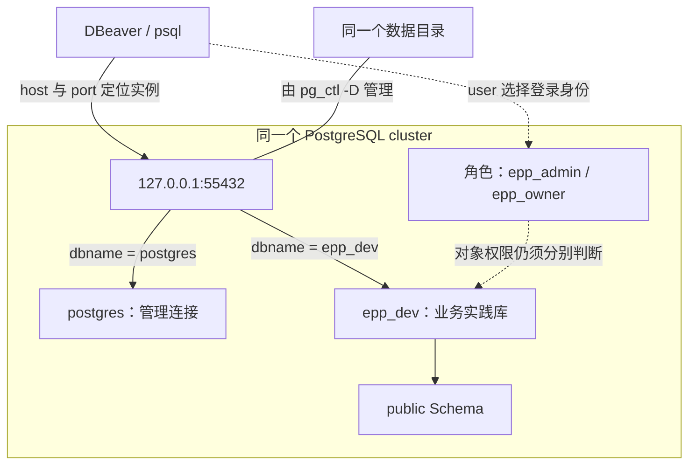
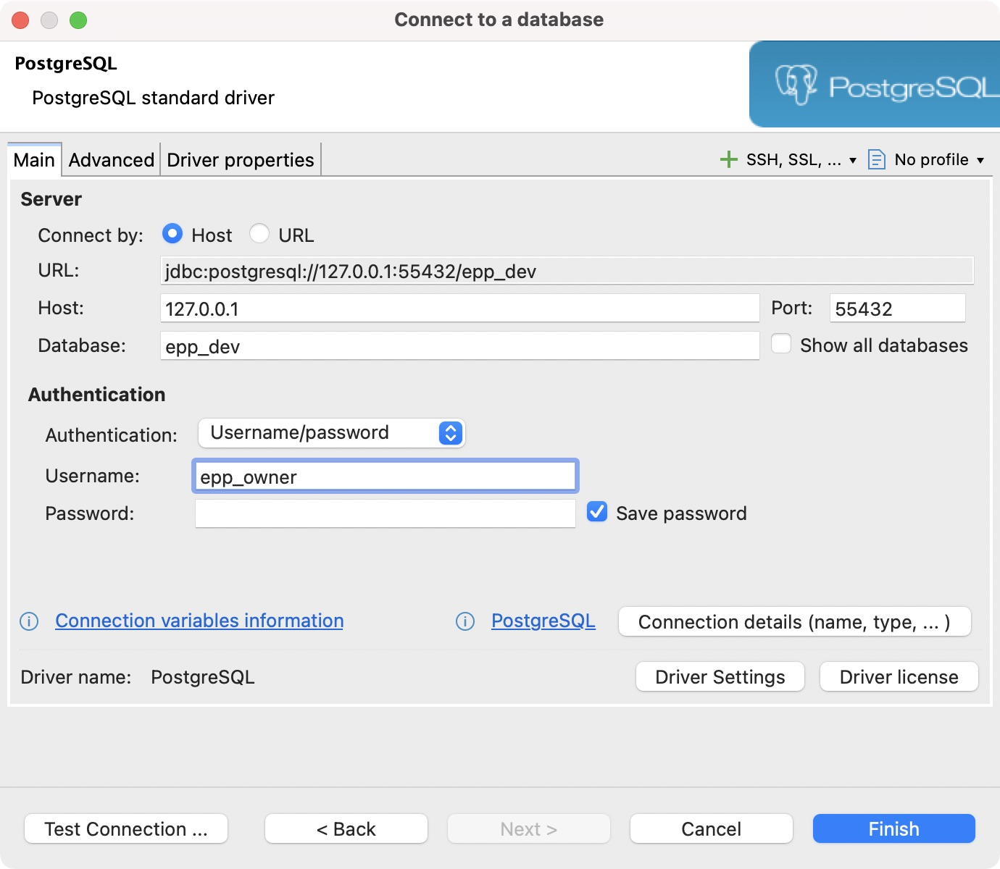

# 第 17 章 PostgreSQL 运行环境：安装、连接与实例管理

第十六章已经用两个文件写入者区分了完整保存与修改保留；文件实验到此结束，不带入数据库主线。第二篇已经为存储替换留好了 `CaptureStore` 接口，也建立了配置校验、请求日志和资源关闭流程。接入 PostgreSQL 以后，需要把这些边界落实到外部依赖：连接哪个实例、使用什么权限、什么时候确认写入完成，以及连接失败时去哪里取证。

本章先把 PostgreSQL 环境准备到可以反复开发和排错的程度：安装指定大版本，管理独立实例，建立开发角色，用 psql 与 DBeaver 核对连接，再处理启动、认证和目标库错误。下一章建表，第十九章展开 SQL，第二十章纳入 Prisma 迁移管理，第二十一章替换 Nest 存储。先掌握数据库侧的操作，接入 ORM 后才有办法独立判断问题落在哪一层。

代码起点是 `part-02/chapter-15` 的主线：原文上限仍为 2000 个 UTF-16 单元，存储仍为 Map。第 15 章收紧到 1200 单元及替换数组的练习不进入这里。本章配套分支为 `part-03/chapter-17`，新增 `database/chapter-15/` 中的环境准备和只读诊断文件，业务源码、Node 依赖与接口保持原状。

## 17.1 从现有存储契约确定接入边界

### 替换存储时，哪些行为必须保持

`CaptureStore` 已经提供异步的新增、列表和详情方法。接下来可以替换实现，但原有契约仍需保持：原文保留输入空格，详情使用原 ID，列表先筛选再限量，成功输出继续经过现有响应 Schema。数据库模型需要服务于这些行为，而不是让表结构直接决定公开响应。

有些内存实现中顺带成立的条件，需要重新作出决定。例如 Map 遍历具有插入顺序，SQL 查询若没有明确排序就不能接替这个保证；目前使用 JavaScript 字符串和 ISO 时间，数据库类型及驱动转换也必须与既有契约对齐。下一章先处理模型和类型，第十九章落实查询表达，第二十一章再核对适配层。

拿列表做个具体比较。假设先存入 `tea`，随后存入 `coffee`，在 Postman 查 `q=coffee&limit=1`，匹配的只有第二条。如果适配层先从库取第一条，再交给 JS 过滤，用户就会得到空列表。由此可以倒推出数据库查询的责任：先确定哪些行符合条件，再按约定的次序从中取最多一条。即便两个实现的返回类型完全相同，这个输入仍能把它们区分开。

新增的工程责任在失败路径上更明显。数据库不可用时，创建操作不能自动降级到 Map；写入成功后响应链路失败，也不能简单推断数据库中没有记录。第二篇已经区分过存储完成与响应完成，数据库接入会进一步要求我们以提交状态和实际查询结果判断。这里先确定这些要求，避免接入时只把三个方法改成 ORM 调用便结束。

本篇使用 PostgreSQL，主要考虑后续 API、后台工作进程和管理命令需要共同访问数据，并继续实践并发事务与结构演进。SQLite 可以降低单机应用的服务维护成本；选择独立数据库服务，则需要同时承担连接管理、账号授权和运行维护。下面的环境工作就是这次选型的一部分。

沿一次创建再往里看。配套的 Service 在接触存储之前就生成了标识和时间，把三个字段一起交给 insert。这个方法只报告完成或失败，调用者并没有等待它返回一份由存储重新编号的素材。假如换库时顺手让数据库另发一个标识，插入本身完全可能成功，创建响应也能通过格式检查，可是用户复制响应中的标识去读详情就会落空。排这种问题要把创建响应中的标识一路带到读取端去比对；看两边“各有一个格式正确的标识”少比了一步。数据库可以生成标识，但那意味着连谁生成、谁读回、谁构造响应这三个约定一起改，不能只改一个字段的默认值。

原文也有两次用途。Service 用去掉两端空白后的字符串判断有没有内容，通过后却把最初的字符串放进记录。比如一次输入是“空格、茶、空格”，校验关心中间那一个字，读详情时需要交还全部三个字符。若在入库时保存校验用的临时值，所有记录仍然非空，页面上甚至很难看出差异。接手时可以在响应的 JSON 文本里看引号与内容的间距，或在调试器里比较字符串长度。长度相等仍不足以证明内容相同，最后要逐值相等。这个例子把“被接受的输入”和“保存的值”拆开了，后面选择数据库类型时才知道哪些转换会改变事实。

再看长度的单位。一段恰好一千个 🫖 的文字，在 JavaScript 中每个这样的符号占两个 UTF-16 单元，总共两千，恰好到本章主线的上限。末尾再加一个普通汉字，界面只多显示一个字，服务却必须拒绝这次创建。数据库若按字符个数来限长，前后两段按这种算法分别只有一千和一千零一，都没有达到两千。编码为 UTF8 后占用的字节数又是另一个量。由此可见，单看数据库字段声明里有没有数字两千，回答不了是否保留接口边界。我们可以在入口继续按原单位检查，也可以另外设计库侧约束来保护其他写入路径，判断两种检查是否等价时必须用会使答案分开的输入。

列表里还有一种看似合理的改法：只要找到包含关键词的原文，就把它们按字母排好再返回。拿两条不同的素材来推，先录入“茶园”，再录入“茶具”，同查一个“茶”并只取一条。内存版本先遇到“茶园”就停止，改成按文字排序则可能先得到“茶具”。即使没有改排序，一次查询在小表中碰巧得到先录入的那条，也不能把这次扫描的顺序交付给客户端。需要先说出产品要的先后，例如按创建时刻，再回答两笔创建时刻相同时按什么分胜负。如果业务真的要求严格复原录入顺序，还需要能表示那个顺序的依据；相同毫秒里的两个随机标识只能帮助排出稳定次序，不能证明谁先写入。后面会回到这个取舍，现在先把尚待决定的条件留下。

逐项核对还会发现，配套用的是区分大小写的字面子串查找。录入“Tea”和“teapot”，查小写的“tea”，手算只应命中后者；不带查询词时，两条都可以进入候选。这与界面上常见的忽略大小写搜索都讲得通，只有现行契约能裁定本次替换要保留哪一种。在数据库配置中来回换字符集解决不了产品语义差异。要是用户日后明确想查到两条，应当更新需求、输入示例和回归期望，再选查询表达；把这个变化藏在存储升级里，排错的人就会花时间去查有没有丢行。

读详情的失败也有一个容易忽略的分界。在现行实现里，存储已经顺利查完，只是找不到指定标识，才会把缺失报告给 Service。将来如果数据库连不上，根本没有发生足以证明“查完”的操作。两种情况都可能让前端没有可展示的素材，前者可以结束查找，后者却需要保留可恢复的故障信息。若适配层把所有异常都转换成找不到，用户可能以为记录已删而重新创建；等连接恢复，原来的那条还在。后面学习判断连接是否成功，正是为了能够解释这种从页面看行为相似、从数据看后果截然不同的情况。

### 数据范围不要跟着工具选择膨胀

首批业务字段仍是 `id`、`originalText`、`createdAt`，下一章逐项确定 SQL 类型、约束及 API 表示。

还有一个以前暂时没有落地的需求：用户只能查看自己的记录。数据库版本因此需要记录归属，并建立最小用户表。不过当前接口尚无登录身份，也没有可靠的 `userId` 来源。下一章会明确建立固定开发用户，先让记录能够指向一个确实存在的用户；这不等于已经实现登录，也不能让客户端随意传一个 userId 就获得访问权。身份和授权在后续篇章接入。

现在若同时打开 Postman 与 DBeaver，两边分别在问谁？Postman 的创建请求经过 Controller、Service 到本章仍在使用的 Map；DBeaver 的 SQL 通过自己的连接直达 PostgreSQL。二者甚至没有共同的写入者。因此此时拿到一个 201，去 DBeaver 找不到素材是可以预测的。等后面的适配层真正接上线，同样的现象才值得沿请求的 ID、归属与数据库目标逐层追查。

所以这里确定的是持久化范围，而不是假装现有对象已经有全部字段。中文意图到第二十三章才增加；修订、候选、采纳也还没有进入模型。眼前先把原有记录和归属保存可靠，再观察增加字段时怎样保留旧数据。

想象明天交接时，对方发来一张 Postman 成功响应的截图和一张空表列表的截图，问该补跑哪一条初始化命令。先看分支上的模块装配，再看请求究竟经过哪个存储对象。若仍然是本章的内存实现，就算停掉学习数据库，原进程中的详情查询也有条件成功；反过来，即便数据库端能查出服务器时间，也没有任何步骤把刚创建的素材送给它。这个预判来自调用关系，毋须真的关服务试运气。如果检查的程序已经切到数据库适配层，证据的意义才变了，此时才轮到比对连接目标与记录标识。同一张空列表截图，在这两种程序下指向完全不同的下一步。

为什么还要在代码切换之前花一章建环境？将来一次新增操作至少有两段可以独立核实的路径。一段是程序把合法记录交给指定存储，一段是数据库用某个身份在指定位置接受写入。假如第一次接入时同时更换校验、改账户、换库、改表并调整响应，随便哪个差错都可能表现为“保存失败”。先取得一条能独立登录的开发连接和一套来自服务器的身份信息，之后遇到问题就可以在脱离应用的条件下问一个具体问题：同一账号对同一对象能否完成这件事？若管理工具用了另一个账号，这个对照就失去了最重要的控制条件。

固定开发用户和数据库开发账号很容易被叫成同一个“用户”。设想以后甲录入一条素材、乙录入两条，三个请求都由同一个运行中的 API 处理。服务器可以一直拿同一套数据库凭据借用连接，因此三行写入的数据库执行身份完全可能相同。要在应用里给甲返回一行、给乙返回两行，必须让行本身带有可核对的业务归属，并在处理请求时取得可信的业务身份。即使此时为两个数据库登录设置了不同密码，也不能凭空得到这层对应关系。反方向也成立，用户表里新增一行不会在 PostgreSQL 中自动生成一个可以登录的角色。

这层区分直接决定交接时要问什么。如果下一章出现一条归属错误的行，去重设数据库登录密码不会改变那条行的拥有者字段；如果本章出现角色认证失败，也没有一张业务用户表可以通过编辑资料来修好。看错误发生在第一次 SQL 之前还是查询返回之后，就能把两个含义相同的中文词拆开。做到这一步才值得动手准备实例：它要让我们用已知身份进入已知位置，下一章才能在那里讨论一行素材应当怎样代表业务事实。

## 17.2 PostgreSQL 实例如何定位和授权

### 用数据目录确定正在管理的实例

一台开发机可能同时装有多个 PostgreSQL 大版本，也可能已经运行着安装器创建的默认实例。此时 `psql --version` 只能说明当前 PATH 选中了哪个客户端，不能回答接下来操作的是哪个服务。我们需要把启动参数和连接结果对应起来。

PostgreSQL 将一个初始化数据目录管理的一组数据库称为 **database cluster**，这里的 cluster 不表示多机高可用。`initdb -D` 初始化这个目录，`pg_ctl -D` 管理它对应的服务；真正执行服务的是 postgres 程序。后面固定同一个 `-D`，再通过管理员查询 `SHOW data_directory` 核对连接目标，就能把操作系统侧的进程管理与数据库侧的诊断接上。

数据目录与大版本有关。安装另一个大版本的程序，不代表已有数据已完成升级；`PG_VERSION` 用于确认目录所属大版本。本章固定 PostgreSQL 18，不用重新 initdb 的方式处理升级或启动错误。

初始化得到的 postgres 库用于管理连接，template0、template1 用于创建数据库；业务实践另建 epp_dev。角色属于整个 cluster，同一角色可以在不同库获得不同权限；Schema 和表则属于具体数据库。因而“在另一个库里也看到了 epp_owner”是正常的，但不能由此推断两个库中的对象授权相同。相关作用范围见 [PostgreSQL 18 数据库概览](https://www.postgresql.org/docs/18/manage-ag-overview.html)。

下面把本章会用到的管理范围画在一起。外框表示同一个实例，连线区分“连接到哪里”“对象属于哪里”和“以谁的身份操作”；不是 DBeaver 的界面布局。



换数据库不会创建另一套同名角色；换 Schema 也不会把当前连接切到另一个数据库。第十八章的业务表将建在图中的 `epp_dev.public`，现在还没有这些表。

可以从两个方向读这张图。坐在终端前的人握有一个目录路径，要回答的是“我接下来要启动或停止哪一组数据”；坐在 DBeaver 前的人握有一个地址，要回答的是“我的请求会交给哪个正在监听的服务”。假设原有实例占用默认端口，新学习实例另用一个端口，两者都能以各自目录成功启动。在终端对学习目录执行状态查询得到“正在运行”，同时在图形界面连默认端口得到“测试成功”，这两项结果可以同时为真，却还没有一条证据把两端接在一起。沿图从目录走到端口，再从一条真实会话查回服务端口和目录，两条路径在同一个服务上相交才完成核对。

另一个方向是从业务现象倒推。有人看到导航树里也有一个叫 postgres 的数据库，以为这是刚建的实例，可以在里面继续做书里的工作。其实每个按默认方式初始化的目录里都可能有这个库，甚至版本、默认的 Schema 和可见的系统表都相同。两个目录轮流绑定同一个端口的情况下，连地址也可能完全一样。本章选非默认端口能减少日常误连，但端口可被以后启动的进程重用。正在运行时取得的管理侧目录和自己完成初始化的目录，是这次本地接手比一个熟悉的名字更强的依据。到了允许复制数据的部署场景，还得把机器、存储卷和恢复记录一起看。

一个数据目录可以有两个数据库，因此下一章即使在开发库里建好了第一张表，保持管理连接再去找也会找不到。这里不要照文件浏览器的习惯推理，以为向上一级就能打开旁边那个库的表。每条普通 PostgreSQL 连接在建立时选定一个数据库，之后解析对象名都在这个库中进行。管理连接能够从共享目录查出有哪些数据库，这个查询返回的是库的登记信息，和打开其中某库的业务表是两件事。图形工具可以把多个库放在一棵树上，背后访问另一库的内容仍需要相应的连接。

### 开发库所有者需要哪些权限

本章创建两个数据库角色：`epp_admin` 是初始化时的实例管理员，只在创建角色、数据库和查看管理配置时使用；`epp_owner` 是开发库的所有者，用于本地建表和演进结构。后者没有超级用户、创建数据库或创建角色权限，但它能修改自己拥有的数据库对象，仍然不是生产 API 应当直接使用的最小权限账号。

这样做把“管理整个实例”和“管理一个开发库”先分开。部署时还要区分迁移身份和运行身份：迁移身份允许必要的结构变更，API 身份只获得业务所需的数据权限。现阶段既没有表，也没有数据库版 API，不提前建立一套名字齐全、权限却没有实际对象可核对的生产账号。

这里有一个看起来矛盾的安排：开发角色没有创建数据库的权力，却拥有一个数据库。把时间顺序还原就清楚了。管理员先决定在实例内分出一个新库，并在创建时写下由谁拥有它，此后所有者在这个已有库内工作。允许在别人给你的空间里组织对象，与允许你再从实例分出一个空间，是作用对象不同的决定。若因看见开发角色不能建库就把它提升为超级用户，以后所有建表和访问对照都会被这个身份掩盖。程序换到正常受限身份后第一次报错，很可能才暴露出原先从未验证过的授权前提。

看一个不需要额外建表就能推断的例子。设管理员成功在开发库里替同事创建了一张表，忘了安排表的所有者和访问授权。开发库所有者重新登录，可以进入库，可以在允许它创建对象的命名空间里建立自己的表，但这些事实并不自动把管理员建的表变为它的表。对象拥有者通常取决于创建时的执行角色，数据库所有者、Schema 所有者、表所有者完全可以是三个不同身份。若以后遇到“能建表却读不到已有表”，先查表由谁创建、查的是哪一张、当前角色有没有读取权。拿能否连接成功当作反证，查不到这条因果链。

另一个容易忽略的区别在于“从哪里得到允许”。所有角色天然属于 PUBLIC；对它的授权是一条公共来源。一个角色同时还可以通过直接授权、角色成员关系和所有权得到能力。从公共来源撤掉一项权利，只是去掉这条路径，不能推断每个有名字的角色现在都失去了这项能力。等会儿撤回公共数据库权限以后，开发所有者照样能够连接，这恰好是预期结果。反过来说，看见自己能连接也不能证明撤回没有执行。要验证收紧的究竟是哪一层，应该看目标数据库的授权记录，再用代表实际调用者的身份判断有效权限，两个问题各有自己的证据。

### 连接参数中的默认行为会怎样影响排错

本章显式固定 host、port、user 和 dbname，避免客户端默认参数把请求送到另一个实例。以不含密码的 URI 为例：

```text
postgresql://epp_owner@127.0.0.1:55432/epp_dev?connect_timeout=5
```

密码由客户端单独提示，或来自经过保护的秘密配置。不要把真实密码放进终端命令、截图、SQL 文件或仓库。带密码的 URI 还会遇到 `@`、`:`、`/` 等保留字符，必须对密码这一组成部分做百分号编码，不能编码整个 URL。本章用交互密码，先避免让连接串解析掩盖身份问题。

`connect_timeout=5` 约束建立连接的等待，不是每条 SQL 的执行期限，也不保证取消服务器已经开始的工作。后续驱动的连接池参数也不一定与 psql 的参数相同，不能把任意客户端设置原样塞进另一个库。参数与 URI 格式见 [libpq 连接文档](https://www.postgresql.org/docs/18/libpq-connect.html)。

这里始终显式写 `127.0.0.1` 和 `55432`。省略 host 时，macOS/Linux 的 psql 通常尝试 Unix-domain socket，可能走不同的认证规则；省略库名时，客户端还可能使用与角色同名的数据库。`psql` 能进入某个提示符，不足以证明它进入了本章的目标库。我们稍后会让服务器自己返回这些信息。

把这一组参数拆开填，是为了让一次失败保留足够的信息。端口是服务进程接受连接的入口，库名和角色名则在联系上服务端以后才由它处理。假设把库名留空的客户端决定以角色名当库名，密码输入正确也可能得到“名为 epp_owner 的数据库不存在”。错误里那个看似熟悉的词是被当作库名使用，不能据此得出角色没有建成。反过来，如果完整消息说的是请求中的角色不能登录，去建一个同名库也无助于身份验证。读错误时先找出它正在谈哪个对象，再去比配置中与那个对象对应的一格。

同样一行回环地址也依赖观察位置。在本机终端中，它把流量送回当前系统看到的本机网络。在虚拟机里运行的服务如果没有转发入口，从宿主机填回环地址访问的是宿主机自己的入口。后面的 Windows 与 WSL 组合之所以需要专门核对，就是因为操作系统可能替你完成转发，使两边的写法看起来一样。今后把 API 放进容器时，照抄一个在宿主机 DBeaver 中成功的地址也可能再次遇到这个问题。现在先记下是谁在发起连接、服务实际在哪一侧监听；一张只写着地址与端口、看不出是哪一侧客户端的截图很难供下一位开发者判断。

### Schema 搜索路径不是连接目标

SQL 中只写 `captures` 时，PostgreSQL 会按 `search_path` 找表；明确写 `public.captures` 则把命名空间也写出来。默认常能看到 `"$user", public`，意思是尝试与当前角色同名的 Schema，再找 public；不存在或无权使用的项不会成为可用的搜索目标。`$user` 不会替你自动创建 Schema。

为什么同一段建表 SQL 换个登录角色，表就可能出现在别处？在这份默认路径下，如果以后建立了名为 epp_owner 的 Schema，并允许同名角色使用，未限定表名的查找就会先访问它；在该角色有创建权限时，未限定名称的新表也会建在那里。已有的 public 表没有移动。`SHOW search_path` 看到的仍可能是原来那行设置，变的是其中哪些名字现在能解析。需要固定对象时写出 Schema，比从连接标签推测可靠。

因此，连接 epp_dev 与选择 public 是两个不同动作。DBeaver 里展开了 public，也不能仅凭视觉推断另一个 SQL 编辑器采用了相同的连接上下文。第十八章的建表会显式说明命名空间；现在先知道用 `SHOW search_path` 和 `current_schema()` 查看实际解析环境。把不可信角色可写的 Schema 放在搜索路径上也会带来对象替换风险，这不是一个纯粹的界面偏好，详见 [Schema 与搜索路径](https://www.postgresql.org/docs/18/ddl-schemas.html)。

试着在纸上走一次查找过程。设想同一个开发库里有两个命名空间，第一个是开发角色同名空间，第二个是共享空间，两边都允许该角色查找对象。若只有共享空间中有素材表，查找经过第一处没遇到该表，会继续往后，最终读到共享空间的表。此时查询当前首个有效空间却可能得到角色同名空间。两个结果并不冲突，首个有效空间用于判断默认创建位置，找已有对象则可以一直向后找。若第一处后来也建立同名表，同一句查询便改为读第一处，第二处原有行数一行都没有减少。此时出现“数据突然空了”，要比较两个限定名称指向的实际对象，重新导入数据反而可能把行写进错误的表。

再改一个条件，如果首个可用空间允许查找却没有创建权，未限定名的建表会因缺权限失败。数据库不会好心替你继续向后找一处能写的空间。这一点不能用前面查表的过程类推，因为查表给的是一个已有名字，需要寻找它所指的对象；建表给的是一个新名字，需要先决定把它登记在哪里。如果自动退到另一处，作者和读者可能都以为在操作第一处，实际却分别对着两个空间。交接建表脚本时把预期位置写清，并在运行前问出当前身份在那里有什么权限，比笼统地说“能连接就能跑”准确得多。

真正操作时可以先把待验证的结果写成一句话：用开发角色连入新建开发库，默认路径中的同名空间尚不存在，所以有效首项应为 public。若随后只换库，哪怕角色没换，得重新核对同名空间是否存在；如果只换角色，库没换，路径中角色占位符的含义也会跟着改变。下节先在空库得到这个最简单的结果，等有了连接再用当前会话中的只读查询区分设置文字、可用名字和对象权限。

## 17.3 安装、启动，再从两个客户端连接同一个库

### 先统一运行方式，避免装出两个相互混淆的实例

本篇采用 PostgreSQL **18.x**，安装当前维护的小版本；服务端和 psql 客户端都使用 18。下面分别给出 macOS 和 Ubuntu／WSL Ubuntu 的安装入口，后续初始化与运行命令相同。Windows 延续前文的 WSL 路线，数据库和 psql 都在同一个 WSL 发行版中；不另起 Windows 原生 PostgreSQL 来混用。

我们只用包管理器安装程序，另建一个由当前普通操作系统账号拥有的学习实例，通过 `pg_ctl` 显式启停，端口使用 55432。PostgreSQL 常见默认端口是 5432；这里选择另一个端口，是为了与机器上可能已有的默认实例分开。端口没有特殊语义，后续所有客户端必须保持一致。

直接使用安装器的默认服务也可以，但不同安装方式的管理员身份、数据目录、端口和自动启动行为不同。独立实例让这些条件都在读者眼前建立。部署篇再讨论系统服务和开机恢复；这里使用官方工具，不为数据库另外造一套后台管理脚本。

**macOS** 在已有 Homebrew 的终端执行：

```bash
brew install postgresql@18
export PATH="$(brew --prefix postgresql@18)/bin:$PATH"
postgres --version
psql --version
```

尚未安装 Homebrew 时，先按 [Homebrew 官方入口](https://brew.sh/)完成安装并重新打开终端。这里的 PATH 在当前终端生效；新终端先重复 export，熟悉后再将同一行加入自己的 shell 配置。不要为找不到 psql 而随意链接另一个大版本。

Homebrew 的 formula 可能已经创建默认数据目录；本章不启动它，也不执行 `brew services start postgresql@18`。后续只管理自己创建的目录。若已经运行其他实例，保留它，不停止或删除不属于本次实践的服务。[formula 官方说明](https://formulae.brew.sh/formula/postgresql@18)列出其默认目录和服务命令，可以据此分清两者。

**Ubuntu／WSL Ubuntu** 先确认终端所在的系统。Windows 用户先在 PowerShell 执行 `wsl --list --verbose`，找到前文放置项目的发行版，再用 `wsl --distribution "实际发行版名"` 进入它；引号内替换为列表中的完整名称。不要把数据库装到另一个同样叫 Ubuntu 的环境里，详见 [WSL 基本命令](https://learn.microsoft.com/en-us/windows/wsl/basic-commands)。以下命令在 Ubuntu 终端执行：

```bash
cat /etc/os-release
dpkg --print-architecture
```

用输出中的 `ID`、`VERSION_CODENAME` 和架构，对照[官方 Ubuntu 下载页](https://www.postgresql.org/download/linux/ubuntu/)的支持列表。确认是受支持的 Ubuntu 版本与架构后，再执行安装。没有 sudo 权限或不在支持列表时，先选择适用安装方法，不把另一个发行版的代号硬填进去。

```bash
sudo apt update
sudo apt install -y postgresql-common
sudo /usr/share/postgresql-common/pgdg/apt.postgresql.org.sh
sudo apt update
sudo apt install -y postgresql-18
export PATH="/usr/lib/postgresql/18/bin:$PATH"
postgres --version
psql --version
```

第三行运行已安装包提供的官方仓库配置工具，按提示完成；后续再安装指定大版本。包安装可能同时创建或启动系统默认实例，那通常由 postgres 系统账号管理，和接下来由你自己创建的实例不同。后续的 `initdb`、`pg_ctl` 不加 sudo，也不去接管系统默认目录。

两条路径都必须看到 18.x。若版本不对，在同一终端运行 `command -v postgres`、`command -v psql`，检查实际命中的程序是否来自刚加入 PATH 的目录，再修正 PATH。`psql --version` 只说明客户端程序版本，连接后还要查服务器版本。安装成功、服务启动、账号登录和 SQL 执行是四个不同的事实，每一步都有自己的证据。

新开两个终端会让这里的问题特别直观。在第一个终端调整路径，后续启动命令从这个 shell 继承环境，能找到刚装的工具；从桌面另开的第二个终端通常从自己的启动配置建立环境。若第二个窗口仍命中旧客户端，回到第一个窗口的服务器并没有因此降级。类似地，DBeaver 使用自己的驱动建立连接，它不需要从这个终端启动 psql 来替它执行每一句查询。于是“图形客户端能执行查询，终端却找不到 psql”完全说得通，先解决的是终端的程序定位。把数据库重新安装一遍，可能只会让机器上又多出一条可搜索的程序路径。

选择实例的管理方式还会影响第二天如何恢复。包管理器负责让机器上有可执行文件，服务管理工具还可能负责在机器启动时重新拉起某个目录对应的进程。如果两个人一个按包名启动默认服务，一个按目录启动学习服务，他们未必在管理同一个进程；如果两种方式指向同一入口，还可能相互争用地址。先记下当前学习目录由普通账号用哪一个工具启动，后面再看桌面上“服务正在运行”的指示，就知道还要追问它指的是哪个目录。对已经在开发机上使用别的数据库的读者，这个选择尤其重要：另开实例的价值在于能够独立配置和停机，不能为了让学习实例启动成功去停别的项目。

安装完成的判断也有一条最短路径。若程序都找得到，两个版本输出都符合要求，而此时 DBeaver 的测试仍报入口拒绝连接，先对照进度：我们还没有启动监听进程，这恰好是正常的中间状态。能读到版本信息只要求操作系统能加载程序并让它打印文字，不需要有数据目录，更不需要有开发角色。沿这条因果关系继续到初始化，比把连接错误交回安装器处理少走一圈。

### 初始化一次，以后反复启动

在普通用户的 shell 中设置数据目录变量：

```bash
export EPP_PGDATA="$HOME/.local/share/epp-book/postgresql-18"
mkdir -p "$HOME/.local/share/epp-book"
```

这是读者自己机器上的持久化目录，不在代码仓库、dist、临时目录或云盘同步目录中。构建清理不应碰到它，切换章节也不应让它消失。WSL 中保存在 Linux 用户目录内，不放到 `/mnt/c` 下。后面的 `$EPP_PGDATA` 均指这个目录；重开终端要重新执行 export。

首次运行下面这段。它在目标路径已经存在时停止初始化，避免把“重新开始”误解成清空数据：

```bash
if [ -e "$EPP_PGDATA" ]; then
  printf '%s\n' '目标目录已经存在；先确认其来源和 PG_VERSION，不重复初始化。'
else
  initdb -D "$EPP_PGDATA" \
    --username=epp_admin --pwprompt \
    --encoding=UTF8 --locale=C \
    --auth-local=scram-sha-256 --auth-host=scram-sha-256
fi
```

出现提示时，为 epp_admin 设置独立的开发管理密码，保存在密码管理工具里。`--username` 命名的是数据库管理员，不会创建同名操作系统账号；数据目录仍归运行命令的系统账号所有。`--pwprompt` 让密码交互输入；两项 auth 明确让 socket 和 TCP 连接使用 SCRAM 密码认证，不依赖安装器可能采用的 trust 默认值。

`UTF8` 决定文字编码，可以保存中文和英语。`C` 是这里明确选择的排序／字符分类区域设置，不是“只支持英文”；它也不保证中文按拼音、人名按自然语言习惯排序。后面设计查询时会把排序字段和顺序明确写出，需要自然语言排序时再选择相应 collation。初始化选项见 [initdb 文档](https://www.postgresql.org/docs/18/app-initdb.html)。

初始化成功以后检查：

```bash
cat "$EPP_PGDATA/PG_VERSION"
```

应是 `18`。若前面提示目录已存在，只有确认它确实是自己的本书实例、版本正确，才继续。若是失败留下的不完整目录，先查看初始化错误和目录内容，改用新的空目录重新尝试；不要用 `rm -rf` 把来源不明的目录变成“可初始化”。

在该目录的 `postgresql.conf` **末尾添加一次**下面的设置；以后需要修改时编辑这几项，不反复追加重复配置：

```conf
listen_addresses = '127.0.0.1'
port = 55432
unix_socket_directories = ''
password_encryption = 'scram-sha-256'
timezone = 'UTC'
```

本例只接受本机 IPv4 TCP 连接，不开放网络地址，也暂时禁用 socket，保证两种客户端走同一条路径。SCRAM 用于密码认证；它不等于连接中的 SQL 和结果已经启用 TLS。这里使用同机回环连接，远程部署要另外建立可信网络、证书验证和最小权限，不能把地址改成 `0.0.0.0` 就宣布可用于公网。

`timezone` 固定服务器会话的默认显示时区为 UTC，便于跨客户端比较。它与时间字段本身的类型不同；下一章会解释时间点、时区显示与 JSON。上述连接配置的生效方式见[服务器连接配置](https://www.postgresql.org/docs/18/runtime-config-connection.html)，监听地址、端口和 socket 目录的变化需要重启。

现在启动：

```bash
pg_ctl -D "$EPP_PGDATA" -l "$EPP_PGDATA/server.log" -w start
pg_ctl -D "$EPP_PGDATA" status
pg_isready -h 127.0.0.1 -p 55432 -t 5
```

`-D` 指定管理哪个实例，`-l` 把服务端启动和错误信息写入指定日志，`-w` 等待启动结果。服务退出启动命令后继续运行；关闭 psql 也不会让它停止。这里没有注册自动启动服务，机器重启后要再次执行 start，而不是再次 initdb。

status 应显示服务正在运行，pg_isready 应显示 accepting connections。后者只证明入口正在接收连接，不证明 epp_owner 已存在、密码正确或表能查询。`pg_isready` 的退出码也可以区分接受、拒绝、无响应和参数问题，见[官方说明](https://www.postgresql.org/docs/18/app-pg-isready.html)。

若启动失败，先执行 `tail -n 50 "$EPP_PGDATA/server.log"`。`address already in use` 表示地址或端口冲突，macOS 可用 `lsof -nP -iTCP:55432 -sTCP:LISTEN`，Linux 可用 `ss -ltnp 'sport = :55432'` 核对监听者。不要杀掉所有 postgres 进程；如确需换端口，修改本实例配置并同步后面所有连接。日志可能带有路径和数据库错误上下文，分享前只保留必要且已清理的信息。

读启动日志时，把这次尝试的时间与行文的先后放在一起看。日志文件会保留前几次使用同一路径启动时写下的内容，所以搜索到一句“可以接受连接”只能证明某一次到过这个阶段。设想上午启动成功、午后正常停止、傍晚因端口已被占用启动失败，三个事件在同一个文件里都可以找到。应当从这次启动前后的时间开始，读第一条能解释失败的具体信息，再往后看服务有没有成功进入就绪状态。末尾一句“数据库系统已关闭”描述的是结果，前面的监听失败才说明怎么走到了那里。若连日志文件都无法创建，错误可能只来得及出现在运行命令的终端，因此还要保留终端最后几行的上下文。

状态查询和入口探测可以组成一个有分辨力的对照。假定对学习目录查询状态显示未运行，对预定端口的探测却显示接受连接。按本章直接在本机操作的条件，两句结果无法共同证明学习实例启动了，倒是与“入口被别的实例占用”相符。此刻最有价值的是查监听进程和自己的启动日志；尝试拿管理密码登录一个尚未辨明的入口，并不能确定它归谁。换个方向，若目录状态显示运行，对预定回环端口却没有响应，可能是运行中的进程采用了别的端口或监听方式。先比启动日志里实际宣布的监听地址和端口，别因为看到目录里有配置文件就断定正在运行的进程一定采用了你眼前的内容。

配置文件和运行状态之间还隔着一次读取。编辑器保存了新的端口值，已经运行的服务器仍然持有旧的监听套接字；仅在客户端点刷新不会让服务器重新绑定。以后若接手的是已启动的学习实例，可以在已经确认目标的 ADMIN 编辑器里只读查看设置来源。等本节的管理连接建立后再用下面的查询，初次启动无需为观察它而改端口。

```sql
SELECT name, setting, context, source, sourcefile, sourceline, pending_restart
FROM pg_settings
WHERE name IN ('port', 'listen_addresses')
ORDER BY name;
```

先读 name 和 setting，确认这两行各在说哪个实际值。再看 context，值为 postmaster 的项目要在服务启动时确定；这解释了为什么仅重连客户端无效。若来源是配置文件，管理员看到的文件和行号能把排查缩小到具体位置。如果设置来自启动参数，回去改某个同名文件就未必能改变它。最后看是否已有等待重启的变化：服务器重新读取过配置并发现这类差异后，这一列才提供相应线索。刚在磁盘上编辑、服务端尚未重新读过时，它没有义务预告未来。因而一个 false 不能用来证明打开的文件与进程当前值逐字相符。[PostgreSQL 18 运行设置视图](https://www.postgresql.org/docs/18/view-pg-settings.html)

这也说明为什么本章要把数据目录、启动命令和服务端诊断留在同一段交接里。参数值解决“当前如何运行”，来源解决“下回从哪里改”，生效时机解决“什么时候能观察到变化”。三件事混在一起，就会发生改完文件反复测试旧连接、以为编辑器没有保存的情况。现在建立管理连接的目的之一，正是补上只能从服务器内部回答的那半份证据。

### 从管理员连接建立开发角色和数据库

从配套代码仓库根目录执行以下 shell 命令。它明确连接 postgres 管理库，密码提示中输入的是 epp_admin 的密码：

```bash
psql -X -W -v ON_ERROR_STOP=1 \
  'host=127.0.0.1 port=55432 dbname=postgres user=epp_admin connect_timeout=5'
```

`-X` 不读取个人 psql 启动配置，减少自动切库或事务设置的干扰。`-W` 要求密码提示，但是否校验密码仍由服务器认证规则决定；不能靠看见提示框判断认证安全。`ON_ERROR_STOP` 让后面执行的脚本遇错停止，避免前一步失败后继续做下一步，但不会把已经提交的操作撤销。

进入 psql 后，下面这些是 **psql 内的输入，不是 shell 命令**：

```psql
\conninfo
SELECT current_database(), current_user, inet_server_addr(), inet_server_port();
SHOW server_version;
SHOW data_directory;
SHOW hba_file;
```

数据库应是 postgres，角色是 epp_admin，端口是 55432，数据目录应对应刚刚初始化的位置。路径由管理员查看即可，不写进应用日志。若这里已经不符合预期，先退出并修正连接，不能在不明实例上继续建角色。

在 `database/chapter-15/01-create-role.psql` 保存以下内容：

```psql
\set ON_ERROR_STOP on

CREATE ROLE epp_owner
  LOGIN
  NOSUPERUSER
  NOCREATEDB
  NOCREATEROLE
  NOREPLICATION;

\password epp_owner
```

`LOGIN` 允许角色登录，后面明确移除实例级管理能力。最后一行是 psql 的交互密码命令，不是 SQL；它避免把明文密码写进 SQL 历史与脚本。这个密码属于 epp_owner，应与管理密码区分。角色定义见 [CREATE ROLE](https://www.postgresql.org/docs/18/sql-createrole.html)。

再保存 `database/chapter-15/02-create-database.sql`：

```sql
CREATE DATABASE epp_dev OWNER epp_owner;
REVOKE ALL ON DATABASE epp_dev FROM PUBLIC;
```

第一句建立数据库并指定所有者。第二句收回所有角色默认通过 PUBLIC 获得的数据库级权限；这里大写 PUBLIC 是“所有角色”的权限集合，不是小写 public Schema。所有者仍能管理自己的库。它不替代 Schema 和表权限设置，也不限制超级用户；这里只让当前开发库的初始授权范围明确。

按顺序在刚才的 psql 会话执行：

```psql
\i database/chapter-15/01-create-role.psql
\i database/chapter-15/02-create-database.sql
\du epp_owner
\l epp_dev
\q
```

`\i` 从 psql 的当前工作目录读取文件；找不到文件时先检查自己从哪里启动客户端，不需要修改数据库。`\du` 查看角色，`\l` 查看数据库，`\q` 只退出客户端。第一份文件的反斜杠命令不能交给 DBeaver 普通 SQL 编辑器。

这里保持 psql 默认自动提交，不在外面套 `BEGIN`，也不使用 `psql --single-transaction`；`CREATE DATABASE` 不允许在事务块中执行。角色、库和授权是依次完成的独立动作，参见 [CREATE DATABASE](https://www.postgresql.org/docs/18/sql-createdatabase.html)。

如果第二步失败，第一步的角色可能已经存在。重新登录管理员，先用 `\du epp_owner`、`\l epp_dev` 查看实际状态：角色存在但密码设置中断，就只重做 `\password epp_owner`；库不存在就只执行建库；库已存在则核对所有者，再补失败的授权语句。不要为了消除 already exists 而删库，也不要把这些文件加入每次 `npm run dev` 的启动流程。

接手一个做到一半的环境时，不妨从最后一条已经确定成功的动作来推演。角色创建语句成功后，角色名和登录属性就能被另一个管理员会话查到；随后的交互设置密码是另一次动作。如果终端恰好在两者之间关闭，第二天看到“角色已经存在”完全符合预期，却不能说明昨天输入的密码曾经生效。这里能够安全缩小范围的方法，是在正确实例上确认角色及其用途，再由管理员交互设置该开发角色的凭据，随后用新连接验证。已有管理员会话一直能执行查询，对新开发角色能否登录没有证明力。

建库这一步还有一种不容易察觉的中间状态。若只看名称，建库成功但公共权限尚未收回，与两句都成功的情况在导航树中一模一样。我们可以先问“谁拥有这个库”，再问“它登记了哪些数据库级授权”。在管理连接里执行下句，只会返回这个名字对应的目录项，便于在尚不能用开发角色进入时检查。

```sql
SELECT datname, pg_get_userbyid(datdba) AS owner_name, datacl
FROM pg_database
WHERE datname = 'epp_dev';
```

零行表示当前实例没有这个库名；一行而拥有者不同，应该暂停，先确认这个同名库的来历，不能直接把它改成本章练习库。在刚按默认规则创建的库上，权限列可能显示空值，那表示按对象类型的默认授权解释，并非所有人都没有权限。显式撤回后通常能看到只列出所有者的权限项。阅读一个形如“名字等于若干字母斜杠名字”的项目时，等号左侧是获得授权的角色，斜杠右侧是授予者；等号左侧留空才代表面向所有角色的公共授权。单看数组有几个元素、字符串里出现几次开发角色名，很容易把授予者也数成一个额外登录。这里只需辨认本库、所有者和公共授权这三处，Schema 上的授权由后面的查询单独判断。

为什么不把角色、建库和撤权写成每次启动都尝试的一键修复？设想脚本运行到建库处碰到同名对象，它不知道这是昨天自己已经成功创建的半成品，还是同事用来保存别的数据的环境。忽略重复错误然后继续执行后面的撤权，在两种场景下会得到完全不同的影响。能自动补跑的前提是先证明目标的归属和现有状态满足操作条件。这个小项目中由人读一行目录结果、只补缺失步骤，反而比给脚本加上“错误一律继续”更容易交接。

### 换成开发角色，让服务器证明连接目标

重新从 shell 连接，这次输入 epp_owner 的密码：

```bash
psql -X -W -v ON_ERROR_STOP=1 \
  'host=127.0.0.1 port=55432 dbname=epp_dev user=epp_owner connect_timeout=5'
```

不要只依赖提示符里的 epp_dev。把以下只读查询保存为 `database/chapter-15/03-inspect.sql`：

```sql
SELECT
  current_database() AS database_name,
  session_user AS login_role,
  current_user AS effective_role,
  inet_server_addr() AS server_address,
  inet_server_port() AS server_port,
  pg_backend_pid() AS connection_pid,
  current_schema() AS first_schema;

SHOW server_version;
SHOW server_encoding;
SHOW TimeZone;
SHOW search_path;

SELECT
  datname AS database_name,
  pg_get_userbyid(datdba) AS database_owner,
  shobj_description(oid, 'pg_database') AS environment_note
FROM pg_database
WHERE datname = current_database();
```

先在 psql 内执行 `\i database/chapter-15/03-inspect.sql`。第一段读取会话身份和服务端连接信息，SHOW 查看实际生效的设置，最后从系统目录 pg_database 查询当前库的所有者和备注。以后排查应用与客户端结果不一致，可以复用这份查询逐项比较。系统信息函数见[官方说明](https://www.postgresql.org/docs/18/functions-info.html)。

预期 database_name 为 epp_dev，两个角色字段都是 epp_owner，地址与端口为 127.0.0.1 和 55432，first_schema 为 public。server_version 应为 18.x，server_encoding 应为 UTF8，TimeZone 应为 UTC。environment_note 目前可以是 NULL，表示还没写备注。

session_user 表示最初登录角色，current_user 表示当前执行权限的角色；没有切换角色时两者相同。connection_pid 是服务器为这条连接工作的进程编号；两条连接即使账号相同，通常也有不同的编号。它不是 Node 的 PID，不能拿去结束 API 进程。

最后在 psql 执行 `\dt public.*`，核对当前 public 下的表；本章应为空，第十八章再建立业务表。

这里可以先停下：实例、角色和开发库已经建立，03-inspect.sql 可以证明当前连接。保存 SQL 文件，并在自己的开发笔记中记下数据目录、端口和做到的小节，密码仍留在密码管理工具里。下次从本章末尾的[日常恢复入口](#隔天继续开发时从哪里接上)返回，再继续下面的 DBeaver 对照；不用重跑创建角色和建库文件。

第一次读检查脚本，可以把结果分成两个画面。前面几行是在问“此刻替我执行的会话有什么特征”，即使还没建任何业务对象也能回答。最后那条有 FROM 和 WHERE 的语句则是在读系统自己维护的库登记表：每行代表一个数据库，先用当前库名筛出自己所在的那行，再把拥有者的内部编号翻译成人能认的角色名，最后按这个库的对象编号取备注。名字、所有者和说明之所以放在同一行，就是为了让备注的归属一眼可见。换个库再运行，筛选条件会跟着连接改变，并不会因为脚本文件还叫原名就一直取开发库的说明。

这里尤其要分清“有一行，其中某格为空”和“查询一行都没返回”。第一次连接开发库时，名称和所有者都有值，备注那一格可能为空，因此这次查到了对应目录项，只是该库还没有登记备注。若手动把筛选换成一个不存在的库名，就连库名和所有者这一行也不会出现。两种状态在页面上都可能被渲染成一块空白，在结果网格里却有明确区别。下一节我们只改变备注，再用同一条查询比较，预期变化局限在同一行的一个字段。将来调列表返回空数组与详情字段为空，也需要保持这种先问“有无行”再看“行中有什么”的读法。

有些诊断值不应当被写进长期比对条件。比如连接进程的编号只在连接存在的那段时间标识这个服务端进程。保存一份包含编号的成功结果，过两天用下一次连接机械逐字比较，反而会把完全正常的会话更替判为环境变化。相反，如果数据库名一样、拥有者却不同，就值得继续查，因为这已经改变了接下来能否组织对象的依据。比较之前先决定哪些值应当随连接更换、哪些值应当跨连接保持，才能真正用这份输出接手开发。

### 用 DBeaver 做相同的事情

从 [DBeaver Community 官方下载页](https://dbeaver.io/download/)安装免费社区版。首次连接 PostgreSQL 时可能需要下载 JDBC 驱动；下载失败是客户端依赖获取问题，并不说明服务器密码错误。驱动下载完成后，才开始比较实际数据库连接结果。

1. 选择 **Database → New Database Connection**，搜索并选择 PostgreSQL。
2. 使用 Host 连接方式，Host 填 `127.0.0.1`、Port 填 `55432`、Database 填 `epp_dev`、Username 填 `epp_owner`。密码填这个角色的密码，不填 epp_admin 的密码。保持直接连接，不启用 SSH 隧道；本章实例没有配置 TLS，SSL 设置不要强制要求 TLS。
3. 点击 **Test Connection**。成功后将连接命名为 `EPP · DEV · 55432 · epp_dev`，保存。密码若选择保存，应只在自己的受保护客户端配置中保存，不导出到项目资料。
4. 在左侧 Database Navigator 对这个连接打开 **SQL Editor → New SQL Script**。确认编辑器工具栏所选的数据源就是刚才的连接；打开旧脚本文件并不保证自动关联正确的数据源。
5. 粘贴 03-inspect.sql，先选中第一条 SELECT，通过 **Execute SQL Statement** 执行，查看下方结果表。然后逐条运行 SHOW 和最后的查询；也可以用 **Execute SQL Script** 执行整份只读文件并查看各个结果页。



图中核对的是 Host、Port、Database 和 Username 四项；密码栏留空用于展示，实际连接时输入自己的角色密码。Save password 是客户端保存选项，不是连接必需条件。连接向导和 SQL 执行入口分别见 [DBeaver 连接文档](https://dbeaver.com/docs/dbeaver/Create-Connection/)与[SQL 执行文档](https://dbeaver.com/docs/dbeaver/SQL-Execution/)。菜单译名或快捷键会随平台变化，26.2.3 的单条执行菜单称 **Execute SQL query**；按动作含义找，别把“执行光标所在语句”误当成“执行整个脚本”。

对照 psql 的结果：库、角色、地址、端口和所有者应一致；connection_pid 不要求相同，因为这是两个独立会话。展开 `Schemas → public → Tables`，此时仍没有业务表。导航树缓存了对象信息，后面建表后用 Refresh 刷新；结果表也不会因为另一个客户端写了数据就自动重新查询。

如果两边的 `first_schema` 看起来相同，却拿不准 DEV 身份能否在里面建表，可以在 DEV 编辑器选中并执行下面这一句。它只询问当前身份的有效权限，不创建测试表。

```sql
SELECT current_schema() AS first_schema,
       has_schema_privilege(current_user, 'public', 'USAGE') AS can_resolve,
       has_schema_privilege(current_user, 'public', 'CREATE') AS can_create;
```

在按本章初始化的 PostgreSQL 18 开发库，两项应均为 true。USAGE 允许在这个命名空间中查找对象，CREATE 允许往里建立对象；读取已有表里的数据还要有该表的 SELECT 权限。新建库的 public Schema 默认归 `pg_database_owner` 所有，当前数据库的所有者隐式属于这个角色。这就解释了 epp_owner 为什么无需成为实例超级用户，也能在自己的开发库里建表。若实际结果不同，先对照 03-inspect.sql 的库所有者和当前角色，再看 Schema 的所有者与授权。

再按相同步骤保存一个管理连接：Host、Port 不变，Database 为 `postgres`，Username 为 `epp_admin`，命名为 `EPP · ADMIN · 55432 · postgres`，输入独立的管理密码。在它的 SQL 编辑器运行 `SELECT current_database(), current_user, inet_server_port();`，应得到 postgres、epp_admin、55432。这个连接供认证规则检查和后续创建校验库使用；日常业务 SQL 仍选择 DEV。连接显示名称是客户端标签，真正的身份以查询结果为准。

在 DEV 的 SQL 编辑器事务模式菜单中确认当前为 **Auto-commit**，并关闭 **Smart commit**，防止修改语句前自动切到手动提交。先结束此前未完成的事务，再切换模式，不把切换按钮当作撤销操作。保存 SQL 文件只是保存文字；下一节直接在此编辑器写入备注，再重新查询观察。第十九章会展开两个会话的提交可见性。模式入口可参照 [DBeaver 事务模式](https://dbeaver.com/docs/dbeaver/Auto-and-Manual-Commit-Modes/)。

**Windows 上的 DBeaver 连不上 WSL 时**，先在安装数据库的那个 WSL 发行版中，用上面的完整参数新建 psql 连接并执行诊断。成功只能证明 WSL 内部的连接成立，还要区分 Windows 到 WSL 的 TCP 路径与 DBeaver 的驱动、认证设置。在 **Windows PowerShell** 执行：

```powershell
wsl --list --verbose
Test-NetConnection -ComputerName 127.0.0.1 -Port 55432
```

第一条确认目标发行版正在运行及其 WSL 版本；第二条看 `TcpTestSucceeded`，不要用 Ping 的结果判断数据库端口。若为 True，Windows 已能建立 TCP 连接，继续看 DBeaver 的完整错误，并核对驱动下载、库、账号和 SSL 设置；成功登录后仍须执行 03-inspect.sql，排除端口实际指向另一个服务。若为 False，先处理跨环境路径，改数据库密码没有作用。命令输出含义见 [Test-NetConnection](https://learn.microsoft.com/en-us/powershell/module/nettcpip/test-netconnection)。

对于 WSL 2，在 Windows 用户目录的 `.wslconfig` 中查看 `[wsl2]` 下的 `networkingMode` 与 `localhostForwarding`；文件不存在时使用默认配置。默认 NAT 模式的 localhost 转发默认开启，若此前明确设置了 `localhostForwarding=false`，将该项恢复为 `true`，保留其他设置。镜像模式忽略这一项，不靠反复修改它排错。修改 WSL 配置需要重启 WSL 才能应用：先保存各发行版工作、按本章 17.4 正常停止数据库，再在 PowerShell 执行 `wsl --shutdown`；它会停止所有运行中的发行版。重新打开目标发行版，按日常恢复入口启动数据库，再重复上面的探测。

配置正确仍失败时，沿 [WSL 网络说明](https://learn.microsoft.com/en-us/windows/wsl/networking)与[配置说明](https://learn.microsoft.com/en-us/windows/wsl/wsl-config)核对当前模式及 VPN／防火墙限制。保留“WSL 内 psql 成功、Windows TCP 探测失败”的对照作为定位依据，不通过关闭全部防火墙或放开数据库监听来试运气。此时可以先用 psql 继续 SQL 操作，图形客户端的连接问题仍需沿这条路径解决。

把 DEV 编辑器当成一次观察的起点，亲手区分“配置上允许的搜索顺序”和“现在真正可用的搜索顺序”。在刚建好的开发库执行下面这一条只读语句。它没有读取业务表，因此不会以“有没有数据”干扰对名字解析的判断。

```sql
SELECT current_setting('search_path') AS configured,
       current_schemas(false) AS usable,
       current_schemas(true) AS including_implicit;
```

第一格保留配置表达式，双引号内带美元符号的名字仍可能出现在文本里。第二格按当前角色和库展开路径，只列存在且可用的显式项。在本章刚建好的库、角色没有同名空间的前提下，预计这里仅见 public。第三格还纳入隐式搜索的命名空间，可以看到存放系统对象的 pg_catalog；这也是平时直接写 pg_database 就能找到系统登记表的原因。后续如果会话创建了临时对象，实际数组还可能有该会话的临时空间。把结果解读成“所有库都固定按这几个名字查”，就把一次会话观察用过了头。

若想判断“图形界面的两个标签究竟是不是两个独立会话”，不用猜 DBeaver 的默认行为。在两页各执行一次检查，保留两条连接同时活动，再比对后端进程编号；同一实例中相同编号意味着这两次查询落到了同一后端，不同编号意味着独立后端。如果要观察另一会话能否看到提交，使用已经打开的 psql 与 DEV 编辑器更直接。先验证它们的库和身份相同而后端不同，后续的差异才有资格被解释成会话之间的差异。若只在同一个编辑器切换结果标签，看到的很可能只是同一条连接留下的不同时间的结果。

连接向导上的测试成功也可以照这个思路解读。测试是在当时的设置下试着建立连接，已经打开的编辑器可能还关联原来的数据源。尤其是从一个现成连接复制出诊断副本时，应从副本本身打开编辑器，先发出身份查询再看结果。若标题栏已经改为醒目的新名称，结果中的库名却仍是旧值，以这次查询为准，回到编辑器的数据源选择处核对。这样做比反复编辑显示名称更接近真正执行语句的位置。

### 改一个条件，区分三类常见失败

先在 DBeaver 复制刚才的开发连接，命名为 `EPP · 连接诊断`。只改副本，每次只改一项，测试后恢复；原连接保留作为成功对照。psql 也可用新连接重复相同操作。

**第一种：入口没有接受连接。** 将诊断副本的端口改到你已确认没有服务监听的本机端口，例如 55433。预期是 connection refused；如果出现别的服务响应，说明这个端口并不空闲，不能继续在该目标上试密码。此时还没有进入 PostgreSQL 的身份验证，不应先重设密码。核对端口、pg_ctl status、pg_isready 和服务日志，修复后再测原来的 55432。

**第二种：到达服务，但身份验证失败。** 恢复正确端口，只改成错误密码，预期出现 password authentication failed。说明连接已经到达某个 PostgreSQL 认证入口，但不能单凭这个错误保证角色存在，也不能证明这一定是期望实例。先和成功连接比较 host、port、user，再以管理员核对角色、密码设置和认证规则。不要改成 trust 来“解决”错误；正确密码能连上、错误密码会失败，才是本例要建立的对照。

**第三种：连接到了不存在的库，或连错了库。** 恢复密码，将 Database 改成 `epp_missing`。在前面认证条件成立时，应看到 database does not exist。这不需要重装服务，只需要核对建库是否成功及拼写。再把 Database 改为 `postgres`：它可能连接成功，却不是 epp_dev。运行 current_database()，就能发现这个更容易误判的问题。连接成功只是连接成功，不能代替目标确认。

恢复诊断副本为 epp_dev，并重新运行 03-inspect.sql。以后排查“DBeaver 有数据，API 没数据”，也先比较这些结果，而不是一开始就怀疑 ORM 缓存。若错误是 permission denied，则已进一步走到对象授权判断；连接账号正确，不代表它对每个 Schema、表或序列都拥有权限。

还有两个发生在客户端或连接建立更早位置的错误：`psql: command not found` 先查 PATH 和客户端安装；连接持续超时先查地址、路由或过滤，不把它与本机立即 connection refused 混为一谈。数据库服务根本没起来时，Nest 的请求日志也不会替数据库解释启动失败，应该回到数据库自己的日志。

## 17.4 验证实例启停，固定后续开发环境

### 保存环境标识，建立跨客户端核对依据

后续会同时使用日常开发库和迁移校验库。除了给客户端连接命名，还可以给库本身加一条用途备注，让诊断查询直接返回环境标识。备注便于人工核对，不能代替实例地址、权限和配置隔离。

在 DBeaver 的 DEV 编辑器先执行 03-inspect.sql 确认目标为 epp_dev／epp_owner。保持 Auto-commit、关闭 Smart commit，且没有进入 BEGIN，选中下面一条完整语句，通过 SQL Editor 菜单的 **Execute SQL query**（部分版本称 Execute SQL Statement）执行：

```sql
COMMENT ON DATABASE epp_dev IS 'EPP development database; keep across chapters';
```

COMMENT 将说明写入系统目录，03-inspect.sql 中的 shobj_description 负责读取。按 [COMMENT 文档](https://www.postgresql.org/docs/18/sql-comment.html)的可见性约定，这里只保存环境用途，不写密码、连接凭据或个人信息。

在 DBeaver 重新执行 03-inspect.sql 的最后一条 SELECT，environment_note 应出现刚才的文本。若没有看到，先比较实例和库，再确认写入会话是否处于手动事务中；若是，需要明确 COMMIT。后续查询业务数据时，也按目标环境、事务状态、实际查询结果这个顺序排查。

备注只占一格，却能用来解开一种常见的交接争议。负责写入的人能读到新说明，来接班的人看见的仍是旧说明，两边都拿得出查询截图。先看两张截图的产生时间，再问写入者用的是什么事务模式。若写入者在尚未提交的事务中读取，数据库允许当前事务看到自己刚做的修改，另一个连接却还只能看到上次提交的版本。即使数据库毫无故障，两张图也都可能忠实。若只是接班人一直看着先前打开的结果网格，那就连它代表哪次数据库读取都变了。处理顺序应当是先重新发查询、再核对目标、最后判断事务状态，不能靠反复按保存脚本按钮发布数据。

可以用同一条库备注推演回滚后的可见性，而且能在本章内把环境留回原样。在 DEV 编辑器确认正式备注已经按上文提交，psql 的独立开发连接也已重新查询到它。随后在 DEV 编辑器单独执行 `BEGIN;`，再执行 `COMMENT ON DATABASE epp_dev IS 'temporary handover note';`。两次动作要在同一连接上完成。先在这里执行检查脚本的最后一条查询，说明一格应变为临时文字。保持当前事务，转到 psql 独立连接，在默认自动提交下单独执行那条读取备注的查询，预期仍是正式文字。两边拿到的是同一库的一行，只改动那一格，恰好足以区分“确实改过但尚未提交”和“写入本身没有发生”。

回到发起修改的 DEV 编辑器执行 `ROLLBACK;`，然后两边各重新读取一次。这一次发起修改的一侧也应回到正式说明。回滚能这样验证，是因为先前的正式备注早已作为另一个事务提交，撤销范围只包含后来那个显式事务。若在同一连接里刚写完临时备注就退出，未提交的事务也会被撤销，但失去了在原连接比较前后两次读数的机会。如果两个连接都看到了临时文字，先核对是不是实际使用了两个不同后端、写入是否确实在显式事务内；若临时文字已提交，再按上文用开发所有者明确恢复并提交正式说明，核实后再做启停。这样下一次读回有一个约定好的起点。

### 选择关闭模式，并核对重新连接的实例

接下来结束 psql 会话，并在 DBeaver 对开发连接选择 Disconnect。只对本章自己建立的实例执行：

```bash
pg_ctl -D "$EPP_PGDATA" -m fast -w stop
pg_ctl -D "$EPP_PGDATA" status
pg_isready -h 127.0.0.1 -p 55432 -t 5
```

预期 status 报告未运行，pg_isready 无响应并返回非零状态。保留当前数据目录，下面使用同一个 -D 重新启动。

`fast` 是 PostgreSQL 定义的一种受控关闭：拒绝新连接，结束已有会话、回滚活动事务，再正常关闭。它不是 `kill -9`。本例先断开客户端是为了让操作更清楚；即便忘了断开，fast 也不会像 smart 模式那样一直等客户端主动退出。不要在共享实例或有重要工作进行时做这个实验。[pg_ctl 文档](https://www.postgresql.org/docs/18/app-pg-ctl.html)解释了 smart、fast、immediate 的区别。

重新启动同一个目录：

```bash
pg_ctl -D "$EPP_PGDATA" -l "$EPP_PGDATA/server.log" -w start
```

在 DBeaver 重新连接，再执行诊断查询；psql 则退出旧的失效连接后，用原命令新建连接。库、角色、所有者和备注都应保留，connection_pid 可能改变。旧结果页没有消失不能证明连接仍有效，必须真的再次发送查询。

怎样判断刚才是客户端重新连了一次，还是服务器真的重新启动了？在下次启停前后，可以在 DEV 编辑器各执行一次 `SELECT pg_postmaster_start_time(), pg_backend_pid();`。前一列是本次服务启动时刻，同一实例持续运行时，新连多少客户端都读到同一个值。后一列只标识为当前连接服务的进程，断开重连即可变化。若要证明重启的是预期的学习实例，再用管理员连接核对数据目录，并读回先前写入的库备注；一条新 PID 本身不能串起这些事实。

为什么 immediate 会把恢复工作留到下次启动？PostgreSQL 修改数据时，会先生成描述变化的预写日志（WAL）。在默认持久化设置下，向客户端确认提交前，相关 WAL 必须可靠落盘；保存表和索引内容的数据页可以稍后再写。这样每次提交不用等待所有改动过的数据页都落盘，异常中断后则可依据 WAL 重做尚未写回的数据变化。这里的 WAL 是数据库恢复协议的一部分，与前面供人排错的 server.log 不同。

fast 会结束活动事务并正常收尾；immediate 跳过正常收尾，下次启动便需要完成崩溃恢复。因此换成 immediate 可能只是把等待推到下一次启动，恢复完成前服务也不能按正常状态使用。日常启停沿用 fast，保留默认持久化设置；关闭 fsync 会破坏上述可靠落盘的前提。进一步的机制见 [WAL 概述](https://www.postgresql.org/docs/18/wal-intro.html)与前面的 pg_ctl 文档。

本次核对的是指定实例的受控启停、新连接及环境状态，崩溃恢复和备份恢复需要另外验证。部署运维篇会建立相应流程；当前实例用于本机开发。

把启停前后想成三次读数，比较会更容易。第一次在 DEV 中取服务启动时刻、会话进程号和正式备注。第二次只断开 DEV，立即重新连接并重查，服务启动时刻应和第一次一样，正式备注仍在，连接却是新建立的。第三次才按前面的顺序停妥并重启，再建立连接查询。同一个学习目录里的正式备注应继续存在，而第三次的服务启动时刻应落在这次启动附近。记录时间时保留时区和足够精度，如果界面只展示到日期，同一天的两次启动可能被排成完全相同的一格。比较时可以在 SQL 里把时刻转换为文本读到完整值，再和自己的启停时间对上。

这三次观察各有可以推翻结论的结果。假设服务时刻已变，备注却消失了，不要先补写备注让两张图一致。先请自己解释连接到了哪个目录、哪个库、原备注有没有被独立连接读到过。换了目录能解释前两项变化；原备注只在未提交事务里出现过，也能解释同一个目录正常关闭后为什么读不到它。相反，如果启动时刻根本没变，先确认查询是新执行的、停止命令操作的目录和当前连接的目录一致。一个准备接管的工程师更需要看到这几项分歧，而不是一张把预期文字重新填好的截图。

还可以从提交的角度解释为何日常停机前请人先结束手头工作。设某人连续处理两笔修改，第一笔已经提交，第二笔还在手动事务里。受控快速关闭会使后者失去继续提交的机会，重新打开客户端后只能查到第一笔。数据库没有承诺把客户端已经编辑的所有文字持久化，也不会因为两次修改来自同一连接就把已完成的第一笔一起撤销。对自己独占的开发环境，确认各编辑器的事务已经结束即可；若将来接手有其他写入者的实例，就要先协调停止新工作，弄清已有工作能否完成，再决定什么时候停止服务。这里需要保护的是一次业务工作有明确结局，而不仅是进程列表最后变空。

### 从今天起，不用重建来绕过演进

下一章开始，epp_dev 中会有用户、记录和后续字段。本篇一直保留它们：先手写表和 SQL，再把现有结构纳入 Prisma 管理，然后追加迁移。这样才有机会观察“新代码遇到旧数据”的问题；每章重新建库会把最需要理解的兼容责任删掉。

需要练习错误迁移或清空表时，另建可丢弃环境。例如以管理员连接 postgres，执行 `CREATE DATABASE epp_lab OWNER epp_owner;`，随后执行 `REVOKE ALL ON DATABASE epp_lab FROM PUBLIC;`。这个库初始为空，不会复制 epp_dev 的表或数据。以后有了迁移文件，再在这里应用对应结构；不把“建了另一个库”误当作已经得到同一业务状态。

给实验库建立名称醒目的独立 DBeaver 连接，每次操作前运行 current_database()。开发库和实验库可以共享当前实例，便于本机练习，但它们仍共享实例管理员、进程、磁盘和故障范围；这不是生产和开发的充分隔离。正式部署使用独立配置和明确的数据目标，不能只靠连接显示名称区分。

Git 分支保存程序和 SQL 文件，不保存数据库状态。切回第十七章代码不会把已经演进到第二十三章的数据库退回去；同样，`npm run build` 不应初始化或清空数据库。要重现旧章节，使用与该章结构匹配的独立环境，不能在承载后续数据的库上随手执行旧建表脚本。

开发流程继续使用 `npm run dev`，数据库独立运行。后续结构变更通过显式迁移完成，不接入源码 watcher；这样一次保存不会隐式修改共享的开发库。生产入口仍是先 `npm run check` 构建，再用 `npm start` 运行 dist，不开放 Inspector、不加载开发 .env。本章尚未引入数据库驱动，连接配置在第二十一章随适配层接入。

开发库与实验库的差异，还决定一次演练究竟能回答什么问题。假设后面已经有一批合法素材，需要给每条素材增加一个必填属性。在空实验库里建出带新字段的表，最多说明最终结构可以建立；它绕过了开发库里“已有行在新规则下应该取什么值”的难题。若目标是验证从旧状态过渡，就要准备具有旧结构和有代表性的旧行的独立副本，先确定哪些行应当保留，再从那里演进。反过来，如果目标只是核对一份从零建表的脚本能否独立执行，拿一份早有同名表的库作为起点又会混入额外条件。选择哪个库，本质上是在为问题选择起始数据，而不仅是给窗口换一种颜色。

这也是交给下一位开发者时值得写进记录的一句话。与其说“第十七章跑通”，不如说明“开发所有者能从两个客户端进入同一个学习库，正式备注跨受控重启保留，业务表尚待建立”。接手者由此可以预判今天打开导航树应看到什么。如果他拿到的是已经继续到下一章的开发库，树中出现表就是合理差异；如果他声称正在复现本章首次准备，树中却已有一批业务表，就应先查目录、库名和使用历史。两种情况下都没有理由仅为了对齐一张空树截图而清理已有数据。

### 隔天继续开发时，从哪里接上

首次安装、initdb、创建角色和建库只做一次。日常回来先打开 DBeaver 保存的 DEV 连接，执行 03-inspect.sql。成功且身份、地址、版本与备注符合预期，就可以继续当前章节，不必另开终端再验证一遍。旧结果网格仍在不算连接成功，要实际重新执行查询。

连接失败时根据错误进入前面的诊断路径。若提示连接被拒绝，需要检查实例是否运行，再恢复当前终端的程序路径：macOS 执行 `export PATH="$(brew --prefix postgresql@18)/bin:$PATH"`，Ubuntu／WSL 执行 `export PATH="/usr/lib/postgresql/18/bin:$PATH"`，只选自己的那一条。然后恢复实例位置并查看状态：

```bash
export EPP_PGDATA="$HOME/.local/share/epp-book/postgresql-18"
pg_ctl -D "$EPP_PGDATA" status
```

若初始化时选择了别的目录，这里使用当时记下的位置。显示正在运行时直接连接；明确报告服务器未运行时，才执行下面的启动命令。目录不存在或无法访问时先检查路径、系统账号与权限，不能把所有非零退出都当成“需要启动”，更不能顺手重新 initdb。

```bash
pg_ctl -D "$EPP_PGDATA" -l "$EPP_PGDATA/server.log" -w start
```

启动后回到 DBeaver 重新连接 DEV，再执行 03-inspect.sql。尚未配置 DBeaver，或需要用另一客户端复现时，才在代码仓库根目录使用以下等效核对：

```bash
psql -X -W -v ON_ERROR_STOP=1 \
  'host=127.0.0.1 port=55432 dbname=epp_dev user=epp_owner connect_timeout=5' \
  -f database/chapter-15/03-inspect.sql
```

它运行后退出客户端，实例继续运行。尚未配置 DBeaver 时，回到 17.3 的“用 DBeaver 做相同的事情”继续。第十八章以后 public 已经有表，不能再把“没有业务表”当作日常健康条件。若停在建角色或建库中途，先按前面的中断恢复说明补完缺失动作，再使用这个入口。

走到这里，应该能从一条失败连接判断下一步去看客户端、监听、认证还是目标库；能在两个客户端中证明自己操作的是同一环境；也能解释重启后哪一层状态应该保留。下一章将在这个确切的 epp_dev 中建立第一组业务表，解释每个字段和约束来自哪个需求。环境准备由此结束，真实的记录持久化从表和 SQL 开始。

阅读约 136～163 分钟，安装后的配置、连接、权限与搜索路径查询、故障对照、备注回滚和启停读数另加约 68～90 分钟。首次下载软件、处理 WSL 跨环境连接问题和选读支线都需另留时间。

## 知识支线

- [支线 17A：为什么同一个账号，在两种连接方式下结果不同](side-01-connection-and-authentication.md)：从 socket／TCP、操作系统身份和 HBA 规则顺序，推导“密码正确却连不上”“输入错误密码也成功”的原因，并观察规则修改如何影响新连接。

## 附录：本章必要技术点速查

| 名称 | 本章用途 | 必要注意点 |
| --- | --- | --- |
| postgres／psql／DBeaver | 服务端与两种客户端 | 核对服务端版本及连接目标，不只核对客户端安装版本 |
| initdb／PG_VERSION | 首次建立实例，确认数据大版本 | 不用于重启；已有目录先核对来源 |
| `/etc/os-release`／`dpkg --print-architecture` | 确认 Ubuntu 版本、代号与架构 | 安装前与官方仓库支持范围对照；不借用其他版本代号 |
| `command -v` | 确认当前终端实际使用的程序路径 | PATH 顺序会影响结果；程序版本仍需另外查询 |
| `wsl --list --verbose`／`--distribution` | 从 PowerShell 找到并进入项目所在发行版 | 数据库与项目保持在同一发行版；Linux 命令在进入后执行 |
| pg_ctl -D／-l／-w | 精确控制一个实例并观察启动结果 | 不混用系统服务管理同一数据目录 |
| pg_ctl stop -m fast | 本机实验的受控关闭 | 活动事务回滚，不代表可无影响地停止共享服务 |
| pg_isready | 查看目标入口是否接受连接 | 不验证业务角色、密码或查询权限 |
| Test-NetConnection | 在 Windows 探测 WSL 数据库的 TCP 入口 | 查看 TcpTestSucceeded；成功后仍须核对数据库身份 |
| host／port／dbname／user | 明确连接目标 | 省略参数可能走默认库或 socket |
| -X／-W／ON_ERROR_STOP | 减少个人配置干扰、提示密码、脚本遇错停止 | 停止脚本不撤销此前已提交语句 |
| \password／\i／\conninfo／\q | psql 密码设置、文件执行、连接查看与退出 | 是客户端元命令，不是通用 SQL |
| CREATE ROLE／CREATE DATABASE／REVOKE | 建立身份、库及数据库级授权边界 | 角色在实例内共享，PUBLIC 与 public Schema 不同 |
| current_database／current_user／inet_server_port | 用服务器结果核对环境 | 不能只看连接名称与导航树 |
| search_path／current_schema | 核对未限定对象名的解析环境 | 不等于切换数据库，不自动创建 Schema |
| Auto-commit／COMMIT | 区分执行、提交和保存脚本 | 不同会话及工具可能采用不同模式 |
| COMMENT／shobj_description | 写入并读取无敏感信息的环境备注 | 元信息持久化不等于业务接口已接入 |

官方查阅：[psql 18](https://www.postgresql.org/docs/18/app-psql.html)、[客户端认证](https://www.postgresql.org/docs/18/client-authentication.html)、[事务入门](https://www.postgresql.org/docs/18/tutorial-transactions.html)。其余具体命令与客户端文档入口已附在对应操作处。

[上一章：两次都写成功，JSON 文件里为什么少了一条素材](../chapter-16-json-file/chapter.md) · [下一章：关系建模：为已有记录设计第一组表](../chapter-18-relational-modeling/chapter.md) · [返回第三篇](../README.md) · [返回全书目录](../../README.md)
