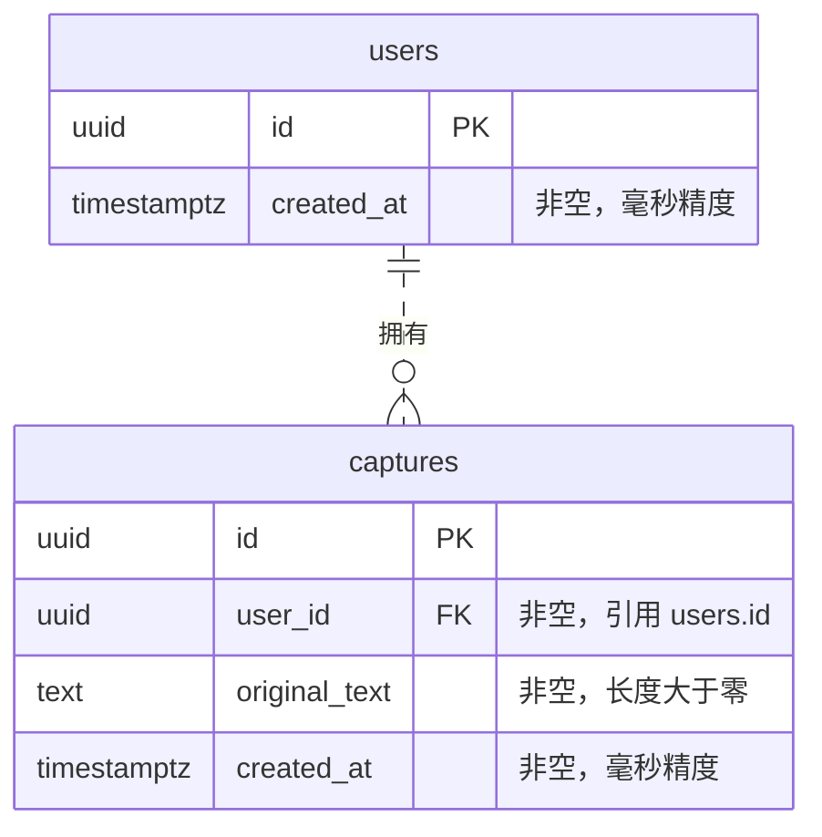
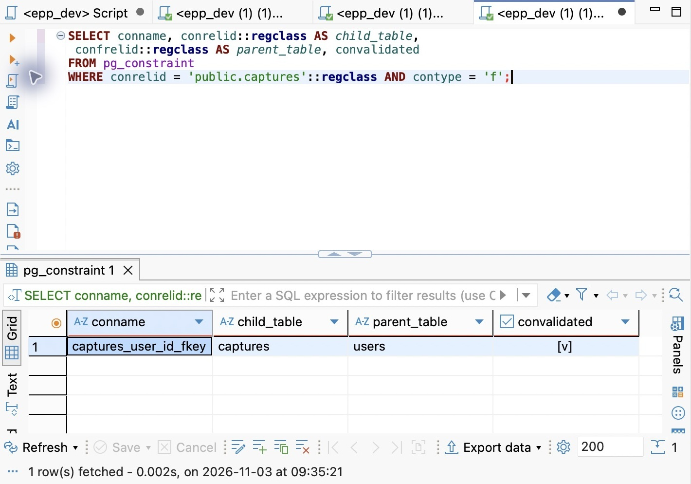
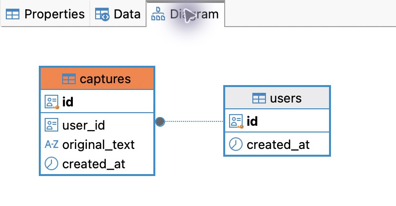
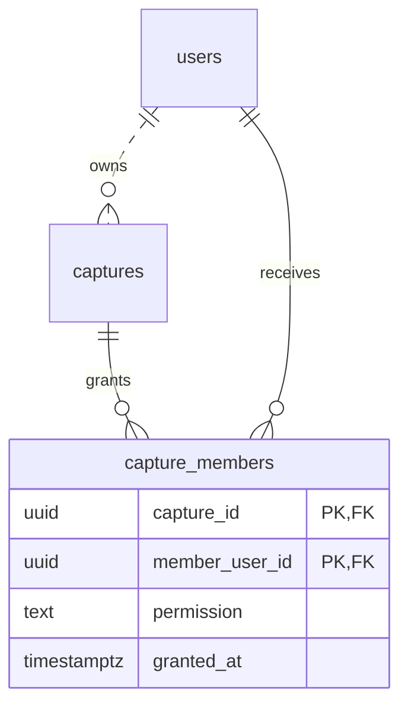
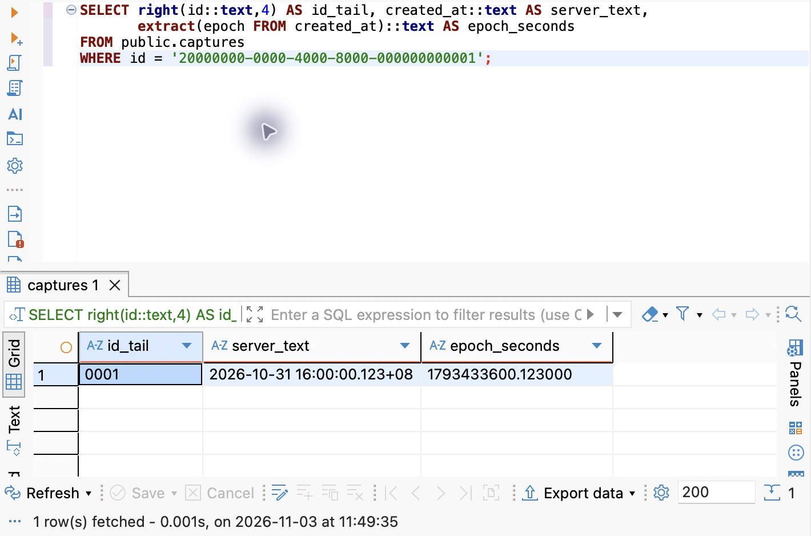

# 第 18 章 关系建模：为已有记录设计第一组表

上一章已经得到一个可以明确定位的 PostgreSQL 18 开发环境：`127.0.0.1:55432` 上的 `epp_dev`，由 `epp_owner` 管理。本章开始决定里面保存什么，以及哪些错误应该在写入时被拒绝。

现有记录只有 `id`、`originalText`、`createdAt`。直接把 TypeScript 属性翻译成三列不难，真正需要判断的是：记录归谁、两个内容相同的记录是否算重复、删除用户时记录怎么办、数据库里的时间怎样回到原来的 JSON。表结构一旦开始承载数据，这些决定就会影响查询、接口和后续迁移。

本章的重点是形成设计依据：从需求确定一行代表什么、哪些事实应放在一起、关系如何表达、哪些规则必须由数据库守住，再考虑查询和演进成本。建表与界面操作用来检查这些判断。学完后，换成收藏、订单明细或成员关系，也应能说明自己为什么这样分表，而不只是照抄 users 和 captures。

本章从 `part-03/chapter-17` 继续，配套分支为 `part-03/chapter-18`。推导完成后建立两张表，写入一个固定开发用户和两条示例记录，观察数据库拒绝哪些写入，再用两个会话时区读取同一个时间点。Nest 主服务仍使用 Map，第二十一章才接入数据库；因此本章默认在 DBeaver Community 的图形界面操作，不是调用 `/captures`。psql 作为终端复现的备用工具；SQL 编辑、执行、结果查看与结构检查都可以在 DBeaver 中完成。数据库中的示例记录会保留到后面的 SQL、Prisma 和迁移章节。

**分段跟做**　先在纸上完成[归属建模](#181-从记录归属推导最小模型)和[约束选择](#182-让类型和约束分别承担明确的责任)，写下两条同文素材为什么都要留下。打开 DBeaver 后做[建表与种子核对](#183-建表写入再确认留下了什么)，确认是哪一个用户、哪两个素材 ID，再进入[外键与归属](#184-一对多关系到底保证了什么)。[时间与重连](#185-时间经过数据库与-json-时发生了什么)可以留到另一天：沿原 ID 读回同两笔，比较显示方式与实际时间点。

## 18.1 从记录归属推导最小模型

### 从业务动作走到模型，中间需要作哪些决定

拿到“让用户保存原文，以后可以查找和删除”这样的需求，先别打开建表对话框。它没有回答重复提交算几条、用户删除后原文是否保留，也没有回答原文修改是覆盖还是新增历史。数据库无法替产品补这些语义；默认接受工具生成的结构，只是把未作出的决定隐藏起来。

先把已有行为写成具体事实。本项目每次成功创建都产生新 ID，相同原文可以保存两次；因此 captures 的一行代表**一次保存形成的记录**，而不是“一段全局唯一的英语文本”，也不是“某个用户的全部原文”。这个“一行代表什么”称为行的粒度。粒度不同，重复、计数、修改与删除的含义都会改变。

接着区分身份、属性和关系。记录有长期不变的身份 id；original_text 描述记录内容；user_id 描述记录与拥有者的关系。归属可以是内部事实，当前创建响应仍只公开 id、originalText、createdAt。将来即便页面要同时显示“记录、作者昵称、记录数”，昵称也属于用户，记录数可由记录集合计算；三项出现在同一个响应里，各自的修改责任仍然不同。

比如有人提出“相同原文只保留一份”，先问删除时应该发生什么。小林周一和周三各保存一次同一句话，周三删掉后，周一那份还应能按原 ID 打开吗？若答案是应当，两次保存就是两个可独立操作的对象。将来即便为了节省空间而让它们指向同一份文本，也得保留两条保存记录，各自有 ID、拥有者和时间。若需求其实是“每个人的生词本里同一句只收录一次”，重复提交的含义才会变成找到已有条目，还须定义什么算同一句。先把这个问题问清，再决定唯一性落在哪里。

然后对关系分别问两个方向。一个用户可以没有记录，也可以有很多条；一条记录必须有且只有一个拥有者。这里既有数量上限，也有是否允许不存在的下限。只写“一对多”会遗漏用户是否必须先有记录、记录是否允许暂时无人认领。这些答案稍后分别落到主键、外键、非空和唯一约束上。

最后把生命周期和访问方式带进来：删除用户时是否连带删除记录，列表按谁筛选和排序，原文修改后是否保留旧值。先判断哪些状态合法，再为已知的查询选择索引。若为了某个页面少写一次关联就复制当前昵称，必须同时回答用户改名后怎样同步；不能只计算读取变简单的收益。

这几步对应三种设计视角：**概念模型**说明用户、记录及它们的业务关系；**逻辑模型**决定表、属性、键与约束；**物理设计**选择 PostgreSQL 类型、索引等具体实现。可以来回校正，但不要因为 ORM 容易生成某种关系，或数据库支持 JSON，就倒过来改变业务含义。下面沿这个过程逐步做出当前模型，而不是先给一张“标准答案”表。

拿一个前端已经可以观察的动作来确定粒度。列表里连续出现两张卡片，内容相同，详情地址不同。把第一张的地址收藏起来，再打开第二张。现在问产品一句足以决定表结构的话：如果以后支持修改原文，改第二张时，从收藏打开第一张应该看到什么？若应看到原来的文字，那么这两张卡片必须分别持有可变化的原文，或者分别指向各自的版本。如果只保存一份可修改的正文，再让两张卡片同时引用它，第一次修改就能让另一张悄悄变样。即使今天只有创建和读取，已经对外发放的两个地址也给明天的设计划出了一条边界。

再沿着已有的内存实现读一次这个决定。在章节快照中，存储器收到的是已经取得身份的记录。插入前，它用记录的标识检查映射里是否已有相同的键；取详情也拿同一种键查。查列表里的文字却要逐条看原文是否包含指定文本。把这三处放在一起，就能分清哪些值用于认出一个对象，哪些值用于找到一批对象。若把原文当成主键，搜索同一句话的结果也许显得很整齐，按旧地址取详情却需要重新解释地址。存储层的翻译应能逐项对应已有行为，尤其要注意那些在页面上恰好显示得一样、在调用方看来却不同的值。

粒度还决定一个数字该怎么算。假设小林在周一存了一句，周二又存同一句，小周在周二也存了这句。「一共有多少」至少有三个可能的答案。按保存记录数是三，按有保存行为的人数是二，按不同原文数是一。如果页面需求写着「我的素材数」，先固定当前用户，再数他的保存记录，小林看到二，小周看到一。若先把文本去重，再去找这些文本的拥有者，一条文本同时属于谁就成了无法用一个值回答的问题。这个矛盾在写查询前就能发现：把三个动作画为三行，给每行填上一个人，答案自然出现。以后真要做流行句排行，也可以在这三份事实上按文字统计；反向从一句流行文本推回三次保存，需要的身份和时刻可能早已丢失。

有时产品同事说「只保存一次」，实际指的是网络超时后点重试，希望拿回刚才那次操作的结果。这时需要辨认的是同一个创建意图。上周收藏过，今天有意再收藏，与刚才没收到回执再发一次，从请求正文看可能完全相同。用户和文字拼在一起也无法把这两种情况分开。只有调用方与服务端共享某个能跨重试识别原操作的依据，才谈得上区分重试和新建。当前章节没有这样的输入，因此相同原文可各占一行，数据库也无法仅凭文字替用户判断用意。这一推导将来可以直接用来审查「给原文加唯一性就能避免重复提交」的改动。

#### 一张没有列名的纸，怎样写出第一条查询

把刚才三个保存动作当成同桌交给你的三张纸条。每张左上写回执号，中间写拥有者代号，右边写原文。暂时用整数代替很长的回执号，用甲、乙标记两个不同的人；这些代号只在推演里使用。第一件事是约定什么算输入。用户在编辑框敲字、切换标签页、点开已有卡片都不会多出一张纸条。只有服务成功创建一条有独立地址的记录，才向纸堆添一张。否则即使后面的计数表达式写得很漂亮，数到的也可能是页面点击次数。

沿用上一章的开发连接，在 DBeaver 新建 SQL 编辑器。此刻可以让左侧业务表清单保持空白。输入下面一条语句，把光标停在语句内，选 Execute SQL Statement。括号内的 VALUES 把三张纸条变成三行，右括号后的一组列名按位置贴上去。它们只供这一条 SELECT 使用，执行完即结束。接下来的变式都在这个草稿里改，保存或关闭编辑器由你决定，数据库里没有要删除的练习行。

```sql
SELECT receipt, owner_code, original_text
FROM (VALUES
  (11, '甲', 'Good morning.'),
  (12, '甲', 'Good morning.'),
  (13, '乙', 'Good morning.')
) AS saves(receipt, owner_code, original_text)
ORDER BY receipt;
```

先看左边的十一、十二、十三能否逐个指回纸条。把右边一列用纸挡住，只凭前两列，还能答出「回执十二属于谁」；反过来挡住前两列，只读原文，连当前行是哪张回执也无法辨认。这就是选择输出列时的第一个实际判断。详情页已经拿到一个标识，但列表项需要把标识一起返回给下一步打开详情使用。在只输出文字的查询结果上再加一个前端数组下标，排序一变，下标就会指向别的回执。

接着在排序前加上 `WHERE owner_code = '甲'`。先用手指盖住乙那一行，再执行，应剩十一和十二。现在只把 SELECT 后面的三个列名换成 `count(*) AS saved_count`，同时移走末尾的排序，保留 FROM 和筛选。原来网格的两行变成一行一格，格里的二表示有两张纸条通过了筛选。这里拿掉排序有具体原因：计算单个总数时，输出行并没有一个可供排序的回执号。若编辑器说某列必须出现在分组里，先看是不是明细阶段的排序还挂在总数后面。为了让语句通过就把回执加入分组，会得到两行各一，问题已经变成「每张回执出现几次」。

换一个不看答案就能自己检查的条件。把甲一字换成丙。查明细时应有列头、没有数据行；只求总数时应有一行、值为零。如果页面读取结果数组的长度当作素材数，两次计数查询都只有一行，甲和丙都会显示一。需要读取那一行里的计数列。再把条件换回甲，让第二张纸条的原文改成另一句。两张回执都在，保存数应仍为二；此时若统计不同原文才会由一变二。一次只换一个事实，就能判定查询是不是偷偷把「保存了几次」理解成「练了几种句子」。

#### 从查询结果还原输入，会缺哪份信息

现在合上带回执的网格，有人只交给你一张汇总表，说甲有两条，乙有一条。试着从中写回三份详情。你知道应该备三张纸，却连甲的两份是同一句还是两句都无法决定，更不用说恢复用户收藏的旧地址。再给一列「每人最近一次保存的原文」也不够：把甲较早的一份换成另一句话，汇总仍可能完全一样。这种找出两组不同输入却有相同输出的方法，比一句「不要丢信息」更容易用。它告诉我们可以从已有记录随时整理出哪些展示结果，哪些值一旦在写入时舍弃，之后便要去别处找证据。

这个判断也适用于产品提出的小改动。如果只要求列表折叠相同句子，可以由每份保存记录算出展示组，点开组仍能返回各自地址。若产品还要求在组上显示「这句话被几个人收藏」，需要在同一句内按拥有者辨别人数，甲的两张收据在这里才合成一人。去重发生在回答这个问题的那一步。将它提前到保存的一刻，看似能少写数据，却连后来要折叠的那两条地址都不存在了。草拟表结构时保留业务能分开的最小事实，通常可以给不同页面各自选择展示粒度的余地。

### 先区分记录本身与记录的拥有者

回看现有创建结果：

```json
{
  "id": "20000000-0000-4000-8000-000000000001",
  "originalText": "  I am not much of a cook.  ",
  "createdAt": "2026-10-31T08:00:00.123Z"
}
```

这是接口的表示，字段来自已有行为：每次创建产生新 ID，原文连同两端空格一起保存，创建时间表示这次记录发生的时间点。用户两次提交相同原文，当前会得到两个 ID。数据库不能为了“避免重复”擅自给原文加唯一约束，否则同一个 HTTP 请求在新旧存储下会有不同含义。

上一章还确定了记录必须有归属。这里需要三个可以分别回答的问题：某个用户是否存在，一条记录的拥有者是谁，当前请求者能不能操作它。前两个可以先落成数据，第三个需要可信身份和权限判断。

因此引入 `users` 与 `captures`：每条用户行有稳定 ID；每条记录行通过 `user_id` 指向一条用户行。用户名、邮箱和昵称可能更改，不适合用来维持记录的长期归属。以后增加密码登录或外部身份，是把登录方式接到这个稳定身份上，不是给每一种登录方式重新分配一批记录。

本章的用户表只放 `id` 和 `created_at`。这不表示一个真实账号只需要这两个字段，而是当前尚未定义注册、邮箱唯一性、密码或账号冻结的行为。此时先放一个 `password` 或 `status`，反而需要凭空规定它们的合法值和生命周期。身份篇会在明确需求后追加结构，原有用户 ID 和记录归属继续保留。

把这次新增的归属放回详情页，还有个容易漏掉的问题。原来的详情只展示原文和创建时刻，产品没有要求把用户资料一起返回。我们仍然要在库里知道记录属于谁，因为后台要能在两个相同的详情请求之间区分访问范围。数据库一行承载的事实可以多于某个页面此刻展示的字段。一张表与一个响应对象看似能逐字段相对，只要换成管理端按用户查素材，这种一一对应就消失了。建表时从需要长期成立的事实出发，返回响应时再选择这次允许读的事实，两处的依据都能说清楚。

一个简单的检验是把「还没存过素材的人」也放进模型。设小周今天建了身份，明天才第一次保存。今晚若只凭记录表寻找用户，小周会消失。为了让他出现而先放一行空原文，素材列表就会冒出一张不存在的卡片，即使列表过滤掉空值，统计和按标识取详情仍要认识这个特殊占位。现在单独给小周一行用户，就能表达身份已经存在；他的标识在记录表中一时找不到，正好表达还没有素材。这种缺席本身携带了足够的信息，无需另存一个「暂无素材」的记录状态。反过来，小林把最后一份素材清掉，也只影响子表的最后一行，不应让他的用户身份随之消失。

同理，如果把每个用户的全部记录放成用户行上的一个数组，直接返回整个数组很顺手，直到有人只带着一个记录标识来打开详情。现在要在多个用户行内部寻找同一个标识，还要确保两个数组里不会各出现一份带着相同标识的内容。列表只想读取一小段时，也必须约定从哪个嵌套位置开始。这里的难点不在于数据库能不能装下数组，而在于记录已经有自己独立的访问地址、自己的唯一性和逐条增加的生命周期。让一行对应这个可独立操作的单位，详情查询可以沿记录标识直接落到一行，逐条检查归属也有了明确的位置。若某项值只是一次展示中固定的几个片段，既不单独寻址也不分别约束，才有理由重新比较整体保存的收益。

#### 两个都叫“没有”的空网格，应当怎样区分

客服在合成练习中拿着一个用户代号问「为什么看不见素材」。在纸上把两张名单摊开。用户簿上有甲、乙、丙；回执簿上仍是十一归甲、十二归甲、十三归乙。现在有两封来信，一封署名丙，一封署名丁。只看回执簿，两次查找都得到零行。可是丙已经登记，应该进入空列表；若代号丁根本没有登记，就连「这个账号的列表」这句话的前提也没有成立。模型让我们能分开提问，至于应用怎样向请求者表达结果，还需要实际身份流程的规定。

从空编辑器试写两句中文草稿：「到用户名单查丙是否在册」「到回执上数有几张写丙」。第一句查找的是一个身份，第二句才有「几张」的单位。把它们分别写成两个小查询，共用开头的两份名单。WITH 后面的名字给每份输入一个临时称呼，逗号表示还要定义下一份；最后一个右括号后直接开始正式的 SELECT。下面故意将两个问题放在同一个结果行内。圆括号里的 SELECT 各自求一个数，外面才可以把这两个数并排显示。

```sql
WITH people(code) AS (VALUES ('甲'), ('乙'), ('丙')),
     saves(receipt, owner_code) AS (VALUES (11,'甲'), (12,'甲'), (13,'乙'))
SELECT (SELECT count(*) FROM people WHERE code = '丙') AS people_found,
       (SELECT count(*) FROM saves WHERE owner_code = '丙') AS saves_found;
```

先预判左格是一、右格是零。再同时替换两处代号：丁应为零、零，甲为一、二。为什么左格在这份名单里只能取零或一？每个代号只给一个人，并且每人只登记一行。为什么右格可以超过一？这里的同一代号标的是拥有者，一个人每存一次就可以多出现一次。万一得到一、零，先把两处常量圈出来，确认没有一处仍留着丙、另一处已经改成甲。两个各自写对的谓词，如果谈的是不同人，并排放置仍会冒充成同一个人的查询结果。实际取数会使用同一来源的用户身份；本例把字面值明列两遍，是为了看清等式左右的列来自哪张名单。

试着独立改成只写一次代号。思路是再准备一张只有一行一列的小纸片，把要问的人写在上面，给这一列起一个区别于两张簿子列名的名字。最外层 SELECT 从纸片取值，两个内部查询引用外层的值。先只做左边，读到一再添右边。这样以后从甲换成丁时，手只需要改一个地方。下面给出参照，可以和自己的查询并排检查：

```sql
WITH requested(who) AS (VALUES ('甲')),
     people(code) AS (VALUES ('甲'), ('乙'), ('丙')),
     saves(receipt, owner_code) AS (VALUES (11,'甲'), (12,'甲'), (13,'乙'))
SELECT r.who,
       (SELECT count(*) FROM people AS p WHERE p.code = r.who) AS people_found,
       (SELECT count(*) FROM saves AS s WHERE s.owner_code = r.who) AS saves_found
FROM requested AS r;
```

先读最外层的 FROM，找到当前这张写甲的纸片，再拿它去两份名单里各数一次。若把纸片扩为甲、丙、丁三行，每行会分别带出自己的两个答案；凭第一列代号核对，未指定排序时不要凭它在网格里的位置辨认。若每行的右格都是三，优先检查右侧是否把拥有者和它自己比较了。三个拥有者都有值，自比结果都成立，于是每次都数了整本回执簿。与其往查询末尾补一个限制行数的参数，不如选一个明显不在簿子里的丁；他的结果仍为三，就说明计算根本没跟着外层所问的人走。

#### 从接口少给的一列，到模型必须保存的一列

把用户和记录分开后，可以反着做一次交接。假设服务已知甲的内部身份，要把回执十一交给一个只认识旧版详情字段的组件。草稿上先画一个四格的内部记录，填回执号、甲、原文、发生时刻；在旁边另画三格，用箭头把回执号、原文和时刻投过去。拥有者那格没有输出箭头，但内部用它找出了该给甲看的记录。一个字段没有出现在返回对象里，只能说明这次展示用不到它。删掉内部那格，再来一封问「甲的详情有哪些」的请求，就连从哪里开始筛选也说不出来。

这里还有一个常见的推理倒置。用旧详情能填回内部的三个格子，于是有人说只须再从页面地址取一个用户代号就能完成还原。试一下把同一份详情分别在甲和乙的练习窗口打开，如果窗口标题一换，推定的拥有者也随之变化，推定依据描述的是当前观察者。拥有者却应当在两个观察窗口看来都是同一个人。这项纸上试验不涉及任何访问操作，已经足以识别字段来源错位。建模时最好能给每格都写一个来源：创建成功时发出的身份、用户提交的原样文字、创建动作确定的时刻、建立记录时可信的归属上下文。四格并非都能从同一段 JSON 反算出来。

### 为什么不把用户资料复制到每条记录里

设想给 captures 直接放 `user_email`：同一个人保存了三百条记录，更改邮箱就要改三百处。漏改一处，会出现同一个用户在不同记录里“拥有不同邮箱”的情况。若用邮箱本身识别用户，更改邮箱还会改变用来连接记录的身份。

根源不是字符串太长，而是把“这个用户的当前邮箱”这一份事实复制成了三百份。用稳定 `user_id` 保存关系，用户自己的事实以后留在 users 或相应身份表，记录只保存记录自己的事实，修改的责任就清楚了。这是规范化在当前问题中的实际收益。

还可以沿新增和删除看同一个问题：如果只用记录表保存用户资料，一个尚未保存任何记录的用户就没有合适的落点；删除他的最后一条记录，又会顺带丢掉用户资料。分别称为插入异常和删除异常；改三百份邮箱却漏一份，是更新异常。这里的“异常”不一定报 SQL 错误，它可能是每句 SQL 都成功，数据含义却已经失真。

为什么拆成 users 与 captures 能解决？因为我们承认两条不同的决定关系：记录 ID 决定这条记录的原文、创建时间和拥有者；用户 ID 决定这个用户的当前资料。把这类“相同的 X 应对应相同的 Y”称为**函数依赖**，记作 X → Y。它来自需求允许的所有合法状态，不是看眼前三行碰巧相同就推断出来。

假设把当前邮箱塞进 captures，就出现 capture_id → user_id → current_email：邮箱随用户而定，却被放进每条记录重复维护。把它移到用户侧之后，修改只发生在一处，读取时再通过 user_id 关联。注意“只存一次”指一份业务事实有明确的权威位置，并不是禁止多个用户恰好使用相同的字符串。也不意味着把每一个重复单词都抽成字典表。

**拆表还必须能正确接回去。** users.id 的唯一性保证每条记录按 user_id 找到至多一个用户，非空外键保证它确实能找到一个；于是关联不会凭空多出另一位拥有者，也不会丢掉原来的归属。若拆分时把 user_id 一起丢了，仅凭相同昵称重接，重名用户就可能把记录互相串在一起。规范化的目标包含避免错误组合，不是把宽表切得越碎越好。

不过，也不能因此规定所有重复值都要拆表。如果将来需要保留“发送邮件时实际使用的收件地址”，那是一次发送的历史事实，不是用户当前邮箱的副本。即使用户改了邮箱，历史发送地址也不应跟着改。建模先问这列描述谁、描述哪个时刻，再决定是否与另一个字段共享同一份事实。

现在的字段映射如下。SQL 采用小写下划线命名，应用继续使用驼峰；后面由映射层衔接，不把数据库命名泄漏给调用方。

| 数据库列 | 当前含义 | 与现有接口的关系 |
| --- | --- | --- |
| users.id | 稳定的业务用户身份 | 当前没有登录接口，不对外新增用户字段 |
| users.created_at | 这条用户记录的创建时间 | 用户表自身的事实，不替代记录创建时间 |
| captures.id | 一次记录的稳定标识 | 对应 id，仍允许同一原文创建多条记录 |
| captures.user_id | 这条记录的拥有者 | 新增内部归属，不允许客户端自行指定权限 |
| captures.original_text | 用户提交的完整原文 | 对应 originalText，不修剪或自动润色 |
| captures.created_at | 这条记录的创建时间点 | 对应 createdAt，公开表示仍用 ISO UTC 字符串 |

PostgreSQL 会把未加双引号的标识符折叠为小写：写 `originalText` 实际得到 `originaltext`。可以使用 `"originalText"`，代价是以后每次引用都要正确加双引号。本篇统一 `original_text`，查询时需要驼峰别名再写 `AS "originalText"`。单引号包字符串值，双引号包标识符，两者不能互换。

看一个会使「重复用户名称」这个结论反转的需求。假设导出一份学习记录，要求导出物上写明制作当日使用的署名。过一个月改了昵称，再打开这份导出仍要看到原署名。在这个前提下，用户表里的当前昵称与导出物上的署名恰好相同，只是制作当天的巧合。前者由用户身份决定，后者由那次导出决定。把导出的署名强行改为实时读取用户表，会让同一份档案在没人修改它的情况下变了内容。相反，若列表的要求是「显示现在的昵称」，复制一份昵称到每条素材又会造成旧行与新行不一致。决定是否复制一个值之前，要补上省略的时间含义。说「名字」很难判断，说「此刻的昵称」与「导出时确认的署名」，维护者就知道哪个变化该传给谁。本章没有署名需求，因此也不预设快照字段。

还可以把错误拆分的代价用手算看清。小林和小周都叫小禾，各存一条素材。如果只保留两边的昵称，用昵称把素材和用户配对，每条素材都会遇上两个可能的用户。第一条产生两对，第二条也产生两对，原来的两条事实重接后变成四行。如果有人在最终页面用去重把两份相同文字折回一份，可能连原本合法的两次保存也一并吞掉。应当回到配对发生的地方问：每个素材行携带的哪个值，在用户表最多匹配一行？用用户标识重接后两条素材仍各占一行，即使两个用户昵称相同也没有歧义。检验一次拆表能否恢复原事实，最有区分力的例子通常包含重名、缺席或重复内容；每个人都不同名、每人都恰有一条记录的示意图容易让错误方案也得到正确答案。

再考虑列表顶部的「共两条」。如果为了省去计数，把二也写回用户表，那么新增、删除和转移归属都会多出要维护的事实。小林把一条转给小周，原文和记录标识都不变，两个用户的数量却要朝相反方向各改一次。只改成功一边，总数量也可能失真。如果页面只问偶尔一次，直接从当前归属数出来更容易验证；若日后读取压力真的值得预存，仍可用记录明细重算，在出现差异时判断哪边代表业务事实。由此能分清两类看起来都像冗余的列。导出时的署名一旦漏存，后来可能无从重建；当前素材数即使整列丢失，也能从完整素材重算。前者保留历史，后者换取读取便利，设计依据与恢复方式完全不同。

#### 网格里是原文，还是列名本身

给前端同事交一份结果预览时，他要的列头是 originalText，列中仍要读到用户原先输入的句子。可以把第一条种子的文字放进一条只读查询，一次看三列。先别运行，拿笔给自己画出一行三格，分别填入预期内容。有一格是固定的字样，有两格应该随着输入文字变化。判断依据在 SELECT 中引号和 AS 的位置。

```sql
SELECT original_text AS stored_value,
       'original_text' AS typed_label,
       original_text AS "originalText"
FROM (VALUES ('  I am not much of a cook.  ')) AS draft(original_text);
```

第一格取输入列的值，第二格把两个单引号之间的字符原样交出来，第三格也取输入列的值，但给输出格换了题头。只把 VALUES 中的英文换成另一句再执行：应是第一、三格一起变，第二格完全不动。在只有一条数据时，固定字符串有时看着也像合理的样本，所以这个换值检验比盯一眼网格可靠。再把第三个别名外的双引号拿掉，观察变化的是列头的大小写，框里的句子仍与第一格相同。这一步可以单独判断错误发生在字段名称还是字段内容。

如果发现结果集右侧显示的句子紧贴单元格边，看起来两端空格都没了，先别给它手工补空格。可以将第一项临时改成 `'[' || original_text || ']'`，用拼接运算在结果里给首尾各加一个可见记号。按种子输入，两端括号和字母之间各有两个空格；若用自己刚换的句子，则取决于那句实际输入。这里改的是 SELECT 对结果值的显示，关闭草稿再读原输入仍是原句。把带方括号的结果抄成业务原文反而会多出两个字符。给展示加记号时应把它留在核对用的列，不要带进要交接给调用方的那一列。

最后从页面的问题倒推一次。如果前端按驼峰名称取值却显示空白，可以先看网格的列头是否逐字对得上；若取到了值，但每张卡片都显示同一串字段名，去看 SELECT 左侧写的是字符串常量还是列引用；只有列头、取值来源都对，才轮到排查实际文字有没有被整理过。同一个空白预览可能起于不同位置，而这条一行输入就能把列的命名、取值和展示拆开核实。

#### 拆开的两张名单怎样接回一条可核对的详情

从一个能手算的小问题开始。收到回执十二，要向负责这份合成数据的同事核对「十二、甲、小禾、Good morning.」四格。先在纸上画两份输入：甲当前叫小禾，乙也叫小禾；十一属于乙，十二属于甲，两张回执存的都是同一句。昵称只为草稿提供一个需要从用户侧取回的属性，实际用户表此时只有身份和创建时间。我们特意让其他格子一样，避免碰巧凭一句独特的原文或一个独特的名字猜对。

先只拿第二份输入。在 SELECT 写出想交接的记录号、拥有者代号、原文，在 FROM 写回执簿，在 WHERE 写本次拿到的回执号。此时最多拿回三格，不能因为缺昵称就改用昵称筛回执。再添第一份输入，为两边起短名，在 FROM 回执簿之后加 JOIN 用户簿，接着写 ON。ON 右边需要的是可以拿来试配的条件。对十二这一行，手指从拥有者格读出甲，再沿用户簿左边的代号下查，甲那一行留下、乙那一行划掉。这条动作路径翻译为两个有表前缀的列相等。最后才把命中的昵称放回 SELECT。

```sql
WITH people(code, nickname) AS (VALUES ('甲','小禾'), ('乙','小禾')),
     saves(receipt, owner_code, original_text) AS (
       VALUES (11,'乙','Good morning.'), (12,'甲','Good morning.')
     )
SELECT s.receipt, s.owner_code, p.code AS matched_person,
       p.nickname, s.original_text
FROM saves AS s
JOIN people AS p ON p.code = s.owner_code
WHERE s.receipt = 12;
```

这里多带一列命中的用户代号，有意让两边用于配对的值同时可见。若上来就只显示昵称，错接乙也会得到一个小禾，读者可能签字认可错误结果。执行后先对回执号，再横读两个代号是否都是甲，最后才读昵称和原文。现在只把 WHERE 中的十二换成十一，应该变成十一与两个乙，昵称和原文完全不变。这个变式检验了查询会不会随回执走向另一个实际身份；只观察画面看起来像不像详情，几乎察觉不到这次切换。

换个条件自己写：同事手里不再有回执号，只有一个昵称「小禾」，要找出使用这个昵称的所有保存记录。保留配对等式，只换筛选列与筛选值，先写期望回执集合再执行。得到十一和十二都合理，因为两个人各有一条。现在草稿中只给乙改名，叫小枝。用旧昵称找应该只剩十二，再用十一这个固定回执取详情，应该看到小枝。从用户侧改一格能影响昵称搜索和详情的显示，又不改变十一实际属于乙的事实。若改名后十一消失得连回执也取不到，回头检查有没有把展示名称作为配对条件。如果只在第一份 VALUES 改了名字却一直读到旧结果，注意在 DBeaver 中选中整条 WITH 到分号重新执行；打开上次结果页不会重读当前草稿。

配对结果恰好有两行也未必通过验收。把甲乙两张纸上的回执归属互换，仍然每张回执都只会命中一个用户，总人数、素材数、甚至每人条数都保持原值。只有从某张独立来源的回执出发，说得出「十一原本归乙」，才能识别这个错位。真实种子把回执和所声称的拥有者放在同一行，检查结构时可以验证它能否找到那个人；确认录入者有没有抄反，则要带着输入逐行比两个标识。数据一致性有可由键说明的部分，也有必须回到采集来源才能判断的部分。

#### 接手一份宽表，先找哪几行值得回查

接手合成的核对清单时，一张回执出现在两行。可能是制表者把同一个事实抄了两遍，也可能是两份记录对同一回执提出了不同归属。直接要求删掉一行，会在后一种情况下替来源作出决定。可以先写一条只读查询，把「出现几次」和「有几种已写明的归属」分开。下例每张纸都写有代号。第一列放回执十一、十二、十三，其中十一抄两遍都是乙，十二也抄两遍却分别写甲和乙，十三只抄一遍。先算出三张回执各该有哪两个数，再动笔。

```sql
WITH copies(receipt, owner_code) AS (
  VALUES (11,'乙'), (11,'乙'), (12,'甲'), (12,'乙'), (13,'甲')
)
SELECT receipt, count(*) AS copies_seen,
       count(DISTINCT owner_code) AS owners_seen
FROM copies
GROUP BY receipt
ORDER BY receipt;
```

写到 GROUP BY 时可以想象在桌上摆三个信封，把回执号一样的纸放在一起。第一个计数报出封里有几张纸，第二个计数把封里出现过的不同代号各念一遍。十一读作二和一，十二读作二和二，十三读作一和一。若问题是「哪个回执的归属得找原作者核实」，就在分组后、排序前写 `HAVING count(DISTINCT owner_code) > 1`。先装好信封才知道一个封里有几个代号，所以条件在分组后判断。若问题改成「哪些回执的纸张需核实是否重复抄录」，换成按第一项计数大于一，十一与十二都应入选。换一个词，注意的是哪种证据也随之改变。

最后再想一张只写回执没写代号的纸。数不同的非空值会跳过 SQL 的 NULL。如果十二的第二张上也写甲，第三张没写人，单看不同代号仍只报一。可以把 VALUES 中十二的两项换成三项：两项都写甲，一项显式写 NULL。要辨别这种未填写，可以并排再数 `count(owner_code)`。它表示确实写了代号的张数，与全部张数之差就是缺失张数。这样可以同时说「已知代号没有分歧」和「仍有一张缺归属证据」。若直接把缺值填成某个已有代号才开始统计，后一个问题将永远不能从这份汇总中回答。这是检查输入的草稿，正式表中素材的拥有者必须非空。

### 固定开发用户放在哪里

本章用初始化 SQL 写入固定用户 `10000000-0000-4000-8000-000000000001`。它是无个人资料的开发数据，不是 PostgreSQL 登录角色 `epp_owner`，也不是所有访问者都应该共享的正式账号。

两种“用户”处在不同边界：epp_owner 决定当前连接能否建表、读写数据库；users 中的行表达产品里的数据归属。一个 API 数据库连接可以服务许多业务用户，连接账号本身不能告诉数据库这次 HTTP 请求来自谁。

固定用户 ID 不设成 `captures.user_id` 的数据库默认值。否则，任何忘记传归属的脚本都可能写入这个用户，表面成功却留下错误归属。每次写入必须明确提供 user_id；第二十一章的开发适配会从受控的服务端配置取得固定身份，第五篇再换成认证结果。对浏览器开放一个可任意填写的 userId 参数，不是这条演进路线。

固定用户让我们可以在真实身份流程出现以前验证这套归属关系。不过，旧记录只有三个字段这个事实，并不会因为表里有了固定用户就自动改变。若手里拿的是前面练习用的一批文件，要导入前先问这批文件的来源是否确实只有这个开发用户。已知全是同一人的合成数据，才可以在导入边界给每条补上同一归属；如果拿到的是几个人混在一起、完全不含来源的备份，就算所有新行都能通过外键，也不能推断补的归属正确。缺少证据的归属应保留为待核对的导入问题，直接写进正式行以后，库里看到的会是十分整齐却错误的用户标识。本章使用两条明确编写的种子来避开这种不确定性。

这也解释了为什么固定值适合出现在初始化文件里。读者可以沿着一条种子看到是谁作出了归属决定，也可以在下一章查询时指名要查这个用户。若把固定值埋进表的默认值，任何遗漏拥有者的新入口都会继承这个决定；以后哪怕前端正确切换账号，漏传归属的写入仍可能全部成功。若写在展示组件里，换一种客户端就会得到另一套规则。把开发前提限制在可指出的输入处，比事后在已经落库的众多行里区分哪些是有意归属更可靠。这里保留的两张小表，已经能让接手的人分别追到「谁决定这个用户存在」和「谁声称这条记录属于他」。

#### 给两条种子填写一份来源说明

如果现在请你从空白处草拟一份初始化数据，不妨先把要保留的值分成两栏。左栏写文件已经给出的事实，右栏写这次建立开发数据才决定的事实。以第一条记录为例，已经给定的有完整记录标识、两端各有两个空格的原文、末尾是毫秒和 Z 的时刻。这些值即使在另一台机器上运行文件也应相同。开发拥有者是谁由这批合成材料明确指定，要新建哪一条用户行也有固定代号；唯有用户行本次创建于何时，允许由运行这次初始化的事务补出。同样的字段名在左栏还是右栏，直接决定稍后 INSERT 的列清单能否省略它。

在纸上依次演练三步。先放一张用户卡，上面写完整用户标识，留一个空位给本次创建时间。随后摆第一张记录卡，在它的拥有者格抄用户卡上的标识，把记录自身的标识填入另一个格。最后摆第二张，只抄同一个拥有者，自身标识取第二个回执。同一时刻可以照抄两次，因为配套本来就为两条素材指定了相同的时间。在把纸条交给下一位读者前，遮住原文，请他只凭两个标识指出「这是第几条，属于谁」。这一步专门发现两列 UUID 排在一起时把第一个格复制两遍的笔误，读原文猜是哪条会让这类问题漏掉。

还可倒过来出一道实务题：如果只收到一张截图，能看见两句原文、同一个保存时刻，看不到任何标识，能不能据此补出第二条回执？不能。即使你猜到它可能出自这批种子，截图的可见值也没有承担唯一性。能够保留原地址的办法，是找回带固定标识的输入文件或原始回执，按那里的值恢复对应关系。如果只是要从头造一批新演示素材，可以为新动作分配新标识，但旧详情地址不会因此恢复。恢复旧记录和制造一组长得像它的新记录，需要的证据不同，写建表和种子以前先区分清楚，才能谈后面的读回是否成功。

#### 换一批材料，哪些数量足以验收

现在给你一份不同的清单：甲交来两张有独立回执的保存卡，乙交来一张，丙只交用户卡。三个人都同意用自己的合成资料做练习，拥有者来源清楚；甲第二句和乙那句一模一样。请不要照抄种子的「一人两条」。先写出需要登记的用户身份数、素材身份数、各自出现几次的拥有者，再告诉同桌如何确认丙的状态。核对时应当有三个用户、三条素材，素材侧甲两次、乙一次、丙零次。若有人说丙不应该出现在用户名单里，问他明天丙第一次保存时是在新建身份还是在已有身份下增加一张素材，就能找出争论到底发生在哪个动作上。

接下来故意只交给同桌总数三和三，让他排除「把甲第二张错分给乙」这种笔误。总数不变，加上每人数量才能看出甲少一、乙多一。再把甲和乙那两张同文素材的归属对换，每人数量也不变；现在必须拿每一张原回执与拥有者配对对账。由此可以自己选择检查强度。要验是否少了一批用户可以先数；要验一位用户的列表就看他的回执集合；要验两条同文记录有没有串户，则必须保留逐条的归属依据。最终交给数据库的是三行用户和三行素材，每一份归属都写在对应的素材行上；即使展示把同一句折叠起来，接手者仍能用这份清单查回每次成功的保存。

### 不看表名，换个现场检验模型

有三个测站。每个整点时段都要至少交一次读数，一个时段内允许报多次。如果负责人只给你一份已收到的读数明细，要求你告诉他谁漏报了，你能从这份文件推回答案吗？先在纸上写两份可能的现场：两份都有甲、乙的相同读数；其中一份还有个一直没报过的丙站，另一份从来没设丙站。两份明细逐行完全相同，应催的人却不同。缺的事实是本来有哪些站需要报告。若有的站只值第二班，还需要知道各站在哪些时段有任务。

给每类事实写一句“一行表示什么”。一行站点说明这个站存在；一行读数说明发生过一次观测，归属某站；一行排班说明某站在某段时间应报告。在本题起点，所有站对所有时段有相同义务，可以从站点名单和时段表组合出应报清单。若只有部分站值班，这条组合规则就失效了，需要独立的排班依据。两种情况下，实际读数有几条都不能替代应报清单。

接着检查唯一性放在哪里。同一个站、同一个时段可以有两次正常观测；若把“站点加时段”设为读数表的唯一键，第二次上报就会被错误拒绝。但在一份没有分角色、没有多班次的应报清单里，同一站同一时段只应算一次。两份表都可能有站点和时段这两个字段，约束的含义取决于一行代表的是**一次观测**还是**一份义务**。为每一行配一个任意编号，能让人指到那一行，仍然不能替我们决定什么叫重复。

带回本章的两张表：一位用户即使还没有任何素材，也必须有办法作为用户出现；两条不同的素材允许来自同一个人；合法外键能证明每条素材指到了存在的用户，却推不出每个用户至少有一条素材。[下一章的缺报练习](../chapter-19-sql/chapter.md#把找不到写成结果哪一个站缺哪一个时段)会用一份可以手算的测站名单，把“原本应该出现，却没有对应明细”的要求写成查询。这里保留纸上的三句定义即可，不需要在 EPP 库里增加测站或排班表。

## 18.2 让类型和约束分别承担明确的责任

### UUID 表达身份，主键负责拒绝重复

现有服务使用 `randomUUID()`，因此数据库选择原生 `uuid`。它保存 128 位标识，读取时可以表示为标准 UUID 字符串；没有必要仅因 JSON 中是字符串，就在数据库中使用 `varchar(36)`。后者仍可能装入任意 36 字符文本，类型本身不能说明它是一个有效 UUID。

自增整数也是合理选择，尤其在数据库统一分配 ID 的系统中，索引更紧凑；选择 UUID 则方便应用在写入前拿到 ID，并延续现有接口。UUID 的随机性有存储与索引局部性的代价，不代表所有场景都比整数好。这里根据已有协议选择，不借建表改掉整个 ID 策略。

本章不给 id 设置数据库默认生成器：业务沿用应用生成，初始化 SQL 明确指定演示 ID。PostgreSQL 可以生成 UUID，但生成位置是另一项决定；不能让数据库重新生成一个 ID，而响应还返回应用生成的另一个 ID。

即使生成算法让碰撞概率很低，表仍要有 `PRIMARY KEY`。类型只判断“是不是 UUID”，主键判断“这张表里能否已经有同样的身份”，并禁止 NULL。PostgreSQL 会为主键建立唯一索引，不要再手工为 id 建一份相同索引。原文相同可以是两条记录，id 相同则不能是两条不同记录；这两个判断必须分开。

把标识当成值读时，可以将三个判断依次拆开。收到一串字符，先要能解释成这个类型的一个值。值有效以后，才有资格在某张表里找相等的一行。找到一行以后，还要看那一行在业务中扮演什么角色。把一条素材的标识填到拥有者一栏，类型系统只看到一个有效的标识，完全不知道这个值是从哪个页面复制来的。如果用户表里没有这样的值，引用检查才会指出找不到父行；若两表中刚好各有同值，查用户表反而会成功。两个表分别声明主键，各自只管自己表内的行。种子里以不同数字开头便于人眼对照，不能把这个书写习惯当成数据库会检查的类型标记。

技术身份的另一个要求是稳定。假设用列表项当前所处的位置作为标识，插到中间一条以后，后面的详情链接就可能全指错对象。若用原文的摘要当身份，同一个人再次保存相同原文时，又要解释两次操作如何取得两个地址；若将来修改原文，还会改变地址赖以生成的输入。现在由创建动作一次分配标识，以后显示什么文字都不改变这个对应关系。这对排错很实际：看见某次更新返回了一段相同文字，无法确认就是要找的那条；请求地址、写入结果与再次读取的行都带同一标识，才有条件继续检查内容是否也符合预期。

这里没有为主键列安排数据库生成的默认值。已有服务在交给存储器之前就知道自己创建了哪一条，外部也可能保存着旧标识。如果移植时再由数据库分配一份，应用里的详情地址与实际存储行就可能分裂成两个名字。数据库生成标识也是可行的设计，但那需要改变创建的交接顺序，由写入端取得实际生成的值，用它构造响应，先前已有的标识还要有明确保留办法。对照现有契约可以直接判断本章该选哪一种。种子中显式写入值，也让第二次执行时重复身份的冲突可观察。

#### 用两张抄写单核实数据库究竟在比较什么

复制标识时，前端手里先有字符串，数据库列却声明为 uuid。这中间有一次解释。取一个确实含英文字母的演示值，让两位同事各抄一次，其中一位用了大写。问题是「原单上写法完全一致吗」还是「他们指的是同一个标识吗」？先在纸上分别给这两问填是或否。仅用配套的纯数字种子做这项比较看不出差别，所以下面另取合成标识，查询结束它就从样本中消失。

```sql
WITH slips(first_copy, second_copy) AS (
  VALUES ('abcdef00-0000-4000-8000-000000000001',
          'ABCDEF00-0000-4000-8000-000000000001')
)
SELECT first_copy COLLATE "C" = second_copy AS same_spelling,
       first_copy::uuid = second_copy::uuid AS same_id,
       second_copy::uuid::text AS displayed_again
FROM slips;
```

从空白写这条时，先只 SELECT 两份抄写单，保留原样并排摆好。第二步选定比较单位。第一格在明确的 C 排序规则下按文本比较，大写与小写有别；第二格的两边都先解释为 uuid，再比较值。类型转换的两个冒号可读作「把左边解释成右边的类型」。最后一格分两步，先取得标识，再要求数据库把它表示成文本，看看还留不留原来那种大写拼法。核对结果应为假、真、小写的标识。测试的是数据库的输入与呈现，不必由此改变前端已约定的标识格式。

再让抄写者只改大写单末位，从一换成二。按原样拼写当然不同，这次解释成标识以后也不相等。这里有一个很实用的读错定位法：两张单文字确实不同，若数据库按标识仍然匹配，先找大小写等表示差别；若最后一位也不同，就应该回到完整值检查。页面为了紧凑只显示前八位时，这一对不同标识会显示成完全一样的一串。前八位在这里能帮助目视定位，拿它们作详情查找条件却会让两张不同的回执都进入候选。选择证据时要保留问题所需的分辨能力。

若准备交一批数据，可以先数有几种输入写法，再数有几个实际身份。沿用上面同一对大小写写法，把两列竖起来当成两行，再追加末位为二的第三行。预期写法三种，标识两种。怎么写第二个数？让 count 的 DISTINCT 接受转换后的值，先据类型判断相等，再只计不同值。若先按文本汇总得到三这个数，然后才想把三转成某种标识，就已经拿不到要比较的原始三份输入了。决定按什么判等，必须发生在丢掉细节之前。

把结果带回建表讨论。假设第一张抄写单来自详情地址，第二张出现在一份对照稿里，二者写法不同但确认是同一素材，模型中应该只占一行。反过来，两个账号各保存一条一模一样的句子，只要发出的回执是不同的标识，素材表就应能同时容纳它们。第一种情况检验数据库对同一身份的认识，第二种检验数据库有没有把身份以外的相同值误当成冲突。两种都能守住，原来按 ID 发放的外部地址才有稳定落点。

### 技术主键之外，还要找业务上的唯一性

给每张表加一个 id，只解决了“每行怎么称呼”，没有自动解决“哪两行代表同一件事”。假设未来保存共享成员，每次都生成新 UUID，那么“同一记录、同一成员”仍能插入两行；两个 id 不同，主键不会报错。但如果业务规定一人只能在一条记录上拥有一份当前授权，就需要额外保证 `(capture_id, member_user_id)` 这对值唯一。

这对字段也可以直接作为组合主键，表示关系本身就是身份；若另外使用 UUID 主键，仍需为这对字段加组合唯一约束。独立 ID 方便其他对象引用某次关系，组合键直接表达身份，但会让后续引用携带多列。决定依据是这条关系是否需要独立身份和引用，而不是“所有表必须有一列叫 id”。

更一般地，能唯一识别一行、且不能再去掉任何一列的一组属性叫**候选键**；从候选键中选一个作为主键，其他业务唯一性仍要落实。基于业务值的键常称自然键，额外分配的 UUID／序号常称代理键。代理键稳定，却不会消除原有业务重复规则。本章 captures.id 是代理键，原文没有唯一要求，因此不额外约束原文。

唯一性还必须带着范围理解。“同一用户下标签名不能重复”和“全站标签名不能重复”是两种产品规则，分别需要 `(user_id, name)` 与 `name` 的唯一性；大小写、空格是否等价又是规则的一部分。不能仅凭“名称看起来应该唯一”添加约束。必填业务键的列还要非空，避免把 NULL 的处理留给默认行为。PostgreSQL 普通 UNIQUE 默认允许多个 NULL，不能把它直接当成“最多一个缺失值”。

这种规则不能只靠应用先查一次。两个请求可能都查到“还没有这份授权”，随后各插入一行；如果没有组合唯一性，它们就都能成功。数据库唯一约束会把这个规则放到写入的竞争点上，冲突请求需要按业务处理失败。普通索引仅帮助查找，不承担拒绝重复的职责。事务与重试后面继续展开，但模型此时就应明确哪些重复必须被拒绝。

从集合的角度也能把组合唯一性推得更清楚。假设甲有素材红和蓝，乙只被允许看红。未来的授权明细里可以合法地出现「红、甲」「蓝、甲」「红、乙」这三对，因为甲能看两条，红也能让两人看。若只给记录那一列加唯一，第三对会被拒；若只给人那一列加唯一，第二对会被拒；若两列都分别加唯一，两种合法情况都消失了。把两列作为整体，只有第四次再出现「红、乙」才发生冲突。审查表设计时可以把拟议的每个唯一约束盖到这三行上逐个比，只要拒绝了本该合法的一行，就找到了约束范围过窄的证据。这里讨论的是将来的成员关系，直接在本章的素材表上加这种限制，会把拥有者与授权成员两种角色混成一回事。

「最少的列」也有实务含义。给已经唯一的记录标识再拼上原文，当然仍然能找到至多一条，但这个组合没有提供另一种识别途径。反过来，若撤掉原来的主键、只约束标识与原文的组合，同一标识配两段不同原文就能共存，从详情地址再也不能确定该读哪段。在需求里先用一句可以推翻的承诺写明键的含义，例如「给我一个记录标识，无需再问拥有者或正文，我就知道是哪行」，比从某个刚巧没有重复的查询结果猜键可靠。即便现在只有一行，姓名、时间、原文、甚至字符数看起来都会唯一；样本的唯一只说明今天没撞上。

冲突发生后的处理也取决于是哪一种键。若预先分配给两条独立素材的标识相撞，简单地返回旧行会把另一份保存当成这次成功；若业务规定某一对人和素材只能有一份当前授权，再次提交相同授权可能要返回已有关系。即便是后一种，也要读一眼双方要求的权限是否相同。已经有只读授权，用户请求提升到可编辑，吞掉重复键并报告成功，会让页面以为权限已经升级。数据库用约束指出两份写入不可能同时按原样存在，应用仍需根据约束所代表的承诺解释冲突。这是给约束起有意义的名字、并在处理前保留具体约束名的直接理由。

#### 不先加约束，怎样用现有两条种子淘汰错误的键

设计评审会上，有人说「用户和保存时刻合在一起足以识别一条素材，一人总不会在同一毫秒保存两次」。与其争论人手点击有多快，不如看模型允许什么输入。本章种子是现成的见证：两条记录时间相同、拥有者相同，保存回执不同，而且初始化本来就要让它们同时成立。先把标识缩短成末尾编号，给两行各写一个素材号、拥有者号和时间。只在这个草稿中用整数代号，实际列的类型沿用前面的决定。

```sql
WITH draft(receipt, owner_no, recorded_at) AS (
  VALUES (1, 1, timestamptz '2026-10-31 08:00:00.123+00'),
         (2, 1, timestamptz '2026-10-31 08:00:00.123+00')
)
SELECT owner_no, recorded_at, count(*) AS matching_rows,
       min(receipt) AS first_number, max(receipt) AS last_number
FROM draft
GROUP BY owner_no, recorded_at
HAVING count(*) > 1;
```

写第一版时先省掉 HAVING，按拟议的两项条件分堆，把同一个人的同一时刻放成一堆。每堆报出张数，若多于一张，抄出最小与最大回执号便于返回明细查原纸。这里最小和最大只说明编号范围，不给保存先后作证。第二版才添最后一行，仅呈现能推翻这个候选的堆。应当正好剩一行，数量二，两端回执一和二。假如把数量换成不同拥有者的数量，所有堆都至多算出一，因为拥有者本来就是分堆的条件；如此得出的「没有重复」完全不能回答一堆里有几条素材。

现在由你提出另一组候选，优先试只用回执。要改的地方有 SELECT 的观察列和 GROUP BY 的分堆列。让回执相同的纸进同一个堆，仅把每堆的回执和行数放到输出，保留最后的筛选。此时没有明细堆超过一张，网格应该空。但你还不能说「证明了回执在将来永远唯一」。加一行与第一行回执相同、拥有者换成二的假想草稿，不往正式表写；新查询应能把一号堆找出来。这样至少表明你的检查能够在存在反例时报警。把它升级成真正的主键，要另有业务承诺，即同一回执不能发给两个独立对象，数据库此后才有理由在写入处持续守住它。

有时一份检查表列出「按拥有者查」「按时刻查」「按回执查」三种入口，维护者把它们都照抄成唯一列。用刚才的两张纸会立即发现问题。给定拥有者应该走到两张纸，这是查找集合；给定同一时刻也可能走到两张纸；只有详情回执承诺走到一张。快速找到一堆与禁止这堆超过一张，是两个可以分别问答的愿望。如果把唯一性当成加速的附赠品，新增第二条合法素材就会失败，用户看到的会是业务行为变化，远不止查询速度上的取舍。

再把条件稍改：产品希望详情页显示「和当前素材同一时刻保存的其他素材」。以一号为当前素材，二号应该出现；换成二号，一号应该出现。纸上先按时刻圈出两张，再按「回执与当前不同」划掉一张。这里同一时刻正是要保留的相似性。如果评审的键拒绝并列保存，未来连这个正常观察都无法完成。换一个读取任务经常能看见错误约束的代价，比为了眼前两行能插入就随手改一个时间更有说服力。

### text 保存原文，不偷偷改成另一套长度规则

原文用 `text`。当前接口的上限是 **2000 个 JavaScript UTF-16 代码单元**，不是“数据库最多 2000 个字符”。例如 `😀` 在 JS 的 `.length` 中是 2，在 UTF8 数据库的 `char_length` 中是 1；`varchar(2000)` 因而不能复制现有校验。

`text` 并非不占空间，也不是省掉所有输入控制。它让列本身不强行采用另一套长度定义；API 的 16 KiB 请求体限制、2000 单元上限、非全空白规则继续由已有入口和业务逻辑负责。数据库另用 `NOT NULL` 与 `CHECK (char_length(original_text) > 0)` 拒绝缺失和空字符串。这是较宽的存储底线，**不等于完整输入契约**：全空白以及超过 2000 单元的文本仍可能经直接 SQL 写入。

为什么不简单加 `trim` 与正则就宣布两端相同？两种运行环境的空白集合、字符计数和编码边界需要逐一对齐。当前先明确分工：受控 SQL 只写本章给出的合法示例；未来导入入口必须复用同一业务校验，不能因为表接受就认为接口也接受。如果要求每个直接数据库写入者都受同一规则限制，应先统一规则，再设计数据库函数或约束及其迁移，不能用一个相似的表达式冒充等价实现。

这个选择还涉及可表示性：PostgreSQL text 不接受零字符 U+0000，也不能原样保存 JS 中孤立的 UTF-16 代理项。现有 JSON／字符串校验与数据库字符域并不完全一致。第二十一章在切换实际入口前必须明确拒绝这些输入并给出输入错误，不能让编码替换或数据库异常静默改变原文。本章的字符串支线会用可运行对照把这些差异拆开，当前业务接口仍保持前文状态。

这一列的名字有个值得坚持的词，「原文」。比如用户复制的是带缩进的两行对话，保存后列表卡片为了排版只显示一行，详情页却应该还能展开成两行。把换行在列表展示时处理，与在写入前把换行变成空格，有截然不同的后果。前者的输入还在，另一处页面可以有另一种排版；后者把两种原来不同的输入压成了同一个值，后来无法判断用户当时粘贴的是哪一种。同样，如果搜索要忽略两端空格，完全可以定义搜索时使用的比较值，同时保存原文。搜索规则改变时能从原文重新计算，这比让原文跟着每一次搜索需求改写更便于维护。

长度也要先确定是在保护什么。页面显示一小块预览，只说明一次要展示多少内容，并没有规定库里最多能保存多少；请求限制如果是为了控制一次读入的字节数，又要把编码和整个请求的开销考虑进去。给数据库列任意设一个看似够大的字符上限，会让某些早已通过上游检查的文本到最后一步才失败，而且用户得到的「太长」可能与页面显示的数字不同。拿同一段包含中英文和表情的文本分别问「人眼看到几个符号」「程序索引走了几步」「发送时要传多少字节」，答案未必一致。正文里的字符计数主要用来识别样本是否往返完整。将来真要制定产品上限，先把计量单位、检查位置和拒绝后的用户提示说清，再决定数据库是否还能独立执行同一规则。

还有一种比截断难察觉的损失。两个字符串在常用字体里看上去完全相同，内部却可能由不同的字符序列组成。例如带重音的字母，可能是一个已经合成的字符，也可能是普通字母后面接组合标记。若原文用于事后比对，界面截图连同肉眼核对都分不出这两条输入。反过来，若需求是让搜索者认为两者相等，直接用原始内容作业务唯一键也未必得到产品需要的结果。保存事实、定义搜索等价、绘制屏幕字形，分别回答了三个不同的问题。就这两条英文种子而言，字符计数和查看两端空间已经足够发现常见的误处理，不必为了给搜索做预案就改变现有存储规则。

#### 验收一份原文，用什么作对照尺

假设第一条种子已经出现在预览里，同事说「这句话一点都没少」。请他把输入与输出各放在一张纸上：输入两端各有两个空格，输出在网格中可能因为字体或对齐而看不清边缘。只比较渲染后的截图，很难对「原样」负责。可以先把一个候选输出和已知输入摆在同一条 SELECT 里，让查询同时给出字符数和相等判断。下面三份候选都是草稿中的展示结果，数据库尚未创建任何业务表。

```sql
WITH source(v) AS (VALUES ('  Go!  '::text)),
     readings(label, v) AS (
       VALUES ('A', '  Go!  '), ('B', 'Go!'), ('C', '  GO!  ')
     )
SELECT r.label, '[' || r.v || ']' AS marked,
       char_length(r.v) AS characters,
       convert_to(r.v, 'UTF8') = convert_to(s.v, 'UTF8') AS same_bytes
FROM readings AS r CROSS JOIN source AS s
ORDER BY r.label;
```

从空白写时，第一稿只写 readings 和前面三项输出，算一次长度。嘴里念一遍就能手算：两个空格、三个可见字符、两个空格，合起来七；中间那份只剩三。第三份也是七。长度检查会抓到中间那份，无法抓到改了字母大小写的末份。第二稿引入 source，把唯一的一份输入分发给每个候选作对照。这里的 CROSS JOIN 是所有配对：右边恰有一行，三个候选各配一次。若放了两份来源却没有指定哪个候选对哪个来源，会得到六行；这时应先修复配对，再解释每行的真假。最后一列把文本按给定编码转成字节后比较，这组三个结果依次是真、假、假。

把上题当作一次交接排错。有人看到 B 少四个字符，立刻判断是数据库写入时修剪了。仅凭末端结果还得不出这个结论。可以在写入前保留已知的合成输入，用同一把尺分别对照数据库取回的文字与页面收到的文字。如果库中 A、页面中 B，去查读出后是否在展示映射里整理了空格；如果两处都是 B，则沿写入前后的值继续查。当前快照仍用内存保存 HTTP 记录，这个判断方法可先在上面的三个候选之间练习，等真正更换适配器时才有一条跨存储的链路可查。今天把数据库网格和一个另行运行的接口硬配起来，得不到同一次写入的证据。

再留一个不用数两千个字符的边界题。同事拟把应用的长度规则翻成「若有两千个数据库字符就到头」。给他一份仅由九百九十九个笑脸和两个英文字母组成的原文，再给一份只多一个字母的原文。按现有 JavaScript 单元手算，前一份是一千九百九十八加二，恰好两千；后一份是两千零一。两份都有可见内容，也都远低于请求体的十六 KiB（用直接的 UTF-8 文本序列化作本例请求）。应用按长度应分别允许与拒绝。按数据库字符算，前一份却是一千零一，后一份一千零二，两个都远未到两千。可以把这两个数字分别抄到「能写进这种列」和「应通过业务入口」两个栏里，差异来自计量单位，没必要编造一条数据库写入失败来解释。

若读者想自己造替代样本，先写出总单元数等于「普通英文字母数加笑脸数的两倍」，再令等式刚好取两千，最后只增加一个字母。如此造出的两份原文只在一个方向跨界；如果同时移走结尾唯一的可见字又改用全空白，就无法判断拒绝究竟来自长度还是非空白校验。这里在纸上改变正常练习文本已经足以检验规则。至于组合字符、不同空白集合和输入表示的详细差异，章末的字符串支线可用各自运行环境的实际结果继续对照。

### NOT NULL、DEFAULT、CHECK 各自补上哪一个缺口

缺值和默认值不是一回事。`created_at` 的默认值可以在 INSERT **省略该列**或显式写 `DEFAULT` 时产生；显式传 NULL 不会触发默认值。要拒绝 NULL，必须另外声明 `NOT NULL`。

同一个“没填”，为什么在两列上要有不同结果？创建时间没填，事务有开始时刻，可以据此给出一个有定义的默认值。拥有者没填，数据库只知道当前连接是 epp_owner，从这个连接无法反推出是哪位业务用户。给两列都配默认值会让 INSERT 更容易成功，却把一次本可定位的漏传变成很难发现的错误归属。选择 DEFAULT 之前，先说出缺值时这份事实能从哪里取得。

同样，`text NOT NULL` 仍允许 `''` 和 `' '`。空字符串有值，只是长度为零；空白字符串有字符，只是未包含当前业务需要的内容。后面的 CHECK 只负责拒绝前者，不能用列名或约束名暗示它还保证了非全空白。

CHECK 还有一个容易从 JS 经验误判的地方：表达式结果为 false 时拒绝，结果为 true 或 SQL 的 unknown 时通过。NULL 参与 `char_length(original_text) > 0` 得到 unknown，不能靠这条 CHECK 拒绝 NULL。这就是为什么同一列同时保留 `NOT NULL` 和 CHECK：两者有各自的职责。

主键与 CHECK 都是数据库写入时检查的规则。用户界面的校验能改善交互，业务层能生成清楚的错误，而数据库约束可以覆盖经过不同程序的写入；不过覆盖哪些条件，取决于实际声明了哪些约束。检查一张表时，要读定义，不能只看界面上是否有“约束”分类。

读约束可以倒过来，从一条实际会留下的坏数据出发。假设只保留「原文长度大于零」。给它一个显式的空字符串，长度可计算为零，零大于零是假，这条检查会拒绝。换成空值，连长度是多少都不知道，「长度大于零」的结果也是未知。在数据库的行检查里，明确为假才构成这条检查的违反，所以仅凭检查无法保证原文一定有值。非空声明补上了这条通路。再换成一个空格，长度确实是一，非空也成立，库会接受。这三个结果分别对应「根本没给内容」「给了一段长度为零的内容」「给了一段有字符但读起来空白的内容」。修复时如果不区分，容易遇到第一个失败就为所有行补空字符串，转眼又撞上第二条规则。

为什么数据库不直接套用页面现有的空白判断？把一个语言里的整理函数翻译成另一个系统中的同名或近义函数，需要先知道它们认得哪些字符。浏览器能粘贴的文本包括普通空格以外的空白，用一个只处理普通空格的条件，可能对常见手输样本全部通过，却对粘贴样本与接口产生分歧。这里选择让数据库承诺一个简单、可核对的下界，接口继续履行已有的完整输入契约。排查时从入口看这条数据经过哪些检查：如果网页提交和手写种子有不同结果，原因可能就是种子直接到了数据库。要把某条规则升级为所有写入途径的共同承诺，再用两种途径的边界样本逐一核对。章节支线给出了文本边界的具体对照。

默认值还有一个时间上的限制。它是在构造这条新行时填上去的，行一旦写好，读取它不会按今天的默认值重新算一遍。否则同一条记录每次打开都会显得刚刚创建。比如用户行的创建时刻由本章这次初始化产生，明天再打开，仍应能看到当时的时刻。若导入旧行时省略创建时间，默认值就忠实记录了本次导入事务的开始，却可能完全偏离原记录实际创建的日子。这里数据库没有出错，是导入者没有交给它需要保留的事实。因此种子对用户可以省略这一列，对两份已经给定观察时刻的素材要显式写入。同一条默认表达式是否合适，取决于正在创建新事实还是搬运旧事实。

#### 把“哪里不合格”写成一张逐格可读的表

现在要审一份还没入表的练习草稿。维护者只想看哪些行达不到数据库的原文底线，先写了「找出不满足长度大于零的行」，以为把条件取反即可。别急着查，先画出缺值、空串、单个普通空格、带边空格的正常句子四行。再画三列，依次写「长度是否已知」「长度大于零的判断」「这两项列约束合起来能否接受」。尤其盯住第一行，把“不知道长度”写成“未知”，不要先替换成零。

```sql
WITH drafts(pos, original_text) AS (
  VALUES (1,NULL::text), (2,''), (3,' '), (4,' Go! ')
)
SELECT pos, char_length(original_text) AS n,
       char_length(original_text) > 0 AS check_value,
       (char_length(original_text) > 0) IS NOT FALSE AS check_allows,
       original_text IS NOT NULL
         AND (char_length(original_text) > 0) IS NOT FALSE AS both_allow
FROM drafts
ORDER BY pos;
```

先写到 check_value 为止，在结果区对照未知、假、真、真。第三行的空格长度是一，不因读起来空白就自动消失。然后添 check_allows，逐字读作「检查结果没有明确为假」。这样第一行会亮起真，和第二行的假不同。最后一列再问原文确实有值吗，两项都允许才接受。从第一到第四行应为假、假、真、真。这张表评的是数据库两项声明，第三行不适合作为合法的 HTTP 输入；第四行既包含可见内容也保留了边空格。网格如果把未知与假都画得很淡，点开结果值或盯住后两列的布尔变化，不靠颜色猜测。

现在遮住最后一列，自己把问题改成「只列出应该退回核对的草稿位置」。从原来的 FROM 出发，保留位置和原文作观察列，在排序前补 WHERE。应该取到一、二两个位置。若只取到位置二，常见原因是写了 `NOT (char_length(original_text) > 0)`。在第一行，未知取反还是未知，WHERE 只接受真，于是被筛掉。分别写清两种退回情形就容易了：`original_text IS NULL OR char_length(original_text) = 0`。这样即使右半边在第一行未知，左半边为真，整句仍然为真。在同一份输入上往返做「列出判定过程」和「只返回异常位置」，能分辨查询漏查与数据库规则缺失。

#### 给新行的默认值，能替旧记录找回什么

轮到 DEFAULT 时，最难观察的是「交给服务器的列清单」。图形网格中留空一格，不一定告诉你客户端到底省略了该列，还是明确提供了空值。在本节只用一张临时表把三种正常输入的写法列出来。回到上一章的 DEV 连接，新开一个空闲且无未完成事务的编辑器，自动提交模式、关闭 Smart commit。下面从 BEGIN 开始留在同一会话，依次单条执行 BEGIN、建表和三条插入，再执行 SELECT 看结果，读完网格才执行后面的回滚。临时表随本事务的回滚一起撤销。若中间停止练习，在原会话执行末尾的 ROLLBACK 即可；不需要先建本章正式表。

```sql
BEGIN;
CREATE TEMP TABLE lesson18_stamp (
  slip integer PRIMARY KEY,
  marked_at timestamptz(3) NOT NULL DEFAULT CURRENT_TIMESTAMP
) ON COMMIT DROP;

INSERT INTO pg_temp.lesson18_stamp (slip) VALUES (1);
INSERT INTO pg_temp.lesson18_stamp (slip, marked_at) VALUES (2, DEFAULT);
INSERT INTO pg_temp.lesson18_stamp (slip, marked_at)
VALUES (3, timestamptz '2026-10-31 08:00:00.123+00');

SELECT slip,
       marked_at = CURRENT_TIMESTAMP::timestamptz(3) AS equals_tx_start,
       marked_at = timestamptz '2026-10-31 08:00:00.123+00' AS equals_source
FROM pg_temp.lesson18_stamp
ORDER BY slip;
```

第一行的插入根本没列出时间，第二行列出来且明确请求默认值，第三行则交还原材料已经给定的时间。读第一列比较，应见一、二都等于本次事务开始时刻按毫秒精度得到的值；读第二列比较，三必须等于来源。一般跟做时本次事务在另一天，第三行左格为假，第一、二行右格也为假。这里把比较对象也转为三位精度很重要。若拿保存的毫秒与还带微秒的事务时间直接比，明明取自同一个默认表达式也可能说不相等。把两边先放在承诺的精度上，再讨论来源是否符合预期。

在原来的编辑器单独执行下面这句，结束本次实验。

```sql
ROLLBACK;
```

再回想三次插入能留下多少线索。单从落库的两个相同时间，无法还原一号是省略列、二号是显式写 DEFAULT；如果第三人恰好显式提供同一时刻，值本身也不标注由谁提供。知道本例的来源，是因为保留了三条输入。排查一份旧数据被显示为今天创建时，应先找到当时实际发送的列清单，再判断哪条默认规则可能生效。如果一运行第一条插入就说找不到临时表，检查建表后是否换了会话、是否已经结束事务；ON COMMIT DROP 会在提交时移除表，回滚创建它的事务也会撤销建表。不要将限定名改成 public 来让下一条语句勉强找到一个同名对象。

### 时间列保存时间点，精度与应用相接

`created_at` 选择 `timestamptz(3)`，也就是 `timestamp(3) with time zone`。这里的 3 表示秒后保留三位，与当前 JS Date 的毫秒表示一致。PostgreSQL 默认能处理更高的微秒精度；直接默认六位，再把时间交给只保留毫秒的应用，往返后可能丢失精度。

“带时区”并不是额外保存一个 `Asia/Shanghai` 字段。timestamptz 将输入解释成时间点，输出按当前会话时区显示；原来输入的时区名称不会被保留下来。若未来业务是“每个工作日上午九点提醒”，需要另外保存当地时间、时区和重复规则，一列创建时间不能表达完整计划。

为什么不用普通 timestamp？它保存没有时区解释的日期和钟表读数；同一个 `2026-10-31 16:00:00`，放在北京与伦敦可以表示不同时间点。记录发生在某一刻，需要确定时间点；本章写入时始终带 Z 或明确偏移，避免会话默认时区替我们猜。

默认值选择 `CURRENT_TIMESTAMP`。它表示当前事务开始的时间，同一事务里创建多条记录可能拿到同一个值；它不是每次调用都读取墙上时钟，也不是提交时间。应用后续传入已有 createdAt 时会覆盖默认值，因此仍保持“由业务创建记录时确定时间”的来源。默认值只是省略列时的约定，不强迫应用改用数据库时间。

想象原先在内存里生成的两条素材相差不到一秒，前端收到的字符串保留毫秒。若建表时只存整秒，两条都可能落在同一秒，重新返回时即使格式器忠实补上三位零，丢失的毫秒也回不来。反方向，如果新来源带微秒而客户端只理解毫秒，数据库仍可能把两个时刻分开，但页面却显示相同。在需求只要求毫秒时，用相同精度使「读回的时间等于写入的时间」成为可以精确检验的承诺。这个承诺只覆盖输入本来就符合该精度的情况。用秒表感到操作似乎先后发生，并不能推出两列保存值必然不同。

这里还有个容易被名称掩盖的取舍。「用户创建于」与「素材创建于」都叫创建时间，数据库允许一条素材的时间早于当前种子用户行的创建时间。本章就可能出现这样的输出，因为用户行在读者今天执行脚本时产生，素材使用事先确定的示例时刻。外键只核对用户身份存在，从未比较两列先后。若强行要求所有历史素材的创建时刻晚于迁入本系统的用户行创建时刻，迁移旧记录时就会被迫改写其中一边。要订这种规则，先确认说的是现实中用户开始存在的时间、系统首次见到这个用户的时间，还是迁移建立本地行的时间。三个时刻偶尔相同，不意味着可互相代替。

#### 把写入前后的两个时刻放上同一把刻度尺

产品给出一条容易误读的验收条件：「原创建时刻在换存储后仍能读回来。」先写清楚输入范围。现有接口提供的是带毫秒的明确时间点；如果另有人交来六位小数的来源，这个输入本身已经比公开契约精细。可以用本章种子的八点作刻度起点，让第一条保留准确的一百二十三毫秒，第二条只比它多四百微秒，第三条设在下一秒前四百微秒。先用手在纸上标出前后两个整毫秒，再问每个输入更靠近哪一个，避开恰在一半时如何取舍的歧义。

```sql
WITH samples(slip, supplied) AS (
  VALUES (1, timestamptz '2026-10-31 08:00:00.123000+00'),
         (2, timestamptz '2026-10-31 08:00:00.123400+00'),
         (3, timestamptz '2026-10-31 08:00:00.999600+00')
)
SELECT slip,
       supplied::timestamptz(3) AT TIME ZONE 'UTC' AS rounded_utc,
       extract(epoch FROM (supplied::timestamptz(3) - supplied))
         * 1000000 AS change_microseconds
FROM samples
ORDER BY slip;
```

第一步只选原输入和它转成三位的结果。第二步才把转好的值和原输入相减，差得到一段时长；从这段时长取秒数乘一百万，才是带方向的微秒差。第一行差零；第二行回到一百二十三毫秒，差负四百；第三行进到下一秒的起点 `08:00:01.000`，差正四百。若把第三行误算成八点整秒内的九百九十九毫秒，你用的是截掉后三位的办法。若两行非零差的符号全反了，看看减法左右是谁。同一个实验既能检查时间列的规则，也能查出检验式本身把「写后减写前」反写成了「写前减写后」。

到这里应能独立回答一个变化问题。收集端给来两条保存回执，分别对应上面的第一、第二个输入，界面只显示毫秒。前端显示的时间会一样。要核实是否丢失了一份保存，先按两个回执号找行，不能用不同毫秒值的个数推算记录数。要核实是否损失来源的额外精度，则应看最后一列的微秒差，回到输入核对具体时刻，拿输入的微秒与承诺的精度对照。若业务新要求六位都可追溯，原本只保存毫秒的表即使能找回两行，也已经无法仅凭库中值恢复第二条原有的四百微秒。这两个验收问题用同一份样本，却需要不同的观测列。

再想列表把时间切为每秒一格的情形，第三张纸在写入前还落在八点整那格，按本列规则保存后已进入下一秒。若按原始六位时间给脚本算「八点整这秒有几条」作期望，再按库里的值做实际统计，会出现少一条的问题。这里没有改时区，缺口出现在量化到毫秒的步骤。手工诊断时先把候选回执和源时刻列出来，再用同样的转换预测它在库中应落的那一格；两种统计要比较，就得交代各自依据哪种精度。本章正式种子输入本来只有毫秒，因此这种跨秒是对列语义的单独验证，不会让那两条素材改天或改秒。

### 把当前两张表放进 ER 图

把前面的决定汇成实体关系图（ER 图），再进入建表。每个框表示一张表，框内列出字段；这张图对应本章实际要建立的 `public.users` 与 `public.captures`，也作为第十九章查询和第二十章迁移基线的结构起点。



PK 表示主键，FK 表示外键。users 一端的 `||` 表示每条记录必须对应且只对应一个用户；captures 一端的 `o{` 表示一个用户可以对应零条或多条记录。这里“零条”允许用户尚未创建记录，不表示一条记录可以没有拥有者。

虚线表示非标识关系：记录由自己的 id 标识，user_id 不参与 captures 的主键。虚线不表示外键可以省略，也不表示允许 NULL；必须有拥有者仍由 `user_id NOT NULL` 与外键共同保证。user_id 上没有唯一约束，所以同一用户可以拥有多条记录。

图让身份和关系一眼可见，完整规则还要落实到下一节的 DDL：两列 created_at 都使用 `timestamptz(3)` 和 CURRENT_TIMESTAMP 默认值；original_text 用 NOT NULL 与 CHECK 分别拒绝 NULL 和空字符串；外键更新、删除动作均为 RESTRICT；user_id 另有普通索引。关系线本身不表达级联删除、查询性能或访问权限。

#### 合上图，从四种合法的摆法推回那根线

现在把 ER 图盖住，桌上只留甲乙两张用户卡、十一和十二两张素材卡。假定两张素材都已被创建，每张都要写一个拥有者。先给十一选人，有甲、乙两个可能；再给十二选人，也有两个可能。因此在不改用户和素材身份的前提下，一共有四种摆法。按十一、十二的顺序念一遍，分别是甲甲、甲乙、乙甲、乙乙。如果一个设计一看就只允许中间两种，即使它正确处理了「一张卡必须有主人」，它也没有表达「同一人可拥有多张卡」。

这可以变成一条只读的出题器。拿上一节练过的所有配对：这回左边是十一的两位候选拥有者，右边是十二的两位候选拥有者。给同一张 users 草稿起两个别名，让每一边都独立取值。在 SELECT 里给结果列写上它负责的回执号，避免误读成「一条素材有两位拥有者」。先只写前两项，看到四行后才加布尔列，用它标出如果给素材的拥有者列加 UNIQUE，哪些摆法将被排除。

```sql
WITH people(code) AS (VALUES ('甲'), ('乙'))
SELECT a.code AS owner_of_11, b.code AS owner_of_12,
       a.code = b.code AS lost_with_unique_owner
FROM people AS a CROSS JOIN people AS b;
```

在网格里按两个列值核对四种组合，各出现一次。布尔列为真的两行就是甲甲与乙乙；在甲甲这种完全合法的状态，乙仍在用户簿里，只是没有素材。在纸上试一次给 users 增加一条「必须出现在素材侧」的规则，同样会排除甲甲与乙乙，只留下甲乙、乙甲。注意两种错误的设计在这批样本上居然排除了相同的行：仅看四行结果无法断定究竟添错了哪条规则。想分开两种原因，必须自己挑一个有区分力的新样本。

把卡片数改成三个素材、两位用户，写甲、甲、乙。所有用户都有素材，但甲重复出现了；这种摆法能通过「人人有素材」，却不能通过「拥有者不可重复」。再让用户数为二、素材数为一，唯一的一张归甲。拥有者只出现一次，乙却没有素材；这种摆法能通过「拥有者不可重复」，却不能通过「人人有素材」。两个新样本加在一起才能解释，为什么应分别从两个方向读数量下限和上限。以后接到「几乎所有数据都正常，只有部分用户的第二条怎么也存不了」这样的报告，先询问失败是随同一人第二张卡出现，还是随另一个新用户尚未保存出现，能直接缩小需要检查的规则。

#### 六个格子写完以后，逐句认领定义

不看后面的建表脚本，请给刚拿到这个模型的人写一份足以还原定义的便条。先写用户行，告诉他区分两个用户只看哪个值，这一列可以用哪种类型、能否缺失、有没有默认生成的位置；再写用户创建时刻，一旦操作者省略，应该采用什么。随后单独写素材行，先标出自己的身份，再标出它引用的身份。这两个值都可用 uuid 表示，但前一个用来检索唯一的一份素材，后一个应能在多行中重复。把这条差别说完整，读者才能把主键的标志贴对格。

接下来写原文那一格。若便条只说「必填」，接手者可能只写非空，而长度为零的文本也有值。若只说「长度为正」，又会遗漏未提供原文的情形。把列存在一个文本值、该值字符数大于零分成两句，再标出应用仍有的非全空白与单元数判断，读者便能预测脚本直写与接口提交各自检查的内容。最后填素材时刻，给一个明示来源的输入例与一个确实要新取时间的省略例。两张表的时刻可以各有默认值，然而种子实际选择了在哪一行使用默认值，是写入语句作出的选择。在图旁写默认规则时，不要顺手把所有历史时间都解释成本次事务产生。

把便条交回同桌前做一次逆向核对。不念 SQL 名称，只问「给定一个没有素材的用户能否落一行」「同一用户同一时刻的两段原文能否各发一张回执」「把某张回执的拥有者留空能否保存」。这三问的答案分别是能、能、不能。接着让同桌解释最后一个答案：缺值由拥有者列的非空检查挡住；如果给的是一个有效且非空的标识，但并没有这样的用户，则由引用检查挡住。它们都会导致素材无法按原样写入，排查时应先分清是根本没有提供身份，还是提供的身份没有对应用户。等到下一节看实际列定义，便能指着具体一列或一条关系找到每个答案的来源。

## 18.3 建表、写入，再确认留下了什么

### 在 DBeaver 准备本章工作台

沿用第十七章已经运行的实例和保存的 `EPP · DEV · 55432 · epp_dev` 连接。尚未创建连接时，在 **Database → New Database Connection** 选择 PostgreSQL，填写 Host `127.0.0.1`、Port `55432`、Database `epp_dev`、Username `epp_owner`，输入自己的开发密码并测试连接。安装与连接失败的定位仍见上一章。

选中该连接，通过 **SQL Editor → New SQL Editor** 新建脚本；不同版本也可能显示 New SQL Script。编辑器上方确认选中的数据源，不因左侧选中了一个库就默认所有旧编辑器都切到了它。主界面的分工是：左侧导航树看数据库对象，中间编辑器写 SQL，下方结果页看数据、执行统计或错误。

打开配套 `database/chapter-15/03-inspect.sql`，或把内容复制进这个编辑器。这里的“打开文件”是打开 SQL 文本，不是向数据库导入数据。选中第一条 SELECT，通过 **SQL Editor → Execute SQL Statement** 执行，在下方结果页核对 epp_dev、epp_owner、127.0.0.1 和 55432；再执行其余只读查询。展开左侧 **Schemas → public → Tables**，首次到达本章时尚无业务表；已做过本章则先核对现状，不重复初始化。

单条执行与整份执行要明确区分：**Execute SQL Statement** 用于当前或选中语句；**Execute SQL Script** 按顺序执行脚本，若有选区则可能只执行选区。下面的完整初始化文件应取消选区后执行整份。不要选名字相似的 **Execute SQL Script natively**，它依赖外部客户端；也不使用把各条语句放入独立线程的并行执行动作。快捷键随系统与个人配置变化，先按菜单动作确认。操作依据见 [SQL 编辑器](https://dbeaver.com/docs/dbeaver/SQL-Editor/)与[执行方式](https://dbeaver.com/docs/dbeaver/SQL-Execution/)。

本章 SQL 已显式包含 BEGIN、COMMIT 或 ROLLBACK，因此先在没有未完成工作的会话中设置：工具栏事务模式为 **Auto-commit**，关闭 Smart commit；在偏好设置 **Editors → SQL Editor → SQL Processing → Scripts** 中，将 Commit type 设为 **No commit**、Error handling 设为 **Stop + rollback**，让脚本自己的语句决定提交边界，执行器不额外逐句提交。No commit 不会忽略文件里显式写出的 COMMIT。启用 Fetch query results 才能看到只读脚本各条查询的结果；事务中不要开启每次执行前重新连接的选项。这里采用这一组明确配置，避免客户端设置改变实验含义。

第一次接手别人的练习环境，最容易错过的是编辑器和导航树各自所指的对象。比如左侧展开的是本章实例，中央脚本却是昨天连接另一个库时留下的。文件名、脚本里的注释、窗口标题都能和书上一样，只要执行的连接不同，表就会建到另一处。此时让当前编辑器自己返回一行身份信息，就把「我正准备向谁发指令」变成了一次往返观察。主机端口用于区分同一台机器上的不同实例，库名区分实例内的数据库，当前角色说明服务器按谁的身份判断权限。只对上其中一项，例如两边都叫开发库，证据仍不够。先确认这一行，再把光标移回准备执行的建表文件；若中间更换了数据源，就从新编辑器再确认一次。

可以把操作界面理解成几份更新时间不同的材料。脚本文字是打算发出去的内容，执行输出是某一次发送的反馈，导航树是上一次展开或刷新时得到的对象列表。一个窗口同时显示三者，不代表它们描述同一时刻。比如脚本里已经改好类型，导航树还能看到昨天的表，结果区甚至还停在修改文件以前执行的成功反馈。要回答「现在哪个定义正在生效」，选定数据库和表，再执行一次只读结构查询最直接。等真正要改变结构时，再回到将发送的那份脚本。用这个顺序接手旧窗口，可以避免把一次普通的刷新误会为一次迁移。

若界面提示事务仍有未完成的工作，也别把切换自动提交当作清理按钮。先回到产生这些改动的会话，看能否认出未完成的事务属于哪个任务。有意保留的工作应由它的操作者决定如何结束，本章可以另用空闲的连接。原因很具体，回滚的单位是当前事务，无法理解「只撤销书上这条语句」这种人的意图。在本章专用、状态已知的会话里开启实验，再用同一会话结束，就可以把这层语义直接用在后面的失败对照上。

#### 两个文件都叫 03，该用哪一个

从上一章的项目跟写时，先沿用 `database/chapter-15/03-inspect.sql` 认连接。它可以在没有业务表的库里执行。到本章要保存第一份建表文件时，才在项目的 database 下建立 chapter-16 文件夹。使用完成快照的读者，直接在代码分支 `part-03/chapter-18` 打开已有的 chapter-16 目录。这里的目录名沿用配套原名；如果只在仓库里找名为 chapter-18 的 SQL 文件夹，会在开始前就卡住。

两份名字以零三开头的查询其实是在问不同阶段的问题。旧目录中的那份查服务器、数据库和连接身份，新目录中的 `03-inspect-model.sql` 还要读两张业务表的结构和内容。后者的第一条身份查询在空库也会成功，后续引用表名才会出错。所以“第一张结果网格看起来没问题”不能作为整份模型检查都能跑通的依据。按次序先用旧文件认库，建表提交后才用新文件验模型；下一次重连到已做完本章的库，又可以直接用新文件查行。若是自己跟写，配套的检查脚本可在完成分支单独打开或复制到工作目录，原编辑器仍指向自己的开发连接；查阅源码文件不会自动替你切换数据库或接续事务。

#### 编辑器接上了数据库，现在该从哪一步接续

试着在这个空闲编辑器里独立写一行查询，回答“我用什么身份，在什么库里，准备操作的两张表已经有名字了吗”。先在 SELECT 后取当前库名和当前角色。这两个值来自连接，不需要从业务表读，所以这句不用写 FROM。接着想一想，再添哪一列能区分同一个人开的两个编辑器？库名和角色都可能相同，配套身份查询里的 `pg_backend_pid()` 能给出当下处理这条连接的服务进程号。同一个练习过程中，对两个还连着的编辑器分别查一次，同号才说明它们指向同一个后端会话；重连后应重新辨认。不同会话仍然可能在同一库工作。

现在把表名的判断接到这一行后面。数据库把表、索引等对象登记在系统目录中，`to_regclass` 可以拿带模式的名字去找登记项，找到就返回对象引用，没找到返回 SQL 的 NULL。对结果问一次 `IS NOT NULL`，就把客户端不易辨认的空白格变成“这个名字能否解析”的是非题。下面是一种写法，在本章开发连接中用 **Execute SQL Statement** 执行。它不依赖业务表已经存在，可以在建表前后各运行一次。

```sql
SELECT current_database() AS db, current_user AS acting_as,
       pg_backend_pid() AS session_pid,
       to_regclass('public.users') IS NOT NULL AS users_named,
       to_regclass('public.captures') IS NOT NULL AS captures_named;
```

先把四种可能的读数写在草稿上。两格都为假且身份核对无误，符合首次建表的起点；两格都为真，下一步该问列、约束和已有数据；一真一假说明已经有同名对象占着其中一个位置，不能径直选中建表文件按执行。反过来，两格都为真仍未回答那个对象是不是我们要的业务表，更没有统计出里面有几行。一次名字探查之所以有用，是因为在目标缺失时也能提供可解释的反馈。若一上来就从不存在的表读取数量，查询在解释表名时就报错，连一个可供比较的零都得不到。

认清这个区别后，在接手记录上可以写“库中两名可解析，尚未检查列与行”。如果同事说自己的两个结果都是假，比较两人的连接身份和检查时刻；若两人连接同库，而一人的建表事务还在等待提交，看到不同现状也有合理解释。此时先请原操作者核对自己的事务，不必对对方的窗口发送写入。等已提交时再运行同一只读查询，才有共同起点。第十九章会安排两个会话实际观察这个边界。

### 先核对目标，再执行一份完整的建表文件

确认目标后，在新脚本中编写下面的结构定义，或打开配套文件。若看到来源不明的表，先检查环境和既有进度，不删除对象来凑成空白起点。

#### 先在草稿里把一张表拼出来

在编辑器里新开一个不执行的草稿，暂时遮住下面的完整文件。从需求写第一行时，先确定你要命名的对象。用户需要被素材引用，因此先把 `CREATE TABLE public.users (` 和它配对的右括号、分号写下来。括号里先列出两份要保留的事实，每份占一行，两行用逗号隔开。写成“列名在前、类型在后”，就可以像读带类型的接口一样读出骨架。接着把“凭什么找到至多一个用户”放回标识那一行，把“没提供时间时从哪里取得它”和“能不能缺失”放回创建时刻那一行。至此应能在没有素材表的情况下完整解释用户表。最后一列后不留逗号，分号结束一条语句；排版换多少行都不会增加另一张表。

第二张表先平移同样的标识和创建时刻，再补归属、原文。四列有了，并不等于四列之间和表之间的规则都写了。在纸上给未来的拥有者值留一个格子，画箭头到用户表的标识格。把箭头的起点写进 FOREIGN KEY 后的括号，把终点的表和列写在 REFERENCES 后面。这样读就知道带 REFERENCES 的整段应该在素材表括号以内。删除与更新动作跟着这条引用写，才知道所讨论的是父端被引用的标识变化。再单独读原文格子上的判断式，它只用到本行已有的值，可以作为另一条 CHECK 放在同一个表定义里。这两条规则与列定义也用逗号分隔。

到这里草稿里已经能说清一条合法素材具有什么属性。还差“按谁找素材”，它不再决定一行是否合法。于是把给查询使用的普通索引放在表的结束分号以后，由单独的语句指明建在哪张表和哪一列。如果把索引写在用户表的标识上，查“给定用户，列出他的素材”时，恰好是另一张表还缺少查找入口。写完再回看草稿，先圈出每一条语句**创建的对象**，再用下划线标注它**引用的对象**，按被引用者先已就位的顺序排列。这个动作能帮助你在没有配套文件时自己决定执行先后。

草稿到这里就够了。只保留一份要实际发送的正式文件，对照下面的定义校准列名、动作和索引；不把草稿和成品在同一个编辑器前后各执行一次。下面这一轮必须从已确认的空白起点开始，已建表的读者直接走后面的结构核对。

#### 用完整脚本建立提交边界

将下面内容保存为 `database/chapter-16/01-create-tables.sql`：

```sql
BEGIN;

CREATE TABLE public.users (
  id uuid CONSTRAINT users_pkey PRIMARY KEY,
  created_at timestamptz(3) NOT NULL DEFAULT CURRENT_TIMESTAMP
);

CREATE TABLE public.captures (
  id uuid CONSTRAINT captures_pkey PRIMARY KEY,
  user_id uuid NOT NULL,
  original_text text NOT NULL,
  created_at timestamptz(3) NOT NULL DEFAULT CURRENT_TIMESTAMP,
  CONSTRAINT captures_original_text_nonempty CHECK (char_length(original_text) > 0),
  CONSTRAINT captures_user_id_fkey
    FOREIGN KEY (user_id) REFERENCES public.users (id)
    ON DELETE RESTRICT ON UPDATE RESTRICT
);

CREATE INDEX captures_user_id_idx ON public.captures (user_id);

COMMIT;
```

两张表放在 public，明确限定 Schema，避免 search_path 让建表和后续查询指向不同对象。先创建 users，因为 captures 的外键需要引用已经存在的表。给主键、外键和 CHECK 起明确名字，是为了报错时可以从 `captures_user_id_fkey` 回到具体规则，不依赖系统自动命名来理解规则。

外键这段的意思是：captures.user_id 的非 NULL 值必须能在 users.id 中找到。被引用的 users.id 是主键，一个 ID 只对应一个用户；一条记录因此不会同时指向两条用户行。user_id 自己没有 UNIQUE，同一用户才能有多条记录。删除或改动正在被引用的用户 ID 时，这里选择 RESTRICT，具体取舍在 18.4 展开。

`captures_user_id_idx` 是另建的普通索引。外键会检查父记录是否存在，但 PostgreSQL **不会自动为引用端 user_id 建索引**。按用户找记录、删除用户时检查还有没有引用，都可能需要按 user_id 查找。这里明确建立它；它不会让 user_id 唯一，也不保证返回行的顺序。当前几行数据即使不用索引也很快，这个索引是根据访问方式选择的初始结构；复合索引和执行计划在查询与性能章节根据实际条件继续调整。

最外层 BEGIN 与 COMMIT 将本次建表和索引创建放在一个事务内：都成功才一起提交，中途失败则可以整体撤销。这里用的是允许在事务中的普通 CREATE TABLE／CREATE INDEX，不能照搬到上一章的 CREATE DATABASE。第十九章会用两条连接展开提交可见性；现在先掌握执行和恢复这一条完整路径。

在 DBeaver 中确认此编辑器仍关联开发连接，取消文本选区，选择 **Execute SQL Script**。在下方执行统计／输出中核对所有语句完成，确认最后的 COMMIT 成功；没有查询结果网格是正常的，因为这些语句没有 SELECT。不要只看见第一张表出现就认为全部完成。

若中途报错，选择停止执行，不忽略错误继续。前面的 Stop + rollback 会尝试回滚；如果是逐条执行或状态不确定，在**同一个 SQL 编辑器、同一连接**单独选中并执行：

```sql
ROLLBACK;
```

然后查明原因，再重试。事务失败后继续查询通常只会看到 `current transaction is aborted`；这个错误是在提醒尚未退出失败事务，不是表已经坏了。已经自动回滚时，再执行 ROLLBACK 可能提示当前不在事务中；这不意味着需要重新初始化。不要另开一个可能使用不同连接的编辑器来回滚原事务。

建表文件和下一份 seed 文件各有自己的 COMMIT。假如种子中的第二条 INSERT 报错，回滚会撤销同一事务里刚插入的用户，先前已经提交的两张表却会保留。所以种子报错后，在 DBeaver 看到“表都在，Data 页零行”完全说得通。要找的是种子事务的第一条错误；此时重跑建表只会多得到一个同名表错误。

文件没有 `IF NOT EXISTS`。已经存在的同名表可能少了列或约束，跳过创建不等于结构正确。若遇到 relation already exists，先回滚，再用下一段结构查询核对；若确认已完整完成本章，直接进入读取。若是从别处手动建立的部分结构，保留它并分析差异，不通过删表或编辑初始化文件反复重放来冒充迁移。

不妨用这份建表文件推演一回中途退出后的现场。正确起点上，第一张表创建成功时，当前事务里已经可以解析它的名字，因此第二条建表语句能够引用它。此时若连接意外断开且尚未提交，该事务中的建表也会随中止撤回。换一种时序，最后的提交已经被服务器接受，只是客户端在收到回复前失去连接，重新接上时则可能两张表和索引都在。客户端最后看到的是相同的「连接已断」，持久状态却有两种。恢复入口因此是查询目标库里实际留下的结构。一个红色断线图标提供的是通信结果，不能替服务器回答提交结果。

这个推演还能揭穿一种貌似保险的补救办法。假设接手时发现有用户表，素材表却找不到，于是有人说「原脚本一定跑到一半，直接从第二张表续跑」。如果原文件从开始到提交都在同一事务里且起点为空，单凭断线根本推不出这个状态。现有的用户表可能来自早先单条执行、别的初始化脚本、另一个同名模式，甚至是按不同需求建的手工版本。先比较用户表的主键、列类型和时间默认值，再核对是否有来自其他对象的引用。即便名字都对，也要确认当前已存在的行属于哪批工作。能区分「脚本打算建什么」和「接手时已经有什么」，后面才谈得上给非空库设计迁移。

索引那一行同样值得单独读。新写入一条素材时，为验证拥有者存在，库需要按标识去用户表中找目标；用户主键已经为这条查找提供入口。反过来删除某个用户时，要知道素材表中还有没有他的记录，这一次给定的是用户标识，被查的却是所有素材。以素材自己的标识排序的主键索引，不能自然把同一拥有者的全部素材聚在一处。额外的用户标识索引记录了这种反向查找需要的线索。一旦用户拥有多条记录，相同索引键要能指向多行，所以这里建的是普通索引。它也有代价，每次插入或改变归属，库都得维护对应的索引项。对两条种子手测速度几乎看不出区别，设计时有根据的是查询方向，能节省多少工作仍得等实际数据和执行计划回答。

如果有人提议让业务先正常运行、过几天有空再加外键，却保留这个索引，问他一个能区分两者的问题：在那几天里，用户表中从未出现过的拥有者标识可不可以写进去？普通索引会尽职地保存这样的索引项，查询甚至能很快找到所有归错地方的素材；它验不了父行。反过来有外键而缺少子表索引时，数据库仍需保证正确，只是寻找引用可能要做更多扫描。面对「已经有一根线」「已经有索引」之类的交接说明，分别写出一条本该被拒的行与一次需要加快的查找，就能核对每种结构到底解决了哪个问题。

#### 从一份提交后的结果判断是否还需要写

建表文件有三条改变数据库结构的语句。若在第一处 CREATE 执行前观察名字，两者都不存在；执行第一处后，在当前事务中用户表的名字已经可用；执行第二处后，两张表都可以被同一事务读取，两个主键所需的索引也已经由数据库建立；执行第三处才多出引用端的普通索引。注意数的东西变了：两张表、三份索引、多个约束，不能期待一个对象列表里所有项目的数目都等于自己敲过的 CREATE 的次数。两张表都有名但还没找到普通索引时，尤其不该直接宣告结构已按图完成。

这些中间时刻用纸推演就够，不用为了看一次“半成品”而拆开正式初始化文件。如果接手人只知道上次操作说“执行成功”，要把那句话落到具体命令上。一次普通的 CREATE 成功说明服务器能理解并执行该定义，在显式事务中还需要确认事务后来如何结束；SELECT 成功只说明查过，不会顺便执行排在它下面的建表。比较本次输出中的最后一条命令、预期对象现状和文件的最后一行，三者一致才知道这一阶段做到了哪里。尤其不能把过去保存的成功结果页当成今天执行过一次文件的凭据。

还有一种常见的恢复起点，结构已确认但业务表里尚无这批数据。如果还原工作安排时把所有事情揉成一个“初始化成功”的开关，就很难表示这种起点。将它记成两项会更精确：结构是否和模型一致，固定标识的行是否按预期存在。前一项要从系统目录验收，后一项在结构确认以后从业务表读取。第一项完成、第二项未做，就只需要种子步骤；第一项未核对，即便读到了两段熟悉的英文也不宜跳过约束检查。后面的两轮读取正好给这两个问题各留一份证据。

### 用数据库里的实际定义核对模型

在 DBeaver 的导航树中对 public 的 Tables 选择 **Refresh**，双击 users 或 captures 打开对象编辑器，在 **Properties** 中查看 Columns、Constraints、Foreign Keys、Indexes。users.id、captures.id 应是 uuid 主键，时间列应为带时区、精度 3、非空且有默认值；captures.user_id 非空，普通索引和外键分别存在。继续比较外键的删除动作，不只数表的数量。

同一个对象编辑器中的 **Data** 页用于查看行。导航树 Refresh 更新的是对象列表，Data 页 Refresh 才重新读取数据；两者都不是提交按钮。此时表应为空，下一步写入后再回到 Data 页刷新。

#### 从一个属性格写出列清单

从一个比“查模型”小得多的问题入手。素材创建时刻的精度究竟是多少？如果只打开素材的 Data 页，刚建好的表没有样本，无法根据某行的显示外观猜精度。在 Properties 的 Columns 标签里，要找的是名叫 created_at 的**列定义**。可以把数据库提供的 `information_schema.columns` 看成一张现成的清单，清单的一行描述一列，清单上还写了这一列属于哪个模式、哪张表。于是我们能用熟悉的单表 SELECT 去问同一个问题，业务表内有没有记录都无妨。

在已经提交建表的开发编辑器开始一条新的只读语句。先写 FROM 和清单的名字，再在它前面写 SELECT 与要看的几格。把纸上题目的每个限定语都对回去：“在 public 里”给模式条件，“素材表”给表名条件，“创建时刻”给列名条件。三个条件要同时成立，用 AND 接起来。以下是完成这一小步时可执行的版本。先预测结果行数，再用 Execute SQL Statement 运行。

```sql
SELECT table_name, column_name, data_type, datetime_precision
FROM information_schema.columns
WHERE table_schema = 'public'
  AND table_name = 'captures'
  AND column_name = 'created_at';
```

期望一行，左边两格告诉你抽查的是哪一列，右边两格才是要读的事实：带时区的时间类型、小数秒精度三。只选精度这一格也能得到数字，但同事拿到一张只写着“三”的结果图，无法分辨这是哪个对象的属性。暂时保留用于定位的列，是写核对查询时很省心的做法。若看到零行，先只去掉最末的列名条件，再取一次四列清单；若能看到别的列，就把调查缩到“列是否存在且名字正确”。若仍没有任何行，则从上一级的表名、模式和当前角色的可见范围查起。一次只放宽一层，结果第一次出现的位置才有诊断意义。

现在改问题：要并排看用户表与素材表上的两个创建时刻，而且要能说清它们是否都使用默认时间。保留模式和列名，把表名从“等于一张表”改成“位于这两个名字之中”；在 SELECT 末尾添上能回答默认值的那一列。在空白行自己写出改动，用结果核对：应当只有两行，两行的精度都是三，都有默认表达式。若出现六行，先找是否意外删掉了创建时刻的限定；若出现一行，看看条件是不是要求同一行的表名同时等于两个不同名字。一个表名格不可能同时是 users 和 captures，要在两个备选之间任选其一，`IN` 正好表达这种选择。

接下来才把题目放宽成“逐列验收这两张表”。去掉对创建时刻的专门限定，补上可空标记、类型名等列。为了让同一张表的定义挨着读，先按表名排，再按表内列序号排。用于排列的列即使不显示也仍然能参与排序；反过来在 SELECT 中把标识挪到第一格，只改变结果网格列的次序，对行的排列没有约束。下一段就是从这一次单格抽查逐步展开的完整列清单，以及另外一份规则清单。两份都读完才去对照关系图。

需要核对界面显示的依据时，也可以在 DBeaver SQL 编辑器直接运行下面的查询。第一条从信息 Schema 看列，第二条从 PostgreSQL 系统目录读约束定义：

```sql
SELECT table_name, column_name, data_type, udt_name,
       is_nullable, column_default, datetime_precision
FROM information_schema.columns
WHERE table_schema = 'public' AND table_name IN ('users', 'captures')
ORDER BY table_name, ordinal_position;

SELECT conrelid::regclass AS table_name, conname,
       convalidated, conenforced,
       pg_get_constraintdef(oid) AS definition
FROM pg_constraint
WHERE conrelid IN ('public.users'::regclass, 'public.captures'::regclass)
ORDER BY table_name, conname;
```

`information_schema.columns` 提供列元数据，不是业务行。`udt_name` 能看到 uuid、text、timestamptz 这样的底层类型名，datetime_precision 应是 3。`regclass` 把表名解释成数据库中的对象引用，`pg_get_constraintdef` 将已保存的约束还原成可读定义。这里按两张表限定范围，不需要记住整个系统目录；理解它们查询的是服务器现状，就能用它们检查工具生成的结构。

再看 convalidated 与 conenforced：本章新建的约束均应为 true。前者说明已有数据已通过约束验证，后者说明约束处于执行检查的状态。PostgreSQL 18 可以在部分约束上表达尚未验证或不执行的状态；只看到名字和定义，不能认定完整性保证已经成立。本章不使用这些特殊状态，后续迁移核对也需要保留这一判断。



这张查询把范围缩小为 captures 的外键（contype = 'f'），child_table 与 parent_table 分别显示 captures、users，convalidated 勾选表示已验证。引用的具体列、删除动作和执行状态仍用上面的完整定义查询核对；只看到两个表名不能替代这些细节。

配套 `03-inspect-model.sql` 保存了这两条查询，并补充索引与数据读取。此时表为空，可以运行来查看结构，数据结果应为零行。不要把仓库里的 CREATE TABLE 文件当作已经应用到数据库的证据。

读列结果可以从每一行的粒度开始。这次结果中的一行代表表的一列，因此刚刚建好但业务行数为零时，仍应读到用户表的两列和素材表的四列。按表名和列序号排列，是为了从结果网格还原定义顺序，两张表都有的标识与创建时刻会各出现两次。先找到素材表的拥有者一行，在「是否可空」这一格看到否，才知道没有归属时不能插入。再去找它的默认值，空白表示这份定义没有提供默认表达式，和「现有业务行里的拥有者值为空」是两件事。即使业务行一个都没有，也完全能够回答这两个结构问题。

时间列的结果要横向读。一格给出类型，一格给出日期时间精度，另一格给出没有显式传值时求什么表达式。只看到类型名里出现时区，不能证明精度已经对齐毫秒；只看到默认表达式，也不能推出所有现存行的值都来自默认值。种子的两条素材就提供了明确的反例。相反，在原文的行上看不到时间精度，是因为这个属性不适用，不是定义损坏。如果把整张结果导出给同事，可以请他只用这几格预测「省略素材创建时刻会怎样」与「省略拥有者会怎样」。这两问有不同的答案，足以暴露把默认值与非空性混读的情况。

约束结果的粒度又变了，这里一行对应一条数据库规则。按素材表定位到外键那行，先沿定义左边确认参与检查的是拥有者列，再沿引用目标看它必须匹配用户标识，最后看删除和更新的动作。两边都是标识类型，所以若在手工搭的结构里错把素材自己的标识关联到用户，类型看起来仍说得过去，表名之间甚至也会画出线，真正的错误只能从两端列名看出。映射到一条实际种子就更直观：种子的素材标识在用户表里没有对应，种子的拥有者标识却确实能匹配。如果结构预测连这条合法种子都放不进去，问题应在加载数据之前查清。

结果行数对不上时，留意两份只读查询的差别。列清单使用文本条件过滤，表名拼错可能只是得到零行；约束查询要求先把名字解释为真实对象，名字不存在时可能在得到结果前就报错。这两个反馈都不能独自证明库是空的。先核对身份行，再回导航树展开指定模式，对照查询里是否使用了相同的限定名。如果列清单只有一张表的行，就分别确认另一张表是否存在、当前角色能否看到，以及文件是否按同一事务完整执行过。结果网格的左上角显示「成功」只说明查询完成，业务上要验收的是返回了哪些对象的哪些属性。

#### 为什么约束清单和索引清单数出来不一样

约束查询里的对象名有两种用途，要分开读。WHERE 条件先把带模式的两个名字解释成库里的对象标识，用它们和每条规则所属表的标识比较；SELECT 中再把内部的表标识显示成人能读的表名。这样能把名字相近但属于别的表的规则排除掉。`pg_get_constraintdef(oid)` 拿的是**这条规则**的对象标识，而不是那张表的标识。把这两种标识画成“取哪张表的规则”和“解释找到的哪条规则”，就能读懂为什么同一行上既有 conrelid 又有 oid，无须先背系统目录结构。

从完整清单中查“拥有者的引用有没有生效”，可以先限定在素材表，再只保留外键这一种规则。先把要读的事实写在 SELECT 一侧：哪张表受检查、往哪张表找、查哪一对列、已有数据和后续检查分别处在什么状态。图里的两张表名只能填前两个空。下面的查询只需在已建表的连接运行，即使还没有写入用户也有结果。

```sql
SELECT conrelid::regclass AS child_table, confrelid::regclass AS parent_table,
       pg_get_constraintdef(oid) AS rule, convalidated, conenforced
FROM pg_catalog.pg_constraint
WHERE conrelid = 'public.captures'::regclass AND contype = 'f';
```

在这份模型中应看到一行。先把第三格念成中文：“拿子行的拥有者，到用户的标识里找；父键更新和删除都受限制。”再看两个检查标记均为真。如果把 WHERE 中的素材表换成用户表，预期零行。零行的含义很窄：这张用户表自己没有向外声明外键。它仍然能作为被引用的目标。想反方向问“谁引用用户表”，保留外键种类，把筛选位置改到 `confrelid`，取值改为用户表；应当重新看到同一条规则。独立写这两个方向时不要改结果列，否则容易连“谁指向谁”的读法也一同翻转。

找索引要换一份清单。在空白编辑器先写“属于这两张表的索引”，再写“显示名字和定义”，据此从 `pg_catalog.pg_indexes` 取下列四个量。索引清单中的模式名列叫 schemaname，与列清单中的 table_schema 写法不同。在不同清单间迁移查询时，先认出要表达的是同一事实，再核对对方实际提供的列名，不能把先前的 WHERE 原封不动搬过去。

```sql
SELECT schemaname, tablename, indexname, indexdef
FROM pg_catalog.pg_indexes
WHERE schemaname = 'public' AND tablename IN ('users', 'captures')
ORDER BY tablename, indexname;
```

在本章刚建立的库里，两行定义有 UNIQUE，分别服务于两张表的主键；剩下一行建在素材拥有者上，允许相同键值出现多次。换一个问题，只查“素材表上能不能容纳多份归给同一人的素材”。看到普通索引只能说明**这一份索引**没有阻止重复；还应通览该表其余唯一索引与约束，确认没有另一条把 user_id 单独规定为唯一的规则。若只按作者取的索引名过滤并看见预期那一行，就可能把一个多建的唯一索引完全漏掉。检查刚初始化的库时，全清单只有三项，逐项念出键列比背住三更有用。

把结果放回 DBeaver 的属性页，主键出现在约束分类，它所使用的唯一索引又出现在索引分类。同一个名字出现在两处，并不意味着建表时把标识限制了两遍。外键和 CHECK 可以出现在约束清单中，却没有同名的子表索引。若同事让你证明“规则全了”，先问是担心合法素材无法写入、错误素材可以写入，还是担心按拥有者找记录缺少查找入口。这三句话分别指向过多的限制、遗漏的限制和物理查找结构，应该回查的属性并不相同。

### 用关系图检查设计，用属性确认图的含义

双击 captures，在对象编辑器切换到 **Diagram**；也可以双击 public 或其 Tables 节点查看 Schema 的关系图，具体入口见 [DBeaver 关系图说明](https://dbeaver.com/docs/dbeaver/ER-Diagrams/)。将实际结构与上一节 ER 图对照：两张表、六个字段，以及 captures.user_id 到 users.id 的关联是否一致；再回到 Properties 检查引用列、非空与删除动作。如果图没显示关联，先 Refresh 并查看 Foreign Keys 是否存在，不靠手动画一根线修复数据库。不同工具的线形和布局可以不同，核对的是键、引用与数量约束。



实际 Diagram 中，captures 有四列，users 有两列，连线来自数据库已存在的外键。图上的线不能单独说明删除行为或每端允许的数量；继续用前面的非空、唯一性与外键定义逐项解释。

把图与前面的需求逐条对应：记录端为什么必须有拥有者，由 user_id 的非空和外键回答；用户端为什么能有多条记录，由引用端没有唯一约束回答；用户为什么可以还没有记录，由 users 不依赖 captures 回答。图能帮助看到结构，但必须结合这些属性，才能确认数量边界。

此处只浏览已有结构，保持图的只读模式。布局移动不改变数据库规则；进入结构编辑模式后的修改则可能生成需要执行的 DDL。保存图形布局、在客户端定义虚拟关系、真正向服务器添加外键是不同动作，最终仍以 Properties 和系统目录中的定义为准。不要为了让图“连起来”就改动后续章节要使用的结构。

把鼠标停在两个同名字段所在的表上，试着从用户走向素材，再从素材走回用户。先从用户出发，手里只有用户的标识，要找的是素材表中拥有者等于它的那些行。一旦把两边都叫作标识的主键相连，虽然查询也能写出来，却变成了「找恰好与这个人同号的素材」，样本里应一条也没有。现在换成从素材出发，已经握有素材自己的标识，就先由它确定那条素材，从行里取拥有者，再去用户表对主键。两次查找虽然沿同一条线，却带着不同的起点，拿来比较的始终是素材的拥有者与用户的标识。下一章写关联时只需把这句口头描述翻成列之间的等式。

图上还有两条都叫创建时刻的列，彼此之间没有线。用户与素材在同一事务中建立时，它们有可能碰巧相等，种子里又有可能不等，二者都合法。如果为了画一个看似完整的关联而在标识之外再要求两边创建时刻相等，用户将找不到很多真实存在的素材。关系图的价值恰好在这种地方：它保留了模型指定的对应依据，提醒我们别把样本里的巧合写成连接条件。但图本身不会替你写查询，同一个数据库仍允许使用错误的列做比较；返回零行时应回图上检查两端实际代表的业务角色。

#### 两个 UUID 都合法，怎样发现自己从图上抄错了列

关系图连的是两个属性，要验证自己读对，可以先不碰业务表。想象手边有一张抄下来的用户卡，标号是甲。面前还有两份素材，一份标号乙、归甲，另一份标号甲、归丙；丙也是已存在的用户。不同表各自保证主键唯一，所以第二份素材恰好与用户甲同号并不违反模型。现在请挑出属于甲的素材。沿标号栏找会挑中第二份，沿归属栏找才挑中第一份。两种查法都能交出一条，结果行数没有揭穿它们。

可以把这两行草稿直接交给 SELECT，用文本代号代表身份，省去在这一小步录入长标识。下面只生成一张查询中的两行小表，括号后分别给它和两栏起名字。先显示每行的两个名字，再把“这一行会不会被选中”写成两个独立的比较列。暂时不写 WHERE，便能同时看见误选的和被漏掉的行。只读语句结束，样本也随之结束。

```sql
SELECT capture_key, owner_key,
       capture_key = '甲' AS matched_by_capture_id,
       owner_key = '甲' AS matched_by_owner
FROM (VALUES ('乙', '甲'), ('甲', '丙')) AS cards(capture_key, owner_key);
```

先看标号乙那一行，第一格比较为假、第二格为真；再看标号甲，真假刚好反过来。用 capture_key 找各自的行，两列真假与显示顺序无关。若需求临时改成“带着素材甲的详情地址找它的拥有者”，要保留的却是标号甲的那行，因为这次手里拿的是素材自己的标识。于是同一个相等比较可以在一项任务中正确、在另一项任务中错误，决定因素是输入值代表什么。回到实际图上，把代号换成数据库列的限定名：从用户名单出发，比较的是 `users.id` 与 `captures.user_id`；从详情地址出发，先用 `captures.id` 找到素材。手算时能区分这两条线路，再写种子的两个 UUID 位置就容易得多。

### 写入一个开发用户，再写入他的两条记录

#### 已有结构时，先认哪几行才轮得到种子文件

若刚刚亲自建好并提交两张空表，可以直接走下面的首次写入。若是接手已有结构，先写两条只读语句。第一条只在用户表里按固定开发标识查，第二条只在素材表里按两个固定素材标识查，把实际拥有者也列出来。第二条用 IN 给出两个备选标识。此时尚未证明归属正确，如果一开始就同时按预期用户过滤，查不到的素材可能已存在，只是归属不同。

```sql
SELECT id FROM public.users
WHERE id = '10000000-0000-4000-8000-000000000001';

SELECT id, user_id FROM public.captures
WHERE id IN ('20000000-0000-4000-8000-000000000001',
             '20000000-0000-4000-8000-000000000002')
ORDER BY id;
```

在首次的空表上两次都是零行，这与表尚不存在时报错是两种状态。若第一次已有一行、第二次有两行，接着核对原文和时刻即可，不要重放种子。若第一次有一行、第二次只有一行，记下在场的是哪条：此时整份脚本一开头就会撞上已有用户，它无从替你把缺的那条自动补上。若两次都是零行，也要结合已有数据判断环境用途；它说明这三个特定标识还没出现，无法排除库中有别人的行。认完本章专用的开发库与空白起点后再首次写入，已有种子则跳过正式 INSERT，继续学下面的核对方法。

#### 从两张输入卡自己写出 INSERT

先不要执行，拿一张纸把现有材料摊开。第一张卡是“登记开发用户”，纸上有一个已决定的用户标识，没有专门约定登记时刻。第二张卡是“装载两份旧素材”，每份各有自己的标识、所属用户、原文和旧时刻。若按页面上出现的顺序先把两段原文填进库，写第一份素材时还没有用户行能为归属作证。即使这三行最终都打算提交，本章的外键也会在写子行的那条语句检查父行。由此得到语句顺序：一条语句打底建立用户，下一条用同一个用户标识放入两份素材。把两次写入围在同一个事务里，第二条可以引用第一条建立的行。

把第一张卡翻成 SQL 可以从列清单开始，只写明“我要提供标识”。在 INSERT INTO 后先写目标的限定表名，再在括号中填 id，VALUES 后另起一对括号放实际标识。这两对括号分别表示目标列和一行值。此时要是觉得用户表少写了一列，就回到该表的列清单，看省略的那一列是否必填且有没有默认值。它虽非空，却有合适的生成依据，省略以后仍能形成完整的用户行。若在这一格填入素材的固定时刻，只因为两处列名都叫创建时间，就会把两个无关的事实错误地对齐。

接着自己写素材那条语句，先保留列名，将值空在草稿中。在纸上用手指从左到右走四个位置：这次保存的是哪条、属于谁、保存了什么、发生在什么时候。第一行填完，第二行沿用同一套列序，只把标识和原文换掉。多个 VALUES 行之间用逗号，同一条语句的列清单只写一次。若想换成“原文在最前”的列序，左右两边必须一起改，且两行都要跟着改。数据库按目标列对应的位置解释输入，不会根据一串 UUID 看起来更像哪个人的名字，自行调整两个标识。

先手算成功时的差额，再展开作者的文件。用户表应增一，素材表应增二，素材中不同的拥有者值只有一个，不同的创建时刻也只有一个。第三、第四个“一”都不表示只保存过一次。若工具显示“执行两条插入”，那是两条命令；若显示“影响两行”且光标在第二条插入，那是这一条插入的结果。行数和语句数一旦混读，即使执行反馈全部正常，也可能误判其中一条素材失踪。下面对照标识、列序和两端空格后，才把正式的种子脚本送出。

#### 执行种子，再按归属读回原文

保存 `database/chapter-16/02-seed-development.sql`：

```sql
BEGIN;

INSERT INTO public.users (id)
VALUES ('10000000-0000-4000-8000-000000000001');

INSERT INTO public.captures (id, user_id, original_text, created_at)
VALUES
  ('20000000-0000-4000-8000-000000000001',
   '10000000-0000-4000-8000-000000000001',
   '  I am not much of a cook.  ',
   '2026-10-31T08:00:00.123Z'),
  ('20000000-0000-4000-8000-000000000002',
   '10000000-0000-4000-8000-000000000001',
   'I''m learning to cook.',
   '2026-10-31T08:00:00.123Z');

COMMIT;
```

用户插入省略了 created_at，所以采用事务开始时间；两条记录明确给出同一个时间点，便于后面复现时区与排序问题。固定时间只是演示数据，不是把所有未来记录都写成这一时刻。

INSERT 的列清单与 VALUES 按位置对应，因此即使以后表增加列，这份语句仍然清楚地说明自己写入了哪些字段。第一条原文两端各有两个空格，应原样留下。第二条的 `I''m` 使用 SQL 字符串字面量中的双单引号表示一个撇号；它只用于这里人工编写的固定 SQL，不能拿来代替下一章的应用参数绑定。

在 DBeaver 中打开 `02-seed-development.sql`，确认数据源和事务设置，取消选区后用 **Execute SQL Script** 执行。确认 COMMIT 成功，再打开 `03-inspect-model.sql` 执行只读核对，逐个查看下方结果页；不要把两份文件合并后无条件连跑。

应看到一个用户和属于他的两条记录。先把实际行与刚写入的值对应起来，尤其是结果网格里不易辨认的空格。可以立即运行以下只读查询；它也是 03-inspect-model.sql 的末尾查询：

```sql
SELECT id, user_id, original_text, created_at,
       char_length(original_text) AS character_count
FROM public.captures
WHERE user_id = '10000000-0000-4000-8000-000000000001'
ORDER BY created_at, id;
```

这里先按固定 user_id 过滤，再按时间与 ID 显示；SELECT 明确列出需要核对的字段。第一条 character_count 应为 28，第二条为 21，第二条原文只有一个撇号。两条 user_id 相同，created_at 表示同一时间点；users.created_at 则来自本次执行时间，不要求和演示记录时间相同。下节继续解释归属与排序的保证范围。

也可以双击 captures，进入 **Data** 页点击 Refresh，在表格中查看两条原文。原文较长时用单元格编辑／查看对话框展开，避免列宽让内容看起来像被截断。

DBeaver 支持在数据网格里修改值、增加行和删除行。编辑后先是客户端待保存状态：Data 页的 **Save** 才将修改发送给数据库，**Cancel** 放弃尚未保存的网格修改；若使用 Manual commit，发送后还需 **Commit** 才提交，或用 **Rollback** 放弃未提交事务。Auto-commit 下已成功保存的数据不能再靠 Cancel 撤销。可以在原文单元格临时改一个字、不点 Save，再点 Cancel 并刷新观察恢复；不要覆盖这批后续章节要用的示例数据。具体入口见 [数据编辑器](https://dbeaver.com/docs/dbeaver/Data-Editor/)与[事务模式](https://dbeaver.com/docs/dbeaver/Auto-and-Manual-Commit-Modes/)。

SQL 编辑器的“保存文件”仅保存 SQL 文字，与上述 Data 页 Save 又是不同动作。本章初始化仍使用保存好的 SQL，既方便回查，也能准确复现相同结构和数据；这不要求回到命令行。

重复执行 seed 会得到主键冲突，这是有意的。它不使用随机 ID 或 `ON CONFLICT DO NOTHING` 来掩盖重跑：前者会悄悄多出开发用户，后者可能藏住同 ID 下内容已经不同的事实。会话仍可用时，结果不确定先 ROLLBACK 退出失败事务，再按固定 ID 查询；连接已中断则重新连接后核对。成功提交则保留这些行，失败已回滚则修复后重试。ROLLBACK 不会撤销此前已经提交的事务。若曾经只执行文件的一部分且分别提交，应按实际缺失内容补齐，不能删除现有数据来重新开始。

#### 输入顺序变了，怎样不靠记表的列序写对一行

换一道小需求。接手者交来两份纸条，第一份只记原文和编号，接收时刻由库补齐；第二份还有原先的接收时刻，要照录。两份纸条都按“原文在先、编号在后”的次序打印，与建表时的列序不同。可以用本次开发编辑器在独立的显式事务里建一张**临时核对表**来写这两笔。这里的编号只是纸条上的整数，不用拿正式素材标识，也不向 public 表追加任何记录。确认种子的 COMMIT 已经完成、当前没有别的未提交工作，逐段执行，最后在原编辑器回滚。

```sql
BEGIN;
CREATE TEMP TABLE receipt_18_3 (
  slip_no integer PRIMARY KEY,
  original_text text NOT NULL,
  received_at timestamptz(3) NOT NULL DEFAULT CURRENT_TIMESTAMP
);
```

临时表属于这条连接，后面用 `pg_temp.receipt_18_3` 明确引用当前会话的临时模式。它只是收纸条时的简表，没有替代素材与用户的模型。第一份内容是“留两个空格”后面跟两个普通空格，编号七。先编写一条 INSERT，列名按纸条次序列，只给这两个值。在末尾加 `RETURNING`，写上编号、原文和接收时刻三个列名。这一小句让数据库在此次插入的结果里带回**已经放进目标行的值**，因此能直接观察省略的列被补成什么。它不额外执行一次插入，也不结束外层事务。自己的写法与下方对照写法只执行其一，停在同一事务里准备第二笔。

```sql
INSERT INTO pg_temp.receipt_18_3 (original_text, slip_no)
VALUES ('留两个空格  ', 7)
RETURNING slip_no, original_text, received_at;
```

第二笔自己从空白行写。编号八，原文为 `It's ready.`，纸条已有明确时刻 `2026-10-31T08:00:00.123Z`。仍按原文、编号的顺序开头，这次还要在目标列清单和这一行值的末尾分别补什么？让返回结果同时给出编号与原文长度。先在纸上算：三个字母加一个撇号构成开头四个字符，接一空格，再有五个字母和一个句号，一共十一。自己执行成功就直接查下面的核对结果，勿再执行作者的写法。若只是阅读推演，也可以只执行下面这一笔作为第二条。

```sql
INSERT INTO pg_temp.receipt_18_3 (original_text, slip_no, received_at)
VALUES ('It''s ready.', 8, TIMESTAMPTZ '2026-10-31T08:00:00.123Z')
RETURNING slip_no, char_length(original_text) AS chars;
```

两笔输入的区别要落在真正能区分它们的列上。用一次 SELECT 展开下面三项：编号、保留下来的原文长度、时间是否等于这张纸条应有的时刻。第一张取事务开始时间作比较基准；第二张取纸条写明的时间点。这里用 CASE 根据编号选择**比较的另一边**，并未改变已写入的值。由于列只保存到毫秒，比较第一张时要把事务开始时间也取成相同精度。服务器的时钟可能精确到微秒，直接与未缩到毫秒的原值相比，哪怕默认值完全正确也可能得到假。

```sql
SELECT slip_no, char_length(original_text) AS chars,
       received_at = CASE slip_no
         WHEN 7 THEN CURRENT_TIMESTAMP(3)
         WHEN 8 THEN TIMESTAMPTZ '2026-10-31T08:00:00.123Z'
       END AS time_matches
FROM pg_temp.receipt_18_3
ORDER BY slip_no;
```

在同一事务里应读到七号、七个字符、真，以及八号、十一个字符、真。若八号行的长度对、时间却不对，先看第二条 INSERT 是否遗漏了 received_at：有默认值的列被遗漏，语句仍可能成功。若两行都在、七号长度只有五，查第一条输入末尾两个空格是否确实出现在闭引号内。若读不到临时表，去原编辑器看刚才建立它的会话是否已经结束或回滚。不要在另一个编辑器悄悄重新建一张同名表再得出“之前一行也没写入”的结论。

观察完在原会话单独执行下段。表与行都是在这个事务内建立的，回滚后按临时模式查它的名字应得到真，即实验对象已撤回。先前正式种子是在另一笔已经提交的事务中建立，两个正式表中的内容不会随这次回滚消失。若中间写错使事务失败，也在原会话回滚，再从临时表的 BEGIN 开始，不能只把第二笔 INSERT 搬到一张尚不存在的表上重试。

```sql
ROLLBACK;
SELECT to_regclass('pg_temp.receipt_18_3') IS NULL AS rehearsal_closed;
```

#### 一条 SELECT 怎么区分少了行和写错了内容

把目光转回已提交的两份素材。这次交接只问一件事：第一份是不是那条保留了首尾空格的旧素材？先拿它真正的完整素材标识作为 WHERE 条件，SELECT 中保留该标识，再把三个要比较的问题各写成一格。**用标识找到行后显示各项比较结果**，即使归属、原文或时刻有误，诊断行也仍在。若把这三项要求全塞进 WHERE，任何一项不符都会表现为查无此行。对筛选“全部符合的行”那样写合理，对查明交接差异就丢了线索。

```sql
SELECT id,
       user_id = UUID '10000000-0000-4000-8000-000000000001' AS owner_ok,
       original_text = '  I am not much of a cook.  ' AS text_ok,
       created_at = TIMESTAMPTZ '2026-10-31T08:00:00.123Z' AS time_ok
FROM public.captures
WHERE id = UUID '20000000-0000-4000-8000-000000000001';
```

在本章种子上应得到一行、三格都为真。现在改一个不会写入的条件，检验这条诊断能否发现“总长仍正确”的差异。在比较用的字面量里，把前面一个空格移到句号以后，成为一前、三后。手算字符数仍是二十八，WHERE 仍应定位到同一个标识，结果中只有原文那格应变成假。若反而返回零行，检查自己改动的是显示表达式还是定位条件。这样就验证了这条 SQL 确实在比原文，也知道看到假时不必去改数据来迁就核对稿。恢复原字面量，按第二份素材的标识和原文再独立写一次；尽管两列时刻相同、拥有者相同，素材身份与撇号仍须分别对应。

还有一种读数是连比较格都没出现。这时先逐字核对素材标识和当前连接，再查第二个种子标识；两个都缺，与只缺第一条相比，需要先调查的阶段不同。若刚把用户标识误填入 WHERE，往往会两条都找不到，因为当前样本没有素材与那位用户同号。把这次结果与前面的按用户清单并排看，一份查询回答“这个人现在有哪些”，另一份回答“这条预期记录到底存成了什么”。从同一份种子得到的两个视角能互相解释，下一节才有稳定的起点去改变其中一个条件，看外键究竟在哪一步出手。

这是一处自然停点：两张表及一个用户、两条记录已经提交。隔天回来只需恢复实例、连接并运行 03-inspect-model.sql；不重复运行 01、02。后面的约束实验均回滚，下一章继续使用这批数据。

要把这次写入交给下一位维护者，可以直接沿结果核一道细账。第一段英文从首字母到句号共二十四个字符，加两端各两个空格，得到二十八；如果网格看起来一样，字符数只有二十四，应怀疑输入或显示前的某一层做了整理。检查的是服务器算出的长度时，列宽和字体不会改变数字。若长度确实是二十八，又怀疑少一个前导空格、多一个尾随空格，单凭总长就分不出，可以在只读查询里将原文与预期字面量比较，或临时在输出两端拼上可见边界。界面不必真的写回任何符号。第二段英文的两个连续单引号是输入语法的一部分，读回的正文只有一个撇号，两个样本刚好帮助区分「源文件写了几个字符」与「库里保存了几个字符」。

接手者还可能只得到一句「读出来有两条」。想象种子第一条正确，第二条被另一个同属该用户的新标识替代，按用户读取仍有两条；如果两个标识正确，拥有者却都被调到另一位用户，全表读取也仍有两条。逐项解读时先固定预期标识，再比实际拥有者，接着比较原文，最后用能表达同一时刻的值比创建时间。哪项不同决定接下来查哪里。少了预期标识但总数没变，要追查是哪行顶替；预期标识存在但按用户查询不见，要优先查归属；原文不同而长度相同，靠数行或数字符都不会发现。这种对账可以只用单表查询完成，也为下一章写多表统计提供了可信的输入。

## 18.4 一对多关系到底保证了什么

### 从三条定义读出关系，不靠图上的箭头猜

当前关系可以准确描述为：一个用户可以有零到多条记录；每条记录必须属于一个存在的用户。

“可以有零条”来自用户行不依赖记录行；“多条”来自 captures.user_id 没有唯一约束；“必须属于一个存在的用户”由 user_id 非空和外键共同保证。若只写外键却去掉 NOT NULL，NULL 可以绕过普通外键的存在性检查，于是记录允许暂时没有拥有者。若误加 `UNIQUE (user_id)`，第二条记录就会失败，一对多实际上变成一对至多一。

同一个 UUID 类型不建立关系。把任意 UUID 放进 user_id，只有它在 users.id 中存在才合法；数据库检查的是引用，不是名称恰好带 `user`。

还要注意相反方向：这两张表没有规定“每个用户至少有一条记录”。外键从 captures 指向 users，不能要求每条 users 都必须被引用。若未来真的出现这种规则，要结合创建过程和事务设计，不能继续往同一外键上添加一串词就以为已经表达。

可以给这一对多关系做一道反向证明。任取一条素材，拿出它的拥有者值。因为该列必填，手里必定有一个值；因为有外键，用户表里至少能找到一个同值标识；因为用户标识是主键，最多只能找到一个。至少一个与至多一个合在一起，才得到「恰好一个」。现在反向任取一个用户，用他的标识找素材。有外键只能告诉我们找到的这些行各有合法的父行，推不出一定找得到素材。没有任何素材的用户照样合法。拥有者列又未被唯一化，所以找到第一条以后也没有理由停止，第二条仍可能是同一人的。沿两个方向各走一遍，最小数量与最大数量怎样从定义里出来，就无需记图例了。

还能用这个证明为下一章的关联查询预先算一笔账。如果只把每条素材和它的拥有者配对，两个种子各遇上一位父行，配对结果应恰好两行。假如后来多建一个尚未存素材的用户，素材出发的配对仍为两行。有人却说新用户也应该出现在报表里，那是起点变了，现在要从所有用户出发，即使找不到素材也要给他留位置。外键并未改变，报表的一行代表谁却已经改变。先理解这两个方向，就不会因为读出来只有一个用户的名字而误判第二个用户建表失败。下一章需要写具体的关联语句时，先用这个数量关系预测结果，再去观察哪一边被保留。

另一个读图容易忽视的问题是「恰好一个」描述哪个时刻。今天一条素材只有一个拥有者，明天改挂到另一位已经存在的用户，两个时刻分别取出这条素材，都仍能证明它只有一个拥有者。现行的结构没有记下它从前属于谁，也没有哪一列宣告归属一经指定永远不能改变。因此要求追溯原所有者，不能拿明天的用户标识倒推昨天。能够说明一个数据库状态允许什么，和能够说明两个合法状态之间允许执行什么业务动作，是建模里相邻但不同的判断。后面那次回滚的转移，正好可以同时观察这两层。

#### 从一张素材卡片写出寻找父行的查询

先从一个真实的问题下笔：有人拿来第一张素材卡片的地址，想知道库里登记的拥有者。手中只有素材 ID，没有用户 ID。在 DBeaver 新开一页 SQL，把结果想成两格，第一格是用来确认没有找错卡片的标识，第二格是要带去用户表查找的标识。所以第一稿只需要素材表，先写出取哪两列，再补上把范围缩到一张卡片的条件。在本章种子已经提交的开发连接里执行：

```sql
SELECT id AS capture_id, user_id AS recorded_owner
FROM public.captures
WHERE id = '20000000-0000-4000-8000-000000000001';
```

应有一行。两个值虽然尾数都是一，第一个以二开头，第二个以一开头；复制去找用户的是第二格。现在另写一条只读语句，从 users 投影 id，将刚读到的第二格与 users.id 比较。能找到一位用户，才把“素材声称属于谁”接上了“此人确实在用户表里”。这两次查找适合解释方向，但若有一百张卡片，逐次复制值很难发现某次复制了上一张的格子。把第二次查找所用的值改写为对第一行某一列的引用，数据库就能替我们对每张卡片做同一个判断。

可以先不学整套多表语法。此刻只问“有没有这样一位用户”，可以在 SELECT 列表里加一个返回真假的表达式。EXISTS 后面的查询只要找到一行就回答真。里面写 SELECT 1，是因为我们只关心有没有结果；这个一是常量，并没有假定用户标识是一。给素材行起名 c、给内层用户行起名 u，是为了清楚表达“里面查找的值取自外面当前这一行”。把第一稿的单张限制拿掉，检验这个等式能否对两张卡片都成立：

```sql
SELECT c.id AS capture_id, c.user_id AS recorded_owner,
       EXISTS (
         SELECT 1 FROM public.users AS u WHERE u.id = c.user_id
       ) AS owner_found
FROM public.captures AS c
ORDER BY c.id;
```

从外层的第一行读到拥有者，再带着这个值问内层；外层换到第二行，内层的比较值也随之取自第二行。这是理解结果的顺序，不是对数据库逐行执行计划的要求。在两条种子上，两行末列都应为真。把这列当作诊断输出，保留每条被检查素材的 ID，很容易定位哪张卡片出了问题；若一开始就只输出成功匹配的行，找不到父行的候选会直接从报告里消失。这里直接读的是已经受约束的表，按本章实际定义，已提交的行都应通过。这个结果证明样本能对上，结构上的保证仍来自前一节查过的非空、主键和已执行的外键。

有个会骗过当前样本的写法：内层只问用户表里有没有人，忘了把用户标识与这条素材的拥有者相比较。当前只有一个用户，两种写法都会在两行显示真；只看两枚绿勾无法判断自己写对了。如果反过来比较用户主键和素材自己的主键，这份种子上又会两行都为假。遇到这两种极端结果，先把内层等式翻成口头问题，左手拿的是找到的哪位用户，右手拿的是这条素材的哪个字段？下面把一份尚未登记的样本送进同一判断，区别会比盯着语法明显得多。

#### 先查一张待导入清单，再决定是否具备写入条件

假设同伴交来两条练习素材，第一条带了固定用户，第二条带了尚未建立的用户。他希望你先指出哪条缺少前置数据。若直接遍历写入，第一条成功后的状态还取决于是否已经提交，排查归属问题就和恢复写入进度纠缠在一起。可以把清单当作这条 SELECT 的输入。VALUES 后每组括号表示清单的一行，AS 为它和两个格子命名，清单不落入素材表，语句结束即消失。执行前在纸上画出两格真假，再看结果：

```sql
SELECT q.note, q.owner_id,
       EXISTS (SELECT 1 FROM public.users AS u
               WHERE u.id = q.owner_id) AS ready
FROM (VALUES
    ('甲', UUID '10000000-0000-4000-8000-000000000001'),
    ('乙', UUID '10000000-0000-4000-8000-000000000099')
) AS q(note, owner_id)
ORDER BY q.owner_id;
```

两条都是正常的 UUID。按本章种子，结果是甲为真、乙为假。若两条都为真，先保持查询不动，单独去用户表按乙的完整标识读取。若确实有这位用户，样本前提已变；若找不到，就回到内层确认取用的是 q.owner_id。若连甲也为假，则先取出真实的用户主键比较完整值，并核对开发连接。这样同一个诊断结果有不同解释时，可以另取一条会区分原因的证据。清单行上的 ready 只回答父行存在；原文是否符合约定、素材 ID 能否使用，都还没问。清单与真正插入之间也可能有人改变数据，写入时数据库仍须检查约束。

现在把需求换成“只列出须联系数据提供者的清单行”。从刚才的查询另存一份，先保留两列明细，把真假判断移到外层 WHERE，只留下找不到用户的那些行。想好应输出哪个标记，再写条件。核对时应只见乙；如果显示甲，方向取反了；两行都不见，检查是否把查找输入误换成了已有约束的正式素材表。这里对一个候选找不到父行，得到的结论是暂停这条输入并核实来源。自动给每个陌生值新建一个用户，会使这项对账失去意义，库里再也分不出原来已有的身份与为让导入过关而添的身份。

### 亲手制造一次“格式正确、归属不存在”的失败

在 DBeaver 的开发连接中打开 `04-rejected-writes.sql`，确认 seed 中的两条记录存在。配套 `04-rejected-writes.sql` 是分组实验材料，不是初始化脚本，也不应整份无差别执行。每组按“BEGIN → 操作 → 查看错误 → 单独 ROLLBACK”进行；即使操作意外成功，最后仍回滚，保留原来的数据。

在同一个编辑器中，先选中 BEGIN 执行单条语句，再选中整条 INSERT 执行；不要选中本组末尾的 ROLLBACK 一起运行，否则不便观察失败时的状态：

```sql
BEGIN;
INSERT INTO public.captures (id, user_id, original_text)
VALUES ('30000000-0000-4000-8000-000000000001',
        '10000000-0000-4000-8000-000000000099', 'Missing owner.');
```

99 结尾的用户 ID 格式合法，但本章没有创建它。预期错误涉及 `captures_user_id_fkey`，指出相应键不在 users 中，SQLSTATE 为 `23503`。这与“UUID 格式非法”不同：输入已通过类型转换，失败发生在关系检查。


从左侧错误详情一起读出 `23503`、`captures_user_id_fkey` 和末尾为 `0099` 的 user_id；Detail 明确指出它不在 users 表中。这三项把失败定位到归属引用，不能只凭红色标记判断是哪条规则拒绝了写入。

DBeaver 报错后展开错误详情，查看 SQLState、约束名和 Detail。若用 psql 复现，`\errverbose` 可查看上一次服务器错误，但它是客户端元命令，不能粘进 DBeaver 普通 SQL 编辑器。错误可能带原文或键值，排错时在本机看，分享时不能直接复制真实用户数据。

然后单独执行：

```sql
ROLLBACK;
```

回到 DBeaver 的数据核对查询重新执行，那两条 seed 数据应该仍在；新实验 ID 不应存在。若执行器因遇错停了下来，主动运行 ROLLBACK，而不是等它继续读取文件尾部。如果查询还只得到事务已失败的错误，说明尚未完成这一步。

再对照配套文件中的其他几组。它们分别只改变一个条件，帮助从错误回到规则：

| 改动 | 应拒绝的原因 | SQLSTATE／主要观察点 |
| --- | --- | --- |
| 把 user_id 改成 NULL | 一条记录不能没有归属 | 23502，非空约束 |
| 使用第一条已有记录的 id | 同一记录身份不能占两行 | 23505，captures_pkey |
| original_text 写成空字符串 | 有值但长度为零 | 23514，captures_original_text_nonempty |
| 删除拥有两条记录的开发用户 | 被 ON DELETE RESTRICT 阻止 | 23001，captures_user_id_fkey |

前三个变式的完整操作如下。逐组执行 BEGIN 与 INSERT，报错后单独执行该组 ROLLBACK，不要全选后假定执行器一定继续：

```sql
BEGIN;
INSERT INTO public.captures (id, user_id, original_text)
VALUES ('30000000-0000-4000-8000-000000000002', NULL, 'Missing owner.');
ROLLBACK;
```

```sql
BEGIN;
INSERT INTO public.captures (id, user_id, original_text)
VALUES ('20000000-0000-4000-8000-000000000001',
        '10000000-0000-4000-8000-000000000001', 'Duplicate ID.');
ROLLBACK;
```

```sql
BEGIN;
INSERT INTO public.captures (id, user_id, original_text)
VALUES ('30000000-0000-4000-8000-000000000004',
        '10000000-0000-4000-8000-000000000001', '');
ROLLBACK;
```

每组中与当前约束无关的值保持合法，避免本想观察空串却先撞上重复 ID。删除拥有者的变式在下面接着解释。

这里的 SQLSTATE 比本地化错误文案更适合程序判断，但仍需结合约束名、操作上下文和服务端版本。本书 PostgreSQL 18 中，插入不存在的拥有者返回 `23503`（foreign_key_violation），本例删除被引用用户触发 RESTRICT 则返回 `23001`（restrict_violation）；不能把两种操作统一写成同一个码。第二十二章会把这些数据库事实映射到应用错误，而不是把服务器完整错误发给客户端。可在[错误码表](https://www.postgresql.org/docs/18/errcodes-appendix.html)中回查条件名称。

若实验结果与预期不同，先重新运行 03-inspect-model.sql：连接目标对不对、约束是否真的存在、固定用户与记录是否仍在？例如删除居然成功，可能是误连空库，或开发用户根本没有被引用；不能只根据“SQL 执行成功”得出 RESTRICT 失效。若错误发生在 INSERT 的类型转换阶段，先检查 UUID 拼写，因为那还没走到期望的外键检查。

阅读拒绝信息时，先把本次本来要成立的事实说成一句话。第一组要求把一份新素材交给一个库里找不到的人；失败的是从新子行找父行这一步。若维护者直接把陌生标识改成现有开发用户再写，外键的确会放行，却可能把一次来源错误变成永久的错归属。应回到产生这个标识的业务边界确认，它是取自正确环境的用户，还是从别处复制来的练习值。比如同名的两个开发库只有一个装了用户种子，程序能连接、表也存在，插入素材仍可能在父行处失败。先在发生失败的数据库里按完整标识读取一次用户，比从另一个窗口截一张用户列表更能解释现场。

第二组故意去掉拥有者，数据库连要找哪一个父行都不知道，因而从报错的列着手查漏传更快。第三组重新使用的是已经分配过的素材标识，拥有者与原文即使都有效，也不能让现存详情地址指向两份事实。第四组把空串写入原文，主键是新值、拥有者能找到，真正起作用的是字符串长度检查。这几组刻意每次只打破一个前提。若在生产故障的一行里同时发现几个问题，第一条错误只说明服务器报告的那个违反，不能从错误的先后顺序推出其余各列已经验过且合格。修复输入后还需要复查整条业务事实，而非把出现下一个错误看成修复导致的新故障。

还有一个看似相同的「失败」要单独认识。上一次错误使事务进入失败状态后，再输入一条本来完全合法的读取，仍然可能得不到结果。这条消息描述的是会话现在拒绝继续执行，并未再次检查那条素材是否合法。追查时向上翻执行输出，先找到第一次偏离预期的语句、对应的规则和输入，再回到原会话结束这笔事务。只截最后一条红字给同事，就丢掉了最能区分缺用户、缺字段、重复身份和空文本的证据。回滚后分开查两个结果。先按下面三个新分配的完整素材 ID 查整张素材表，预期零行。这里不用开发用户的归属条件，否则第一组那个归属异常的候选即使意外留下，也会被查询条件挡掉。

```sql
SELECT id, user_id, original_text
FROM public.captures
WHERE id IN ('30000000-0000-4000-8000-000000000001',
             '30000000-0000-4000-8000-000000000002',
             '30000000-0000-4000-8000-000000000004');
```

再运行 `03-inspect-model.sql` 的素材查询，将两条种子的完整 ID、拥有者、原文和创建时间与实验前的结果逐项比较。第三组重复使用了第一条种子的主键，这个 ID 应该仍有一行，原文连同首尾空格都应保持；若把它也列进前面预期为空的查询，就会把正常保留的种子误报为实验残留。

#### 怎样用回滚前后的读数辨别请求结果

第一次使用显式事务时，容易把“我没看到新行”直接解释成约束起作用。只看回滚后的结果，这个推断并不成立：合法写入在回滚后同样会消失。先做一笔完全合法的对照。在单独的空闲开发编辑器里，仍用自动提交配合显式 BEGIN。下面只占用一个新的练习标识，先单独执行第一条查询，预期没有行；若已有数据，换一个未使用的素材标识并同步替换本段所有位置。确认后依次执行 BEGIN 和写入，先停在 RETURNING 的结果页。

```sql
SELECT id FROM public.captures
WHERE id = '30000000-0000-4000-8000-000000000017';

BEGIN;
INSERT INTO public.captures (id, user_id, original_text)
VALUES ('30000000-0000-4000-8000-000000000017',
        '10000000-0000-4000-8000-000000000001',
        'A note for this session.')
RETURNING id, user_id, original_text;
```

这里刻意请求返回列，因为仅仅看到“命令执行完毕”，无法核对刚写的是不是手头这份样本。返回的一行应当含有尾号十七的素材、固定用户和这句带句号的原文。保持这笔事务打开，在同一编辑器再执行开头按标识的查询，应有一行。现在单独执行 ROLLBACK，再执行同一查询，应回到零行。这三次读数依次是零、一、零。它们既说明检查能找出这条新记录，也说明本次对照没有改变后面练习的起点。若中途需要离开，先在这份专用会话回滚；不能把一笔还开着的练习带去执行下一组 BEGIN。

拿这条合法路径对照刚才缺拥有者的路径。后者在写入时已经给出具体的外键错误，根本没有成功返回一行；退出失败事务后才可以重新查询。两条路径最终都留下零条实验素材，只有执行当时的行或错误才能区分它们。还可能有第三种反馈，更新或删除正常执行却命中零行，事务仍然可查询。这表示没有对象满足条件。等会儿删除用户时应当把“没有匹配”“匹配后被引用限制拒绝”“匹配并成功删除”看成三种不同观察。把返回行、错误来源和事务结束后的读数连起来，才足以解释操作者究竟完成了哪一步。

### 为什么本章删除用户时选择 RESTRICT

上面的合法对照和各组拒绝实验都应已经回滚。切回已核对种子的空闲开发编辑器，**为下面这条 DELETE 单独执行一次 BEGIN**。观察错误后在原编辑器单独 ROLLBACK，再往下读。这样每次拒绝都有自己的事务，下一组的读取也有明确起点。

在默认数据已存在时，下面这句应被拒绝；仍只在上一节的 BEGIN／ROLLBACK 保护内试：

```sql
DELETE FROM public.users
WHERE id = '10000000-0000-4000-8000-000000000001';
```

如果用 `ON DELETE CASCADE`，删除用户会连同引用他的记录一起删除。对完全依附父对象、没有独立保留责任的明细，这可能是合理规则；但 EPP 以后还会有修订、正式表达、文件和其他关联，账号删除需要完整的处置流程。目前没有定义这些责任，因此先拒绝破坏引用的动作。

`SET NULL` 则表示删除用户后保留无归属记录，与当前 user_id NOT NULL 相冲突，不能把它当成“不想选删除策略时的折中”。默认的 NO ACTION 在本章这种不可延迟外键下，也会拒绝造成悬空引用的操作；RESTRICT 明确表示不允许延后这项引用动作检查。等真正需要延迟约束时，再讨论相应事务条件，不在这里把两者都概括成“永远一样”。

ON UPDATE RESTRICT 对被引用的用户 ID 也采取相同立场：稳定身份不随昵称、登录方式或展示信息变化。用户换邮箱不应该修改 users.id，更不应靠级联更新记录归属来“同步邮箱”。

限制删除不等于备份或防误操作。拥有者仍可能主动删除 captures 后再删 users，也能修改结构；外键是在既有结构下维护关系，不是阻止所有有权限的管理员行为。部署时还要通过运行账号权限约束谁能执行这些动作。

从删除操作的两端看更容易判断哪一种拒绝合理。删一条素材，只会使引用父用户的子行少一条，其他素材仍照原样归属，父行可以留下；删一位尚无素材的用户，这两张表之间没有需要保护的子行；删当前那位有两条素材的用户，若仍要求两条素材留下，就将立刻找不到它们的拥有者。最后这一种才触发这里的删除限制。把报错理解成「用户表永远不能删」会误导接班人，因为换一个没有被引用的用户就可能成功；理解成「这位用户有数据」也要注明具体是哪些表的哪条引用。随着产品新增其他关系，即使素材已经清空，另一个引用仍可能拒绝删除，届时应沿报错中的约束名定位责任。

考虑一个实际的处置决定。用户要求停止使用账号，但希望保留导出素材的机会。若登录资格、拥有者身份与所有素材的物理删除都绑成同一个动作，删除父行时就没有表达「先停用、待导出」的空间。在本章现有模型里，先保留有归属的事实，可以把后面的停用状态、导出期限和最终清理作为独立需求设计。另一类数据可能恰好相反，比如只对某个临时预览有意义的排版片段，预览本身删掉后，片段不再能被任何人使用，此时跟随父对象删除反而贴合语义。挑选删除动作时应把父对象消失后的读者和用途说具体，不能仅凭子表名字里有「明细」二字就决定命运。

如果业务将来真的允许转让素材以后关闭旧账号，执行顺序也能从规则推出来。先让接收方作为用户存在，再把要转让的素材明确改归接收方，然后确认旧用户还引用着什么，最后才可能删除旧用户。倘若把顺序倒转为先删旧用户，哪怕同一事务里下一句本打算补救，当前的限制也会在删除处拒绝。若只改走第一条素材就误报交接完成，第二条还引用旧用户，删除仍会失败，这正是外键帮我们捕获的不完整操作。不过把两条都交给了不该接收的人时，外键就没有依据拒绝。数据库守住的边界与交接流程要证明的事实在这里有一个很清楚的分界点。

#### 同样叫更新，改父行标识和改子行归属为什么效果不同

在 DBeaver 的外键属性里，更新动作和删除动作并列显示。这里的“更新”容易让人误以为，只要素材的 user_id 变过，数据库就应一律按 RESTRICT 加以阻止。要读对它，先辨认哪一侧是被引用的一侧。设父表里有用户甲，素材指向甲。如果把**甲这行的主键**从甲改为乙，原先子行仍拿着旧值甲，再也找不到对应父行。限制更新要处理的正是被引用键本身发生变化的情况。反过来，若甲和乙两条父行都在，把**子行的外键值**从甲改成乙，父表一个标识也没变。它要通过的是新子值是否有匹配父行的检查。两次操作看似都把一个格子的甲换成乙，数据依赖的方向完全不同。

画两张小表即可给自己出判断题。先写用户甲、乙，再写素材红归甲、蓝归甲。有人提出“让蓝改归乙”，改动后红拿甲、蓝拿乙，各自仍能找到父行。另一个方案是“让甲改用一个新标识丙，保留红、蓝原值”，改动后子行两次都拿着甲，而父表里再无甲，当前约束会拒绝。即便这是维护者想改一个显示名称，实际提交改变的是主键，数据库只按真实的列变化判断。再换成修改用户行的一项非键属性，前后的主键相同，原有引用仍能配上。这项推理没有要求现在给用户表补昵称；它说明了为什么给易变的业务属性分配独立位置，可以让别人持有的引用继续有效。

这还能帮助判断一句含混的修复要求：“把这个用户的标识改对”。先取一张有分歧的卡片，分清是用户本身的身份选错了，还是某一份素材的拥有者填错了。前者可能牵涉所有引用该父行的地方，后者可以仅定位一份子行，同时保留其他素材的归属。写修复语句之前，先列出操作后应该保持原样的另一条素材和另一位用户，再用旧值推算它们能否继续配对。如果只能说出哪个新值应该出现，说不出哪些旧值应当继续有效，就还没有把要求限定到合适的行。下面对临时用户的处置正好可以让两侧的身份分开观察。

#### 在外键不变的情况下，让父行的删除结果改变一次

要判断 RESTRICT 究竟限制了什么，最小改动是只改变有没有子行引用目标。可以用一个临时新增的练习用户把每一步走完，保留种子。仍在只含章节数据的开发库，另起一笔显式事务。下面用尾号七十七的用户和尾号七十七的素材，前者以一开头，后者以三开头。若开始插入时提示任一个标识重复，回滚，改用未使用的完整标识从头开始。在后面这组语句中同样替换它。这笔练习到最后才回滚，中间的几个停点都留在同一连接。

```sql
BEGIN;
INSERT INTO public.users (id)
VALUES ('10000000-0000-4000-8000-000000000077');

INSERT INTO public.captures (id, user_id, original_text)
VALUES ('30000000-0000-4000-8000-000000000077',
        '10000000-0000-4000-8000-000000000077',
        'A practice note.');
```

给检查方一个用户标识，它要找出“哪些行使这个用户现在不能被删除”。先别写 DELETE，把自己的问题写成 SELECT。要交给维护者的是素材清单，所以 FROM 选 captures；手里有的是用户的身份，所以 WHERE 要比较 user_id；为了能定位是哪一条阻止了动作，输出素材自己的 id。可顺便把原文投影出来，让读者核对指的是本次创建的练习素材。

```sql
SELECT id, original_text FROM public.captures
WHERE user_id = '10000000-0000-4000-8000-000000000077';
```

这张清单现在应有一条。若误把 WHERE 左侧写成 id，比较变成「是否有一份素材自己的标识恰好与用户标识相同」，会误报没有依赖。两边的类型允许比较，检查器也不会报语法错误。手算时沿关系图从父走向子，你要找的是子表中指回父行的那一格。这就是为什么删除以前清点引用时，用来筛选的列和返回给人的标识往往是两个不同的列。

这次练习的要求改为「撤销这份练习笔记，然后撤销练习用户」。先用两个条件同时选中刚才那份练习笔记并删除，再核对上面的依赖清单和用户行。以下语句逐条执行，到两项都核对清楚再继续。

```sql
DELETE FROM public.captures
WHERE id = '30000000-0000-4000-8000-000000000077'
  AND user_id = '10000000-0000-4000-8000-000000000077'
RETURNING id;

SELECT id FROM public.users
WHERE id = '10000000-0000-4000-8000-000000000077';
```

DELETE 返回一条素材标识，重新执行依赖清单应为零行，单查用户仍为一行。删掉最后一个子行后，父行的存在已经可以用第二条查询直接证明。如果把「依赖清单没有行」当作「父行不存在」，前面的推理就会走歪。这两个真假各由一张表回答。此时再以父表主键选中用户，观察返回值；随后原样重发同一条 DELETE，在结束事务以前对比两次结果。

```sql
DELETE FROM public.users
WHERE id = '10000000-0000-4000-8000-000000000077'
RETURNING id;
```

第一次返回一个用户标识，引用端已经没有刚才那条素材，删除成功。第二次正常结束却返回零行，因为目标用户已经消失，操作没有候选行需要做删除检查。两次都没报外键错误，完成的动作却不同。现在单独执行 ROLLBACK，按固定开发用户运行 03 的读取，应仍有两份原来的素材；再按本次两个实验标识分别读两表，应都没有行。临时用户和笔记是本笔事务开头才建立的，事务中又移除了它们，回滚恢复的是 BEGIN 前的状态，不会把它们当成“刚刚删掉的旧数据”重新放回。若换成 18.3 已经提交的种子，回滚到的起点才包含那些种子。这一点能解释同样一句回滚之后对象有时应该还在，有时就应该不在。

把条件再改小一点，自己判断怎样检验「账号保留，只移走笔记」。先画出最后应当满足的两个事实，再决定在哪个停点就已经得到了它们。应在删除笔记后、删除用户前看到清单为空且父行存在。只检查其中之一都不充分：清单空时可能连用户都删了，用户存在时笔记也可能仍在。这一变式不需要给 users 增加一种特殊状态，更不需要更改外键。只要确定哪些事实应继续存在，就能由读取结果独立决定操作应停在哪里。

### 外键不能回答“这是你的记录吗”

本章用下面的查询读取固定用户的记录：

```sql
SELECT id, user_id, original_text, created_at,
       char_length(original_text) AS character_count
FROM public.captures
WHERE user_id = '10000000-0000-4000-8000-000000000001'
ORDER BY created_at, id;
```

SELECT 后面的列是要读出的投影，WHERE 限定归属，ORDER BY 明确显示顺序。`character_count` 可辅助检查结果表里不易辨认的首尾空格；这不是 API 输出的新字段。更完整的查询和参数绑定下一章展开。

这条 WHERE 的输入现在由我们手写，未来必须来自可信的服务端身份。外键只能证明被写入的 user_id 存在；它不会拦住一个拥有表读权限的连接去查另一个用户，也不会阻止该连接把一条记录改挂到另一个存在的用户。查询遗漏归属条件时，即便所有外键都健康，仍可能越权。

可以把这个区别放到刚建好的两张表上看。在只有本章种子的 DEV 库中，想象把第一条素材的归属从 `…0001` 改为另一位用户。若对方不存在，会得到刚见过的外键错误；若对方存在，把 user_id 改成对方就满足整张表的约束。在同一个 DBeaver 编辑器分段执行。先执行到 RETURNING，保持事务打开。若插入测试用户时发现它的 ID 已被占用，先回滚；换一个未使用的 UUID，并同步替换后面写入和读取中的接收方 ID。

```sql
BEGIN;
INSERT INTO public.users (id) VALUES ('10000000-0000-4000-8000-000000000088');
UPDATE public.captures
SET user_id = '10000000-0000-4000-8000-000000000088'
WHERE id = '20000000-0000-4000-8000-000000000001'
  AND user_id = '10000000-0000-4000-8000-000000000001'
RETURNING id, user_id;
```

同一个素材 ID 应返回以 0088 结尾的新归属。若 RETURNING 为零行，先回滚，再核对旧归属与素材 ID，查清原因后从 BEGIN 重做。若返回一行，先留在当前事务，沿用上面的只读素材查询，分别用原开发用户和接收用户的完整 ID 作 WHERE 条件。转移前原用户有两条素材；此刻原用户只剩第二条，接收方只有第一条，两人的素材数合计仍为二。只读全表总数分不出前后状态，素材 ID 与拥有者的配对才能指出转移了哪一条。

#### 写一张能发现“转错一条”的核对单

暂时留在刚才那笔归属转移的事务里。设想交接单只写了「原用户剩一条，接收方有一条」，但经办人实际转的是第二条。两个计数还会照样成立，连每个拥有者都存在这件事也一样成立。要让核对能发现这种差错，须把预期描述为两对值，第一条素材应与接收方成对，第二条应与原用户成对。先把这两对写在稿纸上，再决定怎样把稿纸与实际表放在同一张结果网格里。

从空白处起稿时，先写出只有两行的预期清单。这里用 WITH 为这条语句内可引用的查询结果起名，括号里的两个列名从左到右给 VALUES 的两个位置命名。可以先只执行下面的第一稿。它读的是交接要求，哪怕没有运行过 UPDATE，输出也不会改变。

```sql
WITH expected(capture_id, owner_id) AS (VALUES
  (UUID '20000000-0000-4000-8000-000000000001',
   UUID '10000000-0000-4000-8000-000000000088'),
  (UUID '20000000-0000-4000-8000-000000000002',
   UUID '10000000-0000-4000-8000-000000000001')
)
SELECT capture_id, owner_id FROM expected ORDER BY capture_id;
```

接着保留整段 WITH，把它末尾的 SELECT 换成下面这一段，合在一起执行。不要在 WITH 和 SELECT 之间放分号，也不要只选替换片段运行。若这轮实验换过接收方标识，清单中的预期接收方也要填写这轮实际指定的标识。起点选 expected，因为验收必须为每个**应出现**的对象留一行；从实际表起步，丢失的对象甚至没有位置说自己丢了。LEFT JOIN 保留左边的每一行并接上右边匹配的行，右边找不到的各列会以 NULL 补上。

```sql
SELECT e.capture_id, e.owner_id AS expected_owner,
       c.id AS found_capture, c.user_id AS actual_owner
FROM expected AS e
LEFT JOIN public.captures AS c ON c.id = e.capture_id
ORDER BY e.capture_id;
```

连接先按素材自己的稳定身份，抓住“要找的那一张卡片”；拥有者留在两列里供比较。若把「实际拥有者等于预期拥有者」也塞进 ON，归属不符的素材就配不上，实际拥有者那一格会被补成 NULL。维护者会把一个仍然存在、只是配对不符的问题读成丢行。若在 WHERE 中再要求左右拥有者相等，则连要曝光的差异整行都会被过滤掉。写这种核对查询时，应把能确定**是不是同一个对象**的条件用于找对象，把用来判断**对象内容对不对**的字段留在结果里。这个区别比先背连接语法更重要。

此刻的输出应该能横着读成两句话：找到了第一张卡片，实际归属和期望都以八十八收尾；找到了第二张卡片，实际归属和期望都以一收尾。若 found_capture 非空而两位拥有者不等，应追查执行的转移条件及指定的接收方；若 found_capture 为空，先回到同一数据库按该完整素材标识读取。这个网格只检查列在清单里的两条素材，若问题换成「库里有没有多出第三条」，还得从实际集合反向查，或在只含本章种子的前提下对照完整明细。两条期望都匹配，推不出没列在纸上的对象也正确。

先记下此刻两个 actual_owner，把整条核对查询留在编辑器里。到下一步才结束这笔事务。纸上的交接单不会随数据库回滚，所以可以把它留下来检验核对方法：如果回到原状之后两行还都显示转移后的配对，有可能实际读的是交接单自己的一列，而非从素材表取回的值。

看完两份结果，在这个编辑器单独执行：

```sql
ROLLBACK;
```

现在重发原开发用户的查询，应再次看到两条原素材。再在 `public.users` 中按刚使用的接收方完整 ID 查询，应为零行。回滚同时撤销了归属更新和临时用户的创建；下次实验需从创建接收用户开始。

此时原样重发带 expected 的完整核对查询。两张卡片仍能按 ID 找到，第一行的预期归属是八十八，实际归属恢复为一；第二行从头到尾都匹配。这是用已知不同的状态来检验查询的辨别能力。若看见了上述差异，就能指出交接后与回滚后具体是哪一个配对变了。

因此数据库角色权限、业务身份与资源归属是三道不同的判断。此处建立了归属事实和引用完整性，尚未完成多用户访问控制。第五篇会用真实认证结果限制写入归属和读取条件，而不是信任请求正文里的 userId。

在上面那段临时转移里，最值得慢读的是更新条件的后半句。只按素材标识查找，表达「我知道要改哪一份」；再要求旧拥有者是开发用户，表达「我作决定时依赖的旧归属现在仍成立」。若别人已经转走这份素材，后一个条件使这次旧决定无法匹配任何行。这个判断比在很早以前的页面加载时仅检查一遍拥有者更接近真正发生改变的时刻。不过，即使条件匹配，仍需服务端确认当前操作者有权发起转移以及接收方符合业务条件。一个传入正确旧值的人只具备描述现状的知识，这项知识本身不能授予修改权。

这笔推演也给前端的详情页一个具体启发。列表加载时筛过拥有者，不能替另一次详情请求预先决定访问资格：两次之间归属可能改变，详情地址也可能来自很久以前保存的书签。真正读取详情时仍须以当前已验证身份限定目标。反向来看，当前身份下查不到某条记录，只能说明这个请求的可见集合里没有它，可能是记录不存在，也可能是它已经属于别人。数据库中一次返回零行，并没有要求接口向当前访问者公开是哪种情形。等做身份认证时应由产品的可见性契约决定对外答复，维护者在授权的开发环境中才按具体标识核对底层原因。

#### 改变验收条件：只在约定的旧归属上作决定

接一个小的变式。两位同事在本章开发库里合作核对一份交接单，此刻实验已经回滚。交接单要求“这张卡片存在，而且仍属于交接单签发时写下的那位用户，才交给下一步处理”。先不做写入，请从空白页写一个只读判断。能够取得的输入有两格：目标素材的完整标识，以及单据记载的原拥有者。把这两格分开代入，第一次用第一条种子和固定用户，第二次仍用第一条种子、把单据的旧拥有者改成刚才实验用的接收方。这个题要检测的是单据上的旧假设是否仍然成立。

可以先用两条彼此独立的 SELECT 试着说明自己的选择。一条查素材 ID 存在，另一条查固定用户存在，这样是否足够？在前面的转移事务仍开着的时刻，第一条素材存在，固定用户也存在，素材却是接收方的。两次都找到行仍不足以说明同一条素材同时具备那两个值。真正检验的单位是一行里的配对。换句话说，SELECT 的 FROM 只需要 captures，WHERE 要在同一行上要求两个等式同时为真，输出选用可与交接单比对的列。写好以后，用这条只读答案核对自己构造条件的位置：

```sql
SELECT id, user_id FROM public.captures
WHERE id = UUID '20000000-0000-4000-8000-000000000001'
  AND user_id = UUID '10000000-0000-4000-8000-000000000001';
```

回滚后的正确读数依次是一行、零行。第二次只改 WHERE 中第二个字面量为完整的接收方标识，不改素材 ID；查不到只说明这两个值现在没有同时出现在一行。此时运行起初那条只按素材 ID 取 recorded_owner 的查询，应仍能看到固定用户。两份结果配在一起才分得清“卡片不见了”和“卡片还在，单据所指的旧归属不符”。如果独立写的第二次还能返回这张卡片，检查是否误把两个条件用 OR 连接；只要素材 ID 一直相同，逻辑或就会使拥有者的变化再也影响不了这个结果。若独立写的第一次多出第二条种子，应检查是不是只留下了拥有者条件，或者用了逻辑或，把同一人的其他素材也算进来了。

从读取迁回修改时，可以复用同一个配对条件，并把修改结果交由 RETURNING 核对。写程序的人容易把刚刚查到的一行缓存起来，再用一个更宽的条件完成更新。这会让最后一次修改失去刚才查询所依赖的那个事实。用旧归属作条件能挡住**执行当下**已经不匹配的行，却没有记录中间是否曾经转走又转回来：若现在又是原用户，条件一样为真。所以这套两表结构适合回答“当前归谁”，它不具备证明“自签发以来从未改变过归属”的证据。若将来需要后一个承诺，先把需求写成涉及一段历史的问题，再考虑怎样记录变化。当前章节用两列条件就足够回答手头的当前状态问题。

### 如果需求变成多人共享，该改哪一层

现在每条记录只有一个拥有者，关系已足够。如果以后只是允许另一人阅读，首先分开“拥有者”与“被授权的读者”；不要为了共享就把 user_id 改成 UUID 数组，让拥有者和权限成员混为一谈。

数组或 JSON 很适合保存作为整体使用、没有独立引用规则的值，但普通外键不会逐个检查数组中的用户 ID。若需求要求每个共享成员都必须是有效用户、同一成员不能重复加入，还需要成员自己的权限或加入时间，那么关系本身已经有事实，应建独立关联表，每行表示一次成员关系，并用组合唯一性约束重复。

把假设进一步说清：一个用户可以被授权阅读多条记录，一条记录可以授权给多位用户，每对记录与用户只保存一份当前授权。由此得到下面的**设计草图**；这是推演需求，不是要求现在建表。图中的一条成员行代表一份当前授权，拥有者关系仍保留在 captures 上。



两个外键分别保证记录和成员存在；组合主键 `(capture_id, member_user_id)` 保证同一人对同一记录最多一份当前授权。这两个外键都参与成员行的主键，因此指向 capture_members 的关系用实线表示标识关系。permission 描述这一对关系上的权限，所以属于成员表；它不属于 users，因为同一个人在不同记录上可以有不同权限。granted_at 也属于这次授权，而不是用户注册时间。这里已经由属性归属推导出了典型的**关联实体模式**，不是先背“多对多要三张表”。

假设成员从只读改为可编辑：如果产品只关心当前权限，更新原关系行即可；若必须追溯每次授权变化，同一对记录和用户就会有多次历史事件。此时不能删掉组合唯一性、容许多行后让程序随便选一个；应该继续保留唯一的当前授权，另用历史行表达每次变化，或者明确改为带有效期的版本模型。**当前关系与历史事件的行粒度不同**，键的选择也会随之改变。

还要把“存在”与“业务成立”分开：两个外键不会禁止把拥有者自己加入成员表，也不会保证某条授权由拥有者发起。前者是否允许应明确约定，后者属于身份和授权过程。不要写一个跨表 CHECK 来查拥有者，PostgreSQL 的普通 CHECK 不用于持续维护其他行或其他表的数据条件；它们变化时，并不会因此重新检查所有相关行。跨行规则应先寻找合适的唯一／外键等机制，涉及操作过程的规则再结合权限与事务设计。

这里不提前创建共享表。迁移判断已经可以成立：先保留原有 user_id 作为拥有者，再按新需求追加成员关系，旧记录默认没有额外共享者；不能把已有拥有者丢掉，或靠批量复制记录制造共享。相反，如果需求规定记录永远只属于一个用户，就没有理由为了“以后可能有”引入关联表。关系类型由规则决定，不由 ORM 界面能画几种箭头决定。

#### 用三对正常授权检查设计草图的行粒度

先不加表，借用 VALUES 直接检查草图能否回答一个具体问题。假设红卡和蓝卡都是小林的，小周可看红卡和蓝卡，小陈只可看红卡。现在给小周发一份“别人分享给我的卡片”清单。纸上先列成员明细，一行只记一对卡与人，共有红周、蓝周、红陈三行。若漏掉“别人分享给我”的那个“我”，把明细直接给列表就拿到三条，并且红出现两次；如果立刻按卡名去重，又会把不该入列的一份授权悄悄遮住。应先决定谁的清单，再决定每行要显示什么。

在空闲编辑器执行下面这条只读语句。这里只为纸上三个配对使用易读的文字代号，在这张小纸上红、蓝各指一份不同素材，和真实表里两段原文是否相同无关。读者不用建立任何成员表，也不必把这些名字写入真实用户。WHERE 已用两列中的一列限定收件人，试从结果反推出另一列为什么足以标识这里的一条清单项。

```sql
SELECT m.card, m.reader
FROM (VALUES ('红', '小周'), ('蓝', '小周'), ('红', '小陈'))
     AS m(card, reader)
WHERE m.reader = '小周'
ORDER BY m.card COLLATE "C";
```

读回时对照配对，结果应恰有红周与蓝周。条件固定一个人以后，同一张卡对同一位成员最多一份当前授权，所以真实模型若按设计约束，结果中同一素材不会重复出现。查询样本自身没有施加唯一约束；在 VALUES 中手动重复红周，就会立即多一行。在纸上发现重复再临时去重，不能回答究竟是哪一次授权有效。如果两份权限还不同，一份只读一份可编辑，简单去掉重复卡名连权限差异也读不到。把合法样本与重复关系分开判断，才能知道这个要求应由记录 ID 唯一、成员 ID 唯一，还是两者成对唯一来承担。

改变问题，但沿用这张纸：小陈取消对红卡的关注，运营要确认小周已有的两份分享都不受影响。如果只得到“已移除一行”的回执，仍要说出到底应消失哪一对。能够定位动作的是卡和成员这两个值；只按卡会把红周一并选中，只按人恰好在这个样本里也选中一行，暂时看不出错。再给纸上的小陈增加一份蓝卡授权，两种条件就会给出不同答案。读者可以把上一查询改成分别输出“这次要选中的配对”和“其他要保留的配对”，先检验选择范围，无需运行删除。正确结果是只选中红陈，红周、蓝周、蓝陈都保留。若检查只盯着小周两行，误去掉蓝陈仍会被漏过。这里用一个新样本揭开旧样本掩盖的巧合，得出的结论可以直接用于审查关联实体的键，也能解释为什么给每条授权随手分配一个新 ID 仍要另行保证配对唯一。

同一个人同时是拥有者和额外成员算不算两份素材，是另一个产品问题。若页面要显示按来源分开的栏目，同一张卡出现在两个栏目有可能合乎约定；若页面说的是“我可以打开多少张不同的卡”，就先把每条途径还原成素材身份，再根据身份合并。按原文合并会把用户确实分别保存的两张同文卡片也消掉。以往在一对多图上不用考虑重复，是因为每张素材只有一个可追到的拥有者；换成多种获得阅读资格的途径后，这个推理的前提已经改变。主线今天不建设共享功能，纸上的这三对授权已经足以用来判断哪一处需求变化会使原来的数量推断失效。

回到多人共享，先用取消分享这个动作检验模型。小林自己保存一份素材，分别给小周和小陈看。如果给每人复制一条完整素材，取消小周时似乎只需删掉小周那条，但先前两份复制已经取得各自的标识，后来修改小林原文时究竟改哪几条？若共享的意思是大家看到同一份持续更新的内容，复制很快会造成多个真相。保留一条素材，只增两条授权，撤掉其中一条时，素材与另一条授权都能保持原样。如果产品改为「发送一份允许对方独立编辑的副本」，新增一条归对方所有的素材反而符合语义。看起来相同的分享按钮，取决于接收方随后编辑是否应影响原件，可以导出完全不同的模型。

在共享模型里做数量核对也会出现一个新现象。一条素材有两位成员，从素材出发接上成员明细会得到两行，每行都带同一个素材标识。有两行并不说明用户保存了两次，说明这次展开后每行代表一份成员关系。若界面要显示「有几位成员」，数这两行有意义；若要显示「我拥有多少素材」，在展开后直接数行就会把这条算两遍。若还有另一条素材尚未分享，简单地只取匹配的成员，它连一行都不留下。此时最省事的设计判断是回到拥有者列去数自己已有的素材，成员信息只有在问题确实涉及可见范围或协作者时才加入。这样，第一个模型中保持粒度的经验，到关系自身成为实体以后仍能派上用场。

## 18.5 时间经过数据库与 JSON 时发生了什么

### 改的是显示时区，还是已经保存的时间点

#### 先为显示实验留下一份能对得上的基线

假设同事发来一张截图，只圈出一格“下午四点”。在 SQL 里要对照的对象至少有三个：哪个库里的哪条素材、服务器要以哪个地区写出时间、这一时刻究竟距共同起点多少秒。先在本章的开发编辑器执行下面的只读查询，记下会话时区和连接编号。当前会话的初始时区之后要用来检查设置是否恢复；连接编号用来辨认两次结果是否来自同一个后端进程。数据库一旦重新连接，旧结果页仍可能留在屏幕上。

```sql
SELECT current_database() AS db, pg_backend_pid() AS session_pid,
       current_setting('TimeZone') AS previous_zone;
```

从空白处写时间对账查询，可以先只写从 captures 读取 id、created_at 的语句，WHERE 按第一条种子的完整素材标识过滤。两条种子时刻恰好相同，把 ID 写成第二条也会看到期望的时间，因此结果区要保留 id，不能只截取最后一格。接着要问“服务器返回的显示文字是什么”，才额外添加同一列转为文本的表达式。最后补一个能脱离钟面写法作比较的刻度，用 extract 从时间点取 epoch 秒数。下面配套里的 SELECT 正好是这三次增量的成品。若开始时就把原列转成了短日期再做所有后续计算，时分秒在第一步已丢，接下来没有办法判断差了八小时，还是只差了一毫秒。

比较两个窗口时先预测哪些格子应该变化：在同一笔事务里只改时区，ID 应同，秒数应同，服务器文本里的小时和偏移一起变化，网格如何绘制时间类型还取决于客户端设置。把这几个预测保存在纸上，过一遍操作后就能直接指出是哪一个假设需要复查。即使自己的机器初始时区已经是上海，仍先取基线，再依次设置两个明确值；这样最后恢复的就有一个实际可比的参照。

在 DBeaver 的一个没有未完成事务的编辑器中打开 `05-time-representation.sql`。按下面顺序逐条执行，均留在同一个编辑器和会话内；观察完第一条 SELECT 的结果后再切换时区，不在两次查询之间重新连接：

```sql
BEGIN;
SET LOCAL TIME ZONE 'UTC';
SELECT id, created_at, created_at::text AS server_text,
       extract(epoch FROM created_at) AS epoch_seconds
FROM public.captures WHERE id = '20000000-0000-4000-8000-000000000001';

SET LOCAL TIME ZONE 'Asia/Shanghai';
SELECT id, created_at, created_at::text AS server_text,
       extract(epoch FROM created_at) AS epoch_seconds
FROM public.captures WHERE id = '20000000-0000-4000-8000-000000000001';
```

在同一个 DBeaver 编辑器逐条执行，先观察 UTC 的 SELECT，再执行上海设置及下一条 SELECT。server_text 应分别为 `2026-10-31 08:00:00.123+00` 与 `2026-10-31 16:00:00.123+08`；epoch_seconds 两次都是 `1793433600.123`。`::text` 在服务器端转成文本，使结果不会再作为时间类型被客户端换算；extract(epoch ...) 则把时间点表达为距 Unix 纪元的秒数。这里比较的是同一个 ID，显示偏移改变，数值时间点不变，也没有执行 UPDATE。




两图为便于比较，把 ID 显示为末四位，并把 epoch 转成文本保留小数；WHERE 仍使用同一个完整 ID。先对照 `server_text` 的 `+00`／`+08`，再确认 `epoch_seconds` 相同，才能把“显示变化”与“数据被修改”分开。

DBeaver 的驱动与单元格格式可能对 created_at 做额外展示转换，因此那一列不一定跟随 SET LOCAL 改变。把它与 server_text、epoch_seconds 对照，就能区分客户端展示、服务器会话时区和实际时间点。psql 默认文本显示通常与 server_text 一致。不要为让两张网格看起来一样而修改已保存的时间。

继续用带类型的常量让数据库比较：

```sql
SELECT TIMESTAMPTZ '2026-10-31 08:00:00.123+00'
     = TIMESTAMPTZ '2026-10-31 16:00:00.123+08' AS same_instant;
```

结果应是 true，psql 通常显示 `t`。这里比较的是两个被解释后的时间点，不是字符串字符是否相同。末尾执行：

```sql
ROLLBACK;
SHOW TimeZone;
```

SET LOCAL 只在本次事务中生效，事务结束后恢复会话原时区。实验没有修改业务行，ROLLBACK 还可以避免把设置意外带到后续操作；再次 SHOW 应恢复实验前的值，按上一章配置通常为 UTC。若想让两个客户端长期使用不同显示时区，应分别管理连接设置，不修改数据来“修正时差”。

读这两组结果时先把标识列当作书签。只有确认取到的始终是同一条素材，才有资格把另外几列的差异归因于时间表示。接着读服务器文本，上海那组钟表读数比协调世界时晚八个小时，同时末尾的偏移也从零变为正八。比较时把钟表读数减去各自的偏移，前一组八点减零仍是八点，后一组十六点减八也得八点。再看秒的小数部分，两边都是一百二十三毫秒。最后一列把同一时间点换成自统一起点起算的秒数，整秒和小数都一样。读到这里才可以下结论，改变的是同一时刻怎样在这个会话里写给人看。若只盯着小时数字，就会把偏移已经解释过的八小时再补一次。

怎样判断一次「差八小时」的报修发生在哪一层？假设维护者手里有写入时带偏移的原始值，先按上面的方法算出期望时间点。若数据库的秒数已经和期望相差二万八千八百秒，就算换十种界面格式，也不能使两个不同的时间点变回相同；应回看写入边界是否把当地钟表读数当成了协调世界时。若秒数吻合、服务器带偏移的文本也能算回同一时刻，而网格与页面各显示一个小时数，先看两个客户端各自以哪个地区显示。两个显示偏好不同本身完全合法，必须知道页面承诺的是查看者当地时间、固定地区时间还是原始接口字符串，才能决定哪里需要改。特别是种子的明确偏移仍在文件中，完全可以在只读查询里与列值直接做时间点相等比较，没必要为排查显示问题先更新整列。

把设置限制在同一个事务，是为了减小实验对后续判断的影响。回滚以后恢复的是进入事务前的会话设置，因此末尾查询应与原会话设置比较，读者机器上未必原先就选了协调世界时。如果切换时区后换到另一连接再读，观察的可能是另一连接自己的默认设置，得到相同的钟表数字不能推翻前面的推导。反过来，同一事务里服务器文本按预期变了，网格的时间列却没变，说明两处输出经过了不同的格式处理。保留成对的文本和秒数，比保存一张只含时间列的截屏更利于第二天接手判断。

#### 用有偏移的种子输入检验时间值与计量单位

看见两次秒数相同，只证明两次读的是同一个时刻，它仍可能从写入起就错了。还可以从独立的预期出发，取 02 种子中明确写出的 UTC 时间作为等式的一侧。先在第一条种子对应的结果上写一个布尔列，比较保存的值与种子时间是否相等；再取两者的差。如果结果偏了一秒，你希望读到正一还是负一？约定「实际减期望」，实际较晚取正，较早取负，以后面对误差就不必另猜方向。上一笔时区实验回滚后，下面的查询可在任意会话时区执行，只用本章的开发数据。

```sql
SELECT id,
       created_at = TIMESTAMPTZ '2026-10-31 08:00:00.123+00' AS same_as_seed,
       extract(epoch FROM
         (created_at - TIMESTAMPTZ '2026-10-31 08:00:00.123+00')) AS delta_seconds,
       (extract(epoch FROM created_at) * 1000)::bigint AS epoch_ms
FROM public.captures
WHERE id = UUID '20000000-0000-4000-8000-000000000001';
```

两时间点相减先得到一段时长。此处在时长上取 epoch，把这段差换算成秒；最后一列则在时间点上取 epoch，再把从纪元起的总秒数乘一千。两种表达式都出现 epoch，但一格描述偏差，另一格描述位置。正常时依次应为真、零秒、整数 1793433600123。若将比较和相减中两处期望同时写成小数部分为 .122，纸上先从一百二十三毫秒减去一百二十二毫秒，数据库会给出假和正的 0.001 秒；最后一列仍然不变。整条都是只读查询，改的是拿来比对的尺子，不用改素材数据再想办法还原。

这也给接手前端的人一条精确的追查路线。JavaScript 的 Date 数值构造参数用毫秒，若把数据库的整秒数当毫秒传入，会得到靠近一九七〇年的日期；再调八个小时不能修好相差一千倍的单位错误。可以在 Node 的交互环境里计算 `new Date(1793433600123).toISOString()`，先对上种子串，再与页面接收的原始字段核对。只有现行列保存到毫秒，这里乘一千才已经是整数；若来源精细到微秒，强制转成整数毫秒还涉及取舍。这个数字适合作为本次跨工具的核对依据，当前接口仍交付 ISO 字符串。

若查询没有行，不能把空网格里看不到偏差读成“偏差是零”。应先回到只选 id 的第一稿，确认开发连接和种子标识是否正确。若有一行，比较为假而肉眼看两个小时数相同，可以先盯着毫秒和偏移再读差值；十六点整和十六点零点一二三秒在省略小数的列表中也可能显示为同一格。把时刻相等、格式相同、结果中存在一行分成三个问题，才有办法让每个问题接受独立的检查。

### AT TIME ZONE 不是给字符串贴一个 Z

需要专门观察某个地区的钟表读数时，可以执行：

```sql
SELECT TIMESTAMPTZ '2026-10-31 08:00:00.123+00' AT TIME ZONE 'UTC'
         AS utc_wall_time,
       TIMESTAMPTZ '2026-10-31 08:00:00.123+00' AT TIME ZONE 'Asia/Shanghai'
         AS shanghai_wall_time;
```

对于这里的 timestamptz 输入，AT TIME ZONE 输出 **timestamp without time zone**：得到所选地区的日期和钟表读数，结果本身不再携带时间点所需的时区解释。它适合分析显示差异，不应把输出当成已经完成的 API UTC 时间。

在相反方向，对 timestamp without time zone 使用 AT TIME ZONE，会按指定地区解释该钟表读数并得到 timestamptz。方向取决于输入类型，因此排查“同一句转换差了八小时”时，先检查列与表达式类型，再看客户端格式，不反复给字符串追加 Z。

#### 让 PostgreSQL 显示表达式的类型

两种时间类型都能在网格里显示出年、月、日和小时，仅凭外观不容易判断接下来该用哪一个方向。在 SQL 编辑器先写一个没有地区的当地钟面值；告诉数据库“把它理解成上海的钟”以后，才得到可以跨地区比较的时间点；若要告诉伦敦或上海的读者这时 UTC 钟面显示什么，再取这一点在 UTC 的钟面。用 `pg_typeof` 看表达式的结果类型，一次性把三个阶段并排放在结果页。

```sql
WITH sample(wall) AS (VALUES (TIMESTAMP '2026-10-31 16:00:00.123'))
SELECT pg_typeof(wall) AS input_type,
       pg_typeof(wall AT TIME ZONE 'Asia/Shanghai') AS interpreted_type,
       pg_typeof((wall AT TIME ZONE 'Asia/Shanghai') AT TIME ZONE 'UTC') AS output_type,
       (wall AT TIME ZONE 'Asia/Shanghai') AT TIME ZONE 'UTC' AS utc_wall
FROM sample;
```

中间一列带时区，起点和终点两列类型均不带时区，最后的钟面值为当天八时整过一百二十三毫秒。去掉外层转换，再直接读中间那个带时区的表达式，某些会话会把它显示成下午四点。若问它和种子是不是同一时间点，应直接比较带时区的中间值与 created_at；若要求一份明确标题为“上海当地时间”的打印清单，才挑上海的钟面值，并在栏目上标明地区。一个查询内计算出这两种表示没有问题，要看最终消费者拿哪一格做什么。

这里的 WITH 给一行样本取了一个临时名字，只够随后的这条 SELECT 使用。把两个转换拆成两次思考也能避免一种很隐蔽的错法：将已知为 UTC 的钟面，当作上海当地时间再解释。原来的八点在 UTC 对应八点整的时间点，若说它是上海八点，对应的 UTC 就变为零点。语法允许赋予一个钟面不同解释，数据库不知道你丢的那个地区；表达式两边的类型和输入来源才决定哪一种解释有依据。下一步构造日期范围时，恰好是先给定当地零点，再主动提供地区，可以合法使用这个方向。

这个区别也影响按当地日期查记录。假设要找上海 10 月 31 日保存的素材，一天的起点是当地 31 日零点，终点是当地 11 月 1 日零点。先把这两个钟表读数分别解释成时间点，再拿它们与 created_at 比较。在 DBeaver 的空闲编辑器运行这条只读查询，最后一层转到 UTC 钟表读数，方便直接核对边界：

```sql
SELECT (TIMESTAMP '2026-10-31 00:00' AT TIME ZONE 'Asia/Shanghai')
         AT TIME ZONE 'UTC' AS start_utc,
       (TIMESTAMP '2026-11-01 00:00' AT TIME ZONE 'Asia/Shanghai')
         AT TIME ZONE 'UTC' AS end_utc;
```

对应的 UTC 边界是 10 月 30 日 16:00 与 10 月 31 日 16:00。真正筛选时用内层得到的两个时间点，左端取 `>=`，右端取 `<`。这样在上海 11 月 1 日零点整保存的一条素材只会落入次日；若直接用 UTC 的 31 日零点作起点，就会漏掉上海当天最早八小时的素材。

这里可以把日期范围换成三条很靠近的输入，自己判断哪条应进上海十月三十一日的报表。第一条恰在上海当天零点，写成协调世界时还是十月三十日；第二条在上海当晚最后一毫秒，写成协调世界时是十月三十一日下午；第三条比第二条晚一毫秒，已经是上海十一月一日，但协调世界时的日期仍然是十月三十一日。如果拿字符串前十个字符匹配十月三十一日，会丢第一条、留下第三条，偏偏入选条数依然是二。只拿总数做上线前对照就发现不了。把入选标识列出来，或者给这三条分别标作开始、结束前、结束，才看得出两种算法选的是哪两条。

在 DBeaver 的开发连接中，这个变式只需要临时的查询输入。括号中的每一行是一个样本，一列是方便在结果网格中追踪的名字，一列是真正参与比较的时间点。先按上一段在纸上标出应入选的名字，再运行下面的查询。中间的两个比较列分别回答「是否已到上海当天起点」和「是否仍早于次日零点」，两列同为真才应入选。

```sql
SELECT sample, instant >= TIMESTAMPTZ '2026-10-31 00:00+08' AS after_or_at_start,
       instant < TIMESTAMPTZ '2026-11-01 00:00+08' AS before_end
FROM (VALUES
  ('开始',   TIMESTAMPTZ '2026-10-30 16:00:00+00'),
  ('结束前', TIMESTAMPTZ '2026-10-31 15:59:59.999+00'),
  ('结束',   TIMESTAMPTZ '2026-10-31 16:00:00+00')
) AS samples(sample, instant)
ORDER BY instant;
```

读前两行时，两列都应为真；读最后一行，起点比较仍为真，只有终点比较转成假。把最后一个比较符临时换成小于等于，同一行就会同时满足今天的结束和明天的开始。于是按天分别做出的两个报表，在日界处可能把同一次保存算两遍。这里显式使用上海这两天的偏移，让输入易于手算。若产品支持用户选择地区，实际应按所选地区分别解释两个当地零点，如前面的地区名表达式所示。在有夏令时变化的地区，相邻两个当地零点之间不保证总是二十四小时，从前一个时间点硬加固定秒数会把一部分相邻日期算进来。决定范围的是用户要看的日历日，比较双方才是时间点。

#### 把纸上的两个端点接到真实素材上

到这里我们只在临时样本上判断过日期，接下来要能从头写出“上海十月三十一日的素材清单”。要返回的是素材，第一稿可以只取素材自身的标识和创建时刻，不必因为条件里出现一个地区名就先去找用户表。第二稿把日期和地区当作输入：只填一次当地日期，用它加一得到下一个**日期**，再把这两天各自的零点解释成带时区的时间点。若先把输入解释成某一个时间点，再硬加二十四小时，就悄悄把“当地日历上的明天”和“经过多少秒”混成一个要求。

```sql
WITH choice(day, zone) AS (VALUES (DATE '2026-10-31', 'Asia/Shanghai'))
SELECT day::timestamp AT TIME ZONE zone AS starts_at,
       (day + 1)::timestamp AT TIME ZONE zone AS ends_at
FROM choice;
```

在这条语句里，日期加整数的一表示下一个日历日，把 date 转成 timestamp 补的是当天零时零分。先单独执行，两个结果都是时间点，显示受会话时区影响。想看 UTC 钟面时可用上一段的方法单独投影；拿来做筛选的仍是原来这两个端点。为什么值得先写这个只返回一行的查询？选中一个完全没有素材的日期时，清单本来就该是空的。若产生边界的一步可以独立返回一行，你仍能检查是哪一天、起点终点各在哪里，无需先造一条假素材来让报表出现内容。

第三稿给这两个端点取一个名字，放进素材查询。下面是可以整条执行的完整形式。WITH 后面可定义不止一个查询结果，用逗号分开；后面的 bounds 可以使用前面 choice 的列。CROSS JOIN 让每条素材配上这次选择的那一行边界，便于在 WHERE 中比较。这里保证只有一行边界，素材才不会被复制；如果给 choice 增加第二个请求日期，就已经变成“每条素材分别与哪天相配”的另一个问题，输出里也需要标出日期。

```sql
WITH choice(day, zone) AS (VALUES (DATE '2026-10-31', 'Asia/Shanghai')),
bounds AS (
  SELECT zone, day::timestamp AT TIME ZONE zone AS starts_at,
         (day + 1)::timestamp AT TIME ZONE zone AS ends_at
  FROM choice
)
SELECT c.id, c.created_at AT TIME ZONE b.zone AS local_clock
FROM public.captures AS c CROSS JOIN bounds AS b
WHERE c.created_at >= b.starts_at AND c.created_at < b.ends_at
ORDER BY c.created_at, c.id;
```

种子数据应返回尾号一和二，两者的当地钟面都为十六时整过一百二十三毫秒。若先只留下下界条件，此样本也会给出同样的两行，因为没有任何种子在次日或更晚；这个巧合不能说明上界多余。回到前面带有“结束”标签的三行样本，就有能拆穿它的对照。若改选十一月一日，只有本章种子时应返回零行。这一次先去执行边界查询，确认所选起点正是上一日的终点，再看种子的时刻落在哪边。用户问某日没有记录，答复前能分清是这天确实没有，还是计算了另一个地区的日期。

#### 换成有两个凌晨一点半的那一天

现在把条件改得真正会改变答案。纸上排两份素材，都写着纽约当地二〇二六年十一月一日凌晨一点半，第一份注明偏移负四小时，第二份注明偏移负五小时。这一天当地时钟从夏令时调回，重复的一点半有两种明确来历。分别将钟面减去偏移，第一份得 UTC 五点半，第二份得 UTC 六点半，它们间隔一小时。若按当地钟面的年月日时分去重，会让两份真实事件变成一个时刻；若明确使用带偏移的来源，两份都应归入同一个当地日，但仍各自保留身份。

先自己在空白查询里写纽约十一月一日的当地零点和次日当地零点，分别用地区名解释，然后用终点减起点求总秒数。猜测是九万、八万六千四百，还是八万二千八百？回拨当天到下一次当地零点多经历一小时，手算为二十五乘六十再乘六十，得到九万秒。下一条是只读对照，把样本各自的当地读数、UTC 读数和整天长度并排；可以直接在上一实验已回滚的编辑器运行。真正做判断时保留完整的地区名，让服务器的时区规则解释当地日界。

```sql
WITH limits AS (
  SELECT TIMESTAMP '2026-11-01 00:00' AT TIME ZONE 'America/New_York' AS lo,
         TIMESTAMP '2026-11-02 00:00' AT TIME ZONE 'America/New_York' AS hi
), samples(label, instant) AS (VALUES
  ('第一次一点半', TIMESTAMPTZ '2026-11-01 01:30-04'),
  ('第二次一点半', TIMESTAMPTZ '2026-11-01 01:30-05'),
  ('日末前半小时', TIMESTAMPTZ '2026-11-01 23:30-05'),
  ('次日零点', TIMESTAMPTZ '2026-11-02 00:00-05')
)
SELECT s.label, s.instant AT TIME ZONE 'America/New_York' AS local_clock,
       s.instant AT TIME ZONE 'UTC' AS utc_clock,
       extract(epoch FROM (b.hi - b.lo)) AS day_seconds,
       s.instant >= b.lo AND s.instant < b.hi AS belongs
FROM samples AS s CROSS JOIN limits AS b
ORDER BY s.instant;
```

结果前两行的当地读数相同，UTC 相差一小时；第三行仍属于当天，第四行恰在右端而被排除。若只用两份一点半来测，固定加二十四小时的做法也能留下它们，测不出日期范围缩短了。第三行才是有区分力的那一条：它距当地日始已经过二十四小时半，在错误上界之外，却在当地午夜以前。把样本按时间点排序也有意义，若只按当地钟面排序，两份一点半会并列；界面上相邻的两行无从说明谁先谁后。

再独立换成同一地区的二〇二六年三月八日，不沿用秋天那四行样本。沿用只求边界的一稿，先将当天和次日的当地零点分别投影到 UTC，再手算相差几秒。核对反馈是 UTC 三月八日五点到三月九日四点，间隔二十三小时，即八万二千八百秒。这一回若用固定二十四小时当上界，错误的方向反过来，会多收次日第一小时。为它选一条能说明差异的样本，应挑三月九日当地零点后半小时，实际不属于三月八日。选在三月八日下午，两种算法都会通过，没法验证修正。掌握这种选样本的办法，即使产品下次改为按使用者选择的地区显示，也能从日期语义而非背偏移数写查询。

把这道日期题交给只有页面权限的同事复核，也可以提供一组不用猜时区的观察值。在日历上只选一天，记录请求中约定的地区名；在结果里每条素材既保留能定位它的标识，也保留带偏移的原始时间。若他只能交回“两条都显示一点半”，这次截图丢失了地区解释和两条各自的身份。对照刚才的 UTC 两格，就能具体说出需要补的观察：第一条应在五点半，第二条应在六点半。换算成自纪元起的秒数，两条应相差三千六百秒。通过哪一列比较、用什么单位，决定了反馈能否指出到底是漏了一条素材，还是两条都到了、只是钟面格式让它们看起来一样。

这个例子还划出了一个还原信息的限度。若来源只保存了“纽约当天一点半”，即使有地区名，也仍然少了选择第一次或第二次出现的依据。原始偏移、独立的时间点，或能够分辨那次事件的其他可靠记录才可补足。将种子那种带 Z 的明确时刻交给格式器去显示可以得到当地钟面；反方向仅拿钟面去恢复种子，某些日子根本没有唯一答案。这正是接下来审查 JSON 字段时要保住完整时间表示的理由。

### 回到已有 createdAt 契约

原有 API 使用 `new Date().toISOString()`，返回明确的 UTC 字符串。数据库接入以后，应在适配层核对驱动的实际返回类型，再进行显式投影；不是把 SQL 客户端看到的文本直接作为 createdAt。用下面的 Node 示例就能先核对时间点到 JSON 的表示，运行不需要连接数据库：

```js
const value = new Date('2026-10-31T16:00:00.123+08:00');
console.log(value.toISOString());
// 2026-10-31T08:00:00.123Z
```

若驱动返回 Date，按这个明确的 UTC 序列化规则处理；若返回字符串，则先确认字符串中的时区和格式，不能一概 `new Date(anything)`。`2026-10-31 16:00:00` 没有偏移，解释依赖上下文，不能与上面的明确 ISO 字符串混用。第二十一章会在 Prisma 的真实返回值上落实这一映射，并经过现有响应 Schema。

`timestamptz(3)` 也不是“把任意高精度时间截到前三位”。更高精度值会按指定精度舍入，末尾接近下一秒时可以进位。本章示例和当前应用本来就只有毫秒，所以往返不损失它们已有的精度；未来若外部系统要求保留微秒，要连同应用类型和公开契约一起设计。

数据库默认时间、应用产生时间和事务提交时间还需分别命名。当前 created_at 表示创建记录时确定的时间，不承诺“这条记录在并发数据库中第几个提交”。同一事务的 CURRENT_TIMESTAMP 可相同，应用时钟也可能回拨，UUID v4 不携带插入次序。本章两条示例特意使用同一时间，让排序并列真实存在；没有第二排序键时，数据库没有承诺并列行的次序。即使连续查询碰巧相同，也不能据此证明次序有保证。

前面的 `ORDER BY created_at, id` 在时间相同时再按唯一 ID 比较，能给出确定的展示顺序，但**不等价于 Map 的精确插入顺序，更不等价于事务提交顺序**。这里先把差异暴露出来：下一章明确列表排序的契约与并列处理，第二十一章切换存储时同步核对对调用方的影响。若业务必须严格记录某种事件先后，就需要另外定义序号及其分配时机，不能把创建时间当成天然可靠的全局顺序。

把这条链条接回前端，可以从一个平常的需求出发。同一份素材既要显示「保存于上海下午四点」，又要在导出的接口响应里保留原来的时间字段。页面拿到带时区的明确字符串后可以对同一个时间点做本地化显示；准备导出时应沿用约定好的时间表示。若先把下午四点格式化成人看的短字符串，再让导出逻辑从这个短字符串恢复日期，原本明确的年份、地区或毫秒可能已经消失。展示是从一个完整值选择部分信息的过程，在信息不足以后再猜一次，无法保证找回同一时刻。调试时保留接口实际返回的原串，比拿页面截图逆推后端收到什么可靠。

再把有明确偏移的输入和没有偏移的输入放到同一场交接里。收到十六点并带正八偏移，可以直接算回八点的协调世界时；若只收到十六点，缺少的信息是这台钟所在的地区或者明确偏移。好几种不同的时间点都能在各自的本地钟面上显示为十六点，无法从这几个数字唯一恢复原值。补一个表示协调世界时的后缀其实是在作出业务假设，这个假设必须由数据来源支持。对于已有素材的创建时间，本来就应该从带时间点含义的列和明确的应用契约出发，别让中途的一次展示格式化把问题变成猜谜。

精度还影响「最新」的说法。种子第一条和第二条的时间值相同，即使它们在文件里确实按两个位置写下，单问哪条创建时间更大，答案也是两条都没有严格大于另一条。此时列表如果要求只取一条，就必须另约定如何从并列候选中挑选。本章展示顺序用标识补足比较，能使两次读取一致，却没有给标识附加真实先后含义。如果产品要的是「所有同属最新时刻的素材」，沿这个补充顺序只留一条反倒丢数据。把需求说成「取出最大的时间值」「返回所有处于最大时间值的行」或「按约定顺序返回一条」，就能在下一章动手写查询以前预判哪些结果应是一格、哪些可能是多行。

#### 舍入恰好跨日时，筛选依据是哪一个时间点

精度问题在日界处会直接改变入选名单。考虑外部导出的两个打点，写成 UTC 都在十月三十一日的最后一秒，小数部分分别为 .9994 与 .9996。先把一秒摊成一千毫秒，前一个小数是九百九十九点四毫秒，离九百九十九更近；后一个是九百九十九点六毫秒，离一千更近，要向下一秒进位。下一秒已经是十一月一日零点。只有收到的精度高于列精度时，才需要这样判断。本章两条种子没有多出的那一位，本来的毫秒均能原样保存。

在空闲编辑器把这两个值放进一次 VALUES，再将每个值转成与 created_at 相同的列类型。在一行中同时返回进入列之前和按列精度处理之后的 UTC 钟面，以及各自是否早于次日零点。不必插入任何高精度样本，不会改变后续列表的行数。

```sql
WITH samples(label, source_time) AS (VALUES
  ('较早', TIMESTAMPTZ '2026-10-31 23:59:59.9994+00'),
  ('较晚', TIMESTAMPTZ '2026-10-31 23:59:59.9996+00')
), compared AS (
  SELECT label, source_time, source_time::timestamptz(3) AS column_time
  FROM samples
)
SELECT label, source_time AT TIME ZONE 'UTC' AS before_rounding,
       column_time AT TIME ZONE 'UTC' AS at_column_precision,
       source_time < TIMESTAMPTZ '2026-11-01 00:00+00' AS source_before_midnight,
       column_time < TIMESTAMPTZ '2026-11-01 00:00+00' AS stored_before_midnight
FROM compared ORDER BY source_time;
```

第一行两项比较都为真，第二行依次为真、假。若把字符串的小数部分直接截到三位，纸上会预测两行都在旧的一天；库按列精度计算的结果已经反驳了这个假设。这里筛选语句即使使用正确的半开区间，也只能依据列中保有的时刻工作。设计“按到达库前的原始事件时间分日”与“按已保存的毫秒时刻分日”这两个报表时，要先问业务希望保留哪个输入。如果业务原本就以毫秒为准，边界行落在按舍入确定的那天是可解释的；若必须忠实保留更细的原始时刻，事后只拿毫秒列去纠正日期，已经没有足够信息。

还能反过来检查一个看似合理的补救：“把次日零点减一毫秒，作为包含的右边界”。对已经按毫秒保存的离散值，它与次日零点前的那批值可能选得一样；若同一表达式搬到还保留微秒的导入核对里，却会漏掉最后一毫秒内其余合法时刻。用下一日起点作排除边界，就不需要从当前列精度推导“这一天最后一个能表示的点”，而舍入造成的信息损失则应在输入与列类型的交接处判断。这是两个可以分别验证的决定，单改比较符不能弥补被舍掉的小数位。

### 重连以后，从服务器重新读出同一批数据

#### 在断开前记录哪几格，才有办法判断重连的结果

要检验一次“断开再连接”，不能只在最后拍一张新网格。第一次连接时也要留下可与它比较的读数，否则看见相同的日期，只能说明这个日期符合印象。先确认上面的练习都已结束，本节的时区实验已经回滚，18.4 的临时写入也都已回滚。在当前开发编辑器执行下面两条只读语句，并把第一组结果记在一旁；等下文重连和可选的服务重启以后，在同一目标重新发送这两条语句，分别记第二组和第三组。

```sql
SELECT current_database() AS db, current_user AS who,
       pg_backend_pid() AS session_pid,
       extract(epoch FROM pg_postmaster_start_time()) AS server_started_epoch,
       current_setting('TimeZone') AS zone;

SELECT id, user_id, char_length(original_text) AS characters,
       created_at = TIMESTAMPTZ '2026-10-31 08:00:00.123+00' AS matches_seed,
       extract(epoch FROM created_at) AS epoch_seconds
FROM public.captures
WHERE id IN (UUID '20000000-0000-4000-8000-000000000001',
             UUID '20000000-0000-4000-8000-000000000002')
ORDER BY id;
```

为什么要分成两张结果？第一张说话的是处理这次请求的服务器与会话，即使素材表没有任何行，它也能回答库名、角色与服务启动时刻。第二张才是两条已提交素材的事实。若把所有信息都附在业务行上，查询意外返回空集时，恰好把最想看的连接信息也一起丢掉了。启动时刻在服务器端按秒数输出，便于比较两次读到的是不是同一次启动，不受会话显示时区改变的干扰；它表示数据库服务进程的启动，和素材的创建时刻各有自己的来源。

只断开客户端再连接时，会话编号通常变化，同一实例未重启时服务启动时刻应保持。进程号有复用的可能，不能拿某个号码当作长期的实例身份。若随后按下文在原数据目录停止再启动，服务的启动时刻才应更新。先沿第十七章已核对的连接目标比较同一库和角色，再用这个读数区分是重连还是实例真的重新起来；只看查询又能成功，两种操作都会给出相同印象。初次读数如果是在重启以后才取，那就无法事后凭它证明启动时刻发生过变化，这也是把这一步安排在断开之前的原因。

业务行则用另一套判据。两组之间只换了客户端或重启了同一实例，已提交种子的完整素材 ID、拥有者、原文与数值时间点都应保持。上面第二条查询把一个很容易目测错的字段变成布尔值，直接询问它与种子中给定的时间点是否相等；两个 matches_seed 都应为真，字符数按素材顺序为二十八、二十一。长度相同仍可能是不同的原文，因此原文的逐字读回交给下面的 03 查询。若结果少了一行，即便唯一返回的行显示真，也只能为那一条作证。反过来，如果两行都在而某个时间判断是假，把那个标识代回前面的秒差查询，先定量说明偏了多久，再追问写入时的时间表示。这样第二天接手的人拿到的会是一条可重查的差异，而非“昨天图里好像也是十六点”。

先在 DBeaver 完成当前实验的 COMMIT 或 ROLLBACK，对开发连接选择 **Disconnect**，再重新连接并运行 `03-inspect-model.sql`。这一步完全通过界面完成，核对新会话能否读回已提交数据；旧结果网格不会自动变成新查询结果。

若还要核对数据库服务本身重启后的结果，则需沿用第十七章的实例管理方式。DBeaver 的 Disconnect 只断开客户端，不会停止 PostgreSQL。仅对自己的本书实例，在已设置 EPP_PGDATA 的终端执行这一组启停：

```bash
pg_ctl -D "$EPP_PGDATA" -m fast -w stop
pg_ctl -D "$EPP_PGDATA" -l "$EPP_PGDATA/server.log" -w start
```

新终端先按第十七章恢复 PATH 与 EPP_PGDATA，不重新 initdb。服务启动后回到 DBeaver，重新连接并执行 `03-inspect-model.sql`；应仍得到相同固定 ID、归属、原文和时间点。数据库日常操作留在图形客户端，操作系统层的服务启停与客户端重连分别核对。

这一步核对的是刚刚提交的数据与实例是否对应，不是重新论证持久化的用途。若数据不见了，先读连接诊断，确认启动的是原数据目录、连接的是同一库；再回想写入是否成功提交。若此前写入只停在未提交事务，fast 关闭时它会回滚。不要先重跑 seed，否则会把需要解释的现象覆盖掉。

重连时还有一种更细的差异：种子都在，服务器文本的小时数却与上次截屏不同。先取第一条素材的标识和秒数，与上一次时区实验的输出并排比较。若标识与秒数都一致，再查看重连后的会话时区，就能解释为什么同一行换了一种写法。如果秒数发生变化，即使日期还在同一天，也应当作值有差异继续核对。此时查另一条具有相同种子时刻的素材很有用，两条都偏移相同，值得追查是否有共同的导入转换；只有其中一条偏移，单独修改或只对一行生效的输入更值得先查。这是用第二条已知事实缩小排查范围，不能只凭相同偏差就断定已经找到原因。

保留 01 的结构定义、02 的开发数据与 03 的核对查询，它们分别描述“想建立什么”“写入哪些演示数据”和“现在实际有什么”。第二十章会把已有结构纳入迁移基线；这两份初始化文件不是每次启动都执行的数据库同步器。生产交付也不执行开发 seed，更不会创建这个固定演示用户。

应用仍沿用 `npm run dev` 的断点与自动重启，交付仍用 `npm run check` 和 `npm start`。本章没有新增驱动、运行依赖或环境变量，database 目录不进入已有应用构建。保存 SQL 文件不会被 watcher 自动应用到数据库，SQL 的执行、提交和之后的结构迁移都保持显式操作。

到这里，可以把当前设计解释为一组相互支持的决定：一行是一份记录，所以相同原文允许重复、ID 不允许重复；用户资料和记录有不同生命周期，所以分别保存并用稳定身份关联；记录必须有拥有者，所以外键与非空共同存在；账号处置还没有完整规则，所以先拒绝破坏引用的删除；按用户查记录是已知访问方式，所以另建 user_id 索引；创建时间是时间点，所以按明确时区和精度与接口衔接。

这份解释也暴露了设计的适用范围。若需求改成保留每次修改，行粒度和版本关系要重新讨论；若改成多人共享，增加的是授权关系，不能抹掉拥有者；若只是读取变慢，先取得查询证据，再决定索引或派生副本。下一章在同一批数据上展开查询、修改、关联和提交可见性，继续用实际读写检验这些判断。

阅读与纸上推导约 430～520 分钟；在 DBeaver 建表、写样本、核对约束与归属、比较时区边界并重连读回，另留约 140～200 分钟。18.1～18.2 可先在纸上完成，18.3 在首批数据确认后暂停，18.4 和 18.5 分两次沿同一组素材核对。支线单独计时。

## 知识支线

- [支线 18A：同一个字符串，为什么两层校验会给出不同答案](side-01-text-and-null.md)：实际对照 UTF-16、Unicode 字符和 UTF-8 字节，解释 NULL／空串／空白、编码可表示性和强制截断；据此判断哪些规则可以共享，哪些必须明确转换。
- [支线 18B：从一张宽表走到可维护的模型](side-02-modeling-decisions.md)：用报名案例推导范式与无损分解，再比较一对一扩展、关联实体、快照与版本、反规范化、JSON 和软删除的适用条件，并用复合外键验证当前修订是否确实属于这条素材。

## 附录：本章必要技术点速查

| 名称 | 本章用途 | 必要注意点 |
| --- | --- | --- |
| 行粒度／概念、逻辑与物理设计 | 从需求确定每行事实，再选择表与实现 | 接口表示不直接决定存储结构 |
| 函数依赖／规范化 | 按事实归属减少插入、更新与删除异常 | 拆开后须能通过稳定键还原关系 |
| 候选键／代理键／组合唯一性 | 区分行身份与业务重复规则 | 添加 UUID 不会自动阻止重复关系 |
| 关联实体／当前关系与历史事件 | 保存关系自己的权限与时间 | 需求改变行粒度时重新检查键 |
| ER 图／PK／FK／关系数量 | 汇总当前表、身份与引用，和实际结构对照 | 虚线不表示可空；删除动作、CHECK 和权限仍需另查 |
| uuid／PRIMARY KEY | 保存稳定身份并拒绝重复 | 类型不保证唯一；主键自动建立唯一索引 |
| text／char_length | 保存原文与拒绝空字符串 | 字符数不是 JS UTF-16 单元数，也不是完整业务校验 |
| NOT NULL／CHECK | 限制缺失值与列值条件 | CHECK 只在结果为 false 时拒绝，不能独自排除 NULL |
| DEFAULT／CURRENT_TIMESTAMP | 省略创建时间时产生值 | 显式 NULL 不触发默认；时间取事务开始时刻 |
| FOREIGN KEY／REFERENCES | 保证记录指向存在的用户 | 不能识别 HTTP 请求者或保证资源访问权限 |
| ON DELETE／ON UPDATE RESTRICT | 拒绝破坏已有引用 | 不代替账号处置流程；不要无依据改成 CASCADE |
| CREATE INDEX | 支持按 user_id 定位引用 | 普通索引不加唯一规则，也不保证查询返回顺序 |
| BEGIN／COMMIT／ROLLBACK | 原子执行初始化、撤销实验 | 失败后明确回滚；客户端遇错停止不等于自动清理 |
| INSERT 列清单／SELECT／WHERE | 写入和核对首批数据 | 固定 SQL 字面量不是应用参数绑定 |
| ORDER BY created_at, id | 明确显示次序与并列处理 | 确定顺序不等于精确插入或提交顺序 |
| timestamptz(3)／SET LOCAL TIME ZONE | 毫秒时间点与会话显示 | 不保存原始时区名，高精度值会舍入 |
| AT TIME ZONE／toISOString | 解释本地钟表读数与 UTC API 表示 | 先看输入／返回类型，不对无时区文本随意加 Z |
| DBeaver Properties／Data／SQL Editor | 查看结构、数据与执行 SQL | 刷新对象、刷新数据、保存文本、保存网格是不同动作 |
| DBeaver Diagram | 可视化检查表间引用 | 图形布局与实际数据库约束不同，结合属性核对 |
| Execute SQL Statement／Script | 逐条观察与顺序执行整份脚本 | 核对选区、数据源和脚本提交设置，不用并行执行代替顺序 |
| SQLSTATE／\errverbose | 查看数据库错误依据 | DBeaver 看错误详情；备用 psql 元命令不用于 SQL 编辑器 |
| information_schema／pg_constraint／pg_indexes | 跨客户端核对列、约束、索引 | 查询现状，不能拿源文件代替已应用的结构 |

官方查阅：[约束](https://www.postgresql.org/docs/18/ddl-constraints.html)、[CREATE TABLE](https://www.postgresql.org/docs/18/sql-createtable.html)、[UUID](https://www.postgresql.org/docs/18/datatype-uuid.html)、[字符类型](https://www.postgresql.org/docs/18/datatype-character.html)、[日期时间类型](https://www.postgresql.org/docs/18/datatype-datetime.html)、[日期时间函数](https://www.postgresql.org/docs/18/functions-datetime.html)、[事务](https://www.postgresql.org/docs/18/tutorial-transactions.html)、[错误代码](https://www.postgresql.org/docs/18/errcodes-appendix.html)、[约束系统目录](https://www.postgresql.org/docs/18/catalog-pg-constraint.html)、[psql](https://www.postgresql.org/docs/18/app-psql.html)。这些入口供回查行为，建模与操作依据已在正文展开。

[上一章：PostgreSQL 运行环境：安装、连接与实例管理](../chapter-17-postgresql-environment/chapter.md) · [下一章：SQL：查询、筛选和修改自己的记录](../chapter-19-sql/chapter.md) · [返回第三篇](../README.md) · [返回全书目录](../../README.md)
