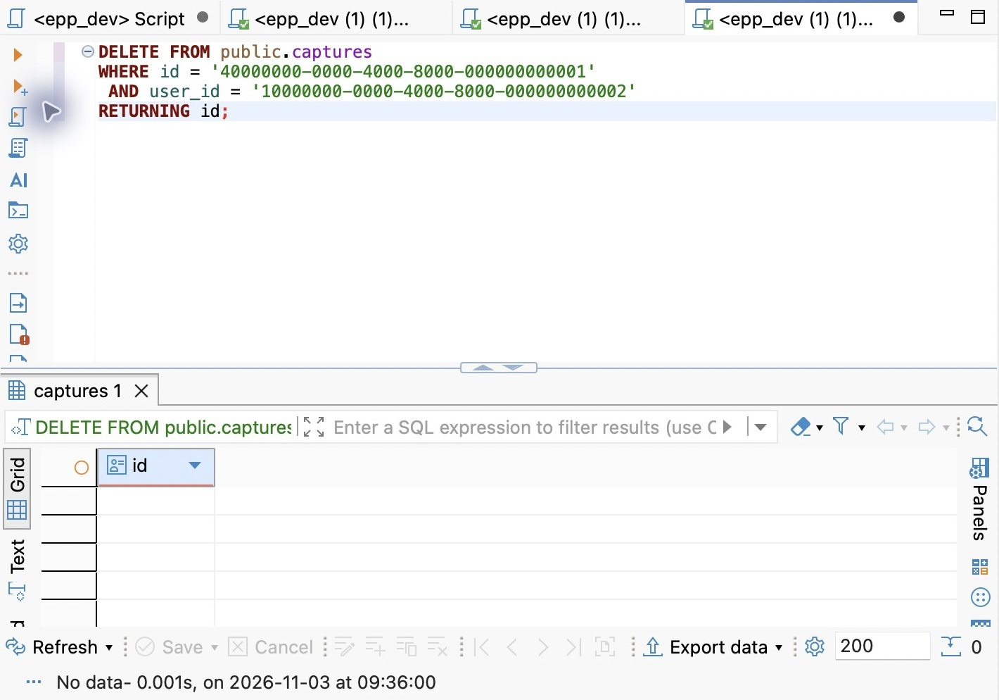
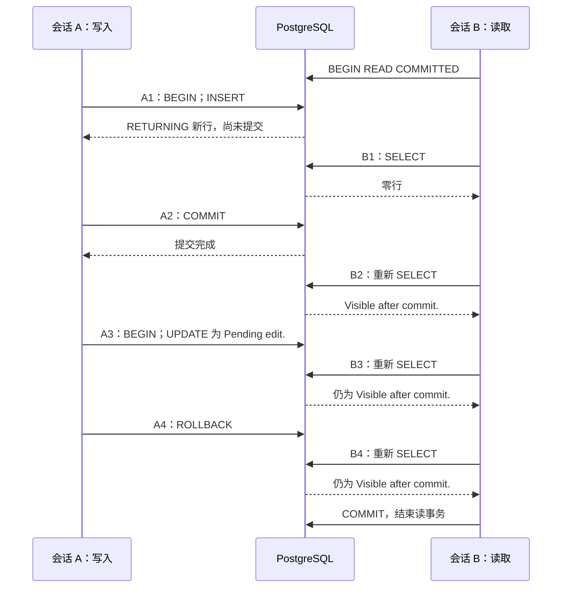

# 第 19 章 SQL：查询、筛选和修改自己的记录

第十八章留下了 public.users、public.captures、一个开发用户和两条记录。模型已经能解释身份、归属与合法状态；现在需要把读取和修改的意图准确交给数据库：要找的是哪些行，结果里一行代表什么，怎样限定写入范围，看到返回值是否就代表数据已经提交。

本章从 `part-03/chapter-18` 继续，代码分支是 `part-03/chapter-19`。默认在 DBeaver Community 操作，配套文件位于 `database/chapter-17/`。Nest 主服务继续使用 Map，不新增修改、删除或分页 API；这里的 SQL 是为后面的存储适配建立依据。原有两条记录始终保留，新增实验行除双会话观察外都在事务内回滚；双会话实验会明确提交一条专用记录，观察完再按固定身份清理。

SQL 的价值在于描述需要的结果及条件。数据库可以选择不同执行计划，但结果的含义必须由我们定义。接下来每次增加一个子句，都先解释它改变了哪个集合或哪种保证，再看界面里的结果。

**分段跟做**　打开一个空白 SQL 编辑器，先在[单表查询](#191-从读取意图推导条件顺序与修改范围)中写出明细，再在[多表报表](#192-先决定结果粒度再选择-join分组与子查询)中把明细变成每人一行。能手算出空用户和并列时间的结果后，可用测站缺报题独立改写查询。[输入参数](#193-把输入值与-sql-结构分开)和[唯一冲突](#194-从冲突结果回到设计规则)分别练习如何接收条件、如何解释写入结果。[提交与可见性](#195-用两个会话看清提交与可见性)需要留一段连续时间，保存当前会话的工作再开始。

## 19.1 从读取意图推导条件、顺序与修改范围

### 恢复工作台，并确定这次读到了谁

按第十七章恢复实例，在 DBeaver 连接 `127.0.0.1:55432/epp_dev`，使用 epp_owner。运行第十八章的 `03-inspect-model.sql`，确认两张表、外键和两条原始记录都在；不重新运行建表与 seed。两条记录 ID 分别以 001、002 结尾，拥有者都是 `10000000-0000-4000-8000-000000000001`，创建时间相同。

沿用 Auto-commit、关闭 Smart commit，以及 SQL Script 的 No commit、Stop + rollback 设置。本章事务由 SQL 中的 BEGIN／COMMIT／ROLLBACK 明确控制；不在未完成事务中切换数据源或自动重连。只读文件可以顺序执行；标有“分阶段”的双会话文件不能全选执行。出现错误先停下，在原会话回滚，再检查原因。

打开 `01-read.sql`，先执行诊断语句：

```sql
SELECT current_database(), current_user, inet_server_addr(), inet_server_port(),
       pg_backend_pid(), current_setting('transaction_isolation');
```

前四项核对库、角色和地址；pg_backend_pid 是这个连接对应的服务端进程编号，后面用来区分两个真实会话；最后一项是当前隔离级别。编辑器标签不同不代表连接一定不同，结果网格也只代表上次执行时取得的结果。

然后读取固定用户的记录：

```sql
SELECT id, original_text, created_at
FROM public.captures
WHERE user_id = '10000000-0000-4000-8000-000000000001'
ORDER BY created_at ASC, id ASC;
```

FROM 指定来源，WHERE 限定结果中的行，SELECT 决定输出列，ORDER BY 决定输出顺序。这里的 user_id 用于限制归属，未必需要返回给页面。显式投影也避免将来表增加内部字段时，`SELECT *` 悄悄扩大输出。SQL 列名仍是数据库表示，第二十一章再映射为原有 JSON 字段。

可以先按“取得来源 → 筛选 → 投影 → 排序”理解这个简单查询的含义；这不是数据库必须逐行执行的算法。优化器可能用索引提前定位，也可能扫描后筛选。把逻辑语义和物理执行分开，才不会从 SQL 的书写顺序猜测性能。

拿到一张“少了一条素材”的工单，先让“少”有个可核对的含义。用户记得保存过的一句话可能在两条素材里都出现过，页面截出的十几个字也可能省掉了头尾空格。素材的完整 ID 才能把两次观察连到同一对象上。配套读取文件还有一条按用户和素材两个身份读取的语句。先运行上面的列表，把两行的完整 ID 展宽，复制第二行的 ID，再运行那条单笔读取。列表第二行和单笔结果应指向同一条记录。这样建立的对应关系，在后面改排序、加搜索后仍能使用。工单如果只有“上次在第二行”，能查的只是某个顺序下现在的第二行，不能据此断定库里曾经丢过数据。

归属在这里还有一层容易忽略的含义。连接诊断里的角色在这两次读取中始终相同，行里的拥有者却是业务用户。数据库允许这个连接读表，接下来才由语句选择当前业务用户的集合。假设编辑器里把拥有者换成第二个演示身份，本节尚未插入他的素材，相同角色、相同表、相同列就会返回空集。若移除归属条件，眼前只有一个用户的数据，结果看起来又与正确查询完全一致。这恰好是单用户样本的盲区。到下一节第二位用户有自己的一条记录时，保留本节这条只读列表再看，就有机会检验这个条件究竟隔开了谁。普通请求一侧的归属条件不能从一次单用户演示的输出反推出来。

#### 把页面草图翻成一条能逐步核对的读取

合上配套查询，只留 DBeaver 左侧的表结构和一个空白 SQL 编辑器。假设你负责素材列表，卡片上显示原文和创建时刻，点卡片能打开同一份素材。先在纸上画一张卡片，在两行可见文字之外留一格写“点击用哪个编号”。这格决定你还需要素材主键。再问服务端用什么限定“我的”：素材行上已经存有拥有者编号，列表却不需要显示拥有者资料。到这里，应该能在没有 JOIN 的情况下写出全部列。两张表有关联，和这次请求必须把两张表都读出来，是两个不同的判断。

第一遍只写 FROM 前后的骨架，选择素材编号和拥有者编号，WHERE 放上已经确定的用户。运行后先认清网格里的两个身份：素材一列有两个值，拥有者一列重复同一个值。再保留原条件，把显示用的原文与创建时间加进选择列，这次应当仍是两个素材编号。如果加一列之后居然少了一行，检查是否同时改了条件或是否在结果网格启用了筛选。普通投影没有“看起来相同就少显示一行”的约定。最后删掉排错时临时展示的拥有者一列，保留 WHERE 里的拥有者，再按需求安排顺序。把“定位对象用的列”“筛选用的列”“交给页面的列”分开想，写 SELECT 就不用从整张表的全部字段往下猜。

用种子刻意做一次容易看错的投影：在原列表的副本里，只选 created_at，保留相同的来源、归属和排序。预期是两行相同的时刻。次数来自两笔素材，显示值相等并不会把两笔创建改成一笔。现在另写一条 SELECT DISTINCT created_at，保留同一个 FROM 和 WHERE，改为只按 created_at 排序。DISTINCT 要求用来排序的表达式也在输出中，照搬上一条的 id 排序会被拒绝。新的查询得到一行，它回答的是“用过几个不同的时刻”。这次变动看起来只涉及一列，却已经改掉结果中一行的含义。回到详情入口想一想：若前端只收到这一个时刻，即使再查一次相等的时间也会找到两个候选，无法据此知道用户点的是哪张卡片。把主键留在列表响应里，就不必等到详情出了歧义才补救。

现在让查询结果的列头对应卡片上的三个字段。先在原编辑器选中下面这条语句单独执行，返回的是本次读取的显示列，不会改变表结构。

```sql
SELECT id AS capture_id, original_text AS preview,
       created_at AS saved_at
FROM public.captures
WHERE user_id = '10000000-0000-4000-8000-000000000001'
ORDER BY created_at, id;
```

结果网格的列头变了，素材编号与原文应当一一对应。这里给列取别名只是改结果名称；preview 仍是保存的完整字符串，没有发生截短、大小写转换或去空格。若需求真的要求“只看前几个字符”，必须明确界面是否只改显示，还是查询只取片段。前者仍可用原文做本地核对，后者拿到的已经不是原始值，不能把这段预览再当成保存时的旧原文。完成对照后，回到以原列名呈现的查询，后面的搜索和修改都以完整值为准。

### 先确定排序契约，再讨论第几页

这两条记录的 created_at 一样。如果只按时间排序，它们谁在前没有保证。补上唯一 id 后，在数据不变时就有确定顺序：升序先 001，再 002。ASC 是升序；若定义“最近在前”，应同时写 `created_at DESC, id DESC`，让相同时间下的规则也明确。

本篇数据库列表选择 **created_at 升序、id 升序**作为默认顺序，表达“按创建时间从早到晚，同一时间用身份稳定打破并列”。这与原 Map 的精确插入顺序有区别：两条记录可能使用同一毫秒，ID 的比较也不代表插入先后；补录旧时间的数据还会排到前面。第二十一章替换存储时，要把新顺序写进 OpenAPI，并检查调用方是否依赖原来的插入顺序。当前 HTTP 实现仍保持旧行为。

现在在同样的集合上取第二条：

```sql
SELECT id, original_text, created_at
FROM public.captures
WHERE user_id = '10000000-0000-4000-8000-000000000001'
  AND strpos(original_text, 'cook') > 0
ORDER BY created_at ASC, id ASC
LIMIT 1 OFFSET 1;
```

两条原文都包含 cook，筛选后仍有两条；OFFSET 1 跳过排序后的第一条，LIMIT 1 最多返回一条，所以结果是 002。LIMIT 和 OFFSET 在语句中的位置不能理解成“先取一条，再跳过一条”。逻辑上是在符合条件的有序结果中跳过偏移量，再取需要的数量。

如果只有一条符合条件，OFFSET 1 就会返回零行，不是 SQL 故障。一般页号从 1 开始时，偏移量是 `(page - 1) × pageSize`；页大小与偏移量需要输入校验。现有 API 只有可选 limit，未提供 page 或 offset；本节的分页用于理解数据库行为，不把新参数悄悄加进旧接口。

唯一排序也不意味着跨请求读取同一份数据。假设第一页读到 001，随后它被删除；下一次请求仍跳过一行，就会越过已经移到第一位的 002。往前插入新行则可能导致重复。因此 OFFSET 适合明确接受数据变化影响的浅分页；深偏移还可能需要处理大量被跳过的行。第三十三章结合真实分页接口展开 Cursor，当前不能用“排序稳定”承诺永不漏读。客户端网格一次抓取多少行，也不等于产品定义的 SQL 分页。

可以用读数组切片的经验来算页界。把满足归属和搜索的行依次写在纸上，第一行的下标记为零。偏移量标记的是第一个允许返回的下标，页大小给这个区间规定最多几个位置。两行数据、页大小为二时，第一页占下标零和一，第二页从下标二开始，一个位置也取不到。第一页正好满，在这组数据上仍然没有下一页；若某个页面拿“本页已满”显示下一页按钮，它表达的是可以试读下一页。如果产品需要准确回答此刻还有没有下一条，可以在相同条件和顺序下多读一个位置，只把规定数量交给页面，用多出来的那条判断是否还有结果。这里比较的是同一次读取里的位置，对下一次打开页面时的数据量没有预言能力。

再想一下网格里点列标题排序的习惯。假定服务端查询已经按时间和 ID 截出第二页，界面再把这一页反向排列，只能改变已取回的行之间的次序。第一页中本该移到最前面的行根本没有传给页面。要检验“最近在前”的改动，应直接看编辑器里的 ORDER BY，并用同一个筛选、同一个偏移量重跑。种子时间相等，这时第一位随 ID 方向改变，正好排除“其实只改了时间方向”的实现。若两条样本的时间原本不同，错误的第二排序键在每页上都可能毫无破绽。检验排序的样本要覆盖会用到下一比较项的那一次比较。

有时交接时会有人指出，明明表上有按用户建的索引，为何还要在查询里写顺序？那个索引让数据库有机会较快找到同一用户的一批行；对这个用户而言，这些行的索引键都相等。即使某次页面恰好按插入先后读出，也没有给调用方一个可以依赖的比较规则。把需求写成“先比创建时间，相等再比完整身份”之后，执行器可以选择怎样满足顺序，包括额外排序。以后为查询添加索引时，可以用同一组并列数据核对输出应当保持的次序，另用运行证据衡量成本。两条种子的快慢无法替代后一项判断。

#### 从五张便签推导一页的第一行

真实种子有一个局限：两行既同属一人又同时创建。如果有人把排序误写成只按 ID，仍会交出眼前这两行的正确次序。给自己五张便签，每张记一个素材代号、归属、创建分钟和原文。下面是只存在于一条 SELECT 内的输入。编号用小整数，分钟只代表同一小时内的先后；它们没有占用任何真实用户或素材身份。可在当前校验用的 SQL 编辑器单独运行，语句结束便无需清理。先看 VALUES，在读最后几行 SQL 之前算一遍。

```sql
SELECT s.id, s.minute_no, s.body
FROM (VALUES
  (14, '甲', 8, 'cook at home'),
  (12, '甲', 9, 'cook for two'),
  (11, '甲', 9, 'cook again'),
  (15, '乙', 7, 'cook outside'),
  (13, '甲', 6, 'read quietly')
) AS s(id, owner_name, minute_no, body)
WHERE s.owner_name = '甲' AND strpos(s.body, 'cook') > 0
ORDER BY s.minute_no, s.id
LIMIT 2 OFFSET 0;
```

括号里的 VALUES 每组括号给一行，右侧的四个列名按位置贴到每行四个值上。先用笔划去乙的十五号，虽然它也有搜索词，却不在甲的集合中。再划去甲的十三号，虽然最早，但不含词。还剩十四、十二、十一，照抄 VALUES 的书写顺序会把十二排得太靠前；只按编号又会把八分创建的十四误放到九分之后。先比分钟，得到十四在前、两条九分在后。九分的两条才需要比较第二个键，因此完整合格序列应是十四、十一、十二。第一页留两个位置，返回十四、十一。数据库的行比较并不要求分钟和编号同时变大才换位置，第一项能分胜负时，比较已经结束。

保留这条查询再派生第二页，不改所有者、搜索词与排序，只把偏移量改成二。返回十二，不能因为只剩一项就从乙那里补足两项。如果第二页又出现十一，检查是否只减了一得到偏移一，却忘了乘以每页的条数；如果第二页是十四，看看是否改成按编号单独排序。由错误的具体编号倒推哪一道筛选或排序出了问题，比只看“也是一行”更能验出含义。这批输入还帮助区分默认顺序与调用者想要的展示方向：若两项都降序，序列应当是十二、十一、十四，升序的最后一项确实变成降序的第一项。

现在把参考查询折起来，只留五张便签，从空白写一份变化需求：甲想复习最近的素材，**所有原文都参加**；同一分钟按编号从小到大看，每页两条，取第二页。先列完整序列再截页。核对时应是十一、十二、十四、十三，第二页为十四、十三。这个需求只反转分钟的方向，明确保留编号升序，故意与前面“两项都反转”不同。若结果只剩十四，很可能还留着 cook 条件；若返回的是十一、十二，可能改了顺序却仍在取第一页。还有一种错误恰好给出正确的第二页：把并列的十一、十二也排成降序。第二页恰巧没有并列项，所以最后还须取回第一页，确认十一在十二之前。一个查询的部分输出相同，不能替代对真正有区分力的那两行做比较。

#### 相邻两段复习时间，分界那一分钟归谁

把五张便签留在编辑器里，再读一个与翻页不同的需求。甲按创建时间分批复习，第一批从八分开始，到九分切换；第二批从九分开始，到十分切换。两批都看全部原文。这里需要先问一句：九分创建的素材应当出现几次？按“到点切换”的约定，它们全部归第二批。试着在纸上只写第一批的两个比较符号，再把上下界整体往后挪一分钟。起点要允许相等，终点只允许小于，这样上一次没取到的边界值恰好能在下一次取到。

回到刚才那段 VALUES，保留原样的五行输入和归属条件，删去搜索与截页，把范围写进 WHERE。第一批应加上 `s.minute_no >= 8 AND s.minute_no < 9`，沿用分钟、编号升序，应当只见十四。把两个数字分别换成九和十，结果应当是十一、十二。两批合看，甲在这两分钟创建的三张卡都能点到一次。乙的十五与甲的十三分别在七分和六分，不应因为删去了搜索条件就混进来。若第一批还出现十一、十二，先看上界是不是写成“小于等于”，或者用了包含两端的 BETWEEN。若第一批正确而第二批全空，要看是否把第二批的下界写成了严格大于。

这里能从结果读出两种遗漏。有读者换了范围，忘记删掉原来的每页两条，眼前第一批一条、第二批两条，数量竟然都对。把两批合成一次读取，再想一想：从八分到十分应当有三条，保留每页两条只会交出十四、十一。另一种情况是只检查两份清单的总条数，看到重复项却误以为是两份不同素材；应该抄下两份清单的编号，查看交界处有没有同一张卡。把这种写法迁移到真实素材的 created_at 时，先定清楚两端代表的实际时刻，补齐所在时区，再沿用相同的比较关系；没有必要猜测某分钟“最后一个可存的小数秒”。

### 搜索要保留原有匹配语义

先区分两种听起来几乎一样的要求：“第二条记录是否包含 learning”，和“包含 learning 的第二条记录是什么”。种子里的 002 含 learning，001 不含。第一问要先对全部记录排序取第二条，再检查原文；第二问先筛到只剩 002，再跳过一条，结果是空。上面的列表回答第二问。把搜索词从 cook 换成 learning、先用 OFFSET 0 再用 1，就能从同一批数据看到差别。决定子句位置的是“在谁当中排第二”，不是界面上先有搜索框还是先有分页器。

原服务使用 `originalText.includes(text)`：大小写敏感，搜索值按字面内容解释。这里用 `strpos(original_text, 'cook') > 0`，在本篇 UTF8、C 区域设置下，返回子串首次出现的位置，找不到是 0。位置从 1 开始，和 JS 的 indexOf 从 0 开始不同，但我们只用它判断是否存在。

不要顺手替换成 `LIKE '%输入%'`。LIKE 中 `%` 表示任意长度内容，`_` 表示一个字符；用户搜索百分号时可能意外匹配所有记录。ILIKE 还会引入大小写不敏感的含义。参数化能防止输入改变 SQL 结构，却不会取消 LIKE 自己的通配语义，这两件事需要分别决定。

执行配套文件末尾的只读对照：

```sql
SELECT strpos('100% ready', '%') AS literal_percent,
       strpos('a_b', '_') AS literal_underscore,
       strpos('Cook', 'cook') AS case_sensitive;
```

预期为 4、2、0。LIKE 并非不能用：若需求就是前缀或模式匹配，应该选择它；若要用它表达字面匹配，则必须正确转义模式元字符。本章选择直接表达字面子串的函数，不提前承担另一套模式规则。现有 q 的非空白、最多 200 个 UTF-16 单元限制仍须在应用入口遵守；数据库可表示性也要在接入时核对。

看第一条种子的首尾，原始文本特意保留了空格。界面把它画成单行时，空白边缘很难看见。要判断“输入带一个空格的词怎么也能搜到”，先用只读查询同时投影原文、字符长度和子串位置，仍按这个人的两条 ID 排序。例如用 `strpos(original_text, 'cook.')` 看连续的字母和句点，用 `strpos(original_text, 'cook. ')` 在句点后多要求一个空格。前一个词应命中两条，后一个只应命中带尾随空格的第一条。这次改变的只是搜索值里的一个字符。若查询里擅自把原文或搜索值两边去空白，看似做了体贴的输入整理，实际就改变了第二次的预期。写入时保存什么、搜索时比较什么、页面展示时折叠什么，要各自从能观察到的结果作判断。

还要分清“按位置帮助排错”和“把位置当作页面高亮坐标”。当前查询只检查是否大于零，这个布尔判断不需要把数据库的字符位置换成 JavaScript 的字符串下标。如果原文首字符是一个需要两个 UTF-16 单元表示的表情，紧跟着一个英文字母，按字符数它在第二位，而在 JS 里这个字母的起始下标是二。简单把数据库给的位置减一就会落在表情内部。本节保留原 API 的意图是判断是否包含子串。将来若要返回高亮区间，接口还得约定起点是否从零算、长度按哪种单位，或让页面对收到的原文自行定位。单凭两条英文种子测对了命中与否，还不能推导出跨端位置协议。

#### 先把筛选条件写成一列，再决定要不要删行

读到空网格时，最终结果已经把原因一起藏掉了。可以保留可信用户的范围，把有疑问的文本条件从 WHERE 暂时搬到 SELECT，给每条本来有资格参加的记录附上一列“匹配吗”。这样未命中的行还在，能看到被拒的究竟是哪一句原文。先预测两条种子的结果：如果词只有句点，两个句子都含句点；如果词是句点和一个尾随空格的组合，就只有第一句符合。下面直接在 DBeaver 运行，上下两行仍对应原来的两个身份。

```sql
SELECT id, '[' || original_text || ']' AS visible_edges,
       strpos(original_text, 'cook.') AS cook_at,
       strpos(original_text, 'cook. ') > 0 AS has_trailing_space
FROM public.captures
WHERE user_id = '10000000-0000-4000-8000-000000000001'
ORDER BY created_at, id;
```

两侧的方括号只在这次显示时加上，让空格在句点与右括号之间显出宽度。从左往右计算位置，第一句前面有两个空格，第二句的缩写中有一个撇号；它们都是值中的字符。先确认 cook_at 两行都为正，再看最后一列只有第一行为真。若两个位置都为零，不要先改偏移量，偏移量无法使单行里的字符串突然含有一个子串。若匹配列正确，看不见记录却只发生在结果分页时，沿用这份身份序列去检查截页。两次读取使用同一个目标用户，这样诊断用的明细不会因为放宽归属混入其他人的文本。

现在独立改写成只交付命中项的列表。保留拥有者，把最后一列的表达式作为 AND 条件加到 WHERE 中，选择列只留 id 和 original_text。这里容易写出一种很像 JavaScript 的表达：“已经计算了 has_trailing_space，就在 WHERE 判断这个名字吧。”在同一层简单 SELECT 中，WHERE 不会把 SELECT 为输出列起的名字当作先前赋好的变量。可以在条件里直接使用原表达式；若确实需要多次使用命名结果，可以在外层从内层已经命名的查询结果再筛，后面组织报表时会见到这种写法。对此处的一项短判断，直接写表达式就足以把意图讲清。

验收这个改写时再变一次搜索目标：查找包含大写 `I`、同时不含 `learning` 的原文。先在纸上分列“大写字母出现的位置”和“第二个词出现的位置”，只有前列大于零且后列等于零才保留。两个种子都有大写字母，其中学习烹饪的那句应当离开，结果只剩第一条。若反过来要求“至少满足其一”，先把两个判断各算成布尔值，再把它们作为一对括号中的 OR 条件与拥有者相连，第二条也会回来。用两个都合法的业务条件区分“同时”和“至少一个”，就能检查布尔组合是否表达了需求。练习只是在编辑器选择读哪些素材，现有应用的一个搜索框仍按单个字面子串解释输入。

#### 同一批命中项，先显示哪一条

再给空白页一个很小的需求变化：校对原文时，希望先看搜索词在句子里出现得较早的那条。如果两句中的位置相同，再沿用创建时间和编号的顺序。这个需求只用于校对网格，日常列表的排序契约仍是时间、编号。先拿刚才的两格正数手算，第一句的位置是二十二，第二句是十七，所以用 cook 搜索时第二句应排到第一行。若实际先显示素材一，且两格数字确实是二十二和十七，就知道匹配算法已算对，差异在排序依据。

从刚才显示位置的语句出发，不看下面的答案改写三处：先让不含词的行离开，再把匹配位置放到结果列，最后把它放在时间之前排序。为什么先筛行？找不到时函数给零，如果把全部位置按从小到大排序，不匹配反而会比任何命中都靠前。恰好两条都含 cook 时，这个错误并不会现形，写完必须再用另一个只命中一句的词检验。

```sql
SELECT id, original_text, strpos(original_text, 'cook') AS first_hit
FROM public.captures
WHERE user_id = '10000000-0000-4000-8000-000000000001'
  AND strpos(original_text, 'cook') > 0
ORDER BY first_hit ASC, created_at ASC, id ASC;
```

这里 ORDER BY 可以引用输出列名 first_hit，正好与刚才在同一层 WHERE 中不能依靠输出别名形成对照。先执行，比对编号及位置；然后把两处单词都改成 learning，再执行一次。现在只有第二条，位置为五。如果出现两行且第一条的位置为零，检查 WHERE 中的搜索词是否仍是 cook；如果只有第二条却显示十七，检查选择列是否忘了换词。这个例子故意让同一业务输入在手写 SQL 里出现两次，使你能看到只改其中一次会怎样。到 19.3 可以让两处都引用同一参数，从源头表达“显示位置和筛选用的是同一个词”。

最后把需求改回按时间显示，同时保留位置这一列供校对。要修改哪一行？应当从排序列表移去 first_hit，WHERE 和 SELECT 不需要变化；两条都含 cook 时素材一回到最前。如果为了挪动行的位置而改了匹配条件，返回集合也随之改变，已经动错地方。现在可以把这条校对语句留在编辑器中，写操作另起空行。网格上的第一条随排序而变，下面真正要更新哪条记录，必须重新用完整身份确定。

### 修改前先限定对象，修改后读取实际影响

SELECT 可以返回许多行，UPDATE、DELETE 也按条件作用于一个集合。`WHERE id = ...` 不是可有可无的修饰；没有 WHERE 就会面向整张表。按 ID 操作自己的记录时，还应包含可信的 user_id，避免把“知道 ID”误当作“有操作权限”。当前 SQL 中的身份是固定演示值，未来从服务端认证结果取得。

在 `02-write-and-rollback.sql` 中逐条执行下面一组，均停留在同一个编辑器：

```sql
BEGIN;
SET LOCAL lock_timeout = '3s';

INSERT INTO public.captures (id, user_id, original_text)
VALUES ('40000000-0000-4000-8000-000000000001',
        '10000000-0000-4000-8000-000000000001', 'A temporary draft.')
RETURNING id, original_text, created_at;

UPDATE public.captures
SET original_text = 'A corrected draft.'
WHERE id = '40000000-0000-4000-8000-000000000001'
  AND user_id = '10000000-0000-4000-8000-000000000001'
RETURNING id, original_text;
```

INSERT 省略 created_at，让默认值确定时间，RETURNING 取回实际写入的行；UPDATE 的 RETURNING 默认返回更新后的内容。因此两次结果应分别包含 temporary 和 corrected。它们表示语句完成时的影响，尚不表示事务已经提交。lock_timeout 限制等待锁的时间，避免实验意外等待别处未结束的写入；它不是整个查询的执行时限，超时后同样要回滚并排查。


观察完整实验 ID、包含归属的 WHERE 和返回的 A corrected draft.。结果表格展示本语句实际影响的一行；当前仍处在前面 BEGIN 开启的事务中，继续下面的操作后再统一回滚。

另一个容易丢失的信息是用户编辑时看到的旧值。设想两个编辑页都读到 temporary，甲先改成 corrected，乙过了一会儿才保存自己的文字。仅用身份和归属做条件，两人都能选中同一行，乙的保存可以覆盖甲刚交付的结果。若本次意图是“只修改我看到的这个草稿”，可以把当时读到的旧原文也写入这条更新的条件。先停在当前事务，用 SELECT 预览同一素材 ID 和拥有者，再加上原文条件 `AND original_text = 'A temporary draft.'`，应选不到行。只把条件里的旧原文换成完整的新值 `'A corrected draft.'`，应读到刚刚更新的一行。两次都用读取即可，保留这行供下面的删除实验使用。这个小对照解释了为什么后文双会话脚本会把预期旧原文带入 WHERE。用文字作条件只能检验当前内容相等，如果中间被改走又改回来，它辨不出经历过的两个动作。真正需要区分每一代编辑结果时，就要单独保存能随修改推进的版本依据。

接着故意使用不匹配的拥有者删除这个实验 ID：

```sql
DELETE FROM public.captures
WHERE id = '40000000-0000-4000-8000-000000000001'
  AND user_id = '10000000-0000-4000-8000-000000000002'
RETURNING id;
```

结果应为零行，执行统计为零条删除；数据还在。零行是正常结果，可以表示对象不存在或不满足条件，不能只凭这一次结果区分二者。面向用户的接口是否统一返回“未找到”，要结合权限边界设计，不能为了区分而先查询并泄漏他人的记录。



WHERE 中的记录 ID 没变，user_id 换成了另一个用户，结果区显示 No data。这里的零行来自实际执行，不是客户端忘记刷新；可以回到同一事务查询这条记录，确认它仍存在，再使用正确归属继续删除。

再用正确归属删除，并结束实验：

```sql
DELETE FROM public.captures
WHERE id = '40000000-0000-4000-8000-000000000001'
  AND user_id = '10000000-0000-4000-8000-000000000001'
RETURNING id, original_text;

ROLLBACK;
```

这次应返回一条被删除记录，其原文为 corrected；ROLLBACK 撤销整组实验，最初的插入也不存在了。重新运行 01-read.sql 仍能看到原来的 001、002 两条记录。这里的 `400...` 专用实验身份与 `200...` 原始记录区分开，不能把实验 SQL 改成对原始 ID 的批量修改。


结束事务后重新执行 SELECT，实验 ID 没有留下记录。此图只检查这一个实验 ID；原始两条记录是否保留，仍按上面的 01-read.sql 单独比较，不能从实验行消失推断整库状态。

预览 SELECT 有助于发现错误条件，但在有并发写入时，“预览了两行”不能保证稍后 UPDATE 仍只影响相同两行；返回行数和 RETURNING 才是该次语句的实际结果，要求更强保证时需要事务与并发策略。也不要把普通 UPDATE 的成功理解为它保留了历史，覆盖就是覆盖，第十八章的版本判断仍然适用。

从适配层接手这个更新时，可以给返回值配上两个不同的问题。其一是“我的条件选中了谁”，看返回的身份和条数。其二是“这一行现在满足我要的状态吗”，看返回的新原文。假设把 corrected 再设为 corrected，在本章没有额外更新触发器的表上，条件仍能匹配这一行，也仍会返回它。于是“影响一行”不足以统计用户实际改动过几次文字。如果产品要求相同值不算改动，可以在更新条件中要求当前原文与目标不同；代价是零行又多了一种解释，调用方必须约定怎样处理已是目标值的情况。先决定成功是“存在且达到目标”还是“确实发生一次变化”，才能解释同一条数的业务意义。

这些判断也决定了接手故障时该留下什么证据。若编辑器上只剩最后一个空网格，沿固定身份重读，可以知道眼下有无这条记录，却分不出此前是从没插入、插入后删除，还是整段事务回滚。要在跟做时分辨三者，在插入返回后、更新返回后、错误归属的删除返回后分别记下动作、条数和实验 ID，最后才运行回滚。这样即使结束状态都是原来的两条记录，也能指出哪一次写入确实命中了目标，哪一次是条件正常排除了它。日常服务可以保存这类操作和数量信息来排查，实验中为人眼核对而展示的完整原文没有必要随请求写进日志。

#### 从空白写一次有旧值前提的更正

刚才配套把写入过程安排好了。现在给自己一份没有成品语句的编辑任务：甲的十一号卡片原写着“周一复习”，他想改为“周三复习”。甲的十二号也写着“周一复习”，乙另有一张同文卡片。本次保存只针对甲刚点开的十一号，而且只在库里仍是他看到的旧文时执行。先圈出“选谁”“现在应当是什么”“想让它变成什么”。如果三句话都翻译成 SET 后面的赋值，更新就没有选择条件了；如果把新值放入 WHERE 当作查找条件，又会在改动发生之前就找不到目标。

为了能检查选错哪一张，这次不用种子表。确认上一组操作已经回滚，在同一个 DBeaver 编辑器单独执行下列准备，保留这次新事务直到本练习末尾。临时表只在当前连接使用，列名与整数编号仅供本题。若同名表已经存在，先核对是否还有自己上次未结束的练习，不覆盖它。

```sql
BEGIN;
CREATE TEMP TABLE epp19_edit_cards (
  card_no integer PRIMARY KEY,
  owner_name text NOT NULL,
  body text NOT NULL
) ON COMMIT DROP;
INSERT INTO pg_temp.epp19_edit_cards (card_no, owner_name, body) VALUES
  (11, '甲', '周一复习'), (12, '甲', '周一复习'), (21, '乙', '周一复习');
```

先不用 UPDATE，在空白处只写一条 SELECT，读这三行的编号与原文，再写第二条加条件的读取。为了能观察每个条件的作用，可以先固定旧原文，结果三行；再固定甲，剩两行；最后限定十一号，才只剩一行。SQL 的 AND 没有要求必须按这三个条件的书写顺序进行物理筛选，这里逐步增加条件是给人做诊断。若一开始就用唯一编号，第一步已经只剩一行，后面再补归属和旧文，行数都不再变化。那不能说明后两个条件可以省略，只能说明当前样本恰好同时满足它们。

把第二条读取保留下来作为预览，在另一条语句中试写更正。将预览的 WHERE 完整带过去，新值只放进 SET。执行前先预计返回的编号、旧文和新文，再与下方写法对照。PostgreSQL 18 的 RETURNING 可以同时读出本次变更前后的列值，便于把“刚才预览到的行”和“这次语句实际改到的行”分开核对。[PostgreSQL 18 的 RETURNING 说明](https://www.postgresql.org/docs/18/dml-returning.html)

```sql
UPDATE pg_temp.epp19_edit_cards
SET body = '周三复习'
WHERE owner_name = '甲' AND card_no = 11 AND body = '周一复习'
RETURNING card_no, old.body AS before_edit, new.body AS after_edit;
```

第一次应返回十一号、“周一复习”、“周三复习”。先别回滚，立即再执行同一条 UPDATE，应当返回零行。此时想判断原因，在同一事务里按甲和十一号读当前原文即可，当前值已经是“周三复习”。如果去掉旧文条件再试，语句仍可能返回一行，但你检验的已经是“把当前值设成目标”而非“本次编辑依据的旧文仍有效”。要比较两种成功定义，可以在纸上推算后者的返回，不必改掉手里的保护条件。返回的 before_edit 与 after_edit 属于这一次 UPDATE 的结果，表里仍只有 body 这一列，没有因此多出一张可回放所有编辑的历史表。

接着改变编辑对象，自己从空白写一份预览：甲现在打开的是十二号，仍然看到周一，希望也改到周三。预览应读出一行十二号和周一。先只做预览，再按编号列出所有三张卡片，此刻应当是十一号周三、十二号周一、二十一号周一。若十二号已经是周三，第一条更正很可能把同一人的相同旧文都改掉了；若二十一号也变了，连归属范围都丢了。只核对十一号的新文字，以上两类问题都可能通过。检验一条写语句还应挑一条“很像但不该动”的近邻，能明确说出它靠哪一项条件留在范围外。

最后回到本练习的原编辑器结束事务：

```sql
ROLLBACK;
SELECT to_regclass('pg_temp.epp19_edit_cards') AS remaining_table;
```

这里预期返回**一行，列值为 NULL**，表示按这个临时名称查不到表；这与刚才 UPDATE **返回零行**是两种不同的结果。前者是我们主动查询一个名称有没有对应对象，查询本身产生了一格答案。后者是写语句没有找到同时满足三个条件的对象，没有可以交回的行。两者在图形工具里都可能看着很空，但一个要查对象寿命，一个要查匹配条件。如果中途停止练习，只在原编辑器回滚即可，因为临时建表本身也在本次事务内。回到下一节时继续使用原来的两条 public.captures 种子。

## 19.2 先决定结果粒度，再选择 JOIN、分组与子查询

### JOIN 是按条件组合行，不是自动生成嵌套对象

页面需要“记录及拥有者的创建时间”时，可以从记录出发关联用户：

```sql
SELECT c.id, c.original_text, u.id AS owner_id,
       u.created_at AS owner_created_at
FROM public.captures AS c
JOIN public.users AS u ON u.id = c.user_id
WHERE c.user_id = '10000000-0000-4000-8000-000000000001'
ORDER BY c.created_at, c.id;
```

c、u 是当前查询的表别名。ON 表达如何配对，WHERE 限制需要保留哪些组合。每条记录的 user_id 对应 users 的唯一主键，且有非空外键，所以每条记录恰好找到一个拥有者，结果仍是一行一条记录。用户列会随不同记录重复出现，这是查询结果的表示，并不意味着存储模型退回了重复维护用户资料。

反向从 users 出发 JOIN captures，同一个用户有两条记录，就会形成两行组合。JOIN 没有自动把两条记录塞进一个 captures 数组。如果需要一行一个用户，需要聚合或另一种读取组织；仅仅改变 SELECT 列，把记录 ID 隐藏掉，不会消除这两行。

省略正确的关联条件可能产生笛卡尔组合：两个用户与三条记录会有六对，而不是自动按同名字段匹配。加 DISTINCT 有时能让界面看起来没有重复，却可能掩盖错误关联或错误结果粒度。先数清每一侧能匹配几行，再选择去重，不能把 DISTINCT 当修复 JOIN 的默认动作。

若习惯把两次接口响应按 ID 放进 Map，可以从那里理解关联条件。拿素材行上的拥有者身份，到以用户主键为键的 Map 里查一次，把命中的用户创建时间复制到这条结果上。用 SQL 写出这个关系，就不必先把所有用户传到应用。这里之所以能用“查一次得到一个”的思路，是因为键的唯一性确实由表保证。若反过来把素材按拥有者放进一个只存单个值的 Map，第二条会挤掉第一条；正确的内存表示得让这个键对应一个数组。关系两端的列可以有同一种类型，沿两个方向查找时却有不同的数量保证。

这种推导还有个很实用的校对办法。在 DBeaver 的明细查询里同时取素材自己的 ID、素材行的 user_id 和用户行的 id，给后两列起可辨认的名字。对每一行，后两列应该相同；素材 ID 则应当可以重复指向同一拥有者。假如误写成按两表自己的 id 配对，语法和类型检查都能通过，因为两列都是 UUID，但当前种子的用户身份和素材身份来自不同的值，找不到这样的组合。此时把 JOIN 改成 LEFT JOIN 可能恢复了左边的行数，右边用户创建时间却全为空。按列把配对值摆出来，比从最终“时间字段为空”猜是驱动解析失败更接近原因。外键声明提供了写关联条件的依据，数据库不会替一条写错的查询改条件。

#### 两个时间都叫 created_at，怎样在结果里认出它们？

先把页面上的句子拆成两个能分别查证的问题。点开一条素材，正文旁边写着“素材创建于……”，旁边的拥有者信息写着“加入于……”。第一个值在素材行上，拿着素材身份可以直接读到；第二个值在用户行上，拿着素材身份还差一步。试着遮住上面查询的选择列表，只看来源和关联条件，自己写出这两个字段。给它们各起一个能原样当表头的名字，连同素材身份一起选出来。这样，复核的人即使看不到 SQL，也能指出界面上的哪一个时间来自哪一列。

在本节开头的种子上，先看第十八章的插入语句：两条素材都明确给了同一个创建时刻，用户只给了身份，建表时规定的默认值会替用户填写创建时间。因此前一个表头下应当两次读到那个固定时刻，后一个表头下应当两次读到这次建种子时那位用户的同一个时间。不能从书里抄一个固定的注册时间当验收值。要取得本机可对账的值，在 DBeaver 另选一条只读语句，按完整用户身份从 users 单独读取创建时间，再回到结果标签逐行对。即使数据恰好使两个时刻看起来很接近，两次单表读取仍能验证列的来源。

这里还藏着一个写列表时很实际的选择。若需求只是给每条素材标出拥有者身份，素材行上已有外键，读这一列就够了。加入时间则不能用同一办法推出；两位用户完全可以在同一时刻各写一条素材，谁先注册仍未知。动笔时先在纸上给每个输出列标出原表，只有确实缺少来自另一张表的事实，才进一步写出通向那张表的键。这个方法也能帮你删去多余的关联：从上述查询去掉用户表之前，先指出哪一列会失去来源。若一列都指不出来，还要检查原来的关联是否承担了筛掉某些行的职责；在本例非空外键和唯一主键都成立时，素材到拥有者这一步不会筛掉正常的素材。

### 从空白处写一张用户素材汇总表

换一个需求：给维护者一张表，列出三位演示用户各自有多少条素材、最近一条是什么时候创建的。没有素材的人也要列出。先别翻到配套里的查询。上一条 SQL 的一行是一条素材；这次即使某人一条也没写，他也应该占一行。先定下这条要求，才知道应该从用户找素材，而不是从素材找用户。

只有一个用户且他有记录时，看不出 LEFT JOIN 的必要性。打开 `03-joins-and-groups.sql`，先逐条执行 BEGIN、lock_timeout 和两段 INSERT；加入两个实验用户，只有第二位拥有一条实验记录，第三位没有记录：

```sql
BEGIN;
SET LOCAL lock_timeout = '3s';

INSERT INTO public.users (id) VALUES
  ('10000000-0000-4000-8000-000000000002'),
  ('10000000-0000-4000-8000-000000000003');
INSERT INTO public.captures (id, user_id, original_text, created_at)
VALUES ('40000000-0000-4000-8000-000000000002',
        '10000000-0000-4000-8000-000000000002',
        'This is my second workspace.', '2026-11-01T08:00:00.000Z');
```

固定 ID 若已存在，先回滚并查明来源，不用冲突忽略或覆盖更新绕过。下面的查询都在这个会话里进行，文件末尾再 ROLLBACK。它们读取所有三个演示用户，是管理观察，不是普通用户列表接口的授权方案。

在执行过 INSERT 的 **同一个 DBeaver 编辑器** 末尾另起空行写查询，不开新连接。先根据两条种子记录和刚插入的那条写下预期，时间统一按 UTC 表示（网格可能显示本地时区）：

| 用户 ID 尾号 | 素材数 | 最近创建时间（UTC） |
| --- | ---: | --- |
| 001 | 2 | 2026-10-31 08:00:00.123 |
| 002 | 1 | 2026-11-01 08:00:00.000 |
| 003 | 0 | NULL |

从你已经会读的单表查询起笔：自己写 `SELECT u.id FROM public.users AS u`，用 `WHERE u.id IN (...)` 限定刚才的三个完整 UUID，按 `u.id` 排序。选中自己写的整条语句执行，先核对三个身份，不看素材数。下一步只问“这个用户能配上哪条素材”，把右侧的素材 ID 也放到结果里。先试普通 JOIN：如果 003 消失，问题已经出在配对这一步，还没轮到计数。再改成保留全部左侧用户，和下面的明细对照：

```sql
SELECT u.id AS owner_id, c.id AS capture_id
FROM public.users AS u
LEFT JOIN public.captures AS c ON c.user_id = u.id
WHERE u.id IN ('10000000-0000-4000-8000-000000000001',
               '10000000-0000-4000-8000-000000000002',
               '10000000-0000-4000-8000-000000000003')
ORDER BY u.id, c.id;
```

IN 限定观察的三个用户。预期四行：用户 001 对应两条记录，002 对应一条，003 对应一行 capture_id 为 NULL 的结果。LEFT JOIN 保留左侧没有匹配的行，用 NULL 补右侧字段。这一行不是数据库里多出了一条空记录，而是查询构造的表示。

在四行明细上多停一下。用笔把每个完整用户 ID 画成一栏，把右侧出现的素材身份记在对应栏里，第三栏空着。纸上有三个栏位、三个实际素材身份、四行查询输出；前两个数字恰巧相同，指代却不同。这也解释了为何对结果末尾直接取 length 是个危险的选择。如果调用者问用户数，应数三个栏位；问素材数，应数写进去的三个身份；问此次数据库传回多少个组合，才数四。现在把第一人的第二条素材在纸上盖住，用户数保持三，素材数降到二，外连接结果降到三行。能分别预测这三个数怎么变，就不会因为它们在某次截图里一样而拿错指标。

左表的选取还有一个表面合理的替代方案。先对素材按拥有者分组，把小表再关联到完整用户名单。这样数素材的那一步只接触真实素材，可以放心数行；但小表里没有第三位用户这个分组。关联回用户名单之后，他的统计列整体缺失，才需要把缺失的计数解释成零。若在素材小表内部给计数包一个空值替代函数，依然造不出那个根本未形成的组。眼前先关联再分组的方案让每人都已有一组，通过数右侧身份自然得到零。两条路线都能表达需求，调试时要找零从哪一步产生，不能在看到一个空格时随手把所有空值都填零。例如最近时间本来就该保留空值，填一个任意日期会让从未写过的人在时间轴上多出一次活动。

#### 名单上写着一个身份，就一定能报零吗？

先把刚才写下的需求只改几个字。维护者给你一张待核对的名单，问“这几位分别有多少素材；如果某个身份查无此人，也请告诉我”。原报表从用户表出发，用 IN 测试每一行是否属于指定范围。假设多给一个这个练习库里不存在的身份，数据库在用户表中找不到一行可以通过测试，结果就只剩三人。此时界面既显示不出谁缺席，也无法凭缺少的行分辨是没查到人还是根本没请求过这个人。需求中的“每一行”已从一名登记用户改成了一个待核对身份，左侧应当相应地换成输入名单。

在已加入实验用户的原编辑器中选中下面整句运行。VALUES 把列举的值当作一张可读取的小表，括号后的 owner_id 给唯一的一列起名。它只供这条语句使用。尾号四在本章的干净练习数据中没有登记；这里只把它作为待读取的名字，并不插入第四位用户。

```sql
WITH requested(owner_id) AS (
  VALUES ('10000000-0000-4000-8000-000000000001'::uuid),
         ('10000000-0000-4000-8000-000000000002'::uuid),
         ('10000000-0000-4000-8000-000000000003'::uuid),
         ('10000000-0000-4000-8000-000000000004'::uuid)
)
SELECT r.owner_id AS requested_id, u.id AS registered_id, c.id AS capture_id
FROM requested AS r
LEFT JOIN public.users AS u ON u.id = r.owner_id
LEFT JOIN public.captures AS c ON c.user_id = u.id
ORDER BY r.owner_id, c.id;
```

从左到右读五行。第一人有两行，第二人有一行，各行的三格都有值。第三人占一行，中间格有用户身份，末格空；第四人的中间格已经空了，末格也空。这两个空的素材身份对应不同的答复。只看末格就写“各有零条”，会把无此人写成有这样一个账号。若报表要折叠回四行，先保留请求身份，再保留“有无登记”这个事实，最后才数实际配到的素材。下笔前可以先写出两个要在界面上并排读懂的状态，已登记且无素材、未登记所以无从统计。哪怕产品最后都画一道横线，查询结果也应该足以让维护者把两者区分开来。

再问输入中的同一个身份是否允许出现两次。用 IN 写两个相同常量，只是在同一行上两次检查相同的成员条件，它仍然只通过一次。在上面 VALUES 里重复第一人的输入行，两份左行则分别能够配上两条素材，会出现四行属于第一人的组合。若需要“一份名单里的不同身份”，可以先让输入按身份去重再关联；若需要“逐项反馈”，就应当给输入另带一个位置号，按位置核对两份答复。只在最外层把两列看起来相等的显示文字去重，可能连两条内容相同的真实素材也一并抹掉。回到本章原报表时，三位已登记用户各自的主键已经能充当名单，这一层输入表就可以拿掉。

### COUNT 数的是哪一种东西

接下来要把四行明细收回三行。同一个用户的行归到一组；组里的素材按身份数，创建时间取最大的那个。001 两条素材恰好同时创建，不能数不同的时间；003 根本没有创建时间，不要填今天。在刚写的查询上改，先保留一列组合行数帮助验错。配套文件的计数查询可以用作起点；最近时间这一列在编辑器里自己加：

```sql
SELECT u.id, count(*) AS joined_rows, count(c.id) AS capture_count,
       max(c.created_at) AS latest_capture_at
FROM public.users AS u
LEFT JOIN public.captures AS c ON c.user_id = u.id
WHERE u.id IN ('10000000-0000-4000-8000-000000000001',
               '10000000-0000-4000-8000-000000000002',
               '10000000-0000-4000-8000-000000000003')
GROUP BY u.id
ORDER BY u.id;
```

GROUP BY 把相同用户的组合归成一组，输出粒度变成一行一个用户。count(*) 统计组内全部结果行；count(c.id) 只数其中非 NULL 的记录 ID。第三位用户的两个数字应分别是 1 和 0；前两位分别是 2／2、1／1。记录主键非空，所以这里用它计数，恰好避开外连接产生的占位行。

把最后两列与手算表逐行对照。003 的时间只有占位的 NULL，没有可求最大值的时间，所以 `max(c.created_at)` 也是 NULL。数目和时间都对上之后，交付的报表去掉排错用的 `joined_rows`，而不是用它替换素材数。

分组之后不能随便同时 SELECT 一条未聚合的 original_text：同一用户有两条原文，没有定义要选哪条。需要“最新原文”时，必须另外表达最新的排序与选择规则；不能期望数据库帮你任取一条。count 在 PostgreSQL 返回 bigint，后面经过驱动或 ORM 时还要核对其应用侧类型，不凭界面显示为数字就一律当安全的 JS Number。

如果需求是“列出记录不少于两条的用户”，先限定参与统计的记录，再按用户分组，最后筛选组：

```sql
SELECT user_id, count(*) AS capture_count
FROM public.captures
WHERE user_id IN ('10000000-0000-4000-8000-000000000001',
                  '10000000-0000-4000-8000-000000000002',
                  '10000000-0000-4000-8000-000000000003')
GROUP BY user_id
HAVING count(*) >= 2
ORDER BY user_id;
```

预期只有用户 001。WHERE 筛单行，HAVING 筛已经形成的分组；在 WHERE 写 count(*) 不成立，因为此时还没有当前分组的计数。此查询直接从 captures 分组，没有记录的用户根本不会形成组；需要显示零时，应回到前面的 LEFT JOIN 方案。

在这个样本上还可以检验一个不显眼的错误。有人会把用户创建时间也列入结果，自然地想按“用户创建日期”分组。在真实运营报表里，按注册日数素材确实是合理需求，可那张表的一行代表一日内的一批用户。如果两个人恰巧同时注册，按用户创建时间乃至按日期分组都有可能把两个人合成一行。反过来把素材时间也塞进 GROUP BY，原来每人一行的报表会变成每人每个时间一行。种子两条同刻，光检验第一人仍得到二甚至发现不了错误。推导分组键时，可以设想同一人隔一天多写一条、新用户在同一天注册，各问一次“应该另起一行吗”。前一个答案是否、后一个答案是，足以把身份和时间的角色分开。

为什么数身份这一招在此处可靠，后续接入更多明细却可能失效？现在每条真实素材只占一行，即便同一人有好几条，数它们的身份也恰好各数一次。如果以后页面还要列每人参加的多个集合，在同一个用户名下把素材和集合明细同时展开，同一素材可能和不同集合各成一对。计数列非空仍然成立，“一条素材出现一次”却已经失效。排查时固定一条素材的完整身份，只看中间结果里它出现几次、旁边哪一列发生了变化。末尾支线用只读数据把这种相乘拆开。明细层出错时先恢复每种事实应有的粒度，再计算总数，否则很容易得到每组都像整数、加起来却毫无业务意义的报表。

#### 怎样把从素材起笔的草稿改到零素材的人也有一行？

现在换一张白纸，先暂时把用户名单折起来，只交付一张“有素材的人及其数量与最近时间”的草稿。已经会读单表查询的人可以照三步写：来源只写素材表，限制拥有者在三人之中；每发现一个新的拥有者就应当另开一行，所以用拥有者身份分组；每组数行并取其中最大的创建时间。此时用行数是有依据的，因为输入里尚无任何补出来的行。保留下面完整的 WITH 和两个括号内的查询，只把末尾从 SELECT r.id 开始的部分暂换成 `SELECT * FROM facts ORDER BY user_id;`，选中改好的整句执行。若只选 facts 括号里的几行，编辑器会把它当作独立语句送出，其中用到的 roster 在那条语句里没有定义。执行前先预报会出现几组，尤其要回答第三人那组的行数究竟是零，还是连组都没有。核对后恢复末尾从名单出发的查询。

```sql
WITH roster AS (
  SELECT id FROM public.users
  WHERE id IN ('10000000-0000-4000-8000-000000000001',
               '10000000-0000-4000-8000-000000000002',
               '10000000-0000-4000-8000-000000000003')
), facts AS (
  SELECT user_id, count(*) AS total, max(created_at) AS latest_at
  FROM public.captures
  WHERE user_id IN (SELECT id FROM roster)
  GROUP BY user_id
)
SELECT r.id, f.user_id AS found_group, f.total AS raw_total,
       coalesce(f.total, 0) AS total, f.latest_at
FROM roster AS r
LEFT JOIN facts AS f ON f.user_id = r.id
ORDER BY r.id;
```

读结果可以倒着走。第三人的 total 是零，左边的 raw_total 却空，再左边的 found_group 也空。这证明零是在名单补齐之后产生的。前两人的 found_group 和名单身份相同，raw_total 与 total 也分别相等。此时如果把输出改成每一行都用一个计数函数重新计数，就要问自己到底在数哪张表：左侧名单中的第一人和右侧统计组只配成**一对**，即使这个组说他有两条素材，再数一遍组合行数也只能得到一。当数据已经携带数量时，把数量列取出来与重新数行是两件不同的事。

可以把两种写法当作对同一问题的两份独立计算。先用前面的“先展开再分组”保留三个身份、计数、最近时间，再看此处最后三列。对有记录的人，比较相同完整身份的数目和时间；对没有记录的人，分别比较“数目为零”和“时间为空”这两项。不要用时间相减为零来证明两个空时间相等，两侧都没有时刻就没有可作差的两个值。若某次只是排序不同，按身份对应后应仍然相符；若排序相同而第三人整行缺失，最先查看最后的关联是否仍从名单出发。若第一人由二变一而另外两人正常，则先看第二次计算到底取了 total 还是数了组。定位到最先偏离的那一层，只需修改一处，不必把整条查询重写一遍。

这条写法还有一个能自己改的出口。把问题换成“哪位有且仅有一条素材，取这个人的那条素材的时间”。先在 facts 的两行上用纸圈出数量恰为一的组，再判断第三人需不需要补回来。唯一符合的是第二人，组内唯一的时间自然也是最大时间；一旦把条件换为至少一条，时间仍然有定义，但“这个人的那条素材”已经不再唯一。要求本身决定了此时能否顺带交付一条具体原文。

### “达到人均素材数”的平均值该在哪一层算

维护者不是每次都给出“至少两条”这样的固定门槛。他可能会问：“这三个人当中，哪些人的素材数达到了人均水平？”先别想怎么在 HAVING 里再塞一个函数。拿纸写下 2、1、0：一次计数的输入是一条条素材，结果是每人一个数；求平均的输入恰好是**这三个数**。平均数是 1，而不是只看写过素材的两个人算出来的 1.5。这次要保留没有素材的用户，不只是为了显示零，他还是分母里的一人。

可以把上一条外连接计数查询当作一张只有三行的小表。用 `WITH 名称 AS (查询)` 给它起名，后面就在这个结果上工作；名字只在这一条语句里有效，并没有创建数据库表。下面仍在三个演示用户都可见的原事务中运行：

```sql
WITH per_user AS (
  SELECT u.id AS owner_id, count(c.id) AS total
  FROM public.users AS u
  LEFT JOIN public.captures AS c ON c.user_id = u.id
  WHERE u.id IN ('10000000-0000-4000-8000-000000000001',
                 '10000000-0000-4000-8000-000000000002',
                 '10000000-0000-4000-8000-000000000003')
  GROUP BY u.id
)
SELECT owner_id, total
FROM per_user
WHERE total >= (SELECT avg(total) FROM per_user)
ORDER BY owner_id;
```

调试时保留 WITH，把最后那段 SELECT 先换成 `SELECT * FROM per_user ORDER BY owner_id`，核对是不是三个人；再换成 `SELECT avg(total) FROM per_user`，核对门槛；最后才取达到门槛的人，应是 001 和 002。如果先过滤掉零再算平均，002 就会消失。这里分两层是因为两次统计的对象不同，不是为了把 SQL 写长。括号里的平均值对三个人都一样；下面再看一种**每个人的答案不同**的子查询。

人均的分母还能从另一个方向核对。不用求平均的语法，先将 per_user 里的 total 相加，分子应当是这个范围里全部素材的数量三，再数 per_user 的行，分母应当是名单人数三。在分子和分母上各问一次用户三是否参加：他对分子贡献零，对分母贡献一。维护者如果改口说“只与活跃作者比较”，可以保留同一张每人计数的小表，专门在计算门槛的那层选择正数。此时总量仍是三，人数变二，门槛是一点五。不能为了方便把门槛先截成整数再比较，否则素材数为一的人又会被判为达标。尤其要留心用两个整数相除重写平均值的版本，PostgreSQL 的整数除法会舍弃小数部分。让一个操作数先进入精确的小数类型，或直接对计数求平均，再用原门槛比较；显示时需要几位小数属于最后一步。

还会遇到一个更难从成品表看出的口径问题。假设页面列表只展示排名靠前的两个人，并在右上角显示“达到了全体人均”的标记。如果把 LIMIT 提前放进 per_user，让那张中间表只剩二和一，门槛成了一点五，第二人失去标记。页面少显示一人原本不该改变已显示用户的标记。正确的依赖方向是由完整比较范围算出门槛并判定各人，再决定送到页面的行。若产品问的是“当前可见两人的平均”，才应允许翻页改变门槛。这类错误与列名、数据类型、SQL 是否报错无关，问一句“换页时同一人的达标状态应不应该变”就能暴露两个实现的分歧。

#### 平均值的输入少到零行时，网格还会出现一行吗？

先分清“名单里有一位没写过的人”和“本次名单里没有任何人”。前一种情况可以问这位用户的平均素材数，因为已有一个成员，他的数量是零。后一种情况没有任何人的计数可供平均。要在原练习库中作这个对照，无需删掉任何用户，先复制前面带 per_user 的整条查询，把名单里的三个身份缩成只留下第三人。在最外层暂时不筛达标者，只显示 `count(*) AS people, sum(total) AS items, avg(total) AS mean_items`，来源写 per_user。手算时纸上仍有第三人这一行，三个输出依次应该是一、零、零。下一次只把名单条件换成永远不选中人的 `WHERE false`，不要在最外层筛数字。此时 per_user 没有行，最外层没有分组键的汇总仍交付一行，读作人数零、总和空、均值空。把最外层临时换成按身份列出 per_user 的明细，你会看到真正的空网格。

这两个动作解决了一个常见的排查难点。DBeaver 里一行的某几格空和整张网格连行号都没有，是两种不同的结果。如果页面说“列表空了”，先问查的是中间的人均明细、最终合计，还是达标者名单。应当没人达标时，明细可能仍有成员；没有候选人时，最终计人数的合计仍可能有一行。试着描述维护者想展示的句子：“本次比较共零人”可以从那一行的计数直接读出，“平均每人零条”却需要至少一位参加比较的人。若总量字段约定空名单也显示零，可以只对总量作空值替换，保留人数和平均值各自的语义。否则，没人参加的批次和有人参加、大家都还没写的批次，在图上就会看成同一个点。

#### 如果门槛写成“其他人的平均”，能复用哪个中间结果？

先写出“其他人”是相对谁说的。站在第一人身边，应当只看第二、第三人；站到第二人身边，参加比较的就换成第一、第三人。不能把页面选中的某一个身份一次性从三人名单里删掉，再拿同一个常量当三人的门槛。先不碰 SQL，把三行的数量竖着写出来，旁边另留两列“其他人的合计”和“其他人的人数”。第一行用一加零，第二行用二加零，第三行用二加一，人数都是二。于是要显示的三个门槛依次是零点五、一、一点五。求三次平均看似要写三套条件，但手算中每次都只是从同一个总量里扣掉当前人的贡献。

下面先用只读的三个计数检查这段算法。名单和每人数量已经由上一个查询核实，这次把它们列成 VALUES，刻意让你能只动一个输入就检查分母。读一层写一层：先取每人的数量，再求整张小表的总量和人数，最后把那一行统计值放到每一人旁边。CROSS JOIN 在这里有意让左侧的每一行都配到右侧的每一行；右侧的不分组汇总只产生一行，所以结果仍是一人一行。

```sql
WITH per_user(owner_no, total) AS (
  VALUES (1, 2), (2, 1), (3, 0)
), batch AS (
  SELECT sum(total) AS all_items, count(*) AS people FROM per_user
)
SELECT p.owner_no, p.total, b.all_items - p.total AS others_items,
       b.people - 1 AS others_people,
       (b.all_items - p.total)::numeric / nullif(b.people - 1, 0) AS others_avg
FROM per_user AS p CROSS JOIN batch AS b
ORDER BY p.owner_no;
```

在网格里先遮住最后一列，按相邻两列自己作除法，再打开门槛核对。把 VALUES 临时缩成只保留第二人的一行，人数扣一后为零，最后一格应为空。此处不能用零填补：组里原本有其他人且这些人都没写过，才有一个可比较的零门槛；独自一人时没有同伴可以用来比较。检验这种区别不需要再造业务账号。选中修改后的整条只读查询执行，下一条语句不会继承这张小表。若要接回实际名单，把第一个括号里的值表替换成前面已验证的每人计数查询，让它输出拥有者身份和数量两列，其余运算不必知道素材表如何关联。

还有个有趣的验错陷阱。按“达到”来勾选，以上两种门槛下被勾选的恰好都是第一和第二人。为什么表面上换了需求，最后名单却没变？设三人共写三条，某人写了若干条。把他自己的数量加入其他人的平均，会把平均往他的数量方向拉近，却不会使平均从原先低于他变成高于他，或从原先高于他变成低于他。只要还有别人，二者在同一侧，相等也会保持相等。因此只核对勾选名单无法检验“显示的是同伴平均”这项新需求。三个门槛本身和只有一人的情况才是能把实现分开的证据。这里的反馈也提示报表验收应当随交付字段变化：以前只要一份名单，现在要解释每一行的参照值，就得留下可算出该值的分子与分母。

### 最近时间相同，怎样取回一条确定的原文

维护者看到时间后追问：“那条素材到底写了什么？”给刚才的汇总多加一列 `max(c.original_text)` 不行。两个 max 各自在一组值里选最大值：一个比较时间，另一个按文字排序，它们没有约定要来自同一行。先拿最大时间再按时间连回明细也不够，001 的两条素材会一起回来。问题已经从“组里最大的值”变成“按什么规则从组里选一行”。

沿用 19.1 的时间和 ID 排序约定。先只给 001 查：按创建时间降序、相同时间按 ID 降序，取第一条原文。现在才把固定的 001 换成外层当前用户的 ID；内层不再替整份名单选一条，而是替当前用户选一条。在原编辑器、回滚之前运行：

```sql
SELECT u.id,
       (SELECT c.original_text
        FROM public.captures AS c
        WHERE c.user_id = u.id
        ORDER BY c.created_at DESC, c.id DESC
        LIMIT 1) AS latest_text
FROM public.users AS u
WHERE u.id IN ('10000000-0000-4000-8000-000000000001',
               '10000000-0000-4000-8000-000000000002',
               '10000000-0000-4000-8000-000000000003')
ORDER BY u.id;
```

这里括号要当一个值用，叫**标量子查询**：必须只有一列，零行当 NULL，超过一行则报错，不会随便挑一个。001 应得到素材 002 的 `I'm learning to cook.`，002 得到自己的原文，003 仍在名单上、原文为 NULL。若只换成 ID 升序，001 就换一条原文，最近时间却没变；这正好说明 ID 是我们规定的并列裁决，不是测出了真实插入先后。若删掉内层的归属条件，每人反而都拿到同一条全局最新原文，即使总行数仍是三也不对。

如果需求改为“列出所有并列最新的素材”，001 的两条都该出现，此时用 LIMIT 1 反而错了。先问清要一个值、一行还是一组行，再决定该不该裁掉并列项。括号里查询作为一个值使用的规则可回查 PostgreSQL 的[标量子查询](https://www.postgresql.org/docs/18/sql-expressions.html#SQL-SYNTAX-SCALAR-SUBQUERIES)。

如果维护者把最新素材的 ID 也加进报表，先在纸上把最近时间、原文、身份圈成一行。三个值要有同一个来源。可以先写一个独立查询，只对第一位用户把符合条件的素材按规定顺序完整列出，同时投影 ID、时间、原文。目光只落在第一行，就看得到三个值的对应关系。接下来把它用作标量子查询时只能选其中一列；若对原文和身份各写一次子查询，两处的归属和排序必须一直一致。未来一处改成正序另一处漏改，就会拼出“这条素材 ID 对应另一条原文”的假记录。要求一次返回多列时，还有一种简单的组织办法：先按相同规则选出最新素材的唯一 ID，再用这个 ID 左关联回素材表，在同一条匹配行上取其余各列。因为 ID 唯一，第二次关联最多命中一行，空用户也可以留下。这里的多一步换来的是可检查的同一行来源。

理解这层关系后，还能辨别“最近”到底指哪个时间。素材表当前只记创建时刻。假如修改一条很老的素材，原文发生变化，创建时间仍然保持旧值。按本节的查询，它不会仅仅因为刚才改过字就排到另一条新建素材前面。若接手的人按活动流的经验把标题写成“最近编辑”，展示的数据并不能支持这个标签。单凭更新后读到新原文，也无法从表里推算出上次编辑的精确时刻。此时需要先明确要追踪创建事件还是编辑事件，再决定是否要新增事实并通过迁移保存；调换排序、给默认时间取别名都补不回从未记录的事实。

#### 先挑身份再读整行，两个关联条件各写在哪里？

先在编辑器里写出外层名单，沿用前面三人的范围；旁边只放一列“本次选中的素材身份”。这一列正是把上一条标量子查询里的 original_text 换成 id 的结果。单独看它，第一人应选中二开头尾号二的种子，第二人应选中四开头尾号二的实验素材。只记最后三位，两张便笺上都会写成同一个数，靠它无法验证引用是否选对。等完整身份和手算一致，再把选好的身份交给第二次读取。下面给前半句起名 picked，让你能分别检查选择和取值。

```sql
WITH picked AS (
  SELECT u.id AS owner_id,
         (SELECT c.id FROM public.captures AS c
          WHERE c.user_id = u.id
          ORDER BY c.created_at DESC, c.id DESC LIMIT 1) AS picked_id
  FROM public.users AS u
  WHERE u.id IN ('10000000-0000-4000-8000-000000000001',
                 '10000000-0000-4000-8000-000000000002',
                 '10000000-0000-4000-8000-000000000003')
)
SELECT p.owner_id, p.picked_id, item.user_id AS checked_owner,
       item.created_at, item.original_text
FROM picked AS p
LEFT JOIN public.captures AS item ON item.id = p.picked_id
ORDER BY p.owner_id;
```

第一处条件是在一位用户的候选素材中选择，很多条有资格，排序和限量才有意义。第二处条件则是在素材表里按已选身份读整行，唯一主键保证零或一条，此处无需再次用排序猜是哪一条。若误把第二次关联也写成只按拥有者，第一人的同一个 picked_id 会出现在两行里，一行还配上另一条原文。若省去第一次归属检查，第二次即使用唯一主键读回也只是准确读到了选错的记录。结果中的 checked_owner 是为这两个步骤搭的一座小桥：选中身份时它应与左端用户相同，没选中时它和素材各列一起为空。完成对账才去掉这列。

#### 一个词是用来选素材，还是用来评价已经选好的素材？

维护者指着第一人的原文问：“最近有没有写到 much？”这句话至少可以做出两种界面。一个展示最近一条含这个词的原文，另一个展示最新素材并在旁边标明它是否含这个词。先只用第一人的两条种子作答：同刻裁决排在前面的第二条没有这个词，第一条有。因此第一种界面应该找到第一条，第二种界面应该留下第二条并标记未命中。两问即使对同一人也可能给出不同的素材身份。用 cook 来测则恰好两条都命中，写错地方仍可能过关。

保留一份上面的查询作底稿。要做第一种界面，就在 picked 中与拥有者条件一起加入 `AND strpos(c.original_text, 'much') > 0`，重新按合格素材的顺序选第一条。名单人数仍为三，只有第一人能读到原文。要做第二种，恢复底稿，在外层的选择列表再投影 `strpos(item.original_text, 'much') > 0 AS latest_mentions_much`。这次前两人应当各有原文、标记都为假，第三人的标记为空，因为没有原文可以判断。若在外层 WHERE 加这个条件，会连未命中的名单成员也删掉。面对新词时，先明确哪一步应该可能换掉素材身份，哪一步只应该多显示一格判断，再打开结果核对身份，比只数最终有几个“是”更有把握。

### 条件放在 ON 和 WHERE，可能改变需求

现在要求“显示每位用户，并统计他包含 cook 的记录数”。应把记录筛选放在 LEFT JOIN 的 ON 中：先匹配符合要求的记录，没有匹配仍保留用户。`03-joins-and-groups.sql` 提供完整查询，核心变化是：

```sql
LEFT JOIN public.captures AS c
  ON c.user_id = u.id AND strpos(c.original_text, 'cook') > 0
```

在前面的用户分组查询中用这段替换原 JOIN，并输出 `count(c.id)`，结果为 2、0、0。若把同一条件挪到 WHERE，先形成的 NULL 占位行会被过滤掉，因为 strpos(NULL, 'cook') > 0 得不到 true；有记录但不匹配的用户也会被过滤。结果只剩用户 001。

两种查询都合法，却回答不同问题。不要机械记成“LEFT JOIN 的条件都必须写 ON”：用户范围仍应在 WHERE 限定。要分清哪些条件用于寻找右侧匹配，哪些用于淘汰整个结果行。对“保留所有用户”的需求，这个位置直接决定正确性。

这里还有个容易从 JavaScript 带来的误判：“不包含 cook”是不是正好等于“包含 cook”的其余所有行？当右侧是占位行时，`strpos(NULL, 'cook') > 0` 既不是真也不是假，而是未知；对未知取 NOT 仍是未知。WHERE 只留下真，所以简单反转条件也找不回这一行。要问“哪些用户没有任何一条含 cook 的素材”，应在**用户**上判断有没有这样的匹配，而不是在每一条素材上找“不含 cook”的原文。一个人可以两种素材都有，后一种写法会把他错算进去。稍后从用户出发写 NOT EXISTS 时，再把这个搜索条件带入子查询。

同一份运营表若要同时显示“全部素材数”和“命中 cook 的素材数”，前面的选择又会变化。把搜索条件写在 ON 可以得到命中数，却已经丢掉第二人的那条不匹配素材，无法在这些明细上还原他的总量。先保留只按拥有者配对的完整明细，给一次聚合的输入另设条件，就可以让同一组里两个数字各自有依据。在上面的分组查询内并排放入 `count(c.id)` 和 `count(c.id) FILTER (WHERE strpos(c.original_text, 'cook') > 0)`。读后一个表达式时，从每组候选行出发，只有括号里条件为真的行才交给这一个计数器。其他计数器仍接收原来那组。第一人两列都是二，第二人应是一和零，第三人两列都是零。若又加上“只展示有素材的人”，才轮到用分组后的总量淘汰第三人；不能要求命中数大于零，否则第二人也会消失。

这张两列报表让比例有了明确分母。对第一人，命中占比是二除以二；第二人是零除以一；第三人则没有可用的分母。把第三人的占比直接显示成百分之零会让他看起来与“写过但全部不匹配”的第二人经历相同。页面可以显示横线，并让总量零保留在旁边作为解释。若需要由 SQL 算比例，可让小数分子除以 `NULLIF(count(c.id), 0)`，分母为零时得到空值，其余时候正常相除。这样的空值有可以追溯的来源，与连接失败、列没有选出来或字段映射错误不同。若业务后来要算整批素材的命中率，先合计命中数二和总量三再相除；把个人的一和零直接求平均得到二分之一，回答的是每个有素材者等权时的平均占比，素材多的人和少的人各占同一份权重。

#### 为什么每一行的判断都对，数出来却仍然多了一条？

换成只在第二条种子中出现的 learning，试着同时给页面两格：“写过几条”和“命中了几条”。这次第一人的正确答案是一格二、一格一，避免用 cook 测试时两个数碰巧相等。在分组前，按前面的四行明细多画一列“这一行命中吗”。第一人的两行分别填假、真；第二人的唯一一行填假；第三人的占位行填未知。请先圈出所有写有真或假的格子，再换颜色只圈写有真的格子。前一种圈法分别得二、一、零，后一种才是一、零、零。两份计算用的是同一列判断，差别在于怎样接收这个判断的结果。

```sql
SELECT u.id,
       count(strpos(c.original_text, 'learning') > 0) AS known_answers,
       count(CASE WHEN strpos(c.original_text, 'learning') > 0
                  THEN 1 ELSE 0 END) AS numbered_rows,
       count(c.id) FILTER (WHERE strpos(c.original_text, 'learning') > 0) AS hits
FROM public.users AS u
LEFT JOIN public.captures AS c ON c.user_id = u.id
WHERE u.id IN ('10000000-0000-4000-8000-000000000001',
               '10000000-0000-4000-8000-000000000002',
               '10000000-0000-4000-8000-000000000003')
GROUP BY u.id
ORDER BY u.id;
```

这三列是有意并排的诊断工具。第一列问有多少行给得出一个布尔答案，假也是一个非空值。第二列先把每个答案编码成一或零，再数这些编码，零也有值；连第三人的未知都走了 ELSE，因而那里数出一。第三列只把真的交给计数，和第二种圈法相同。在网格中逐人比较，第一人三格应为二、二、一；第二人为一、一、零；第三人为零、一、零。若看到“第三人修好了，第二人还是一”，通常是排除了占位、还没排除明确为假的真实素材。若第三人也为一，可以先单独显示 CASE 的每行结果，再看计数器实际接到了什么。这里的 CASE 从上往下检验条件，只有真才进入 THEN；通过这四行就能看清为什么一个写成数字的分支仍会被数。

给自己留一个不用抄参考列的改写：如果使用已经编码的一或零，换哪一种聚合能得到命中数？先对每人的编码手算，第一人是一加零，第二和第三人各只有一个零；再在第二列单独把 count 改为 sum，同第三列逐行对账。这个等式依赖每人至少留有一行，且 ELSE 确实产生零。假如先在 WHERE 就淘汰了不命中的行，第二、第三人的分组都建不起来，换求和也恢复不了名单。这样一来，出错的数字就有两种不同的修理位置：人员仍齐全时检查交给计数或求和的值；连人都少了时先检查参与分组的明细。

### 不看原查询，改写一份七日报表

仍在原事务里，在编辑器末尾从空白处重新写。维护者现在只想统计一个固定七天窗口内的素材，最近时间也只算窗口内的，但名单上三个人一个都不能少。窗口从 `2026-11-01T08:00:00Z` 起，到 `2026-11-08T08:00:00Z` 止，含起点、不含终点。用固定时间而不用今天，隔多久重做都能核对。先写出你认为会返回的三个用户、数量和时间，再执行自己的 SQL。

对账时分开看两种零：001 **写过，但都在窗口外**；003 **从未写过**。这两人都应返回 `0 / NULL`；002 那一条恰在起点，应返回 `1 / 2026-11-01 08:00:00Z`。然后只把窗口平移到前七天，即 `[2026-10-25T08:00:00Z, 2026-11-01T08:00:00Z)`：001 应回到 `2 / 2026-10-31 08:00:00.123Z`，另两人都是 `0 / NULL`。如果两张报表都把 002 的素材算进来，检查两个窗口是否都包含了交界时刻。

如果名单少人，保留自己的来源与条件，临时去掉分组和聚合，只显示用户 ID、素材 ID 和素材时间，找出哪位用户的最后一行消失了。一个常见补丁是在 WHERE 的时间判断后加 `OR c.id IS NULL`。拿第一个窗口试它：003 可能回来了，001 却没有，因为他的两条旧素材都配对成功过，不存在 NULL 占位行。修好以后，说清楚哪条条件决定**谁进名单**，哪两条边界决定**哪条素材能参与统计**。这比对照参考 SQL 是否逐字相同更可靠。

检查七天窗口时最好先写两个完整时刻。报告上的“十一月第一周”可能指业务所在地从零点起的自然日，也可能指从某次活动开启算起的七个整日。本题给出了带时区的固定时刻，它在上海显示为当天下午四点。若在图形网格里只看日期，把看到的十一月一日当作当地零点写回条件，起点已经比指定时刻早了十六小时。刚好位于指定起点的样本仍可能被选中，单看它通过不能证明起点精确。可以用只读的时间值构造一对邻居，分别在起点前一毫秒和起点，代入自己写的两个比较式。前者应归入前一窗口，后者应归入后一窗口，每个只归属一次。配套时间列精确到毫秒，但比较的写法没有必要依赖“最后一毫秒”这个精度。直接用小于下一段起点，日后时间列换成更细精度时仍能把相邻时段严密接起来。

如果要核对窗口平移前后的总量，先把两个窗口的明细并排，检查同一完整素材身份只在一侧出现，再把每位用户的两次计数相加。当前样本三条素材都落在两段合起来的范围内，三位用户相加后应分别回到二、一、零。这个等式来自窗口相邻且互不重叠，以及本题所有素材都在联合范围内；换成真实月份，窗口外还可能有更老的素材，二者之和只应与联合范围内的单次查询比较。最近时间的对账又不同，不能把两个时间相加，只需取有值两侧中较晚的那个，两侧都空则仍空。相同的窗口能对接两种指标，合并两段结果所需的运算却取决于指标本身。

#### 如何一次交付两周结果，让没有素材的那一周也留一格？

维护者决定把刚才分开运行的前后两周放在一张表上。先不用日期函数，把一张纸沿横向分出三个人，纵向分出前周、本周，画出六个格子。任给一个用户身份还不能确定填哪一格，还需要窗口起点；任给一个起点也不能确定是谁。现在答案的一行要用“人、窗口”这对值指认。先在每格写零，再拿三条素材逐条落格：第一人的两条落前周，第二人的一条落本周，第三人的两个格子都没有笔迹。真正需要保住的是这六个格子。如果先根据素材时间去分周，从来没有落过笔的格子在哪里？无论最后怎样调整排序，都无法让不存在的组重新出现。

在编辑器里分两步写这张表。用两个带起止时刻的值对作为 windows，给每位用户各配两个窗口。可以先只保留下面的 WITH、用户名单与 CROSS JOIN，选择用户身份和开始时刻，按这两列排序，目测每人是否真的出现两次。此处正需要所有“人和窗口”的组合。接下来才引入素材，把归属、下边界、上边界三项并排写进右侧的匹配条件。只有都成立，素材才有资格进这个人的这个格子。最后在一格里数身份、取最大时间。下面是自己写完后用来对照的一份完整答卷。

```sql
WITH windows(starts_at, ends_at) AS (
  VALUES (timestamptz '2026-10-25T08:00:00Z', timestamptz '2026-11-01T08:00:00Z'),
         (timestamptz '2026-11-01T08:00:00Z', timestamptz '2026-11-08T08:00:00Z')
)
SELECT u.id, w.starts_at, count(c.id) AS total, max(c.created_at) AS latest_at
FROM public.users AS u CROSS JOIN windows AS w
LEFT JOIN public.captures AS c
  ON c.user_id = u.id
 AND c.created_at >= w.starts_at AND c.created_at < w.ends_at
WHERE u.id IN ('10000000-0000-4000-8000-000000000001',
               '10000000-0000-4000-8000-000000000002',
               '10000000-0000-4000-8000-000000000003')
GROUP BY u.id, w.starts_at
ORDER BY u.id, w.starts_at;
```

按结果顺序，数量应读作二、零，零、一，零、零。再只看四个零旁边是否都没有最近时刻。少写归属条件仍可能得到六行，但第二人的本周活动会抄到另外两人的格子里；少写任意一边的时间判断则要看哪侧的素材能够流入邻格。若少按起点分组，只留下用户身份和计数，某人的两周会折成一行，合计二、一、零仍然很像一份正确的整期报表。可以保留这条语句的来源和匹配条件，暂时把选择列表换成用户、起点、素材身份，去掉分组，亲眼数出七行明细：六个格子原本各至少有一行，第一人的前周多配上一条。这条核对路线把“少了格子”“一条素材串到别人那里”和“把两周折到一起”分到了三个不同的位置。

给自己换一道交付题：维护者只要“前周写过、本周没有写”的名单。先别把上面的总量为零的四行直接交出去，问每一份证据该和哪一份配对。第一人的本周是零，而且前周为二；第三人的本周也是零，但前周同样为零，不应当入选。试着把六行结果当作一张小表，自关联两份，按同一个完整用户身份配对，分别限定左边是前周、右边是本周，最后要求前周为正、本周为零。若换成“本周才开始在这两周里出现”，两个数量条件对调，应当只剩第二人。这里的“才”只就这两个固定窗口作判断，更早时间有没有素材，从这张表不能得知。

如果自己的“前周写过、本周没有写”名单还多出第二人，先把两份起点都摆在同一行看。只按用户配对时，一个人有两个左窗和两个右窗，会列出四对，其中还包括前周对前周、本周对本周。如果没有限定左右的时刻，第二人也能用本周的一和前周的零凑出一对，时间方向就倒过来了。先给左右各自固定哪一周，再看数量条件是否落在相应那一侧。如果想回答的只是这个固定区间里的变化，两份结果都从同一张六行表取即可；若换成只有活跃用户的周报再做普通关联，恰恰是那些从有变无的人找不到右侧行，会在检查零之前就消失。原来保留的四个零格在这里派上了用场。

### 只问是否存在时，避免把匹配行带进结果

找“还没有任何记录的用户”可以写：

```sql
SELECT u.id
FROM public.users AS u
WHERE u.id IN ('10000000-0000-4000-8000-000000000001',
               '10000000-0000-4000-8000-000000000002',
               '10000000-0000-4000-8000-000000000003')
  AND NOT EXISTS (SELECT 1 FROM public.captures AS c WHERE c.user_id = u.id)
ORDER BY u.id;
```

结果只有用户 003。内层引用外层 u.id，表示针对当前用户判断是否有匹配记录，这叫相关子查询。SELECT 1 不表示只取第一条记录，也不统计数量；EXISTS 只关心子查询是否产生行。将 NOT EXISTS 改成 EXISTS，得到有记录的两位用户，每人一行，不会因用户 001 有两条记录就重复出现。

仍在当前事务中，把子查询的条件从 `WHERE c.user_id = u.id` 扩展为 `WHERE c.user_id = u.id AND strpos(c.original_text, 'cook') > 0`，保留外面的 NOT EXISTS 再执行。此时要找的是没有任何一条素材命中 cook 的用户。002 写过素材，但他的原文没有命中；003 从未写过，两人都应返回。若只保留归属条件，002 的任意一条素材就足以使子查询有结果，因此原查询只返回 003。

这是语义上的“对每个用户作判断”，不代表执行器一定反复逐个查询数据库；优化器可以选择相应连接策略。若把查询写成应用循环，每位用户单独发一次网络请求，那才引入了另一种往返成本。执行计划在第三十五章进一步观察。

#### “写过素材，而且每条都命中”，需要哪两份证据？

只要有一条命中就高亮用户名，是常见的列表效果。维护者另要一份更窄的名单，要找确实写过且每条都提到 cook 的人。若沿用 EXISTS 去找一条命中，只能证明“至少有一次”。余下的素材里即使有一条不匹配，也不会推翻已经发现的那条命中。换个角度，想推翻“他写的每条都提到这个词”，举出几条证据就够？只需要举出一条他的原文里找不到这个词的素材。于是可以先寻找反例，再留下找不到反例的用户。当前表的原文列非空，对每一条真实素材都能明确判断有词或无词。

从白纸上写两项互不替代的检查。第一项只查身份，回答他有没有素材；第二项在相同身份范围内查有没有不含该词的素材。暂不写最终的筛选，把两个布尔值并排显示。这样即使最终名单为空，仍能查明每个人落选在哪一项。请先用配套三条原文预测下面两列，再执行。

```sql
SELECT u.id,
       EXISTS (SELECT 1 FROM public.captures AS c
               WHERE c.user_id = u.id) AS has_work,
       EXISTS (SELECT 1 FROM public.captures AS c
               WHERE c.user_id = u.id AND strpos(c.original_text, 'cook') = 0)
         AS has_exception
FROM public.users AS u
WHERE u.id IN ('10000000-0000-4000-8000-000000000001',
               '10000000-0000-4000-8000-000000000002',
               '10000000-0000-4000-8000-000000000003')
ORDER BY u.id;
```

第一人得到真、假，第二人得到真、真，第三人得到假、假。若只检查第二列为假，第三人也将入选；对一个空集合，确实拿不出任何不匹配的元素，但维护者明说要有作品。此时给整段判断取个查询名，在它外面写 `WHERE has_work AND NOT has_exception` 就足够了。外面可以用这些名字，是因为到了下一层它们已经是输入列。若仍在定义别名的同一层 WHERE 里直接使用，数据库不会把选择列表中的名字当作那里已有的列。

最后把词换成 learning，再把报表标题改成“既写过含这个词的素材，也写过不含它的素材”。请独立决定两项检查该留下哪一项、替换哪一项，先不要看结果。第二项仍需要保留，第一项则要从“任意素材”改成“含词素材”，最终两个判断都要求真。第一人的第二条和第一条分别提供正反两份证据，他应是唯一返回的人。不能在针对同一条素材的一个 WHERE 中同时要求含词和不含词，那会要求同一行自相矛盾。两份证据的拥有者要相同，提供证据的素材却可以不同。把这句话译成两个各自引用外层拥有者的子查询，就能从需求独立写出条件。

这一组观察结束后，执行文件末尾的 `ROLLBACK;`。用第十八章核对文件确认两个临时用户和一条实验记录都不在，原始两条记录仍在。这是一处自然停点：不需要为下一节保留任何临时表或未提交事务。

### 一行结果里的整数能有多大

在 DBeaver 执行下面的只读查询。先预测 n 的类型，再比较相邻两列的最后一位。

```sql
SELECT pg_typeof(count(*)) AS count_type, count(*) AS n,
       9007199254740992::bigint AS a, 9007199254740993::bigint AS b
FROM (VALUES (1), (2)) AS sample(id);
```

即使只数出 2，COUNT 的 SQL 类型仍是 bigint。两列相邻的大整数在库里各有一个精确值。打开 Node，比较 `Number('9007199254740992') === Number('9007199254740993')`。若把这类列先转 Number 再交给客户端，这次比较的结果已经指出丢失发生在哪一步。需要原样传递的计数可以约定返回十进制字符串，SQL 中的排序和运算仍用数值列；按字符串排序会让 "10" 排在 "2" 前面。

#### 传给页面的是文字，怎样检验名次仍按数量决定？

假设界面要在每一行右端显示条数，同时按条数给维护者一份从少到多的名单。这是两个约定：显示需要一串可原样读出的数字，决定前后次序则需要比较数量。先手排四张便笺，分别写二、十以及上面相邻的两个大整数。自然排序中二先于十，因为一位数比正的两位数小。若把便笺当作十进制文字逐字符比较，十的首字符比二的首字符靠前，此时读出的顺序便会倒过来。现在样本小到可以同时查证两件事，一是小计数有没有按量排序，二是大的相邻值有没有在转换时合并。

```sql
WITH counts(n) AS (
  VALUES (2::bigint), (10::bigint), (9007199254740992::bigint), (9007199254740993::bigint)
)
SELECT n::text AS display_count, n - 1 AS previous_count
FROM counts
ORDER BY n;
```

网格中第一列应从二排到十，最后两行的末位分别是二和三。第二列是在库中按数值减一的结果，最后一行的第二格应精确等于倒数第二行的第一格所表达的数量。现在在另一个结果标签作一次有意的对照，只把排序项换成显示列，在固定的逐字节次序下写作 `ORDER BY (n::text) COLLATE "C"`。这里给文字指定比较规则，让不同机器也能复查按字符排列的结果。十会跑到二之前，格子里的值却一个也没变。如果第一份网格正确，复制到页面后两个大数的末位变得相同，应该从库外第一次数值转换处对账；如果末位正确而十排到了二之前，就该查负责排序的那一层拿到的类型。两种现象可以分开检验，不必为了显示完整数字而放弃在数据库里按数量排列。

这段只读值表在回滚后运行即可，它没有模拟业务库里真的写入那么多条素材。它检验的是列值的表示和传递能力。回到三人报表，只需沿这条路径问下去：数据库在哪一层完成计数，在哪一层比较门槛并排序，到了哪个出口才决定页面如何显示？这样即使今天最大计数只是二，也能说明代码依赖的是经过验证的范围，还是一次恰巧足够小的演示值。

### 把“找不到”写成结果：哪一个站缺哪一个时段

回到[第 18 章画过的测站清单](../chapter-18-relational-modeling/chapter.md#不看表名换个现场检验模型)。在同一天的东八区，甲、乙、丙都应在 08:00～09:00 和 09:00～10:00 各交至少一次读数。甲报告于 08:01、08:07、09:00；乙报告于 07:59、09:59、10:00；丙没有报告。负责人要一张**待催明细**，一行应当能发出一条“请某站补某个时段”的通知。把刚才的每人每周计数表收起来。现在输出的每一行都得能直接交给催报人。先写下预期站名与时段，再试一次完全不用 COUNT 的写法：既然只关心该格有没有一笔读数，在哪一层决定保留或排除它就够了？

两站的原始读数都是三条，但甲两个时段都有读数，乙只完成第二段。甲的 09:00 属于第二段；乙的 10:00 已经不在这次核对范围内。如果你给出的答案只有“乙、丙”，这还只是去重后的站名，负责催报的人仍不知道丙该补哪两段。若按“应交两次减实际次数”的算式，读数多交在同一段还会抵消另一段的缺报。

在 DBeaver 的空白 SQL 编辑器执行下面的只读查询。三个命名子查询分别提供站点、时段和实报明细，最下面的 SELECT 只列应交格子。

```sql
WITH stations(station) AS (
  VALUES ('甲'), ('乙'), ('丙')
), slots(slot_no, lo, hi) AS (
  VALUES (1, TIMESTAMPTZ '2026-11-01 08:00+08', TIMESTAMPTZ '2026-11-01 09:00+08'),
         (2, TIMESTAMPTZ '2026-11-01 09:00+08', TIMESTAMPTZ '2026-11-01 10:00+08')
), readings(station, observed_at) AS (
  VALUES ('甲', TIMESTAMPTZ '2026-11-01 08:01+08'),
         ('甲', TIMESTAMPTZ '2026-11-01 08:07+08'),
         ('甲', TIMESTAMPTZ '2026-11-01 09:00+08'),
         ('乙', TIMESTAMPTZ '2026-11-01 07:59+08'),
         ('乙', TIMESTAMPTZ '2026-11-01 09:59+08'),
         ('乙', TIMESTAMPTZ '2026-11-01 10:00+08')
)
SELECT s.station, w.slot_no
FROM stations AS s CROSS JOIN slots AS w
ORDER BY w.slot_no, s.station COLLATE "C";
```

WITH 中的名字只对紧跟的一条查询可见，每轮都连同这三段一起执行。这里有意让名单的每一行与时段的每一行配对：三站乘两段，恰好六份义务。只有在需求真的是“每站每段”时，这个没有 ON 的组合才准确。再挑“乙、第一段”那一行问：能否找到一笔属于乙、时间同时满足该段左右边界的记录？我们只需要有或没有这个答案，不需要把段内所有读数都扩成输出行。

保留 WITH 和末尾 SELECT 的 FROM，在 ORDER BY 前独立写 WHERE 部分，拿六格逐格划掉已完成者，然后再展开对照。

<details>
<summary>对照查询与三个能分辨错法的样本</summary>

将起点中最下面的 SELECT 替换为下段，保留前面的 WITH：

```sql
SELECT s.station, w.slot_no
FROM stations AS s CROSS JOIN slots AS w
WHERE NOT EXISTS (
  SELECT 1
  FROM readings AS r
  WHERE r.station = s.station
    AND r.observed_at >= w.lo
    AND r.observed_at < w.hi
)
ORDER BY w.slot_no, s.station COLLATE "C";
```

输出按时段排列，第一段列丙、乙，第二段列丙，共三行。末尾的排序只是让网格便于逐行核对。去掉关联里的站名条件再运行：每个时段在全体站点中都有人上报，结果会错误地变成零行。恢复原句，再把右端改成小于等于：乙的 10:00 会被算进第二段，但该段原本就有 09:59，所以这个差错在当前缺报表上竟然看不出来。暂时只从 VALUES 中拿走乙的 09:59，再比两种边界，严格小于时会多出“乙、第二段”，小于等于时会漏掉它。一个反例要能改变最终回答，才能拿来检验那条规则。

</details>

最后改业务，不改读数：通知说丙从第二段才开始值班。正确做法应减少一份原本不存在的义务，“丙、第一段”就应从待催表消失。若在读取读数的子查询里排除丙的早段报文，外层那一格仍在，仍会催错人。这时应该从实际排班表取得站与时段的组合，仍用同一段 NOT EXISTS 检查是否完成。把 SQL 对应回上章的一行定义，你便能判断变化发生在**该做什么**的集合，还是**实际做了什么**的集合。

需要查关键字时，可对照 [PostgreSQL 18 的表组合规则](https://www.postgresql.org/docs/18/queries-table-expressions.html)与 [EXISTS 子查询](https://www.postgresql.org/docs/18/functions-subquery.html)。

## 19.3 把输入值与 SQL 结构分开

### 能查出正确结果，不等于能接受外部输入

目前 SQL 中都是我们编写的固定字面量。应用不能把用户搜索词直接插进 SQL 字符串：当输入包含引号、注释或运算符时，它可能终止原来的字面量并改变 WHERE 的结构。只禁止某几个词也不足以建立边界；原文里合法出现撇号本来就是正常情况。

正确方向是固定语句结构，把值交给驱动的参数接口。数据库先知道哪些位置是表达式中的值，外部内容不能再变成表名、条件或注释。参数化仍不代替身份来源、长度校验和业务规则；它解决的是代码与数据的边界。

#### 从两份请求倒推出要填的四个位置

先在新编辑器的注释里写两张请求单。第一张是“这个用户，找 cook，最多一条，从第一条开始”；第二张是“同一个用户，仍找 cook，最多一条，跳过第一条”。给两张单各画四格，第二张只有最后一格需要改。现在回看 19.1 的查询，用笔圈出拥有者 UUID、单词、上限、偏移量四个值，表名、列名、比较函数和排序方向都不圈。换一份请求时希望哪些地方保持同一种含义，决定了准备语句该保留怎样的结构。先把四个位置写成普通话，再写编号，能减少把“最多取几条”误听成“从第几条起取”的机会。

从已会写的固定查询改起，第一步只替换拥有者。把等号右侧的固定 UUID 换成第一个参数，等号左侧仍是表中每行各自的 user_id。一次执行只有一份当前用户输入，却可能检查多条素材；每条素材都拿自己的归属与同一个输入值比较。这就是列引用与参数引用的区别。接着把搜索词换成第二个参数，一次搜索也只有一个词，不能因为在条件里既问它是否为空、又用它算位置，就给同一份输入安排两个独立值。如果用两个位置，调用方就可能一个位置传缺省、另一个传了词，让同一次搜索有两份相互矛盾的说明。

第三步才处理截取：上限占一个整数位置，偏移占另一个整数位置，两者能取的合法业务值不同。此处有两套编号，千万不要互相借用。PostgreSQL 的第一个绑定位置写作 `$1`，JavaScript 数组的第一个元素却用 `values[0]` 取得；而业务列表的 OFFSET 自身又是从零开始数需要跳过几行。比如数组第四个元素是整数零，表示给第四个参数传“不要跳过任何匹配项”，并非传了不存在的参数零。把四列写成“位置、业务名、SQL 类型、这次的值”，就能从函数签名逐格推回调用，不必靠记熟一串美元符号。

最后暂时遮住 SQL，按刚才两张单手算。两个种子都符合归属、都含 cook，时间并列时按 ID 升序。第一张单应取较小的编号，第二张取另一个。现在把第一张的搜索词改为 learning 并保持偏移零，第一项就应从素材一换成素材二。若答案仍是素材一，可能是查询根本没使用搜索词；若总是一行也得不到，则需要先用无偏移、无上限的执行确认匹配集合。选两次输入让不同位置都真正影响结果，比反复执行同一组成功样本更能检查模板。

暂不安装应用驱动，先在 DBeaver 用服务器的 PREPARE／EXECUTE 直接观察。打开 `04-parameters.sql` 对照定义，在同一编辑器依次执行下文的语句。本节用种子原文里的英文缩写核对带撇号的搜索词。

```sql
PREPARE epp17_list (uuid, text, integer, integer) AS
SELECT id, original_text, created_at
FROM public.captures
WHERE user_id = $1
  AND ($2 IS NULL OR strpos(original_text, $2) > 0)
ORDER BY created_at ASC, id ASC
LIMIT $3 OFFSET $4;
```

$1～$4 分别是拥有者、可选搜索词、可选上限和偏移量，不要给占位符加单引号。`'$1'` 是普通字符串，不再引用第一个参数。这里用 SQL NULL 表示“没有搜索条件”，与空字符串不同；可选 limit 为 NULL 表示不限制，延续当前接口不传 limit 时返回全部匹配结果的约定。

integer 只规定参数类型，不会自动限制为业务允许的 1～100；text 也不会拒绝空白搜索词。空字符串在任意原文中都能找到，不能把它当成一个已经通过业务校验的搜索条件。本节手写合法值来研究参数行为，后面的组装示例再检查输入范围，接入时仍须保留既有契约校验。

接着运行两次：

```sql
EXECUTE epp17_list ('10000000-0000-4000-8000-000000000001', 'cook', 1, 0);
EXECUTE epp17_list ('10000000-0000-4000-8000-000000000001', 'cook', 1, 1);
```

应该分别得到 001 和 002。再用百分号和含引号的输入：

```sql
EXECUTE epp17_list ('10000000-0000-4000-8000-000000000001', '%', 10, 0);
EXECUTE epp17_list ('10000000-0000-4000-8000-000000000001', 'I''m', 10, 0);
EXECUTE epp17_list ('10000000-0000-4000-8000-000000000001', NULL, NULL, 0);

DEALLOCATE epp17_list;
```

百分号按字面搜索，应为零行；英文缩写应命中 002；最后一次不筛词、不设上限，应为两行。手写 SQL 用两个单引号表示值中的一个撇号，应用已经拿到的搜索字符串则原样交给参数数组。驱动接收 SQL 和数组两个输入，无需自行给值包引号或替换撇号。

PREPARE 的对象只在当前会话存在。重连后 EXECUTE 会找不到名称；中途退出后在同一会话重跑 PREPARE，可能提示同名语句已存在。可先查询 `SELECT name FROM pg_prepared_statements;`，仅对本章的 epp17_list 执行 DEALLOCATE 后重建，不清除其他任务的准备语句。若某个执行错误让显式事务失败，先 ROLLBACK 再处理准备语句。

客户端弹出“填写参数”的窗口，不足以证明服务端收到了绑定参数：工具可能支持变量替换或不同执行模式。本节使用 PostgreSQL 原生 PREPARE，保留 $n 语法，不把它改成客户端的 `${变量}` 或冒号替换。第二十一章在实际 ORM 调用中再次核对参数传递；准备语句能否复用计划、是否更快，是另一个需要测量的问题。

可以用种子的第二条原文区分三个容易混淆的表示。人在页面上看到的是带一个撇号的英文缩写。种子文件为了在 SQL 字面量里写出这句话，把撇号写了两次；读回的原文中只有一个撇号。现在想查找这个缩写，在应用里传的搜索值应该与读回的三个字符完全相同，即大写字母、一个撇号、小写字母。若在构造参数数组之前就模仿种子文件再补一个撇号，数据库会忠实寻找两个连续撇号，返回空集。在 DBeaver 里先读出第二条记录的原文，再用固定的 `strpos(original_text, 'I''m')` 投影位置，对应结果应该是一；对第一条原文则应为零。这个对照让我们看见，转义是书写特定语言的文本时使用的记法。值一旦已经从请求里解析出来，继续对它做同样的文本替换就会改变用户要找的内容。

再看可选搜索条件中的 OR。若没有传搜索词，第一支“参数为空”为真，整段括号都通过，每条属于该用户的行有资格参加排序。若传了正常的非空字符串，第一支为假，是否保留一行就由第二支的字面匹配决定。写这对括号的原因可以从归属推出：无论走哪一支，用户范围都要生效。若在改写时把逻辑拆成“我的且不筛词，或者原文匹配”，后半句少掉了“我的”。这类错误在单用户库里做十次正常搜索都可能看不出。审查代码时可以直接问：另一个用户恰巧写了相同的词，整条布尔表达式有没有机会成立？固定参数的类型完全正确也不会替表达式补上归属。选择在应用里仅当有词才拼入完整的 AND 子句，是接下来另一种保持这个关系清楚的办法。

上限为空也有一层业务含义。在准备语句里“不限制”允许返回这一用户的全部匹配项；传入整数零则是在匹配完成后最多取零行。若页面把尚未选择条数表示为空字符串，而适配层用宽松的数值转换把它变成零，就会出现“去掉限制后反而看不见任何素材”。此时库按收到的值给出了正确答案，修 SQL 的排序或重建索引都不会改善。接手这种故障时，可以在应用断点依次查看解析前的查询参数、校验后的可选值和最后对应的绑定位置。先弄清楚契约是否允许省略；如果允许，保留“缺省”的状态到查询组装处再决定省略子句或绑定空值。把所有看起来为空的输入提前归成一个数字，会让后续再也分不清用户原本作了哪种选择。

在图形客户端看 PREPARE 还有个细节。运行定义时，输出区域可能只有语句执行完成的提示，没有素材网格，这是合理的，此时尚未提供这一次读取的四个值。真正检查分页的是后面的两次执行。若把第一次定义成功当作集成测试通过，会漏掉“绑定用户身份正确、偏移量却放到了上限的位置”这种只有执行时才显现的问题。反过来，如果在另一标签里执行时提示名称不存在，先在原标签查准备语句列表和连接编号。两个编辑器连接同一数据库不代表共享这些会话内的名字。把 SQL 保存在工程文件里只提供了重新定义的文本，库里并没有因此多一张可供所有连接使用的永久查询表。

#### 单独验算“省略”是怎么穿过 WHERE 的

有时最难写的不是四个参数，而是“没有填搜索框时照常显示列表”。可以先不用素材表，把这个选择写成一张只有两条英文、几种输入的只读小表。下面的 VALUES 为每一种要比较的情况各给一行；空值显式标成 text，使输入的类型一目了然。它仅在本次 SELECT 内有效，在 DBeaver 当前编辑器逐条执行即可，没有需要关闭的事务或持久对象。

```sql
SELECT example, body, term,
       term IS NULL AS omitted,
       strpos(body, term) > 0 AS hit,
       (term IS NULL OR strpos(body, term) > 0) AS keep
FROM (VALUES
  (1, 'Plan a meal', NULL::text),
  (2, 'Plan a meal', 'meal'),
  (3, 'Read a book', 'meal'),
  (4, 'Read a book', '')
) AS cases(example, body, term)
ORDER BY example;
```

先不看 keep，自己只填写中间两列。第一行“省略”为真，匹配这一问缺少搜索词，数据库给空值；第二行不省略且命中；第三行有词却找不到；第四行提供了长度为零的字符串，按数据库函数可以在字符串开头找到它。现在才计算 OR。第一行已经有一支为真，不需要另一支也为真，最终保留；第二行保留；第三行排除；第四行也保留。网格若把第一行的 hit 画成一个空格，不能把它当作第三行的假。这里是在看表达式的真值，没有要求服务按书写顺序先运行左边那次判断。第四行特意只在只读表达式里出现，用来说明为何应用必须另外决定搜索框的合法输入。

若你写成了“词不为空并且命中”，第二、三行仍会答对，唯独不填词时满屏空白。对着真实接口，开了搜索有结果、清除搜索反而没结果，第一反应应该是检查表示缺省的那一行。还有另一种很像的故障：页面保留了上次搜索的偏移量。放宽条件通常会带来更多行，但清除条件并不会让 offset 自动回到零；反过来缩小条件却保留较大的偏移，更容易落在匹配集合末尾之外。排查时把一个条件换回默认后再读，不要同时换词、换页、换上限，否则即使页面恢复，也不知道到底修正了哪一层。

从空白编辑器再写一份更小的准备语句，检验自己是否能区分查列表和查详情。需求是只读指定拥有者的一条指定素材，输出编号和原文；先只写 SELECT，在两个等号的右侧各留一个值位置。主键已保证最多一条，就不需要再加一个整数充当 LIMIT。写完再与下列定义对照。此例用另一个名字，在同一连接内定义、执行两次，然后释放；它不依赖前一份列表准备语句仍在。

```sql
PREPARE epp19_read_one (uuid, uuid) AS
SELECT id, original_text
FROM public.captures
WHERE user_id = $1 AND id = $2;

EXECUTE epp19_read_one ('10000000-0000-4000-8000-000000000001',
                        '20000000-0000-4000-8000-000000000002');
EXECUTE epp19_read_one ('10000000-0000-4000-8000-000000000001',
                        '20000000-0000-4000-8000-000000000001');
DEALLOCATE epp19_read_one;
```

所有者相同、素材选择从二换到一，两个网格各有一行，但原文应随第二个编号改变。两个参数的 SQL 类型完全相同，定义成功没有证明两个等号写对了。若两次都空，先比较参数表中的两种业务身份与 WHERE 两端的列，用原来的单笔读取在同一连接找回样本作对照。若两次都有两行，查询很可能只按拥有者筛选，给一个额外的 LIMIT 虽能让条数看起来对，仍无法让第二个输入选中它应该选的对象。这里真正的验收标准是每次回来的完整编号等于那次请求里的素材编号。

### 动态条件可以组合，动态结构只能来自已知选项

前面的可选条件适合展示语义。真实查询也可以仅在有搜索词时添加该条件，让 SQL 更直接。关键是片段由程序选择，外部值始终保留在参数数组中。

配套 `07-query-builder.mjs` 是独立机制示例，不连接数据库，不接入 Nest。函数先校验输入：userId 为 UUID 文本；text 可选，若存在则非空白、至多 200 个 UTF-16 单元且能被 text 表示；limit 可选且为 1～100 的整数；offset 为 0～10000 的整数。这个 offset 上限只是实验的访问约束，不能说明深分页已有性能保证，也不是新增 API 契约。核心组装如下，位于这些校验之后：

```js
const orders = new Map([
  ['oldest', 'created_at ASC, id ASC'],
  ['newest', 'created_at DESC, id DESC'],
]);
const order = orders.get(sort);
if (order === undefined) throw new TypeError('unsupported sort');

const values = [userId];
const where = ['user_id = $1'];
if (text !== undefined) {
  values.push(text);
  where.push(`strpos(original_text, $${values.length}) > 0`);
}
let sql = 'SELECT id, original_text, created_at FROM public.captures' +
  ` WHERE ${where.join(' AND ')} ORDER BY ${order}`;
if (limit !== undefined) {
  values.push(limit);
  sql += ` LIMIT $${values.length}`;
}
values.push(offset);
sql += ` OFFSET $${values.length}`;
return { sql, values };
```

占位符序号跟随 values 的长度，省略搜索条件后，下一个参数不会错误地仍叫 $3。WHERE 的 user_id 始终存在，不能为了动态条件方便而变成可选。sort 只能选 Map 中的固定片段；输入未约定的 `alphabetical` 不在映射里就拒绝，不进入 SQL。

比如同一个人只要求“最多十条”，数组应是 `[userId, 10, 0]`，SQL 的尾部是 `LIMIT $2 OFFSET $3`；若要求“搜索 cook，不设上限”，数组则是 `[userId, 'cook', 0]`，这次 $2 是搜索词，没有 LIMIT。调用者可省略的是一个条件，不是给固定的参数位置留下一个洞。排查这类错误时把 SQL 和参数数组并排看：即使两次参数个数一样，第二个值的用途也可能不同；只看数组长度查不出错位。

为什么不能写 `ORDER BY $2` 来绑定列名？值参数表示一个值，不会被重新解析为标识符或 ASC／DESC 等语法。表名、列名和方向都属于 SQL 结构，需要由固定映射选择，不能从请求原样拼接。这里字符串拼接是可审查的，因为拼进去的结构片段均来自程序常量。

可以在编辑器给函数末尾设断点，用已有 Node 调试方式运行；或在代码根目录执行一次：

```bash
node --input-type=module <<'JS'
import { buildCaptureQuery } from './database/chapter-17/07-query-builder.mjs';
console.log(buildCaptureQuery({
  userId: '10000000-0000-4000-8000-000000000001',
  text: "I'm", limit: 10, sort: 'oldest'
}));
JS
```

这里导入配套函数，以种子里的英文缩写输出 `{ sql, values }`。应看到 SQL 仍只有 user_id 与 strpos 条件，搜索词完整留在 values；本例参数依次为用户 ID、搜索词、10、0。这是在观察组装边界，不是在模拟数据库已经执行。正式接入时把 SQL 与 values 分别交给真正的驱动，不能再把二者替换合成字符串。

这里还明确拒绝搜索词中的 NUL 和孤立代理项，避免接入 PostgreSQL 后错误或静默替换。现有 HTTP 校验尚未收紧这一点；第二十一章需要连同原文输入一起说明兼容变化。参数化也不会判断 userId 是否真来自当前请求者，那仍由服务端身份边界保证。

跟着函数在断点上走一次，可以把“同样的查询”拆成两种具体相同。只将搜索词从 cook 改成 learning，生成的 SQL 文本应逐字相同，值数组里只有词的位置不同；数据库有机会在固定形状上处理不同值。若改的是“去掉搜索但保留上限”，条件少了一段，后面的绑定位置应随之向前移动。此时文本不同符合预期，归属条件和排序选择仍可逐字比对。调试时不要为了获得一条所谓“最终 SQL”而写替换器把值塞回占位符。分开检查语句形状和带类型的值才能看出哪个阶段负责改变了什么，而且不要求把用户原文复制进服务日志。

有一种参数错位连数据库的类型检查也识别不了。只要上限和偏移量都是整数，即便彼此换位也属于合法 SQL。用两条匹配素材、上限一、偏移零，正确答案是第一条；若互换则跳过一条但一条也不返回。若测试一直用上限一、偏移一，两者无论怎么放结果都是第二条。给相邻的同类型输入选取明显不同且能改变输出的值，才能有效地校验映射。相同道理也适用于排序选项：两条记录时间相同，用 newest 期望第二条排在前面，正好检验映射里的第二个方向有没有遗漏。函数本身只给出文本与值，断点可以确认绑定次序，数据库的结果则要到准备语句对照或实际接入处才能观察。两份证据应沿同一组输入接起来。

再沿着 text 的校验看一次前后端分工。使用 trim 的结果判断是否全为空白，和把 trim 后的字符串写回数组，是两件不同的事。配套函数在判定有实质内容之后仍推入原来的 text，所以带末尾空格的合法搜索保留了上文的精确匹配。它还先判断值是否为字符串，才能对后续的长度和字符表示作出解释。假设某个调用方把未填搜索框序列化成显式的 null，函数看到的是“给了一个非字符串值”，与省略属性产生的 undefined 走不同分支。手写 PREPARE 用空值表达缺省，不能反过来证明 JS 函数也接受 null。接手适配代码时先在各自语言里写清缺省如何表示，再决定跨边界时在哪一处翻译，否则同一个可选框会在两端产生相反结果。

长度上限也要由契约决定计量方式。项目延续的是 JavaScript 字符串长度，同样一百个需要代理对表示的符号会占二百个单元，再多一个普通字母就超出上限。数据库文本函数按字符算长度，给出的数字会比较小。如果应用的一个入口按前者拒绝，另一个入口仅仅依赖库里的字符数判断，两个客户端就可能对同一搜索词得到不同答复。配套在组装前检查上限和能否完整表示，然后才把值推入数组。这一步解决“输入对两个系统都能表达吗”；后面的 strpos 才解决“哪些记录符合这个值”。在前一步被拒绝时根本没有 SQL 结果，把这个现象显示成“目前没有匹配记录”会误导使用者反复改搜索范围。

#### 四种查询形状：数的是用途，不只是参数个数

先遮住函数的输出，在纸上只写“搜不搜词、设不设上限”两个开关。每个都有两种选择，共得到四种形状。拥有者永远需要一个位置，实验构造器也总把偏移放在最后，即使数字是零也会传。就从这两格开始，遇到搜索才在中间插入文本，遇到上限才在偏移之前插入整数。以下都以种子用户、默认升序为前提，表中写的是值的用途，实际数组保存的是 UUID、字符串和数字。

| 搜索 | 上限 | 从第一个到最后一个绑定位置 | 偏移为零时，种子结果 |
| --- | --- | --- | --- |
| 省略 | 省略 | 用户、偏移 | 001、002 |
| learning | 省略 | 用户、词、偏移 | 002 |
| 省略 | 一条 | 用户、上限、偏移 | 001 |
| learning | 一条 | 用户、词、上限、偏移 | 002 |

第二行与第三行同样用到三个位置，却没有一段完整的 SQL 可以不经改变就解释两个数组。第二行的中间位置要进入文本函数，第三行的同一位置要进入截取条数。再比较第二和第四行，样本恰好都只命中一条，从结果网格上看不出第四行是否真的带了上限。把搜索词暂时换成两个种子都含的 cook：无上限应返回两条，有上限一只返回第一条。选变式的办法是先指出这组例子里哪一个分支从未改变可见结果，再只换足以激活它的那个输入。

可以自己从空白纸上组装第四行：先记下当前用了一个位置，用数组追加词，当下的长度是二，给匹配条件写第二个占位。接着轮到上限，长度到三，给 LIMIT 写第三个占位；最后推入偏移，长度到四，给 OFFSET 写第四个占位。若决定去掉上限，就同时去掉“追加上限值”和“生成上限片段”两个动作，最后偏移自然变成第三个位置。只做其中一个动作，后面最容易先出错。此时去数据库猜哪行没有保存，远不如检查第一次出现“片段所说的用途”与“实际追加的值”对不上的地方。

把这张纸与配套函数对照时，可以连续调用四次，在结果里观察每次的参数数组。以下命令从配套根目录执行，只导入函数，不建立连接。每次都有自己的 options 对象；共有部分只传服务器此处已知的演示身份。使用短词和小数值让整组结果容易目检，实际调用不需要打印业务输入。

```bash
node --input-type=module <<'JS'
import { buildCaptureQuery } from './database/chapter-17/07-query-builder.mjs';

const userId = '10000000-0000-4000-8000-000000000001';
for (const options of [{}, { text: 'learning' }, { limit: 1 },
                       { text: 'learning', limit: 1 }]) {
  const { sql, values } = buildCaptureQuery({ userId, ...options });
  console.log(sql, values);
}
JS
```

逐行先找 WHERE 中用户条件是否还在，再从左到右找有没有搜索、上限和偏移的占位。用数组相同的顺序读回一遍，看两个省略位置是否真的从语句与数组中一起消失。不要把纸上代表省略的空格真的塞成数组元素。例如没有词而有上限时，若数组中间留了一个空位，数据库仍会按实际参数位置解释后面的数字，不会因为你在业务表单里没填，就自动把数字向左移动。准备语句的固定四格能用 NULL 作约定，动态组装的格数则是按实际形状算出来的，两者不必使用同一种缺省编码。

#### 独立改写：让搜索结果同时报告命中位置

把 19.1 的校对任务接回来。假设这次一定给一个搜索词，希望在同一份响应里既筛出命中项，又显示词在原文的哪个字符位置。先不看参考，独立给查询画参数格：用户、搜索词、最多几条。正文里虽然要在选择列和筛选条件各用一次词，两处取得的却是同一次输入，应该共用一个参数位置。排序约定是先比命中位置，再比时间与编号。把模板写完后，在 DBeaver 同一个编辑器依次定义、执行与释放；这次是专供校对的准备语句，练习不改应用接口。

```sql
PREPARE epp19_find_position (uuid, text, integer) AS
SELECT id, strpos(original_text, $2) AS hit_at
FROM public.captures
WHERE user_id = $1 AND strpos(original_text, $2) > 0
ORDER BY hit_at, created_at, id
LIMIT $3;

EXECUTE epp19_find_position ('10000000-0000-4000-8000-000000000001', 'cook', 1);
EXECUTE epp19_find_position ('10000000-0000-4000-8000-000000000001', 'learn', 2);
```

第一份应返回二号和十七；第二份应返回二号和五。两个编号碰巧相同，只有位置变化才能证明所显示的位置也跟着词变了。若第一份是一号和二十二，检查是否仍按列表默认时间和编号在取第一条；若第二份冒出一号和零，则在选择列计算出了“找不到”却没有在 WHERE 排除。写查询时同一个参数可引用两次，执行时只传一个词，这样无需在应用同时维护“显示用的词”和“过滤用的词”。如果将来产品真的要求用一个词筛选、用另一个词标出位置，才需要新增一格，并说明标记词找不到时该显示什么。

现在换一道不用设计新模板的题。调用方想看 cook 的两个命中位置，还想按时间列出含英文缩写的素材原文。先在纸上选出两份请求各要使用的模板，写出值的个数与用途。第一问沿用校对语句，把上限从一换成二，答案依次是二号十七、一号二十二，下面会实际执行。第二问需要原列表的三列，翻回本节开头看已经做过的四参数查询：它用了用户、缩写、上限十、偏移零，返回二号的编号、原文和时间。若想重跑这一问，在同一编辑器重新定义已释放的 epp17_list，执行后只释放这个名字。当前校对语句要留到下一步使用。不要把页的偏移误填进校对语句的第三格，那一格的用途始终是最多取几条。

想知道编辑器当前实际上还能调用哪份定义，可以在释放校对语句之前查看 PostgreSQL 为本会话列出的准备语句。下面的 SELECT 只按刚才取的名字找定义，既不执行素材搜索，也不更动数据。先预测清单的长度：参数类型应有三项，虽然词在 SELECT 和 WHERE 里各出现一次。返回结果里的名字是一项，类型清单是另一项。

```sql
SELECT name, parameter_types
FROM pg_prepared_statements
WHERE name = 'epp19_find_position';

EXECUTE epp19_find_position ('10000000-0000-4000-8000-000000000001', 'cook', 2);
DEALLOCATE epp19_find_position;
```

逐条运行。先看是否有一行依次列出 uuid、text、integer；接着才是两条素材和各自的命中位置。释放后只重做上面的 SELECT，应当查到零行。这个空表格有很具体的含义：当前会话里已经找不到该名字。素材本身还在，换回普通列表查询照样能读到。如果本应保有定义却在第一次查看时就得到空表格，先和定义时的编辑器对一下后端进程号；若进程号一致，再核对名称及是否已经手动执行过释放。假如有一行类型也对，却查出错误的素材，接下来该看的就是执行时三个值的业务含义和查询里的比较条件。

在这里停下时，可以用两种互补的方法检查自己的实现。结构检查用两份相同形状的正常请求，只换搜索词，确认 SQL 保持相同、输入数组只变一项；结果检查则先手算身份、顺序与位置，再在库中执行相同意图的参数查询。第一种能发现把值和结构混在一起、或可选分支意外改变了排序，第二种能发现查询虽然绑定正确却问错了业务问题。最后确认本练习的准备语句已经分别释放，下一节开始的冲突写入不需要继承本节的会话对象。

## 19.4 从冲突结果回到设计规则

### ON CONFLICT 不是自动补全业务语义

上一章让重复主键报错，是为了明确“这个身份已经被占用”。现在常见的建议是加 `ON CONFLICT DO NOTHING`，让脚本重跑也不报错。SQL 确实能这样写，但应该先判断两次输入是不是同一份事实。

#### 写第一条 INSERT 前，先画三列记录这次实验

假设你收到同事发来的三行导入清单。第一行说“给四号素材保存第一版”，第二行说“给四号素材保存另一段话”，第三行说“给五号素材保存第一版”。四、五只是两个完整实验 UUID 的尾号。现在用一张纸分出三列：本次想放进去什么，语句实际放进去什么，执行完表里能查到什么。第二列可以为空，第三列仍然可以有值。我们马上要写的三种 SQL，恰好分别对应这三栏：VALUES 描述候选输入，RETURNING 取本次写入结果，SELECT 读当前表。先分开这三种数据来源，才不会在第二步看见一个空网格就以为原有素材消失了。

在 DBeaver 里沿用上一节已结束事务的开发连接。先用文件里的 SELECT 作模板，把等号改成限定四号、五号两个完整身份的 IN，再把投影扩成 id、user_id、original_text。只读这两个专用身份，开始前应为零行。这样第一步成功才有明确含义。若基线里已有同名身份，停下来核对之前是否真的执行过回滚、当前连接看到的是否自己的未提交行。不要用 DO NOTHING 包住第一条语句来“修复”起点，否则后面三栏的第一行就已经不是同一场实验。后面的对账还会把尾号六作为尚未写入的对照。正式开始前也用同一条只读查询核对完整 ID `40000000-0000-4000-8000-000000000006` 不存在；若已存在，先按 19.5 的恢复条件查明来源，再开始本节。原有种子的身份以 200 开头，这次不用它们充当冲突对象。

现在从空白处写第一条插入。先列出这次输入确实提供的三列，再把每个值与列名竖着对应：位置一是素材自己的身份，位置二是拥有者，位置三才是要保存的原文。两个 UUID 写反，类型仍然都像身份，却换成了完全不同的业务关系。创建时间由表的默认值承担，因此不用为了凑齐表的所有列从客户端捏造一个时间。最后决定写回网格要看什么：只看数量能说明有一次写入，同时投影身份和原文才可以同纸上的第一行配对。对照下面的配套写法，先逐条选中 BEGIN、超时设置和第一条 INSERT，拿到返回结果再往下走。

打开 `05-conflict.sql`，在同一事务中执行：

```sql
BEGIN;
SET LOCAL lock_timeout = '3s';
INSERT INTO public.captures (id, user_id, original_text)
VALUES ('40000000-0000-4000-8000-000000000004',
        '10000000-0000-4000-8000-000000000001', 'First version.')
RETURNING id, original_text;

INSERT INTO public.captures (id, user_id, original_text)
VALUES ('40000000-0000-4000-8000-000000000004',
        '10000000-0000-4000-8000-000000000001', 'Different content.')
ON CONFLICT (id) DO NOTHING
RETURNING id, original_text;

SELECT id, original_text FROM public.captures
WHERE id = '40000000-0000-4000-8000-000000000004';
```

第一次返回 First version.；第二次没有新插入行，RETURNING 为零行；第三次读取仍是 First version.。DO NOTHING 没有替你比较两段内容相同，也没有应用新的内容。“没有抛错”不能被适配层翻译成“这次输入已经成功保存”。

`ON CONFLICT (id)` 明确针对 id 的唯一冲突，不会把缺失拥有者、非法类型或非空约束失败都转为成功。若改成 DO UPDATE，则必须定义冲突时允许更新什么、是否校验拥有者和旧版本，是否可能覆盖别人的内容。当前记录创建是生成新身份，不因原文相同而合并，也没有“撞上 ID 就覆盖”的规则，因此不能用 upsert 直接替代已有 create。

配套文件接着用另一个 ID 保存相同的 First version.：

```sql
INSERT INTO public.captures (id, user_id, original_text)
VALUES ('40000000-0000-4000-8000-000000000005',
        '10000000-0000-4000-8000-000000000001', 'First version.')
RETURNING id, original_text;
```

这次应返回一行，因为当前没有原文唯一约束。先停在同一个事务，暂缓执行配套文件末尾的回滚。

若要向接班人说明“为什么回滚前有两条 First version.”，可以分别按内容和按身份追一次。内容查询会把尾号四和五选到一起，按身份读则给出各自的一行；第二份 Different content. 按内容读不到。回滚前在同一编辑器按实验拥有者及这两个完整实验 ID 读取，按 ID 排序，就能对上「一个候选被拦下、另一条合法新建被保留」的过程。如果只按内容数到二就推断防重失效，要先问防的是身份重复还是事实重复。数据库现在明确承诺了前者，而两个可独立编辑的入口正是允许后者的设计结果。

```sql
SELECT id, original_text FROM public.captures
WHERE user_id = '10000000-0000-4000-8000-000000000001'
  AND id IN ('40000000-0000-4000-8000-000000000004',
             '40000000-0000-4000-8000-000000000005')
ORDER BY id;
```

#### 用一张只读对账单解释“有记录”和“内容相符”

先不要回滚，仍在写入四号与五号的原编辑器。现在有另一项小需求：让导入者逐项核对，告诉他每一行要求的身份和原文是否在当前表里。第一列应该是清单中的行号。它跟素材 ID 作用不同：清单的第一行和第二行都提到同一份素材，回报时却不能漏掉任何一项。再增添第四行，假设导入者还计划给六号素材保存另一段话，至今没有执行它。这里只把六号写进只读清单，没有向表里插入，下一节的会话实验仍应从六号不存在开始。若库中确已有那条上次实验的六号记录，先结束本次冲突实验并按下一节恢复办法核对，不能拿前一次的残留充当第四行的答案。

先手算四行。第一行要第一版，四号现在正是第一版；第二行也能找到四号，原文却与它所要的不同；第三行找的是五号，第一版也在；第四行连对应身份都没有。假如只从素材表出发选出四号和五号，最多两行，无法交付这份清单。应该先把四个意图交给 VALUES，给每一项带上行号，然后从清单向已存素材做外连接。先只写 WITH 和一个读取清单的 SELECT，确认网格为四行。再加连接，同时显示请求原文和库中原文。此时不要把“原文必须相同”放进 ON：那会让第二项的已存原文也变成 NULL，和第四项一样，最想解释的差别反而丢失。下面是连上实际数据后的完整版本。

```sql
WITH wanted(pos, capture_id, wanted_text) AS (
  VALUES (1, '40000000-0000-4000-8000-000000000004'::uuid, 'First version.'),
         (2, '40000000-0000-4000-8000-000000000004'::uuid, 'Different content.'),
         (3, '40000000-0000-4000-8000-000000000005'::uuid, 'First version.'),
         (4, '40000000-0000-4000-8000-000000000006'::uuid, 'Another draft.')
)
SELECT w.pos, w.capture_id, w.wanted_text, c.original_text AS stored_text,
       CASE WHEN c.id IS NULL THEN 'missing'
            WHEN c.original_text = w.wanted_text THEN 'same'
            ELSE 'different' END AS comparison
FROM wanted AS w
LEFT JOIN public.captures AS c
  ON c.id = w.capture_id
 AND c.user_id = '10000000-0000-4000-8000-000000000001'
ORDER BY w.pos;
```

表中四号与五号只有两个实际身份，却对应清单中三项能找到素材的输入；注意第二项也算“找到身份”。CASE 从上往下决定这张对账单的说明，先检查右侧非空主键有没有配上，再比较两段已经配对的原文。从上往下应是 same、different、same、missing。若只写一个“相等为真，否则不同”，第四项的比较因缺失而没有真值，会和真正的内容不同混成一类。若只按素材 ID 排序，前两项的先后又没有得到保证。这里有明确的清单位置，所以排序的依据也应来自清单。

独立改一下需求：维护者只想捞出需要人工查看的清单项，准备发给导入者两行结果，已经相符的省略。先盖住四个英文结果，从你自己的四行明细开始改，预期只留下行号二、四，且第二行仍可同时看到两段不同的文字。可以给比较结果再起一层查询名，从那张小表选择 comparison 与 same 不同的行；如果直接在配对层筛，要同时表达“未找到匹配”或“已找到但文字不同”。用普通的不等号直接比较右侧原文和请求原文，只会留下二，缺失的一项不会通过 WHERE。交付前恢复四行明细：删去输入第二项，四号的存储内容不会改变，对账单里 different 的数量才会减一。这说明你量的是清单和当前表的关系，无法仅凭一个 same 标签证明某次写入发生过。以上查询都只读取数据；继续回到两条真实实验行的回滚步骤。

确认上述两行的原文都是 `First version.`，再单独执行 `ROLLBACK;`。在同一连接重发这条 SELECT，现在按两个实验 ID 查询应为零行。回到本章的 01-read.sql 仍能读到原始种子。第一次是身份冲突，第二种是内容相同但身份不同，数据库遵守的是已经声明的规则。

反过来，从返回结果能推出多少？同一个 ID、同一段原文重发，和同一个 ID、不同原文重发，这两种请求对 DO NOTHING 来说都是“没有插入行”，但前者可能是重复提交，后者可能是两份不同的工作。只拿到空的 RETURNING 就把这两种情况都报告成成功，丢掉的是“保存的是不是这一次要求的内容”。而只比较文本也不够：两条不同 ID 的相同原文在当前模型里本来就可以都是有效记录。要先说清楚用什么标识一次操作，才谈得上判断是不是同一次重试。

需要安全重试时，还要知道本次操作的身份、请求内容和已经产生的结果。忽略主键冲突只完成其中非常有限的一步，第二十九章再结合业务命令建立幂等语义。现在先让代码准确处理“插入了一行”“跳过了插入”“因规则被拒绝”这三种结果。

在图形结果里解释第二次插入，可以把两份原文分别放在两个时间点上。执行前库里已有第一份，程序此时拿的是第二份。唯一约束裁决的是候选行能不能以这个身份再占一个位置，冲突分支选择放弃候选，所以语句完成后的表与执行前在这条记录上相同。RETURNING 只产出本次真正写入的行，并不负责把使它发生冲突的旧行也附赠回来。这就解释了为何此处需要第三条独立读取。若改成只从第二次 RETURNING 里取第一行交给页面，可能得到一个空值；若在空值时直接回显请求正文，页面将显示第二份，稍后重读却又变回第一份。那个看似“稍后又被改回去”的故障，根源可能是最初显示了一份从未写入的内容。

第三条查询按 ID 查看当前状态，是因为本实验的操作者掌握两次输入与开发库的全部上下文。换成业务调用就要多走一步推理。一个登录用户声明某个 ID 对应自己的草稿，只说明请求作了声明；冲突指向的既有行未必属于他。即使出于改善重试体验想在冲突后返回已存行，也得用可信归属去限定读取。拿全局唯一 ID 找到行再无条件返回，会把“不能创建”变成越过原来列表范围的读取。若归属限定后读不到，响应可以表示此次创建未能按约完成，而不透露另一位用户的原文或身份。唯一索引为所有行维持同一个身份空间，业务可读范围却只覆盖其中一部分，二者同时成立并不矛盾。

再看用“先查有没有，再决定插入”取代约束的想法。如果只在自己的编辑器顺序执行，先查为空，然后写入，整个过程像从空位置拿了个号。但第一条 SELECT 完成并不会替未来的 INSERT 预留这个身份。在它们之间，另一项正常创建也可能选中了同一个值。两边的预览都可以诚实地返回零行，最终仍只能有一方成功占用那个主键。因此预查可以用于解释已有状态，创建时仍需以数据库的写入结果为准。这里不必制造并发才能判断逻辑漏洞，只要在两条语句间放入“另一个事务已成功提交”这个合法事件，原来由预览推出的保证就不成立了。后面双会话观察会给出不同语句间可见集合变化的实际读法。

什么时候冲突更新才真正贴合需求？设想维护一项明确要求“每位用户始终只有一份当前偏好”的设置，修改定义就是给那份设置指定新值，此时按用户唯一键创建或更新同一行，有一个业务上可说明的目标。素材的情况恰好能通过读者熟悉的交互来辨别：我在上午保存一句话，下午再次看到它，又点一次新建，两份素材各有自己的创建时间和后续编辑入口。若因为原文一致就让第二次创建更新第一份，列表少了一个入口，第一次的创建时间究竟要不要变也没有依据。反过来，网络确认丢失后自动重发同一个创建动作，即便按钮只点了一次，也可能得到两份内容相同的行。前者希望相同内容可多次创建，后者希望同一次动作只交付一个结果。原文相同这个条件在两种情形都为真，靠它无法把两种意图分开。

#### 把需求换成“每位读者留一种排序偏好”，再写冲突分支

刚才的素材实验已经回滚。接下来只用一张会话临时小表，把上面提到的偏好算一遍。读者选择“最早在前”或“最近在前”，产品此时只关心他现在选了哪一种；同一位读者改选，就是替换同一份偏好。先说出这个表里一行代表什么，再写唯一键：一行代表一位读者当前的选择，所以主键放在读者编号上。若把排序方式也并进主键，改选会得到另一个键，两种选择就都能留下，与“一人一份”不符。这里用整数一、二代指两人，临时表与记录服务的正式用户、素材没有关系。

在空闲编辑器同一连接逐条执行。建表前显式开始事务，表名只供这一轮使用；若同名对象已经存在，回滚并另开一个空闲连接。先做前两次写入，第三次由你自己写：同一人再次给出刚刚选定的值，要求不产生一次更新。观察每次 RETURNING 与最后的保存结果。

```sql
BEGIN;
CREATE TEMP TABLE reading_choice_19 (
  reader_no integer PRIMARY KEY,
  sort_choice text NOT NULL CHECK (sort_choice IN ('oldest', 'newest'))
) ON COMMIT DROP;

INSERT INTO pg_temp.reading_choice_19 (reader_no, sort_choice)
VALUES (1, 'oldest') RETURNING reader_no, sort_choice;

INSERT INTO pg_temp.reading_choice_19 AS saved (reader_no, sort_choice)
VALUES (1, 'newest')
ON CONFLICT (reader_no) DO UPDATE
SET sort_choice = excluded.sort_choice
WHERE saved.sort_choice <> excluded.sort_choice
RETURNING reader_no, sort_choice;
```

把第二条 INSERT 拆成一次对话。拟插入的是一号的 newest；主键遇到的已存行是一号的 oldest。冲突分支里，目标表的别名 saved 指向已存行，excluded 指向原本要插入的候选行。因此先比较的是 oldest 与 newest，条件为真，再将候选值赋给已存行，返回一号和 newest。如果误将赋值右侧写成已存行的值，比较仍能通过，却会把旧选择写回去。只盯着“更新一行”，发现不了这个方向写反的错误。

第三次不必发明新 SQL：不改候选值，单独重发最后那条 INSERT。此时比较的是 newest 与 newest，条件为假，没有发生更新，所以本次 RETURNING 为零行。若改为二号读者第一次也选 newest，虽然与一号的值相同，却不命中主键，应进入插入路径并返回二号。先独立写下三种情况中原行、候选行、最终行分别是什么，再实际只改 reader_no 发一次；随后运行以下两句，先看结果再结束事务。

```sql
SELECT reader_no, sort_choice FROM pg_temp.reading_choice_19 ORDER BY reader_no;
ROLLBACK;
```

预期两行都是 newest。回滚撤销了创建临时表及其数据，连接可以继续使用。现在再看“空的 RETURNING”：素材实验中它意味着候选行被跳过，库里仍是另一段话；偏好实验第三次，它同样为空，而库里已经是这次想要的值。两者连是否达成目标都不相同。这也是为何应先写清成功条件，再决定写适配代码时零行应怎样报告。这个选择只有在两列都非空的前提下才可以直接用不等号；若下一种设置允许未知值，还得另行决定空值相遇时怎样比较。

### 删除顺序表达的是生命周期

删除拥有者时，当前外键 RESTRICT 会拒绝仍被记录引用的用户；第十八章提供了对应的失败观察步骤。先删除用户的记录再删除用户，在引用完整性上可能通过，但它仍不等于“账号删除方案已经正确”。一旦未来有历史、文件和其他依赖，还必须定义要保留、匿名化或清理哪些事实。

不要为了让一句 DELETE 成功就改成 CASCADE。级联删除是明确的生命周期决定，不是异常修复按钮。同样，在关联查询中用 INNER JOIN 隐藏查不到父对象的数据，也不能修复错误归属。查询选择、外键动作与业务处置分别承担责任。

本章保留原有用户与记录，没有新增唯一约束或改变删除策略。若真实需求将来要求同一范围下某字段唯一，应先查已有重复、决定归并或拒绝策略，再追加约束迁移；不能把新 CREATE TABLE 文本覆盖到旧库上，假定已有数据自然满足。下一章开始建立这种结构管理能力。

从用户的素材列表看，删除一条素材和删除一位用户也许都是点一次操作，数据库需要回答的方向却相反。删素材时，移走的是持有引用的一端；剩余素材的 user_id 仍能找到原来的拥有者。删用户时，移走的是别人引用的目标，只要还留有任一素材，原来的那个 user_id 就会指向不存在的行。外键在这个方向阻止操作，告诉维护者有尚未处置的依赖。要理解一次拒绝，可以先用只读的素材列表限定该用户，再投影实际素材身份。只看“有两条”不如知道是哪两条，因为接下来要讨论的是这两份原文由谁保管、允许何时清理，而不是想办法让数量立刻变成零。示例种子属于前置数据，本节的这层判断用读取就能完成。

#### 从空白处写一份删除前的只读说明

接手人也许只问：“这个用户现在能不能删？”先把问题缩到本章两张表能够证明的范围。要给出的事实至少有两层：目标用户存在吗，当前有哪几条素材引用他？若单从子表写一个按拥有者计数的查询，返回零既可能表示有用户但没写素材，也可能表示这个用户根本不存在。两种情况下都没有引用，但接下来要解释的事不同。前一种可以继续讨论这名用户的处置，后一种应先核对传来的身份。

先在空白处写一条只读语句，从 users 选固定开发用户的完整 ID，结果应为一行。接着沿外键方向把该用户的素材接上来，保留用户 ID 和素材 ID 两列。若有两条真实引用，你应该能逐一指出是哪两个身份；若没有，右侧的空位仍让人知道用户在。最后才把这张明细收成数量。试着把目标改成 19.2 里已经回滚的第二位实验用户，不要重新插入：从 users 出发限定这位用户再按他的 ID 分组，结果应该是零行，并不会出现一行“用户二、数量零”。这正好检验你有没有把不存在的用户也当成待删除成员。

还可以先写一个更窄的只读问题：“请列出当前没有任何素材引用的、确实存在的目标用户。”这次既不要素材明细，也不要合计数。先从 users 限定要核对的身份，再为其中每一个人到 captures 看有没有一行指向他；存在这样的行就把这个人从答案里排除。按这个推导，用前面学过的 NOT EXISTS 写一版。不要让内层条件变成“能不能找到一条属于其他人的素材”，那至多说明库里还有别人的内容，与当前用户能否被引用没有关系。用种子拥有者核对，应该得不到他的 ID，因为至少有一条素材仍在引用他。再将同一条查询的 NOT 暂时拿掉，应该正好返回他本人一次，两条素材也不会让他的身份重复。这对相反结果能验证相关条件确实盯着当前这一位。

若两次都没有任何人，先只执行最外层对 users 的读取。可能连目标用户都没有选中，再改内部 EXISTS 的真假也无济于事。若有多个目标用户时两次总是全有或全无，再检查子查询是否引用了外层当前行：忘写这一对键，内层得到的只是“全表里有没有任意一条素材”，所有人会共用一个答案。这里给出的零行只能支持这份只读名单没有合格项；表的外键仍然负责在真正写入时核实依赖。这样即使维护者临时决定推迟处置，刚写好的查询也能作为一份解释现状的材料保留下来，而不必先执行删除来试探。

如果来的是一张指定名单，要求即使查无此人也要逐项回复，改写应从名单出发，先外连接用户，再外连接素材。对每一项，先看用户侧的身份是否为空，再看素材侧的身份有几项；不要仅从素材数推断用户是否存在。把这一变式同上面的写入对账放在一起，会发现两张表虽然一个报告保存、一个报告依赖，都由“必须给谁一个答案”决定从哪一侧开始写查询。这里的读取给操作者的是当前事实，不会替将来的删除预留一个永久有效的许可；在查看结果与实际处置之间，用户仍可能提交另一条正常素材。

假如后续真要交付一个清理流程，把两个 DELETE 放在两个独立的自动提交语句中，会留下一个可见中间状态：素材已提交删除，用户还在。随后删用户若因另一项依赖而失败，重跑时看到“用户存在但素材数是零”，很难仅凭这张表辨别他原本没写过，还是前一步已经清掉了。若业务把这两步定义成必须共同生效的一次处置，显式事务可让中途失败时撤销前面的删除；若有必须分阶段完成的保留或移交，则应把阶段作为能追踪的事实记录下来。这里需要先确定什么状态允许对外可见，再决定事务的范围。不能在两个按钮后面分别接一条能执行成功的 SQL 就当作流程完成。

还有人会提议保留所有素材，只把拥有者设为空。对当前结构，素材归属是非空列，单独更换外键的删除动作也无法让这些行合法地没有拥有者。更重要的是，当前列表、修改与删除都以“它属于当前用户”作为条件；一旦放开无主素材，即使行物理上还留着，原来的所有者列表和报表也不再有同一种含义。把它们全指向一个公共用户同样会改变每人素材数、最近创建时刻以及谁有资格读取。若实际目标是保留匿名汇总而移除可识别的原文，可保留的事实和粒度又完全不同。这些都是需要另行设计的业务变更。从一条外键拒绝逆推出应采取哪种处置，缺的是这部分信息，允许空值或设置级联都补不了。

## 19.5 用两个会话看清提交与可见性

### 两个编辑器必须确实对应两个连接

前面的 RETURNING 让我们看到了自己刚写入的内容，但另一个请求何时能读到，需要另一个会话观察。不要用同一编辑器反复 SELECT 证明“大家都看到了”，因为事务总能看到自己此前的修改。

先结束现有实验的事务。沿第十七章连接向导创建两个使用相同开发参数的连接配置：地址 127.0.0.1、端口 55432、库 epp_dev、角色 epp_owner，分别命名 `EPP · DEV-A`、`EPP · DEV-B`。对每个连接分别打开一个 SQL 编辑器，工具栏核对数据源名称。名称不同只帮助定位，不能替代会话验证。

如果习惯复用同一连接配置，也可以在连接配置或偏好设置 **Editors → SQL Editor** 中，将为 SQL 编辑器打开独立连接的选项设为 **Always**，再打开两个新编辑器；具体说明见 [Multiple datasource connections](https://dbeaver.com/docs/dbeaver/Separate-Connections/)。两种方式选一种即可，不需要既复制配置又修改全局设置。无论采取哪种方式，都在两个编辑器各自执行：

```sql
SELECT current_database(), current_user, pg_backend_pid();
```

两边必须都是 epp_dev、epp_owner，PID 必须不同。PID 相同就仍是同一会话，先修正连接方式。DBeaver 还可能为元数据或 Data 页开连接，所以本实验只在这两个已验证的 SQL 编辑器中交替执行，不跳到任意 Data 网格代替观察。

打开 `06-session-a.sql` 与 `06-session-b.sql`，分别绑定到 A、B。文件按阶段保存，**不要 Execute SQL Script 整份连跑**；每次选中一条完整 SQL，用 Execute SQL Statement 执行，完成当前阶段的所有语句后再切到另一侧。两边保持 Auto-commit UI 模式，SQL 的 BEGIN 显式开启事务。不要在事务中切换提交模式、重连或启用自动刷新。

先执行 A0，查询专用实验 ID `40000000-0000-4000-8000-000000000006`，应为零行。如果已经存在，说明先前实验可能在提交后中断：核对它的拥有者和原文，按后面的恢复说明处理，不能直接覆盖或继续 INSERT。

准备双会话时，可以把第一个编辑器当作“我刚保存了草稿”的请求，把第二个编辑器当作列表刷新。两者使用同一个数据库角色，目的是让读权限保持相同；两者查同一用户和同一实验 ID，目的是让筛选范围保持相同。此时剩下的变量才是语句在哪个会话、哪个提交时刻执行。若两个 PID 不同但端口不同，也不能开始比较，两个隔离实例完全可以各自存在一个同名开发库。把连接地址、端口、库和身份在操作前对齐，比跑到 B2 没行时才反复猜权限要省事。显示名称里写着开发库只能帮人找标签，诊断函数返回的信息才来自正在响应的服务器。

安排暂停位置也有讲究。用两个请求各跑完整套操作，再比较最后一次结果，你大概只会得到“最后查不到实验行”。这样的输出同时符合从未成功插入、成功插入并已清理等多种历史。此处要检验的是写入者拿到结果之后、提交之前，另一个请求能看到什么，所以必须把暂停放在两者之间，并让读取者在放行提交前已经取得结果。若先切回去提交再去看旧网格，无法重建那一次没有执行过的读取。实验的可靠性来自两边动作有可辨认的先后关系，无需赌手速或人为制造若干毫秒的延迟。

#### 把要证明的事实写成一条能重复执行的查询

先留出两个空白区域，一处给 A 的写入，另一处给 B 的读取。假设同事只说“我刚在左边保存，右边还是空的”。要读的是左边表格里原来选中的行，还是右边同一用户的整份列表？本实验要辨别的是一条特定素材是否可见。读全列表再用眼睛找不够稳妥：表格按时间排、滚动位置变化或结果页未取全，都会让人说“不见了”。把这个问题写成 SQL 时，先从 captures 选素材身份与原文，再在 WHERE 固定素材的完整身份，接着把归属也加上。前一项保证不会把文字相同的另一行认错，后一项让结论始终限定在本次用户范围内。原文应作投影，稍后它会改变；若把原文也固定成 Pending edit. 作筛选，读到空集就分不清是行不可见还是行可见但仍为旧文。

此处可以拿两个已知的种子身份练习写 B 的查询：只把待查素材 ID 先换成种子一，再换成种子二，拥有者保持不动。两次都应有一行，原文和身份随之改变。然后换回尾号六的完整实验 ID，此时应为空。这个很短的校正能排除一种隐蔽错误：如果不小心把素材 ID 写到了 user_id 那一侧，B 从头到尾都可能返回零，看起来恰好通过第一次“未提交不可见”的预测。用一个已知可见的正例校正读取条件，再把它作为不可见性的证据，才知道这支探针本身能读到行。完成校正后不要在后续阶段继续改查询；让发生变化的是事务，保留固定的观察方法。

把纸分成“写入者执行完哪一条”“目前最近一次确定提交了什么”“读取者新执行的结果”三栏。一开始三栏分别是尚未写、实验行不存在、零行。这里的“零行”描述该身份在这次读取中没被选中，不等于素材总表为空；原先的两条种子正好用来防止混淆。接下来按 A 的动作一格格往下填，先填前两栏，遮住书上的结果，自己决定 B 这一格该填零行、旧原文还是新原文。没有发出新读取的阶段先留空，旧网格里的值不能补进新格。这张纸会在最后清理时回答一个事后重查回答不了的问题：读者究竟有没有在某一步亲眼读到过那条后来被删掉的记录。

若想在中间休息，最适合停在目前两边都没有开始事务的时候。A1 和 A3 虽然都有语句返回，连接仍然有属于本实验的未结束工作；在这时关闭笔记本，稍后再开一个名字相同的编辑器，未必接得上原来的会话。给长实验选停点的依据是“恢复时我还需要原来那个 PID 吗”。只要答案是需要，就先把这一小段做到明确的提交或回滚位置。

### 让 A 写入，让 B 在同一事务中反复读取

B 先显式开始读取事务：

```sql
BEGIN ISOLATION LEVEL READ COMMITTED;
SHOW transaction_isolation;
```

应显示 read committed。显式写出隔离级别，是为了让实验不受个人连接默认设置影响。随后按下面的顺序进行；B 每次都重新执行相同 SELECT，不能只看旧结果标签。

| 顺序 | A 的动作 | B 的动作与预期 |
| --- | --- | --- |
| 1 | A1：BEGIN，插入实验记录，暂不提交 | B1：查询实验 ID，零行 |
| 2 | A2：COMMIT | B2：重查，读到 Visible after commit. |
| 3 | A3：新事务中改为 Pending edit.，暂不提交 | B3：重查，仍读到 Visible after commit. |
| 4 | A4：ROLLBACK | B4：重查，仍是原文；随后 COMMIT 结束 B 的读事务 |
| 5 | A5：按完整条件删除专用实验行并 COMMIT | B5：重查，零行 |

这张表是导航，不要按表一口气执行到底。接下来多做的读取都插在已有停点：B2 后先读两列计数，A3 返回而 A4 尚未执行时再由双方对读；B4 结束后、A5 开始前做总数与空页。若要从第三个编辑器观察，提前打开后文的会话查询，在对应停点执行。到 A5 时若要看未提交的删除，先只执行到 DELETE 的 RETURNING，等 B 查完才选择最后一行 COMMIT。每个停点处理完再放行下一步，整个主实验只插入一次六号记录。文末更换隔离级别时，会先确认已经清理，再开始独立的第二轮。

把前四阶段沿时间向下展开，可以看清“SQL 已返回”和“其他会话可见”之间的间隔。下图描述本实验的预期时序；A、B 必须是不同 PID，B 始终采用 READ COMMITTED 的普通 SELECT。



重点看 B1 与 B2：B 没有重开事务，却因为两次 SELECT 开始的时间不同而看到不同结果。A3 的更新随后回滚，不会撤销 A2 已提交的插入；表中的第五阶段再负责清理那条实验行。

A1 的关键语句是：

```sql
BEGIN ISOLATION LEVEL READ COMMITTED;
SET LOCAL lock_timeout = '3s';
INSERT INTO public.captures (id, user_id, original_text)
VALUES ('40000000-0000-4000-8000-000000000006',
        '10000000-0000-4000-8000-000000000001', 'Visible after commit.')
RETURNING id, original_text;
```

A 的 RETURNING 应已经出现新行，B1 却看不到。B 使用下面这条查询，后面的 B2～B4 也重复它：

```sql
SELECT id, original_text FROM public.captures
WHERE id = '40000000-0000-4000-8000-000000000006'
  AND user_id = '10000000-0000-4000-8000-000000000001';
```

等 B1 查询完成后，A2 单独执行 `COMMIT;`。B2 不结束原事务，直接再次查询，就应该读到新行。这说明 READ COMMITTED 并不是整个事务固定住一份结果：普通 SELECT 每次语句开始时取可见快照，可以看见在本次语句开始前已经提交的其他事务修改。


两图上方的 WHERE 相同，下方从 `No data` 变为一行。结果网格中的 ID 列较窄，完整身份以查询条件为准。这里改变的是 A 的提交状态和 B 的查询时刻；B 没有结束原来的 READ COMMITTED 事务。

#### 在同一身份上，分清“没有明细”和“统计结果为零”

停在 B2 已经读到原文、A 尚未开始修改的地方。现在同事把问题改成“给我一个数字，说明该用户能读到几条这个身份的素材”。保留原来 FROM 和 WHERE，只换投影：查明细时每条匹配素材占一行；查未分组的 count 时，不管匹配几条都要交出一个计数。这是同一次可见性观察的两种结果形状。假设能回到 B1，明细的网格没有数据，计数的网格却有一行，单元格里写零；B2 两个网格都恰好一行，只有计数的单元格写一。若应用取驱动返回的数组长度来判断这一身份存在，两次读计数都将得到长度一，恰好把最关键的差异抹掉。

还可以把问题拆成两列，同一行里对照“存在”和“可见的是否为待提交新文”。从空白处先写只含 count 的版本，用固定归属和实验身份限定输入。再照 19.2 的条件计数，第二列只统计原文等于 Pending edit. 的行。两个计数器都从同一批可见行里取数。不要把文本条件移到公共 WHERE，否则第一列也改成了只数新文，原本要区分的两种情形又会得到同一个零。完整写法如下，这条读取不改变任何状态。

```sql
SELECT count(*) AS visible_rows,
       count(*) FILTER (WHERE original_text = 'Pending edit.') AS pending_text_rows
FROM public.captures
WHERE user_id = '10000000-0000-4000-8000-000000000001'
  AND id = '40000000-0000-4000-8000-000000000006';
```

先在 B2 后运行，预期为一和零。把语句保存在 A、B 两个编辑器的末尾，等下一个阶段的 UPDATE 返回后，两边依次执行同一段；不要把它连着 A 的回滚一起选中。在纸上先填：更新若还没提交，A、B 仍都应看见一个身份，哪一边的第二列应当变为一？如果两个计数都没变，只能说明 B 所见的分类未变，不能说明 A 的写入没有执行。这正是要把写入者和读取者各自的结果并排保留的原因。

现在暂时改一笔纸上条件：假设 A1 插入时写的就是 Pending edit.，并且仍在 A2 才提交。可见行数从零到一的时刻保持，第二列却会与第一列同时从零变一。由此可知这个计数器只识别某个字符串，字符串叫“待编辑”也无法告诉你数据库的事务还开着。实际练习仍沿用配套原文，后面判断是否提交要看 A 的事务边界和 B 的新读数，不要拿字段里的英文充当事务状态。

然后在 A 执行 A3：

```sql
BEGIN ISOLATION LEVEL READ COMMITTED;
SET LOCAL lock_timeout = '3s';
UPDATE public.captures SET original_text = 'Pending edit.'
WHERE id = '40000000-0000-4000-8000-000000000006'
  AND user_id = '10000000-0000-4000-8000-000000000001'
  AND original_text = 'Visible after commit.'
RETURNING id, original_text;
```

应返回一行新内容；如果返回零行，先检查实验状态，不去掉条件强行覆盖。B3 普通 SELECT 仍读取旧的已提交版本。PostgreSQL 的多版本并发控制（MVCC）让读者按可见性规则读取行版本，而不是让普通读取直接看到另一事务尚未提交的覆盖结果。这里不使用 FOR UPDATE 等锁定读取，也不让 B 修改同一行；那些动作会引入另外的等待与竞争规则。


这两张图对应 A3／B3。A 已执行 UPDATE 并收到新值，B 却仍读到 `Visible after commit.`，所以 RETURNING 出现一行不能当作其他会话已可见的证据。

#### 先独立判读 A3，再决定要不要检查事务

此刻保持 A3 未结束，分别到 A 和 B 运行刚才保存的双计数查询。A 应是一、一，B 应是一、零。取两边的明细并对照完整 ID，它们指向同一条素材，并没有因为出现两段不同文字而多出第二个素材编号。数据库可以让不同语句看到同一行在不同时刻的内容。SQL 使用者拿到的是每次查询可见的业务行，不需要把底层实现的每份行版本都当成新记录来数。若 A 的明细为新文但 B 的双计数为零、零，先检查 B 的公共 WHERE 有没有误加新原文，或是否抄了种子身份。按本实验已经确认的 B2 和唯一写入者 A 的动作，无论新文能否看到，已提交的那条旧记录此时都应该能找到。

这几份小结果还能区分两个容易混淆的请求：“这个身份目前的原文是什么”和“这个身份目前有没有指定原文”。前者需要把旧原文也交给用户，后者可以只回答真假。以 B3 为例，输出旧原文能支持“这一素材存在且我仍读到旧文”。若只运行检查新原文的查询，得到假，能支持的结论只有“本次读取没有得到那种原文”，既不能证明素材已删除，也不能证明输入的目标身份正确。前端如果只需要决定是否显示一个状态图标，真假已经够用；若是排查保存后为何仍显示旧文，就需要具体的原文、身份与读取时刻。把投影按问题选好，用不了的细节可以不取，但不要在出了问题后要求一个布尔值替你还原整个经过。

若还想看服务端事务状态，现在就是后文观察表的第三个停点。让 A、B 都停在各自结果已经返回处，只从独立的观察编辑器执行 09 的只读查询，记下对应 PID 和状态后回到这里。否则可以先按步骤继续，用本段两份计数作为证据；等 A4 执行以后，再回看上一个网格只能回看历史结果，无法补测刚才那个尚未提交的时刻。

A4 执行 `ROLLBACK;`，B4 再读仍是 Visible after commit.。回滚撤销的是 A3 这次事务，A2 已提交的插入仍然存在。B 随后执行 `COMMIT;`，结束自己的读取事务。读事务也应及时结束，不能留着连接隔夜等待下一章。

这组现象只建立当前隔离级别下的普通读行为：看不到他人未提交内容，语句之间可以看到新提交。它不证明所有并发操作都等价于串行，也不保证“先查余额再扣减”等业务过程正确。第二十七、二十八章再从多处写入和竞争推导相应事务策略。

将这次观察用在实际读接口上，可以解释一种“总数和列表对不上”的报障。假设一个请求先查该用户的素材数量，再查第一页，把两项装进同一个响应。即使两条语句在同一个 READ COMMITTED 事务里，也是两个开始时刻。若这位用户原有两条，第一条语句数到二，另一连接恰在中间提交第三条，第二条语句在上限足够时可以读到三个 ID。两条语句都满足各自的可见性规则，合成后的界面却显示“共二条”且列了三项。把获取总数和读取列表分别移入两个函数，并不会改善这种关系。维护者首先要问产品是否允许总数近似反映查询当时的状态。如果数量和列表必须对应同一份可见数据，可以考虑让同一条读取语句同时基于匹配集合产生两项结果，或者在专门设计的读取事务内使用一致的快照。返回的页面即使为空也得能表达总数，这一点不能靠在每条素材上附一个字段草草解决。

#### 从一个可见集合写出总数和一页明细

把上面的报障落到当前实验。现在 A4 已回滚、B4 已确认旧原文并结束读事务，先不做 A5。我们只核对三条已知身份：两条种子和这条已提交的实验记录。按完整 ID 升序，第一位是开头为 200 的种子一，第二位是种子二，第三位才是开头为 400 的实验行。要求数据库送出“这三条里当前可见的总数”和“跳过两条之后的一项”。先在纸上做切片：总数是三，第三个位置对应尾号六。把偏移量增到三，明细用完，总数仍然是三。最后一个条件专门用来识别有些平时看似正确的写法。

先独立写最里层，从素材表挑出当前拥有者的这三个完整身份，只留 ID 和原文。给这个查询取名 visible，后面两个读取都可以使用它。在编辑器末尾先接一个普通 SELECT，把 visible 按 ID 铺开，逐项比对，再考虑计数。第二步单独把末尾读取换成未分组的 count，看总数是不是三。第三步换成有顺序和偏移的分页 SELECT，确认跳过两项确实得到六号。如果在这一步取得种子二，先看是不是写成跳过一项，或排序是否选成了只按创建时间。直到计数和页内容各自正确才把它们组合；两个部件同在一条语句里使用相同条件，就有了这次普通读取的同一个可见时点。

怎样把数字留在空页上？想象计数部分给出一张单行卡片，分页部分可能给一张素材卡片，也可能一张都没有。从计数卡片出发去找页面卡片，若没有找到，也要留下总数。这里不用比较业务字段，只想把已经算好的两个结果放在一起，所以连接条件可以写成 ON true；每次页长限制为一，右边最多配一行。若把两边直接作普通交叉组合，空页连一对都组不成，总数就跟着消失。先写自己的组合，再与下面的查询核对。

```sql
WITH visible AS (
  SELECT id, original_text
  FROM public.captures
  WHERE user_id = '10000000-0000-4000-8000-000000000001'
    AND id IN ('20000000-0000-4000-8000-000000000001',
               '20000000-0000-4000-8000-000000000002',
               '40000000-0000-4000-8000-000000000006')
),
total AS (SELECT count(*) AS n FROM visible),
page AS (SELECT id, original_text FROM visible ORDER BY id LIMIT 1 OFFSET 2)
SELECT t.n, p.id, p.original_text
FROM total AS t LEFT JOIN page AS p ON true;
```

先在 B 运行这段只读查询。偏移为二应有一行，三列分别是三、实验 ID、已提交的原文。然后只把偏移改为三，预期仍有一行，第一列是三，后两列都是 NULL。交给界面时，这种结果应组织成总数三、明细空数组，不能把外连接补出来的空身份塞进数组充当第三条素材。若另写一个版本，在分页结果的每一行旁都带上总数，满页时看不出差别；真正空页时没有承载数字的那一行，就回答不了“仍有多少”。因此这不是把两个请求凑成一条语句的写法练习，而是同时满足了同一次可见性与空页的输出约定。

给自己一个不看范例的变式。需求现在改成“在这三个身份里只查包含 cook 的原文，总数和明细都只考虑命中者；跳过两项，最多取一项”。把词放在哪里才不会让总数仍等于三？先列出两个命中身份，它们都是种子，实验原文不含这个词。预期结果应是总数二、明细为空；若结果是三和空值，多半只给分页部分加了条件。若得到总数二和一条素材，再查偏移是不是在筛选前就已经用掉。把偏移改成一作反向检查，应读到第二条种子的完整身份和带撇号的原文。做好这组对账以后可以停在 B 的空闲状态，稍后的 A5 仍然只清理六号。

也可以反过来判断本节没有测到的行为。B 在 A3 之后读到旧文，是因为更新之前已有一个提交过的版本可读；若 A 做的是首次插入，旧版本根本不存在，同样的普通读取就给零行，这正是 B1。B 所见的原文由它可见的版本决定，并不要求先把 A 的改动撤回，或者由客户端缓存一份旧字符串。若有人用这组截图说明“更新期间其他人始终可以立即修改这条素材”，就超出了观察。B 从头到尾只是读，没有向同一行要求写入权；锁等待需要另一个实际提出冲突请求的动作和等待证据。把普通读、条件写、锁定读混作一种操作，会让人拿“我还能看到旧内容”去证明一个从未提交的编辑动作也能成功。

从这里也能看出事务中的原子性对外意味着什么。若一个事务内先插入草稿，再把原文改成定稿，普通的其他读取者在提交前看不到那份新草稿；提交后新语句可能直接读到定稿。写入者在两次 RETURNING 中都能看见自己的中间成果。相反，把创建和编辑分别提交，相同的最终原文就有另一种可见历史，中间来访的读者可能确实读过草稿。两种流程事后只看终值都会显示定稿，因此无法靠终值证明中间状态曾否对外开放。安排事务边界时可以先画出允许用户看见的中间状态，再把必须共同生效的步骤收进同一次事务。本文选择让 A2 独立提交，正是为了让 B2 有一个能与稍后回滚的编辑相区分的、已经成立的创建事实。

### 区分执行、提交、刷新和结果未知

为什么 B 不退出事务也能在 B2 看见 A 的插入，却不会在 B1 的旧结果表格里看见它凭空出现？在本实验的 READ COMMITTED 下，普通 SELECT 看的是**这条语句开始时**已经提交的版本，以及本事务自己先前的修改。A 在 B1 开始之后提交，不会改写 B1 的答案；B2 是新语句，有新的可见范围。把隔离级别误解成“只要同一个事务，每次就必须看到同一批数据”，会解释不了 B2；把界面网格误解成实时订阅，则会等着 B1 自己变化。这里不需要用脏读或清空缓存解释任一现象。

SQL 编辑器保存文件，只保存文字；服务器执行 RETURNING，表示本次语句产生了结果；COMMIT 完成，才结束这次事务的提交；另一个编辑器刷新或重查，才取得新的结果。这几个动作不能互相代替。即使在客户端看到一行，也要知道它来自哪个会话、哪次执行以及哪种事务状态。

Auto-commit 模式下，不显式 BEGIN 的独立语句通常各自提交；写了 BEGIN 后，事务边界由后续 COMMIT／ROLLBACK 决定。Manual commit 模式则由客户端持续组织事务，保存网格后还可能等待用户提交。本章统一使用前一种模式加显式 SQL，避免同时依赖工具的隐式行为；连接诊断、事务标记与实验结果要能相互对应。

如果 A 在 COMMIT 附近断线，不能从客户端报错断言服务器一定回滚。可能是提交未完成，也可能是已经提交但确认没有送达。重新连接后按固定实验 ID 查询实际结果，再决定继续或清理，不重新生成 ID 盲目插入。相反，明确在未提交事务中断开连接，服务端会在检测到断开并结束会话时撤销未提交事务；网络异常时清理不一定瞬间发生。

B2 看不到行时，依次核对 A2 是否确实提交、PID 是否仍对应原会话、库是否相同、B 是否重新执行以及实际隔离级别。B1 提前看到了行，则先查是否和 A 共用 PID、实验行是否在此前已经提交，或客户端是否代为结束了事务。不要通过重新 seed 抹掉现象；需要证据解释边界。

遇到 B1 提前出现一行，可以用现有证据缩小范围。先看 B 返回的是不是尾号六的完整实验 ID，这能排除误跑普通列表。再对照 A0，当时若确实为空、A1 又实际返回同一身份，便很难用“上次一直没清理”解释这次新行。接下来同时核对两个 PID；相同意味着所谓 B 的重读其实是事务在读自己的插入。若 PID 确实不同，在 A1 停住时用下一段的观察会话检查 A 有没有开着事务。如果已经空闲且事务已结束，就回到 A 标签查看选中的执行范围，尤其检查有没有连着执行提交。若声称 A 一直开着事务，也要核对开着的是哪一次事务，先前那次提交后开启一个新事务同样会显示事务未结束。状态、身份、语句先后相互约束，单看任一张网格都很难查到走错的一步。

确认消息丢失时也要按证据的时间范围说话。本章使用以前确认为空的固定实验 ID，并且只有 A 负责创建和最后清理；只要尚未开始清理，就可以在独立连接重读该行，读到固定内容能支持创建已经提交的判断。如果新连接第一次读不到，旧连接却仍可能处在服务器检测断开或处理提交的过程中，这个零只说明本次读取时还看不到。先查原 PID、确认旧事务已结束，再用新语句读取，比立刻另插一份更有根据。在真实业务里若其他人还能删除或改内容，眼下零行更不能证明历史上从未提交。要解决跨请求的确切重试结果，后面才需要把操作及其结果作为可查的事实保存。

#### 交换两步的先后，自己判断能恢复到哪里

设想轮班交接时只留下 B 的一幅结果图，上面写着 Visible after commit.。它与 B2、B3、B4 都相符，但这三个停点允许接班人做的事不同。B2 刚结束时 A 没有待决编辑；B3 刚结束时回到原 A 还能撤销 Pending edit.；B4 以后那次编辑已经撤销，再次发回滚没有新的撤销对象。给同一幅图配上三种具体历史，会发现“截图已经显示了原文”不足以作为清理起点。需要知道的下一项事实是原 A 是否仍在本实验的那个写事务中，然后才是 A 自己重新查到哪段文字。

先不动数据库，试着把 A4 与 B3 的先后对调。B 在回滚之后才读旧文，结果与原 B3 一模一样，但这次读取再也不能用于说明“另一个事务正在修改它时我仍可读旧文”。对调 A2 与 B1 又怎样？若先提交再开始 B1，在当前隔离级别下就应当直接得到一行；这不是客户端读取到了未提交的数据，而是根本没有安排提交前的那次读。核对一份演示记录时，要看每次读开始前最后一个已完成的动作，不能拿编号中有个“前”字当证据。把读写分别放在两个独立的人工停点，正是为了使这类先后关系可以重做。

再给自己一道恢复题：若 A3 的 RETURNING 返回零行，B 却能按完整身份读到素材，能不能宣布是锁或隔离设置导致更新无效？先复原 UPDATE 的三个约束，分别是素材身份、拥有者、预期旧文。让 A 执行与 B 相同的只读明细，再在原 A 网格逐列比较目标；若身份与归属都吻合，原文已经不是预期值，追加第三个条件自然会把这一行排除。此时不要把被排除的旧文替换为当前值去强行制造一次成功，应保留现场并结束自己的未提交工作。若两边均读得原文无误，再检查选中的 SQL 是否真是同一套值、连接在读取和执行之间是否重建。零行记录的是这次条件写入的结果，不是关于所有其他会话活动的诊断报告。

### 从第三个编辑器确认会话停在哪里

仅凭按钮是否变灰，未必看得清客户端与服务器的事务状态。需要诊断时，使用原 DEV 连接新开一个空闲观察编辑器，保持 Auto-commit，不执行 BEGIN。打开配套 `09-session-state.sql`，执行：

```sql
SELECT pid, application_name, state,
       xact_start IS NOT NULL AS transaction_open,
       wait_event_type, wait_event
FROM pg_stat_activity
WHERE datname = current_database()
  AND usename = current_user
ORDER BY pid;
```

它查询当前库中以同一角色连接的会话；epp_owner 可以查看自己的会话信息，无需切到管理员。用 A、B 刚才返回的 PID 找到对应行。DBeaver 可能另开元数据连接，application_name 也可能相同，所以不能把列表的前两行直接叫作 A、B。观察编辑器自己的行通常是 active，因为它正在执行这条查询。

| 暂停位置 | A 对应行 | B 对应行 |
| --- | --- | --- |
| A1 插入完成、B1 查询完成 | idle in transaction，transaction_open 为 true | idle in transaction，true |
| A2 提交完成、B2 查询完成 | idle，false | idle in transaction，true |
| A3 更新完成、B3 查询完成 | idle in transaction，true | idle in transaction，true |
| A4 回滚且 B4 提交完成 | idle，false | idle，false |

这里 idle 表示服务器正在等客户端下一条命令，不表示连接断开。idle in transaction 表示事务仍开着；ClientRead 等待通常是在等客户端发命令，也不能直接判成锁争用。若出现 idle in transaction (aborted)，说明语句出错后事务尚未结束，要回到对应编辑器执行 ROLLBACK；在别的编辑器回滚无法替它结束事务。


图取自 A3／B3 之后：两行都是 `idle in transaction`，`tx_open` 勾选表示 true，等待事件是 `ClientRead`。为便于辨认，本次在各自事务中用 `SET LOCAL application_name = 'EPP 17 A';`／`'EPP 17 B'` 加了标签，并按事先核对的两个 PID 筛选。标签只是辅助，自己的 PID 要重新查询；A 的待提交内容仍须结合前面两张结果图判断。

每个阶段重新执行观察查询。观察会话不要自己包在长事务里，以免统计信息的事务内快照影响比较。若 A／B 中某个 PID 消失，先检查连接是否关闭或重连；重新查询它的 PID，并按实验行的实际状态恢复，不继续沿用旧编号。这个视图帮助定位“哪条连接、有没有未结束事务”，是否能读到某行仍由 B 的实际 SELECT 验证，不能只从 state 推断业务可见性。

观察表里最容易读错的是 active 那一行。第三个编辑器为了知道别人是否还开着事务，自己也必须执行查询；它出现时当然正在工作。反复点刷新永远看见至少一条活动连接，不等于 A 的更新没结束。先用本编辑器自己的 PID 把它辨认出来，再去定位 A、B。若目标行显示正在等客户端而 A 的网格已经出现更新结果，两者其实吻合：服务器已经把这一阶段的结果交回，下一步提交或回滚还要由客户端发起。若目标行已经消失，去新标签看见另一个编号的空闲连接，也不能把它当成原来那个尚未提交的事务。重新连接可以重新执行保存过的脚本，却不继承原连接里待提交的工作。

接手人在这里要作的决定往往很具体：现在还能回滚哪次写入？在 A1 暂停时，回到原 A 执行回滚可以撤销创建；在 A2 已经提交之后，即使站在同一个编辑器再执行回滚，也不能撤销那个早已结束的事务。A3 的回滚只会使这次编辑失效。若接手时只知道“正在一个事务里”，先让 B 重新读固定身份，再与 A 自己读到的值比较。A 有新行而 B 空，与 A 看到新文而 B 看到旧文，看似都是两边不同步，恢复目标却分别是撤销未提交创建和撤销未提交编辑。后一种情形仍留有已提交的实验行，必须继续下面的单独清理。

#### 从空白编辑器写出只盯两个连接的观察表

如果数据库导航器里还有其他标签，09 的结果可能占满一屏。维护者现在只要一张表：每个预期参与实验的会话占一行，能看到它是否还在、事务何时开始。先从 A、B 手抄本轮取得的两个 PID，在观察编辑器用 VALUES 构造两行，一列写角色标签，一列放 PID。下面的 101、102 是写法示意，执行之前务必替换为自己的实际编号。观察编辑器保持自动提交。先只运行名单的读取，检查标签 A、B 没有写反，再将视图接上。

```sql
WITH watched(label, wanted_pid) AS (VALUES ('A', 101), ('B', 102))
SELECT w.label, w.wanted_pid, a.pid AS found_pid, a.state, a.xact_start
FROM watched AS w
LEFT JOIN pg_stat_activity AS a
  ON a.pid = w.wanted_pid
 AND a.datname = current_database()
 AND a.usename = current_user
ORDER BY w.label;
```

结果网格有两行是由左边的名单决定的，和服务器上真有几条匹配的连接不是同一个数。A2 后若 A 没有再开始事务，它的 found_pid 应有值、xact_start 为空；若观察名单里抄错了编号，没有任何同库同角色连接与之匹配，则连 found_pid 都为空。两者在“事务开始时刻”一栏看起来都没有内容，却只有前一种可以解释成“我找到了这个会话，它目前没有未结束事务”。若将匹配条件挪到 WHERE，找不到的一行会消失，接班人甚至看不出原来打算观察几位。这个查询只读取你当前连接可见的会话信息，示意编号本身不能作为任何会话的身份依据。

用这张表重读 A1 与 A3 的差别：两次都可能是空闲但事务打开，开始时刻却属于两次独立事务。A1 所在事务若没有结束，A2 就还没完成；若 A2 确实已经完成，后来再看到 A 有开始时刻，就不能把它说成第一次插入仍待提交。开始时刻能帮助对齐段落，业务内容仍要从实际查询取。B 的长读事务则有另一种组合，它的开始时刻可以不变，读取内容却能在连续两句 SELECT 间改变。把 xact_start 误读成“这一行数据最后刷新的时刻”，会同时解释错 A 的提交与 B 的结果变化。若要现场对照各阶段，应在每个暂停位置运行这条查询；已经走过去的阶段只拿当时保留的记录核对。

### 清理专用实验行，保留前置数据

A5 只删除本章创建且内容未被其他动作改变的实验记录：

```sql
BEGIN;
SET LOCAL lock_timeout = '3s';
DELETE FROM public.captures
WHERE id = '40000000-0000-4000-8000-000000000006'
  AND user_id = '10000000-0000-4000-8000-000000000001'
  AND original_text = 'Visible after commit.'
RETURNING id;
COMMIT;
```

正常流程返回一行。若结果为零行，先检查已经清理、仍有未结束事务、原文被改动等情况；不要删掉 WHERE 条件来追求“删成功”。中途退出后恢复，也先在原会话回滚未提交修改，再读取此 ID：不存在就无需清理；存在且与本章固定拥有者和原文相符，才使用这一段。内容不同则查明来源并保留，不假定任何 `400...` 开头的行都可删除。

#### 把清理也当成一次有输入、有输出的写入

执行 A5 时给自己多留一个可选停点：选中 DELETE 直到 RETURNING 的分号，暂不要选下面的 COMMIT。假设条件命中，A 得到的是刚从自己可见集合里拿掉的那条旧行的 ID。此刻从原 A 用详情查询找它，应是零行；B4 的读事务已经结束，若现在从 B 在自动提交中单独查询，却应仍能得到 Visible after commit.。这与 A1 时恰好相反：插入尚未提交时 A 有、B 无，删除尚未提交时 A 无、B 有。把两次都解释成“B 总比 A 少一条”就会在这里算错。B 读到的是上一次已经成立的状态，那个状态可能比 A 当前看到的多，也可能更少。

B 确认以后回 A 单独发 COMMIT，再从 B 重新读取。只有这次新查询才是配套的 B5。若刚才已经按配套提交了 A5，就直接做 B5，不必为了补一幅图再删一次。若选中了 DELETE 却不记得有没有接着提交，先去观察会话看原 A，再按固定身份从两边各读一次；两边都空和只有 A 空所支持的判断不同。恢复时要分清是继续完成这次已核实的专用行清理，还是因目标身份不符应当回滚保留。网格里留下的“删除了一行”，本身分不出这两种结局。

B5 查询应为零行。最后在两个编辑器确认没有未结束事务，再运行第十八章 `03-inspect-model.sql`，核对原始用户和两条记录、内容与时间均保留。前面 `02`、`03`、`05` 的实验也应已经各自回滚。中断后恢复依靠已保存脚本、固定身份和实际查询，不需要重建数据库。

### 独立变式：仍是两次普通读，若要求沿用同一份快照

原流程到这里已经闭合。最后换一个真正影响答案的条件：假如读者希望核对一份固定名单，期间另一人提交了素材，读者仍要按最初看见的集合完成两次检查。上面用同一条 SQL 同时求总数和明细，适合能把两个问题放在一次查询里的情况。如果核对步骤本来就要分两条独立语句，并且两条都必须读同一份快照，光把它们包进 READ COMMITTED 的 BEGIN 做不到。可以在隔离练习库用 PostgreSQL 的 REPEATABLE READ 开一段很短的只读事务。这里只检验两次普通 SELECT，保持其他条件与原实验相同，不引入第二个写入者。

先自己安排四个停点，再看下表。所需动作只有“B 第一次读确认没有六号”“A 插入并确认提交”“B 第二次读同一个身份”“B 结束读事务再查”。关键是先后：让 B **实际发出第一条读取语句并收到零行**，才能在新素材出现以前确定用来比较的快照。仅在 B 点了 BEGIN 就切回 A 提交，不能代替第一次读；在 PostgreSQL 的这个隔离级别里，如果事务还没有取得快照，第一次读取可能已经包括 A 的提交。为避免把诊断 SELECT 也算进这个时点，两个连接的 PID、库、角色和隔离实验行是否已清理，都在 B 开始事务以前核对。

| 停点 | 执行动作 | 预期的核对依据 |
| --- | --- | --- |
| 起点 | 两侧结束旧事务，A 运行原 A0 | 六号不存在；两条种子与原归属保持 |
| 固定读取范围 | B 单独执行下方 BEGIN，紧接着执行原 B1 的明细 SELECT | B 得零行，事务保持 |
| 建立已提交事实 | A 执行原 A1，确认 RETURNING 一行，再单独执行 A2 | A 在提交后新执行同一明细 SELECT，可以读到原文 |
| 留在原读事务 | B 重新执行同一明细 SELECT | 即使 A 已读回提交结果，B 仍是零行 |
| 换到新的读取范围 | B 单独 COMMIT，再执行同一明细 SELECT | 现在 B 也应读到 Visible after commit. |
| 收尾 | A 按原 A5 完整条件删除并提交，B 执行 B5 | 六号消失，原种子保持 |

```sql
BEGIN ISOLATION LEVEL REPEATABLE READ READ ONLY;
```

可以把“B 第一次读在 A 提交之前”与“B 第二次读在 A 提交之后”想成画在纸上的两根竖线。原实验中，每根线都给那一句读确定自己的可见范围；这里第二句读仍按第一根线已经确定的范围取数。A 的提交是真实的，A 能读回，B 结束事务以后也能读回，因此中途 B 的零行不能诊断为写入丢失。与此同时，第一根线固定的是 B 的读取依据，A 在 B 核对期间照样完成了正常提交；要求稳定的读取，并不要求对方停下所有工作。

如果这一轮 B 的第二次读反而已有一行，先区分三种可能：第一次读就已经看见、两次读之间 B 重新开始了事务、两次都按每语句取快照的隔离级别在读。第一种要回到基线和第一次读的停点；第二种核对原 PID 与事务开始时刻；第三种可以在原 B 尚未提交时执行前面用过的 SHOW，读出实际级别。若 B 结束后第三次读反而仍为空，就不再用旧快照解释，回到 A 是否已提交、A5 是否已经执行，以及两侧是否仍查同一库和同一身份。只有观察顺序里保留了能区分原因的一步，才能指望换一种设置后仍然会诊断。

不要把这一轮留成长期打开的读取事务。它有用的部分正是在有限核对窗口中坚持早先的视图；若界面实际要求每次手动刷新都显示最新提交，同一特性反而让成员以为刷新失效。完成最后一次 B5 后，复跑 03-inspect-model 的种子明细，关闭本轮额外的观察编辑器。将来选择把两项结果合进一次读取，还是让一段专用读事务持续到核对结束，可以先问需求允许哪个时刻的数据、哪几个判断必须针对相同集合，再计算要为这段事务保留连接多久。

本章得到的是一套可解释的读写方式：条件限定集合，排序定义顺序，JOIN 和分组决定结果粒度，参数化隔开输入与结构，约束拒绝不合法状态，事务决定提交与可见性。下一章会引入 Prisma，先解释它管理哪些重复工作，再把已经存在的结构纳入迁移基线；这些 SQL 判断仍是审查 ORM 行为和排错的依据。

日常应用入口仍为 `npm run dev` 的断点与自动重启；生产产物仍通过 `npm run check`、`npm start` 管理。本章没有新增驱动或运行依赖，database 下的实验不进入应用构建，保存 SQL 不会自动执行到数据库。第二十一章用 ORM 查询这批数据并映射为原有响应，第二十二章再观察连接池和等待。

阅读与手算推导约 430～525 分钟；从空白编写报表、检验参数与冲突分支、做双会话实验并清理，操作另留约 195～265 分钟。可在单表写入回滚后、两周报表对账后、冲突实验回滚后分别暂停。缺报练习只读，双会话部分要留一段连续时间。支线单独计时。

## 知识支线

- [支线 19A：为什么 JOIN 后数量变多了](side-01-join-multiplicity.md)：用独立只读数据对照两个一对多关联的相乘，推导先聚合再关联，并解释 NOT IN 遇到 NULL 的结果。

- [支线 19B：每人最近两条，遇到并列该留下谁](side-02-window-ranking.md) 在每个用户内编号，推导并列、名额、累计量和空用户的结果。

## 附录：本章必要技术点速查

| 名称 | 本章用途 | 必要注意点 |
| --- | --- | --- |
| SELECT／FROM／WHERE | 定义输出列、来源和目标行 | 逻辑含义不等同物理执行顺序 |
| ORDER BY／ASC／DESC | 明确列表顺序与唯一补充键 | 创建时间顺序与 Map 插入顺序不同 |
| LIMIT／OFFSET | 从有序结果中取一段 | 唯一排序不固定跨请求数据集；不传上限仍可能全量返回 |
| strpos | 实现当前字面、大小写敏感搜索 | 找不到返回 0；不同于 LIKE 通配模式 |
| INSERT／UPDATE／DELETE／RETURNING | 写入并观察实际影响 | 零行不一定是错误，返回不等于事务已提交 |
| JOIN／LEFT JOIN／ON | 按关系组合行或保留未匹配对象 | 外连接占位行不是实际存储的空记录 |
| GROUP BY／count／HAVING | 改变结果粒度，统计并筛组选项 | count(*) 与 count(非空主键) 在外连接中不同 |
| EXISTS／NOT EXISTS | 表达是否存在匹配对象 | 不把匹配的多行带入外层结果 |
| 标量子查询／max | 前者可以取排序选中的那一行的某一列，后者取组内最大的值 | 并列时先确定是否只要一行；对两列分别取 max 不保证来自同一行 |
| PREPARE／EXECUTE／DEALLOCATE | 观察固定结构与值参数分离 | 当前会话作用域，不把外部值拼成 EXECUTE 文本 |
| 动态条件／结构白名单 | 增减条件并限定排序选择 | 值参数不能绑定列名或 SQL 方向 |
| ON CONFLICT DO NOTHING | 观察唯一冲突时跳过写入 | 不验证相同内容，不自动构成幂等 |
| READ COMMITTED／MVCC | 解释普通读看到哪些行版本 | 每条语句取得快照，能看到自己先前的写入 |
| pg_backend_pid／事务标记 | 确认会话与操作边界 | 编辑器标签、数据源名称不同不证明 PID 不同 |
| pg_stat_activity／state／xact_start | 从第三个编辑器定位 A／B 的事务状态 | 观察会话不包 BEGIN；按 PID 匹配，idle 不等于断开 |
| SET LOCAL lock_timeout | 限制实验等待锁的时长 | 不限制整个执行时长，超时后仍需回滚 |

官方查阅：[SELECT](https://www.postgresql.org/docs/18/sql-select.html)、[表表达式与 JOIN](https://www.postgresql.org/docs/18/queries-table-expressions.html)、[LIMIT 与 OFFSET](https://www.postgresql.org/docs/18/queries-limit.html)、[字符串函数](https://www.postgresql.org/docs/18/functions-string.html)、[RETURNING](https://www.postgresql.org/docs/18/dml-returning.html)、[子查询表达式](https://www.postgresql.org/docs/18/functions-subquery.html)、[PREPARE](https://www.postgresql.org/docs/18/sql-prepare.html)、[INSERT 与冲突处理](https://www.postgresql.org/docs/18/sql-insert.html)、[事务隔离](https://www.postgresql.org/docs/18/transaction-iso.html)、[会话活动与统计快照](https://www.postgresql.org/docs/18/monitoring-stats.html#MONITORING-PG-STAT-ACTIVITY-VIEW)。文档用于回查具体行为，查询与设计依据已随例子展开。

[上一章：关系建模：为已有记录设计第一组表](../chapter-18-relational-modeling/chapter.md) · [下一章：Prisma：将已有表纳入 Schema 与迁移管理](../chapter-20-prisma/chapter.md) · [返回第三篇](../README.md) · [返回全书目录](../../README.md)
