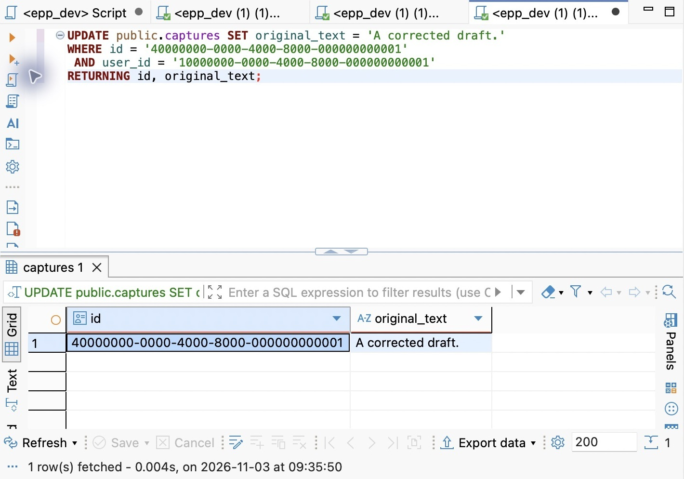
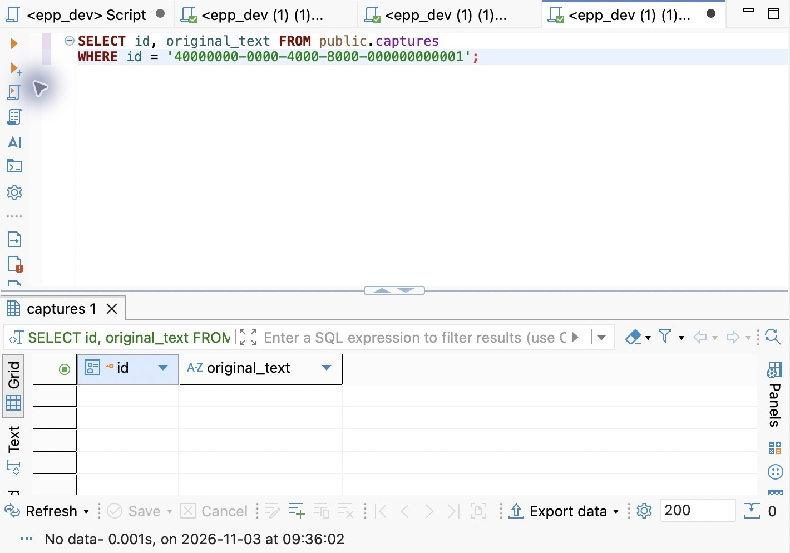
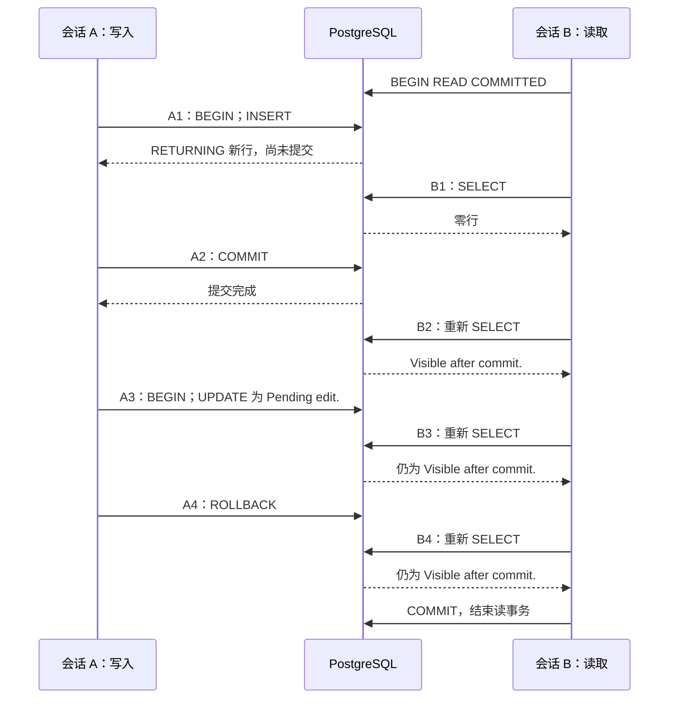
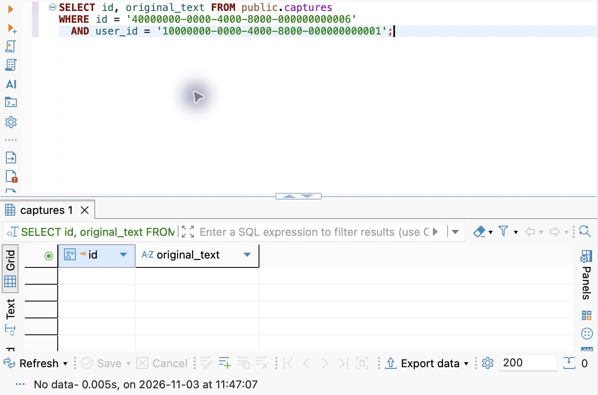
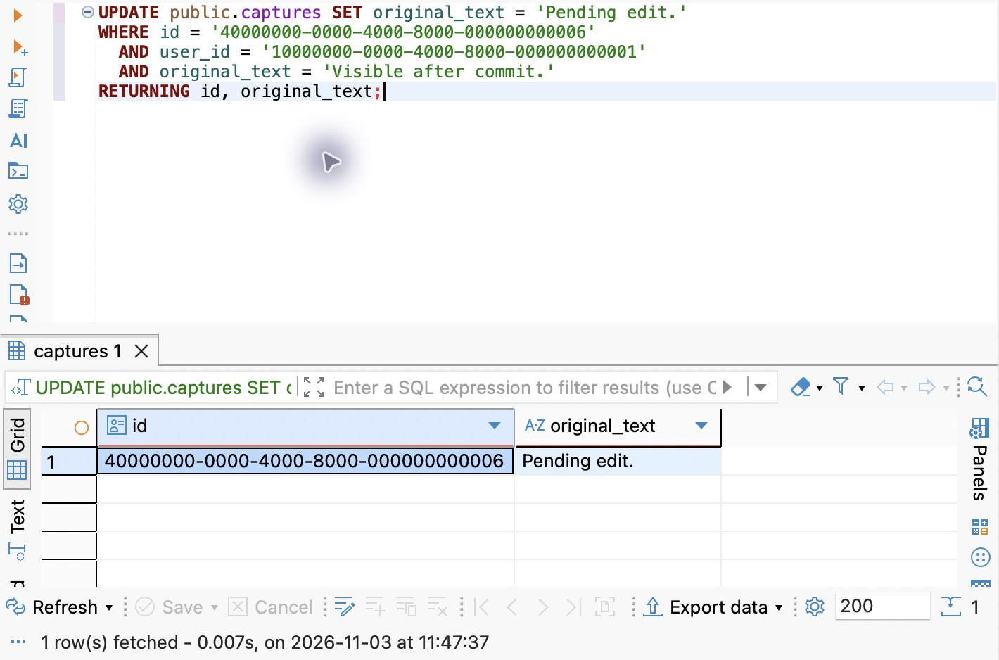
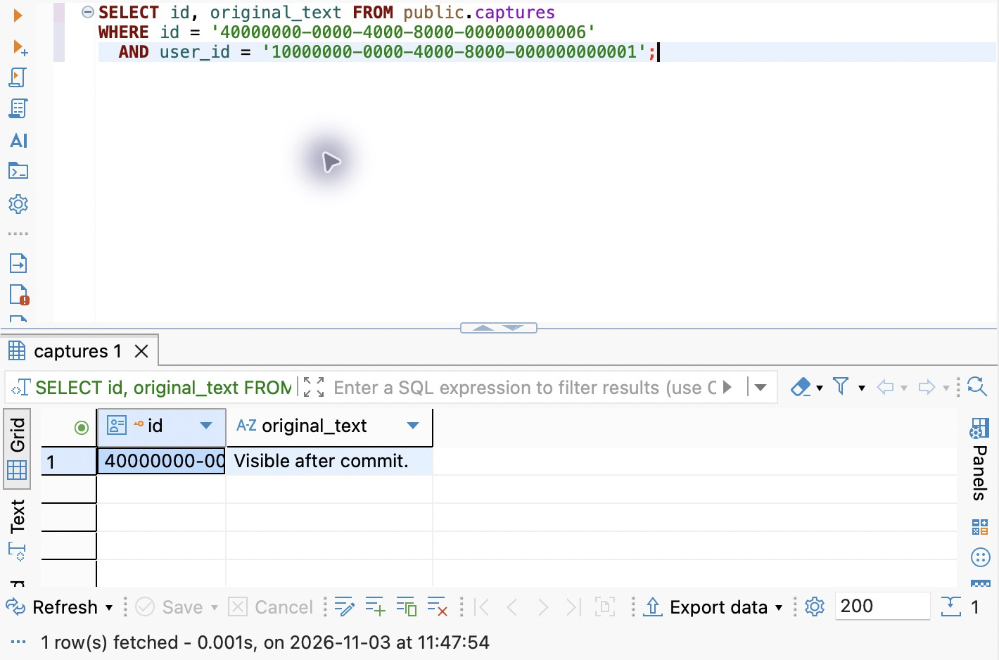
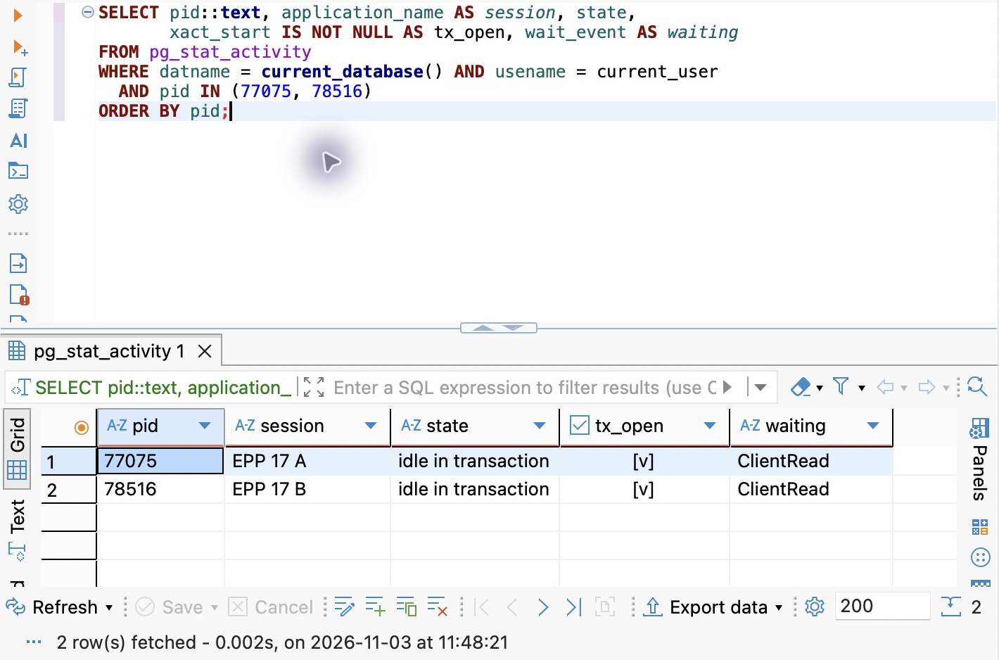

# 第 19 章 SQL：查询、筛选和修改自己的记录

第十八章留下了 public.users、public.captures、一个开发用户和两条记录。模型已经能解释身份、归属与合法状态；现在需要把读取和修改的意图准确交给数据库：要找的是哪些行，结果里一行代表什么，怎样限定写入范围，看到返回值是否就代表数据已经提交。

本章从 `part-03/chapter-18` 继续，代码分支是 `part-03/chapter-19`。默认在 DBeaver Community 操作，配套文件位于 `database/chapter-17/`。Nest 主服务继续使用 Map，不新增修改、删除或分页 API；这里的 SQL 是为后面的存储适配建立依据。原有两条记录始终保留，新增实验行除双会话观察外都在事务内回滚；双会话实验会明确提交一条专用记录，观察完再按固定身份清理。

SQL 的价值在于描述需要的结果及条件。数据库可以选择不同执行计划，但结果的含义必须由我们定义。接下来每次增加一个子句，都先解释它改变了哪个集合或哪种保证，再看界面里的结果。

## 19.1 从读取意图推导条件、顺序与修改范围

### 恢复工作台，并确定这次读到了谁

按第十七章恢复实例，在 DBeaver 连接 `127.0.0.1:55432/epp_dev`，使用 epp_owner。运行第十八章的 `03-inspect-model.sql`，确认两张表、外键和两条原始记录都在；不重新运行建表与 seed。两条记录 ID 分别以 001、002 结尾，拥有者都是 `10000000-0000-4000-8000-000000000001`，创建时间相同。

沿用 Auto-commit、关闭 Smart commit，以及 SQL Script 的 No commit、Stop + rollback 设置。本章事务由 SQL 中的 BEGIN／COMMIT／ROLLBACK 明确控制；不在未完成事务中切换数据源或自动重连。只读文件可以顺序执行；标有“分阶段”的双会话文件不能全选执行。出现错误先停下，在原会话回滚，再检查原因。

打开 `01-read.sql`，先执行诊断语句：

```sql
SELECT current_database(), current_user, inet_server_addr(), inet_server_port(),
       pg_backend_pid(), current_setting('transaction_isolation');
```

前四项核对库、角色和地址；pg_backend_pid 是这个连接对应的服务端进程编号，后面用来区分两个真实会话；最后一项是当前隔离级别。编辑器标签不同不代表连接一定不同，结果网格也只代表上次执行时取得的结果。

然后读取固定用户的记录：

```sql
SELECT id, original_text, created_at
FROM public.captures
WHERE user_id = '10000000-0000-4000-8000-000000000001'
ORDER BY created_at ASC, id ASC;
```

FROM 指定来源，WHERE 限定结果中的行，SELECT 决定输出列，ORDER BY 决定输出顺序。这里的 user_id 用于限制归属，未必需要返回给页面。显式投影也避免将来表增加内部字段时，`SELECT *` 悄悄扩大输出。SQL 列名仍是数据库表示，第二十一章再映射为原有 JSON 字段。

可以先按“取得来源 → 筛选 → 投影 → 排序”理解这个简单查询的含义；这不是数据库必须逐行执行的算法。优化器可能用索引提前定位，也可能扫描后筛选。把逻辑语义和物理执行分开，才不会从 SQL 的书写顺序猜测性能。

拿到一张“少了一条素材”的工单，先让“少”有个可核对的含义。用户记得保存过的一句话可能在两条素材里都出现过，页面截出的十几个字也可能省掉了头尾空格。素材的完整 ID 才能把两次观察连到同一对象上。配套读取文件还有一条按用户和素材两个身份读取的语句。先运行上面的列表，把两行的完整 ID 展宽，复制第二行的 ID，再运行那条单笔读取。列表第二行和单笔结果应指向同一条记录。这样建立的对应关系，在后面改排序、加搜索后仍能使用。工单如果只有“上次在第二行”，能查的只是某个顺序下现在的第二行，不能据此断定库里曾经丢过数据。

归属在这里还有一层容易忽略的含义。连接诊断里的角色在这两次读取中始终相同，行里的拥有者却是业务用户。数据库允许这个连接读表，接下来才由语句选择当前业务用户的集合。假设编辑器里把拥有者换成第二个演示身份，本节尚未插入他的素材，相同角色、相同表、相同列就会返回空集。若移除归属条件，眼前只有一个用户的数据，结果看起来又与正确查询完全一致。这恰好是单用户样本的盲区。到下一节第二位用户有自己的一条记录时，保留本节这条只读列表再看，就有机会检验这个条件究竟隔开了谁。普通请求一侧的归属条件不能从一次单用户演示的输出反推出来。

### 先确定排序契约，再讨论第几页

这两条记录的 created_at 一样。如果只按时间排序，它们谁在前没有保证。补上唯一 id 后，在数据不变时就有确定顺序：升序先 001，再 002。ASC 是升序；若定义“最近在前”，应同时写 `created_at DESC, id DESC`，让相同时间下的规则也明确。

本篇数据库列表选择 **created_at 升序、id 升序**作为默认顺序，表达“按创建时间从早到晚，同一时间用身份稳定打破并列”。这与原 Map 的精确插入顺序有区别：两条记录可能使用同一毫秒，ID 的比较也不代表插入先后；补录旧时间的数据还会排到前面。第二十一章替换存储时，要把新顺序写进 OpenAPI，并检查调用方是否依赖原来的插入顺序。当前 HTTP 实现仍保持旧行为。

现在在同样的集合上取第二条：

```sql
SELECT id, original_text, created_at
FROM public.captures
WHERE user_id = '10000000-0000-4000-8000-000000000001'
  AND strpos(original_text, 'cook') > 0
ORDER BY created_at ASC, id ASC
LIMIT 1 OFFSET 1;
```

两条原文都包含 cook，筛选后仍有两条；OFFSET 1 跳过排序后的第一条，LIMIT 1 最多返回一条，所以结果是 002。LIMIT 和 OFFSET 在语句中的位置不能理解成“先取一条，再跳过一条”。逻辑上是在符合条件的有序结果中跳过偏移量，再取需要的数量。

如果只有一条符合条件，OFFSET 1 就会返回零行，不是 SQL 故障。一般页号从 1 开始时，偏移量是 `(page - 1) × pageSize`；页大小与偏移量需要输入校验。现有 API 只有可选 limit，未提供 page 或 offset；本节的分页用于理解数据库行为，不把新参数悄悄加进旧接口。

唯一排序也不意味着跨请求读取同一份数据。假设第一页读到 001，随后它被删除；下一次请求仍跳过一行，就会越过已经移到第一位的 002。往前插入新行则可能导致重复。因此 OFFSET 适合明确接受数据变化影响的浅分页；深偏移还可能需要处理大量被跳过的行。第三十三章结合真实分页接口展开 Cursor，当前不能用“排序稳定”承诺永不漏读。客户端网格一次抓取多少行，也不等于产品定义的 SQL 分页。

可以用读数组切片的经验来算页界。把满足归属和搜索的行依次写在纸上，第一行的下标记为零。偏移量标记的是第一个允许返回的下标，页大小给这个区间规定最多几个位置。两行数据、页大小为二时，第一页占下标零和一，第二页从下标二开始，一个位置也取不到。第一页正好满，在这组数据上仍然没有下一页；若某个页面拿“本页已满”显示下一页按钮，它表达的是可以试读下一页。如果产品需要准确回答此刻还有没有下一条，可以在相同条件和顺序下多读一个位置，只把规定数量交给页面，用多出来的那条判断是否还有结果。这里比较的是同一次读取里的位置，对下一次打开页面时的数据量没有预言能力。

再想一下网格里点列标题排序的习惯。假定服务端查询已经按时间和 ID 截出第二页，界面再把这一页反向排列，只能改变已取回的行之间的次序。第一页中本该移到最前面的行根本没有传给页面。要检验“最近在前”的改动，应直接看编辑器里的 ORDER BY，并用同一个筛选、同一个偏移量重跑。种子时间相等，这时第一位随 ID 方向改变，正好排除“其实只改了时间方向”的实现。若两条样本的时间原本不同，错误的第二排序键在每页上都可能毫无破绽。检验排序的样本要覆盖会用到下一比较项的那一次比较。

有时交接时会有人指出，明明表上有按用户建的索引，为何还要在查询里写顺序？那个索引让数据库有机会较快找到同一用户的一批行；对这个用户而言，这些行的索引键都相等。即使某次页面恰好按插入先后读出，也没有给调用方一个可以依赖的比较规则。把需求写成“先比创建时间，相等再比完整身份”之后，执行器可以选择怎样满足顺序，包括额外排序。以后为查询添加索引时，可以用同一组并列数据核对输出应当保持的次序，另用运行证据衡量成本。两条种子的快慢无法替代后一项判断。

### 搜索要保留原有匹配语义

先区分两种听起来几乎一样的要求：“第二条记录是否包含 learning”，和“包含 learning 的第二条记录是什么”。种子里的 002 含 learning，001 不含。第一问要先对全部记录排序取第二条，再检查原文；第二问先筛到只剩 002，再跳过一条，结果是空。上面的列表回答第二问。把搜索词从 cook 换成 learning、先用 OFFSET 0 再用 1，就能从同一批数据看到差别。决定子句位置的是“在谁当中排第二”，不是界面上先有搜索框还是先有分页器。

原服务使用 `originalText.includes(text)`：大小写敏感，搜索值按字面内容解释。这里用 `strpos(original_text, 'cook') > 0`，在本篇 UTF8、C 区域设置下，返回子串首次出现的位置，找不到是 0。位置从 1 开始，和 JS 的 indexOf 从 0 开始不同，但我们只用它判断是否存在。

不要顺手替换成 `LIKE '%输入%'`。LIKE 中 `%` 表示任意长度内容，`_` 表示一个字符；用户搜索百分号时可能意外匹配所有记录。ILIKE 还会引入大小写不敏感的含义。参数化能防止输入改变 SQL 结构，却不会取消 LIKE 自己的通配语义，这两件事需要分别决定。

执行配套文件末尾的只读对照：

```sql
SELECT strpos('100% ready', '%') AS literal_percent,
       strpos('a_b', '_') AS literal_underscore,
       strpos('Cook', 'cook') AS case_sensitive;
```

预期为 4、2、0。LIKE 并非不能用：若需求就是前缀或模式匹配，应该选择它；若要用它表达字面匹配，则必须正确转义模式元字符。本章选择直接表达字面子串的函数，不提前承担另一套模式规则。现有 q 的非空白、最多 200 个 UTF-16 单元限制仍须在应用入口遵守；数据库可表示性也要在接入时核对。

看第一条种子的首尾，原始文本特意保留了空格。界面把它画成单行时，空白边缘很难看见。要判断“输入带一个空格的词怎么也能搜到”，先用只读查询同时投影原文、字符长度和子串位置，仍按这个人的两条 ID 排序。例如用 `strpos(original_text, 'cook.')` 看连续的字母和句点，用 `strpos(original_text, 'cook. ')` 在句点后多要求一个空格。前一个词应命中两条，后一个只应命中带尾随空格的第一条。这次改变的只是搜索值里的一个字符。若查询里擅自把原文或搜索值两边去空白，看似做了体贴的输入整理，实际就改变了第二次的预期。写入时保存什么、搜索时比较什么、页面展示时折叠什么，要各自从能观察到的结果作判断。

还要分清“按位置帮助排错”和“把位置当作页面高亮坐标”。当前查询只检查是否大于零，这个布尔判断不需要把数据库的字符位置换成 JavaScript 的字符串下标。如果原文首字符是一个需要两个 UTF-16 单元表示的表情，紧跟着一个英文字母，按字符数它在第二位，而在 JS 里这个字母的起始下标是二。简单把数据库给的位置减一就会落在表情内部。本节保留原 API 的意图是判断是否包含子串。将来若要返回高亮区间，接口还得约定起点是否从零算、长度按哪种单位，或让页面对收到的原文自行定位。单凭两条英文种子测对了命中与否，还不能推导出跨端位置协议。

### 修改前先限定对象，修改后读取实际影响

SELECT 可以返回许多行，UPDATE、DELETE 也按条件作用于一个集合。`WHERE id = ...` 不是可有可无的修饰；没有 WHERE 就会面向整张表。按 ID 操作自己的记录时，还应包含可信的 user_id，避免把“知道 ID”误当作“有操作权限”。当前 SQL 中的身份是固定演示值，未来从服务端认证结果取得。

在 `02-write-and-rollback.sql` 中逐条执行下面一组，均停留在同一个编辑器：

```sql
BEGIN;
SET LOCAL lock_timeout = '3s';

INSERT INTO public.captures (id, user_id, original_text)
VALUES ('40000000-0000-4000-8000-000000000001',
        '10000000-0000-4000-8000-000000000001', 'A temporary draft.')
RETURNING id, original_text, created_at;

UPDATE public.captures
SET original_text = 'A corrected draft.'
WHERE id = '40000000-0000-4000-8000-000000000001'
  AND user_id = '10000000-0000-4000-8000-000000000001'
RETURNING id, original_text;
```

INSERT 省略 created_at，让默认值确定时间，RETURNING 取回实际写入的行；UPDATE 的 RETURNING 默认返回更新后的内容。因此两次结果应分别包含 temporary 和 corrected。它们表示语句完成时的影响，尚不表示事务已经提交。lock_timeout 限制等待锁的时间，避免实验意外等待别处未结束的写入；它不是整个查询的执行时限，超时后同样要回滚并排查。



观察完整实验 ID、包含归属的 WHERE 和返回的 A corrected draft.。结果表格展示本语句实际影响的一行；当前仍处在前面 BEGIN 开启的事务中，继续下面的操作后再统一回滚。

另一个容易丢失的信息是用户编辑时看到的旧值。设想两个编辑页都读到 temporary，甲先改成 corrected，乙过了一会儿才保存自己的文字。仅用身份和归属做条件，两人都能选中同一行，乙的保存可以覆盖甲刚交付的结果。若本次意图是“只修改我看到的这个草稿”，可以把当时读到的旧原文也写入这条更新的条件。先停在当前事务，用 SELECT 预览同一素材 ID 和拥有者，再加上原文条件 `AND original_text = 'A temporary draft.'`，应选不到行。只把条件里的旧原文换成完整的新值 `'A corrected draft.'`，应读到刚刚更新的一行。两次都用读取即可，保留这行供下面的删除实验使用。这个小对照解释了为什么后文双会话脚本会把预期旧原文带入 WHERE。用文字作条件只能检验当前内容相等，如果中间被改走又改回来，它辨不出经历过的两个动作。真正需要区分每一代编辑结果时，就要单独保存能随修改推进的版本依据。

接着故意使用不匹配的拥有者删除这个实验 ID：

```sql
DELETE FROM public.captures
WHERE id = '40000000-0000-4000-8000-000000000001'
  AND user_id = '10000000-0000-4000-8000-000000000002'
RETURNING id;
```

结果应为零行，执行统计为零条删除；数据还在。零行是正常结果，可以表示对象不存在或不满足条件，不能只凭这一次结果区分二者。面向用户的接口是否统一返回“未找到”，要结合权限边界设计，不能为了区分而先查询并泄漏他人的记录。


WHERE 中的记录 ID 没变，user_id 换成了另一个用户，结果区显示 No data。这里的零行来自实际执行，不是客户端忘记刷新；可以回到同一事务查询这条记录，确认它仍存在，再使用正确归属继续删除。

再用正确归属删除，并结束实验：

```sql
DELETE FROM public.captures
WHERE id = '40000000-0000-4000-8000-000000000001'
  AND user_id = '10000000-0000-4000-8000-000000000001'
RETURNING id, original_text;

ROLLBACK;
```

这次应返回一条被删除记录，其原文为 corrected；ROLLBACK 撤销整组实验，最初的插入也不存在了。重新运行 01-read.sql 仍能看到原来的 001、002 两条记录。这里的 `400...` 专用实验身份与 `200...` 原始记录区分开，不能把实验 SQL 改成对原始 ID 的批量修改。



结束事务后重新执行 SELECT，实验 ID 没有留下记录。此图只检查这一个实验 ID；原始两条记录是否保留，仍按上面的 01-read.sql 单独比较，不能从实验行消失推断整库状态。

预览 SELECT 有助于发现错误条件，但在有并发写入时，“预览了两行”不能保证稍后 UPDATE 仍只影响相同两行；返回行数和 RETURNING 才是该次语句的实际结果，要求更强保证时需要事务与并发策略。也不要把普通 UPDATE 的成功理解为它保留了历史，覆盖就是覆盖，第十八章的版本判断仍然适用。

从适配层接手这个更新时，可以给返回值配上两个不同的问题。其一是“我的条件选中了谁”，看返回的身份和条数。其二是“这一行现在满足我要的状态吗”，看返回的新原文。假设把 corrected 再设为 corrected，在本章没有额外更新触发器的表上，条件仍能匹配这一行，也仍会返回它。于是“影响一行”不足以统计用户实际改动过几次文字。如果产品要求相同值不算改动，可以在更新条件中要求当前原文与目标不同；代价是零行又多了一种解释，调用方必须约定怎样处理已是目标值的情况。先决定成功是“存在且达到目标”还是“确实发生一次变化”，才能解释同一条数的业务意义。

这些判断也决定了接手故障时该留下什么证据。若编辑器上只剩最后一个空网格，沿固定身份重读，可以知道眼下有无这条记录，却分不出此前是从没插入、插入后删除，还是整段事务回滚。要在跟做时分辨三者，在插入返回后、更新返回后、错误归属的删除返回后分别记下动作、条数和实验 ID，最后才运行回滚。这样即使结束状态都是原来的两条记录，也能指出哪一次写入确实命中了目标，哪一次是条件正常排除了它。日常服务可以保存这类操作和数量信息来排查，实验中为人眼核对而展示的完整原文没有必要随请求写进日志。

## 19.2 先决定结果粒度，再选择 JOIN、分组与子查询

### JOIN 是按条件组合行，不是自动生成嵌套对象

页面需要“记录及拥有者的创建时间”时，可以从记录出发关联用户：

```sql
SELECT c.id, c.original_text, u.id AS owner_id,
       u.created_at AS owner_created_at
FROM public.captures AS c
JOIN public.users AS u ON u.id = c.user_id
WHERE c.user_id = '10000000-0000-4000-8000-000000000001'
ORDER BY c.created_at, c.id;
```

c、u 是当前查询的表别名。ON 表达如何配对，WHERE 限制需要保留哪些组合。每条记录的 user_id 对应 users 的唯一主键，且有非空外键，所以每条记录恰好找到一个拥有者，结果仍是一行一条记录。用户列会随不同记录重复出现，这是查询结果的表示，并不意味着存储模型退回了重复维护用户资料。

反向从 users 出发 JOIN captures，同一个用户有两条记录，就会形成两行组合。JOIN 没有自动把两条记录塞进一个 captures 数组。如果需要一行一个用户，需要聚合或另一种读取组织；仅仅改变 SELECT 列，把记录 ID 隐藏掉，不会消除这两行。

省略正确的关联条件可能产生笛卡尔组合：两个用户与三条记录会有六对，而不是自动按同名字段匹配。加 DISTINCT 有时能让界面看起来没有重复，却可能掩盖错误关联或错误结果粒度。先数清每一侧能匹配几行，再选择去重，不能把 DISTINCT 当修复 JOIN 的默认动作。

若习惯把两次接口响应按 ID 放进 Map，可以从那里理解关联条件。拿素材行上的拥有者身份，到以用户主键为键的 Map 里查一次，把命中的用户创建时间复制到这条结果上。用 SQL 写出这个关系，就不必先把所有用户传到应用。这里之所以能用“查一次得到一个”的思路，是因为键的唯一性确实由表保证。若反过来把素材按拥有者放进一个只存单个值的 Map，第二条会挤掉第一条；正确的内存表示得让这个键对应一个数组。关系两端的列可以有同一种类型，沿两个方向查找时却有不同的数量保证。

这种推导还有个很实用的校对办法。在 DBeaver 的明细查询里同时取素材自己的 ID、素材行的 user_id 和用户行的 id，给后两列起可辨认的名字。对每一行，后两列应该相同；素材 ID 则应当可以重复指向同一拥有者。假如误写成按两表自己的 id 配对，语法和类型检查都能通过，因为两列都是 UUID，但当前种子的用户身份和素材身份来自不同的值，找不到这样的组合。此时把 JOIN 改成 LEFT JOIN 可能恢复了左边的行数，右边用户创建时间却全为空。按列把配对值摆出来，比从最终“时间字段为空”猜是驱动解析失败更接近原因。外键声明提供了写关联条件的依据，数据库不会替一条写错的查询改条件。

### 从空白处写一张用户素材汇总表

换一个需求：给维护者一张表，列出三位演示用户各自有多少条素材、最近一条是什么时候创建的。没有素材的人也要列出。先别翻到配套里的查询。上一条 SQL 的一行是一条素材；这次即使某人一条也没写，他也应该占一行。先定下这条要求，才知道应该从用户找素材，而不是从素材找用户。

只有一个用户且他有记录时，看不出 LEFT JOIN 的必要性。打开 `03-joins-and-groups.sql`，先逐条执行 BEGIN、lock_timeout 和两段 INSERT；加入两个实验用户，只有第二位拥有一条实验记录，第三位没有记录：

```sql
BEGIN;
SET LOCAL lock_timeout = '3s';

INSERT INTO public.users (id) VALUES
  ('10000000-0000-4000-8000-000000000002'),
  ('10000000-0000-4000-8000-000000000003');
INSERT INTO public.captures (id, user_id, original_text, created_at)
VALUES ('40000000-0000-4000-8000-000000000002',
        '10000000-0000-4000-8000-000000000002',
        'This is my second workspace.', '2026-11-01T08:00:00.000Z');
```

固定 ID 若已存在，先回滚并查明来源，不用冲突忽略或覆盖更新绕过。下面的查询都在这个会话里进行，文件末尾再 ROLLBACK。它们读取所有三个演示用户，是管理观察，不是普通用户列表接口的授权方案。

在执行过 INSERT 的 **同一个 DBeaver 编辑器** 末尾另起空行写查询，不开新连接。先根据两条种子记录和刚插入的那条写下预期，时间统一按 UTC 表示（网格可能显示本地时区）：

| 用户 ID 尾号 | 素材数 | 最近创建时间（UTC） |
| --- | ---: | --- |
| 001 | 2 | 2026-10-31 08:00:00.123 |
| 002 | 1 | 2026-11-01 08:00:00.000 |
| 003 | 0 | NULL |

从你已经会读的单表查询起笔：自己写 `SELECT u.id FROM public.users AS u`，用 `WHERE u.id IN (...)` 限定刚才的三个完整 UUID，按 `u.id` 排序。选中自己写的整条语句执行，先核对三个身份，不看素材数。下一步只问“这个用户能配上哪条素材”，把右侧的素材 ID 也放到结果里。先试普通 JOIN：如果 003 消失，问题已经出在配对这一步，还没轮到计数。再改成保留全部左侧用户，和下面的明细对照：

```sql
SELECT u.id AS owner_id, c.id AS capture_id
FROM public.users AS u
LEFT JOIN public.captures AS c ON c.user_id = u.id
WHERE u.id IN ('10000000-0000-4000-8000-000000000001',
               '10000000-0000-4000-8000-000000000002',
               '10000000-0000-4000-8000-000000000003')
ORDER BY u.id, c.id;
```

IN 限定观察的三个用户。预期四行：用户 001 对应两条记录，002 对应一条，003 对应一行 capture_id 为 NULL 的结果。LEFT JOIN 保留左侧没有匹配的行，用 NULL 补右侧字段。这一行不是数据库里多出了一条空记录，而是查询构造的表示。

在四行明细上多停一下。用笔把每个完整用户 ID 画成一栏，把右侧出现的素材身份记在对应栏里，第三栏空着。纸上有三个栏位、三个实际素材身份、四行查询输出；前两个数字恰巧相同，指代却不同。这也解释了为何对结果末尾直接取 length 是个危险的选择。如果调用者问用户数，应数三个栏位；问素材数，应数写进去的三个身份；问此次数据库传回多少个组合，才数四。现在把第一人的第二条素材在纸上盖住，用户数保持三，素材数降到二，外连接结果降到三行。能分别预测这三个数怎么变，就不会因为它们在某次截图里一样而拿错指标。

左表的选取还有一个表面合理的替代方案。先对素材按拥有者分组，把小表再关联到完整用户名单。这样数素材的那一步只接触真实素材，可以放心数行；但小表里没有第三位用户这个分组。关联回用户名单之后，他的统计列整体缺失，才需要把缺失的计数解释成零。若在素材小表内部给计数包一个空值替代函数，依然造不出那个根本未形成的组。眼前先关联再分组的方案让每人都已有一组，通过数右侧身份自然得到零。两条路线都能表达需求，调试时要找零从哪一步产生，不能在看到一个空格时随手把所有空值都填零。例如最近时间本来就该保留空值，填一个任意日期会让从未写过的人在时间轴上多出一次活动。

### COUNT 数的是哪一种东西

接下来要把四行明细收回三行。同一个用户的行归到一组；组里的素材按身份数，创建时间取最大的那个。001 两条素材恰好同时创建，不能数不同的时间；003 根本没有创建时间，不要填今天。在刚写的查询上改，先保留一列组合行数帮助验错。配套文件的计数查询可以用作起点；最近时间这一列在编辑器里自己加：

```sql
SELECT u.id, count(*) AS joined_rows, count(c.id) AS capture_count,
       max(c.created_at) AS latest_capture_at
FROM public.users AS u
LEFT JOIN public.captures AS c ON c.user_id = u.id
WHERE u.id IN ('10000000-0000-4000-8000-000000000001',
               '10000000-0000-4000-8000-000000000002',
               '10000000-0000-4000-8000-000000000003')
GROUP BY u.id
ORDER BY u.id;
```

GROUP BY 把相同用户的组合归成一组，输出粒度变成一行一个用户。count(*) 统计组内全部结果行；count(c.id) 只数其中非 NULL 的记录 ID。第三位用户的两个数字应分别是 1 和 0；前两位分别是 2／2、1／1。记录主键非空，所以这里用它计数，恰好避开外连接产生的占位行。

把最后两列与手算表逐行对照。003 的时间只有占位的 NULL，没有可求最大值的时间，所以 `max(c.created_at)` 也是 NULL。数目和时间都对上之后，交付的报表去掉排错用的 `joined_rows`，而不是用它替换素材数。

分组之后不能随便同时 SELECT 一条未聚合的 original_text：同一用户有两条原文，没有定义要选哪条。需要“最新原文”时，必须另外表达最新的排序与选择规则；不能期望数据库帮你任取一条。count 在 PostgreSQL 返回 bigint，后面经过驱动或 ORM 时还要核对其应用侧类型，不凭界面显示为数字就一律当安全的 JS Number。

如果需求是“列出记录不少于两条的用户”，先限定参与统计的记录，再按用户分组，最后筛选组：

```sql
SELECT user_id, count(*) AS capture_count
FROM public.captures
WHERE user_id IN ('10000000-0000-4000-8000-000000000001',
                  '10000000-0000-4000-8000-000000000002',
                  '10000000-0000-4000-8000-000000000003')
GROUP BY user_id
HAVING count(*) >= 2
ORDER BY user_id;
```

预期只有用户 001。WHERE 筛单行，HAVING 筛已经形成的分组；在 WHERE 写 count(*) 不成立，因为此时还没有当前分组的计数。此查询直接从 captures 分组，没有记录的用户根本不会形成组；需要显示零时，应回到前面的 LEFT JOIN 方案。

在这个样本上还可以检验一个不显眼的错误。有人会把用户创建时间也列入结果，自然地想按“用户创建日期”分组。在真实运营报表里，按注册日数素材确实是合理需求，可那张表的一行代表一日内的一批用户。如果两个人恰巧同时注册，按用户创建时间乃至按日期分组都有可能把两个人合成一行。反过来把素材时间也塞进 GROUP BY，原来每人一行的报表会变成每人每个时间一行。种子两条同刻，光检验第一人仍得到二甚至发现不了错误。推导分组键时，可以设想同一人隔一天多写一条、新用户在同一天注册，各问一次“应该另起一行吗”。前一个答案是否、后一个答案是，足以把身份和时间的角色分开。

为什么数身份这一招在此处可靠，后续接入更多明细却可能失效？现在每条真实素材只占一行，即便同一人有好几条，数它们的身份也恰好各数一次。如果以后页面还要列每人参加的多个集合，在同一个用户名下把素材和集合明细同时展开，同一素材可能和不同集合各成一对。计数列非空仍然成立，“一条素材出现一次”却已经失效。排查时固定一条素材的完整身份，只看中间结果里它出现几次、旁边哪一列发生了变化。末尾支线用只读数据把这种相乘拆开。明细层出错时先恢复每种事实应有的粒度，再计算总数，否则很容易得到每组都像整数、加起来却毫无业务意义的报表。

### “达到人均素材数”的平均值该在哪一层算

维护者不是每次都给出“至少两条”这样的固定门槛。他可能会问：“这三个人当中，哪些人的素材数达到了人均水平？”先别想怎么在 HAVING 里再塞一个函数。拿纸写下 2、1、0：一次计数的输入是一条条素材，结果是每人一个数；求平均的输入恰好是**这三个数**。平均数是 1，而不是只看写过素材的两个人算出来的 1.5。这次要保留没有素材的用户，不只是为了显示零，他还是分母里的一人。

可以把上一条外连接计数查询当作一张只有三行的小表。用 `WITH 名称 AS (查询)` 给它起名，后面就在这个结果上工作；名字只在这一条语句里有效，并没有创建数据库表。下面仍在三个演示用户都可见的原事务中运行：

```sql
WITH per_user AS (
  SELECT u.id AS owner_id, count(c.id) AS total
  FROM public.users AS u
  LEFT JOIN public.captures AS c ON c.user_id = u.id
  WHERE u.id IN ('10000000-0000-4000-8000-000000000001',
                 '10000000-0000-4000-8000-000000000002',
                 '10000000-0000-4000-8000-000000000003')
  GROUP BY u.id
)
SELECT owner_id, total
FROM per_user
WHERE total >= (SELECT avg(total) FROM per_user)
ORDER BY owner_id;
```

调试时保留 WITH，把最后那段 SELECT 先换成 `SELECT * FROM per_user ORDER BY owner_id`，核对是不是三个人；再换成 `SELECT avg(total) FROM per_user`，核对门槛；最后才取达到门槛的人，应是 001 和 002。如果先过滤掉零再算平均，002 就会消失。这里分两层是因为两次统计的对象不同，不是为了把 SQL 写长。括号里的平均值对三个人都一样；下面再看一种**每个人的答案不同**的子查询。

人均的分母还能从另一个方向核对。不用求平均的语法，先将 per_user 里的 total 相加，分子应当是这个范围里全部素材的数量三，再数 per_user 的行，分母应当是名单人数三。在分子和分母上各问一次用户三是否参加：他对分子贡献零，对分母贡献一。维护者如果改口说“只与活跃作者比较”，可以保留同一张每人计数的小表，专门在计算门槛的那层选择正数。此时总量仍是三，人数变二，门槛是一点五。不能为了方便把门槛先截成整数再比较，否则素材数为一的人又会被判为达标。尤其要留心用两个整数相除重写平均值的版本，PostgreSQL 的整数除法会舍弃小数部分。让一个操作数先进入精确的小数类型，或直接对计数求平均，再用原门槛比较；显示时需要几位小数属于最后一步。

还会遇到一个更难从成品表看出的口径问题。假设页面列表只展示排名靠前的两个人，并在右上角显示“达到了全体人均”的标记。如果把 LIMIT 提前放进 per_user，让那张中间表只剩二和一，门槛成了一点五，第二人失去标记。页面少显示一人原本不该改变已显示用户的标记。正确的依赖方向是由完整比较范围算出门槛并判定各人，再决定送到页面的行。若产品问的是“当前可见两人的平均”，才应允许翻页改变门槛。这类错误与列名、数据类型、SQL 是否报错无关，问一句“换页时同一人的达标状态应不应该变”就能暴露两个实现的分歧。

### 最近时间相同，怎样取回一条确定的原文

维护者看到时间后追问：“那条素材到底写了什么？”给刚才的汇总多加一列 `max(c.original_text)` 不行。两个 max 各自在一组值里选最大值：一个比较时间，另一个按文字排序，它们没有约定要来自同一行。先拿最大时间再按时间连回明细也不够，001 的两条素材会一起回来。问题已经从“组里最大的值”变成“按什么规则从组里选一行”。

沿用 19.1 的时间和 ID 排序约定。先只给 001 查：按创建时间降序、相同时间按 ID 降序，取第一条原文。现在才把固定的 001 换成外层当前用户的 ID；内层不再替整份名单选一条，而是替当前用户选一条。在原编辑器、回滚之前运行：

```sql
SELECT u.id,
       (SELECT c.original_text
        FROM public.captures AS c
        WHERE c.user_id = u.id
        ORDER BY c.created_at DESC, c.id DESC
        LIMIT 1) AS latest_text
FROM public.users AS u
WHERE u.id IN ('10000000-0000-4000-8000-000000000001',
               '10000000-0000-4000-8000-000000000002',
               '10000000-0000-4000-8000-000000000003')
ORDER BY u.id;
```

这里括号要当一个值用，叫**标量子查询**：必须只有一列，零行当 NULL，超过一行则报错，不会随便挑一个。001 应得到素材 002 的 `I'm learning to cook.`，002 得到自己的原文，003 仍在名单上、原文为 NULL。若只换成 ID 升序，001 就换一条原文，最近时间却没变；这正好说明 ID 是我们规定的并列裁决，不是测出了真实插入先后。若删掉内层的归属条件，每人反而都拿到同一条全局最新原文，即使总行数仍是三也不对。

如果需求改为“列出所有并列最新的素材”，001 的两条都该出现，此时用 LIMIT 1 反而错了。先问清要一个值、一行还是一组行，再决定该不该裁掉并列项。括号里查询作为一个值使用的规则可回查 PostgreSQL 的[标量子查询](https://www.postgresql.org/docs/18/sql-expressions.html#SQL-SYNTAX-SCALAR-SUBQUERIES)。

如果维护者把最新素材的 ID 也加进报表，先在纸上把最近时间、原文、身份圈成一行。三个值要有同一个来源。可以先写一个独立查询，只对第一位用户把符合条件的素材按规定顺序完整列出，同时投影 ID、时间、原文。目光只落在第一行，就看得到三个值的对应关系。接下来把它用作标量子查询时只能选其中一列；若对原文和身份各写一次子查询，两处的归属和排序必须一直一致。未来一处改成正序另一处漏改，就会拼出“这条素材 ID 对应另一条原文”的假记录。要求一次返回多列时，还有一种简单的组织办法：先按相同规则选出最新素材的唯一 ID，再用这个 ID 左关联回素材表，在同一条匹配行上取其余各列。因为 ID 唯一，第二次关联最多命中一行，空用户也可以留下。这里的多一步换来的是可检查的同一行来源。

理解这层关系后，还能辨别“最近”到底指哪个时间。素材表当前只记创建时刻。假如修改一条很老的素材，原文发生变化，创建时间仍然保持旧值。按本节的查询，它不会仅仅因为刚才改过字就排到另一条新建素材前面。若接手的人按活动流的经验把标题写成“最近编辑”，展示的数据并不能支持这个标签。单凭更新后读到新原文，也无法从表里推算出上次编辑的精确时刻。此时需要先明确要追踪创建事件还是编辑事件，再决定是否要新增事实并通过迁移保存；调换排序、给默认时间取别名都补不回从未记录的事实。

### 条件放在 ON 和 WHERE，可能改变需求

现在要求“显示每位用户，并统计他包含 cook 的记录数”。应把记录筛选放在 LEFT JOIN 的 ON 中：先匹配符合要求的记录，没有匹配仍保留用户。`03-joins-and-groups.sql` 提供完整查询，核心变化是：

```sql
LEFT JOIN public.captures AS c
  ON c.user_id = u.id AND strpos(c.original_text, 'cook') > 0
```

在前面的用户分组查询中用这段替换原 JOIN，并输出 `count(c.id)`，结果为 2、0、0。若把同一条件挪到 WHERE，先形成的 NULL 占位行会被过滤掉，因为 strpos(NULL, 'cook') > 0 得不到 true；有记录但不匹配的用户也会被过滤。结果只剩用户 001。

两种查询都合法，却回答不同问题。不要机械记成“LEFT JOIN 的条件都必须写 ON”：用户范围仍应在 WHERE 限定。要分清哪些条件用于寻找右侧匹配，哪些用于淘汰整个结果行。对“保留所有用户”的需求，这个位置直接决定正确性。

这里还有个容易从 JavaScript 带来的误判：“不包含 cook”是不是正好等于“包含 cook”的其余所有行？当右侧是占位行时，`strpos(NULL, 'cook') > 0` 既不是真也不是假，而是未知；对未知取 NOT 仍是未知。WHERE 只留下真，所以简单反转条件也找不回这一行。要问“哪些用户没有任何一条含 cook 的素材”，应在**用户**上判断有没有这样的匹配，而不是在每一条素材上找“不含 cook”的原文。一个人可以两种素材都有，后一种写法会把他错算进去。稍后从用户出发写 NOT EXISTS 时，再把这个搜索条件带入子查询。

同一份运营表若要同时显示“全部素材数”和“命中 cook 的素材数”，前面的选择又会变化。把搜索条件写在 ON 可以得到命中数，却已经丢掉第二人的那条不匹配素材，无法在这些明细上还原他的总量。先保留只按拥有者配对的完整明细，给一次聚合的输入另设条件，就可以让同一组里两个数字各自有依据。在上面的分组查询内并排放入 `count(c.id)` 和 `count(c.id) FILTER (WHERE strpos(c.original_text, 'cook') > 0)`。读后一个表达式时，从每组候选行出发，只有括号里条件为真的行才交给这一个计数器。其他计数器仍接收原来那组。第一人两列都是二，第二人应是一和零，第三人两列都是零。若又加上“只展示有素材的人”，才轮到用分组后的总量淘汰第三人；不能要求命中数大于零，否则第二人也会消失。

这张两列报表让比例有了明确分母。对第一人，命中占比是二除以二；第二人是零除以一；第三人则没有可用的分母。把第三人的占比直接显示成百分之零会让他看起来与“写过但全部不匹配”的第二人经历相同。页面可以显示横线，并让总量零保留在旁边作为解释。若需要由 SQL 算比例，可让小数分子除以 `NULLIF(count(c.id), 0)`，分母为零时得到空值，其余时候正常相除。这样的空值有可以追溯的来源，与连接失败、列没有选出来或字段映射错误不同。若业务后来要算整批素材的命中率，先合计命中数二和总量三再相除；把个人的一和零直接求平均得到二分之一，回答的是每个有素材者等权时的平均占比，素材多的人和少的人各占同一份权重。

### 不看原查询，改写一份七日报表

仍在原事务里，在编辑器末尾从空白处重新写。维护者现在只想统计一个固定七天窗口内的素材，最近时间也只算窗口内的，但名单上三个人一个都不能少。窗口从 `2026-11-01T08:00:00Z` 起，到 `2026-11-08T08:00:00Z` 止，含起点、不含终点。用固定时间而不用今天，隔多久重做都能核对。先写出你认为会返回的三个用户、数量和时间，再执行自己的 SQL。

对账时分开看两种零：001 **写过，但都在窗口外**；003 **从未写过**。这两人都应返回 `0 / NULL`；002 那一条恰在起点，应返回 `1 / 2026-11-01 08:00:00Z`。然后只把窗口平移到前七天，即 `[2026-10-25T08:00:00Z, 2026-11-01T08:00:00Z)`：001 应回到 `2 / 2026-10-31 08:00:00.123Z`，另两人都是 `0 / NULL`。如果两张报表都把 002 的素材算进来，检查两个窗口是否都包含了交界时刻。

如果名单少人，保留自己的来源与条件，临时去掉分组和聚合，只显示用户 ID、素材 ID 和素材时间，找出哪位用户的最后一行消失了。一个常见补丁是在 WHERE 的时间判断后加 `OR c.id IS NULL`。拿第一个窗口试它：003 可能回来了，001 却没有，因为他的两条旧素材都配对成功过，不存在 NULL 占位行。修好以后，说清楚哪条条件决定**谁进名单**，哪两条边界决定**哪条素材能参与统计**。这比对照参考 SQL 是否逐字相同更可靠。

检查七天窗口时最好先写两个完整时刻。报告上的“十一月第一周”可能指业务所在地从零点起的自然日，也可能指从某次活动开启算起的七个整日。本题给出了带时区的固定时刻，它在上海显示为当天下午四点。若在图形网格里只看日期，把看到的十一月一日当作当地零点写回条件，起点已经比指定时刻早了十六小时。刚好位于指定起点的样本仍可能被选中，单看它通过不能证明起点精确。可以用只读的时间值构造一对邻居，分别在起点前一毫秒和起点，代入自己写的两个比较式。前者应归入前一窗口，后者应归入后一窗口，每个只归属一次。配套时间列精确到毫秒，但比较的写法没有必要依赖“最后一毫秒”这个精度。直接用小于下一段起点，日后时间列换成更细精度时仍能把相邻时段严密接起来。

如果要核对窗口平移前后的总量，先把两个窗口的明细并排，检查同一完整素材身份只在一侧出现，再把每位用户的两次计数相加。当前样本三条素材都落在两段合起来的范围内，三位用户相加后应分别回到二、一、零。这个等式来自窗口相邻且互不重叠，以及本题所有素材都在联合范围内；换成真实月份，窗口外还可能有更老的素材，二者之和只应与联合范围内的单次查询比较。最近时间的对账又不同，不能把两个时间相加，只需取有值两侧中较晚的那个，两侧都空则仍空。相同的窗口能对接两种指标，合并两段结果所需的运算却取决于指标本身。

### 只问是否存在时，避免把匹配行带进结果

找“还没有任何记录的用户”可以写：

```sql
SELECT u.id
FROM public.users AS u
WHERE u.id IN ('10000000-0000-4000-8000-000000000001',
               '10000000-0000-4000-8000-000000000002',
               '10000000-0000-4000-8000-000000000003')
  AND NOT EXISTS (SELECT 1 FROM public.captures AS c WHERE c.user_id = u.id)
ORDER BY u.id;
```

结果只有用户 003。内层引用外层 u.id，表示针对当前用户判断是否有匹配记录，这叫相关子查询。SELECT 1 不表示只取第一条记录，也不统计数量；EXISTS 只关心子查询是否产生行。将 NOT EXISTS 改成 EXISTS，得到有记录的两位用户，每人一行，不会因用户 001 有两条记录就重复出现。

仍在当前事务中，把子查询的条件从 `WHERE c.user_id = u.id` 扩展为 `WHERE c.user_id = u.id AND strpos(c.original_text, 'cook') > 0`，保留外面的 NOT EXISTS 再执行。此时要找的是没有任何一条素材命中 cook 的用户。002 写过素材，但他的原文没有命中；003 从未写过，两人都应返回。若只保留归属条件，002 的任意一条素材就足以使子查询有结果，因此原查询只返回 003。

这是语义上的“对每个用户作判断”，不代表执行器一定反复逐个查询数据库；优化器可以选择相应连接策略。若把查询写成应用循环，每位用户单独发一次网络请求，那才引入了另一种往返成本。执行计划在第三十五章进一步观察。

这一组观察结束后，执行文件末尾的 `ROLLBACK;`。用第十八章核对文件确认两个临时用户和一条实验记录都不在，原始两条记录仍在。这是一处自然停点：不需要为下一节保留任何临时表或未提交事务。

### 一行结果里的整数能有多大

在 DBeaver 执行下面的只读查询。先预测 n 的类型，再比较相邻两列的最后一位。

```sql
SELECT pg_typeof(count(*)) AS count_type, count(*) AS n,
       9007199254740992::bigint AS a, 9007199254740993::bigint AS b
FROM (VALUES (1), (2)) AS sample(id);
```

即使只数出 2，COUNT 的 SQL 类型仍是 bigint。两列相邻的大整数在库里各有一个精确值。打开 Node，比较 `Number('9007199254740992') === Number('9007199254740993')`。若把这类列先转 Number 再交给客户端，这次比较的结果已经指出丢失发生在哪一步。需要原样传递的计数可以约定返回十进制字符串，SQL 中的排序和运算仍用数值列；按字符串排序会让 "10" 排在 "2" 前面。

## 19.3 把输入值与 SQL 结构分开

### 能查出正确结果，不等于能接受外部输入

目前 SQL 中都是我们编写的固定字面量。应用不能把用户搜索词直接插进 SQL 字符串：当输入包含引号、注释或运算符时，它可能终止原来的字面量并改变 WHERE 的结构。只禁止某几个词也不足以建立边界；原文里合法出现撇号本来就是正常情况。

正确方向是固定语句结构，把值交给驱动的参数接口。数据库先知道哪些位置是表达式中的值，外部内容不能再变成表名、条件或注释。参数化仍不代替身份来源、长度校验和业务规则；它解决的是代码与数据的边界。

暂不安装应用驱动，先在 DBeaver 用服务器的 PREPARE／EXECUTE 直接观察。打开 `04-parameters.sql`，在一个会话中执行：

```sql
PREPARE epp17_list (uuid, text, integer, integer) AS
SELECT id, original_text, created_at
FROM public.captures
WHERE user_id = $1
  AND ($2 IS NULL OR strpos(original_text, $2) > 0)
ORDER BY created_at ASC, id ASC
LIMIT $3 OFFSET $4;
```

$1～$4 分别是拥有者、可选搜索词、可选上限和偏移量，不要给占位符加单引号。`'$1'` 是普通字符串，不再引用第一个参数。这里用 SQL NULL 表示“没有搜索条件”，与空字符串不同；可选 limit 为 NULL 表示不限制，延续当前接口不传 limit 时返回全部匹配结果的约定。

integer 只规定参数类型，不会自动限制为业务允许的 1～100；text 也不会拒绝空白搜索词。空字符串在任意原文中都能找到，不能把它当成一个已经通过业务校验的搜索条件。本节手写合法值来研究参数行为，后面的组装示例再检查输入范围，接入时仍须保留既有契约校验。

接着运行两次：

```sql
EXECUTE epp17_list ('10000000-0000-4000-8000-000000000001', 'cook', 1, 0);
EXECUTE epp17_list ('10000000-0000-4000-8000-000000000001', 'cook', 1, 1);
```

应该分别得到 001 和 002。再用百分号和含引号的输入：

```sql
EXECUTE epp17_list ('10000000-0000-4000-8000-000000000001', '%', 10, 0);
EXECUTE epp17_list ('10000000-0000-4000-8000-000000000001', ''' OR true --', 10, 0);
EXECUTE epp17_list ('10000000-0000-4000-8000-000000000001', NULL, NULL, 0);

DEALLOCATE epp17_list;
```

前两次应为零行，最后一次为两行。第二个输入实际值以一个撇号开头，内容是 `' OR true --`，并没有变成额外 SQL 条件。这里在 EXECUTE 命令里用两个单引号表达一个撇号，只因为我们正在手写固定 SQL；**应用仍不能把任意输入拼成 EXECUTE 字符串**。使用驱动时把原始值单独交给参数数组，由驱动处理编码和传输；无需自行给值包引号或替换撇号。

PREPARE 的对象只在当前会话存在。重连后 EXECUTE 会找不到名称；中途退出后在同一会话重跑 PREPARE，可能提示同名语句已存在。可先查询 `SELECT name FROM pg_prepared_statements;`，仅对本章的 epp17_list 执行 DEALLOCATE 后重建，不清除其他任务的准备语句。若某个执行错误让显式事务失败，先 ROLLBACK 再处理准备语句。

客户端弹出“填写参数”的窗口，不足以证明服务端收到了绑定参数：工具可能支持变量替换或不同执行模式。本节使用 PostgreSQL 原生 PREPARE，保留 $n 语法，不把它改成客户端的 `${变量}` 或冒号替换。第二十一章在实际 ORM 调用中再次核对参数传递；准备语句能否复用计划、是否更快，是另一个需要测量的问题。

可以用种子的第二条原文区分三个容易混淆的表示。人在页面上看到的是带一个撇号的英文缩写。种子文件为了在 SQL 字面量里写出这句话，把撇号写了两次；读回的原文中只有一个撇号。现在想查找这个缩写，在应用里传的搜索值应该与读回的三个字符完全相同，即大写字母、一个撇号、小写字母。若在构造参数数组之前就模仿种子文件再补一个撇号，数据库会忠实寻找两个连续撇号，返回空集。在 DBeaver 里先读出第二条记录的原文，再用固定的 `strpos(original_text, 'I''m')` 投影位置，对应结果应该是一；对第一条原文则应为零。这个对照让我们看见，转义是书写特定语言的文本时使用的记法。值一旦已经从请求里解析出来，继续对它做同样的文本替换就会改变用户要找的内容。

再看可选搜索条件中的 OR。若没有传搜索词，第一支“参数为空”为真，整段括号都通过，每条属于该用户的行有资格参加排序。若传了正常的非空字符串，第一支为假，是否保留一行就由第二支的字面匹配决定。写这对括号的原因可以从归属推出：无论走哪一支，用户范围都要生效。若在改写时把逻辑拆成“我的且不筛词，或者原文匹配”，后半句少掉了“我的”。这类错误在单用户库里做十次正常搜索都可能看不出。审查代码时可以直接问：另一个用户恰巧写了相同的词，整条布尔表达式有没有机会成立？固定参数的类型完全正确也不会替表达式补上归属。选择在应用里仅当有词才拼入完整的 AND 子句，是接下来另一种保持这个关系清楚的办法。

上限为空也有一层业务含义。在准备语句里“不限制”允许返回这一用户的全部匹配项；传入整数零则是在匹配完成后最多取零行。若页面把尚未选择条数表示为空字符串，而适配层用宽松的数值转换把它变成零，就会出现“去掉限制后反而看不见任何素材”。此时库按收到的值给出了正确答案，修 SQL 的排序或重建索引都不会改善。接手这种故障时，可以在应用断点依次查看解析前的查询参数、校验后的可选值和最后对应的绑定位置。先弄清楚契约是否允许省略；如果允许，保留“缺省”的状态到查询组装处再决定省略子句或绑定空值。把所有看起来为空的输入提前归成一个数字，会让后续再也分不清用户原本作了哪种选择。

在图形客户端看 PREPARE 还有个细节。运行定义时，输出区域可能只有语句执行完成的提示，没有素材网格，这是合理的，此时尚未提供这一次读取的四个值。真正检查分页的是后面的两次执行。若把第一次定义成功当作集成测试通过，会漏掉“绑定用户身份正确、偏移量却放到了上限的位置”这种只有执行时才显现的问题。反过来，如果在另一标签里执行时提示名称不存在，先在原标签查准备语句列表和连接编号。两个编辑器连接同一数据库不代表共享这些会话内的名字。把 SQL 保存在工程文件里只提供了重新定义的文本，库里并没有因此多一张可供所有连接使用的永久查询表。

### 动态条件可以组合，动态结构只能来自已知选项

前面的可选条件适合展示语义。真实查询也可以仅在有搜索词时添加该条件，让 SQL 更直接。关键是片段由程序选择，外部值始终保留在参数数组中。

配套 `07-query-builder.mjs` 是独立机制示例，不连接数据库，不接入 Nest。函数先校验输入：userId 为 UUID 文本；text 可选，若存在则非空白、至多 200 个 UTF-16 单元且能被 text 表示；limit 可选且为 1～100 的整数；offset 为 0～10000 的整数。这个 offset 上限只是实验的访问约束，不能说明深分页已有性能保证，也不是新增 API 契约。核心组装如下，位于这些校验之后：

```js
const orders = new Map([
  ['oldest', 'created_at ASC, id ASC'],
  ['newest', 'created_at DESC, id DESC'],
]);
const order = orders.get(sort);
if (order === undefined) throw new TypeError('unsupported sort');

const values = [userId];
const where = ['user_id = $1'];
if (text !== undefined) {
  values.push(text);
  where.push(`strpos(original_text, $${values.length}) > 0`);
}
let sql = 'SELECT id, original_text, created_at FROM public.captures' +
  ` WHERE ${where.join(' AND ')} ORDER BY ${order}`;
if (limit !== undefined) {
  values.push(limit);
  sql += ` LIMIT $${values.length}`;
}
values.push(offset);
sql += ` OFFSET $${values.length}`;
return { sql, values };
```

占位符序号跟随 values 的长度，省略搜索条件后，下一个参数不会错误地仍叫 $3。WHERE 的 user_id 始终存在，不能为了动态条件方便而变成可选。sort 只能选 Map 中的固定片段；输入 `created_at; ...` 不在映射里就拒绝，不进入 SQL。

比如同一个人只要求“最多十条”，数组应是 `[userId, 10, 0]`，SQL 的尾部是 `LIMIT $2 OFFSET $3`；若要求“搜索 cook，不设上限”，数组则是 `[userId, 'cook', 0]`，这次 $2 是搜索词，没有 LIMIT。调用者可省略的是一个条件，不是给固定的参数位置留下一个洞。排查这类错误时把 SQL 和参数数组并排看：即使两次参数个数一样，第二个值的用途也可能不同；只看数组长度查不出错位。

为什么不能写 `ORDER BY $2` 来绑定列名？值参数表示一个值，不会被重新解析为标识符或 ASC／DESC 等语法。表名、列名和方向都属于 SQL 结构，需要由固定映射选择，不能从请求原样拼接。这里字符串拼接是可审查的，因为拼进去的结构片段均来自程序常量。

可以在编辑器给函数末尾设断点，用已有 Node 调试方式运行；或在代码根目录执行一次：

```bash
node database/chapter-17/07-query-builder.mjs
```

脚本以含引号的演示搜索词输出 `{ sql, values }`。应看到 SQL 仍只有 user_id 与 strpos 条件，搜索词完整留在 values；本例参数依次为用户 ID、搜索词、10、0。这是在观察组装边界，不是在模拟数据库已经执行。正式接入时把 SQL 与 values 分别交给真正的驱动，不能再把二者替换合成字符串。

这里还明确拒绝搜索词中的 NUL 和孤立代理项，避免接入 PostgreSQL 后错误或静默替换。现有 HTTP 校验尚未收紧这一点；第二十一章需要连同原文输入一起说明兼容变化。参数化也不会判断 userId 是否真来自当前请求者，那仍由服务端身份边界保证。

跟着函数在断点上走一次，可以把“同样的查询”拆成两种具体相同。只将搜索词从 cook 改成 learning，生成的 SQL 文本应逐字相同，值数组里只有词的位置不同；数据库有机会在固定形状上处理不同值。若改的是“去掉搜索但保留上限”，条件少了一段，后面的绑定位置应随之向前移动。此时文本不同符合预期，归属条件和排序选择仍可逐字比对。调试时不要为了获得一条所谓“最终 SQL”而写替换器把值塞回占位符。分开检查语句形状和带类型的值才能看出哪个阶段负责改变了什么，而且不要求把用户原文复制进服务日志。

有一种参数错位连数据库的类型检查也识别不了。只要上限和偏移量都是整数，即便彼此换位也属于合法 SQL。用两条匹配素材、上限一、偏移零，正确答案是第一条；若互换则跳过一条但一条也不返回。若测试一直用上限一、偏移一，两者无论怎么放结果都是第二条。给相邻的同类型输入选取明显不同且能改变输出的值，才能有效地校验映射。相同道理也适用于排序选项：两条记录时间相同，用 newest 期望第二条排在前面，正好检验映射里的第二个方向有没有遗漏。函数本身只给出文本与值，断点可以确认绑定次序，数据库的结果则要到准备语句对照或实际接入处才能观察。两份证据应沿同一组输入接起来。

再沿着 text 的校验看一次前后端分工。使用 trim 的结果判断是否全为空白，和把 trim 后的字符串写回数组，是两件不同的事。配套函数在判定有实质内容之后仍推入原来的 text，所以带末尾空格的合法搜索保留了上文的精确匹配。它还先判断值是否为字符串，才能对后续的长度和字符表示作出解释。假设某个调用方把未填搜索框序列化成显式的 null，函数看到的是“给了一个非字符串值”，与省略属性产生的 undefined 走不同分支。手写 PREPARE 用空值表达缺省，不能反过来证明 JS 函数也接受 null。接手适配代码时先在各自语言里写清缺省如何表示，再决定跨边界时在哪一处翻译，否则同一个可选框会在两端产生相反结果。

长度上限也要由契约决定计量方式。项目延续的是 JavaScript 字符串长度，同样一百个需要代理对表示的符号会占二百个单元，再多一个普通字母就超出上限。数据库文本函数按字符算长度，给出的数字会比较小。如果应用的一个入口按前者拒绝，另一个入口仅仅依赖库里的字符数判断，两个客户端就可能对同一搜索词得到不同答复。配套在组装前检查上限和能否完整表示，然后才把值推入数组。这一步解决“输入对两个系统都能表达吗”；后面的 strpos 才解决“哪些记录符合这个值”。在前一步被拒绝时根本没有 SQL 结果，把这个现象显示成“目前没有匹配记录”会误导使用者反复改搜索范围。

## 19.4 从冲突结果回到设计规则

### ON CONFLICT 不是自动补全业务语义

上一章让重复主键报错，是为了明确“这个身份已经被占用”。现在常见的建议是加 `ON CONFLICT DO NOTHING`，让脚本重跑也不报错。SQL 确实能这样写，但应该先判断两次输入是不是同一份事实。

打开 `05-conflict.sql`，在同一事务中执行：

```sql
BEGIN;
SET LOCAL lock_timeout = '3s';
INSERT INTO public.captures (id, user_id, original_text)
VALUES ('40000000-0000-4000-8000-000000000004',
        '10000000-0000-4000-8000-000000000001', 'First version.')
RETURNING id, original_text;

INSERT INTO public.captures (id, user_id, original_text)
VALUES ('40000000-0000-4000-8000-000000000004',
        '10000000-0000-4000-8000-000000000001', 'Different content.')
ON CONFLICT (id) DO NOTHING
RETURNING id, original_text;

SELECT id, original_text FROM public.captures
WHERE id = '40000000-0000-4000-8000-000000000004';
```

第一次返回 First version.；第二次没有新插入行，RETURNING 为零行；第三次读取仍是 First version.。DO NOTHING 没有替你比较两段内容相同，也没有应用新的内容。“没有抛错”不能被适配层翻译成“这次输入已经成功保存”。

`ON CONFLICT (id)` 明确针对 id 的唯一冲突，不会把缺失拥有者、非法类型或非空约束失败都转为成功。若改成 DO UPDATE，则必须定义冲突时允许更新什么、是否校验拥有者和旧版本，是否可能覆盖别人的内容。当前记录创建是生成新身份，不因原文相同而合并，也没有“撞上 ID 就覆盖”的规则，因此不能用 upsert 直接替代已有 create。

配套文件接着用另一个 ID 保存相同的 First version.：

```sql
INSERT INTO public.captures (id, user_id, original_text)
VALUES ('40000000-0000-4000-8000-000000000005',
        '10000000-0000-4000-8000-000000000001', 'First version.')
RETURNING id, original_text;
```

这次应返回一行，因为当前没有原文唯一约束。先停在同一个事务，暂缓执行配套文件末尾的回滚。

若要向接班人说明“为什么回滚前有两条 First version.”，可以分别按内容和按身份追一次。内容查询会把尾号四和五选到一起，按身份读则给出各自的一行；第二份 Different content. 按内容读不到。回滚前在同一编辑器按实验拥有者及这两个完整实验 ID 读取，按 ID 排序，就能对上「一个候选被拦下、另一条合法新建被保留」的过程。如果只按内容数到二就推断防重失效，要先问防的是身份重复还是事实重复。数据库现在明确承诺了前者，而两个可独立编辑的入口正是允许后者的设计结果。

```sql
SELECT id, original_text FROM public.captures
WHERE user_id = '10000000-0000-4000-8000-000000000001'
  AND id IN ('40000000-0000-4000-8000-000000000004',
             '40000000-0000-4000-8000-000000000005')
ORDER BY id;
```

确认上述两行的原文都是 `First version.`，再单独执行 `ROLLBACK;`。在同一连接重发这条 SELECT，现在按两个实验 ID 查询应为零行。回到本章的 01-read.sql 仍能读到原始种子。第一次是身份冲突，第二种是内容相同但身份不同，数据库遵守的是已经声明的规则。

反过来，从返回结果能推出多少？同一个 ID、同一段原文重发，和同一个 ID、不同原文重发，这两种请求对 DO NOTHING 来说都是“没有插入行”，但前者可能是重复提交，后者可能是两份不同的工作。只拿到空的 RETURNING 就把这两种情况都报告成成功，丢掉的是“保存的是不是这一次要求的内容”。而只比较文本也不够：两条不同 ID 的相同原文在当前模型里本来就可以都是有效记录。要先说清楚用什么标识一次操作，才谈得上判断是不是同一次重试。

需要安全重试时，还要知道本次操作的身份、请求内容和已经产生的结果。忽略主键冲突只完成其中非常有限的一步，第二十九章再结合业务命令建立幂等语义。现在先让代码准确处理“插入了一行”“跳过了插入”“因规则被拒绝”这三种结果。

在图形结果里解释第二次插入，可以把两份原文分别放在两个时间点上。执行前库里已有第一份，程序此时拿的是第二份。唯一约束裁决的是候选行能不能以这个身份再占一个位置，冲突分支选择放弃候选，所以语句完成后的表与执行前在这条记录上相同。RETURNING 只产出本次真正写入的行，并不负责把使它发生冲突的旧行也附赠回来。这就解释了为何此处需要第三条独立读取。若改成只从第二次 RETURNING 里取第一行交给页面，可能得到一个空值；若在空值时直接回显请求正文，页面将显示第二份，稍后重读却又变回第一份。那个看似“稍后又被改回去”的故障，根源可能是最初显示了一份从未写入的内容。

第三条查询按 ID 查看当前状态，是因为本实验的操作者掌握两次输入与开发库的全部上下文。换成业务调用就要多走一步推理。一个登录用户声明某个 ID 对应自己的草稿，只说明请求作了声明；冲突指向的既有行未必属于他。即使出于改善重试体验想在冲突后返回已存行，也得用可信归属去限定读取。拿全局唯一 ID 找到行再无条件返回，会把“不能创建”变成越过原来列表范围的读取。若归属限定后读不到，响应可以表示此次创建未能按约完成，而不透露另一位用户的原文或身份。唯一索引为所有行维持同一个身份空间，业务可读范围却只覆盖其中一部分，二者同时成立并不矛盾。

再看用“先查有没有，再决定插入”取代约束的想法。如果只在自己的编辑器顺序执行，先查为空，然后写入，整个过程像从空位置拿了个号。但第一条 SELECT 完成并不会替未来的 INSERT 预留这个身份。在它们之间，另一项正常创建也可能选中了同一个值。两边的预览都可以诚实地返回零行，最终仍只能有一方成功占用那个主键。因此预查可以用于解释已有状态，创建时仍需以数据库的写入结果为准。这里不必制造并发才能判断逻辑漏洞，只要在两条语句间放入“另一个事务已成功提交”这个合法事件，原来由预览推出的保证就不成立了。后面双会话观察会给出不同语句间可见集合变化的实际读法。

什么时候冲突更新才真正贴合需求？设想维护一项明确要求“每位用户始终只有一份当前偏好”的设置，修改定义就是给那份设置指定新值，此时按用户唯一键创建或更新同一行，有一个业务上可说明的目标。素材的情况恰好能通过读者熟悉的交互来辨别：我在上午保存一句话，下午再次看到它，又点一次新建，两份素材各有自己的创建时间和后续编辑入口。若因为原文一致就让第二次创建更新第一份，列表少了一个入口，第一次的创建时间究竟要不要变也没有依据。反过来，网络确认丢失后自动重发同一个创建动作，即便按钮只点了一次，也可能得到两份内容相同的行。前者希望相同内容可多次创建，后者希望同一次动作只交付一个结果。原文相同这个条件在两种情形都为真，靠它无法把两种意图分开。

### 删除顺序表达的是生命周期

删除拥有者时，当前外键 RESTRICT 会拒绝仍被记录引用的用户；第十八章提供了对应的失败观察步骤。先删除用户的记录再删除用户，在引用完整性上可能通过，但它仍不等于“账号删除方案已经正确”。一旦未来有历史、文件和其他依赖，还必须定义要保留、匿名化或清理哪些事实。

不要为了让一句 DELETE 成功就改成 CASCADE。级联删除是明确的生命周期决定，不是异常修复按钮。同样，在关联查询中用 INNER JOIN 隐藏查不到父对象的数据，也不能修复错误归属。查询选择、外键动作与业务处置分别承担责任。

本章保留原有用户与记录，没有新增唯一约束或改变删除策略。若真实需求将来要求同一范围下某字段唯一，应先查已有重复、决定归并或拒绝策略，再追加约束迁移；不能把新 CREATE TABLE 文本覆盖到旧库上，假定已有数据自然满足。下一章开始建立这种结构管理能力。

从用户的素材列表看，删除一条素材和删除一位用户也许都是点一次操作，数据库需要回答的方向却相反。删素材时，移走的是持有引用的一端；剩余素材的 user_id 仍能找到原来的拥有者。删用户时，移走的是别人引用的目标，只要还留有任一素材，原来的那个 user_id 就会指向不存在的行。外键在这个方向阻止操作，告诉维护者有尚未处置的依赖。要理解一次拒绝，可以先用只读的素材列表限定该用户，再投影实际素材身份。只看“有两条”不如知道是哪两条，因为接下来要讨论的是这两份原文由谁保管、允许何时清理，而不是想办法让数量立刻变成零。示例种子属于前置数据，本节的这层判断用读取就能完成。

假如后续真要交付一个清理流程，把两个 DELETE 放在两个独立的自动提交语句中，会留下一个可见中间状态：素材已提交删除，用户还在。随后删用户若因另一项依赖而失败，重跑时看到“用户存在但素材数是零”，很难仅凭这张表辨别他原本没写过，还是前一步已经清掉了。若业务把这两步定义成必须共同生效的一次处置，显式事务可让中途失败时撤销前面的删除；若有必须分阶段完成的保留或移交，则应把阶段作为能追踪的事实记录下来。这里需要先确定什么状态允许对外可见，再决定事务的范围。不能在两个按钮后面分别接一条能执行成功的 SQL 就当作流程完成。

还有人会提议保留所有素材，只把拥有者设为空。对当前结构，素材归属是非空列，单独更换外键的删除动作也无法让这些行合法地没有拥有者。更重要的是，当前列表、修改与删除都以“它属于当前用户”作为条件；一旦放开无主素材，即使行物理上还留着，原来的所有者列表和报表也不再有同一种含义。把它们全指向一个公共用户同样会改变每人素材数、最近创建时刻以及谁有资格读取。若实际目标是保留匿名汇总而移除可识别的原文，可保留的事实和粒度又完全不同。这些都是需要另行设计的业务变更。从一条外键拒绝逆推出应采取哪种处置，缺的是这部分信息，允许空值或设置级联都补不了。

## 19.5 用两个会话看清提交与可见性

### 两个编辑器必须确实对应两个连接

前面的 RETURNING 让我们看到了自己刚写入的内容，但另一个请求何时能读到，需要另一个会话观察。不要用同一编辑器反复 SELECT 证明“大家都看到了”，因为事务总能看到自己此前的修改。

先结束现有实验的事务。沿第十七章连接向导创建两个使用相同开发参数的连接配置：地址 127.0.0.1、端口 55432、库 epp_dev、角色 epp_owner，分别命名 `EPP · DEV-A`、`EPP · DEV-B`。对每个连接分别打开一个 SQL 编辑器，工具栏核对数据源名称。名称不同只帮助定位，不能替代会话验证。

如果习惯复用同一连接配置，也可以在连接配置或偏好设置 **Editors → SQL Editor** 中，将为 SQL 编辑器打开独立连接的选项设为 **Always**，再打开两个新编辑器；具体说明见 [Multiple datasource connections](https://dbeaver.com/docs/dbeaver/Separate-Connections/)。两种方式选一种即可，不需要既复制配置又修改全局设置。无论采取哪种方式，都在两个编辑器各自执行：

```sql
SELECT current_database(), current_user, pg_backend_pid();
```

两边必须都是 epp_dev、epp_owner，PID 必须不同。PID 相同就仍是同一会话，先修正连接方式。DBeaver 还可能为元数据或 Data 页开连接，所以本实验只在这两个已验证的 SQL 编辑器中交替执行，不跳到任意 Data 网格代替观察。

打开 `06-session-a.sql` 与 `06-session-b.sql`，分别绑定到 A、B。文件按阶段保存，**不要 Execute SQL Script 整份连跑**；每次选中一条完整 SQL，用 Execute SQL Statement 执行，完成当前阶段的所有语句后再切到另一侧。两边保持 Auto-commit UI 模式，SQL 的 BEGIN 显式开启事务。不要在事务中切换提交模式、重连或启用自动刷新。

先执行 A0，查询专用实验 ID `40000000-0000-4000-8000-000000000006`，应为零行。如果已经存在，说明先前实验可能在提交后中断：核对它的拥有者和原文，按后面的恢复说明处理，不能直接覆盖或继续 INSERT。

准备双会话时，可以把第一个编辑器当作“我刚保存了草稿”的请求，把第二个编辑器当作列表刷新。两者使用同一个数据库角色，目的是让读权限保持相同；两者查同一用户和同一实验 ID，目的是让筛选范围保持相同。此时剩下的变量才是语句在哪个会话、哪个提交时刻执行。若两个 PID 不同但端口不同，也不能开始比较，两个隔离实例完全可以各自存在一个同名开发库。把连接地址、端口、库和身份在操作前对齐，比跑到 B2 没行时才反复猜权限要省事。显示名称里写着开发库只能帮人找标签，诊断函数返回的信息才来自正在响应的服务器。

安排暂停位置也有讲究。用两个请求各跑完整套操作，再比较最后一次结果，你大概只会得到“最后查不到实验行”。这样的输出同时符合从未成功插入、成功插入并已清理等多种历史。此处要检验的是写入者拿到结果之后、提交之前，另一个请求能看到什么，所以必须把暂停放在两者之间，并让读取者在放行提交前已经取得结果。若先切回去提交再去看旧网格，无法重建那一次没有执行过的读取。实验的可靠性来自两边动作有可辨认的先后关系，无需赌手速或人为制造若干毫秒的延迟。

### 让 A 写入，让 B 在同一事务中反复读取

B 先显式开始读取事务：

```sql
BEGIN ISOLATION LEVEL READ COMMITTED;
SHOW transaction_isolation;
```

应显示 read committed。显式写出隔离级别，是为了让实验不受个人连接默认设置影响。随后按下面的顺序进行；B 每次都重新执行相同 SELECT，不能只看旧结果标签。

| 顺序 | A 的动作 | B 的动作与预期 |
| --- | --- | --- |
| 1 | A1：BEGIN，插入实验记录，暂不提交 | B1：查询实验 ID，零行 |
| 2 | A2：COMMIT | B2：重查，读到 Visible after commit. |
| 3 | A3：新事务中改为 Pending edit.，暂不提交 | B3：重查，仍读到 Visible after commit. |
| 4 | A4：ROLLBACK | B4：重查，仍是原文；随后 COMMIT 结束 B 的读事务 |
| 5 | A5：按完整条件删除专用实验行并 COMMIT | B5：重查，零行 |

把前四阶段沿时间向下展开，可以看清“SQL 已返回”和“其他会话可见”之间的间隔。下图描述本实验的预期时序；A、B 必须是不同 PID，B 始终采用 READ COMMITTED 的普通 SELECT。



重点看 B1 与 B2：B 没有重开事务，却因为两次 SELECT 开始的时间不同而看到不同结果。A3 的更新随后回滚，不会撤销 A2 已提交的插入；表中的第五阶段再负责清理那条实验行。

A1 的关键语句是：

```sql
BEGIN ISOLATION LEVEL READ COMMITTED;
SET LOCAL lock_timeout = '3s';
INSERT INTO public.captures (id, user_id, original_text)
VALUES ('40000000-0000-4000-8000-000000000006',
        '10000000-0000-4000-8000-000000000001', 'Visible after commit.')
RETURNING id, original_text;
```

A 的 RETURNING 应已经出现新行，B1 却看不到。B 使用下面这条查询，后面的 B2～B4 也重复它：

```sql
SELECT id, original_text FROM public.captures
WHERE id = '40000000-0000-4000-8000-000000000006'
  AND user_id = '10000000-0000-4000-8000-000000000001';
```

等 B1 查询完成后，A2 单独执行 `COMMIT;`。B2 不结束原事务，直接再次查询，就应该读到新行。这说明 READ COMMITTED 并不是整个事务固定住一份结果：普通 SELECT 每次语句开始时取可见快照，可以看见在本次语句开始前已经提交的其他事务修改。




两图上方的 WHERE 相同，下方从 `No data` 变为一行。结果网格中的 ID 列较窄，完整身份以查询条件为准。这里改变的是 A 的提交状态和 B 的查询时刻；B 没有结束原来的 READ COMMITTED 事务。

然后在 A 执行 A3：

```sql
BEGIN ISOLATION LEVEL READ COMMITTED;
SET LOCAL lock_timeout = '3s';
UPDATE public.captures SET original_text = 'Pending edit.'
WHERE id = '40000000-0000-4000-8000-000000000006'
  AND user_id = '10000000-0000-4000-8000-000000000001'
  AND original_text = 'Visible after commit.'
RETURNING id, original_text;
```

应返回一行新内容；如果返回零行，先检查实验状态，不去掉条件强行覆盖。B3 普通 SELECT 仍读取旧的已提交版本。PostgreSQL 的多版本并发控制（MVCC）让读者按可见性规则读取行版本，而不是让普通读取直接看到另一事务尚未提交的覆盖结果。这里不使用 FOR UPDATE 等锁定读取，也不让 B 修改同一行；那些动作会引入另外的等待与竞争规则。





这两张图对应 A3／B3。A 已执行 UPDATE 并收到新值，B 却仍读到 `Visible after commit.`，所以 RETURNING 出现一行不能当作其他会话已可见的证据。

A4 执行 `ROLLBACK;`，B4 再读仍是 Visible after commit.。回滚撤销的是 A3 这次事务，A2 已提交的插入仍然存在。B 随后执行 `COMMIT;`，结束自己的读取事务。读事务也应及时结束，不能留着连接隔夜等待下一章。

这组现象只建立当前隔离级别下的普通读行为：看不到他人未提交内容，语句之间可以看到新提交。它不证明所有并发操作都等价于串行，也不保证“先查余额再扣减”等业务过程正确。第二十七、二十八章再从多处写入和竞争推导相应事务策略。

将这次观察用在实际读接口上，可以解释一种“总数和列表对不上”的报障。假设一个请求先查该用户的素材数量，再查第一页，把两项装进同一个响应。即使两条语句在同一个 READ COMMITTED 事务里，也是两个开始时刻。若这位用户原有两条，第一条语句数到二，另一连接恰在中间提交第三条，第二条语句在上限足够时可以读到三个 ID。两条语句都满足各自的可见性规则，合成后的界面却显示“共二条”且列了三项。把获取总数和读取列表分别移入两个函数，并不会改善这种关系。维护者首先要问产品是否允许总数近似反映查询当时的状态。如果数量和列表必须对应同一份可见数据，可以考虑让同一条读取语句同时基于匹配集合产生两项结果，或者在专门设计的读取事务内使用一致的快照。返回的页面即使为空也得能表达总数，这一点不能靠在每条素材上附一个字段草草解决。

也可以反过来判断本节没有测到的行为。B 在 A3 之后读到旧文，是因为更新之前已有一个提交过的版本可读；若 A 做的是首次插入，旧版本根本不存在，同样的普通读取就给零行，这正是 B1。B 所见的原文由它可见的版本决定，并不要求先把 A 的改动撤回，或者由客户端缓存一份旧字符串。若有人用这组截图说明“更新期间其他人始终可以立即修改这条素材”，就超出了观察。B 从头到尾只是读，没有向同一行要求写入权；锁等待需要另一个实际提出冲突请求的动作和等待证据。把普通读、条件写、锁定读混作一种操作，会让人拿“我还能看到旧内容”去证明一个从未提交的编辑动作也能成功。

从这里也能看出事务中的原子性对外意味着什么。若一个事务内先插入草稿，再把原文改成定稿，普通的其他读取者在提交前看不到那份新草稿；提交后新语句可能直接读到定稿。写入者在两次 RETURNING 中都能看见自己的中间成果。相反，把创建和编辑分别提交，相同的最终原文就有另一种可见历史，中间来访的读者可能确实读过草稿。两种流程事后只看终值都会显示定稿，因此无法靠终值证明中间状态曾否对外开放。安排事务边界时可以先画出允许用户看见的中间状态，再把必须共同生效的步骤收进同一次事务。本文选择让 A2 独立提交，正是为了让 B2 有一个能与稍后回滚的编辑相区分的、已经成立的创建事实。

### 区分执行、提交、刷新和结果未知

为什么 B 不退出事务也能在 B2 看见 A 的插入，却不会在 B1 的旧结果表格里看见它凭空出现？在本实验的 READ COMMITTED 下，普通 SELECT 看的是**这条语句开始时**已经提交的版本，以及本事务自己先前的修改。A 在 B1 开始之后提交，不会改写 B1 的答案；B2 是新语句，有新的可见范围。把隔离级别误解成“只要同一个事务，每次就必须看到同一批数据”，会解释不了 B2；把界面网格误解成实时订阅，则会等着 B1 自己变化。这里不需要用脏读或清空缓存解释任一现象。

SQL 编辑器保存文件，只保存文字；服务器执行 RETURNING，表示本次语句产生了结果；COMMIT 完成，才结束这次事务的提交；另一个编辑器刷新或重查，才取得新的结果。这几个动作不能互相代替。即使在客户端看到一行，也要知道它来自哪个会话、哪次执行以及哪种事务状态。

Auto-commit 模式下，不显式 BEGIN 的独立语句通常各自提交；写了 BEGIN 后，事务边界由后续 COMMIT／ROLLBACK 决定。Manual commit 模式则由客户端持续组织事务，保存网格后还可能等待用户提交。本章统一使用前一种模式加显式 SQL，避免同时依赖工具的隐式行为；连接诊断、事务标记与实验结果要能相互对应。

如果 A 在 COMMIT 附近断线，不能从客户端报错断言服务器一定回滚。可能是提交未完成，也可能是已经提交但确认没有送达。重新连接后按固定实验 ID 查询实际结果，再决定继续或清理，不重新生成 ID 盲目插入。相反，明确在未提交事务中断开连接，服务端会在检测到断开并结束会话时撤销未提交事务；网络异常时清理不一定瞬间发生。

B2 看不到行时，依次核对 A2 是否确实提交、PID 是否仍对应原会话、库是否相同、B 是否重新执行以及实际隔离级别。B1 提前看到了行，则先查是否和 A 共用 PID、实验行是否在此前已经提交，或客户端是否代为结束了事务。不要通过重新 seed 抹掉现象；需要证据解释边界。

遇到 B1 提前出现一行，可以用现有证据缩小范围。先看 B 返回的是不是尾号六的完整实验 ID，这能排除误跑普通列表。再对照 A0，当时若确实为空、A1 又实际返回同一身份，便很难用“上次一直没清理”解释这次新行。接下来同时核对两个 PID；相同意味着所谓 B 的重读其实是事务在读自己的插入。若 PID 确实不同，在 A1 停住时用下一段的观察会话检查 A 有没有开着事务。如果已经空闲且事务已结束，就回到 A 标签查看选中的执行范围，尤其检查有没有连着执行提交。若声称 A 一直开着事务，也要核对开着的是哪一次事务，先前那次提交后开启一个新事务同样会显示事务未结束。状态、身份、语句先后相互约束，单看任一张网格都很难查到走错的一步。

确认消息丢失时也要按证据的时间范围说话。本章使用以前确认为空的固定实验 ID，并且只有 A 负责创建和最后清理；只要尚未开始清理，就可以在独立连接重读该行，读到固定内容能支持创建已经提交的判断。如果新连接第一次读不到，旧连接却仍可能处在服务器检测断开或处理提交的过程中，这个零只说明本次读取时还看不到。先查原 PID、确认旧事务已结束，再用新语句读取，比立刻另插一份更有根据。在真实业务里若其他人还能删除或改内容，眼下零行更不能证明历史上从未提交。要解决跨请求的确切重试结果，后面才需要把操作及其结果作为可查的事实保存。

### 从第三个编辑器确认会话停在哪里

仅凭按钮是否变灰，未必看得清客户端与服务器的事务状态。需要诊断时，使用原 DEV 连接新开一个空闲观察编辑器，保持 Auto-commit，不执行 BEGIN。打开配套 `09-session-state.sql`，执行：

```sql
SELECT pid, application_name, state,
       xact_start IS NOT NULL AS transaction_open,
       wait_event_type, wait_event
FROM pg_stat_activity
WHERE datname = current_database()
  AND usename = current_user
ORDER BY pid;
```

它查询当前库中以同一角色连接的会话；epp_owner 可以查看自己的会话信息，无需切到管理员。用 A、B 刚才返回的 PID 找到对应行。DBeaver 可能另开元数据连接，application_name 也可能相同，所以不能把列表的前两行直接叫作 A、B。观察编辑器自己的行通常是 active，因为它正在执行这条查询。

| 暂停位置 | A 对应行 | B 对应行 |
| --- | --- | --- |
| A1 插入完成、B1 查询完成 | idle in transaction，transaction_open 为 true | idle in transaction，true |
| A2 提交完成、B2 查询完成 | idle，false | idle in transaction，true |
| A3 更新完成、B3 查询完成 | idle in transaction，true | idle in transaction，true |
| A4 回滚且 B4 提交完成 | idle，false | idle，false |

这里 idle 表示服务器正在等客户端下一条命令，不表示连接断开。idle in transaction 表示事务仍开着；ClientRead 等待通常是在等客户端发命令，也不能直接判成锁争用。若出现 idle in transaction (aborted)，说明语句出错后事务尚未结束，要回到对应编辑器执行 ROLLBACK；在别的编辑器回滚无法替它结束事务。



图取自 A3／B3 之后：两行都是 `idle in transaction`，`tx_open` 勾选表示 true，等待事件是 `ClientRead`。为便于辨认，本次在各自事务中用 `SET LOCAL application_name = 'EPP 17 A';`／`'EPP 17 B'` 加了标签，并按事先核对的两个 PID 筛选。标签只是辅助，自己的 PID 要重新查询；A 的待提交内容仍须结合前面两张结果图判断。

每个阶段重新执行观察查询。观察会话不要自己包在长事务里，以免统计信息的事务内快照影响比较。若 A／B 中某个 PID 消失，先检查连接是否关闭或重连；重新查询它的 PID，并按实验行的实际状态恢复，不继续沿用旧编号。这个视图帮助定位“哪条连接、有没有未结束事务”，是否能读到某行仍由 B 的实际 SELECT 验证，不能只从 state 推断业务可见性。

观察表里最容易读错的是 active 那一行。第三个编辑器为了知道别人是否还开着事务，自己也必须执行查询；它出现时当然正在工作。反复点刷新永远看见至少一条活动连接，不等于 A 的更新没结束。先用本编辑器自己的 PID 把它辨认出来，再去定位 A、B。若目标行显示正在等客户端而 A 的网格已经出现更新结果，两者其实吻合：服务器已经把这一阶段的结果交回，下一步提交或回滚还要由客户端发起。若目标行已经消失，去新标签看见另一个编号的空闲连接，也不能把它当成原来那个尚未提交的事务。重新连接可以重新执行保存过的脚本，却不继承原连接里待提交的工作。

接手人在这里要作的决定往往很具体：现在还能回滚哪次写入？在 A1 暂停时，回到原 A 执行回滚可以撤销创建；在 A2 已经提交之后，即使站在同一个编辑器再执行回滚，也不能撤销那个早已结束的事务。A3 的回滚只会使这次编辑失效。若接手时只知道“正在一个事务里”，先让 B 重新读固定身份，再与 A 自己读到的值比较。A 有新行而 B 空，与 A 看到新文而 B 看到旧文，看似都是两边不同步，恢复目标却分别是撤销未提交创建和撤销未提交编辑。后一种情形仍留有已提交的实验行，必须继续下面的单独清理。

### 清理专用实验行，保留前置数据

A5 只删除本章创建且内容未被其他动作改变的实验记录：

```sql
BEGIN;
SET LOCAL lock_timeout = '3s';
DELETE FROM public.captures
WHERE id = '40000000-0000-4000-8000-000000000006'
  AND user_id = '10000000-0000-4000-8000-000000000001'
  AND original_text = 'Visible after commit.'
RETURNING id;
COMMIT;
```

正常流程返回一行。若结果为零行，先检查已经清理、仍有未结束事务、原文被改动等情况；不要删掉 WHERE 条件来追求“删成功”。中途退出后恢复，也先在原会话回滚未提交修改，再读取此 ID：不存在就无需清理；存在且与本章固定拥有者和原文相符，才使用这一段。内容不同则查明来源并保留，不假定任何 `400...` 开头的行都可删除。

B5 查询应为零行。最后在两个编辑器确认没有未结束事务，再运行第十八章 `03-inspect-model.sql`，核对原始用户和两条记录、内容与时间均保留。前面 `02`、`03`、`05` 的实验也应已经各自回滚。中断后恢复依靠已保存脚本、固定身份和实际查询，不需要重建数据库。

本章得到的是一套可解释的读写方式：条件限定集合，排序定义顺序，JOIN 和分组决定结果粒度，参数化隔开输入与结构，约束拒绝不合法状态，事务决定提交与可见性。下一章会引入 Prisma，先解释它管理哪些重复工作，再把已经存在的结构纳入迁移基线；这些 SQL 判断仍是审查 ORM 行为和排错的依据。

日常应用入口仍为 `npm run dev` 的断点与自动重启；生产产物仍通过 `npm run check`、`npm start` 管理。本章没有新增驱动或运行依赖，database 下的实验不进入应用构建，保存 SQL 不会自动执行到数据库。第二十一章用 ORM 查询这批数据并映射为原有响应，第二十二章再观察连接池和等待。

阅读与手算推导约 235～285 分钟。另留约 110～150 分钟在 DBeaver 分阶段读写、独立写七日报表、核对命中率与总量、在 Node 观察参数位置，以及用两个会话和观察会话对照提交边界。可以在写入实验回滚后、报表对账回滚后和冲突实验回滚后分别停下，双会话部分留一段连续时间。沿用前两章的环境，支线另计。

## 知识支线

- [支线 19A：为什么 JOIN 后数量变多了](side-01-join-multiplicity.md)：用独立只读数据对照两个一对多关联的相乘，推导先聚合再关联，并解释 NOT IN 遇到 NULL 的结果。

- [支线 19B：每人最近两条，遇到并列该留下谁](side-02-window-ranking.md) 在每个用户内编号，推导并列、名额、累计量和空用户的结果。

## 附录：本章必要技术点速查

| 名称 | 本章用途 | 必要注意点 |
| --- | --- | --- |
| SELECT／FROM／WHERE | 定义输出列、来源和目标行 | 逻辑含义不等同物理执行顺序 |
| ORDER BY／ASC／DESC | 明确列表顺序与唯一补充键 | 创建时间顺序与 Map 插入顺序不同 |
| LIMIT／OFFSET | 从有序结果中取一段 | 唯一排序不固定跨请求数据集；不传上限仍可能全量返回 |
| strpos | 实现当前字面、大小写敏感搜索 | 找不到返回 0；不同于 LIKE 通配模式 |
| INSERT／UPDATE／DELETE／RETURNING | 写入并观察实际影响 | 零行不一定是错误，返回不等于事务已提交 |
| JOIN／LEFT JOIN／ON | 按关系组合行或保留未匹配对象 | 外连接占位行不是实际存储的空记录 |
| GROUP BY／count／HAVING | 改变结果粒度，统计并筛组选项 | count(*) 与 count(非空主键) 在外连接中不同 |
| EXISTS／NOT EXISTS | 表达是否存在匹配对象 | 不把匹配的多行带入外层结果 |
| 标量子查询／max | 前者可以取排序选中的那一行的某一列，后者取组内最大的值 | 并列时先确定是否只要一行；对两列分别取 max 不保证来自同一行 |
| PREPARE／EXECUTE／DEALLOCATE | 观察固定结构与值参数分离 | 当前会话作用域，不把外部值拼成 EXECUTE 文本 |
| 动态条件／结构白名单 | 增减条件并限定排序选择 | 值参数不能绑定列名或 SQL 方向 |
| ON CONFLICT DO NOTHING | 观察唯一冲突时跳过写入 | 不验证相同内容，不自动构成幂等 |
| READ COMMITTED／MVCC | 解释普通读看到哪些行版本 | 每条语句取得快照，能看到自己先前的写入 |
| pg_backend_pid／事务标记 | 确认会话与操作边界 | 编辑器标签、数据源名称不同不证明 PID 不同 |
| pg_stat_activity／state／xact_start | 从第三个编辑器定位 A／B 的事务状态 | 观察会话不包 BEGIN；按 PID 匹配，idle 不等于断开 |
| SET LOCAL lock_timeout | 限制实验等待锁的时长 | 不限制整个执行时长，超时后仍需回滚 |

官方查阅：[SELECT](https://www.postgresql.org/docs/18/sql-select.html)、[表表达式与 JOIN](https://www.postgresql.org/docs/18/queries-table-expressions.html)、[LIMIT 与 OFFSET](https://www.postgresql.org/docs/18/queries-limit.html)、[字符串函数](https://www.postgresql.org/docs/18/functions-string.html)、[RETURNING](https://www.postgresql.org/docs/18/dml-returning.html)、[子查询表达式](https://www.postgresql.org/docs/18/functions-subquery.html)、[PREPARE](https://www.postgresql.org/docs/18/sql-prepare.html)、[INSERT 与冲突处理](https://www.postgresql.org/docs/18/sql-insert.html)、[事务隔离](https://www.postgresql.org/docs/18/transaction-iso.html)、[会话活动与统计快照](https://www.postgresql.org/docs/18/monitoring-stats.html#MONITORING-PG-STAT-ACTIVITY-VIEW)。文档用于回查具体行为，查询与设计依据已随例子展开。

[上一章：关系建模：为已有记录设计第一组表](../chapter-18-relational-modeling/chapter.md) · [下一章：Prisma：将已有表纳入 Schema 与迁移管理](../chapter-20-prisma/chapter.md) · [返回第三篇](../README.md) · [返回全书目录](../../README.md)
