# 第 20 章 Migration：给已有记录增加中文意图

第十九章已经让 `POST /captures`、列表和详情访问 PostgreSQL。数据库中保留着第十六章的记录；Prisma 模型、迁移历史与 HTTP 之间已有一条可以排查的链路。现在需要记录的不只有“我写出了哪句英语”，还有“当时想表达什么”。这两件事并不总能相互推导：一句不准确的英语，恰好可能偏离原来的意图。

本章给 Capture 增加 `chineseIntent`，允许创建时填写，也允许稍后补充或清空。难点不是在模型里多写一行，而是在已有数据、旧调用方和正在运行的程序都存在的情况下，安排结构、程序和内容分别变化。迁移结束后，旧记录仍能读取，旧的创建请求仍然有效，新接口可以修改意图，原文和创建时间保持原值。

起点代码为 `part-03/chapter-19`，完成代码为 `part-03/chapter-20`。继续使用 Node.js 24.22.1、Prisma CLI／Client／adapter-pg 7.10.1、pg 8.16.3 和 PostgreSQL 18；本章不升级依赖。读者应已完成第十八章迁移基线和第十九章数据库接入，日常库 `epp_dev` 有真实旧记录。Prisma 官方站点的默认文档可能指向新主版本，本章命令以 **v7** 文档和固定版本的 `--help` 为准。

**时间参考**：阅读约 135～155 分钟，编码与操作另加 75～100 分钟，均为估算；不含下载和支线。手写推进按 20.1→20.2→20.3，先完成数据库扩展再启动新代码；直接使用完成代码时，先按 20.2 的“已有迁移文件”路径应用迁移，再进行 20.3 的图形联调。不要对成品再生成同名迁移。

## 20.1 先决定旧数据的含义，再决定列怎么加

假设已有原文 `  I am not much of a cook.  `。新增一个中文意图字段，不代表系统突然知道作者当时的完整意思。把这句话翻译成中文可以得到一个候选解释，却不能证明那就是用户当初想表达的内容。字段如果声称保存用户意图，就应由用户提供或确认，不能为了通过非空约束填入猜测。

因此，当前业务接受两种状态：有一段明确填写的意图，或者尚未提供。后者在数据库中用 SQL `NULL` 表达，在响应中明确返回 JSON `null`。它不是空字符串，也不是字符串 `"null"`。本阶段不区分“从未填写”和“后来清空”；如果以后需要区分，就需要额外事实或历史记录，不能从一个 null 值反推。

### 一条记录的一项当前事实

意图与当前 Capture 一对一，随记录一起读取，没有独立身份和生命周期。现在在 `captures` 加一列，比新建一张只有 `capture_id` 和意图的表更直接：读取不增加关联，也不会为了一个可选字段制造第二份存在性判断。

如果后来需要多语言意图、多人确认或多次修改历史，一条 Capture 就可能对应多份相关事实，新的行粒度才有理由出现。第二十二章会引入修订，此时先把“记录当前值”做好，不提前建历史表，也不把当前值伪装成历史快照。

接口中的名字是 `chineseIntent`，物理列名是 `chinese_intent`，保持既有命名映射。使用 `text`，业务上最多 1000 个 UTF-16 code units，保留首尾空白但拒绝全空白、NUL 和孤立代理项。字段名说明用途，不使用“必须出现汉字”的正则；用户可能需要夹带人名、英文术语或数字。服务判断输入是否满足存储与容量规则，不判断其思想是否属于某种语言。

为什么不直接使用 `varchar(1000)`？第十六章已经区分了 PostgreSQL 字符数和 JS UTF-16 长度。500 个补充平面 emoji 在 JS 中占 1000 个单元，在 PostgreSQL 中通常是 500 个字符。用一个看似相同的数字，不能让两层单位自动一致。当前 API 延续 UTF-16 规则；数据库另设明确的字符数底线，避免绕过应用后存入无界的明显异常值，后面会说明两者的差异。

### 缺字段、null 与空白不能混成一种动作

创建请求可以完全沿用旧格式，也可以提供意图。修改请求只处理这一项当前事实，使用 `PATCH /captures/:id`。它是普通 JSON 业务接口，不是 JSON Patch 操作数组，也不宣称实现通用 JSON Merge Patch。

| 输入 | 创建记录 | 修改意图 |
| --- | --- | --- |
| 没有 `chineseIntent` | 兼容旧请求，保存 null | 400；没有说明要修改什么 |
| `chineseIntent: null` | 保存 null | 明确清空已有意图 |
| 有非空白字符串 | 校验后原样保存 | 校验后替换当前意图 |
| 空串、全空白、数字、过长或非法编码 | 400，不写入 | 400，保持原值 |

这里不把缺失字段默认成 null，否则 `{}` 会意外清空已有内容。响应则始终带 `chineseIntent`，值为字符串或 null；可选输入不等于可选输出。列表的 `q` 仍然只查英语原文，不偷偷扩大到意图。旧的搜索语义保持，调用方不用猜这次查询究竟命中了哪一列。

原文、ID、归属和创建时间均不能通过这个 PATCH 修改。客户端多带这些属性仍按既有策略忽略。我们用“只写这一列”实现边界，而不是先把请求对象展开给 ORM 再删几个危险字段。

20.1 结束时应能作出一个明确设计：新增可空列，没有虚构默认值，不增加索引，不改变记录身份。没有按意图筛选的真实需求，就暂时没有为它建索引的理由。

## 20.2 从模型变更到可审查、可重放的迁移

第十八章已有 `0_init`，它记录旧结构。现在必须在它之后追加变化。把新列直接补进 `0_init` 会产生两种数据库：新建库拥有新列，早已执行基线的库不会因为文件变了而重跑建表，还留下校验值冲突。迁移文件既是代码，也是其他数据库已消费过的历史。

### 先留下比较依据

停止本章准备修改的开发服务，避免生成客户端与开发重启交错。数据库保持运行。在 DBeaver 的日常连接打开第十八章的 `02-inspect-data.sql`，先确认实例、数据库、角色，再导出有序结果网格为本地 CSV。保存完整的 ID、归属、原文和时间，而不只记行数。密码和含凭据的 URL 不进入导出。

如果自己已创建更多合法记录，一并保留。这里不是把日常库修回“刚好两条”，更不是清空后重新插入两条以制造一致。比较将回答“原来有什么，现在还在不在、有没有被改”，它不替代正式备份；本章的小改动可直接在开发库演练，真实重要数据还需要可恢复备份，相关完整流程在运维篇继续落实。

先运行既有历史检查，确认没有前章未处理的失败：

```bash
nvm use
unset DATABASE_URL SHADOW_DATABASE_URL
npm run db -- migrate status
```

`db` 读取 `.env.database`。已导出的同名环境变量优先于文件，因而先清除可能残留的目标。不要只看提示中的表名；同名表可以存在于不同实例和数据库。

### 独立的影子库承担什么工作

日常库有旧数据，不能为了比较结构而重置。Prisma 的开发迁移使用另一份可丢弃的数据库，从历史重新搭出“按迁移文件应该存在的结构”，再与日常库和目标模型比较。这个数据库称为影子库。它不是备份，也不复制日常业务行。

当前 `epp_owner` 没有建库权限，所以用 DBeaver 的 ADMIN 连接进入同一实例的 `postgres` 库，开启自动提交，打开配套 `database/chapter-20/01-create-shadow.sql`，逐条执行：

```sql
CREATE DATABASE epp_shadow OWNER epp_owner;
REVOKE ALL ON DATABASE epp_shadow FROM PUBLIC;
```

若名字已存在，先确认用途与所有者，不删除重建。不要用第十八章的 `epp_migration_check` 充当影子库：校验库是保留迁移执行结果的观察对象；影子库会被迁移工具清理重放，生命周期不同。

把本章 `database.env.example` 的两行配置合并进根目录 `.env.database`，填入 URL 编码后的同一开发角色密码。`DATABASE_URL` 指向 `epp_dev`，`SHADOW_DATABASE_URL` 指向 `epp_shadow`，端口继续使用自己的实践实例。**两者必须是不同数据库**，不能只是换了连接名称。`prisma.config.ts` 已在第十八章接收这两个环境变量，无需另写运行时适配器。

在 DBeaver 复制 DEV 连接，数据库改为 `epp_shadow`、名称改为“EPP 影子库”，核对身份。用后续命令运行一次，再刷新它的表，会看到重放产生的结构；里面不应有日常业务记录。影子库不一定维护日常库那样的 `_prisma_migrations` 表，本章组合中只看到重放的业务表；不要拿它的表清单与日常库逐项等同。以后不要在这个连接中录入需要保留的数据。

这里有三份结构，作用不同：

| 对象 | 表示什么 | 比较结果如何解释 |
| --- | --- | --- |
| 历史重放结果 H | 已批准迁移应该建立的状态 | 作为当前结构的预期起点 |
| 日常库实际结构 D | 数据库此刻真正存在的对象 | D 与 H 不同，需要先解释漂移 |
| 当前 Schema 目标 M | 这次准备实现的模型 | H 到 M 的差异用于生成新迁移 |

因此，在 Schema 中新增意图是提出新的目标，日常库尚未有新列并不奇怪；只有日常库在既有历史之外先发生了变化，才需要调查漂移。手工先在 DBeaver 增加同名列，再要求生成器“把这次操作记录一下”，会把目标变化与现场漂移混到一起。正常顺序是先改模型、生成并审查迁移，再由迁移执行结构变化；DBeaver 用来观察和诊断。

影子重放不验证数据回填的真实效果：影子库没有那些旧值，无法替你判断哪条原文对应哪段意图。它解决结构比较，业务数据仍需在保留旧行的目标上检查。

### 修改模型，先生成草稿

在 `prisma/schema.prisma` 的 `Capture` 中新增一行，其他映射、关系和索引保持：

```prisma
chineseIntent String? @map("chinese_intent") @db.Text
```

`?` 允许 null，`@map` 指定物理列名；没有 `@default("")`，也没有把旧记录定义成“已填写”。模型注释改为说明本表的 CHECK 由迁移 SQL 维护。

从前章逐步编写时运行：

```bash
npm run db -- migrate dev --name add_chinese_intent --create-only
```

这个命令会联系日常库与影子库，不是纯文件生成。`--create-only` 留下新迁移供审查，不应用新草稿；若已有待应用历史，先解释清楚它们再执行，不把这个选项当作“整个命令绝不碰数据库”的保证。遇到漂移或重置提示，停止，不确认 reset；20.5 会处理。

打开生成目录中的 `migration.sql`，通常先看到一条可空的 `ADD COLUMN`。生成器不知道你对等待时间、事务和 CHECK 的要求。**在任何目标成功应用之前**，把本次草稿整理成：

```sql
-- Nullable expansion: old rows keep unknown intent, not fabricated text.
BEGIN;
SET LOCAL lock_timeout = '2s';
SET LOCAL statement_timeout = '10s';

ALTER TABLE public.captures ADD COLUMN chinese_intent text;
ALTER TABLE public.captures ADD CONSTRAINT captures_chinese_intent_shape
  CHECK (chinese_intent IS NULL OR
    (char_length(chinese_intent) BETWEEN 1 AND 1000 AND btrim(chinese_intent) <> ''));

COMMIT;
```

完成代码的目录是 `prisma/migrations/20261102040511_add_chinese_intent/`。自己生成的时间前缀会不同，后续诊断使用自己的完整目录名，不为了与书上相同而改已经应用的历史。

为什么不加 `IF NOT EXISTS`？列已存在可能意味着手工漂移、连错目标或者另一条历史已做过同名但不同含义的变化。静默跳过只能隐藏疑点，不能证明列类型、约束和业务语义正确。让迁移在冲突处停下，再检查事实。

### 审查的不只是“会不会删数据”

本次没有 `DROP`、类型转换和旧值更新。可空列不带默认值，旧行逻辑上读出 NULL；PostgreSQL 不需要为了给每行写一份 null 而重写整张表。但 `ALTER TABLE` 仍需取得强表锁。即使语句本身很快，也可能等在一笔一直没结束的事务后面。排队的强锁还可能让后续本来能执行的读取一起等待，所以有限等锁预算保护的不只是迁移进程，也限制对正常请求的连带影响。

`lock_timeout='2s'` 给取得锁的等待设置上限；`statement_timeout='10s'` 限制本次迁移事务中每条语句的总执行时间，不是整个发布的总预算。`SET LOCAL` 只作用于当前事务，成功、失败或回滚后不会污染连接上的后续工作。数值是小型开发数据的有限预算，不是所有生产表都应照搬的参数。

增加 CHECK 默认需要验证已有行，表大时会扫描。当前只有少量数据，可以在一个明确事务中完成；以后大表的验证应拆开安排，20.4 会解释 `NOT VALID`。事务保证本文件两步一起成功或一起回滚；它不让锁消失，也不能把 HTTP 客户端、迁移历史登记与服务器提交变成一个全局原子动作。

这个 CHECK 接受 null；非 null 时拒绝空串、仅由普通空格组成的文本以及超过 1000 个数据库字符的值。`btrim()` 默认处理的空格范围比 JS `trim()` 窄，字符数也不等于 UTF-16 单元。因此它是数据库层的明确底线，完整的 Unicode 与空白输入约定仍由应用执行。若绕过应用导入了仅含制表符的意图，数据库可能接受而响应 Schema 拒绝，读取便会失败；导入必须复用应用规则或先检查待导入值，不能用放宽响应校验掩盖不合法内容。不要声称它和 Zod 完全等价，也不要为了跨层“看起来一致”偷偷改变旧接口的长度单位。

### 应用以后，分别看结构、历史和数据

沿手写流程，审查草稿后执行：

```bash
npm run db -- migrate dev
npm run prisma:generate
npm run check
npm run db -- migrate status
```

Prisma v7 的 `migrate dev` 不自动生成客户端或运行 seed。本项目 `check` 会生成客户端，这里显式列出生成命令，是为了让“数据库已经变了”与“程序认识这个字段了”分别可见。完成代码已带迁移文件时，使用 `npm run db -- migrate deploy` 应用现成历史，再生成、检查；不另生成重复迁移。应用启动仍不自动迁移。

在 DBeaver 刷新 DEV 连接的 `captures`，查看 Columns 中 `chinese_intent` 的 `text`、可空和无默认值；查看 Constraints 中的新 CHECK。执行 `02-inspect-change.sql`，同时观察迁移记录和旧业务行。旧记录的 ID、归属、原文、创建时间与导出的结果逐字段对应，新列为 NULL。若只刷新 Data 页没看到新列，刷新表元数据后重新打开结果，不立刻判断迁移失败。

再向保留的迁移校验库部署相同文件：

```bash
npm run db:verify -- migrate deploy
npm run db:verify -- migrate status
npm run db:verify -- migrate diff --from-config-datasource --to-schema prisma/schema.prisma --exit-code
```

校验库如果沿第十八章仍没有业务行，就应继续为空；迁移不自动插入开发用户和原文。相同迁移在两库的文件校验值一致，而执行时间可以不同。diff 为 0 只覆盖 Prisma 支持的结构，CHECK 仍需通过约束目录核对。重新从空库重放完整历史，是验证历史可重建的另一种路径；不以重建日常库代替这项检查。

此处可以暂停。数据库已完成可空扩展，旧程序仍可运行，新程序尚未成为必要条件。保留 `.env.database`、迁移文件和比较结果，下次先确认 `status` 与当前目标，再继续接口修改。

## 20.3 让创建、补充和读取共享同一份事实

数据库多一列，不会自动让 HTTP 接收或返回它。第十一章已经把输入、业务和输出分开，本次要沿同一条链逐一落实，而不是看到 Prisma Client 的类型就宣布接口完成。

### 在契约里区分“可选输入”与“可空值”

先在 `src/capture.ts` 的 `Capture` 类型中增加必有的属性：

```ts
chineseIntent: string | null;
```

再在 `src/capture-contract.ts` 增加意图 Schema，扩展创建输入并单独定义修改输入：

```ts
export const ChineseIntentSchema = z.string()
  .refine(isPostgresText, 'chineseIntent must be well-formed Unicode without NUL')
  .regex(/\S/, 'chineseIntent must contain a non-whitespace character')
  .refine(text => text.length <= 1000, 'chineseIntent must be at most 1000 code units')
  .describe('User-supplied intent; whitespace preserved. Maximum 1000 UTF-16 code units; well-formed Unicode without NUL. No language detection.');

export const CreateCaptureSchema = z.object({
  originalText: OriginalTextSchema,
  chineseIntent: ChineseIntentSchema.nullable().optional(),
});
export const UpdateCaptureIntentSchema = z.object({
  chineseIntent: ChineseIntentSchema.nullable(),
});
export type UpdateCaptureIntentInput = z.infer<typeof UpdateCaptureIntentSchema>;
```

`CreateCaptureSchema` 使用 `.optional()` 以接受旧请求，`UpdateCaptureIntentSchema` 不用它。两者都 `.nullable()`，含义是允许显式清空。`z.object` 沿用忽略额外字段的策略；`{ originalText: '新的原文' }` 没有合法的意图动作，PATCH 仍然拒绝。

在 `CaptureResponseSchema` 中也加入 `chineseIntent: ChineseIntentSchema.nullable()`；在 `toCaptureResponse` 的白名单对象里加入 `chineseIntent: capture.chineseIntent`。输入字段可以缺失，成功响应字段不能消失。三个读取／创建出口和新 PATCH 均由既有 `ResponseSchemaInterceptor` 检查输出。

### Service 决定缺失值如何进入业务

`CapturesService.create` 增加第二个参数，默认 null，继续兼容既有的非 HTTP 调用 `create(originalText)`。在原文校验之后，构造 Capture 之前，校验意图；构造对象时把 `chineseIntent` 与原文一起保存。

`src/captures.service.ts` 新增以下校验和修改方法，创建方法同样调用 `this.validateIntent(chineseIntent)`：

```ts
private validateIntent(value: unknown): asserts value is string | null {
  if (value === null) return;
  if (typeof value !== 'string' || !value.trim() ||
      value.length > 1000 || !isPostgresText(value)) {
    throw new InvalidCaptureError('chineseIntent must be null or non-empty, at most 1000 code units, and well-formed Unicode without NUL');
  }
}

async updateIntent(id: string, chineseIntent: unknown): Promise<Capture> {
  this.validateIntent(chineseIntent);
  const capture = await this.store.updateIntent(id, chineseIntent);
  if (!capture) throw new CaptureNotFoundError('Capture not found');
  return { ...capture };
}
```

创建签名改为 `async create(originalText: unknown, chineseIntent: unknown = null): Promise<Capture>`，创建对象增加 `chineseIntent`。**修改方法没有默认值**：非 HTTP 调用若漏传，也不能意外变成清空。Pipe 负责解释外部 JSON，Service 负责无论从何处调用都不违反业务边界。

为什么修改不先 `find` 再保存整个对象？先读出的原文、时间或其他未来字段，可能在保存之前被别的操作改变。把旧对象整体写回会覆盖与这次意图修改无关的事实。当前只需要一个明确的字段更新；让 SQL 只改这一列，既减少往返，也缩小并发覆盖范围。

### 一条 UPDATE 把归属、修改与结果连接起来

在 `CaptureStore` 增加：

```ts
updateIntent(id: string, chineseIntent: string | null): Promise<Capture | undefined>;
```

`undefined` 表示在当前用户范围内没有这条记录，不向客户端泄露“别人的记录存在”。在 `PrismaCaptureStore` 实现：

```ts
async updateIntent(id: string, chineseIntent: string | null): Promise<Capture | undefined> {
  if (!/^[0-9a-f]{8}-[0-9a-f]{4}-[0-9a-f]{4}-[0-9a-f]{4}-[0-9a-f]{12}$/.test(id)) return undefined;
  const rows = await this.database.run('updateIntent', () => this.database.client.$queryRaw<Row[]>(Prisma.sql`
    UPDATE public.captures
    SET chinese_intent = ${chineseIntent}::text
    WHERE id = ${id}::uuid AND user_id = ${DEVELOPMENT_USER_ID}::uuid
    RETURNING id, original_text AS "originalText", chinese_intent AS "chineseIntent", created_at AS "createdAt"
  `));
  return rows[0] === undefined ? undefined : project(rows[0]);
}
```

继续使用 Prisma 的带参数 SQL。`id` 和归属同时进入 WHERE，客户端不能给另一个用户 ID 扩大范围。当前归属仍来自固定开发用户，不冒称已完成登录权限。`RETURNING` 返回本次语句实际更新后的行；零行意味着没有修改，Service 转为既有的 404。语句只更新 `chinese_intent`，不重新设置创建时间，也不重新生成记录 ID。

`RETURNING` 结果属于这次操作完成的那个时刻，不保证之后没有其他修改。如果两个请求同时修改同一列，数据库会安排写入顺序，后执行的更新可以覆盖先前意图。这里公开采用“后写覆盖”，不暗示自动合并、版本校验或修改历史。涉及协作编辑时需要新的并发契约，后续修订和并发章节再建立。

把 `PrismaCaptureStore` 其他落点一并改齐：

```ts
// ORM 查询字段白名单。
const selection = { id: true, originalText: true, chineseIntent: true, createdAt: true } as const;

// project(row) 返回的对象增加这一项；仍由同一个函数完成所有出口的投影。
chineseIntent: row.chineseIntent,

// insert 的 data 增加这一项，归属仍由服务器提供。
chineseIntent: capture.chineseIntent,
```

列表的原生 SELECT 增加 `c.chinese_intent AS "chineseIntent"`；WHERE 中的 `q` 仍只使用 `original_text`，排序仍为 `created_at,id`。详情使用上面的 selection；原文、意图与时间都必须经过一致的投影，不允许“详情有，列表丢了”。

`ObservedCaptureStore` 增加转发，继续保留已接受操作跟踪和关闭时等待：

```ts
updateIntent(id: string, chineseIntent: string | null): Promise<Capture | undefined> {
  return this.call('updateIntent', () => this.inner.updateIntent(id, chineseIntent));
}
```

独立机制实验仍会使用 `MemoryCaptureStore`，也应满足扩展后的接口。在类中新增：

```ts
async updateIntent(id: string, chineseIntent: string | null): Promise<Capture | undefined> {
  const capture = this.captures.get(id);
  if (!capture) return undefined;
  const updated = { ...capture, chineseIntent };
  this.captures.set(id, updated);
  return { ...updated };
}
```

它不是本章主服务的持久化替代方案。相关独立 provider 示例的构造数据补 `chineseIntent: null`，只支持查询的示例对新方法显式拒绝，不改变那些实验的目的。

最后，`DatabaseService.onModuleInit` 的查询白名单也加上 `chineseIntent: true`。这样新程序误连尚未迁移的库时，会在监听端口前失败，日志走已有安全错误出口；不能等用户第一次访问列表才发现缺列。反过来，这个检查成功只证明当前使用的列能查询，不证明整套迁移历史、CHECK 和所有业务数据正确。

### 新路由必须贯通字节入口

Controller 从 Nest 导入 `Patch`，从契约文件导入新 Schema 与对应输入类型；创建调用改为 `this.captures.create(input.originalText, input.chineseIntent)`。在详情路由旁增加：

```ts
@Patch(':id')
@UseInterceptors(new ResponseSchemaInterceptor(CaptureResponseSchema))
updateIntent(
  @Param('id') id: string,
  @Body(new SchemaPipe(UpdateCaptureIntentSchema)) input: UpdateCaptureIntentInput,
) {
  return this.captures.updateIntent(id, input.chineseIntent);
}
```

到这里还不能发请求。第七、八章留下的显式 HTTP 边界只放行旧方法，正文解析也只处理 POST。只加装饰器会被它们提前拦截。

在 `src/http-boundary.ts` 将详情允许方法改成 `['GET', 'PATCH']`，从而让不支持的方法返回 `Allow: GET, PATCH`。在 `src/capture-body.ts` 将跳过条件改为：

```ts
if (request.method !== 'POST' && request.method !== 'PATCH') {
  next();
  return;
}
```

PATCH 与 POST 由此共享 `application/json`、16 KiB 字节上限、严格 UTF-8 和无 BOM JSON 规则。别为了让新接口“先通”而再接一套无上限的解析器。

`src/openapi.ts` 版本改为 `0.4.0`，注册 `UpdateCaptureIntent` Schema，在 `/captures/{id}` 增加 `patch` 描述、路径 ID、请求体和 200／400／404／413／415／500 响应；创建说明同时改为接受可选意图。公共响应循环从 `[path.get, path.post]` 改为 `[path.get, path.post, path.patch]`，让新方法同样列出 503 与 `X-Request-Id`。文档需明确 null 清空、漏字段拒绝、原文字段忽略和后写覆盖。已有 schema/jsonResponse/problem 辅助函数继续使用，新增的 patch 操作放在原 get 操作旁：

```ts
patch: {
  operationId: 'updateCaptureIntent', summary: 'Set or clear the intent',
  description: 'Requires chineseIntent: text sets it, null clears it; missing is invalid. Other properties are ignored. Does not edit originalText or createdAt. Concurrent edits to this field use last-writer-wins; no conditional update or revision history. Body limit 16 KiB, valid UTF-8 JSON without BOM; query limit 1000 parts.',
  parameters: [{ name: 'id', in: 'path', required: true, schema: { type: 'string' },
    description: 'Literal ID returned by the API.' }],
  requestBody: { required: true, content: { 'application/json': {
    schema: { $ref: '#/components/schemas/UpdateCaptureIntent' },
    example: { chineseIntent: '我想把这件事解释清楚。' },
  } } },
  responses: {
    '200': jsonResponse('Capture', 'Record after this update'),
    '400': problem('Invalid JSON/input/query; code INVALID_JSON, VALIDATION_ERROR or QUERY_TOO_LARGE'),
    '404': problem('No such record; code CAPTURE_NOT_FOUND'),
    '413': problem('Body exceeds 16 KiB; code BODY_TOO_LARGE'),
    '415': problem('Expected application/json; code UNSUPPORTED_MEDIA_TYPE'),
    '500': problem('Unexpected failure; code INTERNAL_ERROR'),
  },
},
```

在 components.schemas 中注册 `UpdateCaptureIntent: schema(UpdateCaptureIntentSchema, 'input')`。这样路径描述、请求体 Schema 与真正的 Pipe 使用同一输入规则；普通 JSON Schema 不能自动表达所有 refine，UTF-16 和 Unicode 限制仍需保留在字段说明里。

### 在 Postman、Swagger 和数据库中看同一次变化

先执行 `npm run check`，再 `npm run dev`。默认仍带本机 Inspector、自动编译与重启；这次改动不把开发与生产入口合并。导入 `requests/chapter-20.postman_collection.json`，在集合 Variables 中核对 `baseUrl` 与 `captureId`。集合初始 ID 指向第一条演示旧记录；若你的数据不同，先从 GET 响应复制实际 ID。按需求逐项发送，不一次性运行所有创建请求。

先 GET 旧记录：应看到原字段和 `chineseIntent: null`。然后将 PATCH 的 Body 设为 raw／JSON，给这条旧记录填写：

```json
{
  "chineseIntent": "我想表达自己不太擅长做饭。"
}
```

200 响应里只改变意图，原文首尾两个空格、ID 和 `createdAt` 仍保持。DBeaver 重新执行 `02-inspect-change.sql` 的业务行查询，应看到同一个 ID 上的新值。再 GET 详情和列表，均应返回一致意图。之前保存的 GET ETag 对应旧表示；修改后的 GET 应返回新表示，而不是错误地用旧 304 隐藏变更。

下面是 Swagger 的实际 PATCH 响应。演示进程使用 3020，日常集合默认 3000；观察请求方法、同一记录 ID、保留的原文／创建时间和新增意图，端口以自己的进程配置为准。

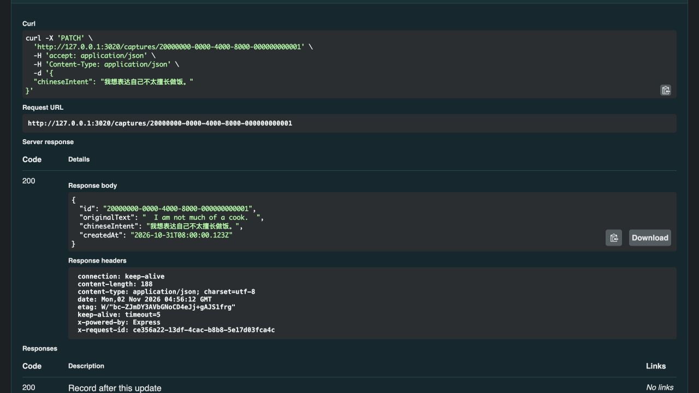

Postman 中也按同样方法操作。下面一组改用一条独立演示记录，原文为 `Chapter 20 screenshot sample`；在这组对照内部始终保持 URL 中同一个 ID，填写意图“用于比较缺失字段与清空。”。

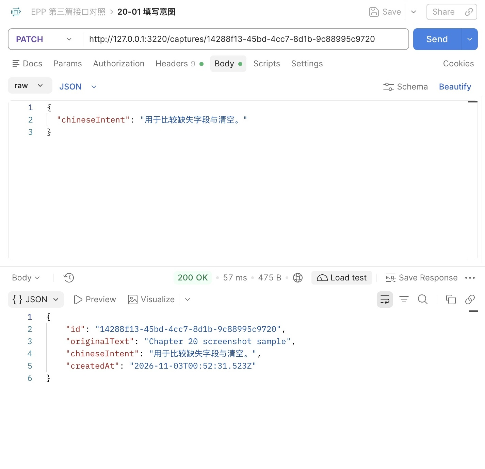

Body 选择 raw／JSON，响应的 `chineseIntent` 与输入相同；记下 ID、原文、意图和创建时间，作为随后拒绝实验的比较基线。图中端口为 3220，跟做使用自己的服务地址。

继续在图形客户端比较 `{}`、`{"chineseIntent":"   "}` 和 `{"chineseIntent":null}`：前两项 400 且旧值不变，后一项 200 并明确清空。发送仅包含原文的旧创建请求，201 响应意图为 null；带意图的新创建请求则保留输入。这时数据库中旧记录、新记录、已填写和未填写记录可以同时存在。

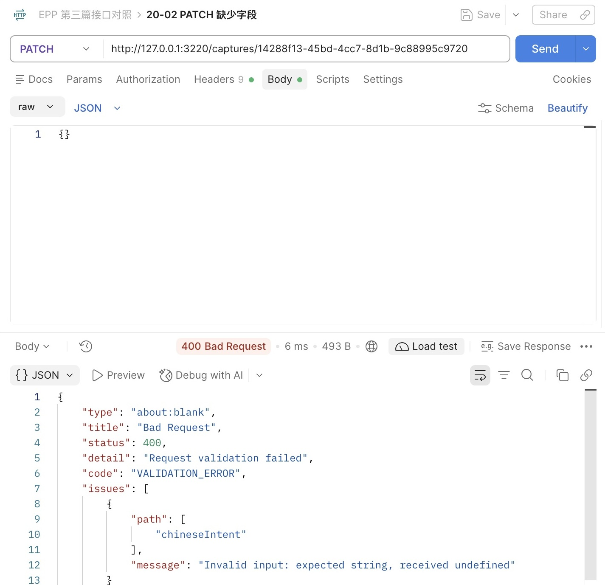

请求 Body 是合法 JSON 对象 `{}`，问题发生在字段契约：`issues` 指向 `chineseIntent`，消息中的 `undefined` 表示未提供字段，不是数据库中的 SQL NULL。创建接口允许省略意图，不代表修改接口也接受省略；先看当前请求方法，再解释响应。

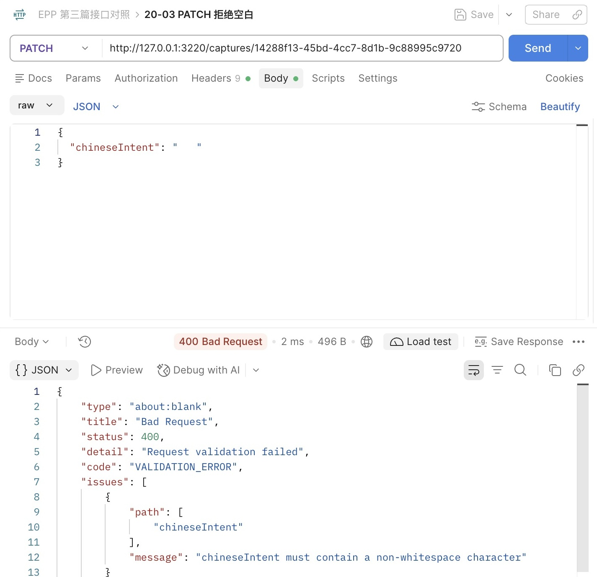

这次字段存在且类型为字符串，失败原因变为没有非空白字符。和后面的成功清空图对照：空对象、纯空白字符串、JSON null 是三种不同意图，不能由客户端统一改成空字符串。两张 400 图只证明输入拒绝；再 GET 同一个 ID 并与操作前比较，才补齐旧值保持的观察。

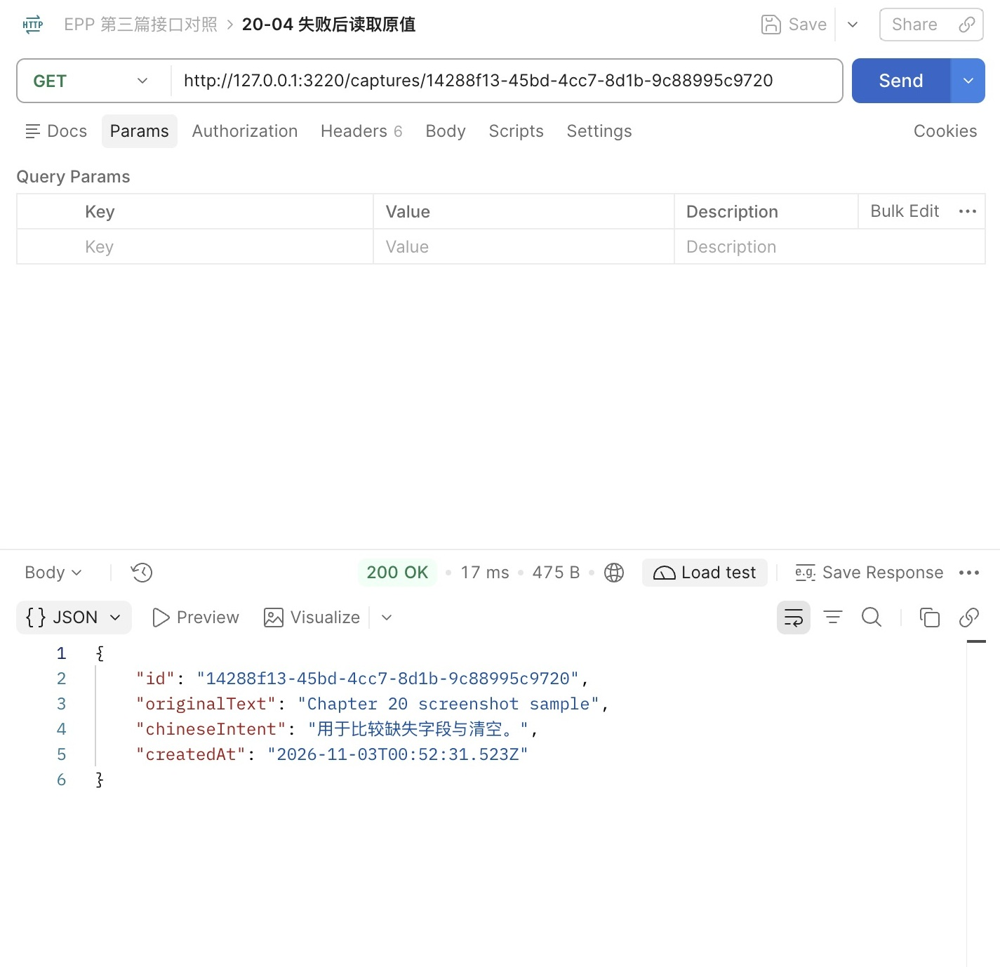

这次 GET 在发送空对象和纯空白请求之后执行。与成功 PATCH 图相比，ID、原文、意图“用于比较缺失字段与清空。”及创建时间都保持；这才把“请求被拒绝”和“旧值未改变”连起来。完成比较后，再发送显式 null，观察清空的不同结果。

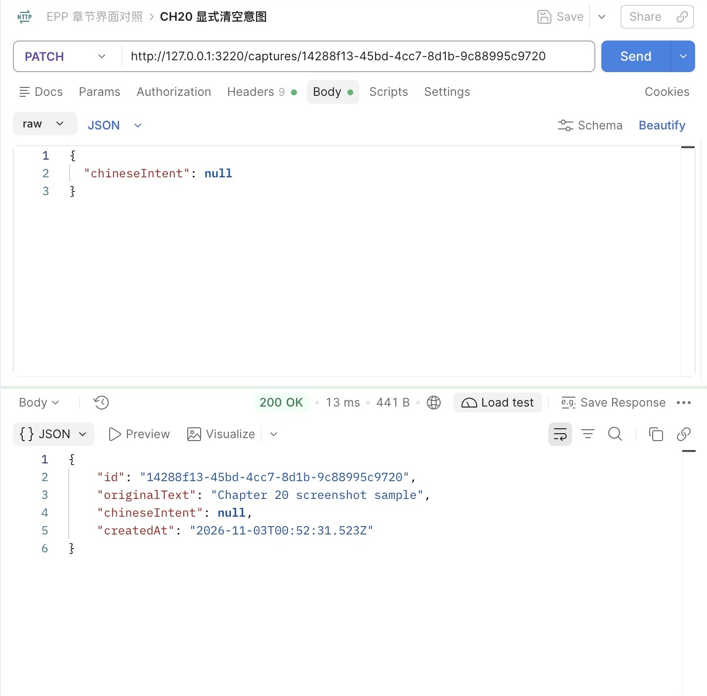

注意请求确实包含 chineseIntent，值是 JSON null，不是字符串 "null"，也不是省略字段。响应仍包含 chineseIntent: null；应按同一 id 与操作前结果比较原文和 createdAt，并在 DBeaver 核对列值。端口使用当前服务地址。

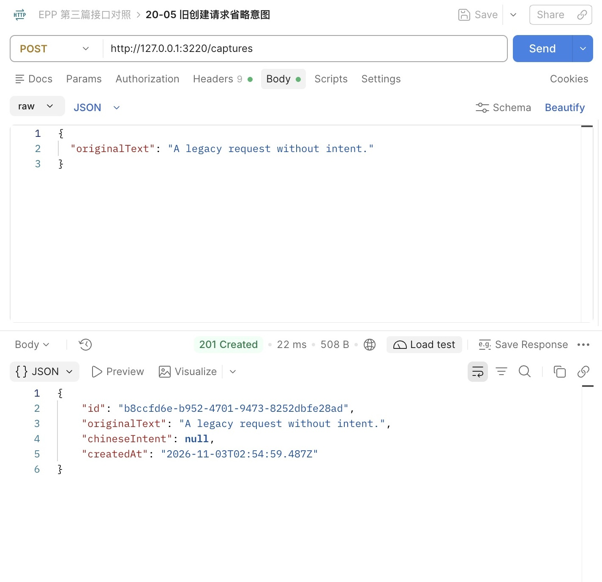

这个 POST 的 Body 只有 `originalText`，201 响应仍明确包含 `chineseIntent: null`。它和前面的 PATCH 空对象不是同一种操作：创建时可以尚无意图，修改时则要求说明要改成什么。

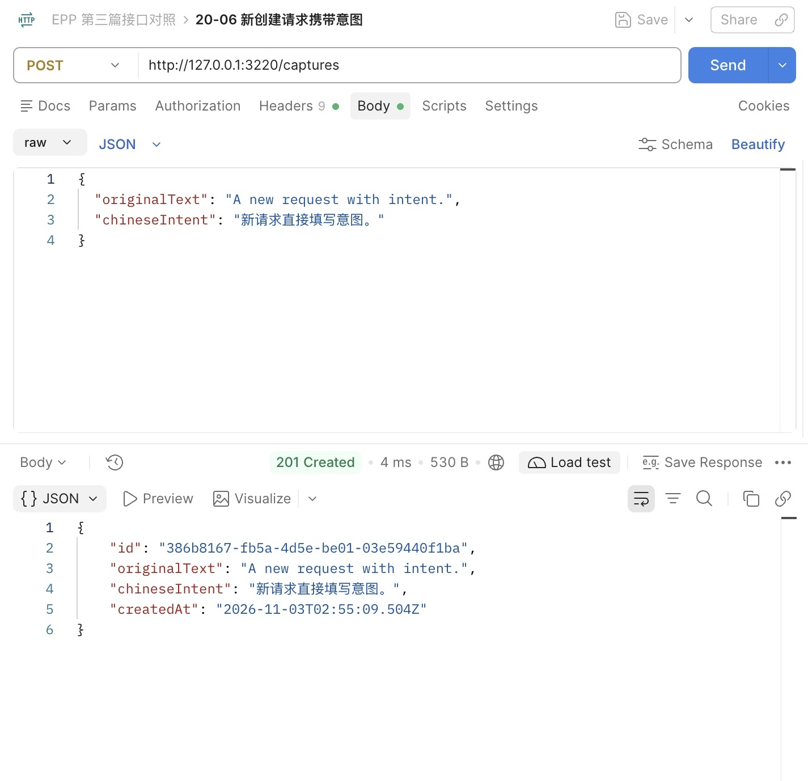

第二个 POST 显式提供意图，201 响应保留该值。两张创建图的 ID 不同，这是两个新记录，不是给上一条记录追加内容；第 22 章才引入修订身份。继续在详情、列表与 DBeaver 中按各自 ID 核对，不用只看原文相似就认定是同一条记录。

若 PATCH 返回 405，先检查方法边界；415 看 Content-Type；400 看 Problem 的 code 和字段路径；500／503 再用 `X-Request-Id` 关联日志。若数据库已改但响应 500，检查输出投影及 Schema，不能直接重放修改。给 `updateIntent`、SQL 返回与响应拦截器设断点，分别看输入、实际更新行和最终表示；查询事件参数中含用户文本，只在本机示例调试时观察，不增加常态原文日志。

沿同一次 PATCH 观察时，先在 `captures.service.ts` 的 `updateIntent` 中、调用 `validateIntent` 的位置暂停，在 Debug Console 求值 `JSON.stringify({id, chineseIntent}, null, 2)`：

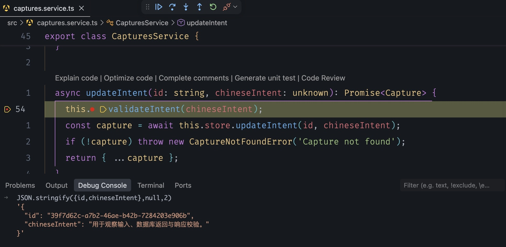

图中使用独立的虚构记录，完整 ID 与控制台中的输入对应；黄色行尚未执行下一行的存储更新。因此这里只能确认传入业务层的值，不能据此断言数据库已经保存。继续沿下面两个位置观察，才把输入、更新和输出连起来：

1. 在 `prisma-capture.store.ts` 的 `updateIntent` 中，停在 `await` 之后的 `return rows[0] ...`，求值 `JSON.stringify(rows, null, 2)`。此时 `UPDATE ... RETURNING` 已返回；应有一行，其 ID 与输入相同，意图是新值，原文和创建时间保持。若数组为空，接下来的业务判断会产生 404，不能自行构造一个“更新成功”的对象。
2. 在 `response-schema.interceptor.ts` 的 `map(value => this.schema.parse(value))` 回调内部暂停，核对 `value`，再求值 `this.schema.parse(value)`。这一行同时包含外层 `intercept` 调用和稍后执行的回调；若尚无 `value`，说明停在外层，需把断点移到回调中的 `parse`，可用行内断点定位。这里检查的是返回对象能否通过公开契约，数据库成功不自动保证这一步成功。

检查完继续执行，再在请求客户端和数据库中按同一 ID 核对。若客户端因长时间暂停而超时，先读取实际结果，不直接重发修改；调试器中的求值和黄色行都不等于 HTTP 已成功送达。控制台只使用虚构数据，关闭调试后仍保持常态日志不含原文。

现在可以再次暂停：追加迁移已应用，四个接口在相同结构上工作。开发进程重启后意图仍来自数据库；暂停前完成请求和事务，记住正在使用的程序分支与数据库目标。

## 20.4 如果以后要求必填，如何不让旧数据突然失效

“界面以后必填”还需要进一步澄清。可能只约束新记录，也可能要求所有旧记录补齐；可能允许草稿，也可能只要求发布时完整。这些要求对应不同约束。数据库的普通 `NOT NULL` 作用于整列，不知道某行属于哪个客户端版本，也不会因为它创建于昨天就自动豁免。

当前主线仍允许 null。下面改变需求，在同一会话的临时表上演练“全表必须有值”，不把实验约束施加到真实 `captures`。这样能观察机制，同时保留主线已经承诺的清空和旧请求行为。

### 先观察直接收紧为什么失败

DBeaver 在 DEV 连接新建一个编辑器，保持同一物理会话，打开 `03-required-intent-lab.sql`。按编号分段执行，别把含预期错误的整份脚本一次运行。临时表只在该连接存在，换编辑器若换了连接就看不到。

```sql
CREATE TEMP TABLE intent_lab (id integer PRIMARY KEY, chinese_intent text);
INSERT INTO intent_lab VALUES (1,NULL),(2,'用户已确认的意图');

BEGIN;
ALTER TABLE intent_lab ALTER COLUMN chinese_intent SET NOT NULL;
ROLLBACK;
```

第二条记录有值，不会让第一条 NULL 自动合法。ALTER 预期返回 23502，事务失败后在同一编辑器执行 ROLLBACK。给列 `SET DEFAULT` 也不等于更新旧行；而默认填“未知”又改变了事实含义，不能拿假值换约束通过。

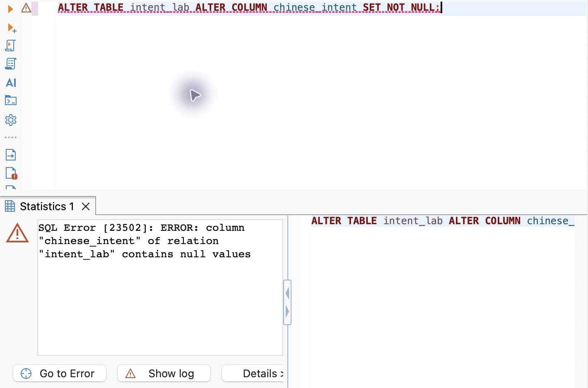

错误详情指出 `intent_lab.chinese_intent` 仍包含 null。失败发生在收紧列定义时，不是客户端拒绝执行 ALTER；先回滚本次失败事务，再安排旧值处理。

### “先回填、再检查”的缝隙

假设回填已经把旧 NULL 清完，随后另一个旧程序又插入一行 NULL，然后你执行 SET NOT NULL。检查时为零不代表收紧时仍为零。普通 SELECT 只说明某个可见时刻的情况，不自动阻止之后的写入。

因此完整顺序是：让所有可能写入的程序遵守新规则，再建立数据库对新写入的防线，处理旧值，验证全表，最后收紧列定义。旧程序、导入脚本、后台作业都属于写入方；不能只升级某个页面就认定所有入口已切换。

下图把“保护新写入”和“处理旧数据”分开。中间阶段允许历史 NULL 暂时存在，但已经有约束阻止新写入继续制造 NULL；这正是直接先回填、后加约束所缺少的防线。

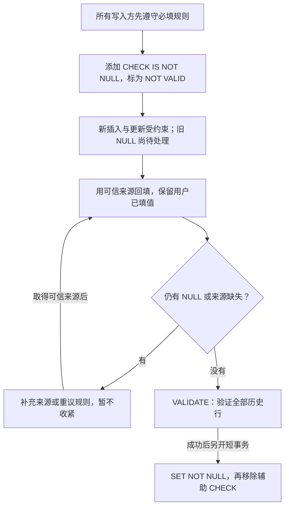

图中的回填不能创造用户没有确认的含义；来源一直缺失时，就停在可解释的中间状态。当前主线仍允许清空，下面仅在临时表演练这条路径。

在临时表中先加一个尚不扫描历史的 CHECK：

```sql
BEGIN;
SET LOCAL lock_timeout='2s';
ALTER TABLE intent_lab ADD CONSTRAINT intent_lab_present
  CHECK (chinese_intent IS NOT NULL) NOT VALID;
COMMIT;
```

`NOT VALID` 表示尚未证明所有历史行符合，**不表示这个约束暂时不工作**。旧 NULL 可以暂时留着，新插入和更新后的行必须通过。尝试插入 NULL，应得到 23514；失败事务随后回滚。即使只改某个其他字段，更新后的行若仍是 NULL，也可能被此防线拒绝，这也是上线前要协调所有写入行为的原因。

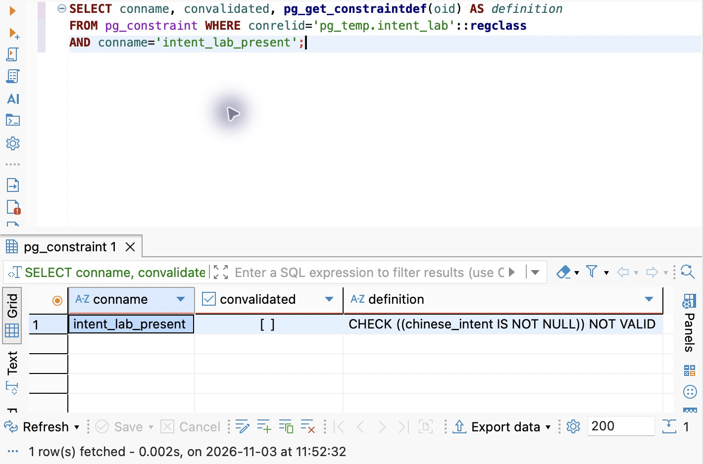

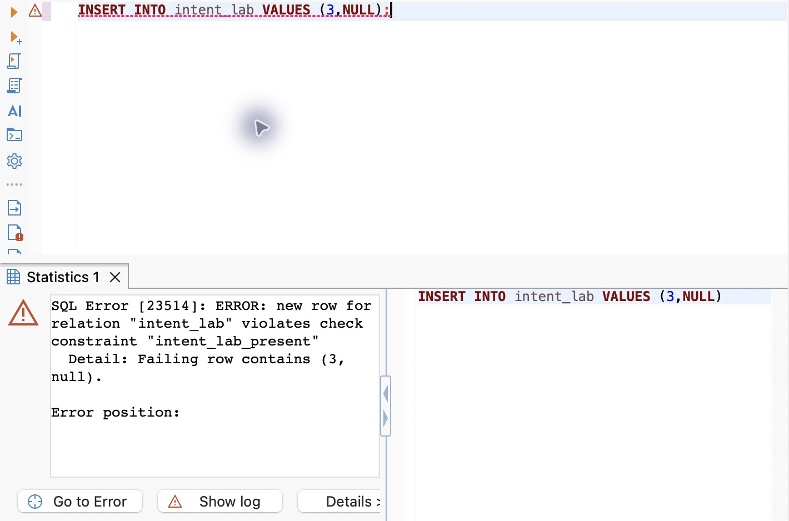

第一张的 `convalidated` 未勾选，定义末尾仍有 `NOT VALID`；第二张插入新 NULL，错误直接指向 `intent_lab_present`。两图要一起看：尚未完成历史验证与已经保护新写入可以同时成立。

在约束页或配套 `pg_constraint` 查询中观察 `convalidated=false`。补上第一条经确认的实验意图：

```sql
UPDATE intent_lab
SET chinese_intent='这条实验记录经确认后补充的意图'
WHERE id=1 AND chinese_intent IS NULL
RETURNING *;
```

WHERE 的 null 条件让已经由用户填写的值不被回填覆盖。真实数据还要限定归属，确认映射来源与当前原文相匹配；不能把“单条实验可更新”扩展成“全库统一写同一句话”。没有可靠来源的旧记录，应保留待处理状态或重新讨论必填规则。

### 验证历史，再把证明交给非空列

在同一编辑器执行：

```sql
BEGIN;
SET LOCAL lock_timeout='2s';
SET LOCAL statement_timeout='10s';
ALTER TABLE intent_lab VALIDATE CONSTRAINT intent_lab_present;
COMMIT;

BEGIN;
SET LOCAL lock_timeout='2s';
ALTER TABLE intent_lab ALTER COLUMN chinese_intent SET NOT NULL;
ALTER TABLE intent_lab DROP CONSTRAINT intent_lab_present;
COMMIT;
```

验证检查剩余历史行，成功后 `convalidated` 为 true。验证期间已有防线约束新写入，因此全表证明不会因为又插入 NULL 而立即失效。PostgreSQL 可以利用已验证的 `CHECK (列 IS NOT NULL)` 跳过 SET NOT NULL 所需的重复全表扫描；**取得变更结构所需的锁仍然必要**。

验证与最后收紧分开提交，是为了不把前一阶段较长的工作都包在最后的强锁事务里。先 SET NOT NULL，再删除辅助 CHECK；不要在同一条 ALTER 中一边删除证明一边指望它帮助优化。正式非空生效后，再插 NULL 应得到 23502。配套脚本最后删除临时表，业务表没有变化。

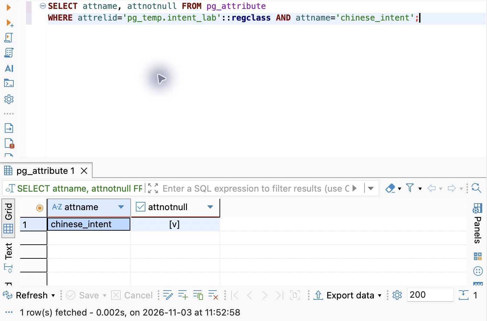

图中查询限定 `pg_temp.intent_lab` 的这一列，`attnotnull` 勾选说明最终列定义已经非空；不能把辅助 CHECK 创建成功当作同一个结果。清理临时表之前先完成这项核对。

若以后真的采用该需求，以上步骤要转成有审查与部署顺序的追加迁移和数据回填任务，Schema 的 `String?` 也要相应改为 `String`，输入、清空动作和响应契约随之改变。不能只手工改数据库，然后让模型继续声称可空。生成器无法替你确定这些步骤该跨几个发布完成；在当前 nullable 功能尚未退出前，本章不把“未来必填”文件加入正式迁移目录。

### PG18原生非空与Prisma过渡模型

辅助CHECK并不是唯一方案。PostgreSQL 18支持把原生非空约束直接标为NOT VALID，同样先保护新写入，再处理历史行。它省去最后的SET NOT NULL和删除辅助CHECK。[PG18的ALTER TABLE说明](https://www.postgresql.org/docs/18/sql-altertable.html)中，这条语法是 `ADD CONSTRAINT ... NOT NULL 列名 NOT VALID`，不是给SET NOT NULL追加NOT VALID。

在同一个DBeaver编辑器另建临时表，避免复用刚才已收紧的列。配套 `database/chapter-20/08-native-required-intent-lab.sql` 保存了完整分段步骤；先执行建表和添加防线：

```sql
CREATE TEMP TABLE intent_native_lab (id integer PRIMARY KEY, chinese_intent text);
INSERT INTO intent_native_lab VALUES (1,NULL),(2,'用户已确认的意图');
BEGIN;
SET LOCAL lock_timeout='2s';
ALTER TABLE intent_native_lab ADD CONSTRAINT intent_native_present
  NOT NULL chinese_intent NOT VALID;
COMMIT;

SELECT a.attnotnull, c.contype, c.convalidated
FROM pg_attribute a JOIN pg_constraint c
  ON c.conrelid=a.attrelid AND a.attnum=ANY(c.conkey)
WHERE a.attrelid='pg_temp.intent_native_lab'::regclass
  AND a.attname='chinese_intent' AND c.contype='n';
SELECT * FROM intent_native_lab ORDER BY id;
```

这里会同时看到 `attnotnull=true`、原生非空类型 `contype=n`、`convalidated=false`，以及仍为NULL的第一行。先前CHECK路线是在完成回填和验证之后才设置attnotnull；原生路线提前设置它，因此不能只看“非空”勾选就判断历史已处理。新插入NULL会报23502；不回填就VALIDATE也报23502。下面两段分别执行，每次失败后先ROLLBACK，再继续下一段：

```sql
BEGIN;
INSERT INTO intent_native_lab VALUES (3,NULL);
ROLLBACK;

BEGIN;
SET LOCAL lock_timeout='2s';
SET LOCAL statement_timeout='10s';
ALTER TABLE intent_native_lab VALIDATE CONSTRAINT intent_native_present;
ROLLBACK;
```

有经确认的来源后，单独提交回填，再验证：

```sql
BEGIN;
UPDATE intent_native_lab
SET chinese_intent='这条实验记录经确认后补充的意图'
WHERE id=1 AND chinese_intent IS NULL;
COMMIT;

BEGIN;
SET LOCAL lock_timeout='2s';
SET LOCAL statement_timeout='10s';
ALTER TABLE intent_native_lab VALIDATE CONSTRAINT intent_native_present;
COMMIT;
```

重跑目录查询，convalidated应为true；确认后 `DROP TABLE intent_native_lab`。不要删除 `intent_native_present`：它已经是正式非空约束，不是可以丢弃的辅助CHECK。原生与CHECK两条路径在添加防线时都需要ACCESS EXCLUSIVE锁，验证时都使用较弱的SHARE UPDATE EXCLUSIVE锁；少扫描、少步骤不等于无锁，仍应分段提交、限制等待并协调写入方。

本节保留CHECK作为与Prisma衔接的演练主线，理由在过渡模型。Prisma 7.10.1对原生未验证非空列执行db pull会得到 `String`，即使历史NULL还在；向必填模型做diff也可能没有差异。生成类型为string，并不证明每行都有字符串：在本章生成器和pg适配器的读取链中，旧NULL仍可作为null返回，直接调用字符串方法会失败。反过来，坚持保留 `String?` 再盲目应用diff，又可能删除原生非空防线。

辅助CHECK让回填期间的列和读取类型保持可空，验证完成后再一起切成必填，阶段含义更直观；但CHECK本身仍需显式检查数据库目录，diff为空也不能替代这项证明。若已经准备好手写迁移、可空过渡读取及目录核对，PG18原生路线完全可以采用，Prisma的迁移执行和历史重放能够执行这段SQL。选择应来自程序、结构与数据怎样协调，而不是认定新语法不能用，或看到步骤更短就直接替换。

## 20.5 漂移、迁移失败与回退：先找出哪一层不一致

一个字段变化完成后，至少有三种版本同时存在：程序版本、数据库结构版本和业务内容状态。Git 切回第十九章只改变程序文件，不会删除数据库里的新列，也不会把已经填写的意图改回 null。把这三件事混为“版本回退”，往往会在急着恢复时再丢一次数据。

### 先判断兼容方向

| 程序与结构 | 本章行为 | 原因 |
| --- | --- | --- |
| 旧程序＋旧结构 | 正常 | 第十九章原状态 |
| 旧程序＋新增可空列 | 旧接口正常 | 旧程序只选旧列，写入时省略意图，数据库允许 null |
| 新程序＋旧结构 | 启动失败 | 启动探测已引用 `chinese_intent` |
| 新程序＋新增可空列 | 支持意图接口 | 模型、访问与公开契约完成衔接 |

因此本次可以先扩展数据库，再启动新程序。发现程序问题时，可暂时退回旧程序，保留新列和已有意图，不马上 DROP COLUMN。旧程序不显示该字段，不等于数据库丢失了它。若回到旧程序，新的 PATCH 功能会不可用，不能对客户端承诺功能完全不受影响。

这份表只证明本次具体变化的方向。响应增加字段是否兼容，还取决于旧客户端是否接受未知字段；严格拒绝额外属性的客户端需要同步适配。收紧非空、重命名或改变语义也不能套用这一结论。更完整的新旧实例并行发布在第六十五章展开，这里先实际建立当前变更的兼容依据。

生产仍使用审查后的历史和 `migrate deploy`，不运行 `migrate dev`，不需要影子库。迁移由独立发布步骤执行，使用拥有相应结构权限的身份；应用启动不竞争执行 DDL。本章沿用开发角色完成本机演练，真实运行身份与迁移身份的最小权限分离将在部署时落实。

Prisma CLI 是开发依赖；仅安装 `--omit=dev` 的应用目录通常没有这个命令。因此“生产用 deploy”不是在运行目录碰碰运气，而是让带有固定 CLI、配置和迁移文件的发布作业连接目标数据库，再运行已构建的应用。应用产物不需要为了每次启动而携带迁移执行职责。

### 历史同步、结构一致、数据正确是三个问题

`migrate status` 主要比较文件历史与数据库记录。没有待执行迁移，不代表有人没有手工添加索引、删除约束或改过列。开发命令借影子重放发现支持范围内的漂移；显式 diff 辅助比较实际结构与目标模型。CHECK 这样的模型外能力仍需查数据库目录及迁移 SQL。

遇到差异先做三向对照：磁盘迁移文件和 checksum 是否改变；数据库当前实际对象是什么；Prisma 模型希望表达什么。不要见到 reset 提示就确认，更不要用 `db push` 把差异盖过去。第十八章支线已经比较过误操作恢复与有效设计变化：误操作需要恢复预期，有效的新需求则应进入模型和追加历史；有业务内容的列不可为了消除漂移随意删除。

如果开发分支缺少别的分支已应用过的迁移，先恢复正确的历史上下文，或为不同分支使用各自的开发库。程序分支可以切换，共用数据库却不会跟着 Git 自动倒退。影子库可清理，日常库不可因此被当成临时产物。

### 用一笔没结束的读取制造可解释的失败

本章配套提供 `epp_ch20_recovery` 隔离库实验。它不复用日常库、校验库或影子库。在 ADMIN 的 postgres 连接开启自动提交，逐条执行 `06-create-recovery-database.sql`，创建并授权这个专用库。把 `database/chapter-20/recovery.env.example` 保存为根目录 `.env.database-recovery`，填写凭据，确认 URL 的数据库名确实是 `epp_ch20_recovery`。

在项目根目录先准备只含基线的隔离历史，部署后才加入本章迁移：

```bash
unset DATABASE_URL SHADOW_DATABASE_URL
node database/chapter-20/prepare-recovery.mjs baseline
node --env-file=.env.database-recovery node_modules/prisma/build/index.js \
  migrate deploy --config database/chapter-20/recovery.prisma.config.ts
node database/chapter-20/prepare-recovery.mjs append
```

`prepare-recovery.mjs` 只复制文件，不连接数据库；baseline 只复制 `0_init`，append 再复制新增历史。专用配置将迁移路径指向 `recovery-history`，它被 Git 忽略；复制品字节与正式文件相同，不能修改正式历史来制造故障。脚本遇到已存在目录会停下，重新开始前先检查历史与库状态，不删除重置。

在 DBeaver 给隔离库建立 A、B 两个独立会话，先比较 `pg_backend_pid()`。A 打开 `05-recovery-lab.sql`，执行 BEGIN、60 秒闲置事务保护的 SET LOCAL 和读取 captures 的 SELECT，暂时不执行 ROLLBACK。超过保护时限会结束该连接上的事务，需重连并重新开始这段实验，不能把已经释放锁的会话当成阻塞者。SELECT 已经返回，也仍可能在未结束事务中持有 ACCESS SHARE 锁。迁移所需的 ACCESS EXCLUSIVE 与它冲突。

在另一个终端向隔离库执行：

```bash
node --env-file=.env.database-recovery node_modules/prisma/build/index.js \
  migrate deploy --config database/chapter-20/recovery.prisma.config.ts
```

B 运行 `04-observe-migration-lock.sql`，看等待事件、阻塞 PID 和事务年龄。迁移等待超过文件中的两秒预算就失败；界面观察窗口较短，错过等待状态时仍可从失败和服务器日志定位，不为截图延长日常库锁定。

不要把 CLI 最后一条错误机械当成首因。带 BEGIN 的迁移在这个版本组合中，可能最后只显示 `current transaction is aborted`，迁移记录的 logs 也可能为空。用第十五章实例启动时指定的 PostgreSQL 日志文件查看服务端记录；日志位置不在应用日志里，也不由 Prisma 保存。先记录失败时间；若观察到了等待中的迁移后端，再记录其 pid，在服务器日志中沿这个 PID 向前找第一个错误，应是 `canceling statement due to lock timeout`；后续事务失败只是结果。DBeaver 约束异常同理，需要区分导致失败的语句和失败状态下继续执行的语句。

下面是这次隔离恢复实验的服务端日志摘录，保留同一个 PID 与先后顺序，省略无关语句：

```text
2026-11-03 11:59:25.280 CST [97090] ERROR: canceling statement due to lock timeout
2026-11-03 11:59:25.280 CST [97090] STATEMENT:
ALTER TABLE public.captures ADD COLUMN chinese_intent text;
2026-11-03 11:59:25.281 CST [97090] ERROR: current transaction is aborted, commands ignored until end of transaction block
```

首因指向 ADD COLUMN 等锁超过预算，随后才进入失败事务状态。自己的复现应按实际时间与 PID 查找，不照抄这里的编号。

回到 A 执行 ROLLBACK。B 检查 `chinese_intent` 不存在，基线两表仍在，迁移历史里本次尝试未完成。由于本文件显式包在事务里，列添加和 CHECK 不会只留下半套。

图中将迁移状态与列的存在性放到同一查询中比较；`finished`／`rolled_back` 分别表示相应时间戳是否非空，`column_exists` 查询当前实际结构：

```sql
SELECT (finished_at IS NOT NULL)::text AS finished,
       (rolled_back_at IS NOT NULL)::text AS rolled_back,
       (EXISTS (SELECT 1 FROM information_schema.columns
         WHERE table_schema='public' AND table_name='captures'
           AND column_name='chinese_intent'))::text AS column_exists
FROM public._prisma_migrations
WHERE migration_name='20261102040511_add_chinese_intent'
ORDER BY started_at;
```

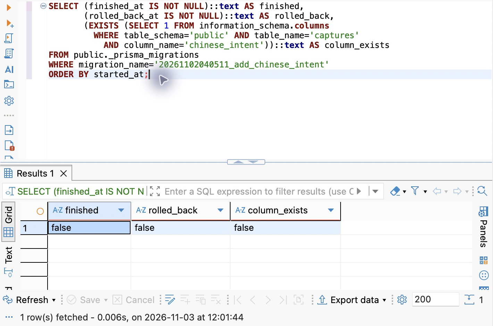

三个 false 分别说明不同事实：迁移未完成、工具尚未登记已回滚、当前列不存在。`rolled_back=false` 不能解释为服务器事务仍未回滚；实际结构检查与历史状态必须分开。

**只有查明回滚事实后**，用相同隔离库配置登记这一失败已回滚，再部署：

```bash
node --env-file=.env.database-recovery node_modules/prisma/build/index.js \
  migrate resolve --rolled-back 20261102040511_add_chinese_intent \
  --config database/chapter-20/recovery.prisma.config.ts
node --env-file=.env.database-recovery node_modules/prisma/build/index.js \
  migrate deploy --config database/chapter-20/recovery.prisma.config.ts
```

本章配套名如上；自行生成的迁移用自己的名称。`resolve --rolled-back` 只是修改迁移状态，不执行数据库 ROLLBACK，也不帮你清理已提交的半成品。重试成功后，历史应保留失败尝试及新的成功尝试，实际结构与完整历史一致。直接重复 deploy 而不处理失败记录，会被阻止，这正是工具要求先解释现场的地方。

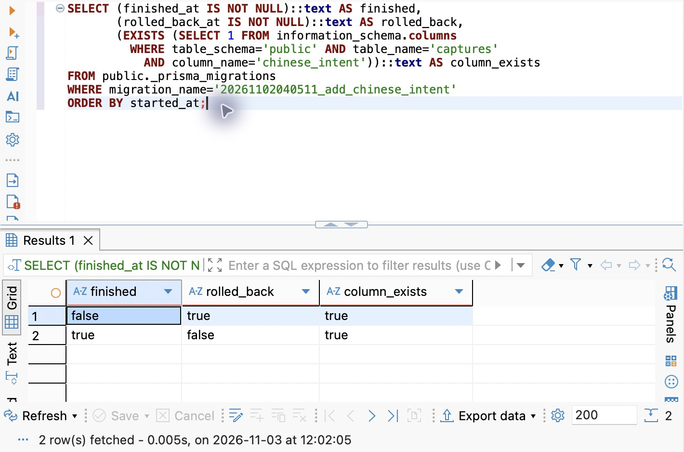

重新执行同一查询，现在有两行：先前尝试是 `finished=false, rolled_back=true`，新尝试是 `finished=true, rolled_back=false`。两行的 `column_exists=true` 都来自**当前**结构查询，不表示失败尝试当时已经建列；迁移历史记录尝试，结构查询回答现在实际有什么。

如果某个迁移没有事务，已经提交了部分步骤，不能套用“没有留下半套”的结论。应先决定恢复到迁移前，还是完成剩余步骤；确认真实对象和数据后再选择 `--rolled-back` 或 `--applied`。后者登记为已完成，同样不替你执行剩余 SQL，也不验证数据。不能用它把失败记录变成绿色而让现场继续残缺。

下面把恢复判断收束到两种不同现场。分支依据是实际对象和数据，不是命令是否显示红字；存在部分变更时，需要先执行并核对具体修复方案，不能直接跳到历史登记。

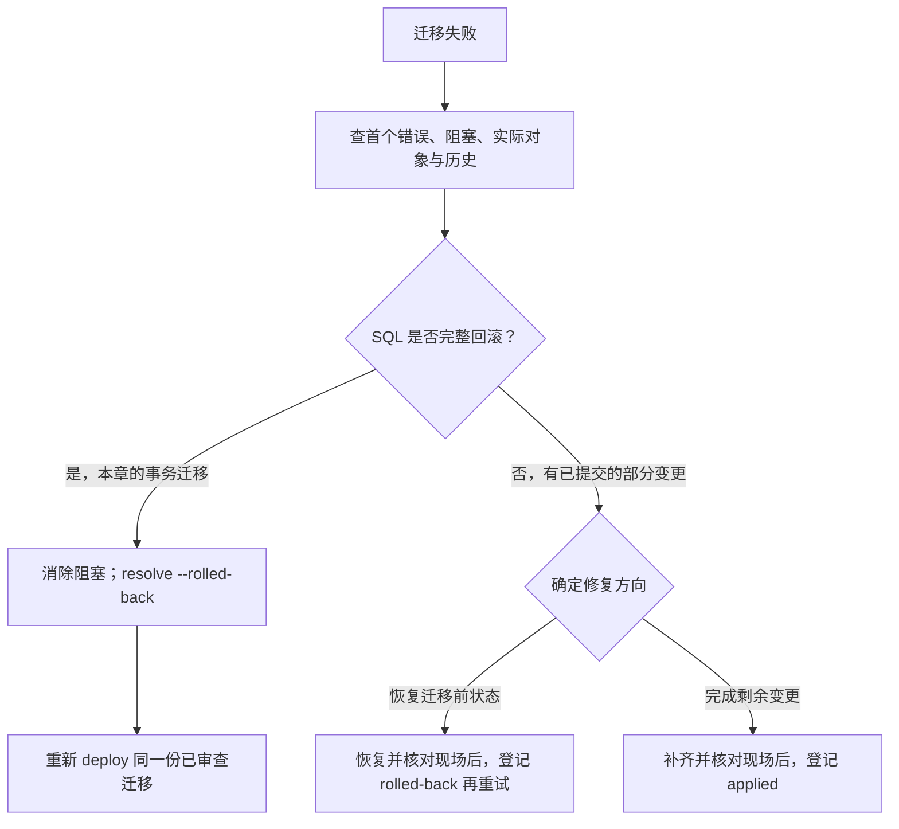

图中所有 resolve 都发生在事实查明之后：它改变迁移记录，不负责把数据库改成你希望的状态。

### 修复为什么通常继续向前

本次成功增加的列被旧程序忽略，保留它的成本很低，而删除会丢掉已填写意图。遇到应用缺陷，先恢复服务行为再追加修复，通常比急着反向改库更可控。修改已成功应用的迁移，不会让已执行的库自动重跑；即使只改注释或空白，也可能改变文件校验值；修改历史会让同名文件在不同环境代表不同动作，排错依据随之失效。

未来确需删除字段时，要先让所有读写方停止依赖，确认数据保留或导出方案，再安排追加的删除迁移。所谓“只能追加历史”约束的是已经被成功消费的动作，并不意味着在第一次应用之前不能审查、编辑草稿。未成功应用的失败草稿能否修改，要核对所有目标：只要任何环境已经成功执行，就按不可变历史处理。

本章完成的结果是：同一批旧记录经历了一次真实结构扩展，接口仍能读取它们，新旧创建格式并存，意图可以独立修改；你也能解释锁等待、失败记录和实际结构为何要分别核对。下一章将换一个字段约束，让这些判断组合成一次独立的结构演进。

## 本章知识支线

- [支线 20A：回填跑到一半，怎样继续而不覆盖用户的新值](side-01-resumable-backfills.md)：把少量演示数据扩展为分批、可恢复的数据修复，区分批次完成、来源缺失和业务完成。

## 附录：本章必要技术点速查

| 名称 | 本章用途 | 必要注意点 |
| --- | --- | --- |
| `String?`／`@map` | 可空意图与列名映射 | 模型变更不等于数据库已改变 |
| `migrate dev --create-only` | 生成供审查的开发迁移 | 需要影子库；遇到漂移不确认重置 |
| `SHADOW_DATABASE_URL` | 显式指定重放工作库 | 不能指向日常库、校验库或任何重要数据 |
| `migrate deploy` | 按现成历史应用待执行迁移 | 不生成客户端，不进行完整漂移检测 |
| `prisma generate` | 更新程序可用的模型类型与客户端 | Prisma v7 迁移后显式生成；生成不应用 DDL |
| `ADD COLUMN ... text` | 扩展为可空字段 | 不带默认值也需要取得表锁 |
| `lock_timeout`／`statement_timeout` | 限制等锁和语句时间 | `SET LOCAL` 作用于当前事务，不是整次发布预算 |
| `CHECK ... NOT VALID` | 先约束新写入，稍后验证旧行 | 更新后的行也受约束；不等于禁用约束 |
| `VALIDATE CONSTRAINT` | 验证已有数据 | 验证成功不意味着后续 DDL 不需要锁 |
| `SET NOT NULL` | 全列不可空 | 先有可信数据和写入防线；不能靠默认值补旧行 |
| `UPDATE ... RETURNING` | 单条语句修改指定字段并返回结果 | 带归属条件；不等于不会被后来的修改覆盖 |
| `nullable()`／`optional()` | 区分清空与省略 | 修改接口不把省略转换成清空 |
| `resolve --rolled-back/--applied` | 在事实核对后修正迁移记录 | 不替代回滚、补写或现场验证 |

官方入口：[Prisma v7 migrate dev](https://www.prisma.io/docs/cli/v7/migrate/dev)、[影子库](https://www.prisma.io/docs/orm/v7/prisma-migrate/understanding-prisma-migrate/shadow-database)、[开发与部署](https://www.prisma.io/docs/orm/v7/prisma-migrate/workflows/development-and-production)、[迁移历史](https://www.prisma.io/docs/orm/v7/prisma-migrate/understanding-prisma-migrate/migration-histories)、[失败迁移与修复](https://www.prisma.io/docs/orm/v7/prisma-migrate/workflows/patching-and-hotfixing)、[PostgreSQL 18 ALTER TABLE](https://www.postgresql.org/docs/18/sql-altertable.html)、[表级锁](https://www.postgresql.org/docs/18/explicit-locking.html)、[UPDATE](https://www.postgresql.org/docs/18/sql-update.html)。

本章完成代码分支：`part-03/chapter-20`。新增迁移后，旧章代码与数据库结构不再自动一一对应；回看旧章时使用其分支，并核对那章需要的数据库条件。

[上一章：Prisma 与 Nest](../chapter-19-prisma-nest/chapter.md) · [下一章：第三篇回顾](../chapter-21-review/chapter.md) · [第三篇导读](../README.md) · [返回全书目录](../../README.md)
