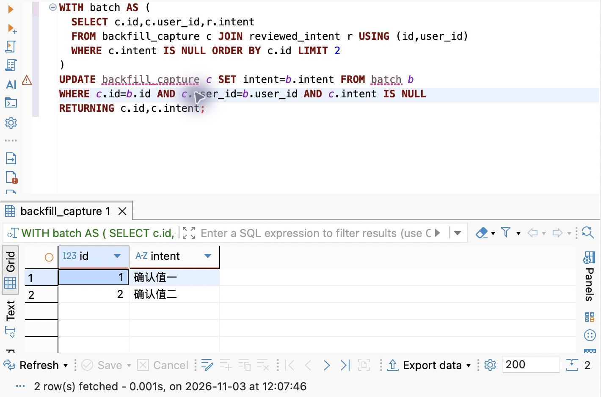
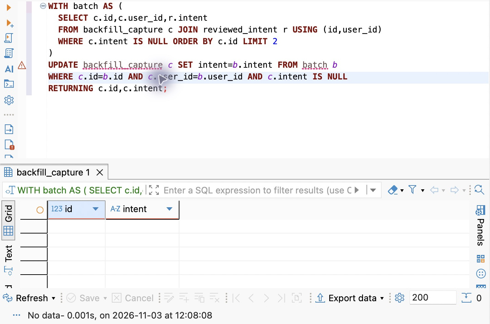
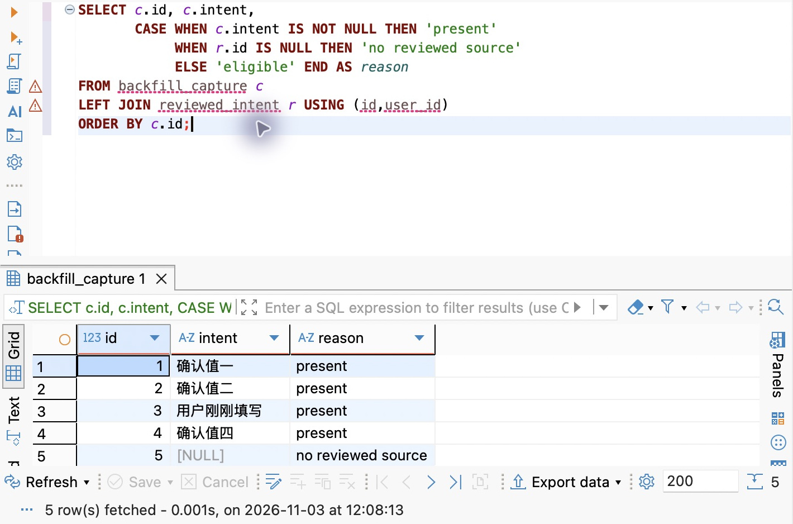

# 支线 20A：回填跑到一半，怎样继续而不覆盖用户的新值

正文用两行临时数据演示了“旧值补齐以后才能收紧约束”。实际系统可能有几十万条待处理记录，回填需要几分钟甚至几小时，中间还有用户修改、作业中断和来源缺失。此时把一条 UPDATE 换成循环，不会自动得到一个可靠过程。

本支线继续使用 DBeaver 和临时表，重点是回填的选择条件与恢复依据。它不把当前 EPP 改成意图必填，不创建后台任务系统。先完成第 20 章，再打开配套 `database/chapter-20/07-batch-backfill-lab.sql`。

**时间参考**：阅读约 30～35 分钟，操作另加 10～15 分钟，按约 2500 个汉字、一个分批更新例子、三张实际结果图和中断／缺失对照估算，尚未经过读者实测。

## 从“全库更新”到“每次处理一段明确的工作”

假设已经取得一批用户确认过的意图，来源表用记录 ID 和用户 ID 标识目标。一条全量 UPDATE 可以把它们写进记录表，但事务持续期间，修改过的行锁要等提交才释放；执行时间、日志量和失败时的回滚工作都会随批次增大。长事务还会让数据库更难及时清理旧行版本。

分批的价值是缩小一次占用资源与失败重做的范围，不是让 SQL 总工作量凭空消失。每批提交以后就成为已发生的事实；后面的批次失败不会自动撤销前面的成功。换来较短事务的同时，必须接受“整体尚未完成，但部分记录已经变了”的中间状态。

这也是先扩展结构、允许新旧内容同时存在的理由之一。如果业务要求所有记录在同一时刻完成切换，就需要额外的版本、影子列或切换方案，不能一边使用多批提交，一边声称全库变化具有单次事务的原子性。

本次每批只处理两条，是为了在界面中看清进度。真实批量取决于单行大小、更新成本、锁等待、复制延迟和对正常请求的影响，不能把某个整数当成通用最优值。

## 来源先满足唯一性，更新才有明确答案

在同一 DBeaver 编辑器中创建两张临时表：

```sql
CREATE TEMP TABLE backfill_capture (
  id integer PRIMARY KEY, user_id integer NOT NULL, intent text
);
CREATE TEMP TABLE reviewed_intent (
  id integer, user_id integer, intent text NOT NULL,
  PRIMARY KEY (id,user_id)
);
INSERT INTO backfill_capture VALUES
  (1,7,NULL),(2,7,NULL),(3,7,'用户刚刚填写'),(4,7,NULL),(5,7,NULL);
INSERT INTO reviewed_intent VALUES
  (1,7,'确认值一'),(2,7,'确认值二'),(3,7,'过期建议三'),(4,7,'确认值四');
```

来源主键不是装饰。如果同一个目标匹配到两份互相矛盾的候选意图，`UPDATE ... FROM` 不能替你决定哪一份才获得用户确认。唯一性必须在进入回填之前建立；有冲突先处理来源，不依赖数据库恰好选中某一行。

连接同时包含 `id` 与 `user_id`，使来源归属成为匹配条件。这里只使用虚构的单一用户，但正式导入不能只依赖文件名或操作员记得“这是哪个人的数据”。来源的合法性、对应关系和审批事实，是回填的前提，不由一次 SQL 成功代替。

第三条记录已经有用户新填的值，来源中却仍有一条旧建议。第五条没有任何确认来源。它们分别检验两个常见错误：覆盖已经完成的工作，以及把没有答案当成执行故障。

## 一批的完成条件写进 SQL

把下面整个事务作为一批执行：

```sql
BEGIN;
SET LOCAL lock_timeout='2s';
SET LOCAL statement_timeout='10s';
WITH batch AS (
  SELECT c.id,c.user_id,r.intent
  FROM backfill_capture c JOIN reviewed_intent r USING (id,user_id)
  WHERE c.intent IS NULL ORDER BY c.id LIMIT 2
)
UPDATE backfill_capture c SET intent=b.intent
FROM batch b
WHERE c.id=b.id AND c.user_id=b.user_id AND c.intent IS NULL
RETURNING c.id,c.intent;
COMMIT;
```

WITH 里的 SELECT 描述候选批次：有确认来源、目标仍缺失、按 ID 明确排序、最多两行。UPDATE 的 WHERE 再次要求目标仍为 NULL，把“没有被其他写入填上”作为实际修改的条件，而不只是在先前的候选选择中检查。

这里的 CTE 不是永久队列，也没有独占领取一批任务。当前只运行一个回填执行者，减少不必要竞争。若多个执行者同时选择相同候选，它们可能等待同一行，不能把 LIMIT 误认为已经分工。需要并行领取时，必须再设计锁、跳过已锁行或任务状态；本支线不通过多开窗口来假装已经解决。

在 PostgreSQL 默认 READ COMMITTED 下，如果另一个写入者先把目标行改成非 NULL 并提交，本条 UPDATE 等待之后会针对更新后的行重新检查条件，`c.intent IS NULL` 可使它跳过。它保护的是“不要覆盖当前已有值”，不是历史版本：若别人在稍后又明确清空，该行重新满足条件，未来一次回填仍可能再次填上。

因此，实际回填必须事先决定用户清空意味着什么。若清空是“不要再自动补充”，单个 NULL 已经不足以表达需求，需要“用户已处理”“拒绝回填”或版本条件等额外事实。正文当前把从未填写和后来清空合为一类，适用于手动意图功能；不能把这个简化无条件搬到长期自动修复任务。

## 中断后，哪些事实仍然可信

本实验使用临时表，只在当前连接存活期间保留；这里的“暂停”是保留同一编辑器和连接，不是断开再重连。要演练跨进程、跨连接的长期恢复，需要将目标与确认来源存入持久表，不能把临时表当作任务存储。

执行第一批，RETURNING 应是 1、2；提交后查询目标表，可以看到两条已填。此处停下，不需要记住进程内的数组下标。再次运行同一批事务，已填写的行不再符合条件，第二批处理 4。第三次不更新任何行。



截图保留本批 UPDATE 与 RETURNING 的对应关系。看到两行说明这条语句实际修改了哪些记录；使用上面的显式事务跟做时，还需执行 COMMIT 才完成这一批。

如果在某批 COMMIT 之前断开，会话事务通常回滚；若 COMMIT 已送出但客户端没收到确认，仍然存在第十九章讨论的未知结果。恢复时先重新查询数据库，再依靠同样的条件决定剩余工作，不把最后一行终端输出当作唯一进度账本。

这种重跑之所以可行，依赖三个前提：来源值固定且经过确认，操作是设置目标值，目标已有值时跳过。把操作换成 `counter = counter + 1`，相同重跑就可能重复累加；把来源换成每次重新生成的内容，也不再是相同决定。不要因为一个回填能重跑，就宣布所有数据库写入都具有幂等性。

“条件足以表达进度”适合当前例子。真实长期任务还应保存运行身份、来源版本、批次范围和成功／失败状态，便于审计和接续；这些记录不需要包含所有敏感原文。本书后面的命令、后台任务和幂等章节会把这种维护责任落实为持久化任务模型。

## 零行更新不等于回填完成

第三次更新零行以后，运行：

```sql
SELECT c.id,
       CASE WHEN r.id IS NULL THEN 'no reviewed source' ELSE 'eligible' END AS reason
FROM backfill_capture c LEFT JOIN reviewed_intent r USING (id,user_id)
WHERE c.intent IS NULL ORDER BY c.id;
```

结果仍有 5，它没有确认来源。循环已经没有可执行项，业务却没有完成“所有意图都有值”。





第二张把同一来源关联扩展为全部目标行的对照：3 保留“用户刚刚填写”，没有被旧建议覆盖；5 的目标值为 NULL，且匹配不到来源，因此显示 `no reviewed source`。这把“跳过已填值”和“无来源可填”区分开。

如果此时立刻收紧 NOT NULL，仍然失败；如果把第五条随便填成“待补充”来消掉统计，只是把未完成工作藏进字符串。

应该把剩余集合分类：来源缺失、来源冲突、目标内容已改变、校验拒绝，还是执行被锁阻塞。前两项需要补充事实或调整规则，最后一项才可能是稍后重新执行同一批。正文的先设写入防线、再回填、验证和收紧，解决的是结构约束的连续性；业务是否有可信答案仍由你负责判断。

每批两行不代表查询成本必然很小。数据量大时，查找“仍缺值且有来源”的候选也可能扫描很多行；需要结合真实查询计划决定索引，而不是看到 LIMIT 就认定成本有界。第二十九、三十章会进一步建立查询与索引的判断，本章先区分返回数量、更新数量和查找成本。

最后确认第三条仍是“用户刚刚填写”，第五条仍缺失，再执行脚本末尾的 DROP，清理两张临时表。主线 `captures` 未被这项实验修改。回到 EPP 时，应把这些条件落实到真实来源和数据规模，而不是复制临时演示的确认字符串。

## 附录：本支线必要技术点速查

| 名称 | 本支线用途 | 必要注意点 |
| --- | --- | --- |
| 来源复合主键 | 确认一个目标只有一份来源 | 不能让多重匹配替业务决策 |
| CTE＋LIMIT | 定义一个有上限的候选批次 | 不等于队列领取或查询成本上限 |
| 条件 UPDATE | 写入时再次要求目标缺失 | NULL 不足以表达“用户拒绝回填” |
| 每批事务 | 缩小锁持有和失败重做范围 | 已提交批次不会因后续失败自动撤销 |
| RETURNING | 观察本批实际更新的行 | 不是客户端收到提交确认的保证 |
| 剩余集合检查 | 区分无任务与业务完成 | 没有来源时不能用重试制造答案 |

官方入口：[PostgreSQL 18 UPDATE](https://www.postgresql.org/docs/18/sql-update.html)、[READ COMMITTED](https://www.postgresql.org/docs/18/transaction-iso.html#XACT-READ-COMMITTED)、[WITH 查询](https://www.postgresql.org/docs/18/queries-with.html)。

[返回第 20 章](chapter.md) · [第三篇导读](../README.md)
