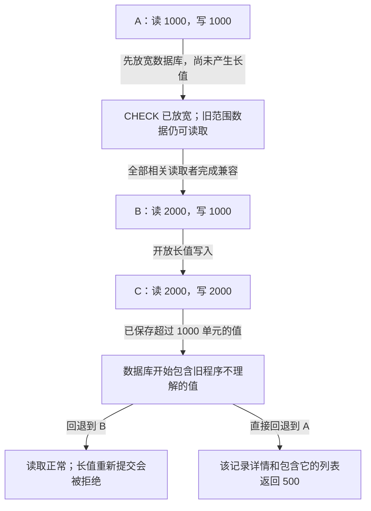
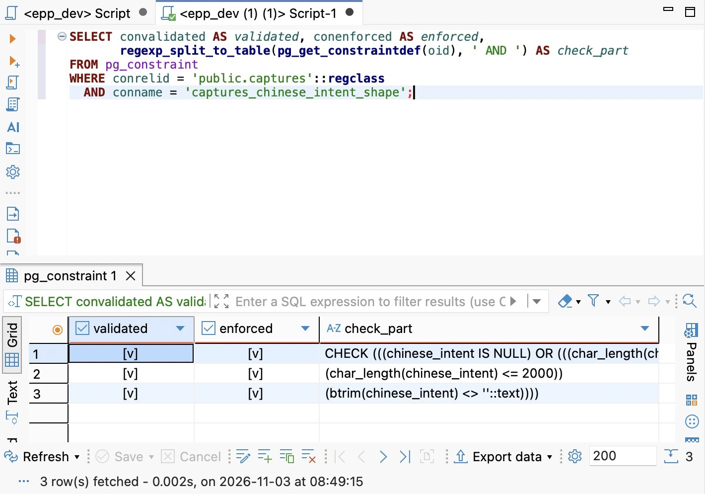
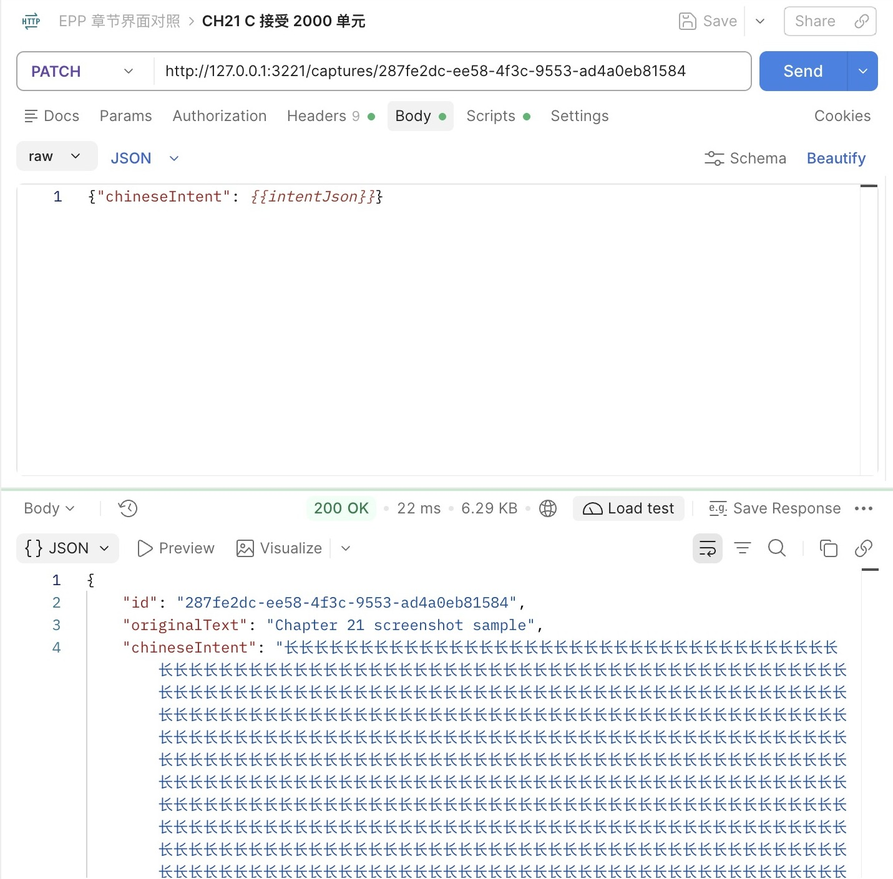
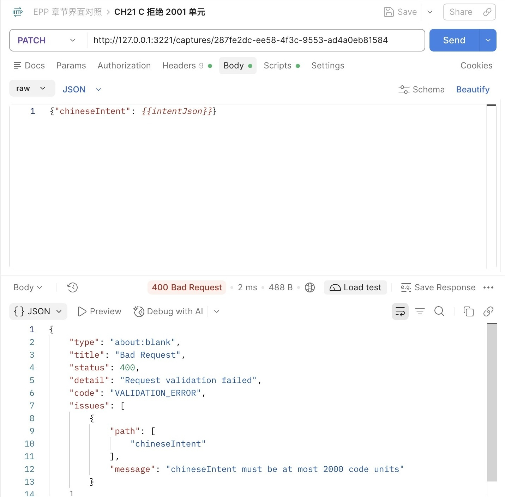
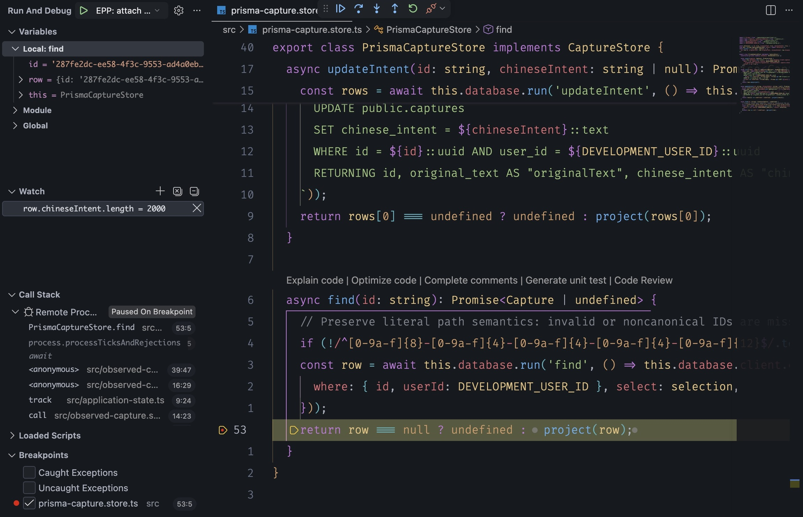
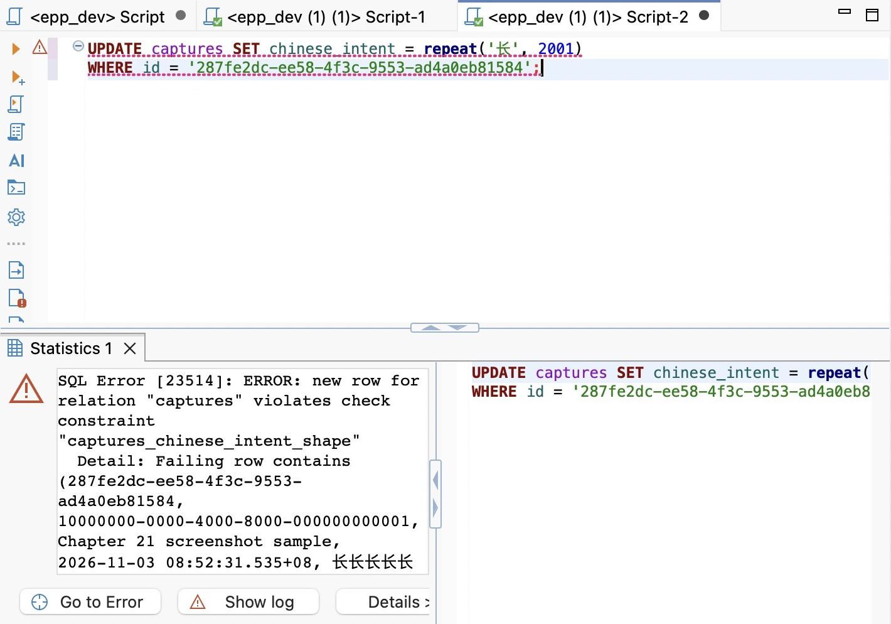
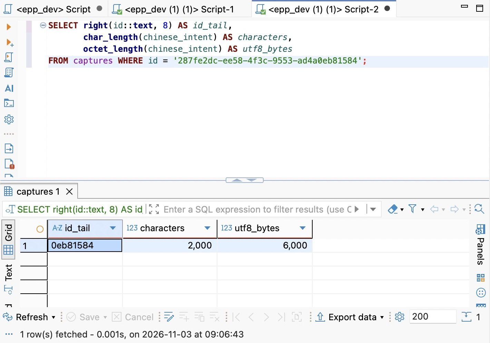
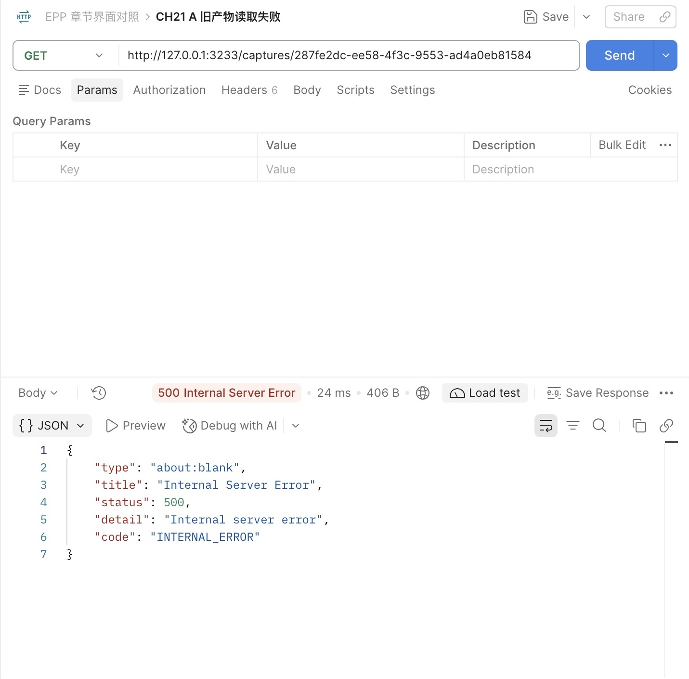
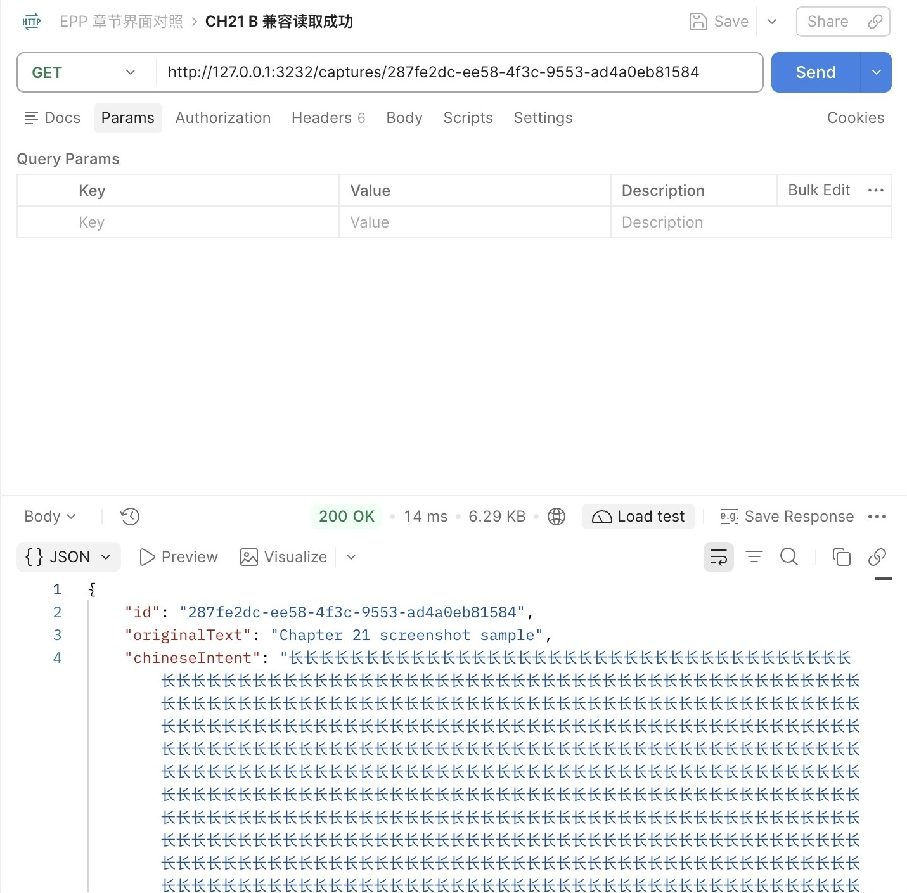

# 第 21 章 第三篇回顾：带着旧记录完成一次结构演进

第三篇已经把同一个记录服务从 CaptureStore 接到了 PostgreSQL。现在面对一个字段变化，你需要同时判断业务值的含义、数据库允许保存什么、程序愿意接收和返回什么，以及旧程序退出之前能否出现新数据。这些判断共同决定一次修改能否交付。

本章先完成第15～20章主线，再从 `part-03/chapter-20` 继续。日常库中保留已有用户、原文和中文意图；没有填写意图的记录仍为 null。固定 Node 24.22.1、PostgreSQL 18、Prisma/adapter-pg 7.10.1，复用 DBeaver、Postman、Inspector 和自动编译重启。环境、工具和依赖不重新搭一套。

这次需求是允许更完整的意图：将上限从1000扩到2000个UTF-16单元，保留既有内容。它看起来只是改两个数字，却会让第二十章的读取校验拒绝新数据。我们借这个变化把本篇连起来，最终主服务采用2000上限，后续章节沿用；过程中另外保留一个只放宽读取的过渡版本。21.3还会运行第二十章旧产物；可以先保存已有构建，也可以到该节按独立检出路径重新准备，不需要让当前工作目录退回旧版本。

时间参考：阅读约75～90分钟，跟做另加50～70分钟，均为估算。按约7900个汉字、约65行代码／命令、一张发布顺序图、九张实际界面图及版本切换与数据库对照估算；附录按需查阅，环境安装和依赖下载等待另计。

## 21.1 从接口结果回到 SQL、模型和历史

先在 Postman 打开第二十章保存的详情请求，读取一条已存在的记录。随后在 DBeaver DEV 连接打开 SQL 编辑器，执行配套 `database/chapter-21/01-inspect-evolution.sql`。第一条查询给出库名、角色和实例地址。核对目标后，在结果表格中找到相同ID，对照原文、意图和创建时间；不要只看两边都有一条相似句子。

这条线索能贯穿本篇，是因为不同层一直围绕同一个事实工作。用户拥有记录，原文与当前意图属于记录，创建时间记录最初创建时刻。一次意图修改不会使原文变成新句子，也不会把创建时间改成修改时间。模型先表达这些含义，SQL和程序再兑现它们；换存储或换框架不会替我们决定事实归属。

### 从一次 PATCH 追到一次返回

`PATCH /captures/:id` 的正文先经过字节上限、UTF-8和JSON解析，再由输入Schema解释字段。Service复核当前业务写入规则，Store把ID与固定用户一起放进SQL条件，只更新 `chinese_intent`，通过 `RETURNING` 取回行。响应Schema最后确认对外对象仍满足公开约定。只有整条成功路径完成，客户端才得到200。

因此，同一个“意图太长”可能出现在不同阶段。输入边界拒绝时，SQL根本没有执行；数据库CHECK拒绝时，SQL到达了数据库，但该语句没有完成修改；输出校验拒绝时，查询或写入已经执行，失败发生在返回路径。仅凭HTTP失败不能推断数据库没有改变。第二十章处理未知写入结果的谨慎，在这里仍然适用。

跟一次请求时，可以在VS Code的 `CapturesService.updateIntent`、`PrismaCaptureStore.updateIntent` 和 `ResponseSchemaInterceptor.intercept` 的 `schema.parse` 行设置断点。前一个没命中，先检查HTTP与Pipe；数据库返回了行而最后一步失败，就看响应契约。变量窗口只用于本章虚构记录，日志继续保留请求编号、错误码与耗时，不把整段意图作为常态日志输出。

从DBeaver直接修改，则绕过了HTTP和Service，但仍必须满足数据库约束。外键保证 `user_id` 引用存在的用户，无法证明当前调用者有权修改那个用户的记录；这一点仍依赖访问条件，身份篇再把固定开发用户替换为真实身份。CHECK能约束一行里的值，不能替代服务端的完整输入语义。

### 四份证据为什么不能互相替代

现在比较四个位置。`prisma/schema.prisma` 仍把意图映射为可空text；`prisma/migrations` 保存建立和演进表的SQL；数据库目录反映目标库此刻的真实约束；查询结果反映表中此刻的实际值。应用源码还有自己的读写规则。它们相关，却不会因为其中一处改变而自动全部同步。

例如，迁移目录新添了一份文件，只说明有一个待执行动作；`migrate status` 显示历史已同步，说明文件与执行记录的关系，没有逐项证明现场的所有结构；`migrate diff` 对支持的结构比较为空，也无法证明Prisma尚不能完整表达的CHECK正确。最后，即使CHECK完全正确，里面的1000个PostgreSQL字符也不等于JS的1000个UTF-16单元。

本章核对CHECK使用数据库自己的定义：

```sql
SELECT conname, convalidated, conenforced,
       pg_get_constraintdef(oid) AS definition
FROM pg_constraint
WHERE conrelid = 'public.captures'::regclass
  AND conname = 'captures_chinese_intent_shape';
```

在第二十章结束的库里，应看到允许NULL、非空白底线和字符上限1000，且已经验证、执行约束。结果表格双击长文本单元格查看完整定义，不要从被截断的列宽猜测数字。再查看迁移历史与数据，这样才能分清“程序没更新”“迁移没执行”和“数据本来就是这样”。

迁移历史还承担重建结构的责任。一个空校验库可以按历史得到相同表、键和CHECK，却不会凭空得到日常库的旧记录；恢复业务数据需要备份等另外的来源。第十八章的基线登记没有搬运旧数据，本章的放宽同样不搬运数据。把迁移、seed、备份视作同一种“初始化”，会在最需要保留状态时做错操作。

## 21.2 保留旧记录，安排一次约束放宽

先把需求写成能判断的规则：允许新写入的意图最多2000 UTF-16单元，已有文本逐字保留；可空、全空白拒绝、Unicode可表示性和首尾空白保留不变；PATCH仍不修改原文、归属或创建时间。创建和修改都接受新范围，列表与详情都能返回新范围。这个需求没有引入新的事实或关系，因此不需要新表、不需要把意图搬到JSON，也不需要改变列类型。

### 先判断是否有数据要回填

旧上限是1000，新上限2000，原来满足规则的值是新规则允许值的一部分。NULL也继续合法。因此这次没有需要推导的新事实，没有待补的默认值，不应执行UPDATE。回填方案写“无需回填，并逐字段核对旧值保持”，比为了凑齐迁移流程而制造一次数据改写更准确。

这个结论有前提：旧数据确实受过我们认为的规则保护。如果有人绕过应用直接写入了1000个emoji，数据库字符数仍是1000，JS长度却是2000；第二十章读取就可能失败。这不是本次放宽产生的问题。迁移前先导出旧行、运行旧接口，确认实际起点；发现不一致时沿21.1找出写入来源和现行契约，不用重置数据库把证据抹掉。少量开发数据可逐项核对；数量多时按范围扫描和保存核对结果，不把一次不加限制的全量响应当作数据审计工具。

在DBeaver把旧数据查询结果导出为本机JSON或CSV，保留全部字段，而不是只留数量。时间同时保留UTC显示和epoch，避免把显示时区变化误认为数据改写。导出可能含用户内容，应存放在受控位置，不提交进代码。后面查询同一ID时比较原文中的空格、已填意图、归属和创建时间；NULL不能被导出工具的空单元格悄悄解释成空字符串。

### 读规则与写规则需要分开演进

第二十章输入和响应共用 `ChineseIntentSchema`。直接把它改成2000，单个程序当然可以读写长值，但发布时不保证旧程序同时消失。只要新程序写入1001个普通汉字，旧程序再读这一行，就会在响应校验失败。详情返回500；列表只要包含它，整个响应校验也失败。数据库成功存下数据与所有读取者理解数据，是两个不同条件。

我们用三个程序阶段说明顺序：

| 阶段 | 可以接收的意图长度 | 可以返回的意图长度 | 用途 |
| --- | --- | --- | --- |
| A：第二十章 | ≤1000 | ≤1000 | 改动前的程序 |
| B：兼容读取 | ≤1000 | ≤2000 | 先让读取者理解扩展后的值 |
| C：第二十一章完成版 | ≤2000 | ≤2000 | 允许产生新范围的数据 |

先扩大数据库允许范围，再让所有读取者升级到B，最后把写入者升级到C。数据库先放宽，并不会主动把旧值变长，所以A暂时仍能读写原范围；但在A尚存时，必须同时约束绕过API的维护脚本和其他写入入口，不让它们提前制造长值。B也能先部署到旧数据库，因为它仍只写1000；本章选数据库先行，是为了把结构验证单独完成。真正不可颠倒的是：C开始产生长值之前，数据库必须允许，所有相关读取者也必须理解。

把正常推进和写入长值后的恢复放在一张图里，就能看到回退目标为什么改变。图中程序的1000／2000均指UTF-16单元，数据库CHECK仍使用PostgreSQL字符数。



改变回退边界的是已经保存的长值。退回旧代码不会让这些值变短；B保留读取能力，也明确带回较窄的写入策略。

这里的“所有读取者”包括同一个服务的其他实例，也包括会对该字段做运行时校验的调用端、导出脚本和任务。当前项目只运行单个服务，可以停旧进程再启动B/C；多实例系统则要从实际部署清单确认旧实例退出，不能凭一台服务返回200推断全体兼容。前端若还限制输入1000，只影响能否使用新能力；若前端连响应都拒绝超过1000，也需要先更新读取逻辑。

修改 `src/capture-contract.ts`，提取公共规则，但分别创建输入与已保存值的Schema。以下先给B：

```ts
function createChineseIntentSchema(maxLength: number) {
  return z.string()
    .refine(isPostgresText, 'chineseIntent must be well-formed Unicode without NUL')
    .regex(/\S/, 'chineseIntent must contain a non-whitespace character')
    .refine(text => text.length <= maxLength,
      `chineseIntent must be at most ${maxLength} code units`)
    .describe(`User-supplied intent; whitespace preserved. Maximum ${maxLength} UTF-16 code units; well-formed Unicode without NUL. No language detection.`);
}

export const ChineseIntentSchema = createChineseIntentSchema(1000);
export const StoredChineseIntentSchema = createChineseIntentSchema(2000);
```

创建Schema仍引用 `ChineseIntentSchema.nullable().optional()`，修改Schema仍引用 `ChineseIntentSchema.nullable()`。只有 `CaptureResponseSchema` 的意图改为 `StoredChineseIntentSchema.nullable()`，列表通过它自动获得相同读取范围。B的 `CapturesService.validateIntent` 仍保持1000；这道非HTTP调用也会经过的检查不能遗漏。公共函数避免空白和Unicode规则分叉，两个实例则明确表达读写当前可能处于不同阶段。

进入C时，把输入Schema的参数改为2000，并同步Service的长度条件与错误说明：

```ts
private validateIntent(value: unknown): asserts value is string | null {
  if (value === null) return;
  if (typeof value !== 'string' || !value.trim() ||
      value.length > 2000 || !isPostgresText(value)) {
    throw new InvalidCaptureError('chineseIntent must be null or non-empty, at most 2000 code units, and well-formed Unicode without NUL');
  }
}
```

把 `src/openapi.ts` 的文档版本改为0.5.0。长度说明来自各自Schema，B文档应呈现输入1000、输出2000，C则均为2000。版本号只是说明，不会自动切换规则。沿用16 KiB正文上限：文本单元、UTF-8字节和JSON编码后正文大小是不同维度，合法字符串也不能绕过传输上限；例如把每个汉字都写成 `\uXXXX` 会扩大请求正文。

### CHECK 的改变要进入追加历史

Prisma模型不变：`chineseIntent String? @map("chinese_intent") @db.Text`。不把它改成 `VarChar(2000)`，也不期待模型能生成我们的CHECK表达式。从第二十章逐步实现的读者，停dev、核对三份数据库配置，沿用独立影子库生成草稿：

```bash
unset DATABASE_URL SHADOW_DATABASE_URL
npm run db -- migrate dev --name widen_chinese_intent --create-only
```

固定版本允许用create-only建立没有模型差异的迁移草稿。打开新目录中的 `migration.sql`，在首次成功应用前写入下面的SQL。完成代码已提供 `20261102061033_widen_chinese_intent`，使用成品时跳过生成步骤，直接审查并应用已有文件；自己生成的时间前缀不同正常，不给已经应用的迁移改名。

```sql
BEGIN;
SET LOCAL lock_timeout = '2s';
SET LOCAL statement_timeout = '10s';

ALTER TABLE public.captures
  DROP CONSTRAINT captures_chinese_intent_shape;
ALTER TABLE public.captures
  ADD CONSTRAINT captures_chinese_intent_shape
  CHECK (
    chinese_intent IS NULL OR (
      char_length(chinese_intent) BETWEEN 1 AND 2000
      AND btrim(chinese_intent) <> ''
    )
  );
COMMIT;
```

这里删除的是旧CHECK，列和值都保留。两个DDL处于同一事务；成功提交后其他连接看到新约束，失败则回到原来的约束状态，没有一个已提交的“任意长度都能写”阶段。不要把这两个操作分别在自动提交模式下手动运行，再伪造历史记录说迁移已经完成。

替换CHECK需要锁，ADD还会验证已有行。即使我们在逻辑上知道旧合法值也符合新规则，也不能据此假设数据库不扫描数据或DDL不影响访问。当前开发数据少，有限超时下直接替换便于理解与核对。数据量大时，可以设计先增加不同名字的新CHECK为NOT VALID、单独验证、最后短事务移除旧CHECK并统一名称的步骤；旧CHECK存在期间长值仍被拒绝。那是按表规模、锁等待与发布窗口进一步拆分执行，不是遇到超时就无限延长等待。本章沿用第二十章的锁诊断和失败恢复方式，不重建库。

自己生成草稿后执行 `npm run db -- migrate dev`；使用成品则执行 `npm run db -- migrate deploy`。两条路径只选符合起点的一条。然后向独立校验库执行 `npm run db:verify -- migrate deploy`。校验库经历相同历史，原本没有业务数据就仍应为空。再核对：

```bash
npm run db -- migrate status
npm run db:verify -- migrate status
npm run db -- migrate diff --from-config-datasource --to-schema prisma/schema.prisma --exit-code
npm run db:verify -- migrate diff --from-config-datasource --to-schema prisma/schema.prisma --exit-code
npm run prisma:generate
npm run check
```

支持范围内的结构差异应为零；两库运行21.1的目录查询，CHECK上限应为2000且已验证。最后对照日常库导出的旧行，各字段保持。这个顺序验证了历史、结构和数据三个不同结果。没有模型变化时客户端形状自然不变，显式generate/check沿用固定构建流程，不能把“生成客户端成功”当作CHECK已经改变。



图中将同一条约束定义按 ` AND ` 拆行显示，便于看到 `char_length(chinese_intent) <= 2000`；它仍是一条 CHECK，不是三条约束。拆行只改变查询结果的展示，不执行结构修改。完整定义仍以前面 `pg_get_constraintdef` 的查询为准。

这里是第一个自然停点：结构已放宽，但尚未制造长值。记下此时仍运行A还是B，结束SQL事务并停实验进程。下次继续时先核对有没有其他入口写入长数据，不能只凭上次记忆回退A。

## 21.3 用失败和恢复区分三个版本

接下来始终围绕本章新建的一条实验记录操作，保留其他旧记录。Postman导入 `requests/chapter-21.postman_collection.json`，设置baseUrl，先发送新建请求，把响应ID复制到集合变量captureId，再GET确认原文与短意图。不要直接把标准旧记录ID当作可覆盖的数据。

长度请求的Body为 `{"chineseIntent": {{intentJson}}}`。在Scripts → Pre-request可以看到一行JS，例如 `pm.variables.set("intentJson", JSON.stringify("长".repeat(1001)));`。它只在发送前生成一个JSON字符串，不发送额外请求，也不隐藏清理动作。这样能准确构造边界，避免手数一长段汉字；集合逐项手动发送，按下面的版本阶段观察。

### 用成品复现B，再恢复C

如果从第二十章逐步实现，就先保持21.2的B代码。若直接使用第二十一章完成分支，配套 `database/chapter-21/reader-only.patch` 把输入Schema和Service暂时退到1000，输出保持2000。先停dev，在项目根目录执行：

```bash
git apply --check database/chapter-21/reader-only.patch
git apply database/chapter-21/reader-only.patch
npm run check
npm run dev
```

检查失败说明当前文件与补丁起点不一致，先打开差异定位，不能强制覆盖自己的修改。正常启动后，在VS Code重新连接Inspector；Postman发送1000单元应成功，1001应400。GET和DBeaver都应仍是最后一次成功的值。这里拒绝发生在输入边界，不是数据库CHECK，因为数据库已经允许更长。


注意响应中的 `VALIDATION_ERROR` 与字段说明“at most 1000 code units”。截图中的请求端口属于 B 实例；复现时使用自己当前 B 的地址，不能只改请求名称却仍发往 C。Body 中的变量由上述 Pre-request 脚本产生。

直接使用成品的读者，停dev后反向应用同一补丁，恢复C：

```bash
git apply -R --check database/chapter-21/reader-only.patch
git apply -R database/chapter-21/reader-only.patch
npm run check
npm run dev
```

从第二十章逐步编写的读者，此时直接按21.2把输入Schema参数和Service的长度条件、错误文本改为2000，check后重启；没有应用补丁就不需要撤回补丁。后面复现B同理，只把这两处写入限制暂时改回1000，观察结束再恢复2000。

这不是数据库回滚。迁移仍在，新CHECK仍为2000；反向补丁只是撤销我们刚才施加的临时代码改动。按顺序发送1001、2000、2001单元：前两次200，最后400。失败后重新GET，值应为2000单元，不是2001也不是空值。POST创建路径也应接受新范围；只有PATCH成功不能证明创建校验同步了。



同一记录切换到 C 后得到 200，响应的 id 保持。长意图在响应区自动换行；可见行数不是字符数，也不能凭滚动区域高度推断长度。下面继续用数据库长度函数核对实际值。



C 的错误上限已变为 2000，而 B 的错误上限为 1000。对比端口、字段路径和错误说明，确认切换的是实际服务；这一拒绝发生在 HTTP 输入边界，后面的直接 SQL 将单独观察数据库 CHECK。

要直接观察应用读到的值，先在当前开发服务中连接 Inspector，在 `PrismaCaptureStore.find` 的 `return row === null ...` 行设断点，再发送该记录的 GET。暂停后在 Watch 添加 `row.chineseIntent.length`；此表达式只适用于已确认意图非 null 的实验行。



图中使用 C 的开发进程，Call Stack 标明 Paused On Breakpoint，黄色行位于 await 查询之后，Watch 为 2000。它证明程序已取到长值，不代表响应校验已经执行。继续运行才会经过输出边界；若要定位 A 的失败，应另用 A 的开发调试入口观察响应 Schema，不能把这张 C 的断点图当作 A 的失败栈。F5 继续完成请求，实验后取消断点或断开调试器；停在这里时客户端等待是暂停造成的，不能据此判断数据库慢。

直接SQL验证使用 `database/chapter-21/02-check-rejection.sql`：把占位ID替换为本章实验记录ID，确认不是零行命中，在同一编辑器先BEGIN，再执行把意图改成2001个普通汉字的UPDATE。应得到23514且约束名是 `captures_chinese_intent_shape`。随后单独ROLLBACK，重新查询原值。零行更新没有检查任何目标行，不能当作约束拒绝已经验证；失败事务中继续SELECT得到25P02，也不能当作新业务故障。



这里是数据库直接拒绝，错误码为 `23514`，约束名为 `captures_chinese_intent_shape`；与上面的 HTTP 400 不在同一个边界。失败明细只使用本章虚构记录。



回滚后按同一完整 ID 查询，结果仍为 2000 个“长”字、6000 字节。id_tail 只用于缩短表格显示，WHERE 仍使用完整 ID；不要将尾号当成业务唯一标识。

### 为什么A能够启动，却不能读取

完整对照使用第二十章运行产物。已提前保存的读者直接使用；没有保存时，在当前项目根目录执行下面的独立检出。`worktree`为同一个Git仓库建立另一份工作文件，`--detach`让它停在指定章节状态而不移动该章节分支。当前目录中的第二十一章改动继续保留。两个目标目录必须尚不存在；若名字已经占用，换一个新目录名并同步后续命令，不覆盖或删除原目录。

先确认第二十章引用在哪里。`git branch --list part-03/chapter-20` 只列本地分支；沿章节一路编写的工作区通常已有它，可以直接执行：

```bash
git worktree add --detach ../epp-ch20-reader part-03/chapter-20
```

如果该列表为空，例如刚克隆后直接进入第二十一章，不能假设远程分支也会自动成为同名本地分支。使用下面这条替代路径，两条检出路径只选一条：

```bash
git fetch origin refs/heads/part-03/chapter-20:refs/remotes/origin/part-03/chapter-20
git worktree add --detach ../epp-ch20-reader origin/part-03/chapter-20
```

fetch 中冒号左边是远程分支，右边是保存到本机的远程跟踪引用；显式指定两端，也覆盖只克隆了第二十一章的情况。这里的 `origin` 是克隆时常用的远程名称，使用其他名称时同步替换两处引用。fetch 失败就先解决远程、分支名或连接问题，不继续构建未知版本；两个命令都不切换当前目录里的章节。

成功创建旧工作目录后，两条路径汇合到相同的构建步骤：

```bash
cd ../epp-ch20-reader
nvm use
npm ci
npm run build
mkdir ../epp-ch20-runtime
cp -R dist package.json package-lock.json .npmrc ../epp-ch20-runtime/
cd ../epp-ch20-runtime
npm ci --omit=dev
```

这份工作目录只用来构建A，不在其中运行迁移。迁移目录停在第二十章，而数据库已到第二十一章，是本次对照刻意保留的组合。产物只含构建输出和生产依赖，不从放宽后的源码重新构建一个冒充A的版本。

在产物目录创建私有 `.env.production`，按第二十一章配套 `old-runtime.env.example` 填入同一个开发库的URL，保留 `DB_QUERY_DEBUG=false` 与 `DOCS_ENABLED=false`。这个文件专用于本地旧产物实验，不是开发源码里的.env，也不进入任何仓库。使用文本编辑器填凭据，不把真实连接串粘进终端命令或截图。然后在产物目录运行：

```bash
unset DATABASE_URL DB_QUERY_DEBUG DOCS_ENABLED
NODE_ENV=production PORT=3001 node --env-file=.env.production --enable-source-maps dist/src/server.js
```

这里显式为旧产物注入实验配置，production模式、3001端口、无Inspector与文档关闭分别可检查；3001占用就选另一个空闲端口。`--env-file`不会替你切换数据库，必须核对其中的库名。Postman复制本章详情请求，命名为“A旧产物读取”，把URL直接写为 `http://127.0.0.1:3001/captures/{{captureId}}`；列表同样直接指向3001。不要修改整个集合的baseUrl，否则后续B/C请求也会落到A。

等C已经保存超过1000单元的意图，再用A请求相同ID。A的启动探测能连接数据库、能找到意图列，所以可以ready；但GET仍然返回500。列表只要包含这条记录，也返回500。DBeaver可以正常查到值，说明不是丢行或连接失败。沿A源码检查这条路径：SQL已经完成，返回的字符串超过其响应Schema上限，最后交给统一错误处理形成500。这不是用户刚提交了非法GET输入，不能改成400把程序不兼容归咎于调用方。



先核对地址确实指向 A，再对照完整记录 ID。响应使用 `INTERNAL_ERROR`，没有将内部校验堆栈暴露给客户端；图中的 500 本身不能证明数据库失败，须结合前面的 SQL 结果和后面的 B 读取成功定位到读取契约。

启动A只用于本地虚构数据的读取对照，不接收业务写入，不用它覆盖长意图。观察后在A终端Ctrl+C，看到正常停止；回到原第二十一章目录继续，不在旧工作目录应用reader-only补丁。切回旧Git分支既不会自动退数据库，也不会自动把新数据变回旧格式。

再停止C、应用reader-only补丁并启动B。此时B仍拒绝1001单元的新输入，但详情和列表都能返回保存的2000单元。看似“不让提交，却可以返回”，实际上是在允许读取既有事实的同时限制新写入。这与第十四章收紧新建规则时保留旧值读取的思路相通；本章增加了持久化与多版本共存，因此需要把发布顺序也纳入判断。



这里是 GET，地址与前面 B 的写入拒绝请求使用同一端口；记录 ID 与 A 的失败请求一致。响应保留长意图，说明恢复读取依靠扩大读取契约，没有截短已保存内容。

B作为回退目标还有代价：用户复制当前长意图原样再提交也会400。恢复服务时要同步说明暂时的写入限制；调用方不能自动重试相同的400。把输出Schema也缩回1000并不能消除这个限制，只会额外破坏读取。若业务要求长意图继续可编辑，就应修复C或构建保留长写入能力的修复版本。

回到C后，再做一次计数单位对照。发送1000个emoji，JS长度2000，因此应成功；1001个emoji占2002单元，应拒绝。DBeaver查询 `char_length(chinese_intent)` 得到1000，而 `octet_length` 得到这些emoji实际编码的字节数。不同数字都可能正确，关键是当前规则使用哪个单位。数据库允许的字符集合比API宽，放宽以后也没有让两层等价。

### 恢复时分别处理结构、程序与值

现在可以按三件事定位所处状态：

| 观察 | 说明 | 下一步 |
| --- | --- | --- |
| 新迁移未完成，CHECK还是1000 | 结构尚未放宽 | 先定位等锁等失败，再按实际状态恢复迁移；不开放C长写入 |
| CHECK为2000，仍只有旧范围数据 | 结构已扩展，数据未使用新范围 | 可运行B并继续核对所有读取者 |
| CHECK为2000，存在长值，A读取500 | 程序理解范围落后于已有数据 | 停A，使用B/C恢复读取；保留长值 |
| B读长值200，提交长值400 | 兼容读取阶段的预期策略 | 判断继续B还是完成C，不调整数据库“修复”这个400 |

DDL失败时沿用第二十章证据链：查看首个数据库错误和阻塞会话，结束自己持有的实验事务，查询实际CHECK及迁移尝试。确认事务回滚且没有部分变更后，才用实际新迁移名执行 `migrate resolve --rolled-back`，再deploy；resolve只是修正尝试记录，不执行SQL回滚。若迁移已经成功，不能把它标回滚来要求重新执行，更不能修改旧文件让各环境历史失去一致性。

有长值以后，回退A需要另一个明确的数据兼容决策，不能靠 `slice(0, 1000)`、SQL截短或删除记录悄悄解决。截短会改写用户含义，按UTF-16截断还可能破坏代理项；恢复A是程序目标，不构成修改用户事实的授权。本章选择保留数据库和数据，回到可读2000的B，再修复C。

B/C对照结束后，停B、反向撤回补丁，check并启动C。保留实验记录，重启服务后再GET相同ID，长值和原字段应该还在；null清空请求只在你确实希望清空本章实验意图时手动发送。生产产物同样单独构建，以环境配置运行 `npm start`，不带Inspector，默认docs关闭；迁移由持有固定CLI及历史的步骤执行，不能塞进每个服务实例的启动里。已有最小 `npm test` 可继续运行，但它不能代替本章的真实数据库和版本对照。

## 21.4 单行正确之后，下一步为什么是一致性

现在这项需求可以完整闭合：从长度规则推导变化范围，判断不用回填，追加可重放的CHECK迁移，拆开读写Schema，用同一批记录验证A/B/C，再据已有数据选择恢复目标。遇到陌生建议，例如“改Schema然后db push”“迁移失败就reset”“读不了就截短”，你可以指出它遗漏了历史、旧事实或读取兼容中的哪一项，并用查询和请求给出证据。

这个过程也给出了第三篇各项能力的分工。第十五章让连接身份、实例和生命周期可确认；第十六章先设计事实、关系与约束；第十七章让查询含义和写入范围落实为SQL；第十八章管理可重放的结构历史；第十九章兑现存储契约、资源与错误边界；第二十章区分扩展、回填、收紧和恢复。它们在本章共同支撑了一个无需换库、无需牺牲旧值的需求变化。

但当前每条Capture仍只有一份当前意图。两个合法PATCH先后到达，都满足长度、归属和CHECK，后一个照样覆盖前一个。这些约束没有承诺保留修改历史，也没有检测用户是否基于过期内容编辑。增加一个长度CHECK无法回答“哪一次修改形成了哪个版本”。

下一篇引入修订和候选以后，一次业务动作可能要求保存修订、更新当前状态，或者记录采纳关系。假设先保存修订成功，随后更新当前指向失败，那么两条单独合法的SQL可能留下业务上不完整的结果；若另一请求同时修改，连“刚才读到的前提仍成立”也需要重新分析。外键可以保证引用目标存在，不能自行决定哪份候选仍可采纳；单列UPDATE成功也不自动把其他操作绑定为同一动作。

这正是从持久化走向一致性的入口。下一篇继续保留现在的数据和工程边界，先明确修订表示的事实，再研究事务、竞争与条件写入。当前固定用户、无身份认证、后写覆盖，以及列表尚未具备完整分页与成本控制的范围仍然明确；这些限制对应后续具体需求，不会因为本篇使用了PostgreSQL和Prisma就自动消失。

## 附录：本章必要技术点速查

| 名称 | 本章用途 | 必要注意点 |
| --- | --- | --- |
| 输入Schema／输出Schema | 分别控制新写入与可读取值 | 放宽读取不要求同时放宽写入；公共规则可共享 |
| `char_length`／JS `length` | 分辨字符数与UTF-16单元 | 同一个上限数字不代表两层允许集合相等 |
| `pg_get_constraintdef` | 查看实际CHECK完整定义 | diff为零不能替代；同时查看验证、执行状态 |
| `migrate dev --create-only` | 为手写CHECK建立新迁移草稿 | Schema不变也可建草稿；仅开发使用，需要影子库 |
| `DROP/ADD CONSTRAINT` | 在事务内替换长度CHECK | 删除约束不删除列；锁与扫描成本仍需评估 |
| `migrate deploy/status/diff` | 分别应用历史、核对记录、比较支持的结构 | 不生成业务数据，也不独自证明API兼容 |
| `git worktree add --detach` | 独立构建第二十章旧产物 | 不改变当前工作目录或旧章节分支；目录不运行迁移 |
| `git fetch` 的显式 refspec | 在缺少本地旧分支时取得远端章节 | 指明远端源引用与本地远端跟踪引用；单分支克隆也适用，失败时先停止构建 |
| `git apply --check`／`-R` | 复现并撤销B阶段补丁 | 只改变代码；先停dev，检查失败先核对差异 |
| `pm.variables.set`／`JSON.stringify` | 在Postman生成长度准确的JSON正文 | 每次请求前生成；不自动发其他请求或清理 |
| 程序／结构／数据版本 | 决定实际兼容与恢复目标 | Git回退不会撤销已写入数据；长值存在后保留兼容读取 |

官方入口：[Prisma v7 migrate dev](https://www.prisma.io/docs/cli/v7/migrate/dev)、[迁移自定义](https://www.prisma.io/docs/orm/v7/prisma-migrate/workflows/customizing-migrations)、[PostgreSQL 18 ALTER TABLE](https://www.postgresql.org/docs/18/sql-altertable.html)、[字符串函数](https://www.postgresql.org/docs/18/functions-string.html)、[Git apply](https://git-scm.com/docs/git-apply)、[Git worktree](https://git-scm.com/docs/git-worktree)、[Git fetch](https://git-scm.com/docs/git-fetch)、[Postman请求前脚本](https://learning.postman.com/docs/tests-and-scripts/write-scripts/pre-request-scripts/)。

本章完成代码分支：`part-03/chapter-21`。正式意图上限为2000；配套reader-only补丁只用于本章B阶段，结束时恢复最终源代码。

[上一章：Migration](../chapter-20-migrations/chapter.md) · [下一章：关系演进](../../part-04-consistency/chapter-22-revisions/chapter.md) · [第三篇导读](../README.md) · [返回全书目录](../../README.md)
