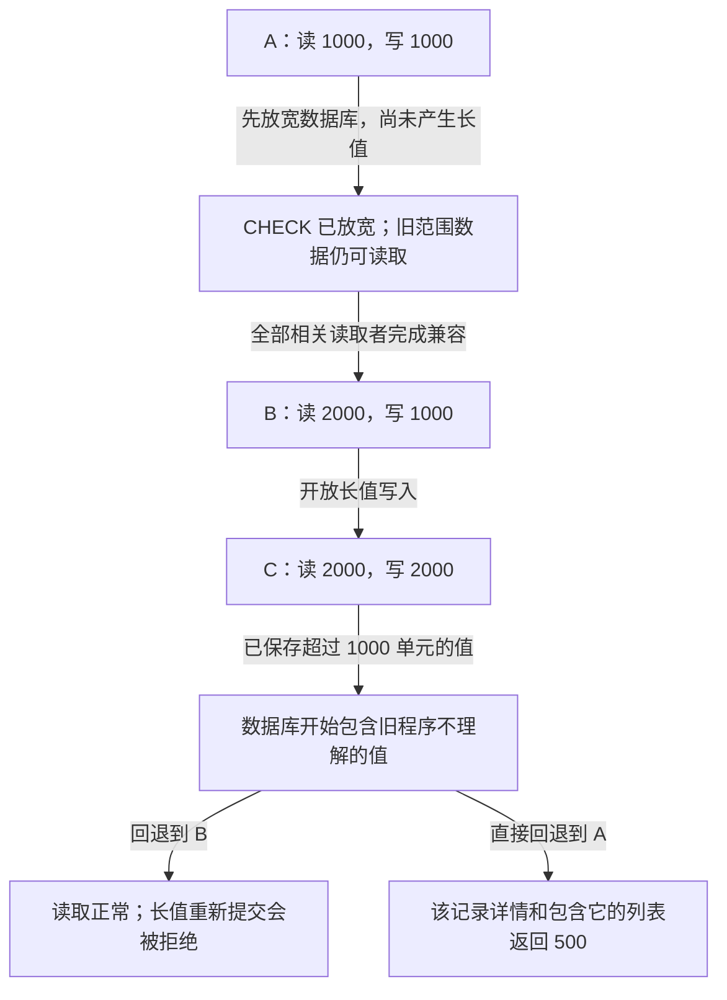
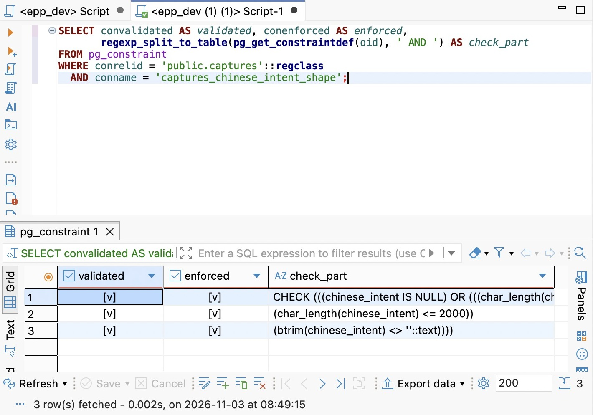
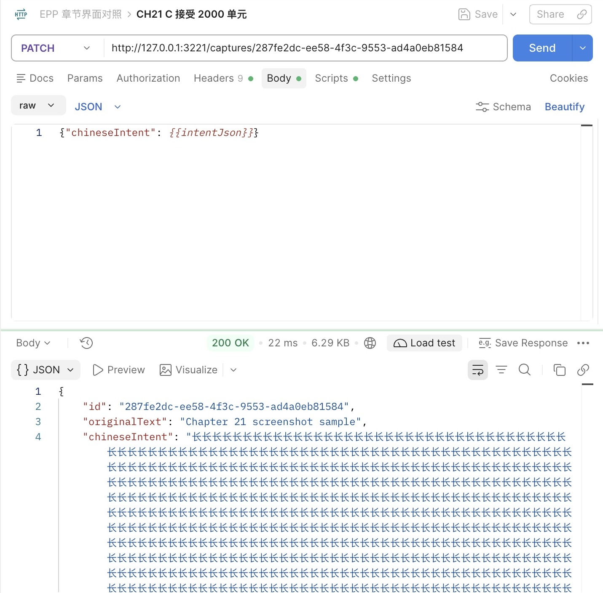
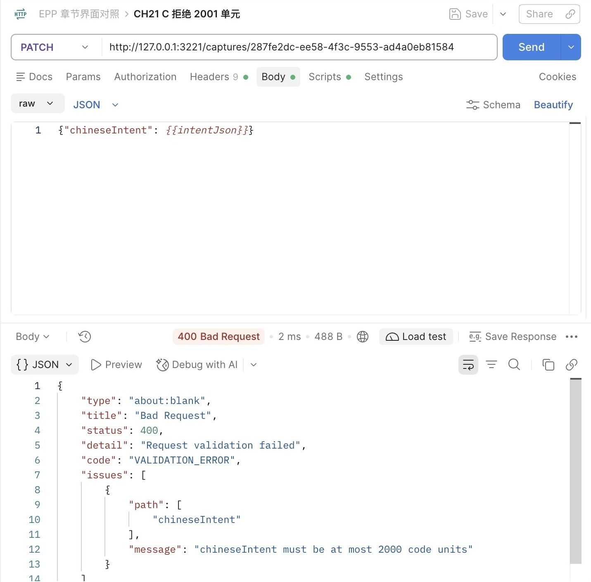
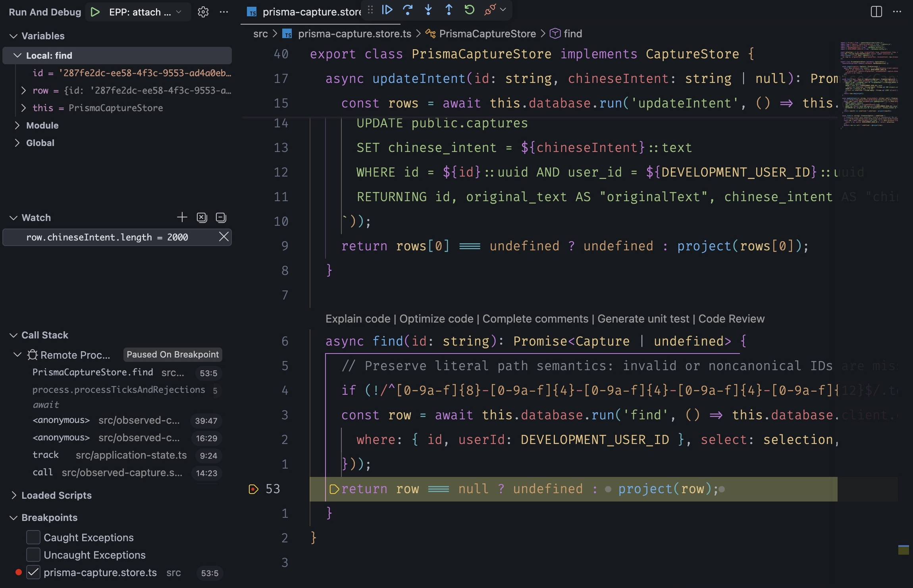
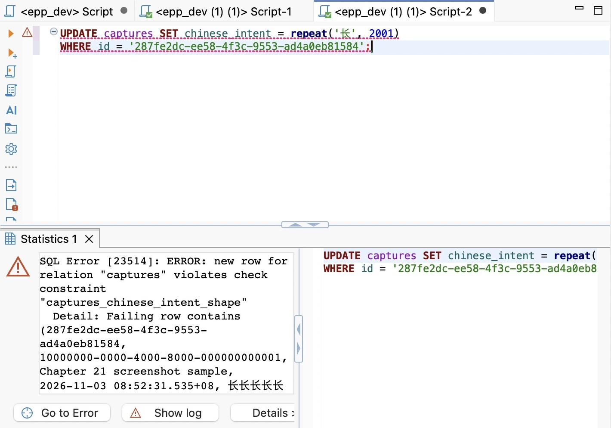
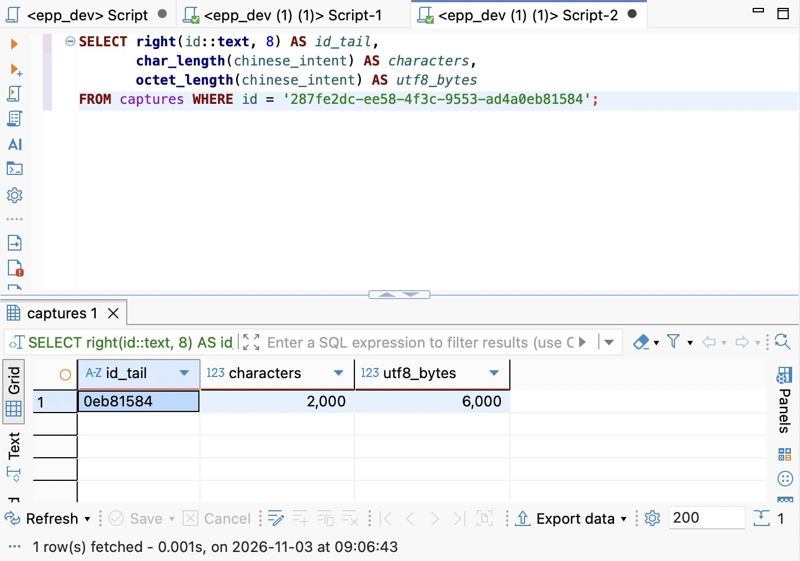
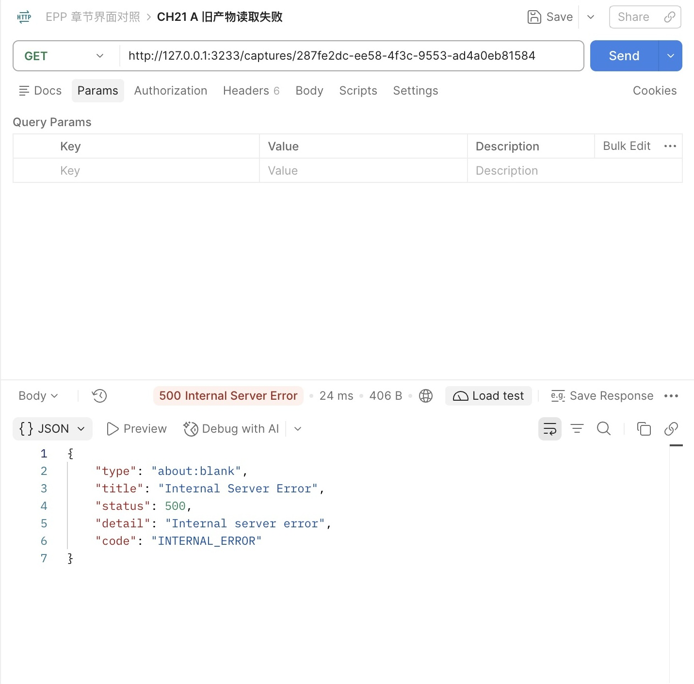
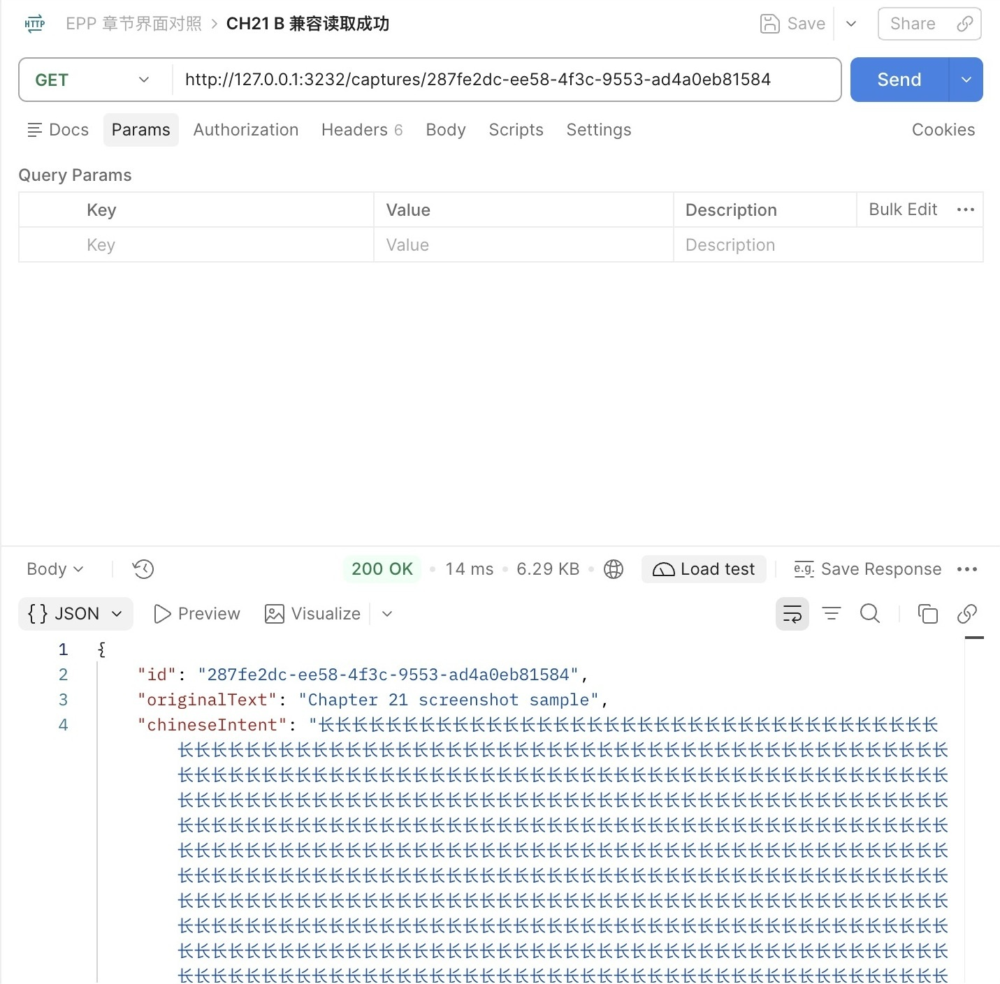

# 第 24 章 第三篇回顾：带着旧记录完成一次结构演进

第三篇已经把同一个记录服务从 CaptureStore 接到了 PostgreSQL。现在面对一个字段变化，你需要同时判断业务值的含义、数据库允许保存什么、程序愿意接收和返回什么，以及旧程序退出之前能否出现新数据。这些判断共同决定一次修改能否交付。

先完成第 16～23 章主线，再从 `part-03/chapter-23` 继续。第十六章两次文件写入都报成功，却有一个 ID 消失；这次也不能只看程序说“迁移成功”，要拿原来的 ID 和内容核对。沿用第二十三章的日常库，里面已有用户、原文和中文意图；没有填写意图的记录仍为 null。固定 Node 24.22.1、PostgreSQL 18、Prisma/adapter-pg 7.10.1，复用 DBeaver、Postman、Inspector 和自动编译重启。环境、工具和依赖不重新搭一套。

这次需求是允许更完整的意图：将上限从1000扩到2000个UTF-16单元，保留既有内容。它看起来只是改两个数字，却会让第二十三章的读取校验拒绝新数据。我们借这个变化把本篇连起来，最终主服务采用2000上限，后续章节沿用；过程中另外保留一个只放宽读取的过渡版本。24.3还会运行第二十三章旧产物；可以先保存已有构建，也可以到该节按独立检出路径重新准备，不需要让当前工作目录退回旧版本。

阅读约 122～151 分钟，跟做另加约 75～106 分钟。环境安装和依赖下载另留时间。可以在结构已放宽、尚未写入长值时暂停；切换程序与核对同一条长值应留在同一次实验中完成。

## 24.1 从接口结果回到 SQL、模型和历史

先在 Postman 打开第二十三章保存的详情请求，读取一条已存在的记录。随后在 DBeaver DEV 连接打开 SQL 编辑器，执行配套 `database/chapter-21/01-inspect-evolution.sql`。第一条查询给出库名、角色和实例地址。核对目标后，在结果表格中找到相同ID，对照原文、意图和创建时间；不要只看两边都有一条相似句子。

这条线索能贯穿本篇，是因为不同层一直围绕同一个事实工作。用户拥有记录，原文与当前意图属于记录，创建时间记录最初创建时刻。一次意图修改不会使原文变成新句子，也不会把创建时间改成修改时间。模型先表达这些含义，SQL和程序再兑现它们；换存储或换框架不会替我们决定事实归属。

**还有一个比“改哪几处代码”更早的问题：保存什么才算保存成功？** 设想你帮一位同事接手这个服务。他在 Postman 里把意图改为“我要表达的是不太擅长，不是不喜欢”，想知道周一打开时还能不能看到。你可以给他两张完全不同的收据。一张是这次请求的返回，证明当时返回了什么；另一张是你在服务重新启动、重新建立数据库连接之后，用那个 ID 又取到相同值的观察。第一张不能替代第二张，第二张也不能追认中间所有步骤都按预想进行。如果中间有人先清空再恢复，你仍会在周一看到相同的结果。我们能验证的是跨过指定边界后的事实保持，不能从两个相同的终点照片倒推出每一瞬间的历史。

本章选择的边界比“重开页面”严格：不只更换读取会话，还要更换程序所理解的数据范围。在前端开发中，同一份后端响应可能同时被新页面和未刷新的旧页面读取；在这里，同一份数据库记录也会被新旧程序分别解释。只要记录本身存在得比任一进程更久，程序就不能假设库里所有值都来自自己的创建路径。这个认识是由持久化带来的，而不是用了 Prisma 才有。后面每一次换进程都保留原 ID，就是为了让这种差别可以被真实观察，而不是靠两个孤立的成功样例推测兼容性。

### 从一次 PATCH 追到一次返回

**先选一条有辨识力的记录。** 假如两条原文都是“I see”，其中一条已有意图，另一条没填过。在 Postman 按原文搜索，两条都出现；在 DBeaver 按原文过滤，也看到两条。现在你能说第一条意图确实从库里读出来了吗？还不能。页面可能按创建时间排序，结果网格可能按你刚点过的列排序，甚至两个库都可能有这两句。把两个列表逐行对齐，实际上是用“排第几”充当了身份。从详情响应复制完整 ID，用它在 DBeaver 定位素材行。逐项比较响应的 `originalText`、`chineseIntent`、`createdAt` 与该行的原文、意图和创建时刻。归属要另查：详情响应没有 `userId`，应把数据库行的 `user_id` 与本阶段固定开发用户的完整 ID `10000000-0000-4000-8000-000000000001` 比较。这种对照有方向：先确定想认领的对象，再问各层如何表示它，而不是先找一段长得相似的文字。

为什么还要看创建时刻和拥有者？ID 负责定位，不负责证明其他字段从来没被改过。如果维护代码误用“删除再插入”模拟修改，可能保留原 ID 和原文，却由默认值生成了新的时间；如果更新时重新根据当前请求组装整行，也可能把归属改成另一个合法用户。对这两种错误，行数、原文和外键都能看上去正常。“修改意图”在这里是一个窄承诺：允许变化的只有这条素材的意图。先记下不该变化的字段，后面才有机会发现一次成功响应里藏着无关改动。

读已有记录和做写入对照也不要混成一件事。选一条既有行，是为了让它横跨迁移前后，充当不被改写的参照；到 24.3 另建一条合成素材，才是用来反复 PATCH 的实验对象。两者若共用同一个 ID，最后发现意图由短变长，你无法从结果区分是迁移篡改了旧值，还是自己刚刚通过接口改掉了它。与其多拍几张图，不如给两个 ID 起清楚的本地备注：一条只读、一条可写。备注不必也不应写回数据库。

`PATCH /captures/:id` 的正文先经过字节上限、UTF-8和JSON解析，再由输入Schema解释字段。Service复核当前业务写入规则，Store把ID与固定用户一起放进SQL条件，只更新 `chinese_intent`，通过 `RETURNING` 取回行。响应Schema最后确认对外对象仍满足公开约定。只有整条成功路径完成，客户端才得到200。

因此，同一个“意图太长”可能出现在不同阶段。输入边界拒绝时，SQL根本没有执行；数据库CHECK拒绝时，SQL到达了数据库，但该语句没有完成修改；输出校验拒绝时，查询或写入已经执行，失败发生在返回路径。仅凭HTTP失败不能推断数据库没有改变。第二十三章处理未知写入结果的谨慎，在这里仍然适用。

跟一次请求时，可以在VS Code的 `CapturesService.updateIntent`、`PrismaCaptureStore.updateIntent` 和 `ResponseSchemaInterceptor.intercept` 的 `schema.parse` 行设置断点。前一个没命中，先检查HTTP与Pipe；数据库返回了行而最后一步失败，就看响应契约。变量窗口只用于本章虚构记录，日志继续保留请求编号、错误码与耗时，不把整段意图作为常态日志输出。

从DBeaver直接修改，则绕过了HTTP和Service，但仍必须满足数据库约束。外键保证 `user_id` 引用存在的用户，无法证明当前调用者有权修改那个用户的记录；这一点仍依赖访问条件，身份篇再把固定开发用户替换为真实身份。CHECK能约束一行里的值，不能替代服务端的完整输入语义。

### 四份证据为什么不能互相替代

**从一个“改好了”的消息反推证据。** 假设编辑者提交“我想表达不太擅长做饭”，看到界面上的新文字。这个显示可能来自组件用请求内容先更新了本地状态，可能来自服务器返回的对象，也可能来自随后一次 GET。三者对用户看起来相同，却只在最后一种情况下实际走了一次读取路径。先在 Postman 明确你看的是哪次请求的响应体；再用同一 ID 单独发一个 GET，不把 PATCH 的结果继续当作 GET 的结果；最后让 DBeaver 在没有未提交事务的连接上查询那条行。三个观察若在同一轮没人再改动的实验里吻合，就能分别回答：写入者报告了什么、公开读取者返回了什么、库中留下了什么。即便三者吻合，也不能推出系统保留了每次改动的历史，因为当前模型只保存一个值。

如果三次不符，排查顺序应由差异决定。例如 PATCH 拒绝，但 GET 与库中都还是旧意图，应先辨别拒绝是输入不合法，还是写入者没法完成数据库操作；重新执行建表在两种情况下都没有理由。如果库中是新值、GET 却报错，说明至少有一条读取链路没有把已保存事实送到客户端，先确认 ID、请求地址与库同源，再检查从行到响应的转换。还有一种更隐蔽的情况：两次读都成功但文字不一样。两次读之间是否有人又发了一次 PATCH？前后读数来自不同时刻，不一定说明哪一边撒谎。先在隔离练习环境停下其他写入，再重复只读对照，不要为了让两格相同就用其中一格覆盖另一格。

对数据库目录的查询也要按“有几行”和“每行说什么”分别读。下面的约束查询如果**没返回任何行**，不是两个布尔值都为假，而是指定表上找不到这个名字的约束；可能是连接了别的库，可能是迁移尚未生效，也可能是现场约束被改了名字。先用配套脚本列出该表的全部 CHECK，再逐个展开定义，不要马上添加第二份同义约束。若返回一行，但名称相同、上限不同，真正有约束力的是定义里的表达式，不是名字中的 shape。定义相同而验证状态不同，则还不能把“以后执行这项规则”和“已检查过所有历史行”画上等号。这就是为什么查询选了这几列，而不是简单做一次计数。

假设同一条记录在 Postman 显示意图为 null，有人据此说“迁移没有加上那一列”。这句话混淆了三个层次：表**没有这列**，表有列但这一行的**值是 NULL**，接口对象里**没有这个属性**。列不存在时，显式选这列的 SQL 会报错，不是返回一行 NULL；若确实返回该 ID 和 NULL，结构与行都在。此时回到 Postman 的原始 JSON：`"chineseIntent": null` 是返回了属性并明说尚未填写，缺少属性则应检查投影和响应契约。先确定是哪一个现象，才知道该查迁移、查行还是查程序。不必因为界面上同样像是“一块空白”就重新跑迁移。

现在比较四个位置。`prisma/schema.prisma` 仍把意图映射为可空text；`prisma/migrations` 保存建立和演进表的SQL；数据库目录反映目标库此刻的真实约束；查询结果反映表中此刻的实际值。应用源码还有自己的读写规则。它们相关，却不会因为其中一处改变而自动全部同步。

例如，迁移目录新添了一份文件，只说明有一个待执行动作；`migrate status` 显示历史已同步，说明文件与执行记录的关系，没有逐项证明现场的所有结构；`migrate diff` 对支持的结构比较为空，也无法证明Prisma尚不能完整表达的CHECK正确。最后，即使CHECK完全正确，里面的1000个PostgreSQL字符也不等于JS的1000个UTF-16单元。

本章核对CHECK使用数据库自己的定义：

```sql
SELECT conname, convalidated, conenforced,
       pg_get_constraintdef(oid) AS definition
FROM pg_constraint
WHERE conrelid = 'public.captures'::regclass
  AND conname = 'captures_chinese_intent_shape';
```

在第二十三章结束的库里，应看到允许NULL、非空白底线和字符上限1000，且已经验证、执行约束。结果表格双击长文本单元格查看完整定义，不要从被截断的列宽猜测数字。再查看迁移历史与数据，这样才能分清“程序没更新”“迁移没执行”和“数据本来就是这样”。

迁移历史还承担重建结构的责任。一个空校验库可以按历史得到相同表、键和CHECK，却不会凭空得到日常库的旧记录；恢复业务数据需要备份等另外的来源。第二十章的基线登记没有搬运旧数据，本章的放宽同样不搬运数据。把迁移、seed、备份视作同一种“初始化”，会在最需要保留状态时做错操作。

## 24.2 保留旧记录，安排一次约束放宽

把刚才收集的事实放在桌上，再决定该改哪里。需求说“允许我把中文意图写得更完整”，不是说“每条素材必须有中文意图”，也不是说“一条素材要保存多个意图版本”。三个听起来相近的说法分别改变值域、必填性和一行所代表的事实。第一种可以仍用同一列、同一个当前值；第二种需要给每一条旧的 NULL 找到可信来源，否则收紧会失败；第三种则要区分同一次素材保存与每一次意图修改的身份。若不先区分，就容易为了放宽长度做一次无根据的回填，或提前建一张今后没人知道该怎样维护的历史表。本章只做第一种。

先把需求写成能判断的规则：允许新写入的意图最多2000 UTF-16单元，已有文本逐字保留；可空、全空白拒绝、Unicode可表示性和首尾空白保留不变；PATCH仍不修改原文、归属或创建时间。创建和修改都接受新范围，列表与详情都能返回新范围。这个需求没有引入新的事实或关系，因此不需要新表、不需要把意图搬到JSON，也不需要改变列类型。

### 先判断是否有数据要回填

旧上限是1000，新上限2000，原来满足规则的值是新规则允许值的一部分。NULL也继续合法。因此这次没有需要推导的新事实，没有待补的默认值，不应执行UPDATE。回填方案写“无需回填，并逐字段核对旧值保持”，比为了凑齐迁移流程而制造一次数据改写更准确。

这个结论有前提：旧数据确实受过我们认为的规则保护。如果有人绕过应用直接写入了1000个emoji，数据库字符数仍是1000，JS长度却是2000；第二十三章读取就可能失败。这不是本次放宽产生的问题。迁移前先导出旧行、运行旧接口，确认实际起点；发现不一致时沿24.1找出写入来源和现行契约，不用重置数据库把证据抹掉。少量开发数据可逐项核对；数量多时按范围扫描和保存核对结果，不把一次不加限制的全量响应当作数据审计工具。

在DBeaver把旧数据查询结果导出为本机JSON或CSV，保留全部字段，而不是只留数量。时间同时保留UTC显示和epoch，避免把显示时区变化误认为数据改写。导出可能含用户内容，应存放在受控位置，不提交进代码。后面查询同一ID时比较原文中的空格、已填意图、归属和创建时间；NULL不能被导出工具的空单元格悄悄解释成空字符串。

### 读规则与写规则需要分开演进

**先用一小份数据推翻错误的验收方法。** 想象迁移前有三行：甲的意图为 NULL，乙和丙分别填了“点一杯茶”和“问路”。迁移后仍有三行，仍是一项 NULL，两段文字的总长度也没变。只看这些汇总，乙和丙的意图互换也能通过。因此计数适合迅速发现大范围丢行，却不适合证明逐项保持。反过来，只拿乙的 ID 读回正确意图，也不能排除丙已被删除。保留数据至少有两层含义：原有身份集合没有缺项，同一身份下的字段没有无授权变化。如果这次迁移承诺不产生新行，还要反向看结果里是否多了陌生身份。三个问题不是在用三种工具重复做同一件事。

少量合成数据可以在 DBeaver 中用保存的结果和新查询逐项比对。把顺序固定为 ID，先比较键，再比较每个键对应的值；遇到一边缺键时不要把后面所有行错位着逐格比。原文与意图都不应为了比较方便先做 trim，因为本书的规则保留有意义的首尾空白。判断新旧值是不是相同还要区分“没填”与“值相等”：SQL 中 `NULL = NULL` 的结果不是 true。PostgreSQL 提供 `IS DISTINCT FROM`，回答的是“这两个值是否不相同”，并为缺值给出确定答案。两侧都缺时是假，一侧缺时是真，两侧有值时按普通值比较。下面这组只读输入可以在任意空闲 DEV 编辑器执行，不用碰真实素材：

```sql
SELECT id, before_intent, after_intent,
       before_intent <> after_intent AS ordinary_difference,
       before_intent IS DISTINCT FROM after_intent AS changed
FROM (VALUES
  (1, NULL::text, NULL::text),
  (2, NULL, '问路'),
  (3, '点茶', '点茶 '),
  (4, '买票', '买票')
) AS compared(id, before_intent, after_intent)
ORDER BY id;
```

先只看第二行。普通不等比较不知道怎样把缺值和文字比较，结果格里还是 NULL；若把它移到 WHERE，第二行会被过滤掉，恰好漏掉了一项真正的变化。再看第三行，眼睛可能看不见尾部多出的一格空白，但比较的操作数是 text，这里返回真。第一行则说明“两个未知量的数学相等”并非我们真正要问的问题；我们问的是这条素材在快照前后是否都处于未填写状态。换了问题，选的比较符也应更换。这个对照只检查已经配好对的行；若把两份保存结果以内连接按 ID 配对，消失的行连比较机会都没有。一定要先比较两侧 ID，再对匹配行判断 changed。

为什么不直接拿两个导出文件的字节作唯一依据？文件摘要相同可以证明两份文件内容相同，但前提是导出范围包含所有要保护的值，且两次导出确实来自应比较的库。漏选意图列，即使两个摘要一致也没回答问题。反过来，数据没变但导出顺序、换行或时区表示变了，文件也可能不再逐字节相同。此时不能先认定数据库改坏了，再去反向修它；先把比较还原为相同 ID 下的业务值。对于本章的小数据，一次身份对照比制造复杂的导出流水线更省事。在真实环境才按数据量、权限和允许的读负载选择合适的对账方式。

为什么“放宽上限”在数据库看来是兼容改动，对旧程序却未必兼容？把同一个字段沿两个方向看。**写入方向**：原先能提交的 800 个普通汉字，放宽后仍可提交。**读取方向**：今天的新程序可以产生 1500 个普通汉字，明天换回旧程序时，这个值依然留在库里，却不在旧程序能返回的范围内。检验兼容性不能只问“旧请求发给新版本行不行”，还要反过来问“新版本留下的数据交给旧版本行不行”。这就是为什么下面需要一个看似多余的中间版本。

第二十三章输入和响应共用 `ChineseIntentSchema`。直接把它改成2000，单个程序当然可以读写长值，但发布时不保证旧程序同时消失。只要新程序写入1001个普通汉字，旧程序再读这一行，就会在响应校验失败。详情返回500；列表只要包含它，整个响应校验也失败。数据库成功存下数据与所有读取者理解数据，是两个不同条件。

我们用三个程序阶段说明顺序：

| 阶段 | 可以接收的意图长度 | 可以返回的意图长度 | 用途 |
| --- | --- | --- | --- |
| A：第二十三章 | ≤1000 | ≤1000 | 改动前的程序 |
| B：兼容读取 | ≤1000 | ≤2000 | 先让读取者理解扩展后的值 |
| C：第二十四章完成版 | ≤2000 | ≤2000 | 允许产生新范围的数据 |

先扩大数据库允许范围，再让所有读取者升级到B，最后把写入者升级到C。数据库先放宽，并不会主动把旧值变长，所以A暂时仍能读写原范围；但在A尚存时，必须同时约束绕过API的维护脚本和其他写入入口，不让它们提前制造长值。B也能先部署到旧数据库，因为它仍只写1000；本章选数据库先行，是为了把结构验证单独完成。真正不可颠倒的是：C开始产生长值之前，数据库必须允许，所有相关读取者也必须理解。

把正常推进和写入长值后的恢复放在一张图里，就能看到回退目标为什么改变。图中程序的1000／2000均指UTF-16单元，数据库CHECK仍使用PostgreSQL字符数。



改变回退边界的是已经保存的长值。退回旧代码不会让这些值变短；B保留读取能力，也明确带回较窄的写入策略。

这里的“所有读取者”包括同一个服务的其他实例，也包括会对该字段做运行时校验的调用端、导出脚本和任务。当前项目只运行单个服务，可以停旧进程再启动B/C；多实例系统则要从实际部署清单确认旧实例退出，不能凭一台服务返回200推断全体兼容。前端若还限制输入1000，只影响能否使用新能力；若前端连响应都拒绝超过1000，也需要先更新读取逻辑。

修改 `src/capture-contract.ts`，提取公共规则，但分别创建输入与已保存值的Schema。以下先给B：

```ts
function createChineseIntentSchema(maxLength: number) {
  return z.string()
    .refine(isPostgresText, 'chineseIntent must be well-formed Unicode without NUL')
    .regex(/\S/, 'chineseIntent must contain a non-whitespace character')
    .refine(text => text.length <= maxLength,
      `chineseIntent must be at most ${maxLength} code units`)
    .describe(`User-supplied intent; whitespace preserved. Maximum ${maxLength} UTF-16 code units; well-formed Unicode without NUL. No language detection.`);
}

export const ChineseIntentSchema = createChineseIntentSchema(1000);
export const StoredChineseIntentSchema = createChineseIntentSchema(2000);
```

创建Schema仍引用 `ChineseIntentSchema.nullable().optional()`，修改Schema仍引用 `ChineseIntentSchema.nullable()`。只有 `CaptureResponseSchema` 的意图改为 `StoredChineseIntentSchema.nullable()`，列表通过它自动获得相同读取范围。B的 `CapturesService.validateIntent` 仍保持1000；这道非HTTP调用也会经过的检查不能遗漏。公共函数避免空白和Unicode规则分叉，两个实例则明确表达读写当前可能处于不同阶段。

进入C时，把输入Schema的参数改为2000，并同步Service的长度条件与错误说明：

```ts
private validateIntent(value: unknown): asserts value is string | null {
  if (value === null) return;
  if (typeof value !== 'string' || !value.trim() ||
      value.length > 2000 || !isPostgresText(value)) {
    throw new InvalidCaptureError('chineseIntent must be null or non-empty, at most 2000 code units, and well-formed Unicode without NUL');
  }
}
```

把 `src/openapi.ts` 的文档版本改为0.5.0。长度说明来自各自Schema，B文档应呈现输入1000、输出2000，C则均为2000。版本号只是说明，不会自动切换规则。沿用16 KiB正文上限：文本单元、UTF-8字节和JSON编码后正文大小是不同维度，合法字符串也不能绕过传输上限；例如把每个汉字都写成 `\uXXXX` 会扩大请求正文。

### 遇到旧程序已经读不了的值，先确定这是不是本次变更

假设你还没开放 C，数据库里已经查到一条超过一千单元的意图。第一反应可能是撤销刚才的迁移，然而 DDL 只是改变允许保存什么，没有给任何一条素材赋新值。更有区分力的证据是迁移前保留的同一行：如果那时已经是同一段文字，问题早于本次放宽，应该追查此前是否存在直接写库或用另一套计长规则的入口；如果之前确实更短，查这段时间内哪个入口还在写。两份快照能缩短可能发生变化的时段，却不能单靠它们说出具体操作者。本章没有意图修改历史，素材的创建时间也不是最后修改时间。证据不足时，保留“不知道是谁改的”比填一个看起来合理的解释更准确。

如果迁移前没有保存该行的副本，还能确认什么？能查清当前库、当前程序以及这个值确实能否经公开详情返回；能比较数据库字符数和程序读到的长度；能据此选择暂时运行能读它的程序。不能仅凭“昨天页面能打开”断言昨天此记录一定符合旧范围，因为昨天打开的那一页未必包含它。把可以立刻处理的服务故障和需要更多材料才能回答的成因分开，同事就能先恢复读取，而不必等所有历史都被解释清楚。恢复过程中保持原值，还为后续继续核对留下了机会。

### CHECK 的改变要进入追加历史

先用边界算一遍两把尺子的关系，而不是看到“长度”就把同一个数字抄到各层。普通汉字“茶”在这里占一个 UTF-16 单元；单个补充平面字符“😀”占两个。若一段文字含九百个“茶”和六十个“😀”，数据库字符数是九百六十，JavaScript 长度却是一千零二十。它在旧数据库一千字符的上限以内，却已经越过 A 的读取和写入上限；即便表里没有任何一行的数据库字符数超过一千，也不能据此决定能退回 A。这不是只在“全是表情”的极端样本才出现，普通文字里夹少数这样的字符就足够。反方向同样值得想一遍：在保证字符串可被数据库表示的条件下，每个字符至少占一个 UTF-16 单元，因此通过两千单元长度上限的输入，不会仅因为数据库字符数超过两千而被拒。这一方向成立，不等于两者的合法集合完全相等。

再问“屏幕上看着一样长，为什么不让提交”。用户眼里的一个符号可能由多个码点组成，文本框里的一次光标移动不一定等于一个数据库字符，更不等于一个 UTF-16 单元。本章沿用此前公开的计量单位，不趁放宽长度偷偷改成按字节、可见字形或去空格后的长度计算。如果产品真正承诺的是“可输入两千个用户能辨认的字”，需要另外明确分割规则、前后端一致性和旧数据的处理。当前帮助文字、错误提示与验证应该共同说清实际承诺；不能只改页面说明，不改程序，也不能在数据库里换一个看似接近的函数就宣告完成。

如果没有业务需要让程序分别维护两个完全独立的规则，为什么这里偏要把输入与响应分开？把契约理解成交通的两个方向比较清楚。来信要经过输入边界，决定今天接受哪些新事实；回信序列化的是库里**已经存在**的事实，决定能否完整还给拥有者。对输入拒绝长文是一个策略决定，对输出截短旧长文却是在改变事实。两边可以共享 Unicode 检查和非空白规则，以免同一个概念写出两份不同实现；只有这次确实会分阶段变化的上限需要分别传入。这比复制整段 Schema 再靠人眼长期保持同步可靠，也比凡是一个字段就到处引用同一个 Schema 更符合这里的发布过程。

最后别遗漏非网页入口。输入在 Postman 发来时会经过 HTTP 校验，但直接调用 Service 的测试或以后的其他调用者未必经过这一层。如果只改输入 Schema 和接口文档，Service 仍保持一千，新请求会在更深处被拒；如果只改 Service，网页请求先被入口挡掉，你可能误以为新二进制没有启动。定位的方法不是随机删一层校验，而是拿同一个刚超过旧界限的合成值，确定它第一次在哪里被拒，确认该层此阶段应该允许什么，再对齐对外说明。若入参和出参仍然只写成一句“意图最多多少”，B 阶段就没法被准确描述。

Prisma模型不变：`chineseIntent String? @map("chinese_intent") @db.Text`。不把它改成 `VarChar(2000)`，也不期待模型能生成我们的CHECK表达式。从第二十三章逐步实现的读者，停dev、核对三份数据库配置，沿用独立影子库生成草稿：

```bash
unset DATABASE_URL SHADOW_DATABASE_URL
npm run db -- migrate dev --name widen_chinese_intent --create-only
```

固定版本允许用create-only建立没有模型差异的迁移草稿。打开新目录中的 `migration.sql`，在首次成功应用前写入下面的SQL。完成代码已提供 `20261102061033_widen_chinese_intent`，使用成品时跳过生成步骤，直接审查并应用已有文件；自己生成的时间前缀不同正常，不给已经应用的迁移改名。

```sql
BEGIN;
SET LOCAL lock_timeout = '2s';
SET LOCAL statement_timeout = '10s';

ALTER TABLE public.captures
  DROP CONSTRAINT captures_chinese_intent_shape;
ALTER TABLE public.captures
  ADD CONSTRAINT captures_chinese_intent_shape
  CHECK (
    chinese_intent IS NULL OR (
      char_length(chinese_intent) BETWEEN 1 AND 2000
      AND btrim(chinese_intent) <> ''
    )
  );
COMMIT;
```

这里删除的是旧CHECK，列和值都保留。两个DDL处于同一事务；成功提交后其他连接看到新约束，失败则回到原来的约束状态，没有一个已提交的“任意长度都能写”阶段。不要把这两个操作分别在自动提交模式下手动运行，再伪造历史记录说迁移已经完成。

替换CHECK需要锁，ADD还会验证已有行。即使我们在逻辑上知道旧合法值也符合新规则，也不能据此假设数据库不扫描数据或DDL不影响访问。当前开发数据少，有限超时下直接替换便于理解与核对。数据量大时，可以设计先增加不同名字的新CHECK为NOT VALID、单独验证、最后短事务移除旧CHECK并统一名称的步骤；旧CHECK存在期间长值仍被拒绝。那是按表规模、锁等待与发布窗口进一步拆分执行，不是遇到超时就无限延长等待。本章沿用第二十三章的锁诊断和失败恢复方式，不重建库。

自己生成草稿后执行 `npm run db -- migrate dev`；使用成品则执行 `npm run db -- migrate deploy`。两条路径只选符合起点的一条。然后向独立校验库执行 `npm run db:verify -- migrate deploy`。校验库经历相同历史，原本没有业务数据就仍应为空。再核对：

```bash
npm run db -- migrate status
npm run db:verify -- migrate status
npm run db -- migrate diff --from-config-datasource --to-schema prisma/schema.prisma --exit-code
npm run db:verify -- migrate diff --from-config-datasource --to-schema prisma/schema.prisma --exit-code
npm run prisma:generate
npm run check
```

支持范围内的结构差异应为零；两库运行24.1的目录查询，CHECK上限应为2000且已验证。最后对照日常库导出的旧行，各字段保持。这个顺序验证了历史、结构和数据三个不同结果。没有模型变化时客户端形状自然不变，显式generate/check沿用固定构建流程，不能把“生成客户端成功”当作CHECK已经改变。



图中将同一条约束定义按 ` AND ` 拆行显示，便于看到 `char_length(chinese_intent) <= 2000`；它仍是一条 CHECK，不是三条约束。拆行只改变查询结果的展示，不执行结构修改。完整定义仍以前面 `pg_get_constraintdef` 的查询为准。

这里是第一个自然停点：结构已放宽，但尚未制造长值。记下此时仍运行A还是B，结束SQL事务并停实验进程。下次继续时先核对有没有其他入口写入长数据，不能只凭上次记忆回退A。

## 24.3 用失败和恢复区分三个版本

### 决定能否进入下一步，不能只看迁移命令的最后一行

开始切程序之前，先演算刚完成的两个 ALTER。如果去掉事务包裹，第一句删除旧约束成功、第二句因锁或表达式错误失败，表会是什么状态？列还在，原值也在，普通短意图照样能写入。团队若只用一条合法请求做冒烟检查，恰好会通过；真正丢掉的是拒绝非法状态的能力。这是负面保证，很难从一次成功样本看出来。放在同一事务里，第二句失败后整笔事务不能当作成功提交，其他会话不会观察到两个已提交定义之间的空当。但迁移工具自己的执行记录和业务表约束不是同一件东西，业务变更已回滚，不表示工具已经把这次尝试从历史里抹掉。应分别读目标表的实际约束和迁移尝试的完成／回滚状态，不凭某一格作两个结论。

锁的作用也要分清。旧程序正进行一次读，为什么只是“放宽”还会等它？放宽说的是哪些值合法，是业务层面的包含关系；替换约束涉及修改数据库对象的定义，需要数据库协调并发访问。即使现存每一行都显然合规，操作也不能越过另一个尚未结束的事务直接更换定义。看到迁移等待，先找持有冲突锁的连接及其事务开始时间。若它来自自己刚在 DBeaver 打开的实验事务，回到原编辑器结束该事务，再依据失败状态决定是否重试；若是正在处理业务的连接，就不能因为自己急着迁移而把别人的工作当作垃圾连接清走。短等待预算表达的是“这次窗口拿不到机会就放弃此次尝试”，不是保证这项工作不需要锁。

另一个容易误会的时间尺度是“开发库只用了片刻”。这段时间混合了等待取得锁、执行定义变更、验证当前数据以及客户端获知结果的过程。十行和一千万行面对的锁冲突可以完全一样：只要一个未结束事务占着所需资源，二者都可能无法开始；即使都没有竞争，检查整个表的工作量也不相同。开发库实跑的用途是确认语义、失败边界和恢复顺序，不是从毫秒数推断任意规模的停顿。若日后必须拆开“建立新规则”和“验证旧行”，要明确每个中间阶段哪条规则仍在执行。旧规则还在时，某次长写入继续失败很可能是设计之内，不是该多重启几次的故障。

现在把两个数据库并排看。DEV 有贯穿前几章的素材，VERIFY 用来独立重放历史。若两个库的新约束都正确，但 VERIFY 的查询没有业务行，这是符合分工还是故障，取决于它**之前有没有这些行**。若它原来就是空素材集，重放结构本来就不应带出开发者的原文；若曾经保留过一条核对样本，迁移后样本消失则是另一回事。不要把“校验库必须永远零行”写成断言。先记录各自的起点，再问对同一份变更，各自终点与起点有什么差别。这样才能把“数据库本来就不同”与“迁移对两个环境做了不同的事”区分开。

还有一个常见分歧：磁盘上两份迁移名字一样，团队成员却说在他的机器上放宽没生效。同名不是内容相同，校验值相同也不意味着已经在**本次请求落到的那个库**运行。一种排查路径是先追请求实际连接到哪一个服务和数据库，以该目标为起点读迁移名和完成记录，再查看该表约束的完整定义；然后才回到源码目录对照本次构建使用的迁移文件。反过来先修本地文件，可能修改的根本不是问题发生的环境。遇到已应用文件内容与历史不一致时，先保留原始状态并查清正确历史，不用“再生成一次同名文件”消掉警告。

接下来始终围绕本章新建的一条实验记录操作，保留其他旧记录。Postman导入 `requests/chapter-21.postman_collection.json`，设置baseUrl，先发送新建请求，把响应ID复制到集合变量captureId，再GET确认原文与短意图。不要直接把标准旧记录ID当作可覆盖的数据。

长度请求的Body为 `{"chineseIntent": {{intentJson}}}`。在Scripts → Pre-request可以看到一行JS，例如 `pm.variables.set("intentJson", JSON.stringify("长".repeat(1001)));`。它只在发送前生成一个JSON字符串，不发送额外请求，也不隐藏清理动作。这样能准确构造边界，避免手数一长段汉字；集合逐项手动发送，按下面的版本阶段观察。

### 用成品复现B，再恢复C

**先做能分清版本的预测。** 如果只选“买茶”这样的短意图，A、B、C 都应接受，成功说明服务可用，却没有版本辨识力。若改选两千零一个普通汉字，三者都应拒绝，同样难以区分。恰好超过旧上限、但不超过新上限的输入，才落在两个版本意见不一致的区间。再把这个值放到两种位置：作为用户今天要提交的请求，或作为昨天已经保存、今天只要读回的值。前者区分写入者是否已开放，后者区分读取者能否兼容。没有任何一条短文本请求能同时替你回答这两个问题。

这也解释了为什么要保留一份 B 而不让同一个作者进程边编辑边充当三个版本。热重载会缩短迭代时间，却让“这个响应究竟出自哪套规则”随文件保存时刻变化；切分支还可能留下上次构建的产物。独立源码位置解决的是可重复取得同一实现的问题，不负责隔离数据；本实验反而刻意让它们在不同时间连回同一份数据。若给每个版本都配上各自种过数据的空库，A 就永远没有机会看到 C 留下的长值，整个兼容问题会被看似整洁的环境隔离藏起来。真正要隔离的是日常业务与实验，不是把需要相互读取的数据硬拆开。

发送边界请求时，让每次失败都有一个能判断的前态。比如先用一段短的合成意图写成功，记下完整 ID 与短值，再请求超出本阶段的长度。预期不仅是收到拒绝，还包括重新读取同一条素材时仍是先前短值。如果一开始就是 NULL，失败后读到的又是 NULL，容易把没发到正确目标、没有该记录、只看了旧网格这几种情况也算成“没有被改动”。选择有辨识力的成功前态，是为了让后面的否定结论有可检验的反例，不是为了向数据库塞很多样本。同理，越界请求不要使用空白字符来重复几千次，否则“超长”和“全空白”同时失败，错误信息可能由哪条规则先执行决定，无法只检验长度边界。

读 Postman 的结果时留意正文生成发生在哪一层。发送前脚本生成的是 JSON 字符串表示，变量占位处若再手工包一层引号，实际请求可能变成无效 JSON；这时再短的词也进不了意图校验。一眼看见 400 不能证明长度策略正确。先用相同请求结构发送很短的“茶”，验证结构合法，再仅替换重复次数；看拒绝信息指向的是正文解析、字段类型还是字段长度。把真实发出的请求与准备写在编辑器里的字符串区分开，前端联调时遇到的大部分“服务不认这个值”才有办法落到具体一层。

如果从第二十三章逐步实现，就先保持24.2的B代码。直接使用第二十四章完成分支的读者，则使用[独立的 B 源码](https://github.com/SamChowRock/epp-public/tree/codex/reference/chapter-24-reader-b)：它把输入Schema和Service限制在1000，输出保持2000，数据库历史与C完全相同。先停止当前dev，保留C目录。在C项目根目录记录路径，再克隆B：

```bash
writer_dir=$(pwd)
git clone --single-branch --branch codex/reference/chapter-24-reader-b \
  https://github.com/SamChowRock/epp-public.git ../epp-ch24-reader-b
```

目标目录必须尚不存在；成功后继续。两份程序必须连接本章同一个实验库，才能比较同一条记录。先在C目录用编辑器核对私有 `.env` 中的 `DATABASE_URL`，确认它就是当前实验库。若C一直只通过进程环境提供连接、尚无 `.env`，先按[环境指南的开发连接配置](../../environment-setup.md#给开发迁移和测试各自选库)在C目录创建私有 `.env`，保存当前同一实验库的 `DATABASE_URL`，并设置 `DB_QUERY_DEBUG=false`；执行 `chmod 600 "$writer_dir/.env"` 后再继续。不要把示例地址直接当作当前库，不把凭据粘到请求或截图。随后把这份已核对的C配置复制到新B目录；这样两版都能在清除继承的进程环境后，从各自 `.env` 加载同一连接：

```bash
cp "$writer_dir/.env" ../epp-ch24-reader-b/.env
chmod 600 ../epp-ch24-reader-b/.env
cd ../epp-ch24-reader-b
reader_dir=$(pwd)
nvm use
npm ci
npm run prisma:generate
npm run check
unset DATABASE_URL DB_QUERY_DEBUG
npm run dev
```

这里不执行迁移，也不创建新业务库；之前24.2已完成同一库的结构放宽。两个目录各自保留源码，重开终端时按实际绝对路径重新设置 `writer_dir` 和 `reader_dir`。正常启动后，在VS Code重新连接Inspector；Postman发送1000单元应成功，1001应400。GET和DBeaver都应仍是最后一次成功的值。这里拒绝发生在输入边界，不是数据库CHECK，因为数据库已经允许更长。


注意响应中的 `VALIDATION_ERROR` 与字段说明“at most 1000 code units”。截图中的请求端口属于 B 实例；复现时使用自己当前 B 的地址，不能只改请求名称却仍发往 C。Body 中的变量由上述 Pre-request 脚本产生。

直接使用成品的读者，在B终端按Ctrl+C并确认退出，再回到保存的C目录启动：

```bash
cd "$writer_dir"
npm run check
unset DATABASE_URL DB_QUERY_DEBUG
npm run dev
```

从第二十三章逐步编写的读者，此时按24.2把输入Schema参数和Service的长度条件、错误文本改为2000，check后重启；后面复现B时只把这两处写入限制改回1000，观察结束再恢复2000。

两个成品目录之间切换的是运行进程，迁移、新CHECK和数据都保留。再次观察B时，先停C，执行 `cd "$reader_dir"`、`npm run dev`；之后回C同理。Postman使用当前实例的地址，Inspector也须连接新进程。按顺序发送1001、2000、2001单元：前两次200，最后400。失败后重新GET，值应为2000单元，不是2001也不是空值。POST创建路径也应接受新范围；只有PATCH成功不能证明创建校验同步了。



同一记录切换到 C 后得到 200，响应的 id 保持。长意图在响应区自动换行；可见行数不是字符数，也不能凭滚动区域高度推断长度。下面继续用数据库长度函数核对实际值。



C 的错误上限已变为 2000，而 B 的错误上限为 1000。对比端口、字段路径和错误说明，确认切换的是实际服务；这一拒绝发生在 HTTP 输入边界，后面的直接 SQL 将单独观察数据库 CHECK。

要直接观察应用读到的值，先在当前开发服务中连接 Inspector，在 `PrismaCaptureStore.find` 的 `return row === null ...` 行设断点，再发送该记录的 GET。暂停后在 Watch 添加 `row.chineseIntent.length`；此表达式只适用于已确认意图非 null 的实验行。



图中使用 C 的开发进程，Call Stack 标明 Paused On Breakpoint，黄色行位于 await 查询之后，Watch 为 2000。它证明程序已取到长值，不代表响应校验已经执行。继续运行才会经过输出边界；若要定位 A 的失败，应另用 A 的开发调试入口观察响应 Schema，不能把这张 C 的断点图当作 A 的失败栈。F5 继续完成请求，实验后取消断点或断开调试器；停在这里时客户端等待是暂停造成的，不能据此判断数据库慢。

直接SQL验证使用 `database/chapter-21/02-check-rejection.sql`：把占位ID替换为本章实验记录ID，确认不是零行命中，在同一编辑器先BEGIN，再执行把意图改成2001个普通汉字的UPDATE。应得到23514且约束名是 `captures_chinese_intent_shape`。随后单独ROLLBACK，重新查询原值。零行更新没有检查任何目标行，不能当作约束拒绝已经验证；失败事务中继续SELECT得到25P02，也不能当作新业务故障。



这里是数据库直接拒绝，错误码为 `23514`，约束名为 `captures_chinese_intent_shape`；与上面的 HTTP 400 不在同一个边界。失败明细只使用本章虚构记录。



回滚后按同一完整 ID 查询，结果仍为 2000 个“长”字、6000 字节。id_tail 只用于缩短表格显示，WHERE 仍使用完整 ID；不要将尾号当成业务唯一标识。

### 为什么A能够启动，却不能读取

把“启动成功”换成一个可以证伪的句子：这个进程使用给定配置，有能力建立数据库连接，并完成启动探测里实际写出的那些查询。它没有用库中所有记录生成全部接口的响应。假如探测只查看固定开发用户、已知列和少量可查询的行，哪怕库里第一万条素材含有旧响应规则无法表示的字符串，探测仍可能成功。为了消除这种风险而在每次启动时读遍所有数据，是把一次发布兼容性核对搬到了每次启动，还会让启停速度取决于业务数据量。更合适的是区分两项工作：启动时检查服务运行所必需的依赖；切换读写规则前，拿专门挑选的边界值验证跨版本行为。一个信号不应该同时承担两个范围不同的承诺。

用 A 观察 500 时，也不要为了取得“更明显”的错误而特意断开数据库。此时实验最有价值之处恰好在于：数据库连接通、表存在、值也存在，而接口仍然失败。改变两个条件，失去的就是归因能力。先在 C 确认同一 ID 能返回长值，保留这条数据；再只改变读取程序，不改表、不重种、不缩短值。若 A 失败，换回兼容读取的 B 后同一 ID 又成功，就把故障定位范围缩到了两个读取路径的差异。接着从源码解释差异，是谁把长字符串判为不符合响应；只凭一次“换版本就好了”还不能知道究竟哪行程序负责。

旧产物目录单独准备还有一个常被忽略的意义：源码的作者意图不等于正在运行的 JavaScript。编辑器里旧分支的常量是 1000，新的产物目录可能仍是从 C 构建的；两者都能启动、都连接同一库，但得出的结果相反。反过来，构建好了 A，却在 Postman 中一直点击 C 的 baseUrl，也会让“旧程序读长值仍成功”。先看进程从哪个目录启动、监听哪个端口、是否真用那份生产配置，再看请求的实际 URL。服务名、标签颜色和请求名只是给人看的提示，不能作为运行身份。把 ID、端口、版本阶段这三样记在同一次观察旁边，比连续点几次刷新有效。

若只有列表出错而详情看起来正常，先问“详情是哪一条”。一条短意图可以被旧程序正常序列化，包含另一条长意图的列表却不行。这不是列表把数据库读坏了，而是一个响应里需要所有元素都能被表示。反过来，如果长值详情失败，列表却成功，列表的归属、筛选、顺序和上限可能使那条记录没有进入结果。沿第十九章的方法列出列表实际应该包含的 ID，先在 B 或 C 上确认这个请求的确包含实验记录，再把相同读取条件交给 A。别单凭两个接口的状态码就推论它们用了不同数据库。这也是在综合回顾里保留 SQL 结果粒度的理由：理解数据如何进入返回集合，才能挑选真正能揭示问题的请求。

完整对照使用第二十三章运行产物。已提前保存的读者直接使用；没有保存时，保留当前第二十四章项目，在其根目录执行下面的独立克隆。这会另建旧章节目录，不切换或修改当前项目，也不要求自己跟写的项目拥有 Git 仓库、章节分支或配套远程。源码目录 `../epp-ch20-reader` 和稍后建立的产物目录 `../epp-ch20-runtime` 必须尚不存在；若名字已被占用，换一组新名字并同步后续命令，不覆盖或删除原目录。

```bash
git clone --single-branch --branch part-03/chapter-23 \
  https://github.com/SamChowRock/epp-public.git ../epp-ch20-reader
```

确认克隆成功后再继续；失败时先解决地址、分支名或连接问题，不进入已有同名目录构建未知版本。`--branch` 指定第二十三章，`--single-branch` 只取该章节所需的历史。无论当前项目是自己从空目录编写、普通克隆还是单分支克隆，都使用这条独立准备路径。

```bash
cd ../epp-ch20-reader
nvm use
npm ci
npm run build
mkdir ../epp-ch20-runtime
cp -R dist package.json package-lock.json .npmrc ../epp-ch20-runtime/
cd ../epp-ch20-runtime
npm ci --omit=dev
```

这份工作目录只用来构建A，不在其中运行迁移。迁移目录停在第二十三章，而数据库已到第二十四章，是本次对照刻意保留的组合。产物只含构建输出和生产依赖，不从放宽后的源码重新构建一个冒充A的版本。

在产物目录创建私有 `.env.production`，按第二十四章配套 `old-runtime.env.example` 填入同一个开发库的URL，保留 `DB_QUERY_DEBUG=false` 与 `DOCS_ENABLED=false`。这个文件专用于本地旧产物实验，不是开发源码里的.env，也不进入任何仓库。使用文本编辑器填凭据，不把真实连接串粘进终端命令或截图。然后在产物目录运行：

```bash
unset DATABASE_URL DB_QUERY_DEBUG DOCS_ENABLED
NODE_ENV=production PORT=3001 node --env-file=.env.production --enable-source-maps dist/src/server.js
```

这里显式为旧产物注入实验配置，production模式、3001端口、无Inspector与文档关闭分别可检查；3001占用就选另一个空闲端口。`--env-file`不会替你切换数据库，必须核对其中的库名。Postman复制本章详情请求，命名为“A旧产物读取”，把URL直接写为 `http://127.0.0.1:3001/captures/{{captureId}}`；列表同样直接指向3001。不要修改整个集合的baseUrl，否则后续B/C请求也会落到A。

等C已经保存超过1000单元的意图，再用A请求相同ID。A的启动探测能连接数据库、能找到意图列，所以可以ready；但GET仍然返回500。列表只要包含这条记录，也返回500。DBeaver可以正常查到值，说明不是丢行或连接失败。沿A源码检查这条路径：SQL已经完成，返回的字符串超过其响应Schema上限，最后交给统一错误处理形成500。这不是用户刚提交了非法GET输入，不能改成400把程序不兼容归咎于调用方。



先核对地址确实指向 A，再对照完整记录 ID。响应使用 `INTERNAL_ERROR`，没有将内部校验堆栈暴露给客户端；图中的 500 本身不能证明数据库失败，须结合前面的 SQL 结果和后面的 B 读取成功定位到读取契约。

启动A只用于本地虚构数据的读取对照，不接收业务写入，不用它覆盖长意图。观察后在A终端Ctrl+C，看到正常停止；回到原第二十四章目录继续，旧目录仍保留A的源码。切回旧Git分支既不会自动退数据库，也不会自动把新数据变回旧格式。

再停止C，回到前面保存的B目录并启动B。此时B仍拒绝1001单元的新输入，但详情和列表都能返回保存的2000单元。看似“不让提交，却可以返回”，实际上是在允许读取既有事实的同时限制新写入。这与第十五章收紧新建规则时保留旧值读取的思路相通；本章增加了持久化与多版本共存，因此需要把发布顺序也纳入判断。



这里是 GET，地址与前面 B 的写入拒绝请求使用同一端口；记录 ID 与 A 的失败请求一致。响应保留长意图，说明恢复读取依靠扩大读取契约，没有截短已保存内容。

B作为回退目标还有代价：用户复制当前长意图原样再提交也会400。恢复服务时要同步说明暂时的写入限制；调用方不能自动重试相同的400。把输出Schema也缩回1000并不能消除这个限制，只会额外破坏读取。若业务要求长意图继续可编辑，就应修复C或构建保留长写入能力的修复版本。

回到C后，再做一次计数单位对照。发送1000个emoji，JS长度2000，因此应成功；1001个emoji占2002单元，应拒绝。DBeaver查询 `char_length(chinese_intent)` 得到1000，而 `octet_length` 得到这些emoji实际编码的字节数。不同数字都可能正确，关键是当前规则使用哪个单位。数据库允许的字符集合比API宽，放宽以后也没有让两层等价。

### 恢复时分别处理结构、程序与值

可以把恢复决策写成一道有条件的题。目标一是立刻恢复读取，同时保留用户最后确认的长文；目标二是暂时不再接受新的长文；目标三是回到某个熟悉的旧版本号。前两个是服务行为，第三个只是手段。库已经有长文时，B 正好满足前两个目标，A 只满足“版本更旧”，却违背最重要的读取要求。因此“回退越多越安全”在这里是错的。若团队真正想撤回新能力，应先明确是停止产生新值，还是连已经产生的值也不允许保存。这两个目标涉及不同的数据责任，后一个需要业务上对已有信息的处置决定，不是运维人员多执行一条 ALTER 就可以替用户决定的事。

再推一遍更难区分的情况：C 写入长意图时客户端超时，维护者没有收到成功确认。能否凭“尚未见到任何 200”判断还没用上新范围，从而回到 A？不能。在返回途中断线与在事务提交之前失败，客户端的表象可以相同。此次是对已知实验 ID 做修改，至少还能从独立连接读出现值；还要确认没有别的写入者，以及这个值不是后来另一笔修改留下的。在未知结果澄清之前，优先保持能读取两种范围的 B 或 C。不要重发一次短文，把现场改成可以由旧版本读取的样子，再宣称第一次长写入一定没成功。那样得到的只是最后一次操作的现值，关于第一次操作的证据反而被消除了。

这里还能看出备份恢复和程序恢复的区别。假设你在放宽前导出过那条素材，恢复旧副本后 A 的确又能读了。这项事实最多证明旧程序与旧副本兼容，不能证明原来那套服务恢复了全部事实。备份以后某人补充的长文、别人新建的素材，都可能不在旧副本中。若需要演练备份，应恢复到隔离的位置，在那里比较哪些 ID 和内容存在、哪些缺失；本章的兼容问题已有不用牺牲数据的 B，没理由拿覆盖日常库作第一反应。恢复之前先定清要保留到哪个时点、哪些新工作不能丢，再选择相应工具，这个判断与是否熟练敲出恢复命令无关。

同事说“列表又好了，可以把旧版切回去”，还缺哪项证据？先问列表中**是否包括那条长意图记录**。一页里只有短值，即使用 A 也能返回 200。反之，列表里九条短值都合法，只要另有一条超出旧响应规则，校验的是整个列表，客户端拿不到“其余九条正常”的部分成功。用 Postman 固定同一个长值 ID 做详情对照，能排除“这页刚巧没有触发问题”；再请求实际包含它的列表，才检验了另一个读取入口。重试同一页普通列表十次，并没有多检查一种兼容条件。

现在可以按三件事定位所处状态：

| 观察 | 说明 | 下一步 |
| --- | --- | --- |
| 新迁移未完成，CHECK还是1000 | 结构尚未放宽 | 先定位等锁等失败，再按实际状态恢复迁移；不开放C长写入 |
| CHECK为2000，仍只有旧范围数据 | 结构已扩展，数据未使用新范围 | 可运行B并继续核对所有读取者 |
| CHECK为2000，存在长值，A读取500 | 程序理解范围落后于已有数据 | 停A，使用B/C恢复读取；保留长值 |
| B读长值200，提交长值400 | 兼容读取阶段的预期策略 | 判断继续B还是完成C，不调整数据库“修复”这个400 |

DDL失败时沿用第二十三章证据链：查看首个数据库错误和阻塞会话，结束自己持有的实验事务，查询实际CHECK及迁移尝试。确认事务回滚且没有部分变更后，才用实际新迁移名执行 `migrate resolve --rolled-back`，再deploy；resolve只是修正尝试记录，不执行SQL回滚。若迁移已经成功，不能把它标回滚来要求重新执行，更不能修改旧文件让各环境历史失去一致性。

有长值以后，回退A需要另一个明确的数据兼容决策，不能靠 `slice(0, 1000)`、SQL截短或删除记录悄悄解决。截短会改写用户含义，按UTF-16截断还可能破坏代理项；恢复A是程序目标，不构成修改用户事实的授权。本章选择保留数据库和数据，回到可读2000的B，再修复C。

B/C对照结束后，停B，回到保存的C目录，check并启动C。保留实验记录，重启服务后再GET相同ID，长值和原字段应该还在；null清空请求只在你确实希望清空本章实验意图时手动发送。生产产物同样单独构建，以环境配置运行 `npm start`，不带Inspector，默认docs关闭；迁移由持有固定CLI及历史的步骤执行，不能塞进每个服务实例的启动里。已有最小 `npm test` 可继续运行，沿用第二十二章 `.env.test` 中显式配置的 `TEST_DATABASE_URL`，只连接独立校验库；它不能代替本章的真实数据库和版本对照。

## 24.4 单行正确之后，下一步为什么是一致性

维护者问：“每位用户有多少条素材？其中多少条还没填中文意图？”两个数字要在同一行；没有素材的人也要出现。一次 PATCH 成功回答不了这个问题。

先不打开第十九章的查询。在 DBeaver 新建一条只读查询，下面两组输入只存在于这条语句里；在右括号后续写自己的 SELECT，不必创建表。`VALUES` 的每一组括号是一行，名称后的列名与值从左到右对应。

```sql
WITH users(id) AS (VALUES (1), (2), (3)),
captures(id, user_id, chinese_intent) AS (
  VALUES (11, 1, '练口语'), (12, 1, NULL), (21, 2, '点餐')
)
```

按“用户、素材总数、未填数”核对：三行应是 `(1, 2, 1)`、`(2, 1, 0)`、`(3, 0, 0)`。再把输入里的“点餐”改成 NULL：只有用户 2 的未填数应从 0 变成 1。如果用户 3 也被算成未填，查看那一行的素材 ID：一条真实素材缺少意图，与根本不存在素材，是两件不同的事。卡住时可以从另一方向推算：每人的素材总数减去已填数，是否等于你查询的未填数？

最后去掉这两组输入，改读 DEV 里的 `public.users` 和 `public.captures`。任选一个已有用户，在另一次只读查询中只列他的素材 ID 和意图，逐行核对汇总。不要求日常库也正好有三位用户，更不需要为了凑出示例数字去清空已有记录的意图。

回到本章放宽意图长度的需求：从长度规则推导变化范围，判断不用回填，追加可重放的CHECK迁移，拆开读写Schema，用同一批记录验证A/B/C，再据已有数据选择恢复目标。遇到陌生建议，例如“改Schema然后db push”“迁移失败就reset”“读不了就截短”，你可以指出它遗漏了历史、旧事实或读取兼容中的哪一项，并用查询和请求给出证据。

### 汇总数字相同，是否就算对了账

再接着读刚才三个人的结果。用户一有两条素材，一条意图为空；用户二只有一条已填；用户三没有素材。假如有人提交的报表只有一行“共三条素材，未填一条”，数字完全正确，却没答维护者的问题。需求的主语是“每位用户”，所以除了数目，还要查是不是三位用户各占一行。另一种错误更难发现：每位用户的素材总数都正确，但把一条未填意图记给用户二。全体未填数依旧只有一条，只有把核对单位缩到“哪位用户的哪条素材”才能抓到它。对账从明细走向汇总有一个朴素原则：每份事实必须被计入一次，计入正确的一组，不属于该事实的占位行一次也不计。

如果你已经写出一条能通过样本的查询，试着不看它的写法，用另一条思路解释三个数字。对任一位用户，把确实存在的素材分成“意图有值”和“意图缺值”两堆，两堆不重叠，合起来是全部素材。因此总数减去有值数，就是未填数。这里分堆的对象是**素材**，不是左连接之后的每一行。空用户的占位行上，素材 ID 与意图都为 NULL；若只问这一行的意图是不是 NULL，会得到真，却没有任何素材应被放进“未填”的堆里。正因如此，把所有行先按意图为空筛选再分组，既会把空用户算错，还会让完全填好的用户从结果里消失。后者的问题不是应该显示零还是显示一，而是整个人没了。

两种合理写法也可以据此互相检查。一种在关联明细上同时算总数与有值数，两者相减。另一种先从素材表出发，每位有素材的用户一组，分别算总数和未填数，再把统计结果连回用户名单。第二种在内部统计时根本没有空用户，所以那里每一行的确是一条素材；到最后接回全体用户，空用户会拿到一组缺失的统计结果，需要按报表语义显示为零。不要把“没有统计可连接”和“意图尚未填写”都粗略说成“把 NULL 改成零”。一个零属于报表输出的计数，另一个 NULL 属于素材字段的业务含义。用输出值替换显示可以，不应对业务表执行更新来让报表更容易写。

再给这张报表增加一个真实的阅读动作：维护者点开“未填一条”，想看到这一条的原文。要复用的是哪一部分逻辑？应该沿用同一个用户范围、同一个“未填”的定义，明细里带回具体素材 ID 和原文；不需要把汇总查询的分组原封不动塞进详情查询，也不用从页面文案猜数据库值。对示例中的用户一，明细应该只有素材十二；用户三的明细应该是空集合。若页面回传的是展示用的短尾号而不是实际身份，将来两条记录尾号相同就可能钻到别人的数据里。当前查询是维护观察，并没有新增这种跨用户查看的公开接口。日后若真的做页面，授权仍由服务端判断，不能让“报表里曾经出现过这个人”替代查看明细的权限。

点开后的条数与报表不相等，也不能一概认定 SQL 写错。先在练习库停下其他写入，重复自己的明细与汇总；在相同数据上仍不等，才优先检查查询。若静止时总是一致，只有在其他人补填意图时偶尔不等，就有另一种解释：两个请求之间，数据从未填变成了已填。可以向使用者说明报表展示取数时刻的情况，点开详情则展示当前状态；如果用户真正需要可复核的历史报表，就要定义是哪一时刻、保存哪些明细或统计依据，不能把它当成显示上加个时间标签就解决。第十九章已看到两次普通 SELECT 即便在同一个 READ COMMITTED 事务内也可能看到不同的已提交状态，何况两个独立的网页请求。

**把结果带回设计问题。** 本章允许把同一段意图写得更长，查询能回答“现在是否填写”和“现在是什么”，不能据此回答“最初填写时多长”“两次编辑相隔多久”或“是谁把已填又改成未填”。数据库没有保存那些历史事实。拿素材创建时间冒充意图最后更新时间，程序也许能跑，解释却已经错了；看到当前是 NULL 就断言从未填过，同样没有依据。用现有列能够可靠回答什么、无法回答什么，本身就是判断要不要演进模型的证据。遇到问题先确认缺的是一条计算规则，还是一份从未被记录的事实；前者可以写查询，后者不能靠更复杂的 SQL 从现值里还原。

这个过程也给出了第三篇各项能力的分工。第十七章让连接身份、实例和生命周期可确认；第十八章先设计事实、关系与约束；第十九章让查询含义和写入范围落实为SQL；第二十章管理可重放的结构历史；第二十一章用旧数据兑现存储契约，第二十二章确立资源与错误边界；第二十三章区分扩展、回填、收紧和恢复。它们在本章共同支撑了一个无需换库、无需牺牲旧值的需求变化。

报表也有时间边界。假设查询结果里有一条素材未填意图，这只描述取数时可见的数据；另一位编辑随后补上意图，下一次报表就可能变成零。你根据旧报表准备补填的文字仍然符合长度要求，现在提交却可能覆盖人家刚写好的内容。两个合法 PATCH 先后到达，都满足长度、归属和 CHECK，后一个照样覆盖前一个。当前每条素材只有一份意图，既没有修改历史，也没有记录这次编辑依据哪个版本。增加一个长度 CHECK 回答不了这个问题。

下一篇引入修订和候选以后，一次业务动作可能要求保存修订、更新当前状态，或者记录采纳关系。假设先保存修订成功，随后更新当前指向失败，那么两条单独合法的SQL可能留下业务上不完整的结果；若另一请求同时修改，连“刚才读到的前提仍成立”也需要重新分析。外键可以保证引用目标存在，不能自行决定哪份候选仍可采纳；单列UPDATE成功也不自动把其他操作绑定为同一动作。

这正是从持久化走向一致性的入口。下一篇继续保留现在的数据和工程边界，先明确修订表示的事实，再研究事务、竞争与条件写入。当前固定用户、无身份认证、后写覆盖，以及列表尚未具备完整分页与成本控制的范围仍然明确；这些限制对应后续具体需求，不会因为本篇使用了PostgreSQL和Prisma就自动消失。

## 附录：本章必要技术点速查

| 名称 | 本章用途 | 必要注意点 |
| --- | --- | --- |
| 输入Schema／输出Schema | 分别控制新写入与可读取值 | 放宽读取不要求同时放宽写入；公共规则可共享 |
| [IS DISTINCT FROM](https://www.postgresql.org/docs/18/functions-comparison.html) | 按同一 ID 比对可以为 NULL 的旧值与新值 | 两边都缺值不算变化；先核对 ID 集合，以免漏掉已经消失的整行 |
| `char_length`／JS `length` | 分辨字符数与UTF-16单元 | 同一个上限数字不代表两层允许集合相等 |
| `pg_get_constraintdef` | 查看实际CHECK完整定义 | diff为零不能替代；同时查看验证、执行状态 |
| `migrate dev --create-only` | 为手写CHECK建立新迁移草稿 | Schema不变也可建草稿；仅开发使用，需要影子库 |
| `DROP/ADD CONSTRAINT` | 在事务内替换长度CHECK | 删除约束不删除列；锁与扫描成本仍需评估 |
| `migrate deploy/status/diff` | 分别应用历史、核对记录、比较支持的结构 | 不生成业务数据，也不独自证明API兼容 |
| `git clone --single-branch --branch` | 在独立目录取得第二十三章代码，用于构建旧产物 | 不依赖原项目的Git配置；目标目录不可占用；克隆成功后再构建，旧目录不运行迁移 |
| B、C 独立源码目录 | 切换正在运行的读取者与写入者 | 先停当前进程，连接同一实验库；迁移和数据保持 |
| `pm.variables.set`／`JSON.stringify` | 在Postman生成长度准确的JSON正文 | 每次请求前生成；不自动发其他请求或清理 |
| 程序／结构／数据版本 | 决定实际兼容与恢复目标 | Git回退不会撤销已写入数据；长值存在后保留兼容读取 |

官方入口：[Prisma v7 migrate dev](https://www.prisma.io/docs/cli/v7/migrate/dev)、[迁移自定义](https://www.prisma.io/docs/orm/v7/prisma-migrate/workflows/customizing-migrations)、[PostgreSQL 18 ALTER TABLE](https://www.postgresql.org/docs/18/sql-altertable.html)、[字符串函数](https://www.postgresql.org/docs/18/functions-string.html)、[Git clone](https://git-scm.com/docs/git-clone)、[Postman请求前脚本](https://learning.postman.com/docs/tests-and-scripts/write-scripts/pre-request-scripts/)。

本章完成代码分支：`part-03/chapter-24`。正式意图上限为2000；`codex/reference/chapter-24-reader-b` 只用于本章B阶段，结束时回到C目录运行。

[上一章：Migration：给已有记录增加中文意图](../chapter-23-migrations/chapter.md) · [下一章：关系演进：从覆盖输入到保留修订历史](../../part-04-consistency/chapter-25-revisions/chapter.md) · [第三篇导读](../README.md) · [返回全书目录](../../README.md)
