# 第24章 事务：让多次修改成为一次业务动作

上一章的放弃只修改候选一行，条件UPDATE已经能把“仍是pending”与状态变化放在同一条语句里。采纳要做的事更多：保留这次确认的来源，建立正式表达及英文形式，再把它放进用户的学习记录。如果前三步成功，最后一步失败，HTTP返回一个错误并不会替我们撤销已经提交的行。

本章从 `part-04/chapter-23` 继续，完成 `part-04/chapter-24`。沿用固定开发用户、不可变候选内容、PostgreSQL 18与Prisma 7.10.1。先把上一章推导的三个对象落成表，再亲眼比较半次成功和整体回滚，最后研究同一个事务为什么仍可能两次读到不同结果。采纳中没有模型调用；我们确认的是已经保存的候选。

先确定一项影响实现的规则：本章允许采纳历史修订的候选。用户请求携带candidateId，含义是确认这个对象，不是“替我选择最新版本”。追加修订不会修改旧候选，旧版也不自动失效。将来若产品要求“只准采纳最新版”，需要额外保护这个前提；不能只在页面上先查一次最新版。

时间参考：阅读约120～140分钟，跟做另加90～115分钟；按约7800个汉字、约190行代码／命令、三张机制图、十二张实际界面图及迁移、接口、两会话实验和产物恢复估算，非读者实测。支线单列；可在原子性实验完成后暂停，保存点实验安排在主线之后。

## 24.1 建立采纳结果，再观察半次成功

### 四处变化为什么属于同一个动作

我们使用上一章的例子：候选英文是 `I'm not much of a cook.`，中文含义是“我不太会做饭。”。候选保留用户看见的建议，Expression保存正式含义，ExpressionForm保存它的一种英文说法，LearningRecord保存用户与正式表达的学习关系，并引用这次确认的候选。

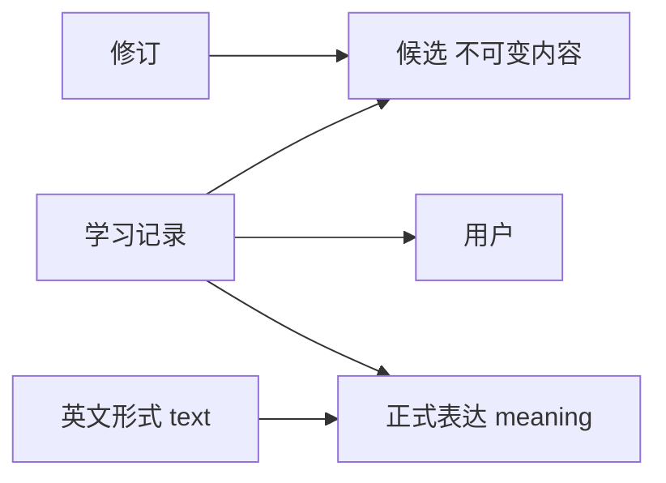

ExpressionForm单独成表，是因为一种含义可以有多种说法；LearningRecord单独成表，是因为“这个含义是什么”与“谁把它收入学习”有不同的变化责任。当前一次采纳只新建一个表达和一个形式。我们还没有建立同义判断，不用英文完全相同冒充含义相同；两个不同候选即使文字相同，当前也可以得到两个表达。第27章再明确正式身份与复用。

这四处变化现在必须一起成立：候选成为accepted、表达存在、至少有初始形式、学习记录连接用户与表达。外键只能要求引用对象存在，不能要求某个accepted候选一定已有学习记录；CHECK也无法仅凭本行看见另三张表。因此，“表都建好了”还不足以完成采纳。

### 追加模型，不给旧数据编造确认

在 `prisma/schema.prisma` 增加三个模型。字段名称沿用上一章的设计，物理表继续用snake_case。UUID由应用生成，模型与迁移都声明createdAt默认值。注意默认值只在写入未提供该列时生效：本章锁定版本的Prisma实际INSERT显式携带created_at，不能据此认为所有对象都使用同一个数据库事务开始时间。createdAt也不是精确提交顺序。

```prisma
model Expression {
  id        String @id(map: "expressions_pkey") @db.Uuid
  meaning   String @db.Text
  createdAt DateTime @default(now()) @map("created_at") @db.Timestamptz(3)
  forms     ExpressionForm[]
  learningRecords LearningRecord[]
  @@map("expressions")
}

model ExpressionForm {
  id           String @id(map: "expression_forms_pkey") @db.Uuid
  expressionId String @map("expression_id") @db.Uuid
  text         String @db.Text
  expression   Expression @relation(fields: [expressionId], references: [id], onDelete: Restrict, onUpdate: Restrict, map: "expression_forms_expression_id_fkey")
  @@map("expression_forms")
}

model LearningRecord {
  id           String @id(map: "learning_records_pkey") @db.Uuid
  userId       String @map("user_id") @db.Uuid
  candidateId  String @map("candidate_id") @db.Uuid
  expressionId String @map("expression_id") @db.Uuid
  createdAt    DateTime @default(now()) @map("created_at") @db.Timestamptz(3)
  user         User @relation(fields: [userId], references: [id], onDelete: Restrict, onUpdate: Restrict, map: "learning_records_user_id_fkey")
  candidate    Candidate @relation(fields: [candidateId], references: [id], onDelete: Restrict, onUpdate: Restrict, map: "learning_records_candidate_id_fkey")
  expression   Expression @relation(fields: [expressionId], references: [id], onDelete: Restrict, onUpdate: Restrict, map: "learning_records_expression_id_fkey")
  @@map("learning_records")
}
```

在User增加 `learningRecords LearningRecord[]`，在Candidate增加同名反向关系和：

```prisma
acceptedAt DateTime? @map("accepted_at") @db.Timestamptz(3)
```

Candidate的状态仍是数据库text列。我们用CHECK约束合法组合，而不是让新增一个值变成独立的数据库枚举演进：pending的两个决定时间均为空；discarded只有discardedAt；accepted只有acceptedAt。旧行全部满足前两种组合，新列为NULL即可，没有需要猜测的采纳时间。三个新表初始为空，不根据已有候选自动生成学习记录。

本章学习记录只保留普通主键与外键，还没有对candidate_id增加数据库唯一约束。业务接口靠候选条件转移避免重复采纳；直接SQL仍能绕过这一入口。第25章会审查现存数据并补数据库防线，不能把本章应用内的保证误写成任意写入口都无法造出重复。

先停止旧开发服务，保留数据库。在DBeaver的DEV连接执行 `SELECT current_database(), current_user;`，保存已有记录、修订和候选的查询结果，至少包括ID、内容、状态和时间。自行编码时，用下面命令生成尚未执行的迁移：

```bash
nvm use
npm ci
unset DATABASE_URL SHADOW_DATABASE_URL
npm run db -- migrate dev --name acceptance --create-only
```

检查新草稿只能追加本章结构，不能删改前章表来“重新生成正确模型”。首次应用前把生成的DDL整理为下面的事务迁移；如果已经使用本章完成分支，其中有 `20261103140000_acceptance`，直接审查并部署它，不再生成第二份同义迁移。

```sql
BEGIN;
SET LOCAL lock_timeout = '2s';
SET LOCAL statement_timeout = '10s';

ALTER TABLE public.candidates ADD COLUMN accepted_at timestamptz(3);
ALTER TABLE public.candidates DROP CONSTRAINT candidates_state_shape;
ALTER TABLE public.candidates ADD CONSTRAINT candidates_state_shape CHECK (
  (status = 'pending' AND discarded_at IS NULL AND accepted_at IS NULL) OR
  (status = 'discarded' AND discarded_at IS NOT NULL AND accepted_at IS NULL) OR
  (status = 'accepted' AND discarded_at IS NULL AND accepted_at IS NOT NULL)
);
CREATE TABLE public.expressions (
  id uuid CONSTRAINT expressions_pkey PRIMARY KEY,
  meaning text NOT NULL,
  created_at timestamptz(3) NOT NULL DEFAULT CURRENT_TIMESTAMP,
  CONSTRAINT expressions_meaning_shape CHECK (char_length(meaning) BETWEEN 1 AND 2000 AND btrim(meaning) <> '')
);
CREATE TABLE public.expression_forms (
  id uuid CONSTRAINT expression_forms_pkey PRIMARY KEY,
  expression_id uuid NOT NULL,
  text text NOT NULL,
  CONSTRAINT expression_forms_expression_id_fkey FOREIGN KEY (expression_id)
    REFERENCES public.expressions(id) ON DELETE RESTRICT ON UPDATE RESTRICT,
  CONSTRAINT expression_forms_text_shape CHECK (char_length(text) BETWEEN 1 AND 2000 AND btrim(text) <> '')
);
CREATE TABLE public.learning_records (
  id uuid CONSTRAINT learning_records_pkey PRIMARY KEY,
  user_id uuid NOT NULL,
  candidate_id uuid NOT NULL,
  expression_id uuid NOT NULL,
  created_at timestamptz(3) NOT NULL DEFAULT CURRENT_TIMESTAMP,
  CONSTRAINT learning_records_user_id_fkey FOREIGN KEY (user_id)
    REFERENCES public.users(id) ON DELETE RESTRICT ON UPDATE RESTRICT,
  CONSTRAINT learning_records_candidate_id_fkey FOREIGN KEY (candidate_id)
    REFERENCES public.candidates(id) ON DELETE RESTRICT ON UPDATE RESTRICT,
  CONSTRAINT learning_records_expression_id_fkey FOREIGN KEY (expression_id)
    REFERENCES public.expressions(id) ON DELETE RESTRICT ON UPDATE RESTRICT
);
COMMIT;
```

为什么把DROP旧CHECK与ADD新CHECK放在同一迁移事务？否则中途失败可能留下没有状态约束的表。BEGIN把这组DDL也变成整体；lock_timeout限制取得结构锁的等待，statement_timeout限制语句执行。本章没有大表数据回填，但ALTER TABLE仍可能等待旧事务。失败时按第20章查看首因、真实结构和迁移历史，不能看到P3009就直接登记为已完成。

在校验库先应用，再切换DEV：

```bash
npm run db:verify -- migrate deploy
npm run db:verify -- migrate status
npm run db:verify -- migrate diff --from-config-datasource --to-schema prisma/schema.prisma --exit-code
npm run db -- migrate deploy
npm run db -- migrate status
npm run db -- migrate diff --from-config-datasource --to-schema prisma/schema.prisma --exit-code
npm run check
```

DBeaver刷新public下的Tables，打开新表Properties，查看Columns和Foreign Keys。再执行配套 `database/chapter-24/01-inspect.sql` 的列、约束查询，确认新状态CHECK与三个关系表确实存在。Prisma的结构diff不替我们审查手写CHECK；历史对齐、模型对齐、实际约束和旧值保持仍是不同检查。

### 先把错误缩小到能看清的实验

暂不破坏业务候选。在一个DBeaver SQL编辑器里打开 `02-atomicity.sql`，确认使用Auto-commit；每次只执行光标所在语句。不要选中整份脚本一口气运行，否则客户端的批次事务设置会掩盖我们正在比较的边界。先建立只属于当前连接的临时表：

```sql
CREATE TEMP TABLE acceptance_lab (id integer PRIMARY KEY, status text NOT NULL);
CREATE TEMP TABLE expression_lab (id integer PRIMARY KEY, meaning text NOT NULL);
INSERT INTO acceptance_lab VALUES (1, 'pending');
```

然后单独执行两句：

```sql
UPDATE acceptance_lab SET status='accepted' WHERE id=1;
INSERT INTO expression_lab VALUES (1, NULL);
```

第二句违反NOT NULL，得到23502。此时第一句已经在自己的事务里提交。再执行：

```sql
SELECT a.id, a.status, count(e.id) AS expressions FROM acceptance_lab a
LEFT JOIN expression_lab e ON e.id=a.id GROUP BY a.id,a.status;
```

结果是accepted和0。这就是“业务只完成一半”：数据库按各条语句的约束分别接受或拒绝，组合结果却违背采纳的承诺。把两句写进一个async函数、先后await、在catch里返回500，都没有改变数据库的提交边界。Promise.all也不是事务，失败的Promise不会撤销另一个已经成功的写入。


只在这张临时表将状态恢复为pending，然后明确包住两句：

```sql
UPDATE acceptance_lab SET status='pending' WHERE id=1;
BEGIN;
UPDATE acceptance_lab SET status='accepted' WHERE id=1;
INSERT INTO expression_lab VALUES (1, NULL);
```

最后一句仍报23502，但此时事务已经失败，之前的UPDATE还没有提交。马上执行SELECT会报25P02，意思是这个事务不能再正常执行命令，不能把它误诊成表突然坏了。单独执行 `ROLLBACK;`，再运行同一条汇总查询，得到pending和0。

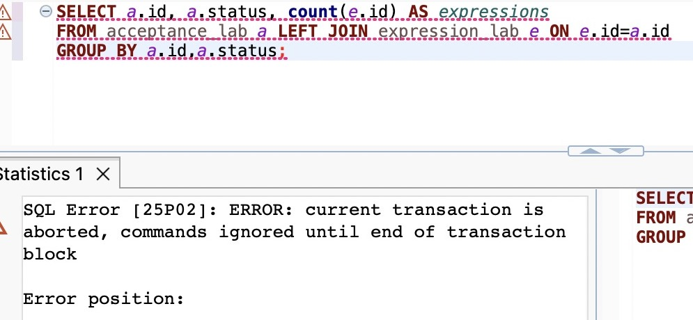


最后做成功对照：

```sql
BEGIN;
UPDATE acceptance_lab SET status='accepted' WHERE id=1;
INSERT INTO expression_lab VALUES (1, '我不太会做饭。');
COMMIT;
```

查询变成accepted和1。关闭这个连接会删除临时表，已提交到临时表的行也不会成为业务数据。它适合研究当前机制，不适合保存需要跨连接继续使用的样本。

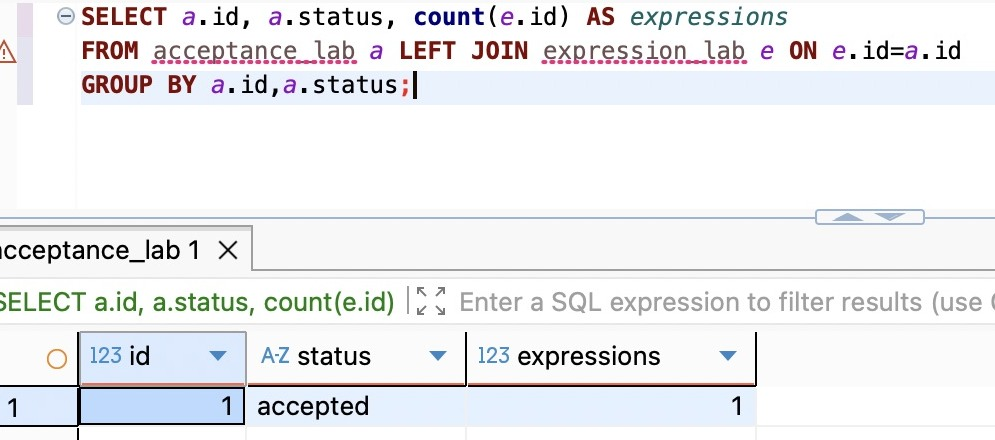

图中临时表名下的红色波浪线是编辑器的对象识别提示，执行是否成功以实际结果或SQLSTATE为准。自动提交、回滚、提交三个结果来自同一连接中依次完成的实验。

## 24.2 把采纳放进一个数据库事务

### 先划清提交边界，再选Prisma入口

原子性保证这组数据库修改全部提交，或者全部不生效。它不是“先完成四次提交，失败后再删掉前三次”。后者属于补偿动作：删除本身会失败，并且其他请求可能已经看见中间结果。单库事务让数据库维护尚未提交的变化，并在结束时统一处理，不需要应用猜测哪些步骤成功了。

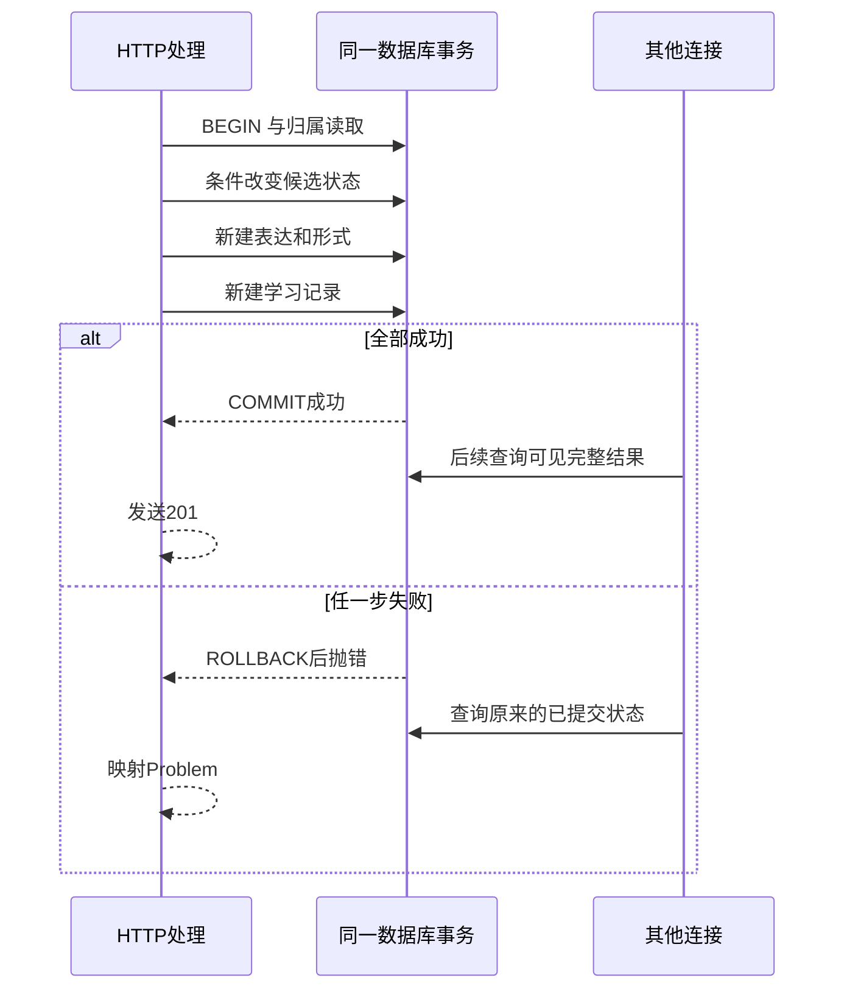

第22章创建Capture及首个修订时已用过嵌套写入：对象有直接的父子关系，可以由一次create描述。这里还要读取归属、检查状态、根据条件更新数量决定是否继续，交互式事务更直接。`$transaction([...])`适合已经能预先列出的独立数据库操作；它不是把任意Promise放进去就变成事务。交互式回调得到的tx才是当前事务客户端。

本章把采纳留在已有 `PrismaCandidateStore`，不另外创建连接池、事务管理框架或通用工作单元。Service负责业务结果到错误的映射，Store知道具体读写顺序；DatabaseService仍管理连接与安全日志。区别在于这次一次Store调用内部有多条SQL。

### 先扩展输入与输出契约

新增 `POST /candidates/:id/accept`，Body必须是JSON `{}`，不允许查询参数。英文与中文含义从候选读取，不能由这次请求覆盖；状态和时间也不接受客户端提交。非法、缺失或其他用户的候选返回404；pending以外的候选返回409；成功新建学习关系返回201。

在 `candidate-contract.ts` 中，CandidateResponseSchema扩为三个分支。保留原candidate公共字段和CreateCandidateSchema，替换状态定义并追加采纳结果：

```ts
export const CandidateResponseSchema = z.discriminatedUnion('status', [
  z.object({ ...candidate, status: z.literal('pending'), discardedAt: z.null(), acceptedAt: z.null() }),
  z.object({ ...candidate, status: z.literal('discarded'), discardedAt: z.iso.datetime(), acceptedAt: z.null() }),
  z.object({ ...candidate, status: z.literal('accepted'), discardedAt: z.null(), acceptedAt: z.iso.datetime() }),
]);
export const CandidateListSchema = z.object({
  revisionId: z.uuid(), items: z.array(CandidateResponseSchema).max(5),
});
export type CreateCandidateInput = z.infer<typeof CreateCandidateSchema>;
export type Candidate = z.infer<typeof CandidateResponseSchema>;

export const AcceptanceSchema = z.object({
  candidate: CandidateResponseSchema,
  expression: z.object({ id: z.uuid(), meaning: text, createdAt: z.iso.datetime(),
    forms: z.array(z.object({ id: z.uuid(), text })).length(1) }),
  learningRecord: z.object({ id: z.uuid(), candidateId: z.uuid(), expressionId: z.uuid(), createdAt: z.iso.datetime() }),
});
export type Acceptance = z.infer<typeof AcceptanceSchema>;
```

新的acceptedAt是所有候选响应都有的字段，pending和discarded为null。前章的原始SQL投影也必须加入 `n.accepted_at AS "acceptedAt"`，Row类型增加 `acceptedAt: Date | null`，project把它转为ISO字符串或null。只改新接口会使旧创建、列表与放弃输出校验失败。这是新增状态对所有调用者的影响，不能等联调报500才去补。

把原文件的Row、columns与project同步为下面这段，创建、列表和放弃就会共用同一投影：

```ts
type Row = { id: string; revisionId: string; candidateNo: number; englishText: string;
  chineseMeaning: string; status: string; discardedAt: Date | null; acceptedAt: Date | null; createdAt: Date };
type OuterRow = Omit<Row, 'id'> & { id: string | null };
const columns = Prisma.sql`n.id, n.revision_id AS "revisionId", n.candidate_no AS "candidateNo",
  n.english_text AS "englishText", n.chinese_meaning AS "chineseMeaning", n.status,
  n.discarded_at AS "discardedAt", n.accepted_at AS "acceptedAt", n.created_at AS "createdAt"`;
function project(row: Row): Candidate {
  return CandidateResponseSchema.parse({ ...row, createdAt: row.createdAt.toISOString(),
    discardedAt: row.discardedAt?.toISOString() ?? null, acceptedAt: row.acceptedAt?.toISOString() ?? null });
}
```

Acceptance只投影这次新建的对象，不把userId或数据库关系对象全部暴露出去。forms限定长度1描述的是本章一次采纳的结果；将来扩充形式后，要重新设计查询和响应，不能把它当成永久的表达模型上限。

### 同一回调里的每条SQL都使用tx

在Store中引入AcceptanceSchema与Acceptance类型，加入下面的完整方法；randomUUID、validId、project与DEVELOPMENT_USER_ID沿用原文件：

```ts
  async accept(id: string): Promise<Acceptance | 'conflict' | undefined> {
    if (!validId(id)) return undefined;
    return this.database.run('acceptCandidate', () => this.database.client.$transaction(async tx => {
      const candidate = await tx.candidate.findFirst({
        where: { id, revision: { capture: { userId: DEVELOPMENT_USER_ID } } },
      });
      if (!candidate) return undefined;
      if (candidate.status !== 'pending') return 'conflict';
      const acceptedAt = new Date();
      const claimed = await tx.candidate.updateMany({ where: { id, status: 'pending' },
        data: { status: 'accepted', acceptedAt } });
      if (claimed.count !== 1) return 'conflict';
      // shortcut: one expression per acceptance; chapter 27 defines semantic identity and reuse.
      const expression = await tx.expression.create({ data: {
        id: randomUUID(), meaning: candidate.chineseMeaning,
        forms: { create: { id: randomUUID(), text: candidate.englishText } },
      }, include: { forms: true } });
      const learningRecord = await tx.learningRecord.create({ data: {
        id: randomUUID(), userId: DEVELOPMENT_USER_ID, candidateId: id, expressionId: expression.id,
      } });
      return AcceptanceSchema.parse({
        candidate: project({ ...candidate, status: 'accepted', acceptedAt }),
        expression: { ...expression, createdAt: expression.createdAt.toISOString() },
        learningRecord: { ...learningRecord, createdAt: learningRecord.createdAt.toISOString() },
      });
    }, { isolationLevel: Prisma.TransactionIsolationLevel.ReadCommitted, maxWait: 2000, timeout: 5000 }));
  }
```

第一条查询沿候选→修订→记录检查固定用户归属，使用明确candidateId，不查询最大版本号。当前候选内容在API里不可修改，所以读取到的英文与含义就是这次确认的内容。数据库管理者直接改表属于另一条写入口，不能用API的不变量替它担保。

紧接着的updateMany仍带 `status: 'pending'`。先读到pending，并不等于过一会儿写入时还pending；另一个请求可能已经放弃或采纳。条件更新的count为0时直接返回conflict，而且此时本事务还没有任何成功写入。先改变状态也不是提前公布成功：在COMMIT之前，它只在本事务内成立，普通其他连接不能读到这个未提交状态。

这一步会在修改行上取得锁，直到事务结束。当前用它让竞争同一候选的两个业务入口只能有一个继续，保留上一章已经建立的状态转移防线。第25章再展开等待、条件重判与其他冲突；本章不会为了演示重复而把正式实现退回无条件UPDATE。

之后expression.create的嵌套forms.create仍使用tx，属于外层同一个事务。learningRecord.create最后执行。外键、非空、数据库超时或映射校验在后面失败，Promise拒绝会离开回调，Prisma负责回滚后再把错误交给DatabaseService.run。我们没有在回调里catch错误后返回一个“失败对象”：正常返回会让Prisma尝试提交，而不是自动理解这个对象代表业务失败。

AcceptanceSchema.parse也在事务内，能够在提交前发现当前返回对象的确定性形状错误。它不能消除所有响应故障：外层Interceptor仍可能出错，连接也可能在COMMIT后中断。事务完成和客户端收到201是两个时刻。时间字段同样不要过度解释：acceptedAt来自应用时钟；本章实际Prisma INSERT也携带createdAt值。它们表达记录时间，不承担跨进程的精确先后证明，不能用表达与学习记录时间相同或不同来推断是否属于同一事务。

三个选项各限制不同的东西：maxWait为取得交互式事务设置等待上限，timeout限制事务回调的执行期限，isolationLevel明确本方法使用READ COMMITTED。现有pg池还有2秒连接等待和3秒statement_timeout；它们不是一个总计时器，也不应通过无限放大来掩盖断点暂停或慢调用。本章设maxWait为2秒、timeout为5秒。断点停住会消耗真实时间，调试时应迅速继续，暂停超时后先确认回滚与pending状态，再决定是否重新发送同一采纳，不能把期限调大后遗忘在生产配置里。

特别注意：tx回调里若调用 `this.database.client.expression.create(...)`，那是根客户端，可能从池里取得另一条连接。它不因为代码写在回调大括号里就自动加入事务。也不要在成功前把Promise丢出去而不await；回调已经结束，后续操作既可能越过生命周期，也可能根本不属于这次提交。

### 接回现有请求、日志与关闭流程

CandidatesService新增的方法很短，继续让ApplicationState跟踪整个数据库工作：

```ts
  async accept(id: string) {
    const result = await this.state.track(() => this.store.accept(id));
    if (result === undefined) throw new CandidateNotFoundError('Candidate not found');
    if (result === 'conflict') throw new CandidateConflictError('Candidate is no longer pending');
    return result;
  }
```

Controller引入AcceptanceSchema，新增：

```ts
  @Post('candidates/:id/accept')
  @UseInterceptors(new ResponseSchemaInterceptor(AcceptanceSchema))
  accept(@Param('id') id: string,
    @Body(new SchemaPipe(EmptyObjectSchema)) _input: object,
    @Query(new SchemaPipe(EmptyObjectSchema)) _query: object) {
    return this.candidates.accept(id);
  }
```

Nest的POST默认201，放弃接口继续保留显式200。两个Pipe分别拒绝正文额外字段和查询参数，原有请求字节上限、JSON解码和Problem Filter保持。不要新建一个“事务实验Controller”混进正式路由。

同时更新四个容易漏掉的位置。在 `http-boundary.ts` 中让候选动作匹配 `^/candidates/([^/]+)/(?:discard|accept)$`，仍只允许POST，保留原始路径转义拒绝。`request-observation.ts`增加 `/candidates/:id/accept` 标签，使日志记录路径模板而非具体ID或正文。`openapi.ts`增加Acceptance组件与accept路径，说明201、400、404、409、500和503，删除“尚无采纳入口”的旧说明。`DatabaseService.onModuleInit`再探测expression、expressionForm、learningRecord，缺迁移时拒绝就绪；原candidate探测会同时覆盖新acceptedAt列。

OpenAPI沿用已有的jsonResponse、problem与schema辅助函数。导入AcceptanceSchema，在components.schemas加入 `Acceptance: schema(AcceptanceSchema, 'output')`，paths新增：

```ts
'/candidates/{id}/accept': {
        post: {
          operationId: 'acceptCandidate', summary: 'Accept one pending candidate atomically',
          description: 'Requires JSON {} and no query. Uses the exact candidate and its immutable revision, including historical revisions. Creates one expression, form and learning record in the same transaction as the accepted state. Repeated acceptance returns 409, not replay. No AI call or semantic deduplication. A lost response may follow a committed transaction; read state before deciding what to do.',
          parameters: [{ name: 'id', in: 'path', required: true, schema: { type: 'string' } }],
          requestBody: { required: true, content: { 'application/json': { schema: { $ref: '#/components/schemas/EmptyObject' } } } },
          responses: { '201': jsonResponse('Acceptance', 'Committed acceptance'),
            '400': problem('Expected empty JSON object and no query'), '404': problem('Candidate not found; code CANDIDATE_NOT_FOUND'),
            '409': problem('Candidate is no longer pending; code CANDIDATE_CONFLICT'), '413': problem('Body exceeds 16 KiB'),
            '415': problem('Expected application/json'), '500': problem('Unexpected failure'), '503': problem('Storage temporarily unavailable; outcome may be unknown') },
        },
      },
```

这些改动没有改变CapturesModule的依赖关系：Controller、Service、Store与DatabaseService已经登记。也没有新增运行依赖。执行 `npm run check` 后启动 `npm run dev`，连接已有VS Code调试配置，确认自动编译、重启和本机Inspector均正常。

### 在Postman与数据库里核对同一次结果

导入 `requests/chapter-24.postman_collection.json`，baseUrl指向当前开发服务。按01～04手动创建本章独立原文、读取修订ID、保存候选并查看pending；成功脚本只保存返回的ID，不自动发送下一条请求。不要从前章已放弃候选开始试采纳，它应该返回409。

05发送 `{}`，成功响应同时包含candidate、expression、learningRecord。核对candidate.id未变，candidate.status为accepted，learningRecord.candidateId等于原候选，learningRecord.expressionId等于新expression.id，形式内容来自候选。06再次采纳得到409；07尝试放弃这个accepted候选也得到409。08读取列表，acceptedAt与首次结果保持一致。

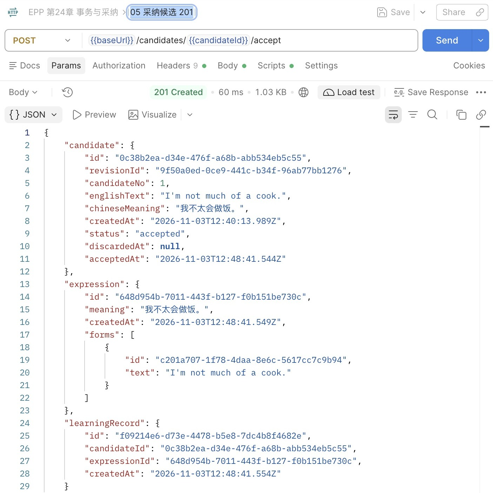

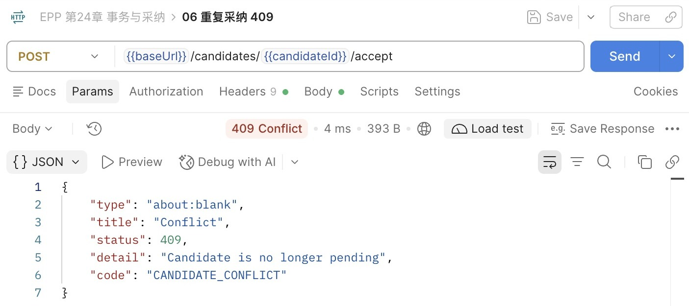

在DBeaver的01-inspect.sql最后一段把全零UUID换成自己的candidateId，再执行关联查询。四处事实应能连成一行，而不是只看到status变了就宣布成功。09～11分别拒绝夹带内容、查询参数与非法ID；12追加新版输入，13仍使用原revisionId读取历史确认。新版本并不会复制或撤销采纳。

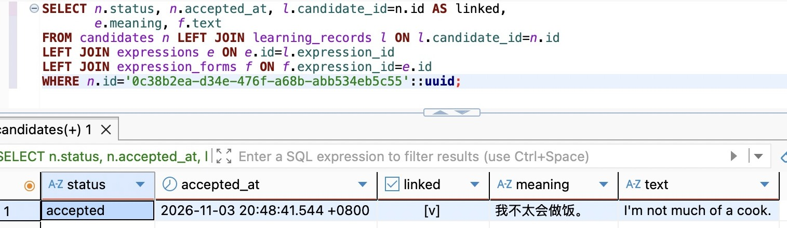

图中为节省宽度，把learning_id改为 `l.candidate_id=n.id AS linked`，勾选表示关联成立；完整检查SQL仍显示学习记录ID。accepted_at的 `20:48:41.544 +0800` 与Postman中的 `12:48:41.544Z` 是同一时刻。

### 沿断点观察尚未提交的结果

在 `PrismaCandidateStore.accept` 的learningRecord.create一行设置断点，它位于表达和形式已经写入之后、学习记录尚未写入之前。使用另一份新的pending候选发送采纳，在Variables或Watch查看 `claimed.count`、`expression.id` 和候选状态。此处1和新ID只证明事务内的步骤已成功，不能证明COMMIT已经发生。断点应尽快继续；如需持续观察数据库锁，使用下一节的SQL双会话，而不是长时间挂住HTTP。

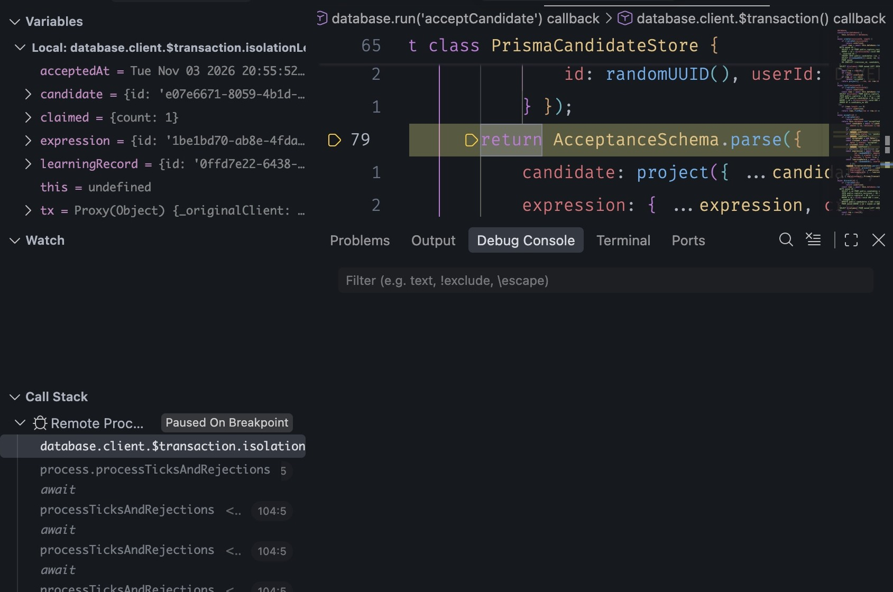

图中停在编译后的prisma-candidate.store.js返回投影处，左侧claimed.count为1，expression与learningRecord已经有值，调用栈仍在事务回调。此次暂停超过5秒，继续后实际返回P2028；数据库核对候选与关联写入均回滚，关闭断点后同一候选重新采纳201。截图证明的是提交前的内存变量，不是持久化成功。

正常执行到Service拿到result时，事务Promise已经返回，COMMIT已完成，Postman随后收到201。如果事务内断点暂停太久，继续后可能得到P2028及HTTP500；先确认原候选仍pending、关联结果没有留下，再关闭断点重发同一采纳。不要把局部变量里出现过表达ID当成已提交证据。保存源码后等待自动编译与进程重启，再发候选GET确认结果仍在；本章没有内存采纳状态需要恢复。不要因为调试器重连而重复05。

失败路径也要在真正的数据库上观察。配套最小回归 `test/acceptance.test.mjs` 在隔离测试库为本次虚构候选临时增加一条拒绝学习记录的CHECK，触发最后一步失败，断言三张结果表行数不变、候选仍pending且acceptedAt为空；移除临时约束后再做两个同时采纳的请求，观察一个201、一个409。它不向正式路由添加fail参数。测试使用DDL并串行执行，DATABASE_URL必须指向已迁移、已建立固定开发用户的隔离库，不能对日常或共享库运行。

```bash
# 在终端中提供隔离测试库的 DATABASE_URL，不提交连接凭据。
npm test
```

如果看到500，先按requestId查安全日志中的operation与code，再核对候选和关联结果。数据库错误发生在事务内、且已确认回滚时，可以解释为何原状态保持。仅凭HTTP500、503或客户端超时，不能推断没有提交；错误也可能发生在提交后的响应阶段。当前没有操作结果重放，恢复先读事实，不能自动换一个候选ID“再试一次”。

## 24.3 一个事务，也可能两次读到不同结果

### 原子性没有承诺冻结整个数据库

事务A执行两次SELECT，中间事务B提交了修改。A能否看见新值，由隔离规则决定。原子性只回答A自己的修改能否拆开提交，不回答两次读取是否使用同一个视图。把函数包进transaction后仍然要判断读取前提会不会变化。

在DBeaver为同一个隔离练习库建立A、B两条连接，或使用前篇已经配置好的独立SQL会话。两个编辑器都先执行 `SELECT current_database(), pg_backend_pid();`，库名必须相同、PID必须不同。两个标签页可能共享连接；若PID相同，这不是并发实验。B使用Auto-commit，A用明确BEGIN／ROLLBACK，逐条交替执行配套 `03-isolation.sql`。

由空闲的准备会话创建独立实验schema：

```sql
CREATE SCHEMA chapter24_lab;
CREATE TABLE chapter24_lab.counter (id integer PRIMARY KEY, value integer NOT NULL);
INSERT INTO chapter24_lab.counter VALUES (1,10);
```

这里不用临时表，因为B无法看到A的会话临时表。也不用业务候选表，避免为演示读写异常破坏真实状态转移。

A先执行：

```sql
BEGIN ISOLATION LEVEL READ COMMITTED;
SELECT pg_backend_pid() AS pid, pg_current_xact_id() AS tx, value
FROM chapter24_lab.counter WHERE id=1;
```

A读到10后，切到B，单独执行 `UPDATE chapter24_lab.counter SET value=20 WHERE id=1;`。B自动提交，再切回A重复同一个SELECT，读到20；最后A执行ROLLBACK。DBeaver结果不会自己刷新，必须真的再执行查询，保留两个结果页或截图作比较。

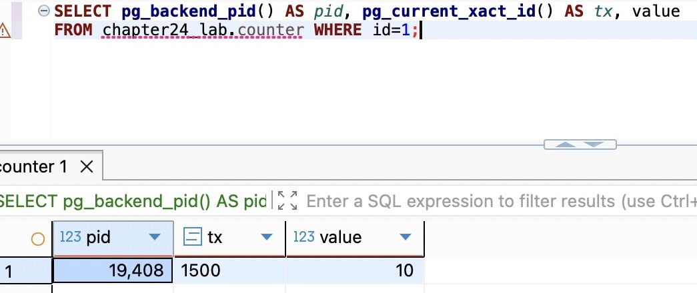

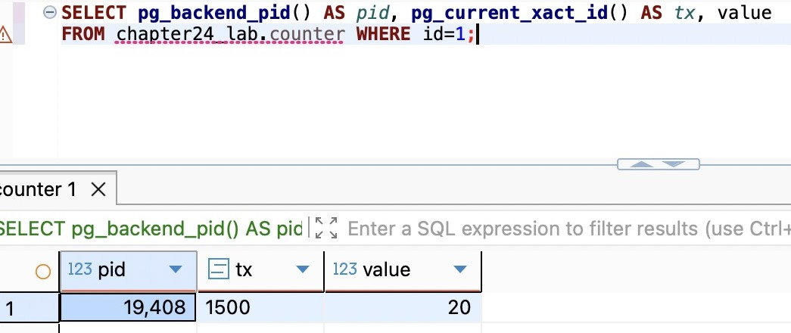

查询选择 `pg_current_xact_id() AS tx` 方便对照；它会为当前事务分配并返回事务ID：A的PID为19408，事务ID两次都是1500；B实际使用另一个PID 16140。PID与事务ID不是固定示例值，应以自己的查询为准。

这叫不可重复读：同一行在同一事务的两次读取中变了。READ COMMITTED下，普通SELECT按每条语句开始时的已提交视图读取，所以它不会看见B尚未提交的20，却能在下一条语句看见B已经提交的20。它仍可以读到A自己的修改。所谓快照是可见性规则，不是把整个数据库复制一份。

### 换成稳定视图，又会失去什么

B把实验值恢复为10。A重新开始：

```sql
BEGIN ISOLATION LEVEL REPEATABLE READ;
SELECT pg_backend_pid() AS pid, pg_current_xact_id() AS tx, value
FROM chapter24_lab.counter WHERE id=1;
```

再让B提交20，A重复SELECT仍为10。PostgreSQL的REPEATABLE READ保留事务首次非事务控制语句取得的快照；不是写下BEGIN的那一刻就必然冻结数据。若BEGIN后还没有执行读取，另一个事务先提交，A第一次查询可以看到那个提交。

稳定读取并不授权A把旧判断覆盖到新现实上。在A继续执行：

```sql
UPDATE chapter24_lab.counter SET value=value+1 WHERE id=1;
```

它会因目标行已被别的事务更新而报40001，常见文字是could not serialize access due to concurrent update。先ROLLBACK，再在新事务里查询，才能看到20。恢复不是在已失败事务内再次执行UPDATE，也不是仅重发最后一条语句：此前读到10所形成的全部业务判断都必须重新成立。第25章会给出有界重试与重试范围。

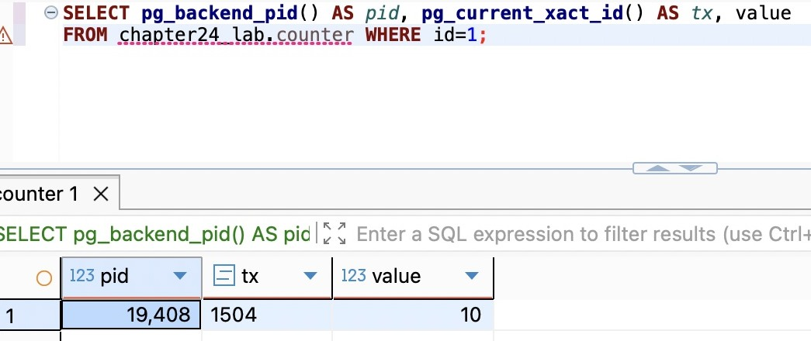

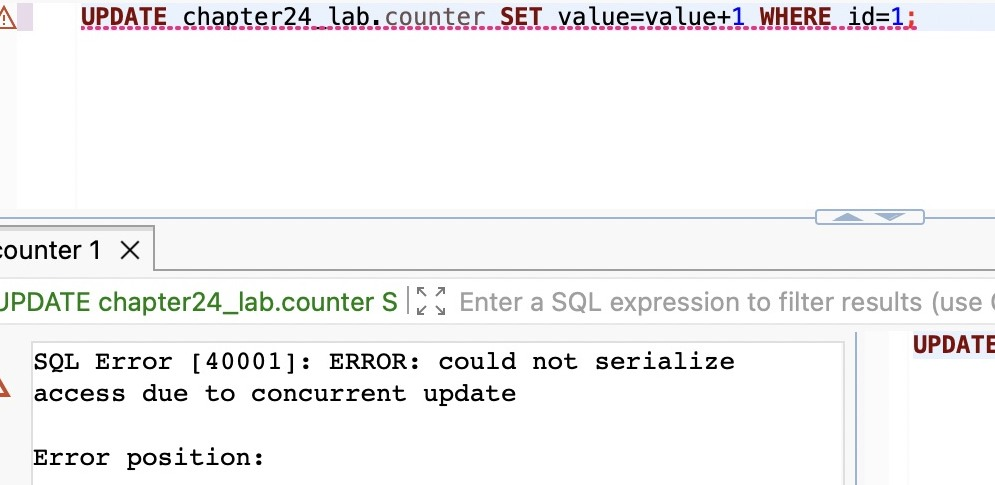

这次A的事务ID已变为1504；它与前面的READ COMMITTED对照是两个事务。失败后已单独ROLLBACK，才进行后续查询。

这组实验说明，提高隔离级别可能把“读取前提悄悄变化”转为“明确拒绝本次事务”。对写入业务，必须把拒绝路径一起设计，不能把Serializable当作没有代价的万能配置。

### 从一行变化扩展到一组条件

不可重复读关注同一行的值；幻读关注条件查询的成员。例如A查询所有pending候选，B提交一个新候选后，A再次查询多了一行。标准对不同级别的最低要求与具体数据库实现并不完全相同。PostgreSQL的READ UNCOMMITTED实际按READ COMMITTED工作，不会读到未提交行；它的REPEATABLE READ也阻止幻读，但仍可能发生序列化异常。[PostgreSQL 18隔离文档](https://www.postgresql.org/docs/18/transaction-iso.html)明确列出了这一区别，不宜套用其他数据库的口诀。

序列化异常可以用值班规则理解：至少留一人值班。A和B都在稳定快照里看见两人值班，分别把自己改成离岗。它们修改不同行，不一定发生同一行的写冲突；两个事务都原子提交后，却可能无人值班。若真的先执行A再执行B，B会看见只剩自己而拒绝离岗。因此，这个结果无法等价成任何合法的串行顺序，稳定快照仍没有保护跨行条件。

Serializable要求成功提交的并发结果能够等价于某种串行顺序，数据库可能中止一个事务来维持保证；它不意味着所有SQL都排成单线程执行，也不替应用定义“至少一人”的规则。若读取检查本来就漏了，串行运行错误程序仍然错误。PostgreSQL用多版本可见性和冲突检测支持这些语义，具体锁定与竞争策略在下一章接着展开。

回到采纳：本章的同一候选竞争已经由条件UPDATE保护，但两个不同候选产生同义表达，是另一个冲突对象。锁住候选A并不能锁住“尚未存在的同义表达”，事务也不知道两段文字应该归为一个含义。业务唯一性、归一化、约束和锁各有作用对象，不能用“已加事务”代替分析。

结束实验时，A、B各自确认没有未结束事务，再由准备会话执行：

```sql
DROP TABLE chapter24_lab.counter;
DROP SCHEMA chapter24_lab;
```

只删除本章实验对象；如果连接断开，先确认会话已消失再继续，不把数据库整体重建当作恢复步骤。长时间idle in transaction会占用资源，并可能保留旧快照或锁。第17章的pg_stat_activity查询仍可按PID检查；界面显示Auto不等于显式BEGIN已经结束。

## 24.4 让事务短而完整，不把网络等待包进去

### 一条连接不能替外部服务撤销事实

设想采纳时顺手调用模型润色，再写表达。如果把模型请求放进tx回调，数据库连接要一直被占着，候选行锁也可能一直不释放。假设池里只有几条连接，几次慢模型调用就能让其他本来很快的列表请求排队。最后超过事务timeout，数据库回滚了，模型服务却可能已经完成调用或计费。数据库没有外部服务的回滚权限。

把外部调用移到事务最后也没有解决原子性：模型成功后COMMIT失败，外部事实仍在；COMMIT成功后发送通知失败，数据库事实也不会自动撤销。判断边界时应问“谁能共同决定提交”，而不是“它们是否写在同一个函数里”。

当前最小的正确安排是先保存候选、展示给用户，再由采纳只完成数据库变化。未来模型生成属于候选生成流程；生成结果先落成明确对象，用户确认它的ID。若正式采纳后必须通知、生成向量或写对象存储，需要记录可恢复的后续意图和处理状态，第六篇任务与外部调用、第七篇文件流程再建立那些能力。本章不提前建队列，也不在事务中假装可以一次提交整个互联网。

事务边界并非越大越安全。把一次用户交互的全部等待都包住，会让数据库替人和网络长期保管锁；拆得太碎则会重新制造半次成功。适合当前采纳的边界是：读取确认对象与归属、在写入时核对状态、保存构成这次确认的全部数据库事实。输入JSON解码、纯格式校验在事务外；依赖数据库当前事实的判断在事务内；响应发送在提交之后。

### 回滚、提交与未知结果各从哪里恢复

数据库明确报告事务失败并回滚时，原来的已提交状态保持。应用收到COMMIT成功后，应按已完成处理。但如果连接在提交附近断开，应用可能拿不到确定答复：服务器可能已提交，也可能尚未提交。不能凭“没有201”宣布失败，更不能凭“UPDATE返回过1”宣布完成。

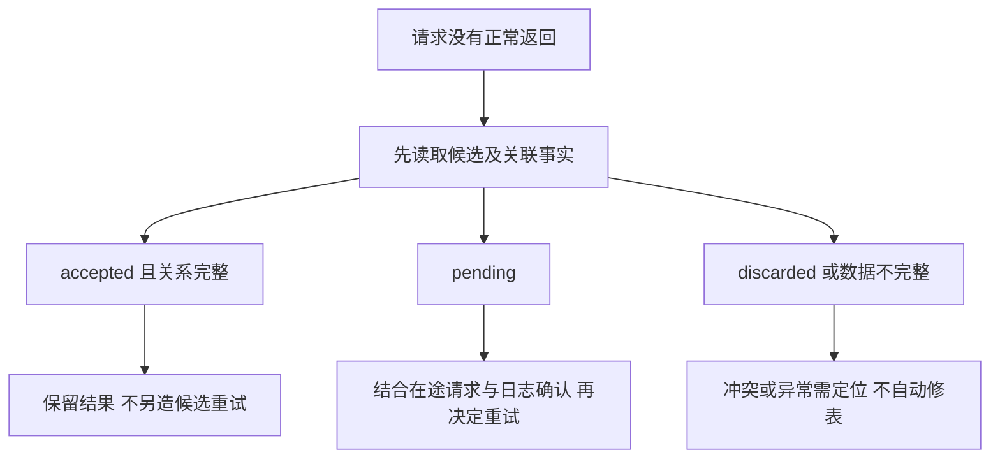

这里的GET反映读取时刻，不保证原请求已经结束；pending之后原事务仍可能提交。日志requestId帮助关联一次HTTP处理，但不是幂等操作身份。第26章会让同一命令可以读取和重放原结果；在此之前，手工核对比自动重建另一份候选更符合现有承诺。

生产交付沿用前章路径：先部署迁移，运行 `npm run check` 生成dist，把dist、package.json、package-lock.json、.npmrc复制到独立运行目录，在那里执行 `npm ci --omit=dev`。运行环境提供DATABASE_URL，再执行 `npm start`；不复制开发.env，不开Inspector和源码监听，docs默认404。用同一个revisionId读回accepted候选，停止再启动，结果应保持。这个验证同时检查迁移顺序、运行依赖与持久化边界，不以开发进程跑通代替。

回退尤其要看实际数据能力。第23章的输出Schema只认识pending／discarded；一旦已有accepted行，直接切回那一版，候选列表就可能因输出失约返回500。新表和新列属于追加变化，并不代表旧应用能够理解新状态。恢复应优先修复并前进，或准备能读取新状态、但关闭新采纳入口的兼容版本；不要为迁就旧代码把accepted改回pending、删除学习记录，更不要修改已应用迁移。

停下时保存captureId、revisionId、candidateId和expressionId，结束DBeaver实验事务并断开本章实验连接。再次继续先读候选列表和迁移状态，不从集合01重新创建。我们现在已经把一个采纳变成数据库可整体提交的动作；下一章将改变请求交错方式，继续研究不同竞争对象需要哪些约束和锁。

## 知识支线

- [支线24A：保存点、异常捕获与事务所有权](side-01-savepoints.md)：从可跳过的导入行推导局部回滚，解释为什么保存点不是独立提交，以及函数拆分后谁负责事务结束。

## 附录：本章必要技术点速查

| 名称 | 本章用途 | 必要注意点 |
| --- | --- | --- |
| BEGIN／COMMIT／ROLLBACK | 明确数据库工作单元 | 单条SQL成功不等于整个事务已提交 |
| 23502／25P02 | 观察约束首因与失败事务 | 先找首因，再ROLLBACK；后续失败不是新根因 |
| `$transaction(async tx => …)` | 根据读取结果组织多次数据库写入 | 每条参与SQL使用tx，并等待Promise完成 |
| 嵌套create | 建立表达与初始形式 | 使用tx时属于外层事务，不单独提交 |
| updateMany.count | 在实际写入时核对pending前提 | 0需停止后续写入；行形状CHECK不替代转移条件 |
| maxWait／timeout | 限制事务获取等待与执行期限 | 与连接等待、statement_timeout及HTTP期限分别判断 |
| READ COMMITTED | 本章采纳的隔离级别 | 普通SELECT每条语句重新取得可见视图 |
| REPEATABLE READ | 对照稳定快照 | 更新已被其他事务改变的目标可能报40001 |
| Serializable | 定义成功结果的串行等价性 | 需要处理失败和整事务重试，不保证错误规则变正确 |
| acceptedAt | 保存采纳状态时间 | 应用时钟记录，不是提交顺序或幂等身份 |
| 事务内输出投影 | 尽早发现确定性响应形状错误 | 无法把网络响应纳入数据库提交 |

官方入口：[PostgreSQL 18事务](https://www.postgresql.org/docs/18/tutorial-transactions.html)、[隔离级别](https://www.postgresql.org/docs/18/transaction-iso.html)、[客户端超时配置](https://www.postgresql.org/docs/18/runtime-config-client.html)、[Prisma 7事务API](https://docs.prisma.io/docs/orm/v7/prisma-client/queries/transactions)。本章调用以锁定的7.10.1生成类型为准，驱动连接池配置沿用第19章。

本章完成代码分支：`part-04/chapter-24`。

[上一章：状态机与关系建模](../chapter-23-candidates/chapter.md) · [第四篇导读](../README.md) · [全书目录](../../README.md)
