# 第25章 并发控制：两个请求同时到来怎么办

上一章保证一次采纳的状态、表达、形式和学习记录一起提交，也已经在更新候选时带上pending条件。本章不撤掉这条保护来制造故障，而是先在隔离表中重建一个很容易写出来的版本：查到pending，就认为自己可以采纳。把两个请求交错运行以后，再回到当前实现，判断每条保护到底承担什么责任。

从 `part-04/chapter-24` 继续，完成 `part-04/chapter-25`。本章为学习记录增加单候选唯一约束，为采纳设置有限锁等待，只对数据库明确中止的事务做有上限的重试。接口仍确认具体candidateId，历史候选仍可采纳；两个不同候选即使文字相同，目前仍各自建立表达。语义身份与结果重放分别由第27、26章接续。

实践沿用PostgreSQL 18、Prisma 7.10.1、固定开发用户，以及DEV／VERIFY／SHADOW三种配置。DBeaver负责观察两个真实连接，Postman保存接口请求，VS Code观察事务边界。配套入口为 `database/chapter-25/README.md`，六份SQL按编号保存；不要把需要交错执行的文件整段运行。先读完25.1的前提，再开始隔离实验；正式库的迁移在25.2处理。

时间参考：阅读约130～150分钟，跟做另加90～115分钟；按约9500个汉字、约110行代码／命令、三张机制图、十七张实际操作图，以及迁移、双会话锁实验、重试与产物恢复估算，非读者实测。支线另计；可在25.2迁移核对完成后暂停，保留实验对象并结束所有事务。

## 25.1 两次都读到pending，为什么不能两次都采纳

### 先找竞争对象

同一个候选被双击采纳，与两个不同候选都写着 `I'm not much of a cook.`，并不是一种重复。前者有同一个candidateId，已有规则可以直接判断：这个候选只能完成一次确认。后者只有内容看起来相似，还没有证明它们属于同一含义、同一用法或同一个正式表达。

再加一种情况：一个请求采纳，另一个请求放弃同一个候选。两者都以pending为前提，最终只能有一个决定成立。它们争的是候选状态，与表达的文字是否相同没有关系。设计并发控制前，先把这三种输入区分开，才知道该在哪一行、哪一列或哪一个身份上建立保护。

Node.js在一个线程中执行JavaScript，也不能保证两个请求的数据库过程连续完成。第一个请求await查询时，第二个可以继续；连接池允许它们使用不同连接。即使这个进程自行排队，另一个API实例、管理脚本或数据库客户端仍能写入。进程内的Set与Promise队列只能协调遵守它的当前进程，不能成为数据库事实的最终保证。

### 在两个窗口中保留同一个过期判断

沿用第17、24章的隔离练习库，在DBeaver建立A、B两个SQL编辑器。每个编辑器先运行：

```sql
SELECT current_database(), current_user, pg_backend_pid();
```

库名必须相同，PID必须不同。两个标签不一定对应两个连接；若PID一样，使用连接上的“新建SQL脚本”，或复制同一连接配置再开编辑器，重查PID后才继续。保持Auto-commit模式，实验仍用明确的BEGIN、COMMIT、ROLLBACK控制范围。

在A空闲时执行 `02-races.sql` 的setup块。这里的decision代表候选决定，result代表采纳生成的关系，只保留复现所需字段。它们位于专用chapter25_lab，绝不替换正式candidates和learning_records。

```sql
CREATE SCHEMA chapter25_lab;
CREATE TABLE chapter25_lab.decision (
  id integer PRIMARY KEY, status text NOT NULL
);
CREATE TABLE chapter25_lab.result (
  id integer PRIMARY KEY, candidate_id integer NOT NULL
);
INSERT INTO chapter25_lab.decision VALUES (1,'pending'),(2,'pending');
```

先在A执行BEGIN并查询id=1，再到B执行同样两句，确认两边都看见pending。A接着无条件把状态改成accepted，插入result(101,1)，COMMIT。B保留刚才读出的判断，也无条件更新id=1，插入result(102,1)，COMMIT。查询result会得到同一candidate_id的两行。

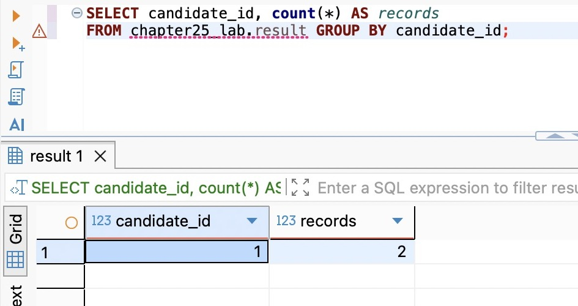

实拍中candidate_id=1的records为2；每笔事务都提交成功，业务上的单次确认规则却已经被破坏。

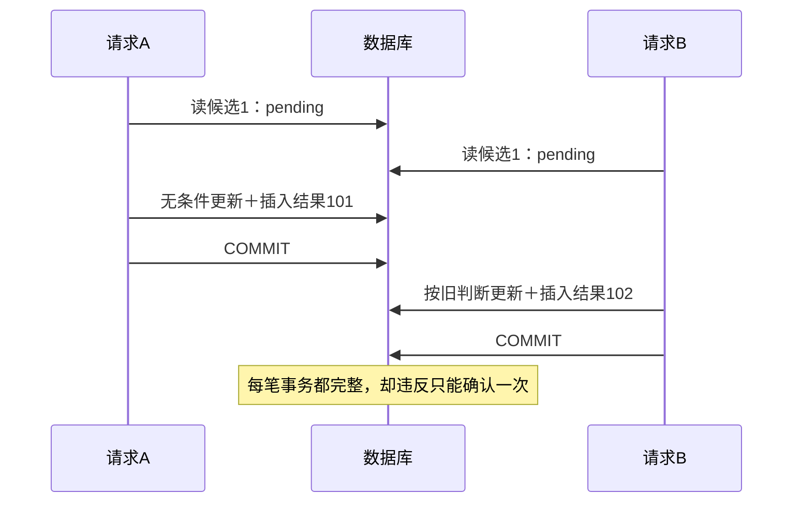

A已经提交，并不意味着B的应用变量会自动变成accepted。数据库接受B的UPDATE，是因为WHERE只有id，没有声明“只有仍为pending才能改”。两笔事务内部没有半次成功，最终业务规则仍然错了。这里缺少的是对竞争前提的保护，不能靠再套一层事务解决。

如果B的UPDATE在A提交前到达，它会先等A的行锁；但A提交以后，B的无条件UPDATE仍能继续。等待保证写入不会同时撕裂同一行，不保证第二个写入符合产品规则。看到请求排队，不能就认定竞争已经处理。

### 把有效前提和修改放在同一条语句里

现在使用未动过的id=2，按脚本A3、B3、A4、B4顺序执行。A先BEGIN并运行：

```sql
UPDATE chapter25_lab.decision
SET status='accepted'
WHERE id=2 AND status='pending'
RETURNING *;
```

A先不要提交。B也BEGIN，运行相同条件、但将目标状态改为discarded的UPDATE。B会等待；切回A执行COMMIT以后，B的结果网格应是零行。最后在B单独ROLLBACK，查询decision确认id=2仍为accepted。

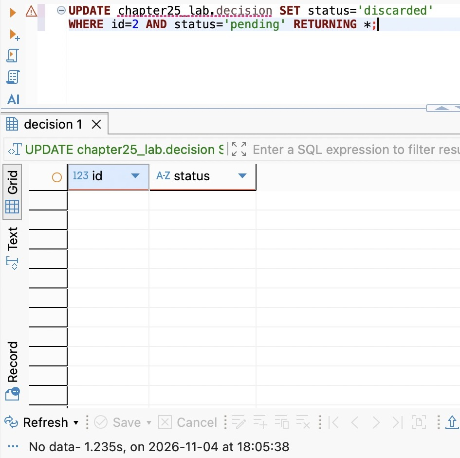

这里的No data来自UPDATE的RETURNING结果，表示B没有改到任何行；不是说decision表为空。

在本章READ COMMITTED下，B等待的行被A提交更新后，数据库会针对更新后的行重新判断WHERE。status已经不满足pending，因此B没有取得改变这行的资格。不是B“失败后也可以继续插入结果”，而是应用必须检查影响行数：零行立即结束这次业务决定，只有一行才往下建立表达和学习关系。

当前代码的 `updateMany({ where: { id, status: 'pending' } })` 正是这个位置。前面的findFirst负责读取不可变内容、检查归属并给出不存在／已结束的结果，不能取代条件UPDATE；后面的 `claimed.count !== 1` 负责阻止竞争失败者继续写入。若A回滚，B就有机会在仍为pending的行上成功；不能把“第一个发到服务器”当成承诺的胜者。

这也解释了为什么本章不另外给候选增加version：pending只能走向终态，不允许重新打开，状态本身已经表达当前更新所需前提。如果未来允许重新编辑、回到pending或基于旧页面覆盖内容，就需要判断“还是不是那一版”；章末的支线25A用具体的丢失更新和ABA过程展开这个差别。

## 25.2 唯一约束守住关系，迁移先面对已有事实

### 条件写入与唯一约束不是二选一

条件UPDATE防止当前采纳路径的两个竞争者同时通过，但未来新增的脚本也可能绕过它，直接向learning_records插入。我们已经决定一个候选只对应一次采纳关系，就应该让这项可用列精确表达的规则落在数据库里：candidate_id必须唯一。

这个约束不是 `(user_id, candidate_id)`：candidateId在整个表中已有唯一身份，并且它通过修订归属于一个用户。加入user_id反而允许两个不同用户引用同一个candidateId各插入一次，弱化了本次规则。权限仍要由带用户范围的查询保证，唯一约束本身不核对候选真正属于谁。

learning_records的id主键解决“这一行是谁”，candidate_id唯一解决“这种业务关系最多出现几次”。两者不能互相代替。相反，不能在expression_forms.text上直接加唯一来解决“相同英文”：文字相同不保证义项相同；当前也没有规定大小写、空格和形式归一化规则。数据库可以严格执行我们声明的相等，却无法替我们决定业务身份。

唯一性检查还会参与并发等待。两个事务插入同一个唯一值时，后者可能需要等前者提交或回滚，才能知道这个值是否最终被占用；提交后产生23505，回滚后则可能成功。所以“先查没有，再插入”仍不能替代约束，也不能把一次没查到理解为预订了这个值。

### 收紧之前，逐条解释重复数据

停止全部旧写入口，包括API和会写入的脚本。在DBeaver运行 `01-inspect.sql` 的重复检查：

```sql
SELECT candidate_id, count(*) AS record_count,
       array_agg(id ORDER BY id) AS record_ids
FROM public.learning_records
GROUP BY candidate_id
HAVING count(*) > 1;
```

零行说明这个库当前没有违反新规则的记录，不说明所有来源永远正确；迁移成功后才由数据库持续防守。若有行，继续查看这些学习记录的user_id、expression_id、候选状态和来源修订。先判断它们是同一次错误复制、不同表达被错误挂到同一候选，还是旧需求允许多次学习却没有另建事件表。

这三种情况会导向不同处理。纯实验复制行可在核实引用后删除那一条；真实错误关系需要保留来源、调整引用并记录修复；如果它本来代表多次学习事件，就不能删到只剩一行，应先重新设计“采纳关系”和“学习事件”的粒度。没有哪个通用的 `DELETE ... MIN(id)` 能替代这个判断。UUID与created_at也不足以证明谁是正确记录。

审核和迁移之间保持停写，避免刚检查完就又插入重复。当前数据量与操作窗口允许常规ALTER TABLE；它需要较强的表锁，会与正常访问冲突，因此不是零停机方案。以后数据量大到扫描和持锁不可接受时，应另行设计并发建索引、校验与接管约束的发布过程，不能只把超时改成无限。

### 模型、迁移和启动检查一起改变

修改Prisma模型中的两处关系声明。Candidate原来的反向数组不再表达当前基数；pending／discarded没有采纳关系，因此应为可空单项：

```prisma
// Candidate 中替换原 learningRecords 数组
learningRecord LearningRecord?

// LearningRecord 中的 candidateId
candidateId String @unique(map: "learning_records_candidate_id_key") @map("candidate_id") @db.Uuid
```

关联字段candidate本身与外键保持原样。检查所有调用者：当前接口显式投影候选和采纳结果，没有读取原反向数组，公开JSON不变。生成客户端后，代码也能按candidateId做findUnique；这是一项模型能力，不等于我们新增了查询路由。

追加 `20261104090000_single_acceptance/migration.sql`：

```sql
BEGIN;
SET LOCAL lock_timeout = '2s';
SET LOCAL statement_timeout = '10s';
ALTER TABLE public.learning_records
  ADD CONSTRAINT learning_records_candidate_id_key UNIQUE (candidate_id);
COMMIT;
```

它不回填、不删除、不改候选状态。唯一约束所需索引由PostgreSQL建立，candidate_id沿用NOT NULL，因此不用额外讨论本列多个NULL的唯一性规则。从前章自行编码时，先按第18章create-only流程生成迁移，首次应用前审查并补齐这段事务与超时；直接使用成品分支则部署已有迁移，不再生成同义文件。

沿用前章配置，先VERIFY后DEV；CLI使用各自的.env.database文件，API使用.env或运行环境，不能因为命令跑通就默认连的是同一个库：

```bash
nvm use
npm ci
unset DATABASE_URL SHADOW_DATABASE_URL
npm run db:verify -- migrate deploy
npm run db:verify -- migrate status
npm run db:verify -- migrate diff --from-config-datasource --to-schema prisma/schema.prisma --exit-code
npm run db -- migrate deploy
npm run db -- migrate status
npm run db -- migrate diff --from-config-datasource --to-schema prisma/schema.prisma --exit-code
npm run check
```

迁移后在DBeaver查看learning_records的Constraints／Indexes，刷新结构；也运行01脚本里的pg_constraint查询，核对名称、`UNIQUE (candidate_id)`、已验证和非延迟属性，再比较原行。migrate status只能说明历史记录，不能替代实际约束和原数据核对。

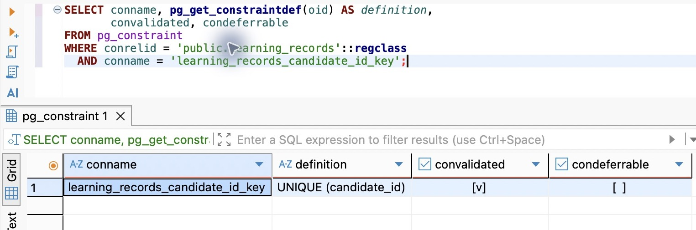

结果行中的convalidated勾选表示true，condeferrable空框表示false；要连同中间的UNIQUE (candidate_id)一起读，不能只看约束名称。

若仍有重复，ALTER报23505，整个显式事务回滚，不会自动挑一行留下。CLI有时只显示后续的“current transaction is aborted”，这是25P02，不是首因；按第18章路径查服务端首条错误、失败迁移记录和实际结构。排除重复或锁等待原因，确认这次迁移完全回滚后，才登记：

```bash
npm run db -- migrate resolve --rolled-back 20261104090000_single_acceptance
npm run db -- migrate deploy
```

这两条不是“忽略错误继续”。resolve只告诉迁移系统这次失败尝试已经回滚，既不会删除重复，也不会替你撤销部分DDL。不要修改已应用历史，或把失败迁移标成applied来换取绿色状态。

还有一个容易漏掉的地方：本章没有新增列，上一章那些findMany启动探针在旧结构上也能成功。因此DatabaseService在连接就绪前增加pg_constraint检查，要求名为learning_records_candidate_id_key的即时、已验证单列唯一约束存在；否则记录安全错误码ACCEPTANCE_CONSTRAINT_MISSING并退出。启动不自动加约束，部署与运行的职责继续分开。在 `src/database.service.ts` 原有learningRecord读取探针之后、database.ready之前加入：

```ts
const constraints = await this.client.$queryRaw<{ definition: string; condeferrable: boolean }[]>`
  SELECT pg_get_constraintdef(oid) AS definition, condeferrable
  FROM pg_constraint WHERE conrelid = 'public.learning_records'::regclass
    AND conname = 'learning_records_candidate_id_key' AND contype = 'u' AND convalidated
`;
const constraint = constraints[0];
if (constraints.length !== 1 || !constraint || constraint.definition !== 'UNIQUE (candidate_id)'
  || constraint.condeferrable) throw Object.assign(new Error('Acceptance constraint is missing'), {
    code: 'ACCEPTANCE_CONSTRAINT_MISSING',
  });
```

这里检查的是本章迁移建立的具体结构，不是通用数据库审计器。异常继续进入原有启动catch，关闭连接并拒绝就绪；错误码提取器同时保留ACCEPTANCE_CONSTRAINT_MISSING，避免日志只剩不明原因的DATABASE_FAILURE。

在隔离练习库已有一条成功采纳后，还可以验证绕过应用写入会怎样。把下面UUID替换为该候选ID，先单独执行BEGIN，再执行INSERT；给新行生成新主键，使冲突明确落在candidate_id上：

```sql
BEGIN;
INSERT INTO public.learning_records (id,user_id,candidate_id,expression_id)
SELECT gen_random_uuid(),user_id,candidate_id,expression_id
FROM public.learning_records
WHERE candidate_id='00000000-0000-4000-8000-000000000000'::uuid;
```

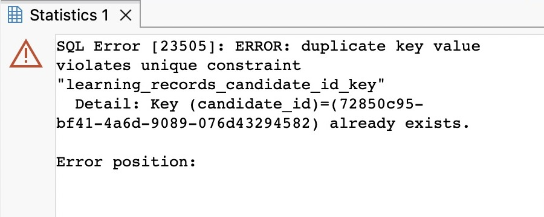

错误点名learning_records_candidate_id_key。随后单独ROLLBACK，再用01-inspect.sql查询该候选，确认原有关系仍为一条。若INSERT没有报错而影响零行，先核对样本ID是否确实已有采纳关系，不把零行当成约束生效的证据。

## 25.3 需要保护一段判断时，锁住什么

### 行锁保护现有对象，普通读取仍能进行

当前状态竞争用条件UPDATE已经足够。如果后续决定要基于一行的多个字段、做几步检查再写回，`SELECT ... FOR UPDATE` 能先锁住读到的行，使其他不兼容写入等待到当前事务结束。关键是随后检查与修改仍在同一个事务、同一连接里；自动提交的一条FOR UPDATE刚执行完就释放，保护不到下一条语句。

保留25.1的实验表，打开 `03-locks.sql`。A执行BEGIN和id=1的FOR UPDATE，不结束事务。B普通SELECT仍可读到已提交的行；B若试图UPDATE，则要等待。它读到旧值并不违反行锁：MVCC普通读取不需要先取得这种写锁，锁定也不等于让其他人看不见这行。

在B用单独的事务设置一秒等待，再尝试写入：

```sql
BEGIN;
SET LOCAL lock_timeout = '1s';
UPDATE chapter25_lab.decision SET status='pending' WHERE id=1;
```

应得到55P03。随后单独执行ROLLBACK，恢复连接；A仍持有原锁，B的超时不会替A提交或回滚。此时A继续保持原事务，供后面的NOWAIT与SKIP LOCKED对照使用；不要提前释放。SET LOCAL只在本事务有效，不把这个实验配置遗留给连接池的下一位使用者。

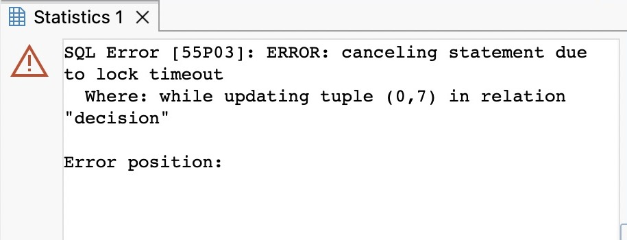

同一对象上可以选择不同等待策略：NOWAIT不等冲突行，立即失败；SKIP LOCKED直接跳过被锁行，可能返回空集合。脚本分别给出操作。对于“采纳指定candidateId”，空结果不能被解释为不存在；对于从许多任务中任选一项的队列领取，跳过正在被处理的行才可能符合含义。选择取决于请求是否允许换对象，而不只是想让错误少一些。

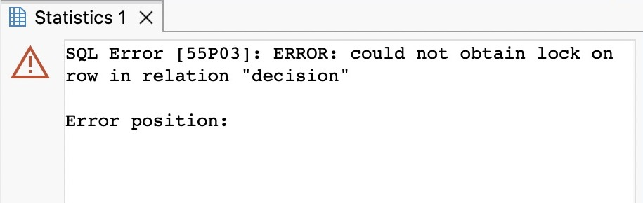

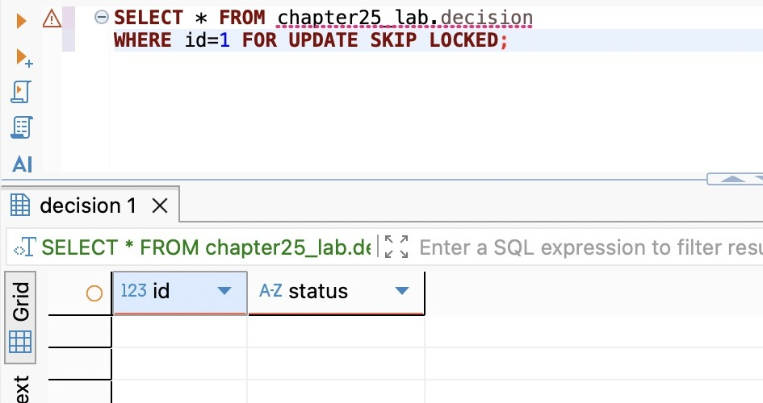

两图中的请求都指向A仍锁住的id=1。NOWAIT与等待超时都可能使用55P03，但触发方式不同；SKIP LOCKED则正常返回零行，不能据此断言id=1不存在。

要知道谁在等谁，按03脚本让B重新BEGIN，设置 `lock_timeout='30s'` 后再次UPDATE被A锁住的行；这次留出手工观察窗口。在B仍等待时，到第三个空闲连接查询：

```sql
SELECT pid, state, wait_event_type, wait_event,
       pg_blocking_pids(pid) AS blockers
FROM pg_stat_activity
WHERE datname=current_database() AND pid<>pg_backend_pid()
ORDER BY pid;
```

先按记下的A/B PID定位。B出现Lock等待、blockers包含A，说明证据指向锁链；A若是idle in transaction，说明它已经没有执行语句，却仍保留事务。不要先加连接池容量：更多请求只会一起堵在同一个持锁者后面。在30秒内先回到自己的A窗口ROLLBACK，B的UPDATE完成后也ROLLBACK；若B先超时，同样先回滚它，再结束A。对不认识的会话先查来源和业务影响，不直接终止。查询不输出SQL文本，避免把原文或参数带入截图和常态日志。

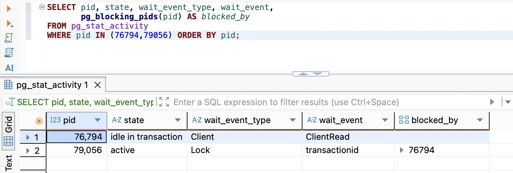

本次A的PID为76794，B为79056；图中按已核对的两个PID筛选，并把blockers列命名为blocked_by。B的Lock／transactionid与blocked_by中的76794连成了等待关系；你的PID应以自己当前连接为准。

FOR UPDATE锁的是实际读到的行。查询id=99没有结果，就没有锁住未来可能插入的99；“查不到所以加了行锁”不能保护不存在的关系。唯一约束适合阻止同一个确定键被插入两次；如果需要在对象尚未存在时协调一整段创建流程，才需要考虑一个所有参与者事先都能计算的锁身份。

### 事务级建议锁保护约定，而不是表

PostgreSQL的advisory lock可译为建议锁：数据库提供锁管理，应用约定某个整数键代表什么。它不会自动附着某张表，正常INSERT／UPDATE也不会因为那个键存在就被阻止；所有竞争入口必须先遵守同一个取锁协议。

在 `05-advisory.sql` 中，我们只用固定整数演示机制，2501代表实验命名空间，1代表实验对象。A、B分别BEGIN后执行：

```sql
SELECT pg_try_advisory_xact_lock(2501,1) AS acquired;
```

A先得到true，B得到false。false不是SQL错误，B事务仍可执行语句；应用若忽略它继续写，等于没有协调。A执行ROLLBACK后，B在自己的事务里再次调用得到true，然后也ROLLBACK。这里回滚既撤销业务写入，也结束事务级锁的持有；不要再调用会话锁的unlock去处理它。

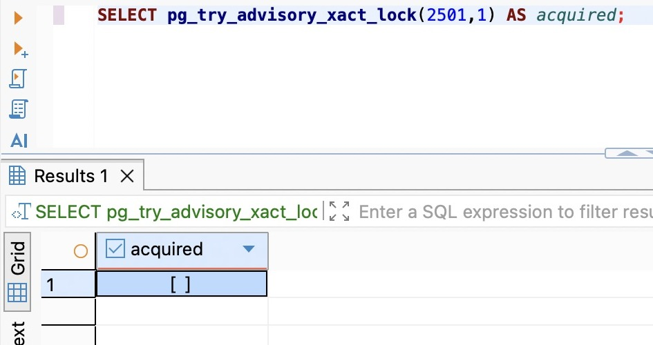

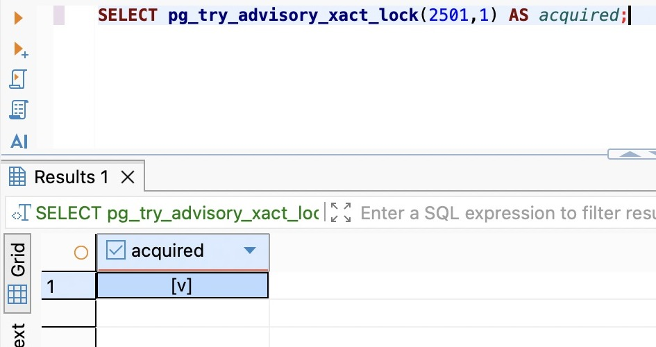

两张图都返回一行：acquired中的空框是false，勾选是true。这与SKIP LOCKED没有返回行是两种不同结果。

`pg_advisory_xact_lock`会等待，try版本把“暂时拿不到”交给调用者决定；锁对象仍相同。我们选择事务级而非会话级，是因为连接池中的会话会被复用，业务函数结束不代表会话结束。会话级锁甚至不会因为事务回滚自动释放，漏掉unlock可能影响下一个请求；事务级锁的生命周期与当前业务事务更容易对齐。[PostgreSQL 18锁文档](https://www.postgresql.org/docs/18/explicit-locking.html)列出了二者差别与冲突方式。

锁键必须从被保护的稳定身份推导。随机生成键会让同一对象的两个请求拿到不同锁，完全失去互斥；不同路径使用不同大小写、前缀或命名空间，也有同样问题。本章业务ID是UUID，不能把示例整数直接替换成截取的一小段UUID：生产方案需要统一的编码／映射规则，明确整数空间、碰撞和所有入口的一致性。哈希碰撞通常会让无关对象额外排队，但同一个对象被编码成不同键会直接漏锁。

本章正式采纳尚不复用现有表达，也没有账号状态变化要协调，因此不增加一个全局建议锁把所有用户排成一队。先保留唯一约束与候选条件写入；等出现跨对象前提，再根据下一节的顺序和25.5的边界选择真正需要的锁。

## 25.4 等待、死锁与重试，分别在哪里结束

### 从单向等待变成循环等待

A占着候选1、B等候选1，只是等待；只要A结束，B就有机会继续。死锁需要形成一个环：A持有1再申请2，B持有2再申请1，两边都在等对方先结束。


打开 `04-deadlock.sql`，先在A执行A1锁住id=1，在B执行B1锁住id=2。接着A2申请2会挂起，不要等它完成，立即切到B执行B2申请1。数据库检测到环后会中止其中一方，报40P01；另一方通常随之继续。被选中的不一定是后发请求，业务不能依赖谁被牺牲。

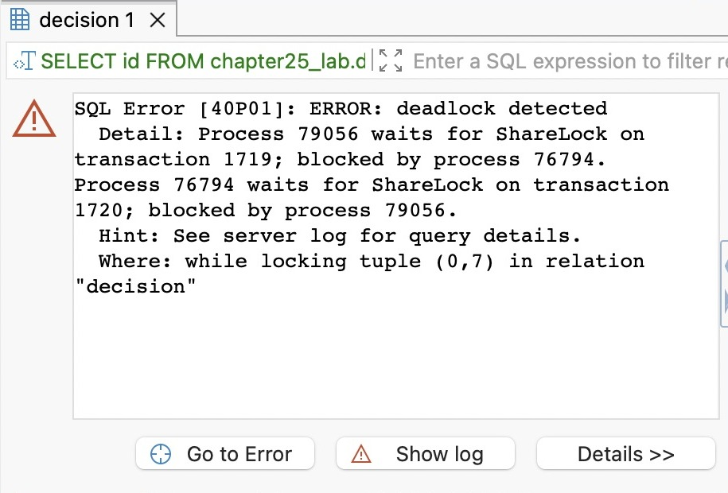

实拍中79056等待76794，下一句又指出76794等待79056，两个方向合起来才是环；这一次B成为中止方。错误里的ShareLock on transaction表示等待对方事务结束，不表示实验改用了FOR SHARE。

脚本设置的statement_timeout=10秒只是实验兜底。若切换太慢、先出现57014，那是语句超时，本轮没有证明死锁。两边分别ROLLBACK，重新按顺序操作。成功复现后，两边也都ROLLBACK：未被中止的一方仍有自己的事务和锁，不能只关闭报错窗口就离开。

避免死锁首先靠一致的取锁顺序。无论请求参数给的是[2,1]还是[1,2]，都先锁1再锁2；不要让“来源表达先、目标表达后”形成两条相反路径。对本例不可变的id，可用：

```sql
BEGIN;
SELECT id FROM chapter25_lab.decision
WHERE id IN (1,2) ORDER BY id FOR UPDATE;
ROLLBACK;
```

顺序必须覆盖所有协作入口与所有相关对象，不是只给一条查询加ORDER BY就万事大吉。若排序字段本身会变化、锁在多个查询中获取，或触发器又访问其他表，还要重新检查实际锁序。外键检查和唯一索引也会引入等待；代码里没有FOR UPDATE并不代表不会死锁。

遇到持续死锁，先记录安全错误码、操作名和requestId，结合等待链定位相反顺序；修复后用原交错再试。短事务、统一顺序会减少冲突，但无法许诺数据库永不报告可重试中止，因此应用还需要一个有限的恢复出口。

### 回滚已确定，才考虑自动重新执行

PostgreSQL的40P01表示死锁中止，40001表示为避免序列化异常而中止。它们与“连接断了，COMMIT到底到没到数据库”不同。前者可以从新的事务重新读前提，后者可能已经提交，需要查询事实与操作身份。服务器内部事务重试和客户端重新发送HTTP请求，也不是同一层动作。

本章使用的Prisma 7.10.1对生成查询中的事务写冲突／死锁提供P2034。采纳仅对此已知错误类型重试；不能见到一个带code属性的任意对象就认定事务已经回滚。原生SQL经适配器包装后的错误层次可能不同，不能把pg的40P01直接填到Prisma判断里就假定会命中。

在 `src/prisma-candidate.store.ts` 引入Node标准库delay，把上一章完整的$transaction放进有限循环。下面保留重试与事务边界，中间的采纳写入仍是24.2的原实现：归属查询、pending条件更新、表达及形式、学习记录、响应投影都必须留在回调内。

```ts
import { setTimeout as delay } from 'node:timers/promises';

// accept通过validId后；database.run仍负责最终错误分类与安全日志。
return this.database.run('acceptCandidate', async () => {
  for (let attempt = 0; ; attempt++) {
    try {
      return await this.database.client.$transaction(async tx => {
        await tx.$executeRaw`SET LOCAL lock_timeout = '1s'`;
        // 原有采纳主体：所有查询与写入使用tx，不能使用根client。
        // 此处按24.2保留候选检查、条件更新及三类关联写入和投影。
      }, {
        isolationLevel: Prisma.TransactionIsolationLevel.ReadCommitted,
        maxWait: 2000,
        timeout: 5000,
      });
    } catch (error) {
      if (!(error instanceof Prisma.PrismaClientKnownRequestError)
        || error.code !== 'P2034' || attempt >= 2) throw error;
      await delay(25 * 2 ** attempt + Math.floor(Math.random() * 25));
    }
  }
});
```

attempt从0开始，所以最多执行三次，只有两次退避，分别为25～49、50～74毫秒。少量随机抖动避免两个失败者每次在同一时刻重新冲撞；等待放在事务外，不占着上次的锁睡觉。次数限制使持续冲突能够明确结束，不能用无限重试掩盖错误锁序。

每次重试都重新执行读取、判断和写入，不能复用上次查到的candidate，或只重试最后一个INSERT。acceptedAt和新行UUID也在新事务里重新生成；前一次确定中止，它们没有成为已提交事实。重试时若其他请求已经采纳，新的读取会得到冲突，最终409是合理结果，不必强求每次重试都返回201。[PostgreSQL的重试说明](https://www.postgresql.org/docs/18/mvcc-serialization-failure-handling.html)特别强调重跑完整决策过程；[Prisma事务文档](https://docs.prisma.io/docs/orm/v7/prisma-client/queries/transactions)给出了P2034对应的客户端边界。

这段回调现在只有数据库操作。若以后把发邮件、扣费、调用AI放进去，第一次事务虽然回滚，那些外部副作用也不一定撤销，再次执行可能重复发生。不能为了复用重试循环把外部网络调用塞进来；第24章划出的本地事务边界继续成立。

### 几种超时不能合成一句“最多五秒”

本章一秒的锁等待可能先于死锁检测触发，因此同样的循环等待也可能先报55P03，而不是P2034；不要把所有死锁场景都想成必然进入自动重试。04脚本不设置这个一秒限制，用于单独观察数据库检测到环的结果。

SET LOCAL lock_timeout的1秒限制每一次获取锁时的等待；maxWait的2秒限制Prisma开始事务的等待；timeout的5秒限制每次交互式事务的执行。重试会重新申请事务，还包括事务之间的退避，所以整个HTTP请求不能据此声称最多五秒。若产品要求严格的请求总预算，还需在外层统一分配剩余时间，不能把三个配置名称当成同一计时器。

锁等待55P03在本章不进入重试循环。它可能只是某个编辑器忘了结束事务，连续重发只会继续占用连接。`src/database-errors.ts`把55P03与重试耗尽的P2034纳入临时不可用，最终映射503；捕获适配器内层55P03时优先记录这个安全码，不记录消息、SQL、参数或连接串。实际锁超时外层可能是P2039，不能只看外层就按普通500处理，也不能把全部P2039都认作锁超时。沿用第19章已收集外层与适配器内层codes的函数，只修改这些位置：

```ts
// transientCodes原有条目全部保留，再加入：
'P2034', '55P03',

// databaseFailure内code的选择：先保留明确的启动与锁错误码，
// 然后沿用原来的格式白名单和DATABASE_FAILURE兜底。
const code = codes.includes('DEV_USER_MISSING') ? 'DEV_USER_MISSING'
  : codes.includes('ACCEPTANCE_CONSTRAINT_MISSING') ? 'ACCEPTANCE_CONSTRAINT_MISSING'
  : codes.includes('55P03') ? '55P03'
  : codes.find(value => /^(?:P[0-9]{4}|[0-9A-Z]{5}|ECONNREFUSED|ECONNRESET|ETIMEDOUT|ENOTFOUND)$/.test(value))
    ?? (unavailable ? 'POOL_TIMEOUT' : 'DATABASE_FAILURE');
```

可用一个最小断言核对 `{ code: 'P2039', meta: { driverAdapterError: { cause: { originalCode: '55P03' } } } }` 得到 `{ code: '55P03', unavailable: true }`；它验证错误提取，不代替真实持锁请求。

唯一冲突P2002不重试。对本次candidate_id约束，它更可能说明有人绕过了状态协议或已有异常事实，换一个学习记录id再试仍然撞同一个candidate_id。当前通用出口保持500并记录安全码，不能把所有P2002自动说成用户重复点击；正常重复采纳已经在状态检查处得到409。P2028事务期限错误、断连与未知错误也不进入循环，先按前章路径判断实际结果。

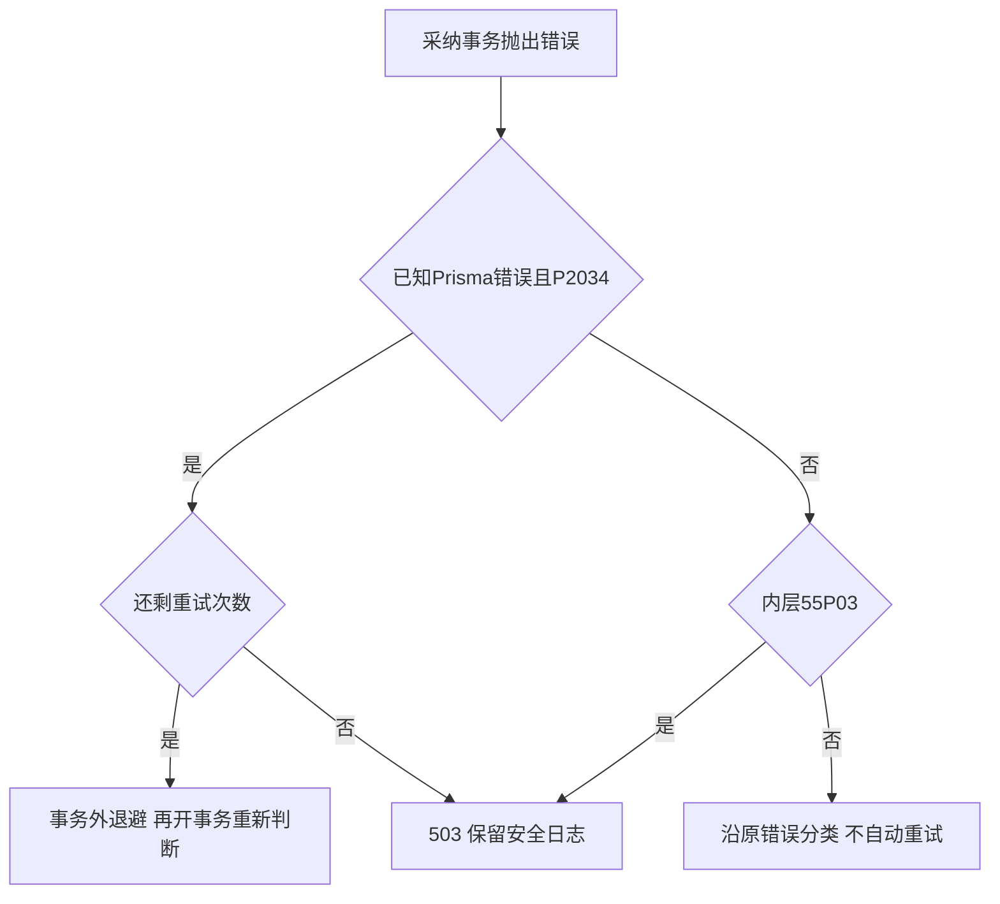

### 在图形客户端中把失败与恢复连起来

启动 `npm run dev`，在Postman导入 `requests/chapter-25.postman_collection.json`，核对baseUrl与实际端口。01～04先建立原文、修订和pending候选；05首次采纳201，06同ID重复采纳409，07已采纳不能放弃，08读回accepted。09～13继续核对严格输入与历史修订；成功脚本只保存ID，不自动重发。

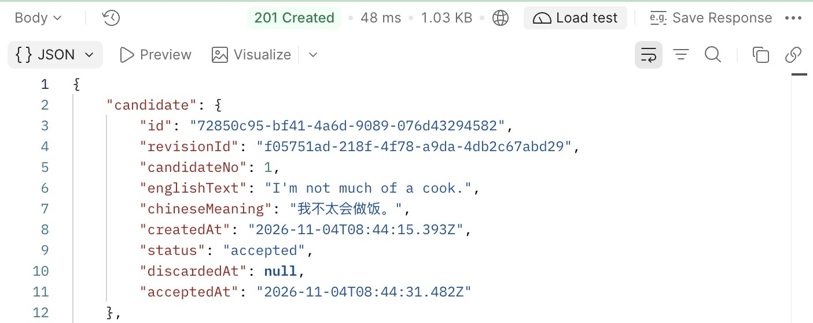

同一个candidateId再次采纳时，响应是业务冲突，不是原201结果的重放：

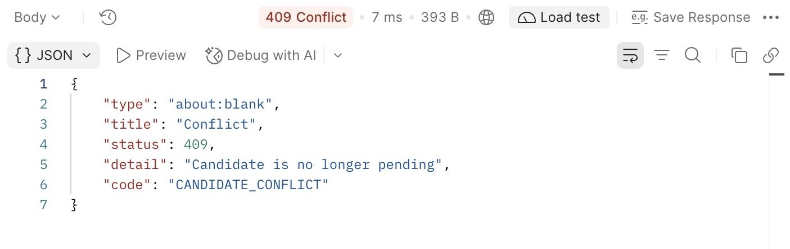

要观察等待超时，另外建立一个pending样本并记录candidateId。在DBeaver独立连接核对库名后BEGIN，用下面SQL锁住它，把示例UUID换成刚保存的ID：

```sql
SELECT id, status FROM public.candidates
WHERE id='00000000-0000-0000-0000-000000000000'::uuid
FOR UPDATE;
```

先保持该事务，在Postman发送这个候选的采纳请求。约一秒后应返回503；它不是“不存在”，也不是业务409。

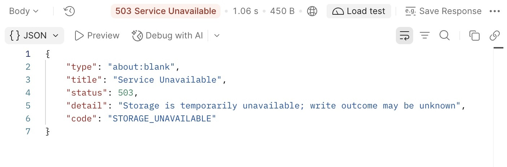

回到DBeaver单独ROLLBACK释放锁，GET确认候选仍是pending，并按01-inspect.sql核对关联记录。然后手工重发本次采纳，应得到201。此时人工持锁者已明确结束；真实网络未知结果不能仅凭一次pending读取就作同样推断。

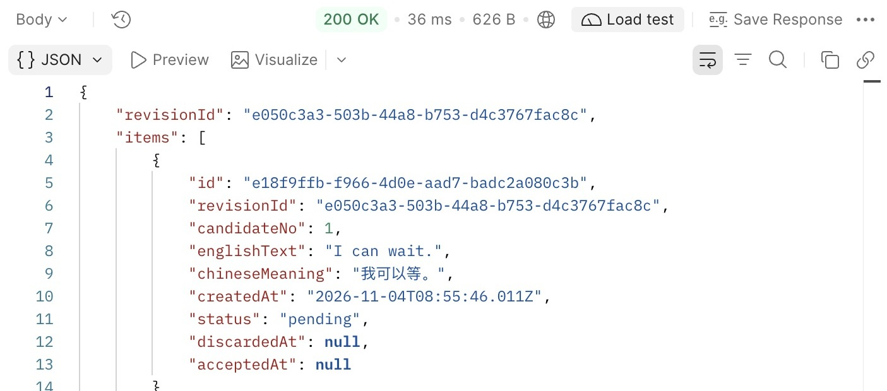

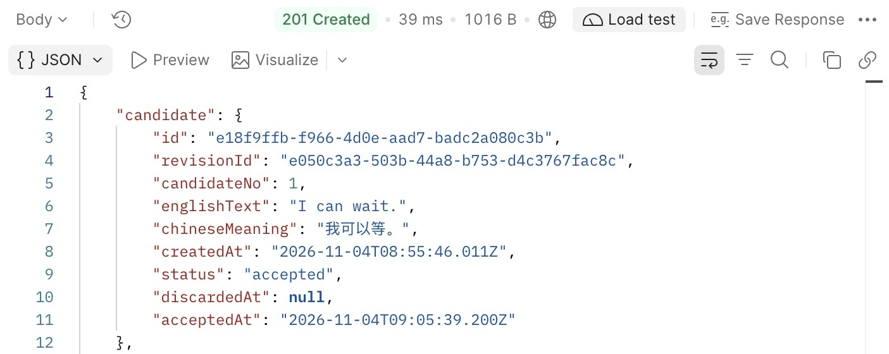

对照两张图的候选ID：恢复继续处理的是同一对象。503响应使用通用的STORAGE_UNAVAILABLE；本例能够确认回滚，是因为掌握了持锁实验、55P03及释放事务的证据，不能把所有503都解释为同一种原因。

连接VS Code的 `EPP: attach to npm run dev`。断点放在accept的catch入口，重复上面的持锁实验，观察attempt、错误类型、error.code与 `error.meta?.driverAdapterError?.cause?.originalCode`。只观察这些安全字段，不将完整error、参数或连接配置复制到日志和截图。这次应走“不重试”分支；继续执行后才看到503。该断点位于事务Promise拒绝之后，和上一章在提交前长时间暂停不同。若要观察P2034重试，先用双会话实验理解死锁，再在真实冲突出现时停在这里；不要在正式路由中添加造错参数。

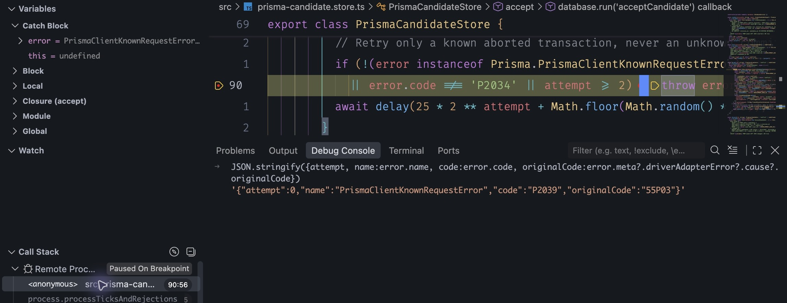

实拍停在抛出错误的位置，attempt=0，name为PrismaClientKnownRequestError，外层code=P2039，内层originalCode=55P03，因此没有进入P2034重试。继续后本次请求返回503；结束持锁事务后，查询确认pending且关联记录为0，手工重发同一candidateId得到201，关联记录为1。断点画面说明代码走到哪里，后续响应与数据库查询才补齐失败和恢复的证据。截图中的暂停时间不用于衡量一秒锁等待。

若断点为空心并提示Unbound，先检查当前文件是否来自正在运行的副本、.dev中的JS与source map是否由本次源码生成，以及附加配置的outFiles是否覆盖它们。macOS符号链接还可能让编辑器路径与运行路径不同；打开同一真实目录，或在该工作区的localRoot／remoteRoot中对应两者后重新附加，不通过改业务代码制造暂停。

修改源码并保存后，等待终端新的app.ready和调试器重连；GET原候选确认状态保留，再继续操作。已有最小回归额外检查唯一冲突及重试次数，在 `.env.test` 中显式设置独立库的 `TEST_DATABASE_URL` 后运行npm test，不把日常库拿来安装临时测试约束。一次两个请求恰好没有冲突不能证明并发安全，前面的可控交错与条件／约束才让结论有可解释的依据。

## 25.5 用户与表达边界，为什么不能只锁候选

### 同一个用户不等于同一个竞争对象

现在候选1和候选2互不依赖，各自采纳可以并行。若给整个用户加排他锁，虽然容易把所有操作串起来，也会让一个慢采纳阻塞该用户所有无关候选；给全表或全应用一把锁，影响范围更大。只有业务真的共享一个可变化前提，扩大范围才有理由。

改变一个条件：以后用户进入“处置中”就不能新增学习记录。若采纳只在开头读取一次用户状态，处置流程可能在它检查后关闭账号并清理数据，而采纳随后又插入一条。候选自己的行锁保护不到用户生命周期；普通SELECT看见active也不会阻止另一个事务改变这个前提。

一种简单方案是双方先锁同一个用户行，读完状态后在同一事务里完成各自修改，代价是该用户相关写入更容易串行。另一种方案是协调共享／排他的事务建议锁：普通操作拿共享门闩，处置拿同一键的排他门闩；普通操作彼此可以并发，处置必须等它们结束，再在锁内改变状态。反过来，处置先完成后，新操作取得共享锁，还必须重新读取状态并拒绝写入，不能把“拿到锁”当成active。

05脚本后半段让A、B分别取得 `pg_try_advisory_xact_lock_shared(2502,1)`，都应为true；B先结束自己的共享事务，再开事务尝试同键排他锁，此时false；A结束后B重试才为true。这组对照说明普通操作可并行、处置要等待，但未加入当前HTTP。选择这种协议必须同步所有写入口和处置入口；漏掉一条路径，锁就无法维护承诺。真正处置的数据范围、状态与恢复由后续账号章节建立，本章不虚构一个已存在的账号开关。

### 表达被复用或合并时，锁范围又会变化

当前采纳每次创建全新expressionId，两个不同候选没有共同的现有表达需要锁。第27章建立规范化身份后，两个候选可能同时认领同一个逻辑表达；此时应先确定唯一身份如何表达，再决定是否需要协调“查找—复用／创建”。不能先对英文字符串加一把锁，就宣称已经正确识别同义关系。

以后合并表达A、B，会同时影响它们的形式和学习引用。若采纳正准备引用A，而合并已经把A迁到B，仅锁candidate也不够。参与者需要对相同表达身份协调，并在取锁后重读它是否仍可引用；合并锁多个表达时按稳定ID排序，不能按调用参数顺序。若合并是跨用户的共享表达，锁键也不能带上不同的userId，否则两人处理同一表达会拿到不同锁。

可以据此为未来扩展约定一个统一方向：先用户生命周期，再候选，再按稳定ID排序的现有表达。路径只取自己需要的对象，不能先锁表达又回头等用户；批量涉及多个用户时也先统一排序。若后续业务无法遵守这个方向，应先重画依赖和锁序，不靠增加重试次数糊过去。它目前是设计约束：正式代码只落实本章已有的候选条件更新、关系唯一约束与有限事务重试，没有偷偷引入未来表和锁管理框架。

锁范围、锁顺序和唯一约束一起决定结果，但没有任何一项代替权限。当前固定用户的归属条件继续保留；真实身份接入后仍由服务端身份限定范围，不能因为数据库串行执行，就信任请求传来的userId。

### 保留能恢复的交付状态

本章没有改公开响应字段，OpenAPI更新版本与采纳说明，补明锁等待和重试边界。全部旧查询继续识别accepted。迁移成功后，第24章正常采纳代码仍与新唯一约束兼容，但切回它会失去本章等待、重试和约束就绪检查；第23章不认识accepted的读取限制也没有消失。恢复程序要按真实数据与行为能力选择，不能只看表是否还在。

交付按前章独立目录方式验证：构建dist，连同package.json、package-lock.json、.npmrc复制到独立运行目录；在那里npm ci --omit=dev，运行环境提供DATABASE_URL后npm start。确认docs默认404、没有Inspector和源码监听，读取已有accepted；停止再启动，同一候选及关联结果仍在。新代码在缺少本章唯一约束时应拒绝就绪，这与“接口打开后才偶然撞到错误”是不同的恢复入口。

离开实验前，A、B和观察连接都结束事务。做支线25A后按06脚本清理专用对象；不做支线则只清理result、decision和chapter25_lab。保留正式候选与采纳数据，保存ID；再次继续先核对连接目标、迁移状态与候选结果，不从Postman第一项重新创建。

我们现在可以解释同一个candidateId为何只能有一份采纳关系，也知道等待、死锁与数据库中止如何处理。但如果采纳已提交，响应在网络中丢失，客户端再次发送时仍只能得到409，而不是原来的结果。下一章会为这次操作建立独立身份，让恢复不再只依赖人工拼接状态与日志。

## 知识支线

- [支线25A：版本校验、丢失更新与ABA](side-01-optimistic-version.md)：从两个人编辑同一备注，推导比较的版本、冲突后重读，以及多行规则为何仍需要额外保护。

## 附录：本章必要技术点速查

| 名称 | 本章用途 | 必要注意点 |
| --- | --- | --- |
| 条件UPDATE／updateMany | 让pending前提与状态变化一起判断 | 必须检查影响行数；零行不继续创建关系 |
| UNIQUE(candidate_id) | 同一候选最多一条学习关系 | 不保证至少一条，不判断语义，不代替归属检查 |
| pg_constraint | 核对实际约束与启动所需前提 | 历史状态、客户端模型、数据库结构分别核对 |
| FOR UPDATE | 保护已读到的现有行 | 必须保持同一事务；空结果不能锁住未来行 |
| NOWAIT／SKIP LOCKED | 立即失败／跳过被占用行 | 跳过不等于不存在；按请求能否换对象选择 |
| pg_blocking_pids | 定位等待者与阻塞者 | 先按PID定位自己的连接，避免输出敏感查询 |
| pg_try_advisory_xact_lock | 按约定整数键协调事务 | false要处理；所有入口使用一致身份；普通SQL不会自动遵守 |
| advisory共享锁 | 讨论普通操作与生命周期排他变化 | 取得锁后仍需检查用户状态；当前未接入HTTP |
| lock_timeout／SET LOCAL | 限制本事务每次获取锁等待 | 55P03后结束失败事务；不同于事务与HTTP总期限 |
| 40P01／40001／P2034 | 数据库明确中止与客户端重试分类 | 匹配实际驱动错误类型；重跑全部读取和决策 |
| 23505／P2002 | 唯一冲突 | 先判业务原因，本章不一律重试或一律映射409 |
| attempt／delay | 最多三次事务与有限退避 | 退避在事务外，不重复外部副作用 |
| migrate resolve --rolled-back | 修复原因并确认回滚后的历史登记 | 不修复数据，不替代检查实际DDL |

官方入口：[PostgreSQL 18行锁与建议锁](https://www.postgresql.org/docs/18/explicit-locking.html)、[锁等待配置](https://www.postgresql.org/docs/18/runtime-config-client.html)、[锁函数与阻塞PID](https://www.postgresql.org/docs/18/functions-info.html)、[事务重试](https://www.postgresql.org/docs/18/mvcc-serialization-failure-handling.html)、[Prisma 7事务与错误处理](https://docs.prisma.io/docs/orm/v7/prisma-client/queries/transactions)。

本章完成代码分支：`part-04/chapter-25`。

[上一章：事务](../chapter-24-transactions/chapter.md) · [返回第四篇](../README.md) · [返回全书目录](../../README.md) · [下一章：幂等与审计](../chapter-26-idempotency/chapter.md)
