# 第 25 章 关系演进：从覆盖输入到保留修订历史

第二十四章结束时，原文、中文意图和记录归属已经保存在数据库中，意图的读写上限统一为 2000 个 UTF-16 单元。我们能够保留旧数据追加迁移，也能判断旧程序是否读得懂新值。但现在的 `PATCH /captures/:id` 仍直接覆盖意图：修改成功后，数据库只剩下修改后的内容。

第四篇从这里继续。用户整理一句表达时，可能先补充意思，再修改原文，随后还想知道某份候选是根据哪一版输入产生的。本章先让内容有稳定的版本身份，再进入候选、采纳和事务。我们不提前创建候选或调用 AI；把“保留哪一个事实”说清楚，后面的并发保证才有对象。

先完成第 17～24 章，从 `part-03/chapter-24` 的最终状态继续，撤回第二十四章的 B 阶段补丁并停掉旧产物。沿用 Node 24.22.1、PostgreSQL 18、Prisma 7.10.1、DBeaver、Postman 和开发调试入口。日常库及旧记录保留，不能换一个空库跳过回填。

时间参考：阅读约145～165分钟，跟做另加95～120分钟；按约12800个汉字、约255行代码／命令、三张机制图和十三张实际界面图估算，非读者实测，支线单列。可以先完成模型推导，另一次集中做停写、迁移和读取切换；这几个步骤之间不能启动旧程序继续编辑内容。

## 25.1 覆盖保存以后，哪些问题已经无法回答

继续使用一条虚构记录。用户最初写下 `I am not much of cook.`，意图为“我不太会做饭”。后来改成 `Cooking is not my strength.`，意图变为“想自然地说我不擅长做饭”。这是同一条正在整理的记录，不是两条毫无关联的记录。

如果直接 UPDATE 两个字段，详情可以展示新内容，却无法回答“原文曾经是什么”。如果再给这条记录加 `updated_at`，只能知道最后一次修改时间；时间不会把已经覆盖的原文恢复出来。运行日志也不适合充当历史数据库：日志可能脱敏、采样、轮转，没有公开查询契约，更不应为了版本功能把每次原文完整打印出来。

于是我们需要保留每次成功保存后的完整内容。记录 ID 继续标识这件事，修订 ID 标识某一次具体内容。以后用户确认候选时，应能确认候选依据的那一版输入，而不是只指向一个随时会变的“当前原文”。这也是本章要保留修订身份而不只保存一段修改说明的原因。

### 先明确保存的语义

这里先把 chunks 理解为调用方随输入提供的一组有序短语片段，例如 `[{"text":"not my strength"}]`；它们没有独立身份，也不是下一章的候选，25.5再从查询和引用需求展开存储取舍。

本章选择完整快照：一次新修订同时保存原文、中文意图，以及这一版内容携带的来源和 chunks。客户端追加时提交完整原文与意图；即使只改原文，也明确带上希望保留的意图，清空意图使用 null。这样读一版时不用重放此前几十次 PATCH，也不会把缺失字段误认为清空。

保留旧 PATCH 入口，避免前章保存的请求全部失效，但它的实现要改变：在数据库语句中取得最新快照，复制原文与附加信息，只替换意图，然后插入新修订。它不再更新旧行。旧请求依然得到同样形状的 Capture 响应，新增历史则通过新接口读取。

下面几种结果必须分开：

| 操作 | 本章结果 | 不能据此推断什么 |
| --- | --- | --- |
| 追加不同内容 | 新增一个完整修订 | 不能证明客户端基于最新内容编辑 |
| 重复发送相同内容 | 仍新增一个修订 | 内容相同不等于同一次操作，尚未提供幂等 |
| 输入被校验拒绝 | 不执行插入 | 不等于任意 500 或网络失败都没有写入 |
| 两次写入争用同一序号 | 一次成功，另一条明确冲突或遇到等待超时 | 不会自动合并，也不自动重试 |
| 查看过去一版 | 返回当时保存的内容 | 不能把它当成当前可采纳的候选或最新事实 |

相同文本也可以形成两次保存。这是一个明确选择：此处记录成功提交的内容快照，不建设内容去重，也不把字符串哈希当作操作身份。第二十九章再为需要安全重试的业务建立命令身份。

“不可修改历史”在本章指应用行为：没有修改、删除修订的接口，PATCH 也只追加。当前开发连接仍持有表所有者权限；外键和唯一约束不阻止有权限的人直接 UPDATE 历史。需要数据库级不可变约束或完整审计时，还要设计角色权限、维护入口和审计机制，不能把一张历史表宣传成防篡改系统。

## 25.2 把记录身份和内容快照分开

先回到行粒度。`captures` 的一行仍表示一条归属于用户的记录，保留 `id`、`user_id` 和最初创建时间。`capture_revisions` 的一行表示某次保存的完整内容，有自己的 `id`、所属 `capture_id`、记录内的 `revision_no`、内容字段和修订创建时间。

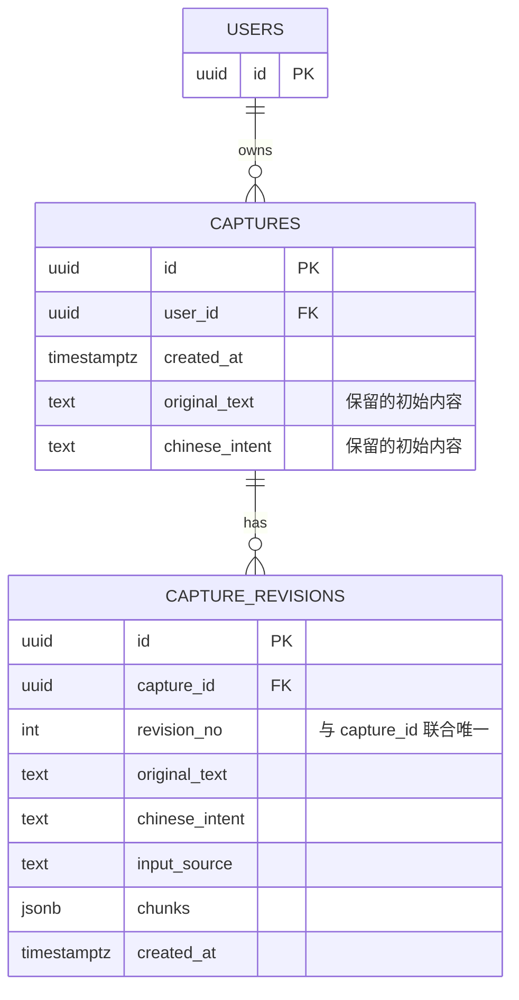

图中的数据库外键允许一条 Capture 暂时没有修订，表示实际约束的能力；本章迁移核对和创建路径共同建立“每条记录至少有一个修订”的应用不变量。不要把图上画成一对多，理解成 PostgreSQL 自动要求父表至少有一行子表。外键检查的是子行能否找到父行。

### 为什么保留两个 ID 和一个序号

Capture ID 用于稳定路由、归属和未来的整条记录操作。Revision ID 可被候选引用，明确绑定一个不会随当前内容变化而改变的快照。`revision_no` 则用来表达同一记录内的顺序，例如 1、2、3；不同 Capture 都可以有自己的第 1 版。

因此候选键是 `(capture_id, revision_no)`，不是 `revision_no` 单独唯一，也不是 `(user_id, original_text)`。同一用户完全可能在不同上下文中记录相同文字；用内容唯一会把业务去重偷偷加入模型。修订表也不复制 `user_id`：归属目前通过 Capture 得到，复制以后就必须额外保证两份归属永远相同。后面所有历史查询仍先约束父记录的用户，不能因为子表没有 user_id 就省略权限范围。

序号也不由时间戳替代。两次写入可以落在同一毫秒，时钟有精度和校准问题，`CURRENT_TIMESTAMP` 还是当前事务的起始时间，不能拿最大时间证明最后提交。UUID 是身份，本章也不依赖其排序表达业务顺序。最新修订明确使用本记录最大的序号。

当前不增加 `current_revision_id`。查询时按序号取一条，省去“插入历史后还要更新当前指针”的第二份状态。以后出现正式采纳、回退选择或读性能需求，再根据具体规则设计指针及其一致性。读取变复杂是当前取舍的成本；少一个字段并不是永远更好的模型。

### 快照中的重复，为什么不是设计错误

第三版可能只修改意图，原文却与第二版相同。把原文再保存一次，看起来重复，但它表达的是“第三版当时的完整输入”，不是两份声称代表同一可变事实的当前值。查询任何一版都能独立解释，代价是存储随修订数量增加。

只保存差量可以减少部分重复，却要求明确差量格式、应用顺序、基础版本和字段删除语义。缺一段差量、修改差量解释规则，都会影响后面的重建。这里文本短、需要按版直接查询，完整快照更简单。若以后保存大文件，可能改成不可变对象引用，而不是在每一版重复存文件字节；不能把现在的选择机械外推。

旧 `captures.original_text/chinese_intent` 暂时保留，含义固定为迁移时或新建时的初始内容，用于核对和兼容迁移期间的旧结构。切换之后它们不再是当前内容，也不跟随新修订更新。数据库暂存了有意的过渡冗余，我们必须标明其生命周期，不能让两处都成为事实来源。

### Prisma 表达关系，SQL 表达完整约束

在 `prisma/schema.prisma` 的 Capture 加入 `revisions CaptureRevision[]`，新增模型的关键部分如下；已有 Capture 列和 User 关系全部保留：

```prisma
model CaptureRevision {
  id            String   @id(map: "capture_revisions_pkey") @db.Uuid
  captureId     String   @map("capture_id") @db.Uuid
  revisionNo    Int      @map("revision_no")
  originalText  String   @map("original_text") @db.Text
  chineseIntent String?  @map("chinese_intent") @db.Text
  inputSource   String   @map("input_source") @db.Text
  chunks        Json?    @db.JsonB
  createdAt     DateTime @default(now()) @map("created_at") @db.Timestamptz(3)
  capture       Capture  @relation(fields: [captureId], references: [id], onDelete: Restrict, onUpdate: Restrict, map: "capture_revisions_capture_id_fkey")

  @@unique([captureId, revisionNo], map: "capture_revisions_capture_no_key")
  @@map("capture_revisions")
}
```

唯一约束建立的联合 B-tree 索引既维护序号唯一，也能为按 capture_id 找修订、按序号排列提供访问路径；无需机械再加一个完全同列索引。具体执行计划在第三十五章继续研究。删除仍选 RESTRICT：目前没有“删除记录并清理全部关联事实”的业务，不用 CASCADE 先替未来作出决定。

来源和 chunks 的取舍在 25.5 展开。先知道迁移旧行时来源是 `unknown`、chunks 是 SQL NULL；新手工输入来源为 `manual`。这些值是有含义的约定，不从旧文本内容猜测来源。

## 25.3 停写、回填、核对，再切换读取

这次变化与前章只放宽 CHECK 不同。旧程序只写 captures，新程序只向修订表追加。如果先回填再允许旧程序继续 PATCH，后续改动只留在旧列，新程序会读到过期快照。数据库结构兼容，不代表写入协议兼容。

本章采用有停写窗口的切换，适合当前单服务和少量开发数据：停止 API 和旧产物，确认没有维护脚本或 DBeaver 网格在修改这两张业务表，完成扩表和回填，核对后启动新服务。不是零停机方案。若业务不能停写，需要先建立所有写入口的过渡协议、增量追赶和最后的切换门槛；只说“临时双写”没有解决双写部分成功的问题。

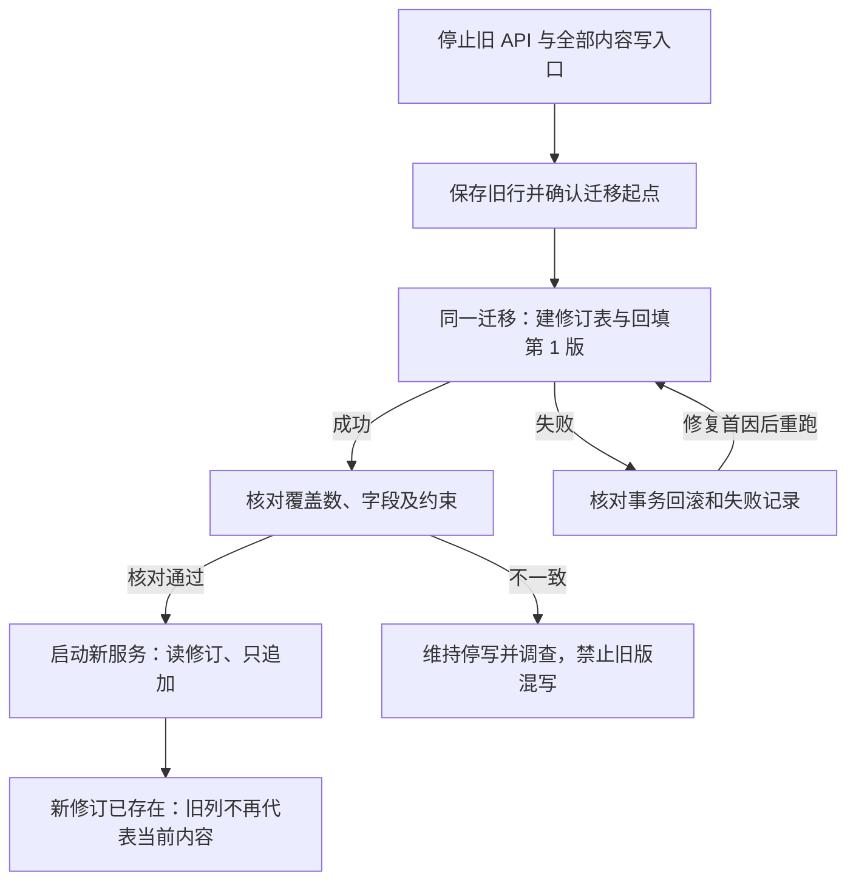

### 冻结的到底是什么

在 DBeaver DEV 的 SQL 编辑器先执行：

```sql
SELECT current_database(), current_user, inet_server_addr(), inet_server_port();
SELECT id, user_id, original_text, chinese_intent, created_at
FROM public.captures ORDER BY created_at, id;
```

确认是日常库，导出结果到受控的本机位置，用于之后逐字段核对。这里沿用前章导出操作，不把包含实际内容的导出加入代码仓库。旧记录为 null 的意图继续保留 null；原文中的空格、原来的 Capture 创建时间与归属都不能改变。

“冻结写入”也包括第二十四章为了对照而启动的 A/B/C 实例。停止当前 dev 并不意味着端口 3001 的旧产物也退出。DBeaver 中未提交的事务应在原编辑器明确提交或回滚；Disconnect 不是数据库停止，也不是完整的发布措施。

### 先备份，再在另一个库恢复一次

前面导出的查询结果便于逐字段比较，但没有表定义、约束和迁移历史，不能拿它重建一个完整的库。这里使用 PostgreSQL 自带的 `pg_dump`，把当前一个数据库的结构和数据保存为归档文件；`pg_restore` 读取这个归档，向指定的空库恢复。归档包括 `_prisma_migrations`，不包含数据库外的角色、密码、服务配置或程序。我们在同一学习实例使用已经建立的 epp_owner；跨实例恢复还需要另行准备角色与权限。

先在仍为第二十四章结构的 VERIFY 完成一次恢复练习。按前文停止全部写入者、结束未提交事务；在 DBeaver 执行 `database/chapter-22/00-verify-samples.sql`，先单独核对连接查询，再执行事务，保存两条虚构样本的全部返回字段。固定 ID 已存在时先查询复用，不重复插入。若 VERIFY 已升级且没有旧备份，按本节末尾建立独立旧结构样本库，不清空现有库。

在终端检查客户端：

```bash
pg_dump --version
pg_restore --version
```

两者应为 18.x。找不到命令或版本不对时，回到[环境准备的 PostgreSQL 安装与 PATH](../../environment-setup.md#homebrew-与数据库程序)，同一个 bin 目录也提供这两个工具。数据库服务器已经运行，不表示客户端工具在当前 PATH 中。

在 DBeaver 核对 VERIFY 的实际库名、端口和角色。本书默认库名是 `epp_migration_check`；若自己改过名字，替换下面源库名。不要把连接显示名称当作库名。

```bash
umask 077
backup_dir=$(mktemp -d "$HOME/epp-backup-XXXXXX")
pg_dump -h 127.0.0.1 -p 55432 -U epp_owner -W \
  -d epp_migration_check --format=custom --file="$backup_dir/before.dump"
```

`-W` 会在终端提示输入数据库密码，不把密码写进命令历史。`--format=custom` 保存 pg_restore 可读的归档。只在 pg_dump 成功退出、没有未处理告警后继续；失败生成的文件不能当作备份。`umask 077` 让新文件只供本机当前账号访问，目录放在代码仓库外；归档仍含完整原文，需要按原数据保护。记下准确路径和源库、章节、备份时间，重开终端后先恢复 backup_dir 的值，不重新猜文件。

在 DBeaver 切到第二十章使用的**管理连接**，目标为 postgres，开启自动提交，单独执行：

```sql
CREATE DATABASE epp_ch21_restore OWNER epp_owner;
```

这个库名必须尚不存在。已存在就先识别用途，为本次选一个新名字，不 DROP、不覆盖。创建后，按第二十章方式复制连接，数据库改为 epp_ch21_restore、角色仍为 epp_owner；在新连接执行身份查询并确认没有业务表。不要在它上面先运行迁移或 seed，恢复工具会建立归档中的对象。

```bash
pg_restore -h 127.0.0.1 -p 55432 -U epp_owner -W \
  -d epp_ch21_restore --single-transaction --exit-on-error \
  --no-owner --no-privileges "$backup_dir/before.dump"
```

`-d` 是恢复目标；这里没有 `--create`，不会按归档里的原库名另选目标。单事务让本次恢复整体成功或回滚，遇错立即停止；`--no-owner --no-privileges` 让对象由当前 epp_owner 建立，不搬运原库授权。这样适合本机同角色的小库练习，不等同还原生产访问控制。没有 `--clean`，因为我们不向已有业务库覆盖对象。

恢复成功后，分别在源 VERIFY 和新连接执行配套 `database/chapter-22/04-backup-check.sql`。先看身份结果，再比较 users、captures 的完整行和 `_prisma_migrations` 的迁移名、校验值及完成状态；两条样本的 ID、空格、NULL／非空意图与 created_at 都应保持。约束结果应仍有主键、外键和 CHECK。恢复后约束表达式的括号排版可能变化，应核对判断条件与拒绝行为，不以显示字符串逐字相等为标准。只看到恢复命令退出 0，或只比较总行数，都不能证明关键内容完整。

确认恢复正确后，把第 25 章项目 `.env.database-verify` 的 DATABASE_URL **仅数据库名改为 epp_ch21_restore**，保留原主机、角色及个人密码；API 的 `.env` 先不改，也不启动旧服务向恢复库写入。后文先在这个恢复库部署第 25 章迁移，DBeaver 同样选它。这就把“恢复了旧结构”继续验证到“旧数据能升级”。原 VERIFY 保留作为对照。修改连接后按下一段的 unset 清除继承变量，避免命令仍连旧目标。

真正升级 DEV 前也按同样次序停止写入，以 DEV 为源重新备份，在另一个全新恢复库验证；VERIFY 的归档不能替代 DEV 的备份。pg_dump 取得的是一致快照，不会持续收集备份以后发生的写入；若升级后已经接收新记录，直接退回这份旧快照会丢掉那段新数据。此时维持停写并选择保留新数据的修复方案，不能把“能恢复归档”当成自动无损回退。长期备份、异机保存和按时间恢复在运维篇继续展开。

**已经升级、又没有第二十四章归档时**，这轮只能重新建立虚构的旧结构实验，不能重现自己的历史数据。用管理连接在自动提交下执行 `CREATE DATABASE epp_ch21_replay OWNER epp_owner;`，名称已存在则另选。另取第二十四章代码：

```bash
git clone --single-branch --branch part-03/chapter-24 \
  https://github.com/SamChowRock/epp-public.git ../epp-ch21-replay
cd ../epp-ch21-replay
nvm use
npm ci
```

在这个目录按第二十章方法由 `database/chapter-18/database.env.example` 新建 `.env.database`，填写自己的密码，DATABASE_URL 只指向 epp_ch21_replay。清除终端旧变量后执行 `npm run db -- migrate deploy`，在 DBeaver 的新连接核对迁移已到第二十四章，再执行上面的两条虚构样本脚本。现在用 epp_ch21_replay 作为 pg_dump 源库，按同样步骤恢复到另一个新库；回到第 25 章代码目录，把 `.env.database-verify` 指向恢复库再继续。切换代码或克隆完成不会改变原来的 DEV／VERIFY。

### 为旧行生成的第 1 版，只能代表已知现状

旧系统可能已经覆盖过十次意图，我们只能看到最后一次留下的值。因此迁移生成的第 1 版表示“从开始记录修订时观察到的内容”，不能称为“用户最初输入”。它的修订时间用迁移事务时间，Capture 的创建时间仍保留原值。来源未知、chunks 未知，不能填成手工输入和空数组来伪造过去的事实。

在修改 Schema 后，从前章逐步实现的读者运行：

```bash
unset DATABASE_URL SHADOW_DATABASE_URL
npm run db -- migrate dev --name capture_revisions --create-only
```

审查草稿，在首次成功应用前加入事务、有限超时、约束及回填。使用本章成品时已有 `20261102100000_capture_revisions`，不要再生成一份相同迁移。以下是迁移的完整内容；CHECK 延续旧字段的数据库底线，完整的 UTF-16、空白和 chunks 元素规则仍由应用校验，不借回填偷偷收紧旧数据：

```sql
BEGIN;
SET LOCAL lock_timeout = '2s';
SET LOCAL statement_timeout = '10s';
LOCK TABLE public.captures IN SHARE ROW EXCLUSIVE MODE;
CREATE TABLE public.capture_revisions (
  id uuid CONSTRAINT capture_revisions_pkey PRIMARY KEY,
  capture_id uuid NOT NULL,
  revision_no integer NOT NULL,
  original_text text NOT NULL,
  chinese_intent text,
  input_source text NOT NULL,
  chunks jsonb,
  created_at timestamptz(3) NOT NULL DEFAULT CURRENT_TIMESTAMP,
  CONSTRAINT capture_revisions_capture_id_fkey FOREIGN KEY (capture_id)
    REFERENCES public.captures(id) ON DELETE RESTRICT ON UPDATE RESTRICT,
  CONSTRAINT capture_revisions_capture_no_key UNIQUE (capture_id, revision_no),
  CONSTRAINT capture_revisions_no_positive CHECK (revision_no > 0),
  CONSTRAINT capture_revisions_original_nonempty CHECK (char_length(original_text) > 0),
  CONSTRAINT capture_revisions_intent_shape CHECK (chinese_intent IS NULL OR
    (char_length(chinese_intent) BETWEEN 1 AND 2000 AND btrim(chinese_intent) <> '')),
  CONSTRAINT capture_revisions_source CHECK (input_source IN ('manual', 'unknown')),
  CONSTRAINT capture_revisions_chunks_shape CHECK (
    chunks IS NULL OR CASE WHEN jsonb_typeof(chunks) = 'array'
      THEN jsonb_array_length(chunks) <= 25 ELSE false END)
);
INSERT INTO public.capture_revisions
  (id, capture_id, revision_no, original_text, chinese_intent, input_source, chunks, created_at)
SELECT id, id, 1, original_text, chinese_intent, 'unknown', NULL, CURRENT_TIMESTAMP
FROM public.captures;
DO $$
BEGIN
  IF EXISTS (
    SELECT 1 FROM public.captures c LEFT JOIN public.capture_revisions r
      ON r.capture_id = c.id AND r.revision_no = 1
    WHERE r.id IS NULL OR r.original_text IS DISTINCT FROM c.original_text
      OR r.chinese_intent IS DISTINCT FROM c.chinese_intent
  ) THEN RAISE EXCEPTION 'Revision backfill mismatch'; END IF;
END $$;
COMMIT;
```

表锁会阻止并发写 captures，允许普通读取；等待已有写事务超过期限会失败。它只保护本次迁移期间，COMMIT 后就释放，不能代替停掉旧写入者。当前数据量少，把建表、回填和核对放在一个有界事务里，失败则一起回滚；数据量大时需要按第二十三章支线拆分可恢复回填，不能照搬十秒限制并无限调大。

旧 Capture ID 在第 1 版回填时也用作 Revision ID。两个表分别有主键命名空间，因此不冲突；这是让本次回填映射直观、可核对的办法，不表示以后可以互换两类 ID。新建记录和后续修订都生成各自的 UUID，不依赖相等关系。

`IS DISTINCT FROM` 用于比较包含 NULL 的值：两边都 NULL 认为没有变化，一边 NULL 一边字符串认为不同。普通 `<>` 在有 NULL 时得到未知，会漏掉本来想报告的差异。DO 块在迁移内部发现差异就抛错，让整个事务不能成功提交；迁移工具的“完成”不能早于业务核对。

在 DBeaver 打开上面已恢复并核对过的独立库。后文称它为本轮 VERIFY；确认 `.env.database-verify` 与图形连接都指向它。两条旧样本已随归档恢复，不再重复插入；使用备份前保存的结果作迁移后逐字段比较。若中断后发现它已经升级，先核对迁移记录与旧行，不再回填；要重做则从原归档恢复到另一个新库。

先只部署到 VERIFY。清除终端继承的连接变量，让命令读取本章的验证库配置。

```bash
unset DATABASE_URL SHADOW_DATABASE_URL
npm run db:verify -- migrate deploy
npm run db:verify -- migrate status
npm run db:verify -- migrate diff --from-config-datasource --to-schema prisma/schema.prisma --exit-code
```

### 数量对了，还要核对什么

留在 VERIFY 连接，先用两个样本 ID 查 captures，对照刚才保存的 ID、归属、原文、意图和创建时间。再在 capture_revisions 按这两个 capture_id 筛选，各应有一个第 1 版，原文和意图逐字一致，input_source 为 unknown，chunks 为 SQL NULL。

DBeaver 刷新 public → Tables，找到 `capture_revisions`，在 Properties 的 Columns、Constraints／Foreign Keys 和 Indexes 中核对列类型、联合唯一和 RESTRICT；在 ER Diagram 中同时选择 captures 与修订表，确认外键连向 captures.id。打开 Data 页按 capture_id 筛选，看同一记录的多版，不直接编辑历史网格。用 SQL 编辑器执行配套 `database/chapter-22/01-inspect.sql`，保存核对结果。

```sql
SELECT count(*) AS captures, count(r.id) AS initial_revisions,
       count(*) FILTER (WHERE r.id IS NULL) AS missing_initial
FROM public.captures c LEFT JOIN public.capture_revisions r
  ON r.capture_id = c.id AND r.revision_no = 1;

SELECT c.id FROM public.captures c LEFT JOIN public.capture_revisions r
  ON r.capture_id = c.id AND r.revision_no = 1
WHERE r.id IS NULL OR c.original_text IS DISTINCT FROM r.original_text
  OR c.chinese_intent IS DISTINCT FROM r.chinese_intent;
```

第一项要覆盖所有父记录，第二项要没有差异。总修订数等于 Capture 数，只在尚未追加其他版本时成立；之后要比较“第 1 版数量”，不能把正常新增版本误判成重复回填。另与迁移前导出核对 Capture 的全部旧字段，确认旧列确实没改；只比较两张已经改过的表，不能证明原值被保留。`migrate diff` 不覆盖所有 CHECK，仍用 `pg_get_constraintdef` 查看完整定义。

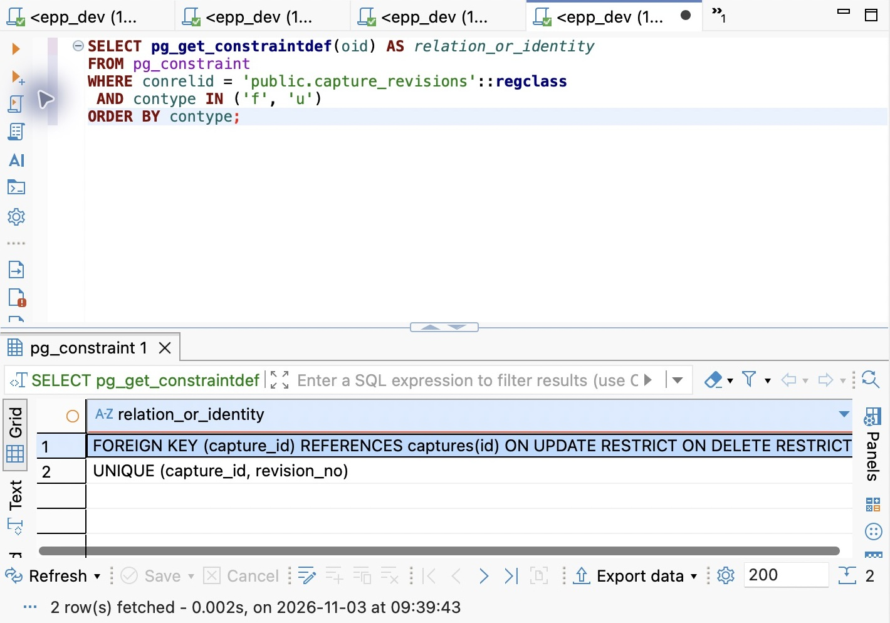

图中将 pg_constraint 筛选为外键和唯一约束：第一行把 capture_id 指向 captures.id，更新、删除均为 RESTRICT；第二行约束同一 capture_id 的 revision_no 不重复。它核对的是数据库现场定义，不是仅在 Prisma Schema 中写下的意图；CHECK 仍需另查。

只有 VERIFY 的迁移状态、结构差异和旧行核对都通过，再升级已停写的 DEV。随后在 DBeaver 切回 DEV，重复上面的覆盖数、字段和约束检查，用本节开头保存的 DEV 导出逐行对照。

```bash
unset DATABASE_URL SHADOW_DATABASE_URL
npm run db -- migrate deploy
npm run db -- migrate status
npm run db -- migrate diff --from-config-datasource --to-schema prisma/schema.prisma --exit-code
npm run prisma:generate
npm run check
```

迁移失败时先看第一个错误。等锁超时就找到持锁事务，由原操作方结束；字段约束失败则定位原行和规则，不能删掉原行只为让迁移通过。此迁移显式 BEGIN，连接退出后应回滚，但仍核对 `to_regclass('public.capture_revisions')` 和失败历史再处理。确认所有动作已回滚、根因已处理后，用实际迁移名执行 `migrate resolve --rolled-back`，再 deploy。它只登记失败尝试的处理，不负责撤销 SQL。成功迁移不再编辑文件；后续发现业务差异用追加修复处理。

这里可以暂停：结构和回填已完成、写入仍关闭。记下两个库的迁移状态和核对结果。下次先确认有没有旧写入口复活，再继续切换；不要先启动第二十四章服务“临时用一下”。

## 25.4 追加修订，并让所有读路径理解最新内容

迁移只解决旧数据起点，运行代码还需要同时改变创建、修改、读取和接口边界。完成分支是 `part-04/chapter-25`；下面按职责解释关键实现，不把“表建好了”当作功能已经存在。

### 先把完整快照变成明确的请求契约

新增 `POST /captures/:id/revisions`，接收完整内容，返回本次保存的修订，成功状态 201。新增 `GET /captures/:id/revisions`，按序号倒序读取历史。已有创建、详情、列表与 PATCH 保留路径和响应形状。详情中的 `id`、`createdAt` 始终来自 Capture；原文和意图来自最新修订。需要修订 ID、序号和修订时间时查询历史。

`src/capture-revision.ts` 定义存储与服务共同使用的结果形状：

```ts
export type InputChunk = { text: string };
export type RevisionContent = {
  originalText: string;
  chineseIntent: string | null;
  inputSource: 'manual' | 'unknown';
  chunks: InputChunk[] | null;
};
export type CaptureRevision = RevisionContent & {
  id: string;
  captureId: string;
  revisionNo: number;
  createdAt: string;
};
export type RevisionPage = { items: CaptureRevision[]; nextBefore: number | null };
```

写入 Schema 不允许客户端提交 `unknown` 冒充迁移历史，也不允许指定 revisionNo、ID 和 createdAt。已有 `OriginalTextSchema`、`ChineseIntentSchema` 的规则复用，意图必须显式提供，保留 null 的语义。新增接口拒绝未知字段，避免拼错字段却被静默忽略；旧创建／PATCH 保留原有“忽略额外字段”的兼容约定：

```ts
export const ChunkSchema = z.object({
  text: z.string().refine(isPostgresText).regex(/\S/).max(200),
}).strict();
export const ChunksSchema = z.array(ChunkSchema).max(25).nullable();
export const AppendRevisionSchema = z.object({
  originalText: OriginalTextSchema,
  chineseIntent: ChineseIntentSchema.nullable(),
  inputSource: z.literal('manual').optional(),
  chunks: ChunksSchema.optional(),
}).strict();
```

Controller 的 SchemaPipe 提供字段级 400，Service 再通过同一 Schema 检查非 HTTP 调用。`appendRevision` 把省略的来源变为 manual、chunks 变为 null，调用 Store；父记录不存在则沿用 `CaptureNotFoundError`。响应 Schema 明确列出修订字段、允许读取 unknown、约束序号为正整数且不超过 PostgreSQL integer 上限，日期转成 ISO 字符串。查询历史与写入响应都挂上 ResponseSchemaInterceptor，不直接把 ORM 关系对象透传给外部。

`src/capture-contract.ts` 接着增加输出和查询 Schema，不能只声明 TypeScript 类型就认为外部值已经验证：

```ts
export const RevisionResponseSchema = z.object({
  id: z.uuid(), captureId: z.uuid(),
  revisionNo: z.number().int().positive().max(2147483647),
  originalText: OriginalTextSchema,
  chineseIntent: StoredChineseIntentSchema.nullable(),
  inputSource: z.enum(['manual', 'unknown']), chunks: ChunksSchema,
  createdAt: z.iso.datetime(),
});
export const RevisionPageSchema = z.object({
  items: z.array(RevisionResponseSchema),
  nextBefore: z.number().int().positive().nullable(),
});
export const RevisionQuerySchema = z.object({
  before: z.string().regex(/^[1-9]\d{0,9}$/)
    .refine(v => Number(v) <= 2147483647).optional(),
  limit: z.string().regex(/^(?:[1-9]\d?|100)$/).optional(),
}).strict();
```

Service 的新写入方法先完整解析，再给省略字段赋予含义，不从旧列拼出半份快照：

```ts
async appendRevision(id: string, input: unknown): Promise<CaptureRevision> {
  const parsed = AppendRevisionSchema.safeParse(input);
  if (!parsed.success) throw new InvalidCaptureError('Invalid revision content');
  const content = { ...parsed.data, inputSource: 'manual' as const,
    chunks: parsed.data.chunks ?? null };
  const revision = await this.store.appendRevision(id, content);
  if (!revision) throw new CaptureNotFoundError('Capture not found');
  return revision;
}
```

CaptureStore 增加两个方法，既有方法保持名称：

```ts
appendRevision(id: string, content: RevisionContent): Promise<CaptureRevision | undefined>;
revisions(id: string, before: number | undefined, take: number): Promise<CaptureRevision[] | undefined>;
```

ObservedCaptureStore 对这两个方法继续使用已有 `call()` 包装，保留工作追踪、耗时和安全日志；MemoryCaptureStore 也改成保存快照并返回深拷贝，避免章节里的手动组装示例失去同一契约。内存实现不能证明数据库并发正确，但接口变更后也不能留下一个没有历史的假替代实现。

### 创建记录时，不能留下没有第 1 版的父行

如果先 `capture.create()`，再独立 `captureRevision.create()`，第二步失败会留下空壳 Capture。我们还没有进入完整事务章节，也不能故意把这个漏洞留给后面。新建路径使用 Prisma 的关系嵌套写入，让父行和第 1 版一起成功或一起失败：

```ts
await this.database.run('insert', () => this.database.client.capture.create({
  data: { id: capture.id, userId: DEVELOPMENT_USER_ID,
    originalText: capture.originalText, chineseIntent: capture.chineseIntent,
    createdAt: new Date(capture.createdAt),
    revisions: { create: { id: randomUUID(), revisionNo: 1,
      originalText: capture.originalText, chineseIntent: capture.chineseIntent,
      inputSource: 'manual', chunks: Prisma.DbNull,
      createdAt: new Date(capture.createdAt) } } },
  select: { id: true },
}));
```

嵌套写入是 Prisma 提供的事务能力，不是两条普通 await 恰好写在一起。原子性在这里负责这个已知的创建动作，第二十七章再从采纳需求展开多次业务写入、隔离与失败。创建时旧列保存初始副本，之后不更新；原有 `POST /captures` 不接收 chunks，需要带 chunks 的完整快照走追加接口。

应用启动还要检查新表的列存在，并查询是否有 `revisions: { none: {} }` 的 Capture。发现空壳时拒绝就绪，先调查迁移或绕过应用的写入，不能一边记录 database.ready 一边让列表悄悄漏掉数据。这个启动检查不替代写入不变量，也不防止管理员在启动后删除历史。

### 用一条追加语句连接“从哪一版继续”和“插入什么”

追加只写修订表，不更新 Capture 或当前指针。先根据父记录 ID 与固定用户选中一条记录，再取得其最大序号，然后插入加一后的快照。不要让客户端给序号，也不要在 JS 内先查最大值、隔很久再拼接 SQL。

`src/prisma-capture.store.ts` 的共享私有方法 `writeRevision` 同时服务新 POST 和旧 PATCH。它把完整输入与“只改意图”区分开，动态选择固定的 SQL 片段；用户的实际字符串仍全部参数化：

```ts
const full = 'originalText' in change;
const original = full ? Prisma.sql`${change.originalText}::text` : Prisma.sql`original_text`;
const source = full ? Prisma.sql`${change.inputSource}::text` : Prisma.sql`input_source`;
const chunks = full
  ? Prisma.sql`${change.chunks === null ? null : JSON.stringify(change.chunks)}::jsonb`
  : Prisma.sql`chunks`;
```

完整请求插入提交的内容；PATCH 的三个固定列引用从数据库读到的上一版继承。读下面这条 SQL 时，可以先看两个名字。`WITH` 给同一条语句里的中间结果起名。先看 `previous`，它为这条输入找出上一版；其中 `LATERAL` 让右边的小查询能用左边当前输入的 ID。再看 `inserted`，它用 `RETURNING` 取回这次真正插入的行。最后的 SELECT 把两份结果放在一起，应用据此判断本次追加是否成功。`revisionColumns` 列出返回给应用的修订字段。

```ts
const revisionColumns = Prisma.sql`r.id, r.capture_id AS "captureId", r.revision_no AS "revisionNo",
  r.original_text AS "originalText", r.chinese_intent AS "chineseIntent",
  r.input_source AS "inputSource", r.chunks, r.created_at AS "createdAt"`;

const statement = Prisma.sql`
  WITH previous AS (
    SELECT c.id AS capture_id, c.created_at AS parent_created_at, latest.*
    FROM public.captures c
    LEFT JOIN LATERAL (
      SELECT revision_no, original_text, chinese_intent, input_source, chunks
      FROM public.capture_revisions WHERE capture_id = c.id
      ORDER BY revision_no DESC LIMIT 1
    ) latest ON true
    WHERE c.id = ${id}::uuid AND c.user_id = ${DEVELOPMENT_USER_ID}::uuid
  ), inserted AS (
    INSERT INTO public.capture_revisions
      (id, capture_id, revision_no, original_text, chinese_intent, input_source, chunks)
    SELECT ${randomUUID()}::uuid, capture_id, revision_no + 1, ${original},
      ${change.chineseIntent}::text, ${source}, ${chunks}
    FROM previous WHERE revision_no IS NOT NULL
    ON CONFLICT (capture_id, revision_no) DO NOTHING
    RETURNING *
  )
  SELECT p.parent_created_at AS "parentCreatedAt", p.revision_no AS "previousNo", ${revisionColumns}
  FROM previous p LEFT JOIN inserted r ON true
`;
```

为最后 SELECT 的结果明确类型，再执行 statement。左连接的 id 可能为 null，必须先经过下面的结果分支才能把其他修订字段当作真实内容；泛型只是 TypeScript 声明，不替代数据库约束与公开响应校验：

```ts
type AppendRow = Omit<CaptureRevision, 'id' | 'createdAt'> & {
  id: string | null;
  createdAt: Date;
  parentCreatedAt: Date;
  previousNo: number | null;
};
const rows = await this.database.run('appendRevision', () =>
  this.database.client.$queryRaw<AppendRow[]>(statement));
```

SQL 时间返回 Date，分别用 `toISOString()` 转成公开字符串。配套源码把 statement 直接写在同一 `$queryRaw` 调用内，参数化行为相同。

数据库在这一条语句里为每条父记录选取最多一版。这里左连接保留“父记录存在但没有修订”的异常状态。previous 是本条语句看到的前提，inserted 是实际插入的结果；读取新行使用 RETURNING 输出，不再从基础表重查、期待同一语句的其他部分看见自己的写入。

真正防止同一记录出现两个第 3 版的是联合唯一约束。两条语句都可能看到第 2 版并尝试插入 3；把查询和写入写在同一个 SQL 文本里，并没有自动给整个业务排队。`ON CONFLICT (capture_id, revision_no) DO NOTHING` 只跳过这个已明确的冲突，不覆盖对方的内容，也不把所有错误都吞掉。

结果的三种空值需要分别解释。方法先验证 ID 是规范的小写 UUID；非法或未命中的 ID 返回 undefined。查询有父行但 previousNo 是 null，属于历史不变量损坏，返回内部存储失败。previousNo 存在而新修订 id 是 null，表示序号竞争，没有插入本次内容：

```ts
const row = rows[0];
if (!row) return undefined;
if (row.previousNo === null) throw new StorageFailureError();
if (row.id === null) throw new RevisionConflictError();
```

这些判断在 `database.run` 返回之后做，避免业务冲突被数据库通用错误包装成 500。新增 `RevisionConflictError` 在 `httpFailure` 映射为 409／`REVISION_CONFLICT`。HTTP 调用方先重新读取内容，再决定重新提交；服务端不自动重试完整快照，因为用户可能仍基于过期页面编辑。发生等锁或连接超时仍沿用 503，未知写入结果继续先查事实，不以自动重发制造重复版本。

成功时用返回行组装两种结果：新 POST 得到修订对象；旧 PATCH 得到 `{ id, originalText, chineseIntent, createdAt }`，其中 createdAt 使用 parentCreatedAt。不要在插入后再 GET 最新一版作为“本次返回值”：另一请求可能已经追加下一版，客户端会误以为自己提交的是别人刚保存的内容。

### 详情、列表和搜索必须一起切换

详情用 Prisma 读取父记录的 id、createdAt，再选择 `revisions: { orderBy: { revisionNo: 'desc' }, take: 1 }` 的内容。明确投影，不展开旧 originalText/chineseIntent，否则极容易让旧字段覆盖新值。

列表使用相同的“先选最新，再筛选”语义，保留原来的 Capture 创建时间和 ID 升序。下面展示无搜索条件时的核心 SQL，配套实现用 Prisma.sql 参数化用户和 q，原来的 limit 在筛选与排序之后应用：

```sql
SELECT c.id, c.created_at, r.original_text, r.chinese_intent
FROM public.captures c
JOIN LATERAL (
  SELECT original_text, chinese_intent FROM public.capture_revisions
  WHERE capture_id = c.id ORDER BY revision_no DESC LIMIT 1
) r ON true
WHERE c.user_id = '10000000-0000-4000-8000-000000000001'::uuid
ORDER BY c.created_at, c.id;
```

这里使用 `src/database-config.ts` 的固定开发用户 ID；若调整过演示身份，就一起替换。不能因为 SQL 返回零行就判断迁移失败。q 在外层用 `strpos(r.original_text COLLATE "C", 参数) > 0` 判断最新原文，不搜索历史。如果把这个条件放进 LATERAL 内部，含义就变成“找最新一条曾经匹配 q 的历史”，旧词即使已经改掉也会命中。配套 `03-content-choice.sql` 用只读 VALUES 对照这两种问题，直接在 DBeaver 运行即可。

普通 `captures JOIN capture_revisions` 得到一行一版，用于历史；加上每个父记录取一版，才得到一行一条 Capture。不能先随意 JOIN 再全局 LIMIT 20，否则同一记录的 20 个版本可能占满列表。这是第十九章结果粒度问题在新关系中的继续应用。

### 历史要能完整读完，又不能一次返回无限版本

历史默认取 20 条，最多 100 条，倒序排列。请求允许 `before`，表示只取小于该序号的版本。例如第一页得到 6、5，下一页带 `before=5`，得到 4、3。它只在同一条 Capture 内使用，序号不变，追加 7 不会让第二页重复 5。

这是一种范围分页，本章先为历史提供必要的有界入口；第三十三章再完整展开跨记录排序、Cursor、条件绑定与时间问题。这里不需要对一个序号做签名来证明权限，权限来自每次查询父记录的用户条件。修改 before 最多改变浏览范围，不能越过归属条件。

Service 请求 `limit + 1` 条，多取的一条用于判断是否还有历史：

```ts
const rows = await this.store.revisions(id, before, limit + 1);
if (!rows) throw new CaptureNotFoundError('Capture not found');
const items = rows.slice(0, limit);
return { items, nextBefore: rows.length > limit ? items.at(-1)!.revisionNo : null };
```

参数先经过严格 Schema：before 为正十进制整数字符串且不超过 2147483647，limit 为 1～100，拒绝重复参数、未知键、小数、负数和前导零；Service 同样检查数字形状。Store 先按 ID 与用户选父记录，再嵌套读取满足 revisionNo 条件的历史，倒序 take。已有记录没有更早版本返回 200 和空数组；父记录不存在返回 404，两者不能混为一谈。以后若允许维护操作删除历史，范围分页仍可跨过空号，但历史完整性的承诺需要重新设计。

### 接上框架入口，再观察实际行为

Controller 增加 `@Post(':id/revisions')` 与 `@Get(':id/revisions')`，分别使用上述输入／查询 SchemaPipe 和响应 Interceptor；Nest 的 POST 默认成功状态为 201。`src/http-boundary.ts` 也必须接纳 `/captures/一个路径段/revisions` 的 GET、POST，否则请求在到 Controller 前就会被原有边界拦成 404。其他方法继续返回 405 和正确 Allow；含百分号的非字面 ID 路径沿用 404 语义。Body 解析继续经过 16 KiB、Content-Type 与 UTF-8 检查，不能为新接口绕开原有入口。

在 `src/captures.controller.ts` 中导入新增 Schema、`AppendRevisionInput` 和 `z` 类型，然后将下面两个方法加入原 Controller。保留原有四个方法：

```ts
@Post(':id/revisions')
@UseInterceptors(new ResponseSchemaInterceptor(RevisionResponseSchema))
appendRevision(
  @Param('id') id: string,
  @Body(new SchemaPipe(AppendRevisionSchema)) input: AppendRevisionInput,
) { return this.captures.appendRevision(id, input); }

@Get(':id/revisions')
@UseInterceptors(new ResponseSchemaInterceptor(RevisionPageSchema))
revisions(
  @Param('id') id: string,
  @Query(new SchemaPipe(RevisionQuerySchema)) query: z.infer<typeof RevisionQuerySchema>,
) {
  return this.captures.revisions(id,
    query.before === undefined ? undefined : Number(query.before),
    query.limit === undefined ? 20 : Number(query.limit));
}
```

`AppendRevisionInput` 在契约文件用 `z.infer<typeof AppendRevisionSchema>` 导出。边界文件在原 `detail` 匹配之后增加路径匹配，再调整 allowed；原百分号检查也扩展到这条新路径，其他错误处理不改：

```ts
const revisions = /^\/captures\/([^/]+)\/revisions$/.exec(url.pathname);
const allowed = url.pathname === '/captures' ? ['GET', 'POST']
  : detail ? ['GET', 'PATCH'] : revisions ? ['GET', 'POST'] : undefined;
// 保留原有 allowed 未命中与不支持方法的处理，然后检查字面 ID。
if ((detail?.[1] ?? revisions?.[1])?.includes('%')) {
  throw new HttpError(404, 'Capture not found', 'CAPTURE_NOT_FOUND');
}
```

`src/openapi.ts` 同步两个路径、输入／响应组件、历史参数和 PATCH 的新语义，版本改为 0.6.0，列出 409；既有 503 提醒改为“重试可能追加重复快照”。文档不只多两个 URL，还必须撤掉“没有修订历史”的旧描述。开发文档默认开，生产仍默认关。`src/request-observation.ts` 同步识别新路径，日志只记录固定标签 `/captures/:id/revisions`，不记录真实 ID、查询值或内容。

完成上述改动再 `npm run check`，随后 `npm run dev`；VS Code 继续使用已有 attach 配置，源码保存后自动编译并重启。数据库不会因重启清空，创建请求也不会自动重放。

Postman Import 本章 `requests/chapter-22.postman_collection.json`，确认集合 Variables 中的 baseUrl 指向当前服务。桌面版若处于 Local mode，可以从 Import 导入集合 JSON，再在 Local Items → Collections 中打开本章集合；直接浏览本地目录时出现的“Upgrade to v3”提示是另一条文件升级路径，不必为跟做本章批量转换旧章节集合。下面按请求名称逐项手动发送。

1. “01 新建本章演示记录”返回 201，集合脚本只在成功时保存 captureId，不发送下一条请求。打开 Variables 核对这个 ID，再发“02 初始修订”，看到第 1 版、manual 和 chunks:null。
2. “03 追加完整修订”发送新的原文、意图和一个 chunk，应返回第 2 版。发“04 详情”，ID 和 Capture 创建时间保持，原文与意图来自第 2 版。

   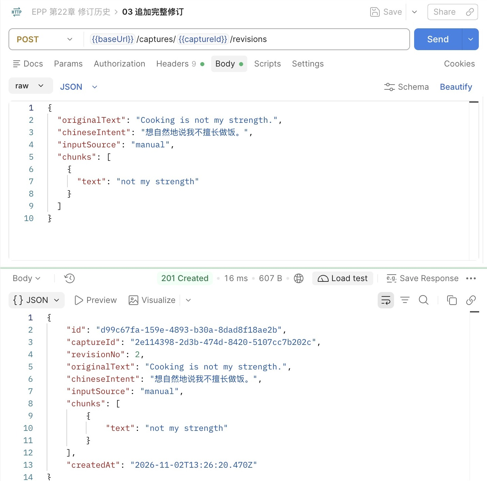

   上半区是发出的完整快照，下半区是实际响应。这里的 `id` 是这次新建的修订 ID，`captureId` 才是原记录 ID；`revisionNo:2`、`inputSource:"manual"` 和 chunks 应与本次写入对应。不要把修订的 createdAt 当成 Capture 最初的创建时间。

3. “05 旧 PATCH 清空意图并追加”返回 200。历史增加第 3 版，原文、来源和 chunks 继承第 2 版，意图为 null；前两版仍在，不被清空。

   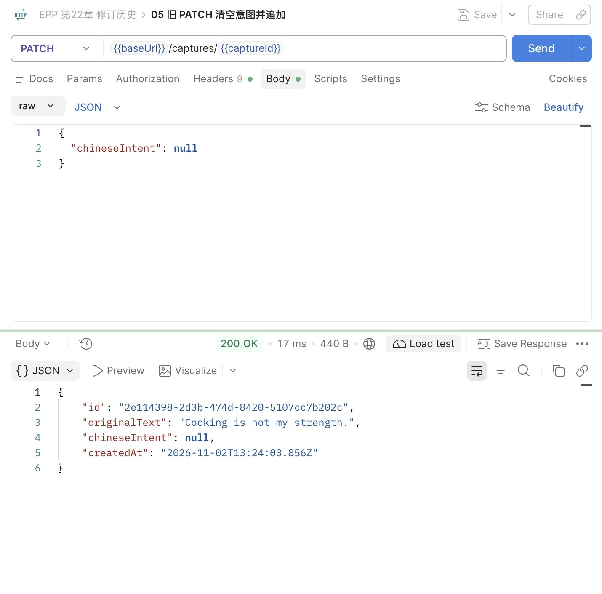

   这里仍返回兼容的 Capture 响应，因此 `id` 是记录 ID，且没有 revisionNo。看到 `chineseIntent:null` 只能确认当前内容已经清空；是否保留旧版，要继续查询历史，不能只靠这次 200 判断。

4. “06 历史第一页”用 limit=2，应看到 3、2。把响应 nextBefore 填进集合 before，再发“07 继续历史”，看到第 1 版及 nextBefore:null。不要写死示例序号：重复点过发送，当前最大号会不同。

   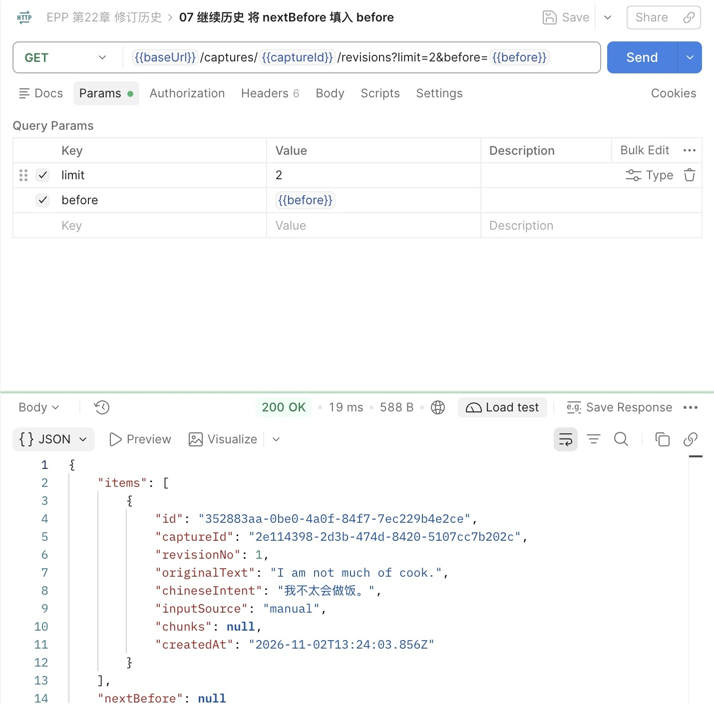

   本次 Variables 中 before 的值为 2，地址栏保留 `{{before}}` 引用。返回的第 1 版仍是最初的 “I am not much of cook.” 和原意图，说明清空最新意图没有回头修改这版。nextBefore 为 null 表示这次查询范围内没有更早的一页。

5. 依次发送缺失意图、空白原文、非法 chunks、非法历史参数和未知字段，观察 400；不存在的 ID 返回 404。

   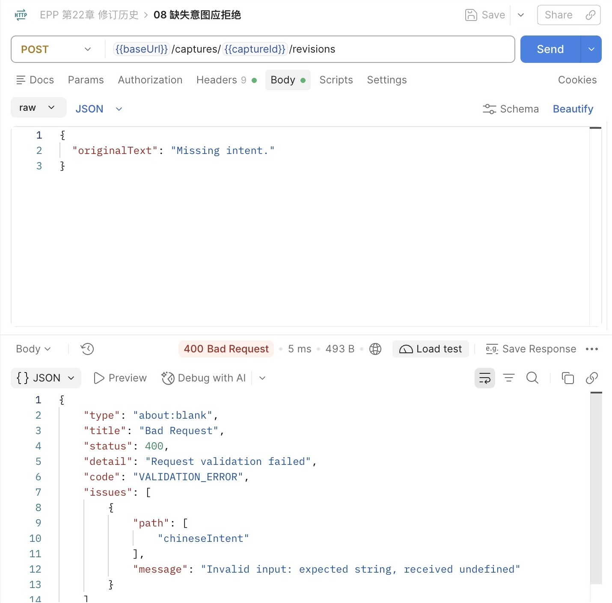

   图中只提供 originalText，`issues.path` 指向 chineseIntent。完整修订要求显式表达意图：没有意图应传 null，漏字段则拒绝。旧 PATCH 只提交意图，原文、来源和 chunks 从上一版继承；意图本身仍必填，传 null 才表示清空。两种入口都不能用省略意图代替明确决定。

   失败请求之后重新发送“02 初始修订”，同一个 GET 现在返回全部当前历史。展开响应筛选功能，输入 JSONPath `$.items[*].revisionNo`，可以只看序号：

   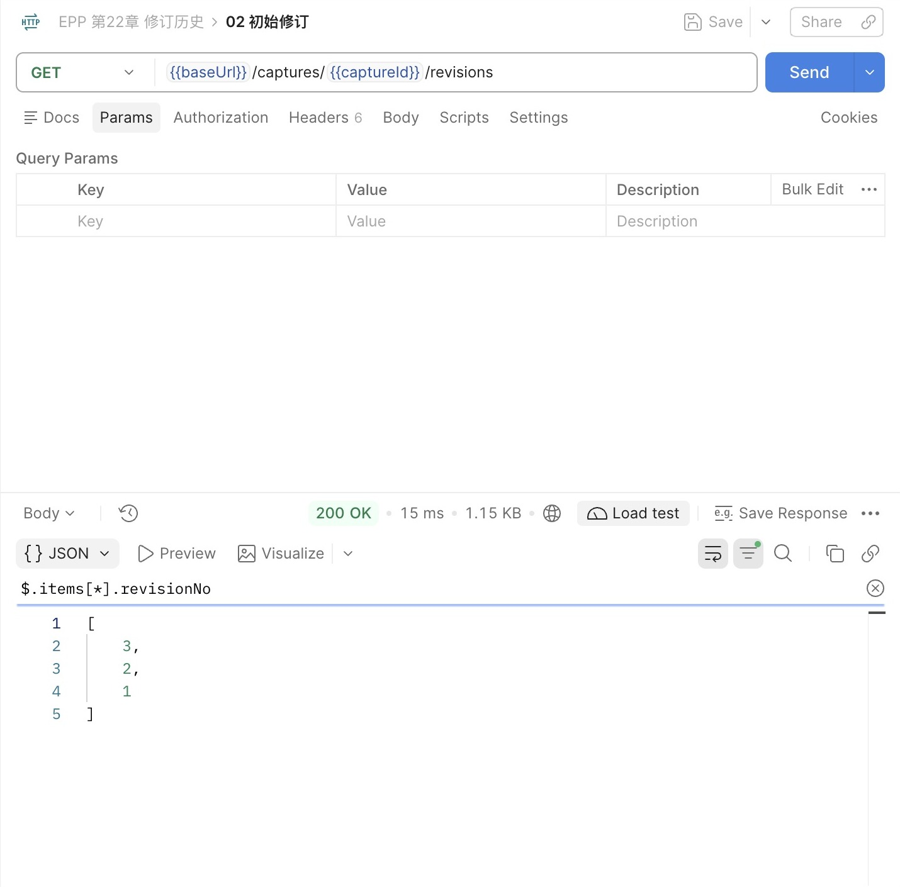

   这是 Postman 对已收到响应的显示筛选，不是服务端新参数，也没有修改响应数据。这里只有 3、2、1，没有第 4 版；关闭筛选可以恢复完整快照。失败状态与重新读取的历史共同核对，才能确认本次失败没有追加。

6. 发送“11 原文旧关键词不再匹配”。本章这条记录应从旧关键词搜索中消失，其他原本匹配的记录不受影响。

   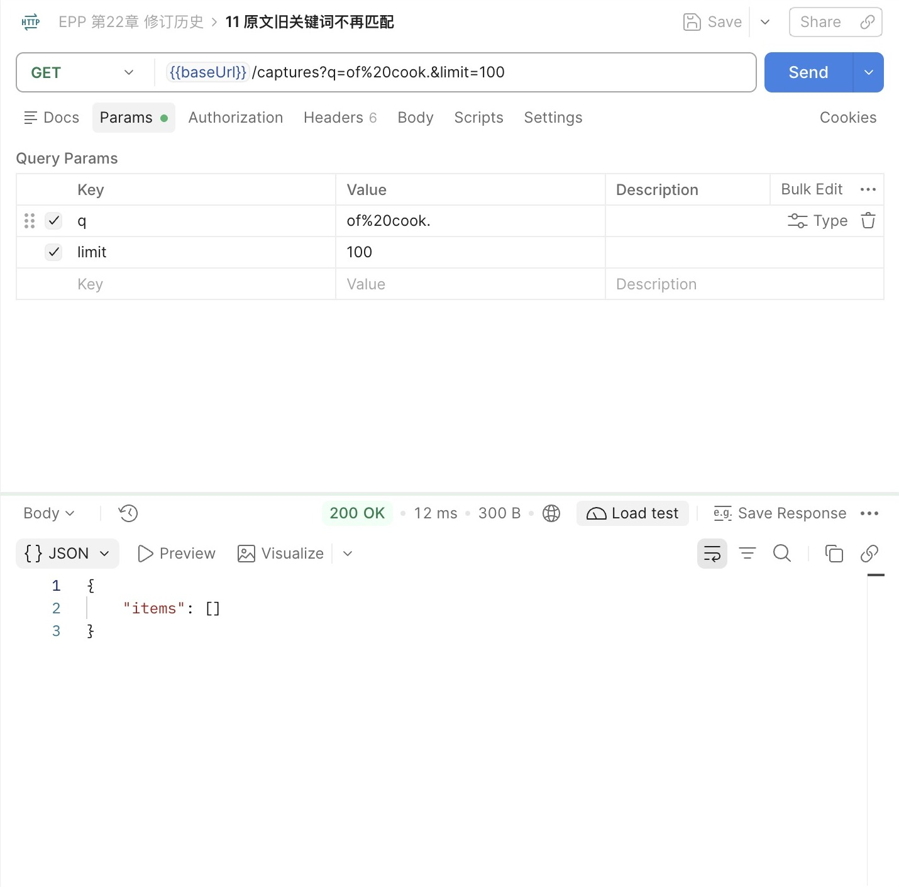

   图中的 `q=of%20cook.` 对应原文片段 `of cook.`，不是搜索中文意图。它仍存在于第 1 版，但最新原文已经改为 “Cooking is not my strength.”，因此本条记录不再命中。示例返回空列表；若自己的库有其他最新原文匹配，应按 captureId 判断本章记录是否消失，不能要求所有人的 items 都为空。

把一条迁移前已存在的 ID 填到集合 captureId，只发 GET 历史，核对第 1 版 unknown、chunks:null 和迁移时保存的内容；不要把失败实验对准旧业务记录。Postman 的 01 会把变量切换到新记录，继续操作前核对目标。

开发文档也能核对同一契约：打开 `/docs`，展开 `GET /captures/{id}/revisions`，点 Try it out，填入演示记录 ID。下面用 `before=4&limit=2` 固定查看第 3、2 版；即使已经继续追加，也能回看这一段历史。请求仍发往当前服务，端口以自己的 baseUrl 为准。

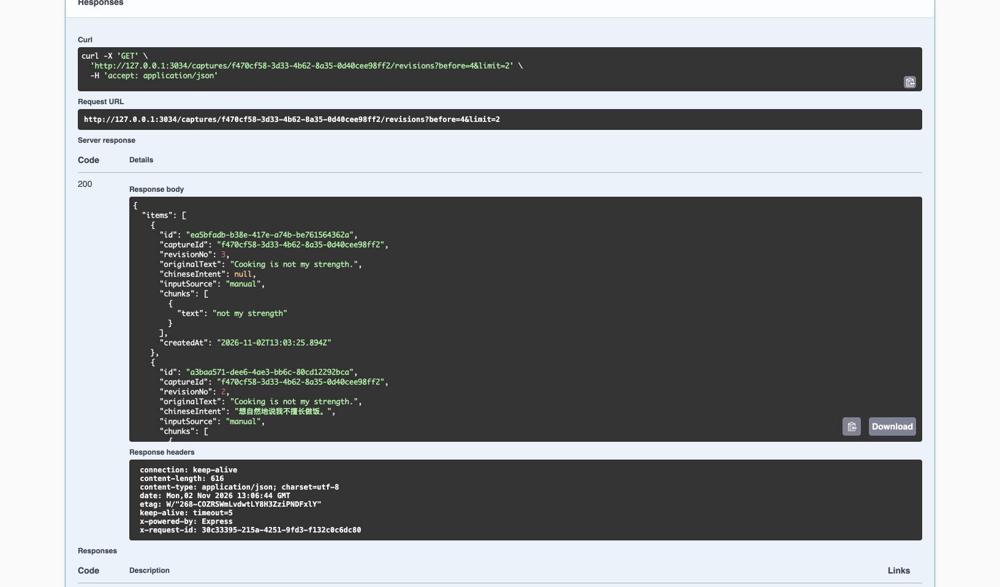

观察 Server response 中实际返回的 200 和 Response body，不要把下方自动生成的 Example Value 当成数据库内容。两版的 captureId 相同、修订 id 不同；第 3 版清空意图，没有改写第 2 版。继续浏览时把响应的 nextBefore 作为下一次 before；本次为 2，下一页才会读到第 1 版。

DBeaver 的历史 JOIN 查询要能对应每次成功响应的 captureId、修订响应中的 id、revisionNo 和内容。下面先按同一 capture_id 查看三版内容，再对照父表旧列与最新修订。查询里的 UUID 换成自己的演示记录 ID。

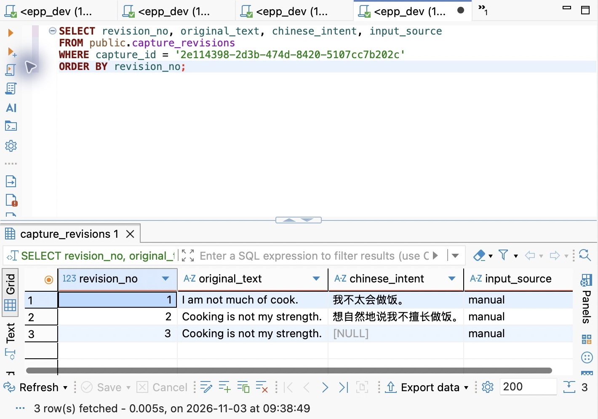

这里按 revision_no 升序显示，与 HTTP 历史接口的降序相反。第 2 版改变原文和意图，第 3 版只清空意图；旧版没有被覆盖。input_source 都是 manual，因为这条记录在新接口建立后手工创建；迁移回填的旧记录应为 unknown，不能混为一类。

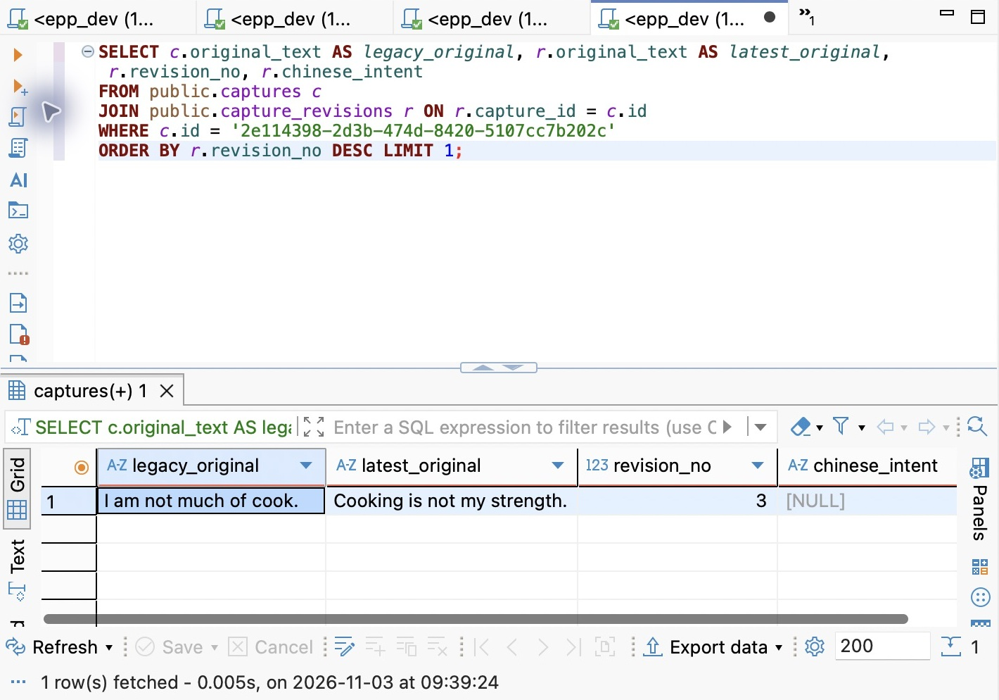

legacy_original 来自 captures，latest_original 来自修订表。结合前面的 GET 响应，才能确认应用已切换到修订读取；单独看到两列不同，只能证明数据库中保存了两份不同内容。这里按单个记录排序并 LIMIT 1；列表查询仍须使用前面“每条记录先选最新版”的写法。

在约束实验前先查询 count(*)、min(revision_no)、max(revision_no)，保存本次基线。下面示例分别是 3、1、3。

配套 `02-constraints.sql` 对本章虚构记录复制第 1 版序号。先单独执行 BEGIN，再执行 INSERT；应触发 23505，并显示联合唯一约束名。

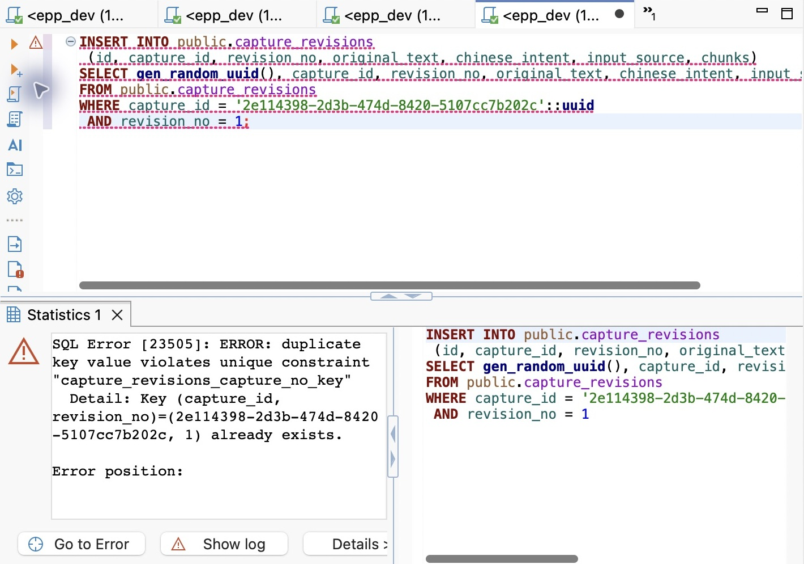

错误明细中的键是 (capture_id, revision_no)，不是新生成的修订 id。INSERT 0 0 只是占位 ID 没命中，不能当作约束已经起效。失败后单独执行 ROLLBACK，再执行基线查询，数量与首末序号应保持；还要重新读三版内容，不能仅从错误响应推断数据状态。

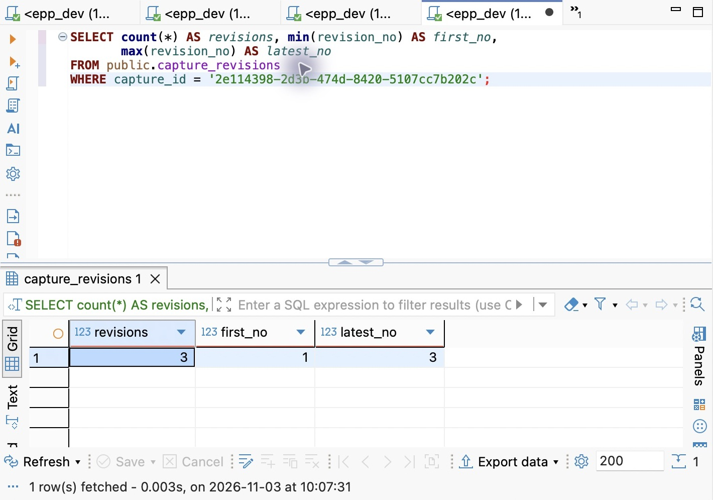

这里重新执行了同一 ID 的统计，revisions、first_no、latest_no 仍为 3、1、3，与实验前基线一致。它证明该记录的版本数量与首末序号保持；每版内容是否保持仍用上面的历史查询逐项对照。

调试断点放在 Service.appendRevision、Store.writeRevision 中数据库调用前后、ResponseSchemaInterceptor.parse。前置 Schema 拒绝时写入断点不命中；数据库返回后 id 为空才是序号冲突，不能把所有 400 或 500 都叫并发问题。检查 SQL 参数只使用虚构内容，不把原文和 chunks 加入常态日志。断点暂停会改变并发时序和超时，不能拿暂停时的耗时作性能结论。

例如，另建一条虚构记录，在 `writeRevision` 的 `if (row.id === null)` 行设断点，再发送完整修订请求。Watch 分别添加 `row.previousNo`、`row.revisionNo` 和 `row.id !== null`：

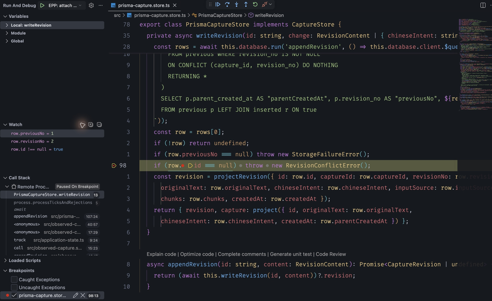

黄色行表示即将执行判断，不表示已经抛出冲突。此处 SQL 已返回，三个观察值分别为 1、2、true，说明本次成功追加；F5 继续后客户端才收到 201。若 previousNo 存在而 id 为 null，才走序号冲突分支。此图使用独立调试记录，不向前面的三版记录继续追加；实验后断开调试器，避免遗留暂停影响后续请求。

### 成功编号没有覆盖历史，仍然不等于拒绝了过期编辑

设两个页面都读到第 2 版。A 保存第 3 版以后，B 的完整快照请求才到达数据库，它会读取当前最大序号 3 并追加第 4 版；不会发生序号冲突，但 B 的原文可能仍来自过期页面。历史都在，当前显示却可能退回 B 提交的旧内容。

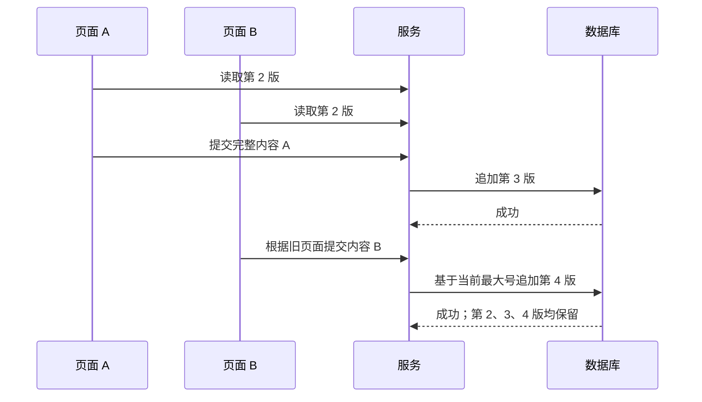

本章保证保留成功快照、序号唯一，并对同时争号给出明确结果；没有承诺检测编辑者的基础版本。若需求是“用户基于第 2 版编辑，当前已是第 3 版时必须拒绝”，就需要客户端带 baseRevision，并把比较纳入原子写入条件。[支线 28A](../chapter-28-concurrency/side-01-optimistic-version.md) 会用独立示例解释这种版本条件与冲突处理；EPP 主线并未加入这个写入前提，仍允许上图中先后到达的完整内容各自追加为新修订。不能声称“已有唯一约束，所以一切竞争都解决了”。

### 交付与恢复依据也要切换

生产仍先执行迁移，再构建独立产物并提供运行环境，最后用 `npm start` 启动；没有 Inspector、没有源码监听、默认没有 docs。迁移 CLI 和历史属于部署步骤，不塞入每个应用进程启动。先用当前调试服务确认旧数据和新修订，再停 dev，用生产入口读相同 ID，确认读取结果不是依赖进程内状态。

迁移成功但尚未写任何新修订时，如果决定恢复旧版写入，必须承认这会让迁移快照再次落后；本章没有提供自动追赶脚本。因此常规恢复目标是修复当前读取并继续新协议，而不是直接启动旧写入者。已经产生新修订后，第二十四章程序虽可能启动，却只读初始副本；让它写入还会制造两条分叉内容线。保留旧字段的目的不是授予任意回退许可。

发生未知结果时先查询历史和当前内容。由于还没有操作身份，仅凭相同内容不能可靠判断“是否就是刚才那一次”；不要自动重发。这一边界会在幂等章节解决。暂停前保存本章演示 ID、最近序号和迁移阶段，结束 SQL 事务；下次从 GET 和核对脚本接上，保留所有历史，不再次回填或重复创建。

### 先在纸上圈出每条原文的当前版

A 有第 1、2、3 版，B 只有第 1 版。读者打开列表时应该看见哪两行？若先把四行都按 revision_no 倒序排列再取两行，A 会占两个位置。改成先把纸分成 A、B 两叠，各自取最上面一行，才有两条不同的记录。在 DBeaver 运行这个不碰业务表的样本。

```sql
WITH parents(id) AS (VALUES ('A'), ('B')),
revisions(capture_id, revision_no, original_text) AS (
  VALUES ('A',1,'old'), ('A',2,'middle'), ('A',3,'new'), ('B',1,'old')
)
SELECT c.id, r.revision_no, r.original_text
FROM parents c
CROSS JOIN LATERAL (
  SELECT revision_no, original_text FROM revisions
  WHERE capture_id = c.id ORDER BY revision_no DESC LIMIT 1
) r
ORDER BY c.id;
```

先只看内层，把 c.id 手换为 'A' 单独查询样本，可取到第 3 版。换为 'B' 得第 1 版。LATERAL 让右边的查询可以引用左边当前这一条 c，把两次手工替换写成一次查询。现在在最外层 ORDER BY 前加 `WHERE r.original_text = 'old'`，预测应该只剩谁。然后去掉该外层条件，把它改成内层的 `AND original_text = 'old'`。A 的旧版会重新出现，说明“当前版含此词”和“找含此词的最后一版”回答了两个不同的问题。若有父记录没有任何修订，CROSS JOIN 会让它消失，因此切换真实列表前还要核对回填是否覆盖全部旧记录。

## 25.5 来源与 chunks：什么时候用列，什么时候用 JSON

到目前为止，前章只有原文和中文意图，没有已有的 chunks 表或历史数组。本章所说的 chunks，是调用方已经准备好、希望随这一版输入保存的短语片段，例如 `[{"text":"not my strength"}]`。当前不生成它们，不把它们叫作候选，也不假设它们已经成为正式表达。它们与版本内容一起保存、一起读取、一起被下一次完整快照替换。

来源 `input_source` 用结构化 text 列加 CHECK，因为它是稳定、低复杂度、需要有明确值域的标记。旧内容不知道来源就 unknown；本章手工完整提交只接收 manual。这里的来源表示原文输入方式，不是操作者身份、客户端可信度或授权证据。旧 PATCH 没修改原文，所以复制上一版的来源；新完整提交声明 manual。以后增加导入或 OCR，需要同时定义具体含义、输入授权和读取兼容，再追加允许值，不能看到一段中文就推断为某种来源。

chunks 目前没有独立身份、单独修改接口和跨版本引用，数量又有上限，所以用 jsonb 保存一个有序数组。与之相比，另建 `revision_chunks` 子表会增加每次写入和读取的协调成本；全部塞进一个 `payload` JSON 又会丢掉原文、意图、版本号等稳定字段的直接约束和查询边界。选择按字段职责作出，不是“关系数据库绝不能用 JSON”，也不是“有 JSON 就不用设计”。

| 保存值 | 本章含义 | 迁移或请求来源 |
| --- | --- | --- |
| SQL NULL | 没有提供或不知道 chunks | 旧数据回填；新完整请求省略或显式 null |
| `[]` | 明确提供了一个空片段列表 | 客户端明确提交空数组 |
| `[{"text":"not my strength"}]` | 按此顺序保存已提供片段 | 客户端完整提交 |

Prisma 对 JSON 字段区分 `DbNull` 与 `JsonNull`。本章使用 SQL NULL，不保存 JSON 字面量 null；创建关系时传 `Prisma.DbNull`，原始 SQL 则传参数 null 并转换为 jsonb。CHECK 中只接受 SQL NULL 或数组，因此 JSON null、对象、字符串不能冒充数组。不能把 `'null'::jsonb` 和 `NULL::jsonb` 当成同一回事。

数据库 CHECK 先保证数组形状和最多 25 项；应用再保证每项只有 text、每项最多 200 UTF-16 单元、非空白且可被 PostgreSQL 原样表示。用 CASE 先判断 jsonb_typeof，再调用 jsonb_array_length，避免把不适用数组函数的对象交给函数。直接 SQL 写入绕过应用后，元素字段并没有被这个 CHECK 完整校验；维护脚本必须承担相同契约，输出 Schema 也会拒绝不合法历史，不能把 JSON 列说成天然“有类型”。

数组顺序表示片段顺序，jsonb 不保留对象键的顺序和原始 JSON 排版，因此不能用 JSON 序列化字节是否相等判断内容历史相同。我们保存的 text 字符串仍保留实际空格，JSON 文本的排版空格与字符串内部空格是两回事。整个 HTTP 正文仍受 16 KiB 限制，满足各字段长度不保证编码后的请求体一定不超限。

现在改变需求：如果用户要单独标记某个 chunk 已学会、候选要外键引用某个 chunk，或者经常跨记录按 chunk 查询统计，它就不再只是随快照携带的一段有界数据。可以推导 `revision_chunks(id, revision_id, position, text, ...)`：revision_id 外键表达所属版本，`(revision_id, position)` 唯一表达顺序，独立 ID 供引用。迁移时按 JSON 数组位置展开，每项生成身份，核对展开数和顺序，再切换读取；没有 chunks 的旧版不能凭空造子行。此时是否需要索引、是否保留 JSON 兼容副本，也由查询和切换要求决定。

这种变式说明，今天不拆表是有条件的选择。需求一旦改变，应回到行粒度、身份、关系、约束和生命周期重新设计，而不是先规定整个项目永远只用 JSON 或永远拆成表。

本章结束时，同一 Capture 可以保留多版完整输入；旧记录已经接入历史，旧 PATCH、列表和详情也都沿新内容来源工作。下一章将在明确的修订上保存候选，先定义状态、事件和关系，再决定用户确认究竟绑定哪一个对象。

## 知识支线

- [支线 25A：快照历史、事件记录与当前投影有什么不同](side-01-snapshots-and-events.md)：从订单地址变更推导历史保存方式，解释快照并不等于事件溯源，以及当前指针何时值得引入。

## 附录：本章必要技术点速查

| 名称 | 本章用途 | 必要注意点 |
| --- | --- | --- |
| pg_dump／pg_restore | 单库归档并恢复到独立空库 | 归档不含角色；源与目标先核对；恢复结果还需逐行、结构与迁移核验 |
| Capture / CaptureRevision | 稳定身份与某版内容 | 记录创建时间和修订时间不混用 |
| `(capture_id, revision_no)` 唯一约束 | 防止同记录序号重复 | 不是编辑基础版本校验，也不保证无空号 |
| `INSERT ... SELECT` | 从已有行建立初始修订 | 保留旧值，不编造未知来源 |
| `IS DISTINCT FROM` | 核对可空字段 | 两个 NULL 认为相同 |
| `LOCK TABLE ... SHARE ROW EXCLUSIVE` | 回填期间阻止父表写入 | 提交即释放，不替代停旧程序 |
| Prisma nested create | 父记录与第 1 版一起保存 | 具有事务语义，不能拆成两个独立 await |
| `LATERAL` | 每个父记录选取一条最新修订 | 搜索放在取最新之前／之后，含义不同 |
| 修改型 CTE / `RETURNING` | 取得本次插入结果 | 不用基础表重查冒充本次结果 |
| `ON CONFLICT ... DO NOTHING` | 明确识别序号争用 | 本次没插入必须返回冲突；不覆盖旧快照 |
| `before`、`limit + 1` | 有界读取全部历史 | before 排除边界本身，空页不等于记录不存在 |
| `DbNull` / `JsonNull` | 区分 SQL NULL 与 JSON null | 本章只存 SQL NULL 或数组 |
| jsonb / `jsonb_typeof` | 保存有界片段数组 | JSON 合法不等于业务形状合法 |
| 409 / `REVISION_CONFLICT` | 指示序号竞争 | 先读取再决定，不自动重试完整快照 |

官方入口：[PostgreSQL 18 约束](https://www.postgresql.org/docs/18/ddl-constraints.html)、[LATERAL 与表表达式](https://www.postgresql.org/docs/18/queries-table-expressions.html)、[WITH 查询](https://www.postgresql.org/docs/18/queries-with.html)、[INSERT 与 ON CONFLICT](https://www.postgresql.org/docs/18/sql-insert.html)、[锁模式](https://www.postgresql.org/docs/18/explicit-locking.html)、[JSON 类型](https://www.postgresql.org/docs/18/datatype-json.html)、[Prisma v7 关系写入](https://www.prisma.io/docs/orm/v7/prisma-client/queries/relation-queries)、[事务与嵌套写入](https://www.prisma.io/docs/orm/v7/prisma-client/queries/transactions)、[JSON 字段](https://www.prisma.io/docs/orm/v7/prisma-client/special-fields-and-types/working-with-json-fields)。

本章完成代码分支：`part-04/chapter-25`。

[下一章：状态机与关系建模：修订如何进入候选确认](../chapter-26-candidates/chapter.md)

[上一章：第三篇回顾：带着旧记录完成一次结构演进](../../part-03-postgresql/chapter-24-review/chapter.md) · [第四篇导读](../README.md) · [返回全书目录](../../README.md)
