# 第 26 章 状态机与关系建模：修订如何进入候选确认

第二十五章把记录身份与内容版本分开了。现在，`Capture` 可以有多份修订，每份都有独立 ID；修改意图也会追加快照。我们终于能够准确指认“这次讨论的是哪一版输入”，而不必把后来改过的原文当成当时的依据。

接着处理候选。针对“我不太会做饭”，用户可能看到 `I'm not much of a cook.`，也可能看到 `Cooking is not my strength.`。这两句可以同时存在，用户尚未决定要留下哪一句。此时把它们直接写进正式表达库，会把“提供了建议”误记成“用户已经确认”。只把候选放进响应，又无法在关闭页面后继续处理。

本章把这段中间过程保存下来：候选属于明确修订，内容保持不变，用户可以读取或放弃。我们同时推导采纳以后需要留下哪些关系，但本章不开放采纳入口；下一章再让那些写入共同提交。这样，状态不会先写成“已采纳”，而学习记录和正式表达还不存在。

从 `part-04/chapter-25` 继续，先完成上一章的停写回填与新读写切换。沿用 Node 24.22.1、PostgreSQL 18、Prisma 7.10.1、DBeaver、Postman 和自动编译调试入口。保留已有库和修订，不接入 AI，也不需要新依赖。固定开发用户的范围不变。

时间参考：阅读约130～150分钟，跟做另加80～100分钟；按约9200个汉字、约290行代码／命令、三张机制图、十一张实际界面图，以及迁移、接口接入、图形联调与产物恢复估算，非读者实测。支线单列；可以在关系设计完成后暂停，再分次做迁移与接口。

## 26.1 从用户操作推导候选状态

先把一条完整过程说清楚。第 1 版修订保存原文 `I am not much of cook.` 和意图“我不太会做饭”。我们手动提供两份候选，各有英文和对应中文意思。它们是建议，不能反过来修改第 1 版原文，更不代表这两种表达已经进入用户的学习内容。

用户看了第一份，认为当前不想用，点击放弃；第二份暂时不处理。后来用户补充了原文，形成第 2 版。此时至少有三个相互独立的事实：第一份被主动放弃，第二份没有收到决定，两份都依据第 1 版。若用一个 `capture.status = 'done'`，这些区别全部消失了。

### 状态属于谁，先于状态叫什么

这里需要状态的是候选，不是整条记录。一份候选对应一次具体建议，拥有独立身份、修订引用和用户决定。记录可以继续追加修订，同一修订也可以有不同决定的候选；因此不能让一份候选的状态代替父对象的全部进度。

先落实两个状态：`pending` 表示尚未收到对这份候选的最终决定，`discarded` 表示用户明确放弃。创建成功后进入 pending，放弃成功后进入 discarded。本章不允许撤销放弃，不修改已保存的候选内容，也不物理删除候选。

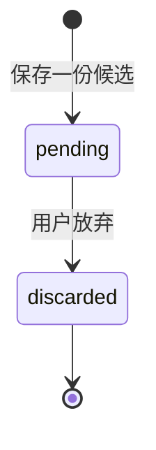

终点符号表示这条处理路径在本章结束，不表示删除数据库行。读取动作没有箭头，因为读取不改变状态。重新打开页面、请求失败、用户暂时离开，也不是放弃事件。

状态机不是先安装一个库，再把字符串放进配置。它首先是对合法行为的约定：操作作用于哪个对象，什么前提下允许，成功后留下什么事实，不允许时如何拒绝。这里只存在一条修改边，用明确条件即可；如果后续出现层级状态、并行流程和大量重复的转移规则，再比较状态机工具能否降低维护成本。

### 用户请求与已经发生的事实

点击按钮发出的是“请放弃这份候选”的命令。数据库成功修改后，才能把“这份候选已放弃”作为事实返回。前端隐藏卡片并不能替代数据库决定；请求超时也不能证明命令没执行。

本章把放弃设计为 `POST /candidates/:id/discard`，请求体为 `{}`。这是明确的业务动作，客户端不提交任意目标状态。若开放 `PATCH { status: "accepted" }`，就必须保证每一种目标状态背后全部业务事实成立；只校验字符串属于枚举远远不够。动作接口也不是唯一正确形式，受严格约束的 PATCH 同样能实现，但不能省去转移与副作用的检查。

第一次放弃 pending 返回 200，并保存 `discarded_at`。再次放弃返回 409，保留第一次的时间。本章选择让“这次没有发生转移”直接可见；也可以设计成重复返回当前结果，但必须另行明确响应语义。不要因为 HTTP 方法叫 POST，就推断服务必然重复写入，也不要因为终态不再变化，就宣称已经有通用幂等重放。

| 当前情况 | 请求 | 本章结果 |
| --- | --- | --- |
| 有权限访问的修订 | 保存一个未占用序号的候选 | 201，创建 pending |
| pending 候选 | 放弃 | 200，变为 discarded，保存决定时间 |
| discarded 候选 | 再次放弃 | 409，原状态和时间不变 |
| 候选或修订不在当前用户范围 | 读取或写入 | 404，不透露其他用户的对象 |
| 任意候选 | 修改内容、采纳或重新打开 | 没有这些路由 |

这里的时间是服务端执行放弃语句时取得的时间，不是用户点击时间，更不是严格的提交顺序。我们没有接收客户端时间，也没有完整事件表。一个 `discarded_at` 能支持当前状态解释，不能还原全部尝试、操作者或网络经过。

## 26.2 先说明采纳后哪些事实需要保存

如果一份候选被采纳，仅把 status 改为 accepted，后面的练习仍然不知道去哪里找正式表达；只创建正式表达，又无法解释用户从哪条输入、哪份候选确认而来。要决定事务里放什么，得先决定哪些行各自代表什么。

### 候选不是正式表达，学习记录也不是表达本身

候选的一行表示“针对这一版输入提出的一份建议”。它保存英文、中文意思和来源修订。两份候选文本相同也不自动合并：它们可能来自不同记录、不同语境，尚未获得相同业务身份。

正式表达的一行将表示一个可以持续组织形式与学习内容的表达身份。表达形式的一行保存该身份下的具体说法。它们分开，是因为后续可能存在缩写、变体或多个可接受形式；反过来，相同拼写也可能对应不同意思。不能简单把 `english_text UNIQUE` 当作完整的表达去重设计。

学习记录的一行将表示某个用户从某份候选确认学习某个表达的来源事实。表达的当前描述以后可能演进，但这次选择来自哪条候选，不该跟着改写。候选继续指向原修订，于是可以一路追溯到当时原文，而不是今天的最新版。

下面是采纳需要的最小关系方向。USER→CAPTURE→CAPTURE_REVISION→CANDIDATE这条链在本章落地；`LearningRecord`、`Expression`、`ExpressionForm` 是下一章开始建立的设计，不是当前数据库已经存在的表。图中的可有零行表示外键不保证父行必有子行。

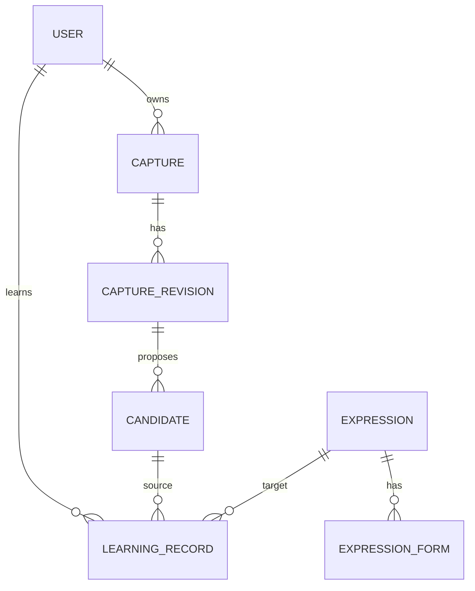

候选到学习记录的零到多画的是最小外键能力，并不批准重复采纳。产品规则最终需要限制哪些重复、如何识别同一次操作，由事务、并发和幂等章节逐步落实；不能先在图里画成唯一，再把数据库里没有的保证当作事实。

如果只做“每份候选复制成一个互不关联的学习卡片”，候选与正式表达可以暂时合在一个对象里。但本书后面要处理同一表达的形式、合并和多处来源。让每份建议直接成为正式表达，会使共享内容与个人确认事实混在一起：删除某次采纳是否等于删除其他来源正在使用的表达，将无法清楚回答。现在先分清事实归属，下一章才有可靠的写入边界。

为下一章预留的最小字段职责如下。这里只做设计，不运行建表SQL，也不让当前API返回这些对象：

| 对象 | 最小字段及事实 |
| --- | --- |
| Expression | id标识表达身份，meaning保存该身份的含义，created_at记录创建；不以某个英文拼写作为唯一身份 |
| ExpressionForm | id、expression_id、text；text是该表达的一种具体形式，外键连接所属表达 |
| LearningRecord | id、user_id、candidate_id、expression_id、created_at；分别指认用户、确认来源、学习目标与记录时间 |

这是写入责任的起点。若今后要标记首选形式，应明确一个表达能有几个首选及如何保证；若要按用户和表达合并学习记录，应另存多份来源，不能用覆盖candidate_id丢掉旧确认。第三十一章再沿规范化与义项需求扩展，当前不先承诺所有同义内容都会自动合并。

### 哪些引用保存，哪些重复先不保存

候选保存 `revision_id`，不再保存 `capture_id` 和 `user_id`。前者已经唯一指向修订，修订指向记录，记录指向用户。少存两列，可以避免出现“revision属于甲的记录，但candidate.user_id写成乙”的矛盾；代价是每次查权限必须沿关系判断。

未来学习记录需要用户身份与表达身份：同一表达可能被不同用户分别学习，表达行不能代替“谁学过”。来源候选则用于保留确认依据。届时即使保存了 user_id，也不能只靠两条各自有效的外键，认为用户和来源一定匹配；采纳写入仍需约束来源归属，必要时再选择复合键等数据库保证。外键证明引用存在，不自动证明业务关系全部正确。

这里暂不复制候选文本到学习记录。候选内容通过应用不可编辑，来源链已经能解释当时选择。若以后允许修正、脱敏或删除候选，或者学习记录必须在来源清理后独立保存凭据，就需要重新设计快照与保留策略。是否复制取决于生命周期，不是“规范化永远不许重复”，也不是“审计一律复制全对象”。

### 采纳将是一个整体结果

沿这组关系，下一章的一次采纳至少需要：确认候选及归属与可操作条件；建立或选定正式表达和形式；写入学习记录并保存来源；把候选变成已采纳。若表上要求每个表达有一个初始形式，创建表达后失败就不能留下空壳；若先把候选标成已采纳再写学习记录，失败会留下一个没有学习结果的承诺。

所以本章没有 accepted 值，也没有“先返回成功、稍后再补”的临时采纳接口。第二十七章将增加所需表和状态约束，把应一起完成的写入放进事务。第二十八章再处理两个请求都在读取时看见 pending 的竞争。状态机说明可以发生什么，事务说明哪些事实一起提交，并发控制说明交错执行时仍能不能满足前提；三者不能彼此替代。

## 26.3 追加候选表，旧修订保持无候选

### 给有限候选集一个可核对的范围

本章每份修订最多保存五份手动候选，`candidate_no` 取 1～5，表示该版内的位置。可以先保存1，再保存2，不要求一次填满；放弃后位置仍被占用，不删除旧候选再复用。UUID标识具体候选，序号用于这一版内的排列和占位，两者用途不同。

这个限制让本章读取可以一次返回该版全部候选，不悄悄截断，也不提前引入新的分页协议。联合唯一 `(revision_id, candidate_no)` 配合范围 CHECK，保证并发保存也不超过五行；应用里的“先 COUNT 小于5再INSERT”不能独自提供这个保证。五份是当前流程的明确上限，不是数据库只能保存五份。以后需要同一版反复生成多批建议时，应增加批次身份并定义旧批的生命周期，再调整接口，不能让当前序号偷偷承担批次与操作身份。

在 `prisma/schema.prisma` 的 `CaptureRevision` 加上 `candidates Candidate[]`，保留其余字段，新增：

```prisma
model Candidate {
  id             String   @id(map: "candidates_pkey") @db.Uuid
  revisionId     String   @map("revision_id") @db.Uuid
  candidateNo    Int      @map("candidate_no")
  englishText    String   @map("english_text") @db.Text
  chineseMeaning String   @map("chinese_meaning") @db.Text
  status         String   @default("pending") @db.Text
  discardedAt    DateTime? @map("discarded_at") @db.Timestamptz(3)
  createdAt      DateTime @default(now()) @map("created_at") @db.Timestamptz(3)
  revision       CaptureRevision @relation(fields: [revisionId], references: [id], onDelete: Restrict, onUpdate: Restrict, map: "candidates_revision_id_fkey")

  @@unique([revisionId, candidateNo], map: "candidates_revision_no_key")
  @@map("candidates")
}
```

用 String 加 SQL CHECK 表达状态，避免为两个值引入独立 PostgreSQL enum 的变更流程。枚举也可以采用；无论选哪一种，都只能限制值域，仍须实现转移规则。`discardedAt` 在 pending 时没有值，用 NULL表达“尚未发生”，不能用 createdAt或占位日期冒充。

从前章自行修改时，沿用第二十三章的 SHADOW 配置，先生成草稿：

```bash
nvm use
unset DATABASE_URL SHADOW_DATABASE_URL
npm run db -- migrate dev --name candidates --create-only
```

检查生成文件；首次应用前加上事务、有限锁等待及模型无法表达的约束。章节完成代码中的迁移为 `prisma/migrations/20261103090000_candidates/migration.sql`，完整内容如下。直接使用完成代码时只部署现有迁移，不再生成一份重复建表脚本。

```sql
BEGIN;
SET LOCAL lock_timeout = '2s';
SET LOCAL statement_timeout = '10s';

CREATE TABLE public.candidates (
  id uuid CONSTRAINT candidates_pkey PRIMARY KEY,
  revision_id uuid NOT NULL,
  candidate_no integer NOT NULL,
  english_text text NOT NULL,
  chinese_meaning text NOT NULL,
  status text NOT NULL DEFAULT 'pending',
  discarded_at timestamptz(3),
  created_at timestamptz(3) NOT NULL DEFAULT CURRENT_TIMESTAMP,
  CONSTRAINT candidates_revision_id_fkey FOREIGN KEY (revision_id)
    REFERENCES public.capture_revisions(id) ON DELETE RESTRICT ON UPDATE RESTRICT,
  CONSTRAINT candidates_revision_no_key UNIQUE (revision_id, candidate_no),
  CONSTRAINT candidates_no_range CHECK (candidate_no BETWEEN 1 AND 5),
  CONSTRAINT candidates_english_shape CHECK (char_length(english_text) BETWEEN 1 AND 2000 AND btrim(english_text) <> ''),
  CONSTRAINT candidates_meaning_shape CHECK (char_length(chinese_meaning) BETWEEN 1 AND 2000 AND btrim(chinese_meaning) <> ''),
  CONSTRAINT candidates_state_shape CHECK (
    (status = 'pending' AND discarded_at IS NULL) OR
    (status = 'discarded' AND discarded_at IS NOT NULL)
  )
);

COMMIT;
```

这份迁移没有 INSERT 旧数据。过去的修订确实存在，过去的候选却没有被保存过；不能根据原文伪造一份“已生成”候选，更不能给旧修订统一标成“已放弃”。零条候选是准确的现状，和候选存在但全部discarded是两种情况。

`candidates_state_shape` 同时约束状态和时间：pending必须无放弃时间，discarded必须有时间。`status NOT NULL` 不能省，否则CHECK表达式可能得到unknown而通过。文本约束是数据库底线：按字符数限制并拒绝普通空格组成的值；HTTP仍按UTF-16单元计数，拒绝全部JS空白、NUL和孤立代理项。数据库CHECK与API并不是完全相同的验证器，不能因两边写了2000就宣称Unicode边界一致。

### 先校验库，再日常库

停止开发服务。DBeaver分别确认DEV、VERIFY的数据库名、身份和端口，将已有captures、capture_revisions查询结果保存在受控位置；不要把真实内容导出提交到Git。先在VERIFY应用并核对，再对DEV执行：

```bash
npm run db:verify -- migrate deploy
npm run db:verify -- migrate status
npm run db:verify -- migrate diff --from-config-datasource --to-schema prisma/schema.prisma --exit-code
npm run db -- migrate deploy
npm run db -- migrate status
npm run db -- migrate diff --from-config-datasource --to-schema prisma/schema.prisma --exit-code
```

在DBeaver刷新public下的Tables，展开candidates的列、外键、唯一约束，再用 `database/chapter-23/01-inspect.sql` 查看完整CHECK。Prisma的结构diff不能替代这些CHECK核对。新表应为空，原记录与修订各字段保持；不是仅仅总行数相等就算保留了原值。

也可以在同一连接的SQL编辑器逐条运行下面两条只读查询，对照实际字段与约束登记；配套01-inspect已包含它们：

```sql
SELECT column_name, udt_name AS type, is_nullable, column_default
FROM information_schema.columns
WHERE table_schema = 'public' AND table_name = 'candidates'
ORDER BY ordinal_position;
SELECT conname, contype, convalidated
FROM pg_constraint
WHERE conrelid = 'public.candidates'::regclass
  AND contype IN ('p', 'u', 'f', 'c')
ORDER BY conname;
```

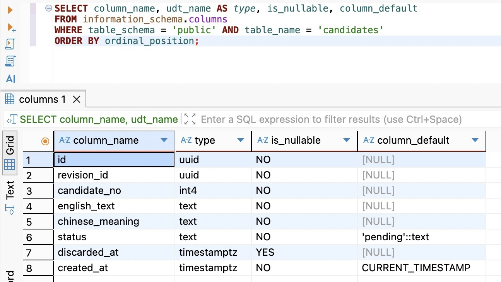

结果中的int4就是integer，timestamptz对应带时区的时间戳。八个字段中只有discarded_at允许NULL；status默认pending，created_at使用数据库时间。id没有数据库默认值，与后面的服务端randomUUID生成一致。

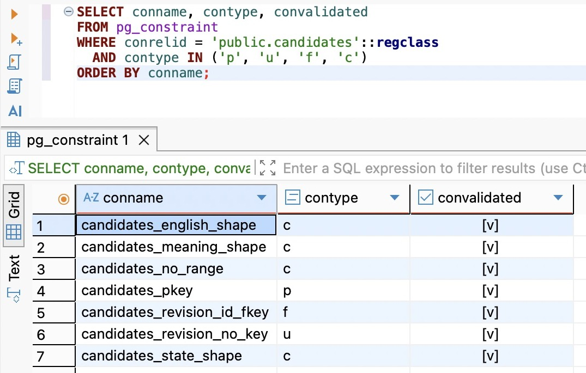

p、u、f、c分别表示主键、唯一、外键与CHECK，勾选表示convalidated为true。这张图确认七项约束已登记并验证；名字本身不能证明定义正确，仍用01-inspect中的pg_get_constraintdef核对外键目标、联合唯一列和CHECK表达式，不只数行。

本次是扩展结构，不需要第二十五章那种内容来源切换。第二十五章程序不会写候选，也不会破坏新表；第二十六章程序却需要新表才能工作。因此先迁移后启动新服务，`DatabaseService.onModuleInit()`在已有修订探测后增加：

```ts
await this.client.candidate.findMany({ take: 1 });
```

空表也会查询所有模型字段，缺表或缺列应在监听前失败。探测不是完整结构审计，不证明每个CHECK存在。迁移若等锁失败，先从第一个数据库错误定位持锁者，确认事务已回滚及迁移历史状态，再按第二十三章的恢复步骤处理。不要重置数据库，也不要在已成功部署后修改原迁移。

此处可以停下：数据库已经扩展，旧修订未变，候选表为空。继续时先看迁移状态和表内容，再接接口，不必重新生成或重放已应用的迁移。

## 26.4 保存、读取与放弃，让状态真正影响写入

### 请求只接收候选内容，状态由服务决定

新增 `src/candidate-contract.ts`。沿用第十二章的Zod边界，在新接口上拒绝未知属性：客户端不能提交id、status或discardedAt，也不能把拼错的字段当成成功请求。

```ts
import { z } from 'zod';
import { isPostgresText } from './postgres-text.js';

const text = z.string().refine(isPostgresText, 'Expected well-formed Unicode without NUL')
  .regex(/\S/, 'Expected a non-whitespace character')
  .refine(value => value.length <= 2000, 'Expected at most 2000 UTF-16 code units')
  .describe('Whitespace preserved; at most 2000 UTF-16 code units. No language detection.');
export const CreateCandidateSchema = z.object({
  candidateNo: z.number().int().min(1).max(5),
  englishText: text,
  chineseMeaning: text,
}).strict();
export const EmptyObjectSchema = z.object({}).strict();
const candidate = {
  id: z.uuid(), revisionId: z.uuid(), ...CreateCandidateSchema.shape,
  createdAt: z.iso.datetime(),
};
export const CandidateResponseSchema = z.discriminatedUnion('status', [
  z.object({ ...candidate, status: z.literal('pending'), discardedAt: z.null() }),
  z.object({ ...candidate, status: z.literal('discarded'), discardedAt: z.iso.datetime() }),
]);
export const CandidateListSchema = z.object({
  revisionId: z.uuid(), items: z.array(CandidateResponseSchema).max(5),
});
export type CreateCandidateInput = z.infer<typeof CreateCandidateSchema>;
export type Candidate = z.infer<typeof CandidateResponseSchema>;
```

这里显式用JavaScript的value.length检查UTF-16单元；不要把库的字符串长度检查默认当成相同单位。例如1000个😀占2000个单元，可以接收；1001个占2002，应拒绝。自定义refine的全部规则不会自动转成OpenAPI约束，所以保留字段说明，并以真实输入验证。

响应使用按status区分的两种形状：pending的discardedAt必须为null，discarded必须为ISO时间。这样，数据库映射若漏了时间，输出检查会失败，而不是返回一个自己矛盾的对象。写入成功后输出验证失败仍不等于回滚；这是第十二章已有的边界，所以输出500之后也需要先读事实。

英文和中文字段表示用途，不在这里判断自然语言质量。`候选中文意思`是对这一份建议的说明，`修订中文意图`是用户当时想表达的内容；它们可能相近，却不是同一事实。不把中文意思自动写回修订，也不宣称手工样例通过了AI评估。

### 在写入语句里同时限定修订归属

新增 `src/prisma-candidate.store.ts`。文件使用现有DatabaseService、Prisma参数化SQL与固定开发用户。先准备投影，所有公开字段显式列出，时间统一转为ISO：

```ts
import { randomUUID } from 'node:crypto';
import { Prisma } from './generated/prisma/client.js';
import { DatabaseService } from './database.service.js';
import { DEVELOPMENT_USER_ID } from './database-config.js';
import { CandidateResponseSchema } from './candidate-contract.js';
import type { Candidate, CreateCandidateInput } from './candidate-contract.js';

const validId = (id: string) => /^[0-9a-f]{8}-[0-9a-f]{4}-[0-9a-f]{4}-[0-9a-f]{4}-[0-9a-f]{12}$/.test(id);
type Row = { id: string; revisionId: string; candidateNo: number; englishText: string;
  chineseMeaning: string; status: string; discardedAt: Date | null; createdAt: Date };
type OuterRow = Omit<Row, 'id'> & { id: string | null };
const columns = Prisma.sql`n.id, n.revision_id AS "revisionId", n.candidate_no AS "candidateNo",
  n.english_text AS "englishText", n.chinese_meaning AS "chineseMeaning", n.status,
  n.discarded_at AS "discardedAt", n.created_at AS "createdAt"`;
function project(row: Row): Candidate {
  return CandidateResponseSchema.parse({ ...row, createdAt: row.createdAt.toISOString(),
    discardedAt: row.discardedAt?.toISOString() ?? null });
}
```

类的构造函数接收DatabaseService，与PrismaCaptureStore相同。保存方法如下：

```ts
export class PrismaCandidateStore {
  constructor(private readonly database: DatabaseService) {}

  async create(revisionId: string, input: CreateCandidateInput): Promise<Candidate | 'occupied' | undefined> {
    if (!validId(revisionId)) return undefined;
    const rows = await this.database.run('createCandidate', () => this.database.client.$queryRaw<OuterRow[]>(Prisma.sql`
      WITH owned AS (
        SELECT r.id FROM public.capture_revisions r JOIN public.captures c ON c.id = r.capture_id
        WHERE r.id = ${revisionId}::uuid AND c.user_id = ${DEVELOPMENT_USER_ID}::uuid
      ), inserted AS (
        INSERT INTO public.candidates (id, revision_id, candidate_no, english_text, chinese_meaning)
        SELECT ${randomUUID()}::uuid, id, ${input.candidateNo}, ${input.englishText}, ${input.chineseMeaning}
        FROM owned
        ON CONFLICT (revision_id, candidate_no) DO NOTHING RETURNING *
      )
      SELECT ${columns} FROM owned LEFT JOIN inserted n ON true
    `));
    const row = rows[0];
    if (!row) return undefined;
    if (row.id === null) return 'occupied';
    return project({ ...row, id: row.id });
  }
  // list 与 discard 在下文继续加入。
}
```

沿candidate → revision → capture判断归属，不能只相信路径里的修订ID。`owned`没有行时不会插入，最终也没有结果，服务返回404。若修订存在且属于当前用户，但序号已占用，DO NOTHING不覆盖原候选；LEFT JOIN仍保留父行，返回id为null，服务据此给409。这样不会把“没有写入”一律误报成不存在。

这里仅处理指定联合唯一冲突，其他数据库错误继续走DatabaseService的安全错误映射。参数值通过Prisma.sql发送，不拼进SQL。占位冲突可能等待另一事务决定；等待超时应仍按暂时不可用处理，不能假装已经确认冲突。DO NOTHING也不证明内容相同；相同序号携带不同内容同样409，不返回“已替你更新”。

### 读取既要保留空集合，也要保留放弃项

```ts
  async list(revisionId: string): Promise<Candidate[] | undefined> {
    if (!validId(revisionId)) return undefined;
    const rows = await this.database.run('listCandidates', () => this.database.client.$queryRaw<OuterRow[]>(Prisma.sql`
      SELECT ${columns} FROM public.capture_revisions r
      JOIN public.captures c ON c.id = r.capture_id
      LEFT JOIN public.candidates n ON n.revision_id = r.id
      WHERE r.id = ${revisionId}::uuid AND c.user_id = ${DEVELOPMENT_USER_ID}::uuid
      ORDER BY n.candidate_no ASC
    `));
    if (rows.length === 0) return undefined;
    return rows.flatMap(row => row.id === null ? [] : [project({ ...row, id: row.id })]);
  }
```

使用LEFT JOIN保留“确实存在但没有候选”的修订。零条数据库结果表示没有可访问的父对象；一条id为null的结果转换为items:[]。这些不是同一个返回值。排序使用candidate_no，最多五个占位就是最多五项，不根据status偷偷过滤已放弃项。

如果现在把查询写成INNER JOIN，再把空结果统一返回404，旧修订就会被误认为不存在。若把 `n.status = 'pending'` 放进WHERE，LEFT JOIN产生的NULL行也可能被过滤；第十九章解释过的外连接语义，在这里直接决定接口契约。

### 放弃时检验当前状态，而不是先查完再无条件改

```ts
  async discard(id: string): Promise<Candidate | 'conflict' | undefined> {
    if (!validId(id)) return undefined;
    const rows = await this.database.run('discardCandidate', () => this.database.client.$queryRaw<OuterRow[]>(Prisma.sql`
      WITH owned AS (
        SELECT n.id FROM public.candidates n
        JOIN public.capture_revisions r ON r.id = n.revision_id
        JOIN public.captures c ON c.id = r.capture_id
        WHERE n.id = ${id}::uuid AND c.user_id = ${DEVELOPMENT_USER_ID}::uuid
      ), changed AS (
        UPDATE public.candidates n SET status = 'discarded', discarded_at = statement_timestamp()
        FROM owned WHERE n.id = owned.id AND n.status = 'pending' RETURNING n.*
      )
      SELECT ${columns} FROM owned LEFT JOIN changed n ON true
    `));
    const row = rows[0];
    if (!row) return undefined;
    if (row.id === null) return 'conflict';
    return project({ ...row, id: row.id });
  }
```

关键不在SET，而在 `n.status = 'pending'`。服务没有先把一份pending读进JS，隔一会儿再按id无条件UPDATE；合法来源状态直接进入修改条件。修改成功才返回数据库实际写出的候选和时间。此处用statement_timestamp表示当前语句开始时刻，并非精确提交时间。

`owned`只用于区分“无权或不存在”和“对象存在但这次没有转移”。状态判断仍在UPDATE目标行上。两个请求竞争同一行时，PostgreSQL在默认READ COMMITTED下会等待并重新检查被更新行的条件；第一个改成discarded之后，第二个不能再次按pending匹配。它可能返回409，也可能先遇到等待超时而返回503，不能承诺所有竞争必定立即409。这里已经需要的单行条件写入直接落实；下一章的跨表采纳仍需要事务，并不能由这一条UPDATE替代。

### 接回应用，而不是另起一套运行环境

新增 `src/candidates.service.ts`，把存储结果转为业务结果。应用其他入口调用create时也会校验输入，不只依赖HTTP Pipe。每个存储调用沿用ApplicationState.track，避免客户端断开后，关闭流程忽略仍在执行的数据库工作：

```ts
import { CreateCandidateSchema } from './candidate-contract.js';
import { PrismaCandidateStore } from './prisma-candidate.store.js';
import { ApplicationState } from './application-state.js';

export class InvalidCandidateError extends Error {}
export class CandidateNotFoundError extends Error {}
export class CandidateConflictError extends Error {}

export class CandidatesService {
  constructor(private readonly store: PrismaCandidateStore, private readonly state: ApplicationState) {}

  async create(revisionId: string, input: unknown) {
    const parsed = CreateCandidateSchema.safeParse(input);
    if (!parsed.success) throw new InvalidCandidateError('Invalid candidate content');
    const result = await this.state.track(() => this.store.create(revisionId, parsed.data));
    if (result === undefined) throw new CandidateNotFoundError('Revision not found');
    if (result === 'occupied') throw new CandidateConflictError('Candidate number is already occupied');
    return result;
  }
  async list(revisionId: string) {
    const items = await this.state.track(() => this.store.list(revisionId));
    if (items === undefined) throw new CandidateNotFoundError('Revision not found');
    return { revisionId, items };
  }
  async discard(id: string) {
    const result = await this.state.track(() => this.store.discard(id));
    if (result === undefined) throw new CandidateNotFoundError('Candidate not found');
    if (result === 'conflict') throw new CandidateConflictError('Candidate is no longer pending');
    return result;
  }
}
```

这里直接注入具体PrismaCandidateStore，没有第二个存储实现就不先建立一套替换接口。原CaptureStore和内存机制示例没有新增候选方法，它们的契约不变。候选SQL继续复用DatabaseService.run的安全错误日志；HTTP日志只记录固定路由标签和请求关联ID，不记录候选正文、ID路径或连接串。

新增 `src/candidates.controller.ts`，把三个动作接入原应用：

```ts
import { Body, Controller, Get, HttpCode, Param, Post, Query, UseInterceptors } from '@nestjs/common';
import { CandidatesService } from './candidates.service.js';
import { CandidateListSchema, CandidateResponseSchema, CreateCandidateSchema, EmptyObjectSchema } from './candidate-contract.js';
import type { CreateCandidateInput } from './candidate-contract.js';
import { SchemaPipe } from './schema.pipe.js';
import { ResponseSchemaInterceptor } from './response-schema.interceptor.js';

@Controller()
export class CandidatesController {
  constructor(private readonly candidates: CandidatesService) {}

  @Post('revisions/:revisionId/candidates')
  @UseInterceptors(new ResponseSchemaInterceptor(CandidateResponseSchema))
  create(@Param('revisionId') revisionId: string,
    @Body(new SchemaPipe(CreateCandidateSchema)) input: CreateCandidateInput,
    @Query(new SchemaPipe(EmptyObjectSchema)) _query: object) {
    return this.candidates.create(revisionId, input);
  }
  @Get('revisions/:revisionId/candidates')
  @UseInterceptors(new ResponseSchemaInterceptor(CandidateListSchema))
  list(@Param('revisionId') revisionId: string,
    @Query(new SchemaPipe(EmptyObjectSchema)) _query: object) {
    return this.candidates.list(revisionId);
  }
  @Post('candidates/:id/discard')
  @HttpCode(200)
  @UseInterceptors(new ResponseSchemaInterceptor(CandidateResponseSchema))
  discard(@Param('id') id: string,
    @Body(new SchemaPipe(EmptyObjectSchema)) _input: object,
    @Query(new SchemaPipe(EmptyObjectSchema)) _query: object) {
    return this.candidates.discard(id);
  }
}
```

新增路由不接收查询参数，EmptyObjectSchema使未知和重复参数直接失败。放弃要求明确JSON空对象，保持已有16KiB、UTF-8和Content-Type边界。`@HttpCode(200)`覆盖Nest对POST的默认201；放弃改变已有候选，没有新建资源。

在 `src/captures.module.ts` 增加三个文件的import，将CandidatesController追加到controllers；在原providers前加入：

```ts
    { provide: PrismaCandidateStore,
      useFactory: (database: DatabaseService) => new PrismaCandidateStore(database),
      inject: [DatabaseService] },
    { provide: CandidatesService,
      useFactory: (store: PrismaCandidateStore, state: ApplicationState) => new CandidatesService(store, state),
      inject: [PrismaCandidateStore, ApplicationState] },
```

服务共享现有DatabaseModule和RuntimeModule提供的DatabaseService、ApplicationState，不创建第二个连接池。原CapturesService的装配保持。

已有HTTP路径白名单也必须同步。在 `src/http-boundary.ts` 的revisions匹配之后新增以下匹配，并替换allowed计算：

```ts
    const candidates = /^\/revisions\/([^/]+)\/candidates$/.exec(url.pathname);
    const discard = /^\/candidates\/([^/]+)\/discard$/.exec(url.pathname);
    const allowed = url.pathname === '/captures' ? ['GET', 'POST']
      : detail ? ['GET', 'PATCH'] : revisions || candidates ? ['GET', 'POST'] : discard ? ['POST'] : undefined;
```

在原Capture百分号路径检查之前，增加候选路径检查，仍然要求使用服务器返回的字面UUID：

```ts
    if ((candidates?.[1] ?? discard?.[1])?.includes('%')) {
      throw new HttpError(404, 'Candidate or revision not found', 'CANDIDATE_NOT_FOUND');
    }
```

`src/http.ts`引入三个新错误类，在httpFailure的statusCode和code分支分别增加：

```ts
// statusCode：放在原有业务错误分支之前。
: error instanceof InvalidCandidateError ? 400
: error instanceof CandidateNotFoundError ? 404
: error instanceof CandidateConflictError ? 409
// code：放在原有业务错误分支之前。
: error instanceof InvalidCandidateError ? 'INVALID_CANDIDATE'
: error instanceof CandidateNotFoundError ? 'CANDIDATE_NOT_FOUND'
: error instanceof CandidateConflictError ? 'CANDIDATE_CONFLICT'
```

Pipe的输入拒绝继续用VALIDATION_ERROR；服务直调拒绝使用INVALID_CANDIDATE；同一输入不会执行两次数据库写入。固定用户范围内没有该修订时也使用CANDIDATE_NOT_FOUND，detail说明Revision not found。其他存储异常保持500或503，不暴露SQL与内容。

`src/request-observation.ts`的route判断增加两个固定标签：

```ts
: /^\/revisions\/[^/]+\/candidates$/.test(path) ? '/revisions/:revisionId/candidates'
: /^\/candidates\/[^/]+\/discard$/.test(path) ? '/candidates/:id/discard'
```

OpenAPI升到0.7.0，components登记CreateCandidate、Candidate、CandidateList、EmptyObject四个Schema；paths登记本章三个操作，复用已有schema、jsonResponse、problem和ETag定义。状态码、空集合、旧修订、占位冲突与重试语义应和上文一致。GET继续支持ETag／304，两个POST列出400、404、409、413、415、500；公共循环继续补503与X-Request-Id。配套src/openapi.ts保存完整路径定义，启动后在 `/openapi.json` 核对，而不是以Swagger能够展开路由就当作契约正确。

例如在原paths对象中追加放弃路径，直接复用前章的辅助函数：

```ts
      '/candidates/{id}/discard': {
        post: {
          operationId: 'discardCandidate', summary: 'Discard a pending candidate',
          description: 'Requires JSON {}. Only pending -> discarded is implemented; repeated discard returns 409 and preserves the first discardedAt. Does not delete content, affect siblings, or create a revision. Query parameters are rejected. No accept or reopen endpoint.',
          parameters: [{ name: 'id', in: 'path', required: true, schema: { type: 'string' } }],
          requestBody: { required: true, content: { 'application/json': { schema: { $ref: '#/components/schemas/EmptyObject' } } } },
          responses: { '200': jsonResponse('Candidate', 'Discarded candidate'),
            '400': problem('Expected empty JSON object and no query'), '404': problem('Candidate not found; code CANDIDATE_NOT_FOUND'),
            '409': problem('Candidate is no longer pending; code CANDIDATE_CONFLICT'), '413': problem('Body exceeds 16 KiB'),
            '415': problem('Expected application/json'), '500': problem('Unexpected failure') },
        },
      },
```

components.schemas中的新增项也使用真实Schema，而不手写另一份字段说明：

```ts
CreateCandidate: schema(CreateCandidateSchema, 'input'),
Candidate: schema(CandidateResponseSchema, 'output'),
CandidateList: schema(CandidateListSchema, 'output'),
EmptyObject: schema(EmptyObjectSchema, 'input'),
```

完成上述修改后执行 `npm run check`，再用 `npm run dev`启动；生成Prisma Client、类型检查和构建仍用现有命令。模型代码生成不应用数据库迁移，若启动报缺表，回到实际数据库与迁移状态，不要反复generate。

### 在Postman里走完同一份候选的生命周期

导入 `requests/chapter-23.postman_collection.json`，进入Local Items下的“EPP 第26章 候选状态与关系”。baseUrl默认 `http://127.0.0.1:3000`，与开发服务端口一致。请求脚本只在成功时保存ID，不替你发后续请求。此处使用独立虚构记录；失败实验不对准已有学习内容。

1. 发送01创建记录，再发送02查询历史，集合分别保存captureId与revisionId。两个ID不能互换；新建记录的第1版也有独立UUID。
2. 发送03，已有修订应返回200和items:[]。发送04、05，分别创建序号1与2，响应201、status为pending、discardedAt为null。04另保存candidateId供放弃使用。
3. 发送06看两条完整候选。发送07，其Body为raw JSON `{}`，观察200、discarded和非空时间；再发06，确认另一条仍pending，修订内容未变。
4. 发送08重复放弃，观察409与CANDIDATE_CONFLICT。再发06，确认原discardedAt没有刷新。09复用已放弃的序号也应409，不能覆盖旧内容。
5. 10伪造status、11超出序号范围应400。输入不合格时，服务器没有插入候选；再发06核对数量，而不是只看错误文字。

04的请求体如下；两种英文是手动演示选项，不是服务生成的输出：

```json
{
  "candidateNo": 1,
  "englishText": "I'm not much of a cook.",
  "chineseMeaning": "我不太会做饭。"
}
```

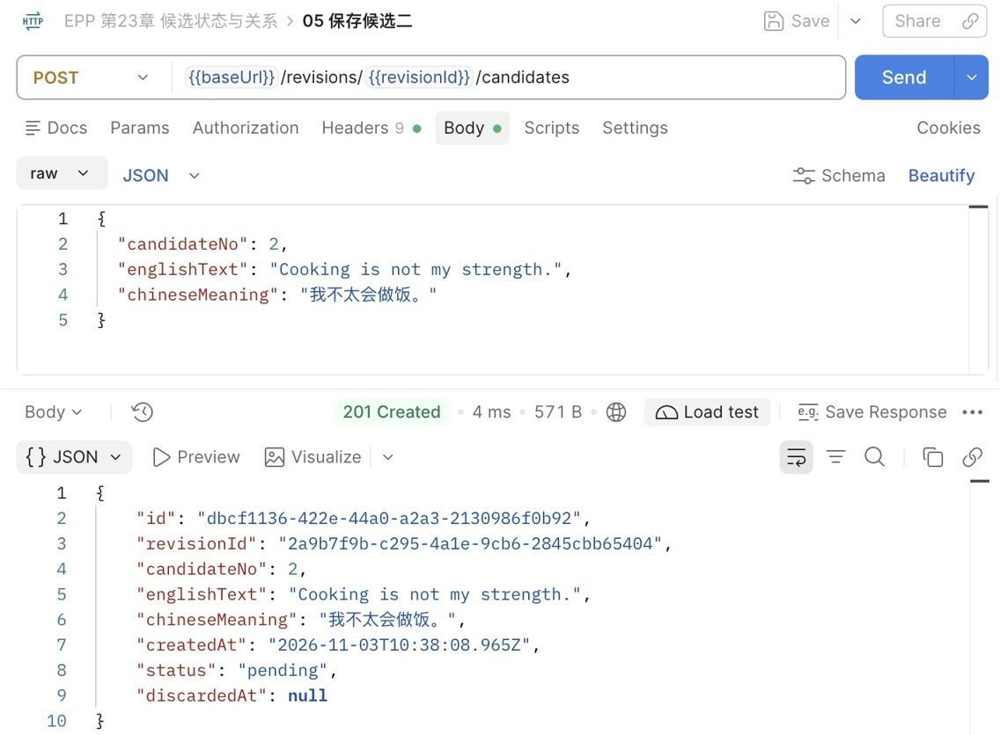

这里保存的是序号2：响应给出独立id和来源revisionId，status为pending、discardedAt为null。候选正文与提交值一致。

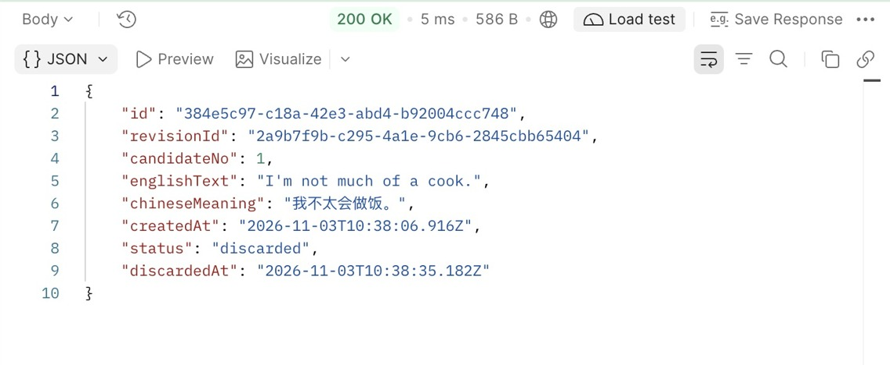

07返回的是序号1的候选：英文内容保持，状态变为discarded，保存了服务端时间。再读取列表才能同时确认另一份候选未改变。

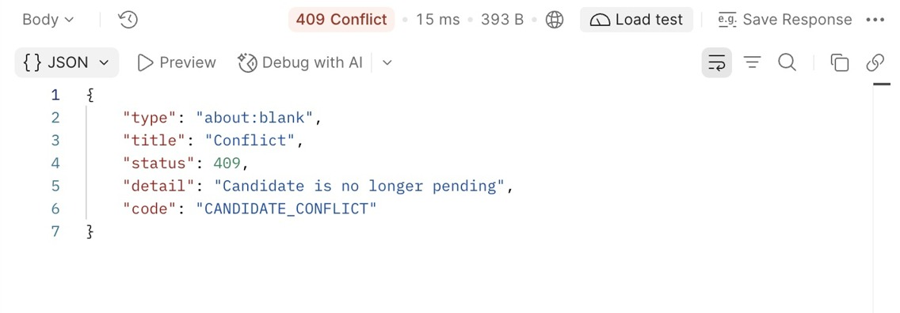

08的detail说明当前已不是pending，code为CANDIDATE_CONFLICT；错误响应本身不展示原放弃时间，要用06读回核对。

在DBeaver运行01-inspect的最后一条关系查询，观察candidate的revision_id与HTTP的revisionId对应，candidate_no仍为1、2。discarded行没有被删除，它的英文和中文意思不变。图形客户端的响应展示和数据库查询是两次观察，后续写入可能发生在两者之间；比较时使用同一个candidateId，不能只凭相同文字认作同一条。

### 用真实断点区分输入、执行与响应

沿用VS Code的Attach Node配置，连接仅绑定本机的Inspector。先在 `CandidatesService.discard` 调用store之后、判断result之前设断点，再在 `PrismaCandidateStore.discard` 的 `const row = rows[0]` 处设断点；发07前，把candidateId换成一份尚未放弃的演示候选。

存储断点中先看rows[0].id、status与discardedAt。非空id说明UPDATE返回了变更行；继续到service应得到discarded对象，继续到ResponseSchemaInterceptor的map回调再看value及Schema解析结果，最后Postman显示200。第二次请求在存储处得到id:null，service转为CandidateConflictError，最终409。不要把整个rows对象复制进常态日志。

在Debug Console中可用下面的只读表达式观察三项值，避免展开整个database对象时误露连接配置：

```js
JSON.stringify({id: rows[0].id, status: rows[0].status, discardedAt: rows[0].discardedAt})
```

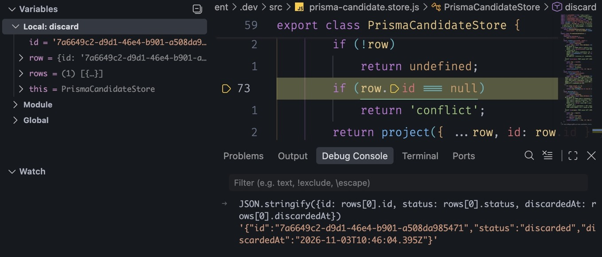

这次调试在编译后的prisma-candidate.store.js中暂停，黄色行正要检查row.id。控制台显示非空id、discarded与时间，继续后HTTP返回200；它与上面Postman图是不同演示候选，不跨ID比较时间。若调试器跳到.dev下的JS，先确认当前生成产物与源码映射，不把JS行号直接当作TS行号。

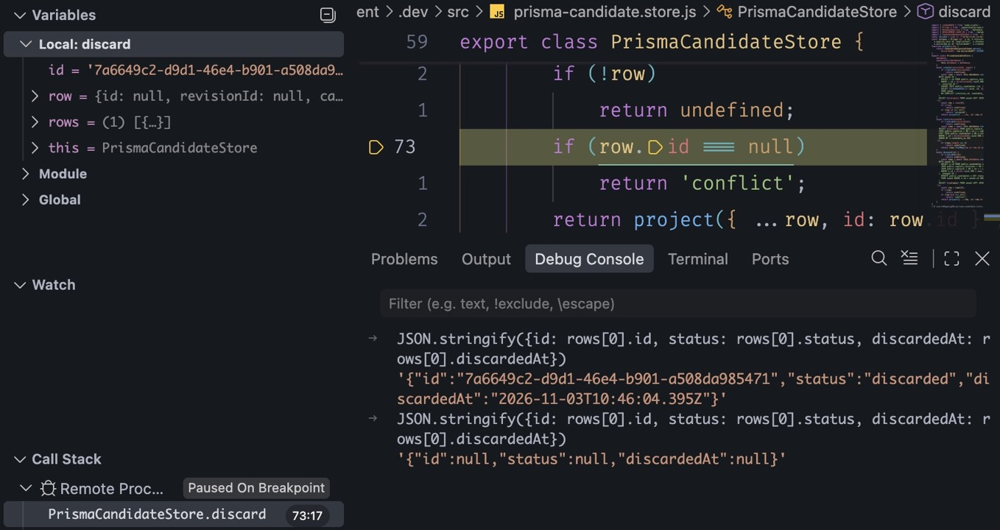

再次发送同一候选的放弃请求，最后一次控制台输出为id:null、status:null、discardedAt:null。这是LEFT JOIN保留了owned行而changed为空，不是把数据库候选改成了null；继续后HTTP返回409。上方控制台仍留有第一次结果，按最后一次输出判断当前暂停。

如果断点停太久，Postman可能先超时，但SQL已经执行完成；继续程序后先GET候选列表确认状态，不自动再发POST。编辑保存时等自动编译成功和调试重连，再发读取请求。编译失败意味着修改没有成为新服务，不能用上一次进程的返回值验收新逻辑。

### 用一次临时表实验拆开两种保证

在DBeaver打开独立SQL编辑器，使用 `database/chapter-23/02-state-shape.sql`，逐块运行。第一段先创建临时表并插入pending，再只把status改成discarded，不写时间；应触发CHECK失败。此时事务已经失败，单独执行ROLLBACK后再继续，不把后续“事务已中止”当作新的根因。

第二段创建相同约束，先插入合法discarded，再把status改回pending并清空discarded_at。这次UPDATE成功：新行形状完全符合CHECK，但它违反了本章“放弃不可撤销”的应用规则。最后ROLLBACK清理临时表，不对业务candidates做反向修改。

```sql
-- One independent DBeaver editor/session; no business tables are changed.
-- Run each block separately. After the intentional error, execute ROLLBACK.
BEGIN;
CREATE TEMP TABLE candidate_state_lab (
  status text NOT NULL,
  discarded_at timestamptz(3),
  CHECK ((status = 'pending' AND discarded_at IS NULL) OR
         (status = 'discarded' AND discarded_at IS NOT NULL))
) ON COMMIT DROP;
INSERT INTO candidate_state_lab VALUES ('pending', NULL);
-- Expected 23514: this row shape is invalid.
UPDATE candidate_state_lab SET status = 'discarded';
ROLLBACK;

-- A valid row shape does not prove a valid transition.
BEGIN;
CREATE TEMP TABLE candidate_state_lab (
  status text NOT NULL,
  discarded_at timestamptz(3),
  CHECK ((status = 'pending' AND discarded_at IS NULL) OR
         (status = 'discarded' AND discarded_at IS NOT NULL))
) ON COMMIT DROP;
INSERT INTO candidate_state_lab VALUES ('discarded', CURRENT_TIMESTAMP);
UPDATE candidate_state_lab SET status = 'pending', discarded_at = NULL RETURNING *;
-- This succeeds: the CHECK does not compare OLD and NEW.
ROLLBACK;
```

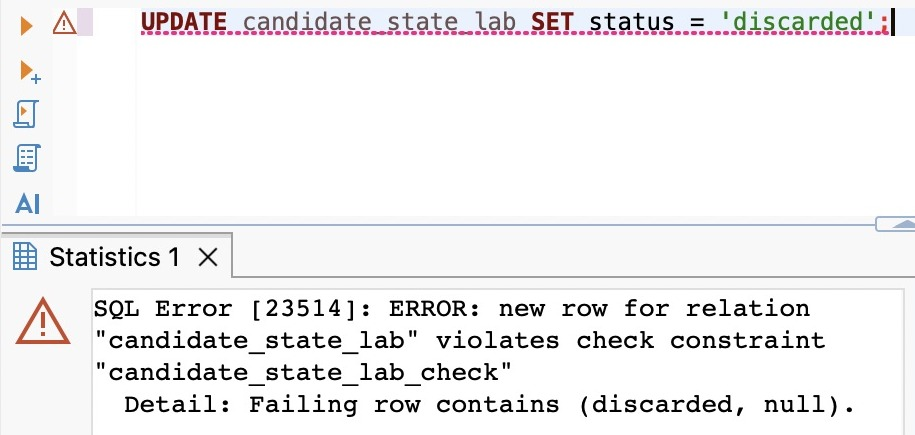

第一组实际返回23514，失败行是(discarded, null)。先单独执行ROLLBACK，再创建第二组临时表。若DBeaver提示UPDATE没有WHERE，先确认目标确实是本会话只有一行的candidate_state_lab，再执行；不要因此关闭客户端的更新提醒。

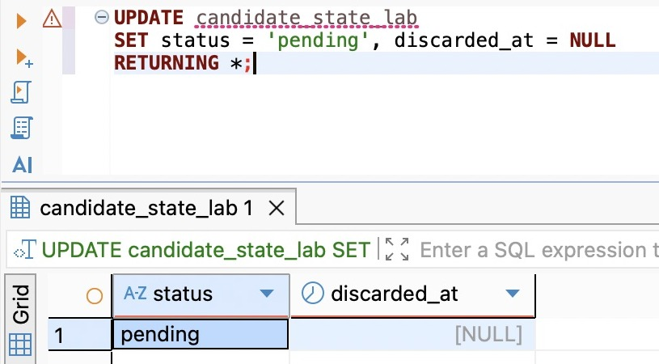

第二组从合法discarded行出发，UPDATE RETURNING实际返回pending与NULL，说明数据库接受了这个新形状。截图时仍在实验事务内，随后执行ROLLBACK；可用 `SELECT to_regclass('pg_temp.candidate_state_lab');` 返回NULL核对临时表已经清除。两组都不修改业务候选。

CHECK检查新行里的值，不比较它来自什么旧状态。应用用条件写入与受限路由落实转移；当前开发账号仍有直接更新表的权限。若要阻止其他写入口绕过规则，应进一步设计最小数据库权限、统一写入入口，或在确有需要时使用触发器维护转移。仅给状态列起名state、把枚举搬进公共常量，都不会自动建立这些保证。

## 26.5 采纳、放弃、未选择与旧修订是不同事实

继续Postman的12～14。12为同一Capture追加第2版，把新ID保存为newRevisionId，保留原revisionId。13读取新版候选应为空；14读取旧版，仍能看见一份discarded、一份pending。追加版本不复制候选、不改变原决定，也不让旧候选自动成为新输入的建议。

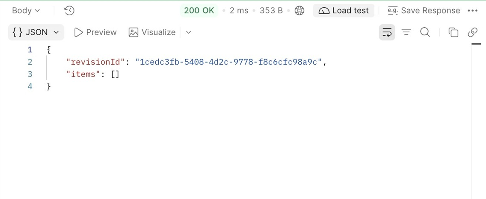

13返回新的revisionId与items:[]。它证明新版本尚无候选；14使用原revisionId，才能核对旧候选仍在。不要把不同revisionId的两个列表当成同一个集合被清空。

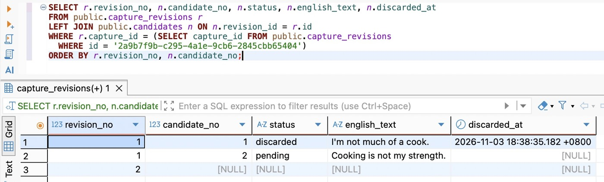

这次数据库查询沿Postman中的第1版revisionId找到同一Capture，再读取全部修订，只投影版本号、候选位置、内容、状态和放弃时间。前两行仍属于第1版；第3行的revision_no为2，而候选字段全为NULL，这是LEFT JOIN保留的新修订，不是保存了一份内容全空的候选。图中18:38:35.182 +0800与Postman的10:38:35.182Z是同一时刻，比较时先统一时区。

“旧修订”是候选来源与当前修订之间的关系，不是候选的处理状态。第1版的候选可以仍pending，也可以早已discarded；若以后已采纳，它仍然是一项历史确认事实。把所有旧候选批量写成discarded，会把系统观察到的过期关系伪装成用户主动决定。

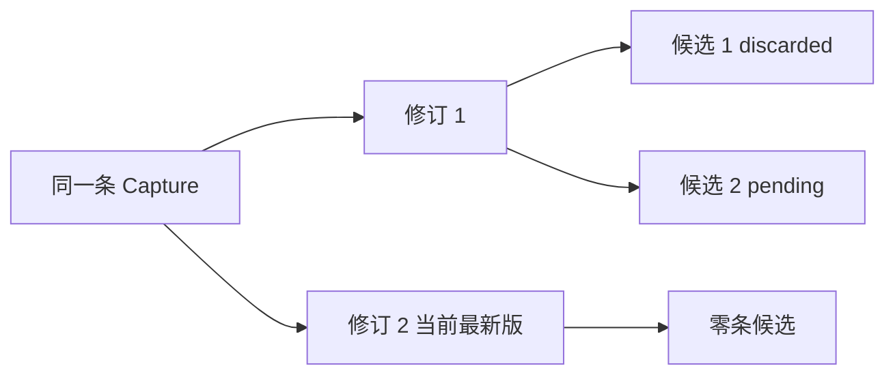

未选择也不能直接当成放弃。用户只看了一眼、暂时离开，或者将来采纳了同组另一条，都不足以证明他对这条候选发出了放弃命令。如果后续产品明确规定“一组只选一项，选定后其余关闭”，应为组的选择事实与候选的展示结果建立明确规则，不能让前端猜测。

### 确认必须绑定用户实际看到的对象

设想用户打开第1版的候选页面后，另一窗口追加第2版，再回到原页面点击采纳。若请求只有captureId，服务读取“当前候选”，就可能把用户没看见的内容当成已确认。请求必须携带具体candidateId，沿它读出revisionId和不可变内容；不能到提交时再替用户选最大revision_no。

至于旧版候选能否采纳，是另一个业务条件。当前接口允许读取、补存或放弃旧版候选，因为这些动作能够准确绑定其来源。本章没有采纳入口，不能从“旧候选可读取”推断“以后一定可以采纳”。下一章的采纳需要明确来源版条件；若要求只采纳当前版，必须把这个前提放进可靠的执行边界。页面先GET判断是最新版，再过几秒无条件采纳，仍可能遇到竞争，第二十八章会继续处理这个问题。

候选内容不提供编辑入口，也与确认对象有关。如果同一个candidateId下的英文可以被另一个请求悄悄替换，用户发来的ID就不再指认他看到的内容。现在需要改候选时，保留旧对象，并使用尚未占用的位置保存新对象；五个位置用尽就停止这一版的候选追加。不能通过改写历史或清空放弃项绕过上限。以后加入重新生成批次或显式候选修订，才扩大这个能力。

### 失败、回退与中断也按事实恢复

保存候选后连接断开，先按revisionId读取全部候选，核对占位及内容。相同candidateNo导致409只证明该位置已占用，不证明是刚才那次请求，也不证明内容一致。自动换一个序号重发可能制造重复建议；第29章的操作身份与结果重放会解决更完整的重试问题。

放弃超时后同样先GET。若看到discarded，说明当前状态已到终点，但不能仅凭时间猜测是哪个并发请求完成的。本章不记录完整操作审计。若看到pending，也要考虑原请求仍可能执行中，不能把一次读取当成永久判定；先结合在途请求与安全日志定位，再决定下一步。

生产仍先迁移，再构建独立产物。沿第二十二章复制dist、package.json、package-lock.json和.npmrc，在独立目录用 `npm ci --omit=dev` 安装运行依赖；由运行环境提供DATABASE_URL后执行 `npm start`。不复制开发.env，不开Inspector或源码监听，默认关闭docs。停止开发进程后以同一候选ID读回，核对放弃和内容都来自数据库，而不是内存。

需要回退到25章程序时，可以保留新增候选表，它不会破坏25章的修订协议；但那一版没有候选路由，客户端会失去该能力。回退程序也不撤销已发生的放弃，不能通过删表伪装恢复。更不能退回24章的旧内容写入方式，它会绕过25章的修订来源。

中断前保存captureId、revisionId、candidateId、newRevisionId，结束SQL事务。下次从GET修订和候选列表恢复，确认当前数据库与运行版本；不要从集合01开始重新创建，再把两套结果混在一起。

至此，我们能够保存某版输入的少量候选，准确区分尚未决定与主动放弃，并能解释状态、归属、历史和未来正式表达之间的关系。下一章将沿26.2的写入责任创建采纳结果，观察半次成功留下的矛盾，再用事务让一个业务动作一起完成。

## 知识支线

- [支线26A：什么时候拆开状态，什么时候保留事件](side-01-state-and-events.md)：用报销审批的条件变化区分处理状态、相对关系、外部进度和历史事实，再回到候选确认。

## 附录：本章必要技术点速查

| 名称 | 本章用途 | 必要注意点 |
| --- | --- | --- |
| pending／discarded | 候选自身的处理状态 | 无候选、旧修订和未选择不能混成放弃 |
| candidateId／revisionId／candidateNo | 候选身份、输入版本与版内位置 | 1～5的位置不复用，不是幂等键 |
| 联合唯一与范围CHECK | 保证版内占位及数量上限 | 放弃行仍参与唯一性；不能先COUNT再无条件写 |
| CHECK与NOT NULL | 限制状态和时间组合 | 合法行不等于合法转移，NULL可能使CHECK得到unknown |
| RESTRICT外键 | 保留候选引用的修订 | 不自动验证用户归属，也不要求修订已有候选 |
| INSERT SELECT／DO NOTHING | 对有权限的修订保存，冲突不覆盖 | 返回零个插入行不等于幂等成功 |
| LEFT JOIN | 区分不存在与空集合、占位或转移冲突 | WHERE过滤右侧可能改变空集合语义 |
| UPDATE WHERE status | 在实际修改时限定来源状态 | 当前单行保证不覆盖下一章多表采纳 |
| statement_timestamp() | 记录放弃语句的开始时间 | 不是客户端时间或精确提交顺序 |
| z.discriminatedUnion | 核对状态和响应字段的一致性 | 输出检查失败不会回滚已经提交的写入 |
| ApplicationState.track | 关闭前等待候选数据库工作 | 客户端断开不等于数据库取消 |
| @HttpCode(200) | 放弃POST返回已有对象结果 | 新建候选仍为201；错误保持Problem Details |

官方入口：[PostgreSQL 18约束](https://www.postgresql.org/docs/18/ddl-constraints.html)、[INSERT与ON CONFLICT](https://www.postgresql.org/docs/18/sql-insert.html)、[UPDATE](https://www.postgresql.org/docs/18/sql-update.html)、[READ COMMITTED](https://www.postgresql.org/docs/18/transaction-iso.html#XACT-READ-COMMITTED)、[时间函数](https://www.postgresql.org/docs/18/functions-datetime.html)、[Nest Controller状态码](https://docs.nestjs.com/controllers#status-code)、[Zod区分联合](https://zod.dev/api#discriminated-unions)。Prisma调用以本项目锁定的7.10.1生成类型为准，模型与迁移仍分开核对。

本章完成代码分支：`part-04/chapter-26`。

[上一章：关系演进：从覆盖输入到保留修订历史](../chapter-25-revisions/chapter.md) · [下一章：事务：让多次修改成为一次业务动作](../chapter-27-transactions/chapter.md) · [第四篇导读](../README.md) · [全书目录](../../README.md)
