# 第26章 幂等与审计：响应丢失后如何安全重试

上一章让同一个候选只能建立一份采纳关系：pending条件决定谁能改变状态，唯一约束防止重复关系，事务把相关事实一起提交。现在把时间再向后推一点：数据库已经提交，服务也准备好了201，客户端却只看到网络错误。再次点击采纳会得到409，这能阻止重复写入，却没回答用户最关心的问题：刚才那次到底成功了吗，原来的学习记录又是哪一条？

本章从 `part-04/chapter-25` 继续到 `part-04/chapter-26`，给采纳增加操作身份、请求指纹和持久化结果。相同操作重试时返回原来的成功结果；身份相同而内容不同则拒绝。新增记录与业务变化进入同一笔数据库事务，并说明这份记录能证明什么、为什么不能把所有运行日志都当成审计。

仍使用PostgreSQL 18、Prisma 7.10.1、固定开发用户和DEV／VERIFY／SHADOW。采纳Body由空对象改为必填operationId；原文创建、修订追加、候选创建与放弃沿用各自的旧契约，不因为这一章完成就全部获得结果重放。接口仍采纳具体候选，不提前加入语义去重或外部AI调用。

配套入口是 `database/chapter-26/README.md`，包含三个分块SQL文件和Postman集合。先理解26.1的身份约定，再在26.2迁移；26.3实现并联调，26.4重现响应丢失。可以在迁移核对后、普通重放成功后分别停下；保留集合变量，结束实验事务，下一次从已保存的操作继续。

时间参考：阅读约115～135分钟，跟做另加80～100分钟；最终篇幅与操作量的估算依据见第四篇导读，非读者实测。章末支线另计。

## 26.1 采纳已经提交，但客户端没有收到响应

### 先画出客户端看不见的那一段

一次请求至少经过接收、事务执行、提交、生成HTTP响应和客户端收到响应。事务能保证采纳相关数据的原子性，不能把网络另一端的“已经收到”一起纳入提交。客户端超时，可能是请求根本没到服务器，也可能是服务还在等待锁，还可能是提交完成后连接才断开。

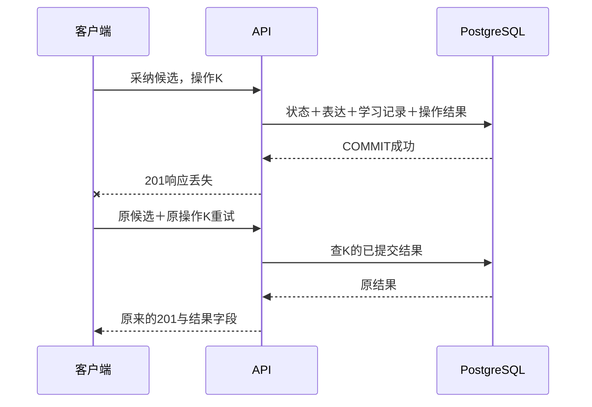

GET到accepted能证明候选已经处于终态，却未必能证明“就是这次操作完成的”。另一台设备可能先采纳，同一页面也可能在此前成功过。仅凭候选状态把所有409改成200，相当于把不同意图都解释成同一次成功。对于后续的付款、预约、发送，这种含混会更危险。

因此先区分三个问题：业务对象是谁，操作依据是哪一版，客户端想恢复的是哪一次决定。candidateId回答第一个问题，并通过revisionId指向不可变输入；operationId回答第三个问题。修订ID不能当操作ID：同一修订有多个候选，也可以发生多种动作。requestId则用于跟踪一次HTTP经过，重试应有新的requestId，却保留相同operationId。

### 身份必须早于第一次发送

本章客户端使用随机UUID，并以小写表示。选定候选、确认这次意图后，先生成并保存operationId，再发送请求。若在发送成功后才生成，恰好丢失响应时就没有恢复依据；若每次点击Send重新生成，服务看到的永远是新操作。

浏览器里可以用 `crypto.randomUUID()`，但调用位置比函数名字更重要。需要跨刷新恢复时，应把candidateId与operationId作为同一份待确认操作保存在适合该客户端的持久存储中，直到确认结果。这里不建设客户端队列，Postman的集合变量承担本章的保存入口。它在创建新候选成功后生成一次UUID，采纳请求只引用变量；不要把 `{{$guid}}` 直接放进采纳Body。新样本建立后，集合同时清掉上一轮expressionId、learningRecordId和otherCandidateId，避免首次响应丢失时误拿旧结果作比较。开始第二组实验前先保留上一组需要回查的ID；不要在尚未确认的操作上重跑01～03。

```json
{
  "operationId": "35000000-0000-4000-8000-000000000001"
}
```

路径仍为 `POST /candidates/:id/accept`。示例UUID便于讲解，真实每次新操作应另生成；重试则不能变。URL中的candidateId同样需要保留，不能把页面当前选中的另一候选代进去。

把身份放在Body而非请求头，是这条小接口的明确选择：原来Body只有空对象，现在只有一个有意义的必填字段，直接沿用Zod和图形集合。使用请求头也可成立，但仍必须解决验证、作用域、重复值和客户端保存，换个位置本身不会产生幂等性。

### 本章承诺的“相同”

我们把成功操作限定在服务端用户范围内，数据库键为(user_id, operation_id)。两个用户碰巧使用相同UUID不应拿到对方结果；请求也不允许自己声明userId。当前从固定开发身份取值，第五篇换成真实身份时仍保留这个来源约束。

相同用户、相同身份、相同采纳内容，返回第一次提交的201与原字段值。不是再创建一次学习记录，也不是从当前表达重新拼一份看起来差不多的响应。对象键顺序、requestId、响应耗时和Date等传输信息允许不同；业务结果中的ID、acceptedAt与内容保持。JSONB不保留对象键顺序，所以这里承诺语义结果一致，而非原始字节一致。

只保存成功结果。400说明输入不符合契约，404说明当前身份看不到目标，409说明业务或操作身份冲突，它们不占用一条成功回执。数据库异常也不会单独留下“失败完成”行。由此可知：同一身份在失败后还可能成功，它不是对所有HTTP状态永久缓存的通用服务。这一边界应在客户端契约里说清楚，不能让调用者靠猜测决定是否继续。

## 26.2 给成功操作保存一份可核对的回执

### 为什么不在内存中记一个Set

若只保存“处理过K”，进程重启就丢失，而且仍然不知道该返回哪个结果。把结果放进Redis等独立存储，又需要解释数据库提交与缓存写入之间的故障窗口。当前所有采纳事实都在PostgreSQL，一张同库表就能与它们原子提交，没有理由先引入另一套协调系统。

也可以只存learningRecordId，下次回查关联对象。对于允许返回当前状态的接口，这常常足够；但本章选择重放首次响应，表达以后可能补充形式、修订说明，当前投影不必等于当时结果。所以这里保存经过公开Schema筛选的响应快照，而不是所有数据库对象，更不保存请求头、Cookie、原始异常或完整日志。

CommandReceipt的一行表示“某个用户的一次采纳操作已经成功，并得到这份结果”。行里没有running状态：执行中由事务锁协调，完成时才插入全部非空字段。这样不需要额外回答running行的租约、接管和超时清理；长时间任务在后续篇另有模型，不能把本章的短事务任意拉长。

在 `prisma/schema.prisma` 增加以下模型，User和Candidate各增加反向字段 `commandReceipts CommandReceipt[]`，其余关系保留：

```prisma
model CommandReceipt {
  userId      String @map("user_id") @db.Uuid
  operationId String @map("operation_id") @db.Uuid
  action      String @db.Text
  candidateId String @map("candidate_id") @db.Uuid
  fingerprint String @db.Text
  statusCode  Int @map("status_code")
  response    Json @db.JsonB
  recordedAt  DateTime @default(now()) @map("recorded_at") @db.Timestamptz(3)
  user        User @relation(fields: [userId], references: [id], onDelete: Restrict, onUpdate: Restrict, map: "command_receipts_user_id_fkey")
  candidate   Candidate @relation(fields: [candidateId], references: [id], onDelete: Restrict, onUpdate: Restrict, map: "command_receipts_candidate_id_fkey")

  @@id([userId, operationId], map: "command_receipts_pkey")
  @@map("command_receipts")
}
```

主键不包含candidateId或fingerprint。否则同一个operationId换个候选或指纹就能再插一行，数据库反而无法表达“同一身份不能表示另一件事”。候选ID用于关联和核对，指纹用于确认请求内容相同；它们与操作身份承担不同责任。这里也不增加独立id，因为用户与操作身份已经足以定位一行。

`action`使用 `accept-candidate/v1`，标明动作及其语义版本。以后如果采纳支持选择形式、合并目标等新输入，版本和指纹需要一起演进；不能悄悄改旧动作的解释。statusCode固定201，保留为这份成功结果的组成部分。recordedAt是服务写入记录的时间，不是数据库提交序号，也不证明用户何时看到了响应；Prisma可能显式写入应用生成的时间，不能据列默认值推断所有INSERT都使用数据库时钟。

### 请求指纹先定义结构，再计算摘要

当前采纳的业务输入只有动作和candidateId，候选内容自身不可变，不接收客户端再次传来的英文或中文。代码在 `src/prisma-candidate.store.ts` 的accept开头生成：

```ts
const action = 'accept-candidate/v1';
const fingerprint = createHash('sha256')
  .update(JSON.stringify([action, id])).digest('hex');
const lockKey = JSON.stringify(['command', DEVELOPMENT_USER_ID, operationId]);
```

同文件从 `node:crypto` 导入createHash。固定顺序的数组避免对象键排列造成差异；不对原始HTTP文本直接哈希，所以JSON缩进变化不会变成不同意图。用户身份已进入主键作用域，operationId是查找键，都不需要靠指纹再次定义身份。候选ID沿用已有小写路径约定，不悄悄trim或把一个不合法值改造成合法对象。

本章即使不算SHA-256，只比较固定动作与candidateId也能判断相同；这里保留摘要作为请求语义的明确版本化表示，同时仍直接比较动作和候选ID。以后字段增加时，先决定省略、null、默认值、顺序是否等价，再构造规范化输入。给任意JSON套一个hash函数，不能替代这些判断。

动作版本也约束保存结果的解释。当前回执只会是v1，使用当前AcceptanceSchema读取；将来修改响应字段时，应保留v1解析器，或为已保存快照设计可验证的升级，不能把旧JSON直接交给不兼容的新Schema。更不能删除解析失败的回执后重做业务；当前解析失败会安全报错，等待修复存储或兼容逻辑。

摘要不是加密。可猜的内容依然可能被枚举；这里摘要只包含动作与UUID，但响应快照仍含用户英语内容。后面的保留策略必须面对这份真实数据，不能因为旁边有一串哈希就称它已经匿名。

### 追加迁移，不给旧采纳编造身份

停止旧API和会写入的脚本，先记录旧候选、学习记录与表达关联。追加 `20261104120000_command_receipts/migration.sql`，不重写前章迁移：

```sql
BEGIN;
SET LOCAL lock_timeout = '2s';
SET LOCAL statement_timeout = '10s';
CREATE TABLE public.command_receipts (
  user_id uuid NOT NULL,
  operation_id uuid NOT NULL,
  action text NOT NULL,
  candidate_id uuid NOT NULL,
  fingerprint text NOT NULL,
  status_code integer NOT NULL,
  response jsonb NOT NULL,
  recorded_at timestamptz(3) NOT NULL DEFAULT CURRENT_TIMESTAMP,
  CONSTRAINT command_receipts_pkey PRIMARY KEY (user_id, operation_id),
  CONSTRAINT command_receipts_user_id_fkey FOREIGN KEY (user_id)
    REFERENCES public.users(id) ON DELETE RESTRICT ON UPDATE RESTRICT,
  CONSTRAINT command_receipts_candidate_id_fkey FOREIGN KEY (candidate_id)
    REFERENCES public.candidates(id) ON DELETE RESTRICT ON UPDATE RESTRICT,
  CONSTRAINT command_receipts_action_check CHECK (action = 'accept-candidate/v1'),
  CONSTRAINT command_receipts_fingerprint_check CHECK (fingerprint ~ '^[0-9a-f]{64}$'),
  CONSTRAINT command_receipts_status_check CHECK (status_code = 201),
  CONSTRAINT command_receipts_response_check CHECK (jsonb_typeof(response) = 'object')
);
COMMIT;
```

这次没有INSERT回填。旧学习记录是真实事实，但客户端当年的operationId不存在，首次响应也未必能从当前对象精确恢复。生成随机UUID补进去既不能帮助客户端找到它，还会制造“曾收到这个操作”的假历史。保留旧accepted及其学习关系，新表为空，才是忠实的升级结果。

CHECK能约束动作值、摘要表示、成功状态与JSON顶层形状，不能自动证明快照每个字段都正确，也不能跨表保证快照对应本次修改。写入前用AcceptanceSchema校验，事务保证一起提交；直接执行维护SQL仍需要遵守这些约定。外键保护引用存在，权限由沿修订和原文归属的查询承担。

沿用前章配置，先VERIFY后DEV，明确CLI和API分别从哪里取得DATABASE_URL。成品分支运行以下命令；从前章自行实现则先按第18章create-only流程生成并审核迁移，不再额外执行同义CREATE：

```bash
nvm use
npm ci
unset DATABASE_URL SHADOW_DATABASE_URL
npm run db:verify -- migrate deploy
npm run db:verify -- migrate status
npm run db:verify -- migrate diff --from-config-datasource --to-schema prisma/schema.prisma --exit-code
npm run db -- migrate deploy
npm run db -- migrate status
npm run db -- migrate diff --from-config-datasource --to-schema prisma/schema.prisma --exit-code
npm run check
```

DBeaver刷新public下的Tables，查看command_receipts的Columns和Constraints，并运行 `01-inspect.sql` 的结构查询。主键应精确为(user_id, operation_id)，非延迟且已验证；原来六张业务表的行和关系保持。migrate status与Schema diff不能替代旧数据核对，Prisma模型也没有覆盖所有手写CHECK。

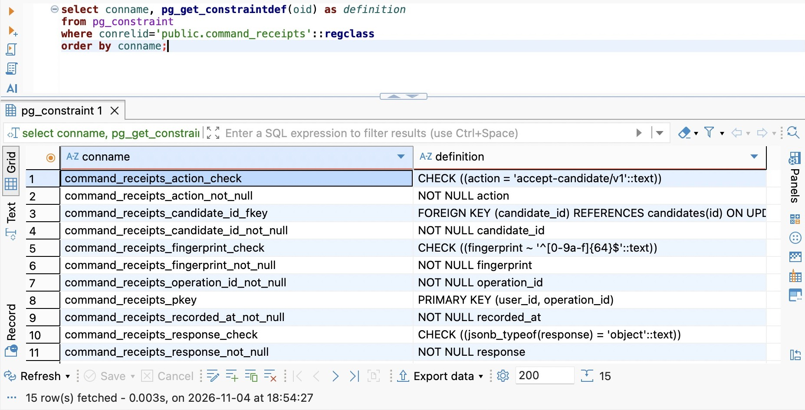

图中主键只包含user_id和operation_id；动作、摘要与JSON形状另有CHECK。展开或横向滚动definition列，核对完整外键定义。

在DatabaseService.onModuleInit沿用前章启动探针，读取一次commandReceipt，并从pg_constraint核对 `command_receipts_pkey` 的类型p、定义 `PRIMARY KEY (user_id, operation_id)`、convalidated与condeferrable。缺表、缺列或主键不符时拒绝就绪；主键不符的安全错误码为COMMAND_CONSTRAINT_MISSING，加入databaseFailure白名单。不能缺表后回退到无幂等的旧路径，否则一个部署错误就会悄悄改变客户端承诺。

这段代码放在 `src/database.service.ts` 既有学习记录唯一约束检查之后、缺失修订检查之前；原有失败关闭连接的catch保持：

```ts
await this.client.commandReceipt.findMany({ take: 1 });
const receiptKeys = await this.client.$queryRaw<{ definition: string; condeferrable: boolean }[]>`
  SELECT pg_get_constraintdef(oid) AS definition, condeferrable
  FROM pg_constraint WHERE conrelid = 'public.command_receipts'::regclass
    AND conname = 'command_receipts_pkey' AND contype = 'p' AND convalidated
`;
if (receiptKeys.length !== 1 || receiptKeys[0]?.definition !== 'PRIMARY KEY (user_id, operation_id)'
  || receiptKeys[0].condeferrable) throw Object.assign(new Error('Command identity constraint is missing'), {
    code: 'COMMAND_CONSTRAINT_MISSING',
  });
```

若迁移被锁阻塞，先看55P03等首因，再核对失败记录和实际结构；显式事务回滚后应没有半张新表。解决持锁原因、确认已回滚，才对这个迁移执行migrate resolve --rolled-back，再deploy。若表已经存在却没有正确历史，不自行drop：先核对来源及是否有业务行。resolve修改的是历史登记，不替你恢复数据。

## 26.3 把业务修改和重放结果放进同一事务

### 未存在的回执，不能直接靠行锁保护

直觉上可以先查K，没有就采纳，再插入K。但两个请求都可能查不到；同候选竞争时，后来的请求会在pending条件处得到409，仍不能重放。同一身份改成两个不同候选时，两边甚至都能走到写结果，最后由唯一约束让其中一个事务失败。唯一约束守住存储规则，却不会自动替应用选择怎样读取并返回胜者结果。

可行的一种方案是先插入占位命令，再把running改成completed，但要保证失败分支不会提交空壳、所有返回路径都正确处理状态。另一种是在事务开始时，为尚未存在的操作身份取得事务级建议锁；完成后只插完整结果。前章已建立这种机制，本章选择后者，以减少持久状态。

锁键由命名空间command、服务端userId和operationId组成，不含candidateId。因此同一身份换候选仍竞争同一把锁；若把candidateId也加进去，两个请求就会各取一把锁，失去本章要的串行协调。hashtextextended把这个字符串映射为64位锁键，碰撞最多让无关操作额外等待，精确身份仍由复合主键和字段比较决定，不能用锁的哈希值直接作为业务身份。

在accept的 `$transaction` 回调开始处加入：

```ts
await tx.$executeRaw`SET LOCAL lock_timeout = '1s'`;
await tx.$queryRaw`
  SELECT pg_advisory_xact_lock(hashtextextended(${lockKey}, 0))::text
`;
const candidate = await tx.candidate.findFirst({
  where: { id, revision: { capture: { userId: DEVELOPMENT_USER_ID } } },
});
if (!candidate) return undefined;
const previous = await tx.commandReceipt.findUnique({
  where: { userId_operationId: { userId: DEVELOPMENT_USER_ID, operationId } },
});
if (previous) {
  if (previous.action !== action || previous.candidateId !== id
    || previous.fingerprint !== fingerprint) return 'operation-conflict';
  return AcceptanceSchema.parse(previous.response);
}
```

这里的SQL仍是参数化模板，字符串没有拼进SQL源码。锁函数返回void，显式转成text让当前Prisma适配器能处理查询结果；返回文本不是成功凭证，函数正常返回才意味着已取得锁。必须使用事务级函数，提交或回滚即释放；连接池中随意使用会话锁，可能把锁遗留给下一次借到连接的请求。

**取锁、检查归属、查回执是三个按序完成的动作。** 当前使用READ COMMITTED，等待锁结束后再发下一条查询，才能看到前一持有者提交的回执。不要为了“少一次往返”把取锁和读取塞到同一条SQL：那条语句的快照可能早于锁等待结束，拿到锁也不会自动刷新它的语句快照。也不要只把隔离级别换成REPEATABLE READ却保持同样推理，它可能保留更早快照；改变隔离规则需要重做整个竞争过程。

查回执之前仍检查当前候选归属。知道operationId不是读取凭证，历史成功也不赋予永久访问权。候选不存在或不属于当前用户返回404，不向调用者披露另一个对象的结果。当前没有权限撤销和账号删除接口，未来接入时要把它们纳入一致的访问与生命周期协议。

### 没有旧结果，才尝试改变业务状态

上述代码紧接前章条件更新及表达创建；没有回执时，accepted或discarded仍返回业务冲突。保留pending条件与学习关系唯一约束，因为不同operationId不会互相排队，仍可能竞争同一候选。以下片段替换前章回调中从状态检查到return的位置：

```ts
if (candidate.status !== 'pending') return 'conflict';
const acceptedAt = new Date();
const claimed = await tx.candidate.updateMany({
  where: { id, status: 'pending' }, data: { status: 'accepted', acceptedAt },
});
if (claimed.count !== 1) return 'conflict';
const expression = await tx.expression.create({ data: {
  id: randomUUID(), meaning: candidate.chineseMeaning,
  forms: { create: { id: randomUUID(), text: candidate.englishText } },
}, include: { forms: true } });
const learningRecord = await tx.learningRecord.create({ data: {
  id: randomUUID(), userId: DEVELOPMENT_USER_ID,
  candidateId: id, expressionId: expression.id,
} });
const response = AcceptanceSchema.parse({
  candidate: project({ ...candidate, status: 'accepted', acceptedAt }),
  expression: { ...expression, createdAt: expression.createdAt.toISOString() },
  learningRecord: { ...learningRecord, createdAt: learningRecord.createdAt.toISOString() },
});
await tx.commandReceipt.create({ data: {
  userId: DEVELOPMENT_USER_ID, operationId, action, candidateId: id, fingerprint,
  statusCode: 201, response,
} });
return response;
```

所有数据库操作都通过tx，尤其不能把最后一行插入写成database.client.commandReceipt.create。后者会跑到另一条连接和事务里，成功或失败都可能与业务提交错开。response先经过已有公开Schema，内部userId与关系字段不会因为spread一起进入快照；JSON可序列化值中的日期已经转成字符串。

回执写失败时必须让异常离开回调，Prisma回滚此前的accepted、表达、形式和学习记录。不要catch后仍return response，也不要先提交业务再异步补回执。反过来，回执与业务提交成功后，HTTP响应即使失败也不能删掉回执；它正是下一次恢复的依据。

回调return不是提交完成。外面的 `$transaction` Promise完成后，Service才能返回给Controller；如果提交结果在连接异常中未知，就沿用存储异常映射，客户端以后用同一身份恢复。内部仍只对P2034做最多三次完整事务尝试，退避位于事务外，maxWait=2000、timeout=5000、每次取锁等待1秒保持前章设定。不把网络异常、P2028或任意500加入自动循环。

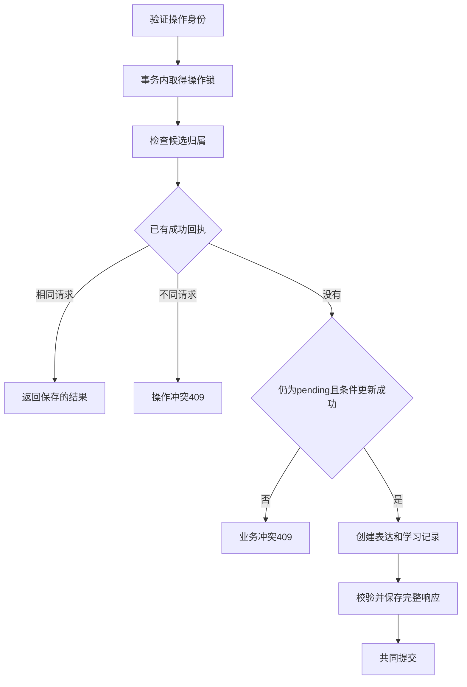

锁序现在是操作身份在前、候选写锁在后；以后加入用户生命周期协调时，应统一为用户生命周期→操作身份→候选→按稳定ID排序的已有表达，所有相关写入口遵守同一方向。建议锁是协作协议，不能阻止绕过它的SQL；复合主键仍是数据库兜底。若另一条不遵守协议的写入口导致P2002，本章安全回滚并报错，不把任意唯一冲突都冒充回执命中。

### 让契约贯穿Controller、Service与文档

在 `src/candidate-contract.ts` 新增严格输入；空对象仍供放弃等旧接口使用，不把它全局替换：

```ts
export const AcceptCandidateSchema = z.object({
  operationId: z.uuid().regex(/^[0-9a-f-]+$/, 'Expected a lowercase UUID'),
}).strict();
export type AcceptCandidateInput = z.infer<typeof AcceptCandidateSchema>;
```

Controller的accept接收这个输入，保留查询参数必须为空以及响应Schema校验：

```ts
@Post('candidates/:id/accept')
@UseInterceptors(new ResponseSchemaInterceptor(AcceptanceSchema))
accept(@Param('id') id: string,
  @Body(new SchemaPipe(AcceptCandidateSchema)) input: AcceptCandidateInput,
  @Query(new SchemaPipe(EmptyObjectSchema)) _query: object) {
  return this.candidates.accept(id, input);
}
```

补齐相应导入。Service仍在边界验证未知输入，新增OperationConflictError，并把结果映射集中在已有位置：

```ts
async accept(id: string, input: unknown) {
  const parsed = AcceptCandidateSchema.safeParse(input);
  if (!parsed.success) throw new InvalidCandidateError('Invalid operation identity');
  const result = await this.state.track(() => this.store.accept(id, parsed.data.operationId));
  if (result === 'operation-conflict') throw new OperationConflictError('Operation identity was already used for another request');
  if (result === undefined) throw new CandidateNotFoundError('Candidate not found');
  if (result === 'conflict') throw new CandidateConflictError('Candidate is no longer pending');
  return result;
}
```

Store的accept签名增加operationId，返回类型增加 `'operation-conflict'`。在httpFailure中将OperationConflictError映射409及OPERATION_CONFLICT，保留CANDIDATE_CONFLICT表示候选业务状态不允许。二者虽然状态码相同，调用者下一步不同：前者检查是否误复用了身份，后者查明谁已经决定了候选。不得捕获所有409后自动生成新UUID再发。

OpenAPI的accept requestBody指向AcceptCandidate，components加入它；201说明同时覆盖首次与重放，400说明缺失／非法身份与多余输入，409分别说明两种冲突。生成文档后在Swagger确认必填operationId，Postman使用本章集合，旧章集合只用于对应章节分支。typecheck能找出漏改的TS调用者，找不出旧JSON请求；必须一起核对请求文件和运行说明。

启动npm run dev，导入本章集合，按01～04准备候选。发送05得到201，保存learningRecord.id、expression.id和acceptedAt；再发送06，三个值应完全相同。DBeaver用01脚本查当前候选，学习记录和回执都应只有一行。仅看到两次201不够：错误实现也可能两次创建成功，必须核对同一份结果及数据库数量。


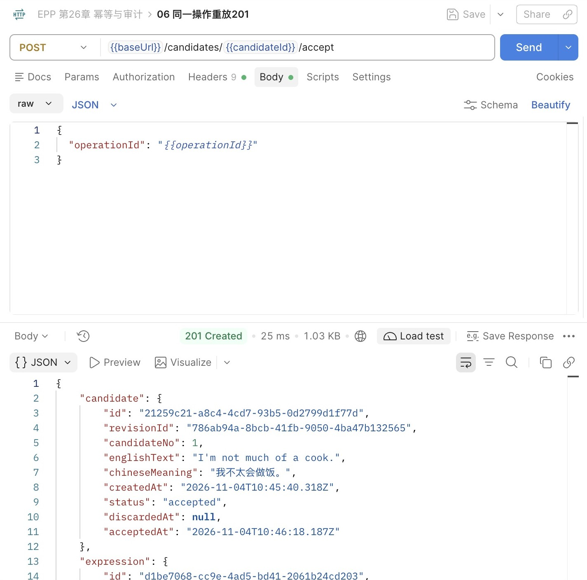

两图candidate.id与acceptedAt一致，表达ID也保持；向下滚动响应继续核对学习记录ID。请求耗时和传输大小可以变化，不能拿它们判断业务是否重复。

## 26.4 响应丢失、请求变化和旧历史，各自怎样恢复

### 真正丢掉一份已经成功的响应

沿用上一节的样本，先执行07～13：07为已采纳候选换身份，08创建第二个候选，09误用第一份成功身份，10～12验证非法输入，13读取状态。第二个候选应仍为pending，后文会解释各个冲突；暂不发送14。DBeaver查询两候选，作为断网前的对照：

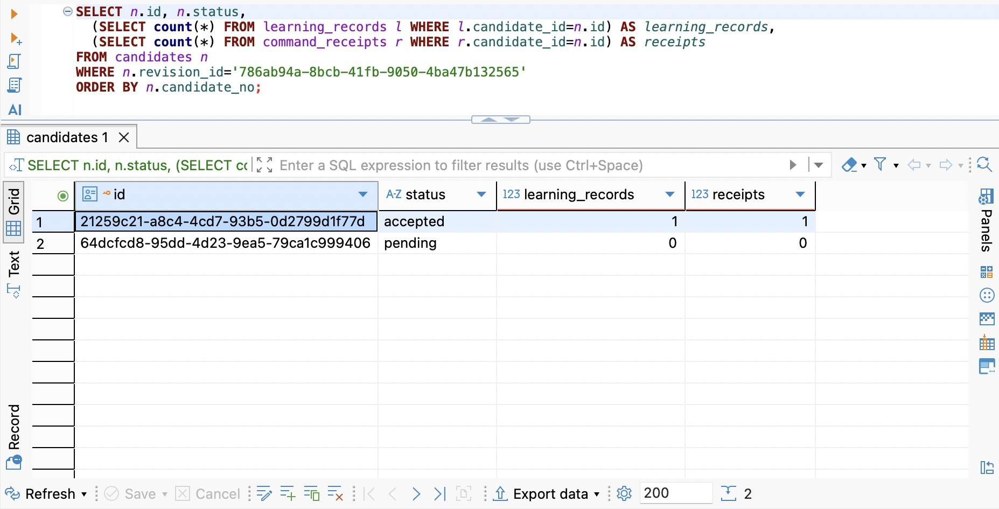

第一候选已经有一份学习记录和回执，第二候选两项都为0。接下来只对第二候选执行14，在第二终端运行：

```bash
node examples/lost-acceptance-response.mjs
```

这个独立Node脚本只监听本机3010，转发采纳请求到本机3000。它不挂进EPP路由，也不进入生产dist。若API端口不同，使用 `TARGET_PORT=实际API端口 PORT=实验端口` 启动；不能把代理端口与目标设成同一个值。

代理不是随机断网。它会消费第一份上游201，然后断开客户端连接，确保这次演示对应“服务已经成功，返回路上丢了”。关键处理如下，完整转发、超时及错误收尾在配套文件中：

```js
if (dropNextSuccess && result.statusCode === 201) {
  dropNextSuccess = false;
  result.resume();
  result.on('end', () => {
    console.log('Upstream 201 consumed; dropping the client response.');
    response.destroy();
  });
}
```

Postman打开14，把该请求的URL临时改为 `http://127.0.0.1:3010/candidates/{{otherCandidateId}}/accept`，Body仍引用otherOperationId，不更改集合的baseUrl。发送14。客户端应出现网络错误，而不是得到一份伪造500；代理终端显示已消费上游201。DBeaver此时查询应是accepted、学习记录1、回执1。这个对照直接打破“客户端显示失败，所以数据库没做”的推断。

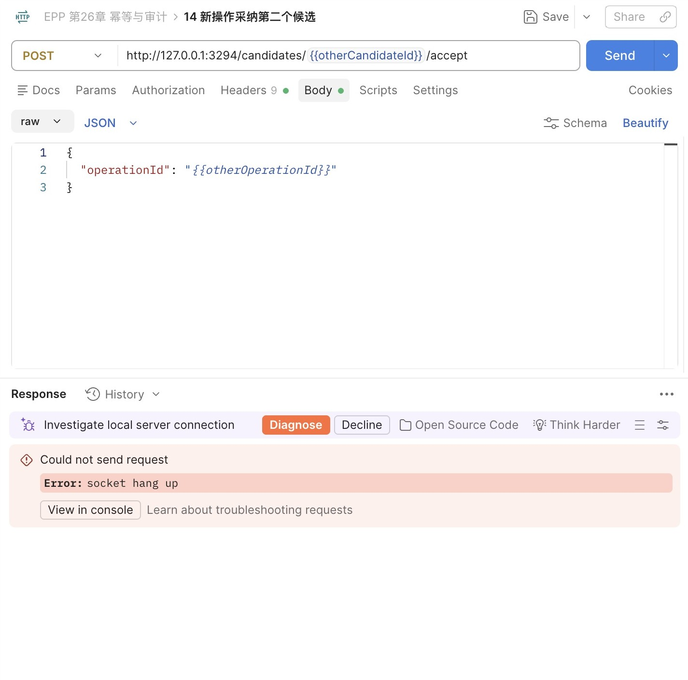

图中实验代理使用3294端口；使用默认配置时对应3010。应观察socket hang up与仍然保留的Body变量，不根据客户端的自动诊断建议重建操作。

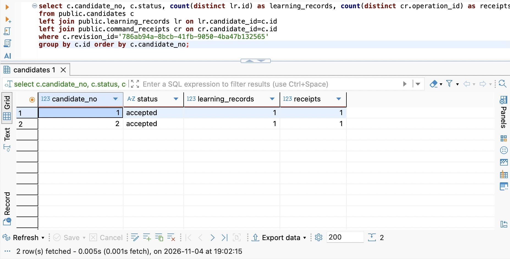

候选2已经accepted，学习记录和回执各1行。查询数据库能确认提交事实，客户端仍需用原身份取回结果。

不重跑创建，不重新生成UUID，再发14。代理第二次正常转发，API读回执，Postman得到201。将结果ID与回执中保存的ID比较。最后把14的URL恢复为 `{{baseUrl}}/candidates/{{otherCandidateId}}/accept`，Ctrl+C关闭代理。代理重启后会再次丢弃第一份成功响应，不能把它留在日常请求链路里。

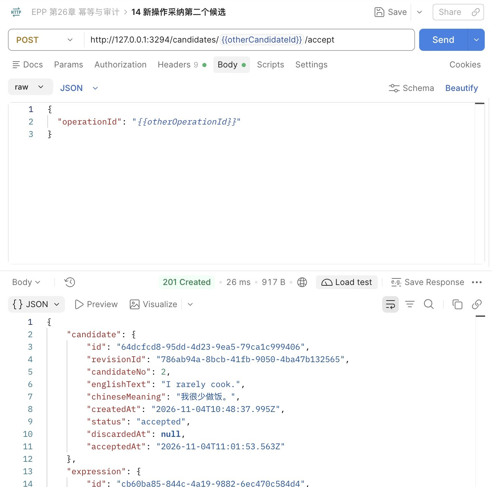

返回的是第二候选已保存的结果；不是因为换了新UUID才成功。此时再查数据库，数量仍为1。

真实网络错误本身不会告诉你故障发生在哪个时点；本实验通过代理人为固定时点，才知道首次已经提交。实际恢复不依赖客户端猜对阶段：原操作若回滚，下一次可以执行；若已经提交，下一次重放；若仍在执行，下一次等同一操作锁，或在等待上限后返回503，稍后仍用同一身份确认。

### 给正在执行的操作一个有限等待

在DBeaver的独立连接A运行02脚本的A1块，使用本次operationId替换全零UUID，保留JSON数组格式和固定用户。确认与API连接的是同一个隔离练习库。A取的是同一个事务级建议锁，不改业务表；此时Postman发送相同操作，约一秒后得到503。A单独ROLLBACK，再重发，得到成功或已保存的原结果。

不能把503转换成“立刻换UUID再试”，那会逃出原操作的协调范围。客户端还应限制次数并延迟，例如先等一秒，再等两秒，连续几次仍无法确认就保留待确认状态，允许稍后手工恢复；不要同步让数百个请求无限重试。具体总等待预算取决于产品，本章集合不自动发送请求，读者能观察每一次决定。

锁等待失败和响应丢失可能长得相似，但依据不同：前者可在安全日志看到55P03，后者可能在服务日志看到201而客户端没有结果。无论哪一种，重试都保持操作身份和业务输入。未知结果是需要继续核对的状态，不是重新制造业务对象的理由。

### 末步失败，回执也不能落单

用另一个新pending候选，在独立练习库执行03脚本，为它的operationId增加一个只拒绝这次INSERT的CHECK。NOT VALID只跳过检查已有行，新写入仍受约束。发送采纳，应得到500；查询应是pending、学习记录0、回执0，表达及形式也不应留下本次孤儿。它比只在第一个SELECT处制造错误更有解释力：前面的业务写入实际执行过，最后一步失败仍能一起撤销。

单独移除这个实验约束，再用原候选与原operationId重发，才能得到完整成功。不要在正式数据库加入故障约束，不要为了清理实验批量删除command_receipts。中断后先查pg_constraint，确认约束是否仍在，再决定从故障观察还是恢复步骤继续。

VS Code连接开发Inspector时，先在CandidatesService.accept的 `if (result === 'operation-conflict')` 处下断点；store的Promise此时已完成，适合停下来观察结果。发送同一已成功操作，在Debug Console只查看result中的状态与三个对象ID，不展开数据库连接或运行环境。

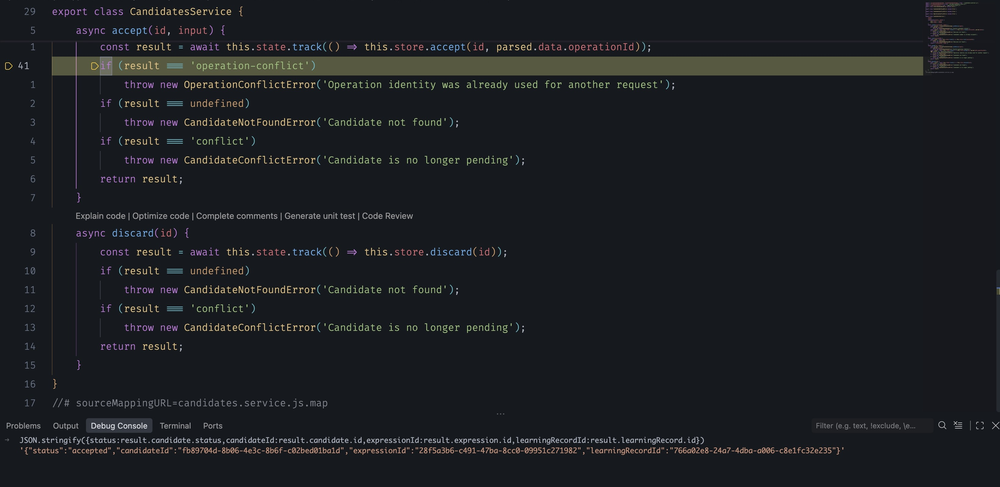

图中黄色箭头停在检查语句，控制台显示accepted及候选、表达、学习记录ID。截图显示的是编译后的candidates.service.js第41行，对应本章TS第30行；判断暂停位置应认语句，不照搬生成文件的行号。若TS断点显示灰色Unbound breakpoint，先核对当前连接的Inspector和开发目录；仍未绑定时，可打开该次开发编译生成的 `.dev/src/` 中同名JS，在对应语句设置断点，不能仅凭编辑器里有一个断点圆点就认定命中。本次用本机HTTP请求触发暂停，继续后收到201，响应逐字段等于原回执。

停用服务层断点，再对同一已成功操作在Store的 `return AcceptanceSchema.parse(previous.response)` 下断点，看previous存在、候选和指纹相同。

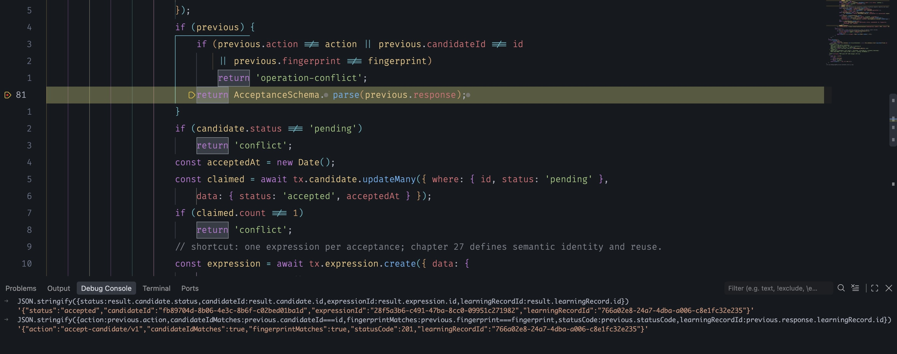

这里是prisma-candidate.store.js第81行，对应TS第79行。控制台的candidateIdMatches和fingerprintMatches均为true，statusCode为201，learningRecordId与上一图一致；因此当前路径准备返回已有快照，不会继续走下面的pending判断和创建表达逻辑。这里只观察虚构样本的少量字段，不把完整response复制进普通日志。

重放断点仍在事务里，暂停超过5秒可能使当前请求失败；不能把“停了多久”当成稳定的超时实验。本次继续后实际仍返回201，断开调试后用原操作重试也返回201，两次结果都与保存快照一致，数据库学习记录和回执仍各一条。无论本机调试得到201还是超时错误，都要以继续后的HTTP和数据库核对收尾，不把暂停时看到的对象当成新提交证据。之前成功的回执不会因为这次读取超时被撤销。

### 两种409与没有回执的历史

普通流程中，07为已采纳候选换一个operationId，应得到CANDIDATE_CONFLICT。08创建第二个pending候选，09携带第一个成功operationId，应得到OPERATION_CONFLICT，第二候选仍pending。10～12再检查缺失身份、夹带字段、查询参数400；13读取状态，14用另一新身份采纳第二候选，15确认已采纳不能放弃。

同一身份但目标当前不可见，先返回404，因为权限检查在重放之前。它不会为了证明身份冲突泄漏其他候选是否存在。失败尝试未保存回执，所以07的业务冲突没有占用otherOperationId，14可以正常使用它；一旦成功，这个身份就永久代表那次成功内容，不能再用于新操作。

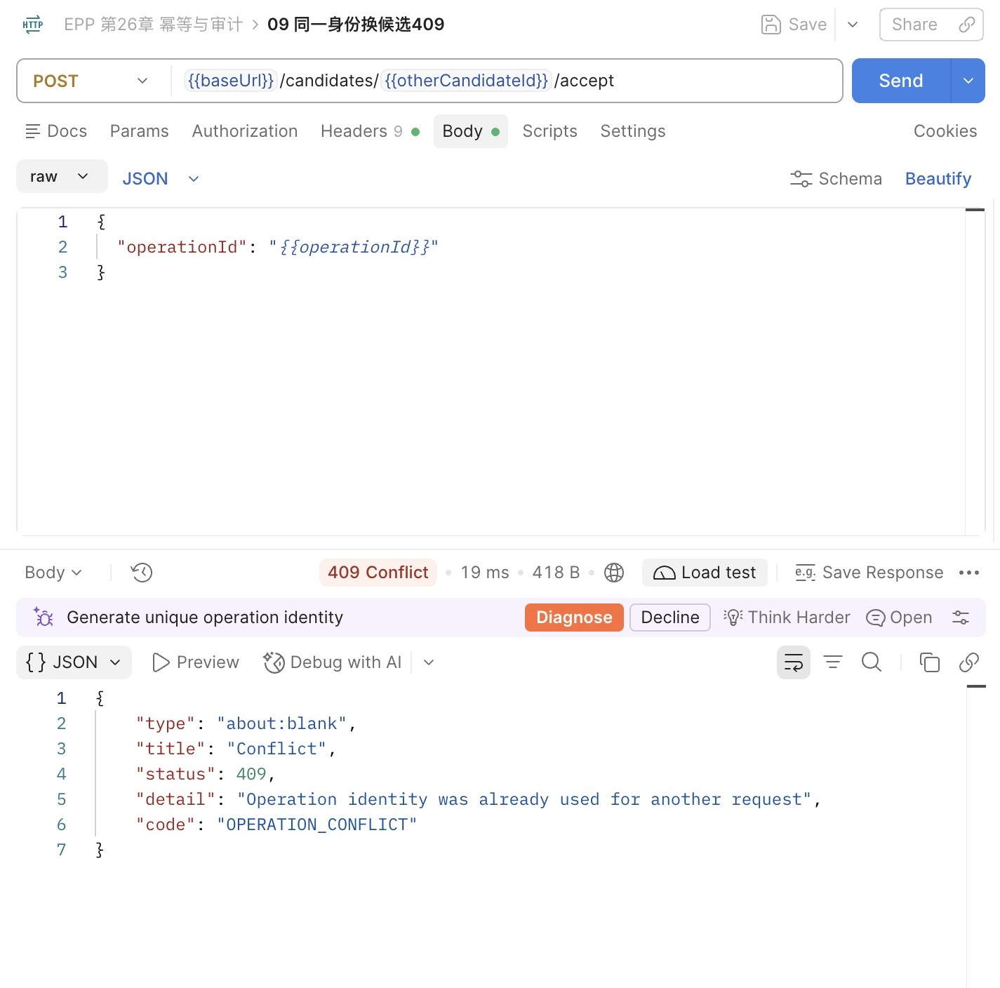

这里URL换成otherCandidateId，Body却仍使用第一份operationId，所以错误码是OPERATION_CONFLICT。图形客户端可能自动建议生成新身份；应先查明是错误替换目标还是确实想发起新操作，不能把自动建议当作业务决定。

升级前已采纳的候选没有回执，对它带任何新身份请求，都返回CANDIDATE_CONFLICT。用01脚本的NOT EXISTS查询可以找到这些旧关系，再沿learningRecord查看既有表达；这是读取历史事实，不是重放原命令。当前没有公开学习记录详情接口，数据库查询用于本章核对，第28章再建设面向客户端的查询投影。

旧记录无回执不等于迁移丢数据，新版本成功记录缺回执则需要调查。区分两者要看可靠的部署与写入来源，不能只用recordedAt机械划线；时钟和应用混跑可能使推断失真。发布时停止全部旧写入口，就是为了防止升级后仍不断产生“只有业务、没有操作结果”的新记录。

## 26.5 领域审计与运行日志，分别留下什么

### 一次成功事实，与多次执行尝试

运行日志中的requestId、路由模板、耗时和安全错误码回答“这次HTTP经过了什么”。相同operationId可能对应一次首次请求、两次网络重试和一次锁等待失败；重放也会产生新的请求日志，但数据库仍只有一条成功回执。日志还可能轮转、丢失或在写文件前进程退出，不能拿日志是否出现success来替代数据库事实。

command_receipts则回答：服务端认定哪个用户，以哪个操作身份，对哪个候选完成了哪个动作，得到什么结果。通过candidate→revision→capture可追溯决定依据，通过response中的学习记录ID核对结果。查询审计时优先选这些标识和状态，不默认展开用户全文：

```sql
SELECT operation_id, action, candidate_id, status_code, recorded_at,
       response #>> '{learningRecord,id}' AS learning_record_id,
       response #>> '{expression,id}' AS expression_id
FROM public.command_receipts
WHERE user_id='10000000-0000-4000-8000-000000000001'
  AND operation_id='35000000-0000-4000-8000-000000000001';
```

把示例operationId替换为本次集合保存值。SQL里的user_id是受信任的查询范围，不是允许客户端任意提交的过滤器。当前本机操作仍由固定开发用户完成，这只能证明固定身份下的服务决定，不能追溯到一个真实登录者。第五篇接入身份后，审计主体才会来自经过认证的会话。

这张表是成功采纳的领域审计依据，但不是完整审计平台。它没有记录读取、拒绝、放弃、管理员修改或所有权限变动，也不是第22章讨论的事件溯源：业务当前状态仍在业务表，不能仅靠回执重建整个系统。若需求要求记录每次拒绝，需另定义尝试事件及保存机制；把拒绝记录也写进随后回滚的业务事务，最终什么都留不下来。

审计也不自动意味着防篡改。当前应用所有者仍有数据库写权限，CHECK和外键不能防止有权限的人改写一个结构合法的response。若要追究管理员操作，需要独立访问控制、外部留存与可验证的完整性设计；本章不把“多一张表”包装成不可抵赖证据。先准确说明这份记录由谁写、可以回答哪类问题，才谈进一步保护。

### 快照有用途，也增加一份内容副本

为了重放，我们把候选文本、中文含义和表达快照存了一份。好处是未来当前对象变化时仍能解释原结果；代价是数据保留、备份、权限与删除都必须覆盖这份副本。不能只删captures中的原文，就声称相关内容已经从系统消失。

本章没有自动过期或清理接口，成功回执随业务数据保留。这个决定让重试期限明确，也避免删除后旧身份突然又被当成新请求。它不等于建议所有系统永远保存全部响应；当产品提出保留期限时，要同时回答三个问题：多久允许重试、过期后怎样回应、哪些审计元数据仍需要留下。章末支线用预约和邮件场景继续推导这些变化。

删除response而保留摘要，只能判断某个身份曾出现过，无法重放原结果；删除整行则连身份占用都失去。若要缩短内容保存期，可以设计“已完成但结果不可再重放”的最小占位记录，收到旧身份时明确拒绝或引导查询；这需要新状态与协议，不能靠定时DELETE偷偷改变已有承诺。

运行日志继续沿用白名单，不输出operationId、fingerprint、响应全文或SQL参数。排错可以用虚构样本在断点观察它们，真实生产调查按受控查询读取最少字段，避免把敏感快照复制到普通日志、工单或截图。operationId本身不是密码，但仍能关联一组用户动作；没有必要为了方便就把它放进所有公共错误响应。

### 从开发目录走到可恢复产物

npm run check后按前章方式将dist、package.json、package-lock.json与.npmrc复制到独立目录，安装运行依赖，运行环境提供DATABASE_URL，再npm start。不开Inspector和watch，docs默认404，实验代理不进入交付产物。把一次已成功操作的candidateId和operationId留在Postman中，重启服务，再发同一采纳：应返回原结果，数据库仍只有一条回执与学习记录。进程内缓存无法通过这项对照。

这次升级是输入契约变化，旧客户端的空Body会400，应同步更新客户端；不是让服务替缺失身份的请求临时生成UUID。第25章程序能连接新增表后的库，也不代表可以安全回退：它不会写回执，会丢失新承诺。出现问题时保留幂等契约修复实现，或停写检查，不通过删除回执、恢复旧API来假装兼容。

本章完成的是单数据库中成功采纳的重试恢复。若以后采纳还要发邮件、扣外部额度或调用另一个服务，不能把那些副作用塞进这个回调就称为原子提交；事务回滚无法撤回已经发出的邮件。下一章先整合现有模型与表达身份，后台执行和跨系统交付在后续篇接上；当前边界的原因在支线26A中展开。

## 知识支线

- [支线26A：重试期限、外部副作用与“恰好一次”](side-01-retry-boundaries.md)：从预约过期和发送邮件推导身份保留、结果查询与事务边界。

## 附录：本章必要技术点速查

| 名称 | 本章用途 | 必要注意点 |
| --- | --- | --- |
| operationId | 客户端保存一次采纳意图的身份 | 发送前生成；重试不能更换；服务端用户限定作用域 |
| requestId | 关联一次HTTP执行 | 同一操作重试会产生新的请求ID |
| createHash／SHA-256 | 固定输入结构的请求指纹 | 先定义规范化语义；摘要不是加密或权限凭证 |
| (user_id, operation_id)主键 | 唯一标识成功操作 | 不把candidateId或fingerprint并入键来放松身份约束 |
| pg_advisory_xact_lock | 协调尚无结果行的操作 | 事务结束释放；所有参与路径遵守协议；设置等待上限 |
| hashtextextended | 将锁名映射为64位键 | 碰撞只应影响等待，业务身份仍精确比较 |
| READ COMMITTED | 取锁后独立语句读取已提交回执 | 等待锁不刷新同一语句或更高级别的旧快照 |
| $transaction／tx | 提交业务和回执 | 回调return早于提交确认；不混用根client |
| JSONB／response快照 | 保存公开语义结果 | 不保存对象键顺序；不塞入内部字段、秘密或异常 |
| 201／OPERATION_CONFLICT | 重放成功／同身份改意图 | 与CANDIDATE_CONFLICT区分；不自动换身份消除冲突 |
| NOT VALID CHECK | 隔离库末步失败实验 | 新写入仍受检查；恢复时只移除该实验约束 |
| 领域审计／运行日志 | 成功事实／执行尝试 | 各自范围与保留不同；都不能单独证明客户端已收到 |

官方入口：[PostgreSQL 18建议锁](https://www.postgresql.org/docs/18/explicit-locking.html#ADVISORY-LOCKS)、[事务快照](https://www.postgresql.org/docs/18/transaction-iso.html)、[JSON类型](https://www.postgresql.org/docs/18/datatype-json.html)、[Prisma 7交互式事务](https://docs.prisma.io/docs/orm/v7/prisma-client/queries/transactions)、[Node.js 24 Crypto](https://nodejs.org/docs/latest-v24.x/api/crypto.html)。Prisma入口明确为v7，避免把后续版本的不同API直接带入本章。

本章完成代码状态为 `part-04/chapter-26`，下一章从此继续。

[上一章：并发控制](../chapter-25-concurrency/chapter.md) · [返回第四篇](../README.md) · [返回全书目录](../../README.md) · 下一章：一致性整合
