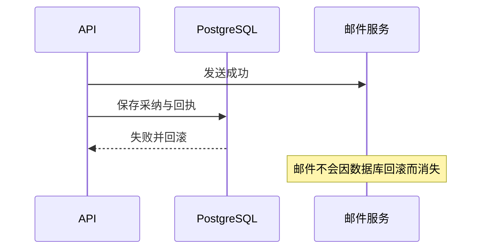

# 支线26A：重试期限、外部副作用与“恰好一次”

主线把一次采纳和它的成功回执放在同一数据库事务里。这个方案看起来已经解决重复请求，但把需求换成“预约有效期三十分钟”或“采纳后发送邮件”，仍会出现新的问题。沿这两个变化推导，才能知道哪些部分可以复用、哪些承诺已经越过当前边界。

时间参考：阅读约25～30分钟，无独立操作；按约2300个汉字和两组需求变化估算，非读者实测。

## 一、预约过期后，相同身份还能代表什么

假设用户用操作K预约了一个名额，系统保存了成功结果R。二十分钟后网络恢复，原请求重试。回执返回R，用户知道当时预约成功，这与查询预约当前仍有效是两回事。再过二十分钟，预约自然过期；此时重放K仍应表达那次决定的结果，不能悄悄再占一个新名额。

因此先区分操作事实与资源当前状态。K描述“我曾做过这次预约”，预约ID描述业务对象，expiresAt描述资源的期限。当前状态查询可以返回expired，而重放原操作仍返回当时的成功快照。如果接口选择重试返回当前状态，也可以成立，但必须明确这种契约：字段可能变化，它就不是本章承诺的原结果重放。

现在为了节省空间，定时任务在三十分钟后删掉所有回执。晚到的K被认为从未处理过，又创建了一次预约。即使数据库在每个瞬间都严格遵守唯一约束，跨越清理时间以后仍发生重复。约束没有失效，是我们删除了它判断重复所依据的事实。

一个较稳妥的有限保留方案，是把“结果内容可以删除”和“操作身份可以重新使用”分开。正文快照到期后可以只保留K、请求指纹、结果引用和过期标记；晚到请求得到明确的结果已过期响应，或被引导到业务对象查询。这个最小占位记录仍是数据，也需要自己的保存期限，不能把它当作免费、永久且无需治理的东西。

另一种方案是请求本身带有效期，服务拒绝过期命令。但有效期必须经过服务端规则核验，不能任由客户端延长，再拿同一个K当新操作。接受时间、客户端时钟偏差、离线重试期限和身份复用约定都要一起设计。只加一个expires_at列，并不能说明到期以后应该拒绝、重放、查询还是重新执行。

回到EPP，采纳不会自动过期，本章也没有回执清理任务，所以先保留完整成功结果。这是当前边界下的简单选择。以后用户提出删除私人内容，应同时处理原文、候选、表达、响应快照及备份；如果仍需要保留最小操作事实，要先明确目的、字段和访问范围，不在“幂等必须保留”名义下无条件保存全文。

## 二、把邮件放进事务，为什么仍会重复

需求变成采纳成功后发一封确认邮件。最直觉的写法是在创建学习记录之后，调用邮件服务，再保存回执。邮件已经发出，随后回执INSERT失败，数据库把采纳回滚；用户重试K，再次执行邮件调用，于是收到两封。事务只控制PostgreSQL中的变化，并不能撤回另一台服务器已经发送的邮件。

把顺序反过来也不够。先提交采纳和回执，再发邮件，若进程在两步之间退出，数据库显示成功，邮件却永远没有发。相同操作重试直接重放结果，不会再经过发送分支，缺失就被固定下来。先发或后发，各自把故障窗口移到另一边，没有消灭窗口。

这时需要把“我要发邮件”也作为一份数据库事实，与采纳共同提交，实际发送由后续执行器完成。通常把这类待交付事实称为Outbox。它首先解决不漏记发送意图：业务和发送意图一起有、一起没有。它并没有自动解决外部只发送一次。

执行器读取发送意图、调用邮件服务成功，随后在登记已完成之前退出；恢复后看到仍未完成，会再发一次。这个窗口与主线的响应丢失结构相同，只是客户端换成了后台执行器。若对方支持持久操作身份，可以让每次投递都携带同一个发送ID，由对方重放结果；若支持按业务引用查询，可先确认原结果；若两者都不支持，就必须面对可能重复并设计可接受的处理方式，不能在代码注释里写“exactly once”抹掉限制。

这也是为什么数据库事务内不能等待外部AI生成或人工确认。长事务会占用连接和锁，外部成功仍不能随回滚撤销。后续任务篇会建立领取、租约、执行结果和恢复；主线当前没有外部副作用，因此不提前加入Outbox表或一个空Worker框架，但读者应知道需求在哪个位置变了性质。

## 三、如何拆开“恰好一次”这个说法

有人说“请求只会执行一次”，可能实际指网络只发送一次、事务回调只运行一次、业务效果最多落一份、客户端只收到一次结果，或外部系统只产生一次副作用。这些不是同一个承诺。

本章P2034会让事务回调重复执行，因此函数层面显然不是一次。客户端也可以发送多次，HTTP结果可以收到多次；最终同一成功操作对应一份持久结果，同一候选对应一条学习关系。关键在可观察的业务效果，而不是代码函数的调用次数。

“最多一次”也不等于“必定成功”。数据库长期不可用、输入始终非法、用户不再重试，操作都可能没有效果。要承诺最终完成，还需要有持续重试者、合理的有效期、可恢复存储与依赖可用性。幂等解决重复执行如何不重复生效，不能独自创造进展。

改变需求时，可以沿一条具体链条分析：先确认重试者保存什么身份，再确认哪个系统能原子记录效果和结果，找出两个系统之间的故障窗口，最后确定超时以后从哪里查事实。若某一环没有稳定身份、没有查询能力或结果已被清理，就应明确指出恢复需要什么新增协议，不能靠增加重试次数掩盖信息缺口。

回到主线，客户端保存operationId，PostgreSQL原子提交采纳与回执，等待和查询都回到同一数据库。这条链在当前范围内闭合。加入外部发送、自动过期或跨账号迁移时，先重新画链条，再决定是否扩展；不要把当前实现中的成功性质直接外推到整个系统。

## 附录：本支线必要技术点速查

| 概念 | 用途 | 必要注意点 |
| --- | --- | --- |
| 操作结果／资源当前状态 | 区分过去决定与现在状态 | 预约过期不能让原操作自动变成新预约 |
| 重试期限／结果保留期限 | 规定何时还能恢复 | 删除内容与释放身份是两种不同动作 |
| 最小占位记录 | 结果过期后保留已处理身份 | 仍需保存、权限和删除策略 |
| 外部副作用 | 邮件、扣费、外部生成等 | 数据库回滚无法撤回远端成功 |
| Outbox | 原子保存业务与待交付意图 | 不自动保证远端只生效一次 |
| 至少一次尝试／最多一次效果 | 拆解执行与业务承诺 | 最终进展还依赖重试者与系统可用性 |

参考：[PostgreSQL 18事务](https://www.postgresql.org/docs/18/tutorial-transactions.html)、[AWS事务Outbox模式](https://docs.aws.amazon.com/prescriptive-guidance/latest/cloud-design-patterns/transactional-outbox.html)。这些用于核对原子边界与投递窗口，具体后台实现沿全书后续任务篇展开。

[返回第二十六章](chapter.md#知识支线) · [返回第四篇](../README.md)
