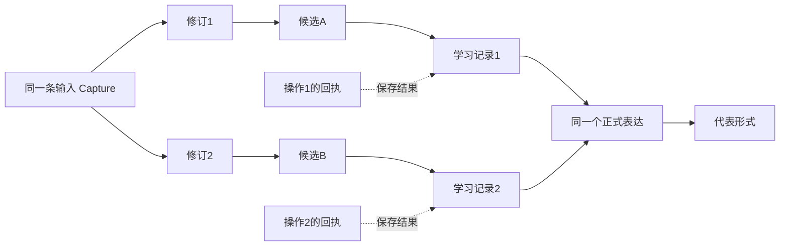
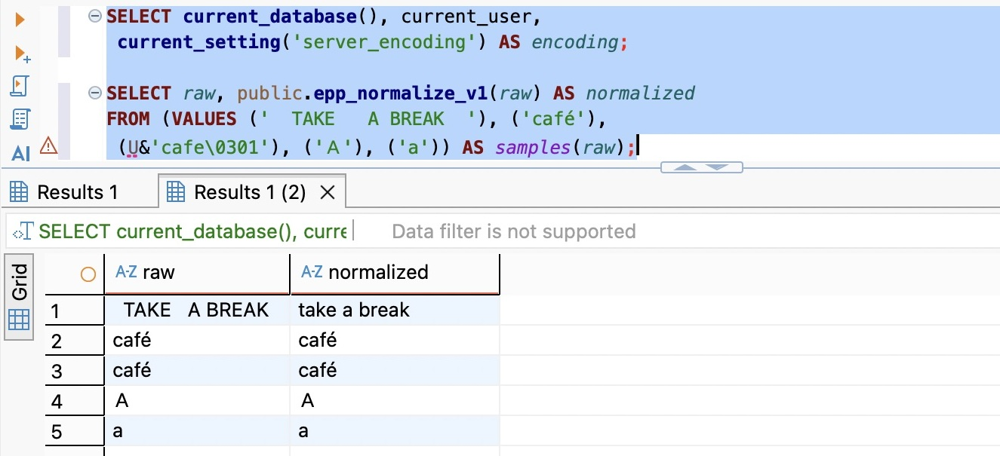
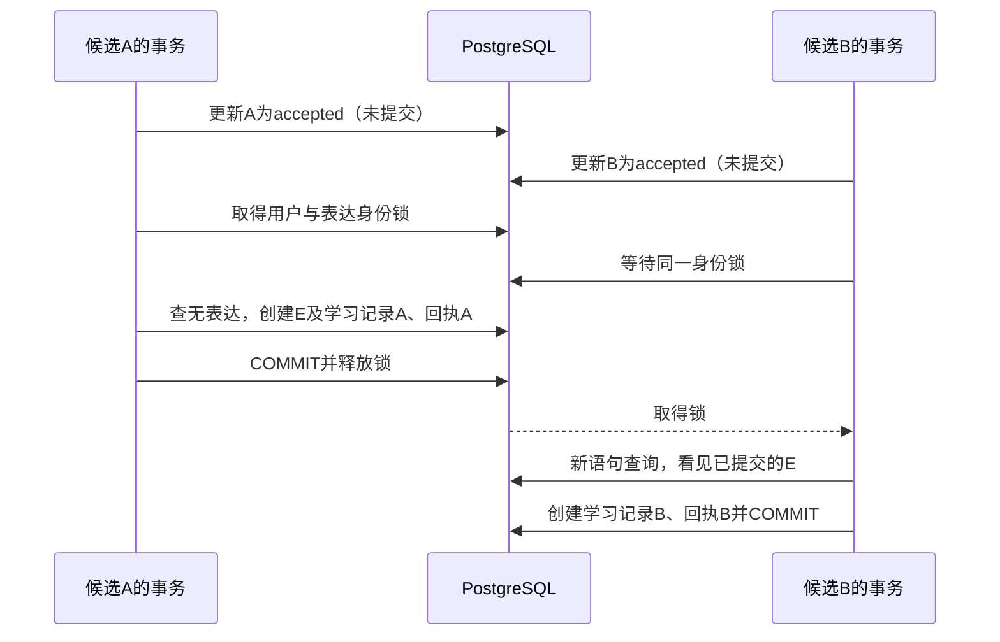
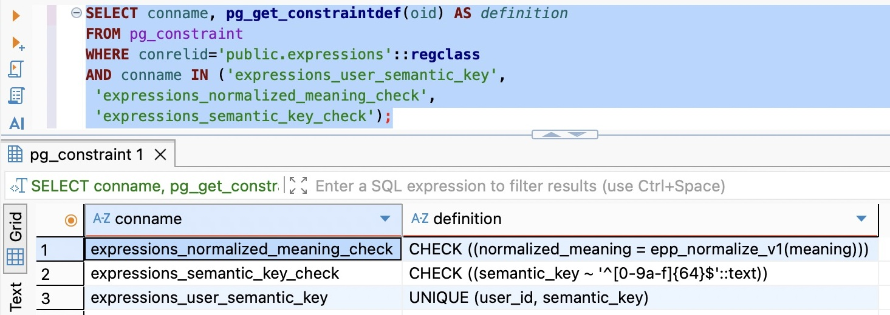
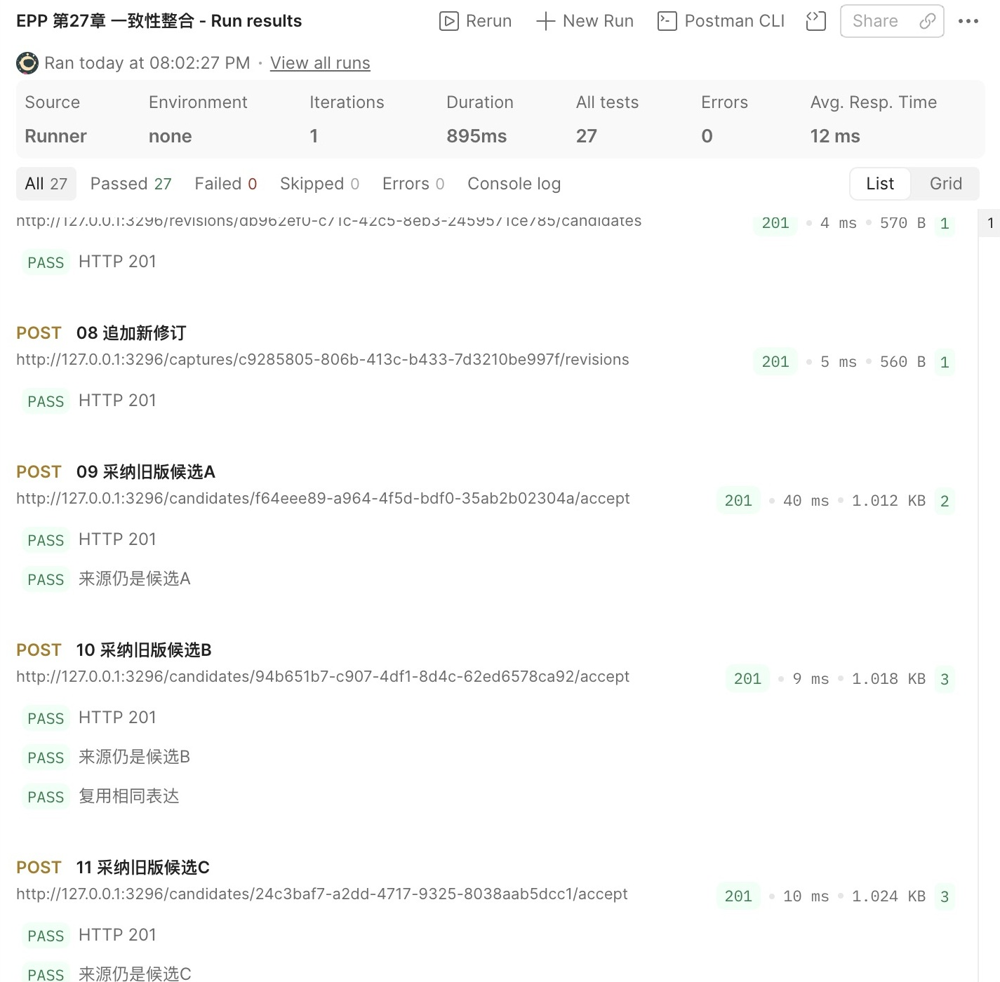
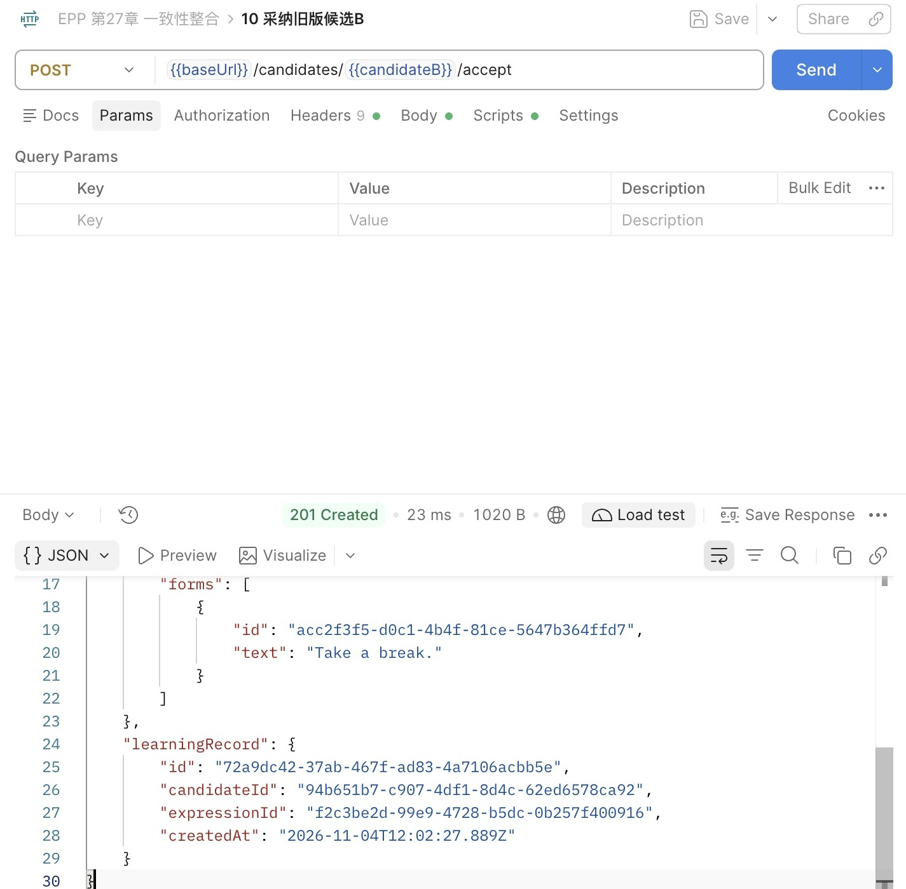
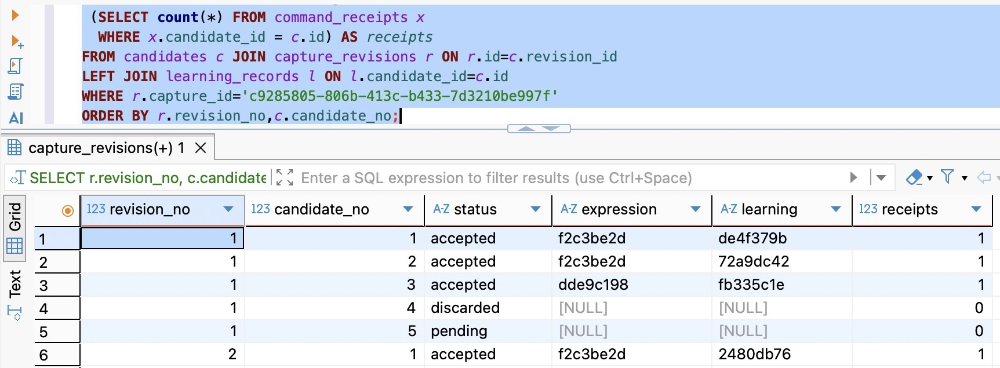
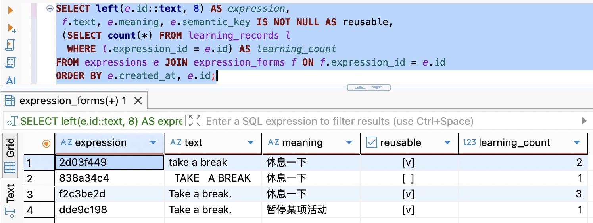
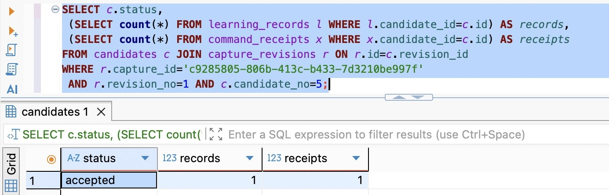
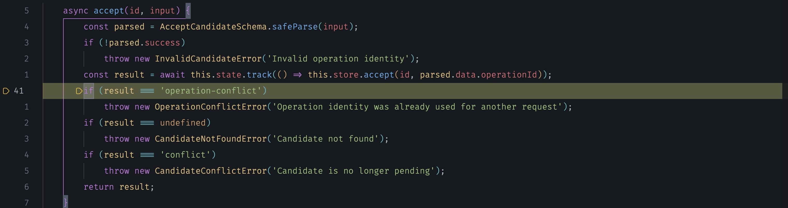

# 第27章 一致性整合：完成可靠的候选采纳

第二十六章解决了一个很具体的尴尬：数据库已经采纳，客户端却只看到连接断开。现在，客户端保留operationId重发，可以取回原来的201结果，而不是再次创建一套表达和学习记录。第二十二章以来建立的修订、状态、事务、并发与幂等，终于能够共同回答“这次操作有没有完成”。

不过，还有一种重复不属于重发。昨天我从一段对话里保存了 `Take a break.`，今天又从另一段输入里选中了同一句话。它们是两个候选、两次决定、两个操作身份，不能以幂等键相同为由阻止第二次采纳。若含义也相同，却每次增加一个正式表达，后面的学习列表就会被同一个内容切成多个身份。

反过来，只看英文相同便强行归到一起也不可靠。`bank` 可以表示银行，也可以表示河岸。本章要在已有完整采纳链中补上这层判断，并把旧数据库一起带过来：怎样确定哪些内容可以复用，怎样防住两个不同候选同时创建相同表达，怎样保留每次采纳的来处，又怎样继续解释已经保存过的旧结果。

代码起点为 `part-04/chapter-26`，沿用 Node.js 24.22.1、PostgreSQL 18、Prisma 7.10.1 和前章开发配置。本章完成状态为 `part-04/chapter-27`，不增加依赖。仍使用固定开发用户和人工填写的候选；生成、相似推荐与向量并非本章的运行前提。

时间参考（估算）：阅读约125～145分钟，跟做另加85～110分钟；支线27A单列于篇导读。可先完成模型与事务实现，再停写迁移和联调，最后核对旧回执与恢复；不要在代码仍缺新必填字段时启动写入。

## 27.1 先把一次采纳的不同身份放回同一条链

先看今天的候选究竟承诺什么。Capture保持一条输入记录的身份；CaptureRevision保存某一版输入；Candidate引用具体修订，保存当时准备采纳的英文与中文义项。新修订出现后，旧候选仍然描述那一版内容，不能悄悄改挂到最新版本。

Expression表示正式表达的身份，ExpressionForm保存它的显示形式。LearningRecord则记下某个用户从哪个候选采纳了哪个表达。因此，复用Expression不要求复用LearningRecord：今天的决定仍有自己的来源。回头查询昨天那次采纳时，也不能因为今天出现了更好的拼写，就把昨天的candidateId改成今天的。

这与“我的收藏中每个商品只占一行”是两种需求。收藏关系通常以用户和商品唯一；这里的学习记录承担采纳来源，允许同一用户从不同候选指向同一个表达。若以后要显示“我共有几个不同表达”，应按表达身份组织查询；若要显示“我是从哪里收录的”，就读取学习关系。把两种行粒度混为一谈，常见结果是列表数量变少了，来源也丢了。第二十八章会用实际查询继续区分它们。



沿着图再问一次“重复的是谁”。同一operationId重发，是同一个操作，重放原结果；换一个operationId再次采纳同一个已accepted候选，是新的命令碰到不再成立的状态前提，仍然409；不同候选内容相同，是不同来源指向同一表达，允许各自成功。三个判断依次使用操作身份、候选状态和表达身份，不靠一个通用的“去重”布尔值解决。

本章只改变第三个判断。候选创建、放弃、修订追加的输入契约不变，采纳Body仍只有operationId；归属判断仍沿候选、修订、输入查询。表达复用增加用户范围：即使两个人保存了相同文本，也不共享一个人的显示形式、创建时间或后续编辑权。当前用户仍来自开发常量，尚不能把这个范围条件称为真实认证。

## 27.2 给相同内容一个可重建的身份，同时保留原文

### 文本相等要先成为一条明确规则

我希望 `Take a break.` 和 `  TAKE   A BREAK.  ` 在义项同为“休息一下”时复用。最直接的做法是在创建前trim、转小写，然后查数据库。但trim到底去掉哪些字符？英文以外的大小写怎么算？旧数据回填用SQL，在线请求用JS，两边是否真是同一个函数？这些差别一旦进入唯一键，就会变成持久化行为，不能只当作展示格式。

本章选择一个有意保守的v1规则：Unicode采用NFC；连续的ASCII空白折叠成一个普通空格，再去掉首尾普通空格；仅将ASCII的A到Z转成a到z。英文和义项都经过这套规则，标点不删除，全角字母不折成半角，不做词形还原，也不判断同义句。

NFC处理的是等价的Unicode表示。例如重音字母é既可能以一个字符保存，也可能以e加组合重音保存，规范化让这两种编码得到一致结果。NFKC还会折叠兼容字符，作用更强，却也会放弃更多区别。当前没有把这些区别视为无关的业务依据，所以保留它们。这里的ASCII大小写折叠同样是一项产品决定，不是适用于密码、商品编码或所有语言文本的默认清洗。

因此，这个“义项身份”是**同一用户下，规范化英文与规范化义项这一对值的精确身份**，不是机器已经理解了含义。`休息一下` 与 `稍作休息` 可能指向同一个意思，但v1仍分开；相同英文而中文义项不同，也分开。保守重复可以留待人工确认，误合并则会把本来不同的学习内容混在一起。改变这条规则需要另一次数据演进，支线27A会继续展开。

规范化只生成比较用的值。候选的englishText、chineseMeaning和正式表达的显示文本都保留原样，否则“去重”会顺手改掉用户输入。复用时采用已有代表的显示形式，新候选自己的拼写仍能从来源链读回。当前每个表达仍只有一个代表形式；ExpressionForm的存在不意味着已经允许把 `have a rest` 自动添加成 `take a break` 的另一个形式。

### 把规则放在回填与在线请求都能调用的位置

这次不在Node和SQL中各写一份近似实现。追加迁移 `prisma/migrations/20261104160000_expression_identity/migration.sql`，先定义有版本的数据库函数。它们没有读取业务表，同一输入产生同一输出；服务端通过带参数查询调用。

```sql
CREATE FUNCTION public.epp_normalize_v1(value text) RETURNS text
LANGUAGE sql IMMUTABLE STRICT PARALLEL SAFE
RETURN translate(btrim(regexp_replace(normalize(value, NFC), E'[ \t\n\r\f\013]+', ' ', 'g')),
  'ABCDEFGHIJKLMNOPQRSTUVWXYZ', 'abcdefghijklmnopqrstuvwxyz');

CREATE FUNCTION public.epp_identity_v1(english text, meaning text) RETURNS text
LANGUAGE sql IMMUTABLE STRICT PARALLEL SAFE
RETURN encode(sha256(convert_to(jsonb_build_array('epp-expression/v1',
  public.epp_normalize_v1(english), public.epp_normalize_v1(meaning))::text, 'UTF8')), 'hex');
```

正则中的空白范围是显式列出的：普通空格、制表、换行、回车、换页及垂直制表，不依赖JavaScript的 `\s` 与数据库字符分类刚好相同。translate只替换列出的ASCII字母，也避免lower随数据库locale变化。STRICT表示传入NULL便返回NULL，不能替代业务字段必填；IMMUTABLE是我们对规则稳定性的声明，不能在原函数名下改算法后假装历史比较值仍然有效。PostgreSQL的normalize要求UTF8数据库，先在DBeaver执行 `SHOW server_encoding`。[字符串函数官方说明](https://www.postgresql.org/docs/18/functions-string.html)可用来核对这些具体语义。

为什么又计算摘要，而不是直接把两个长文本建成联合唯一键？两个输入各允许2000个UTF-16单元，用完整文本建立B-tree唯一索引可能碰到[单条索引项的大小限制](https://www.postgresql.org/docs/18/btree.html)。摘要把查找键控制为64个十六进制字符。JSON数组带上规则版本，保留字段边界，避免直接拼接出现 `ab+c` 与 `a+bc` 的歧义。数据库以UTF8字节计算SHA-256；Node不再另造一种序列化来计算同一个键。

摘要不是额外的语义判断，也不是加密。持有文本的人可以重新计算，不能把它当作匿名化后允许随意记录的内容。在在线复用时，我们还会比较实际的规范化值；若摘要命中但值不一致，就失败回滚，不能以“碰撞很少见”为由把内容关联错。迁移同样先检查这一情况再选择代表。

完整迁移应用后，再打开 `database/chapter-27/01-inspect.sql`，在校验库连接里执行规范化样例；此时函数才实际存在。第一行应为 `take a break`，两种café应相同，全角Ａ仍与ASCII a不同。观察结果后再决定是否接受这套业务规则；不要为了让几条样例合并，继续追加没有边界的replace。



图27-1：同一数据库函数折叠ASCII空白和大小写，并统一两种café编码；全角Ａ仍保留。

### 新字段描述当前判断，旧字段继续描述历史

Prisma模型在 `prisma/schema.prisma` 增加以下字段和关系；已有id、meaning、createdAt、forms及learningRecords保持：

```prisma
// User 中增加反向关系：expressions Expression[]
// Expression 中增加：
userId            String  @map("user_id") @db.Uuid
normalizedMeaning String  @map("normalized_meaning") @db.Text
semanticKey       String? @map("semantic_key") @db.Text
user User @relation(fields: [userId], references: [id],
  onDelete: Restrict, onUpdate: Restrict, map: "expressions_user_id_fkey")
@@unique([userId, semanticKey], map: "expressions_user_semantic_key")

// ExpressionForm 中增加：
normalizedText String @map("normalized_text") @db.Text
@@index([expressionId], map: "expression_forms_expression_id_idx")
```

表达增加userId，是因为复用身份必须在一个用户范围内裁决；旧表达的归属可以从已有学习记录推导。normalizedMeaning和normalizedText保存可核对的比较值。形式表按expressionId加索引，配合读取代表形式；并不因此再给完整长文本建唯一索引。

最容易让人困惑的是semanticKey为什么允许NULL。第二十四至二十六章可能已经采纳过两个内容相同的候选，它们分别生成E1、E2，学习记录和回执各自保存对应ID。如果现在只留一个表达，再把外键全部指过去，旧回执里仍有另一个ID；进一步修改回执JSON，又违背了前章“重放原结果”的承诺。

我们选择保留两条旧表达，只从同一用户的同组旧内容中选一条，供今后的新采纳复用。代表持有semanticKey，其他历史副本的key为NULL；所有显示字段、ID、时间和引用都保留。NULL不是未知义项，也不是待删除标记，只表示“不作为新采纳的复用入口”。PostgreSQL默认唯一约束允许多个NULL，因此可以同时保留这些旧行，又保证每个非空身份键最多有一个代表。[唯一约束的NULL规则](https://www.postgresql.org/docs/18/ddl-constraints.html#DDL-CONSTRAINTS-UNIQUE-CONSTRAINTS)正好服务于这条明确需求。

旧内容回填不能凭感觉。迁移先验证每个表达恰好有一个形式，且学习记录只归属于一个用户；没有来源或跨用户的历史都主动报错。正常前章实现满足这个前提，但手工SQL或其他导入可能不满足。报错时应回到原始来源修复，不能SELECT第一条就当作找到答案。

在完整迁移中，下面的审核放在新增列之前；异常由数据库抛出，沿外层事务整体回滚。

```sql
DO $$ BEGIN
  IF EXISTS (SELECT e.id FROM public.expressions e
    LEFT JOIN public.expression_forms f ON f.expression_id = e.id
    GROUP BY e.id HAVING count(f.id) <> 1)
    OR EXISTS (SELECT e.id FROM public.expressions e
    LEFT JOIN public.learning_records l ON l.expression_id = e.id
    GROUP BY e.id HAVING count(DISTINCT l.user_id) <> 1) THEN
    RAISE EXCEPTION 'Expression history needs owner/form review';
  END IF;
END $$;
```

在校验通过后，迁移追加列、用版本化函数回填，再按created_at/id选代表。关键回填片段如下，前后的事务、异常检查、字段收紧和约束见配套完整迁移：

```sql
ALTER TABLE public.expressions ADD COLUMN user_id uuid,
  ADD COLUMN normalized_meaning text, ADD COLUMN semantic_key text;
ALTER TABLE public.expression_forms ADD COLUMN normalized_text text;
UPDATE public.expression_forms SET normalized_text = public.epp_normalize_v1(text);
UPDATE public.expressions e SET user_id = owners.user_id,
  normalized_meaning = public.epp_normalize_v1(e.meaning),
  semantic_key = public.epp_identity_v1(f.text, e.meaning)
FROM (SELECT DISTINCT expression_id, user_id FROM public.learning_records) owners,
  public.expression_forms f
WHERE owners.expression_id = e.id AND f.expression_id = e.id;
```

回填之后、选择代表之前，还要用以下检查拦住“同一摘要对应不同规范化值”；失败时不猜测合并对象。

```sql
DO $$ BEGIN
  IF EXISTS (SELECT e.user_id, e.semantic_key FROM public.expressions e
    JOIN public.expression_forms f ON f.expression_id = e.id
    GROUP BY e.user_id, e.semantic_key
    HAVING count(DISTINCT jsonb_build_array(f.normalized_text, e.normalized_meaning)) > 1) THEN
    RAISE EXCEPTION 'Expression identity collision needs review';
  END IF;
END $$;
```

通过上面的检查后，再选择代表：

```sql
WITH ranked AS (
  SELECT id, row_number() OVER (PARTITION BY user_id, semantic_key ORDER BY created_at, id) AS position
  FROM public.expressions
)
UPDATE public.expressions e SET semantic_key = NULL FROM ranked r
WHERE e.id = r.id AND r.position > 1;
```

row_number在每个用户、每个身份组内编号。created_at选较早记录，id处理同一时间的并列，保证重复执行同一选择规则有确定依据。这个顺序只定义复用代表，不代表最早的一条内容质量最好。这里不能用MIN(id)去猜时间，也不能把“查询先返回的一行”当作稳定顺序。

随后user_id、两个规范化字段收紧为NOT NULL；表达增加用户外键与 `(user_id, semantic_key)` 唯一约束，规范化列以CHECK核对对应显示字段计算值，非空摘要必须是64位小写十六进制。CHECK负责本行派生值，跨表“这个摘要究竟对应哪个形式”仍由写入事务和复用时的值比较承担。不要声称几条CHECK已经阻止一切任意SQL破坏。

下面是迁移末尾的实际收紧代码，执行完才COMMIT。迁移开头的BEGIN、有限lock_timeout和statement_timeout保持；所有审核、回填与收紧属于同一事务。

```sql
ALTER TABLE public.expressions ALTER COLUMN user_id SET NOT NULL,
  ALTER COLUMN normalized_meaning SET NOT NULL,
  ADD CONSTRAINT expressions_user_id_fkey FOREIGN KEY (user_id) REFERENCES public.users(id)
    ON DELETE RESTRICT ON UPDATE RESTRICT,
  ADD CONSTRAINT expressions_user_semantic_key UNIQUE (user_id, semantic_key),
  ADD CONSTRAINT expressions_normalized_meaning_check
    CHECK (normalized_meaning = public.epp_normalize_v1(meaning)),
  ADD CONSTRAINT expressions_semantic_key_check CHECK (semantic_key ~ '^[0-9a-f]{64}$');
ALTER TABLE public.expression_forms ALTER COLUMN normalized_text SET NOT NULL,
  ADD CONSTRAINT expression_forms_normalized_text_check
    CHECK (normalized_text = public.epp_normalize_v1(text));
CREATE INDEX expression_forms_expression_id_idx ON public.expression_forms(expression_id);
```

## 27.3 在同一事务里复用表达，保留每一次决定

### 两个不同候选会绕开已有的候选锁

第二十五章的pending条件更新和candidate_id唯一约束，已经防住两个请求重复采纳同一个候选。但A、B是两条不同候选，更新的不是同一行，两个请求都可能先查到“没有这个表达”，然后各自创建。第二十六章的操作锁也不解决它：A、B有不同operationId，理应各自通过。

所以，我们要协调的是**还可能不存在的表达身份**。已有用户／操作锁不动，先完成候选归属、回执重放与pending条件更新，再计算表达键，按用户和键取得事务级建议锁，取到锁后重新查询表达。相同身份的两个事务在这里排队；不同身份仍可并行。唯一约束留作数据库防线，不把建议锁当作任意写入者都会遵守的强制约束。



READ COMMITTED下，取锁之后的独立SELECT会取得新的语句快照，因此能看到前一个事务刚提交的表达。若把查表达与等锁塞进同一条语句，不能仅凭“语句里写了锁”便断言查询使用了等锁后的新快照。这正是第二十五、二十六章反复区分取锁位置与读取位置的原因。

当前每个采纳只处理一个候选和一个表达身份，顺序固定为操作锁、候选条件更新、表达身份锁。放弃只更新候选，不持有表达锁，因此没有反向锁序。未来若增加批量采纳、合并两个表达或账户处置，必须重新列出所有写入入口和锁顺序；不能把本章顺序机械扩展为“循环里挨个锁就行”。账户状态和处置入口尚未建立，本章不添加一个没有竞争对手的全用户门闩来制造完整感。

### 把新判断插进原有提交链

在 `src/prisma-candidate.store.ts` 的accept事务里，用以下部分替换原来的“每次create表达”。位置仍在claimed.count检查之后、创建learningRecord之前；回执读取和写入、错误映射与有限P2034重试沿用第二十六章。

```ts
const [identity] = await tx.$queryRaw<{
  normalizedText: string; normalizedMeaning: string; key: string;
}[]>`
  SELECT public.epp_normalize_v1(${candidate.englishText}) AS "normalizedText",
    public.epp_normalize_v1(${candidate.chineseMeaning}) AS "normalizedMeaning",
    public.epp_identity_v1(${candidate.englishText}, ${candidate.chineseMeaning}) AS key
`;
if (!identity) throw new Error('Expression identity is missing');
const expressionLock = JSON.stringify(['expression', DEVELOPMENT_USER_ID, identity.key]);
await tx.$queryRaw`SELECT pg_advisory_xact_lock(hashtextextended(${expressionLock}, 0))::text`;
let expression = await tx.expression.findUnique({
  where: { userId_semanticKey: { userId: DEVELOPMENT_USER_ID, semanticKey: identity.key } },
  include: { forms: true },
});
if (expression) {
  if (expression.normalizedMeaning !== identity.normalizedMeaning || expression.forms.length !== 1
    || expression.forms[0]?.normalizedText !== identity.normalizedText) {
    throw new Error('Expression identity does not match');
  }
} else {
  expression = await tx.expression.create({ data: {
    id: randomUUID(), userId: DEVELOPMENT_USER_ID, meaning: candidate.chineseMeaning,
    normalizedMeaning: identity.normalizedMeaning, semanticKey: identity.key,
    forms: { create: { id: randomUUID(), text: candidate.englishText,
      normalizedText: identity.normalizedText } },
  }, include: { forms: true } });
}
```

这里有两个哈希，各自承担不同责任。SHA-256摘要进入持久化唯一键，命中后还要比对规范化值；hashtextextended把协调用的字符串映射为建议锁编号，它的碰撞只会让原本无关的请求多等一会儿。它不能替代数据库里的完整身份，也不作为对外稳定算法。锁的语义和生命周期见[PostgreSQL建议锁说明](https://www.postgresql.org/docs/18/explicit-locking.html#ADVISORY-LOCKS)。

表达找到以后，不更新它的meaning、forms或createdAt。否则第二次采纳将顺带编辑第一次保存的正式内容，也改变正在学习的对象。学习记录仍按当前候选新建：

```ts
const learningRecord = await tx.learningRecord.create({ data: {
  id: randomUUID(), userId: DEVELOPMENT_USER_ID, candidateId: id, expressionId: expression.id,
} });
```

随后照旧用AcceptanceSchema构建公开响应、保存回执，再提交整个事务。Schema只投影原先承诺的id、显示内容、时间和来源；新加的userId、semanticKey、normalizedMeaning、normalizedText不会因为ORM返回了它们就泄漏到接口。旧回执不需要补字段，依然能通过同一个公开Schema重放。这次内部模型增加的信息，不应迫使调用方了解数据库的比较键。

存储函数、唯一约束与新列都是这段代码的运行前提。`src/database.service.ts`启动时继续试读模型，并额外核对expressions_user_semantic_key确为不可延迟的 `UNIQUE (user_id, semantic_key)`，调用一次epp_identity_v1确认函数可用；错误使用安全码EXPRESSION_CONSTRAINT_MISSING，不打印连接串或文本。这里是启动防错，不能替代迁移历史、SQL约束和旧数据核对。

### 在完整旧数据上应用追加迁移

空库上全部成功，只说明新的建表序列能执行。先保留第二十六章数据库中的样本；如果还没有重复表达，可以在升级前用两个不同候选、两个operationId采纳相同文本与义项。旧版会产生两条表达，正好构成本章要处理的历史。保存两次响应和它们的操作身份；不要在当前已升级库启动旧程序来补造旧数据。

使用前篇的独立 VERIFY，先停止全部旧写入者，再按[22.3 的备份与独立恢复](../chapter-22-revisions/chapter.md#先备份再在另一个库恢复一次)为本次第二十六章状态生成新归档、恢复到全新库。替换为本次源库和恢复库名，不使用第二十一章旧归档或样本脚本；除基础结构与迁移历史外，还要逐表比较下文七张业务表的内容。在DBeaver先执行 `database/chapter-27/02-history-audit.sql` 第一条，异常结果应为空。再保存原七张业务表的ID、原有字段、关系和回执JSON作对照。这里只查看expression总数还不够：删一条又补一条，总数也可能没变，但引用和历史已经被改写。

在项目根目录生成、检查并部署追加迁移：

```bash
nvm use
npm ci
npm run check
unset DATABASE_URL SHADOW_DATABASE_URL
npm run db:verify -- migrate deploy
npm run db:verify -- migrate status
npm run db:verify -- migrate diff --from-config-datasource --to-schema prisma/schema.prisma --exit-code
```

`db:verify` 读取 `.env.database-verify`，`db` 读取 DEV 的 `.env.database`，API读取自己的 `.env` 或进程配置；先分别确认数据库名。已有DEV要沿同样的停写和核对顺序升级，命令改为 `npm run db -- migrate deploy`。不要把VERIFY验证成功当作DEV已经更新。迁移有显式BEGIN／COMMIT、2秒lock_timeout和30秒statement_timeout，小规模已有数据在停写窗口完成；大表需要重新估算锁持有与回填成本，不能原样照搬这份一次性UPDATE。

模型和存储实现已一起修改后再执行这些命令。SQL函数只随完整迁移创建，不单独执行CREATE片段；check会生成客户端，但不会连接数据库或应用DDL。



图27-2：从pg_constraint读取实际定义，用户与非空身份键的唯一约束和规范化CHECK已经落库。

### 用保存的请求看到这些差别

迁移完成后启动 `npm run dev`。在Postman导入 `requests/chapter-27.postman_collection.json`，把baseUrl设成实际开发地址，确认没有环境变量覆盖，然后按01～17发送。01会清除本集合上一轮ID并建立新样本，所以已经开始后不要为了重试采纳重新发送01；操作身份在第一次发送之前就保存在集合变量中。

01～07创建一条输入、读取初始修订，再保存五个候选。A是 `Take a break.`／“休息一下”，B只改变英文大小写和空白，C英文相同而义项为“暂停某项活动”，D、E是另外两种说法。08先追加新修订，09～11才采纳旧修订的A、B、C。

对照09与10的响应：expression.id相同，learningRecord.id不同，candidateId各自指回A、B。B的candidate.englishText保留原空白和大小写，expression.forms返回代表形式。11的expression.id不同，证明英文相同不够；中文义项这条比较条件确实参与了判断。

12放弃D，13再采纳D得到409；14读取旧修订候选列表，状态依次为accepted、accepted、accepted、discarded、pending。E没有被选择，不等于被放弃，不写discardedAt，也没有学习记录。15用B原operationId重放原201；16换新operationId再次采纳B得到409。17读取当前Capture，内容已经是08的新修订，但先前学习关系的来源仍是旧修订。



图27-3：本机集合01～17执行完成，27项断言通过；09、10分别核对来源，10额外核对表达复用。



图27-4：B返回已有的 `Take a break.`，learningRecord仍保存B自己的candidateId。



图27-5：修订1的A、B共享expression却有不同learning；D、E分别为discarded和pending。修订2的最后一行是随后调试时额外采纳的同内容候选，也引用同一表达。图中仅缩短ID显示，实际存储仍是完整UUID。

遇到结果不符，先比较具体身份，不要先怀疑事务：复用失败看两个规范化值及用户范围；重放失败看operationId和candidateId；来源变了看LearningRecord.candidateId及候选revisionId。HTTP201只能证明该次请求成功返回，学习记录数量与来源仍需在数据库联查核对。

## 27.4 把生成与语义能力放在正确的边界外

此时记录、修订、候选、正式表达与学习来源已经能够闭环。未来接AI时，不需要把所有东西重写成一个“生成并采纳”接口。生成读取指定修订，产出候选内容；用户采纳时使用候选快照和稳定ID，执行本章已经建立的状态与提交规则。生成失败不能留下accepted，生成成功也不自动成为学习事实。

为什么不在持有表达锁的事务里问模型“这两个是不是一个意思”？首先，网络等待会占住事务和连接，延迟也难以界定；更关键的是，第二次询问可能得到不同答案。若提交前提依赖一次外部判断，就需要先把判断所依据的输入、版本与结果固定下来，再让写入事务验证它仍然适用。后面的任务与语义篇会分别建立这两个环节，本章不把远程调用偷偷插进临界区。

相似推荐也不是唯一身份。向量检索可以说“这些表达值得比较”，却不能单凭分数高就覆盖外键。词义相关、形式相近、语境可替换，是不同关系；哪一种能合并，要有明确的领域决定。一个推荐结果可以过期或重新计算，而LearningRecord的来源与CommandReceipt的成功结果不能随推荐波动。

如果将来确实允许一个义项有多个词汇形式，ExpressionForm会接住形式之间的关系。但那时必须重新定义主形式的选择、别名唯一范围、形式新增入口、响应中的顺序及数量。本章AcceptanceSchema仍要求一个代表形式，不能只往表中插入第二条就算功能完成。当前多形式异常会使复用失败，是在阻止没有完成契约演进的状态继续扩散。

同样，账户处置将引入“用户是否还允许写入”这一共同前提。届时采纳、修订、候选写入和处置应在用户生命周期规则下协调；现在只有固定开发用户，既没有处置状态也没有处置操作。本章通过userId限定复用范围，为后面的身份与权限接入保持归属，但不提前宣称已经完成账号生命周期一致性。

这些接口边界并不是把问题推迟。它们使当前事务只依赖已经持久化、可核对的事实，也让新增能力能找到自己负责的位置。判断AI生成的改动时，可以直接沿依赖问：它是否把外部等待放进锁内，是否用相似度代替身份，是否为了去重改写来源，是否让一次内部字段增加改变了旧回执。每个问题都能在现有代码和数据里找到检验位置。

## 27.5 让新旧数据一起通过迁移、读取与恢复

迁移后在DBeaver刷新表结构，打开01-inspect.sql的表达与来源查询。原两条表达都应存在，其中一条reusable为true，另一条false；旧学习记录的expression_id各自保持。再采纳第三个规范化相同的候选，应指向代表，表达总数不增加，学习记录增加一条。之后用升级前保存的两个operationId重放，两份JSON都应与原响应一致，其中一份仍然引用不再承担复用入口的旧表达。



图27-6：前两行是升级前保存的无句号样本，都仍存在；代表有两条学习来源，历史副本保留原来的一条。后两行是Postman的带句号样本，标点和不同义项仍形成不同身份。

这个结果看起来没有“把重复清干净”，但满足了本章的两个目标：新写入不再无条件复制表达，旧事实仍然可解释。查询旧记录时，不得加 `semantic_key IS NOT NULL` 过滤掉历史；读取应从学习记录沿expression_id关联。将来确实要合并旧身份，需要迁移引用、保留可解释的旧ID解析和审计规则，不能借本次规范化回填顺手完成。

### 失败时分辨哪一层已经改变

迁移的历史审核发现孤立表达时，会抛出 `Expression history needs owner/form review`。CLI 有时只显示事务已经中止（`current transaction is aborted`）；这时在失败库重跑历史审核的第一条只读查询，定位缺少归属或形式的表达。由于函数创建、字段增加与回填在同一显式事务里，这次失败不应留下半批规范化字段。先在DBeaver检查列是否存在、函数是否存在，再查看_prisma_migrations的logs；迁移历史中可能记录失败尝试，这不代表业务DDL已经提交。

如果是预期之外的真实旧数据，先确认它的来源，而不是直接删除。只有隔离实验中明确人为添加的故障样本才按实验范围撤除。确认数据前提已修复、事务确已回滚后，才将失败尝试登记为rolled-back并再次deploy：

```bash
npm run db:verify -- migrate resolve --rolled-back 20261104160000_expression_identity
npm run db:verify -- migrate deploy
```

上面两步用于 VERIFY。若失败的库是 DEV，两步均用 `npm run db` 指向同一个 DEV。resolve只影响迁移历史，不撤销字段、不修复数据，也不证明恢复完成。本章实测用旧版创建的重复表达加一条孤立故障表达触发审核失败；修复后重新部署，原七表旧字段逐项保持，重复组留下一个复用代表。若失败来自等锁超时，先定位持锁会话和事务，不要盲目调大超时并反复运行。

在线路径也要看失败位置。完成集合01～17后，候选E仍为pending。复制13到一个单独保存的请求，把URL中的candidateD改为candidateE，Body填写一个新生成并固定保存的operationId；不要发送前自动换身份。打开03-expression-lock.sql，它使用E的 `Pause for a moment.`／“停一会儿”，在DBeaver会话A只执行BEGIN与取锁SELECT。这个脚本构造与应用JSON.stringify完全相同的字符串；JSON里多一个空格也会改变锁哈希，不能用“解析后相等”推断锁编号相同。

A暂不释放时，在Postman采纳对应pending候选。每次锁获取最多等1秒，超时映射为503。会话B查询应仍为pending，学习记录和回执没有增加；事务前面已做的候选条件更新也回滚了。A单独执行ROLLBACK，再用同一operationId重发，应成功创建或复用对应表达；原五候选列表中E此时才变为accepted，14里最初的pending断言不再适用于这个完成了额外实验的样本。若客户端只是超时，尚不知道服务端在哪一步结束，仍按前章保存身份、查询或重放处理，不能把任何超时都说成已经回滚。


图27-7：DBeaver持有表达身份锁，本机HTTP请求返回503后，E仍为pending，学习记录与回执均为0。



图27-8：会话A执行ROLLBACK释放锁，再用原operationId请求成功；数据库显示accepted、学习记录1、回执1。这两次HTTP由本机脚本触发，持锁和结果观察在DBeaver完成。

### 在调试器里区分候选内容与正式内容

用VS Code附加到 `npm run dev`。先在 `src/candidates.service.ts` 的 `const result = await ...` 下一条可执行语句设断点，再发送一条可复用表达的采纳。暂停发生在store事务返回之后，适合慢慢观察result，不会把数据库事务一直挂在断点里。

重点比较result.candidate.englishText与result.expression.forms[0].text，再核对result.learningRecord.candidateId。候选保留本次拼写，正式表达返回原代表，学习记录仍引用本次候选。表达的createdAt可以早于本次采纳；这正是复用，而不是时间写错。不要展开数据库连接对象或在截图中显示环境变量。



图27-9：当前开发编译的candidates.service.js第41行实际暂停，对应TS中await之后的判断。本次由本机请求重放触发，黄色行证明执行已从存储层返回；候选来源与表达复用仍要结合响应和数据库核对。

如果要研究查找分支，可以在prisma-candidate.store.ts中表达查询结束之后短暂停下，比较identity和expression。首次创建时expression为null，后来的相同身份能取到代表；恢复执行后再读提交事实。事务内暂停会消耗事务和客户端等待时间，长时间停住引出的失败需要解除断点后用原操作身份恢复，不能据此测量正常接口耗时。

灰色断点先核对附加进程、.dev编译产物与source map，不要对着另一章的dist等待。若路径映射未绑定，可在当前同一次编译的 `.dev/src/candidates.service.js` 对应语句上设断点，确认命中行和变量，再继续。只看红点不算实际命中；调试结束移除实验断点并断开连接。

### 用可交付产物核对恢复位置

最后运行 `npm run check`，再在独立目录只带dist、package.json、package-lock.json、.npmrc，使用同版Node执行 `npm ci --omit=dev`。通过进程配置提供该环境DATABASE_URL，以 `NODE_ENV=production PORT=3001 node dist/src/server.js` 启动。这个目录没有源码和开发配置文件；默认docs为404，也不启动Inspector或文件监听。

发送一次新采纳，正常退出并重启，再用相同operationId重放。核对原JSON、expression.id、learningRecord.id与数据库行数，确认结果来自持久化事实。开发模式另保存一次源码，观察自动重新编译、进程重启与已提交数据仍在；构建dist不应破坏.dev中的调试进程。最小自动化入口仍为npm test，沿用 `.env.test` 中的 `TEST_DATABASE_URL`，只连接独立校验库，其中回滚用例会临时加CHECK。表达开始复用以后，测试从采纳结果拿到一个expressionId，不代表这个对象就是测试新建的；清理必须保留测试前已有的表达及来源。配套用例为普通样本加独立标识，并由 `test/cleanup.mjs` 在一笔事务中清理本次来源，只删除本次新增且已无来源引用的表达；另用复用既有表达的回归核对旧形式、学习记录和回执保持。不能先删形式、再等外键阻止删除表达，那时前一次删除可能已经提交。

本章实测覆盖了同身份并发创建、不同义项分离、末步回执失败回滚、摘要关联不符时拒绝复用、旧记录升级、旧回执重放、缺少身份约束时拒绝启动，以及独立产物重启。这里的“可靠”有具体边界：单库、固定开发用户、已保存候选、明确的v1规则。外部生成、账号处置和相似合并需要各自的新前提，不能由这一次通过替它们背书。

中断时留下当前章节代码、迁移状态、目标库、Postman集合变量与已提交样本；关闭实验事务和调试连接，正常停止自己的API。下次先核对结构与样本，再从未完成的请求继续。切换Git分支不会回滚数据库；升级后的新必填列会让旧创建路径失败，恢复应使用理解新结构的修复产物，或在隔离环境验证成套备份，不能以旧版偶尔能GET为依据恢复全部写入。

本章完成代码为 `part-04/chapter-27`，配套入口集中在 `database/chapter-27/README.md`。下一章从这些已经保存的学习记录和表达出发，建立有明确用户范围、字段投影与数量上限的查询，让客户端能够稳定读取新旧内容。

## 知识支线

[支线27A：规范化规则变了，身份与历史怎样继续成立](side-01-identity-evolution.md)从商品编码与表达身份对照，推导错误合并的代价、规则版本与旧身份的处理。

## 附录：本章必要技术点速查

| 名称 | 本章用途 | 必要注意点与官方入口 |
| --- | --- | --- |
| normalize／NFC | 统一Unicode等价表示 | UTF8数据库；不同于兼容折叠NFKC，[字符串函数](https://www.postgresql.org/docs/18/functions-string.html) |
| regexp_replace、btrim、translate | 显式ASCII空白与大小写规则 | 比较值不覆盖原文；规则版本不可原地改义，[字符串函数](https://www.postgresql.org/docs/18/functions-string.html) |
| jsonb_build_array、convert_to、sha256、encode | 组成有边界和版本的输入，生成固定长度比较键 | 摘要命中仍核对实际值，不是加密，[JSON函数](https://www.postgresql.org/docs/18/functions-json.html)、[二进制函数](https://www.postgresql.org/docs/18/functions-binarystring.html) |
| row_number OVER | 按用户及身份分组选择旧代表 | created_at并列时以id稳定排序，[窗口函数](https://www.postgresql.org/docs/18/functions-window.html) |
| UNIQUE(user_id, semantic_key) | 每个用户的非空身份最多一个复用入口 | 默认允许多个NULL；不等同全部旧行已经去重，[约束](https://www.postgresql.org/docs/18/ddl-constraints.html) |
| pg_advisory_xact_lock | 协调尚不存在的表达身份 | 所有参与写入者遵循同一字符串与锁序，事务结束释放，[显式锁](https://www.postgresql.org/docs/18/explicit-locking.html) |
| Prisma $queryRaw／交互式事务 | 参数化调用规则，原子提交状态、来源及回执 | 取锁后独立查询；不加入外部网络等待，[原始查询](https://www.prisma.io/docs/orm/v7/prisma-client/using-raw-sql/raw-queries)、[事务](https://www.prisma.io/docs/orm/v7/prisma-client/queries/transactions) |
| migrate deploy／status／diff／resolve | 追加迁移、核对实际结构及登记失败恢复 | resolve不修复数据，diff不证明旧内容没变，[Prisma CLI](https://www.prisma.io/docs/orm/v7/reference/prisma-cli-reference) |

[上一章：幂等与审计](../chapter-26-idempotency/chapter.md) · [下一章：查询接口](../chapter-28-queries/chapter.md) · [第四篇导读](../README.md) · [全书目录](../../README.md)
