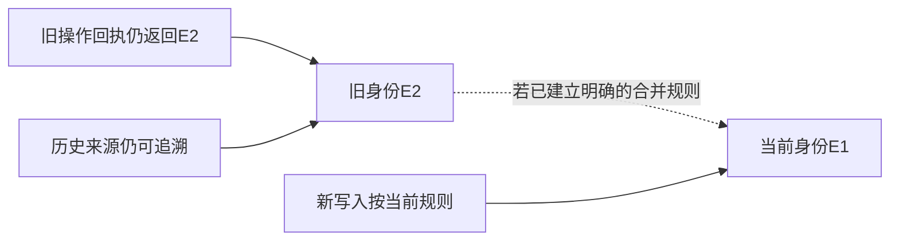

# 支线27A：规范化规则变了，身份与历史怎样继续成立

主线已经把“完全相同”写成了可执行规则。读到这里，容易产生一个顺手的改进：既然NFC和ASCII折叠能减少重复，换成更强的Unicode大小写折叠，再去掉标点、统一全角半角，是否就会更好？先换一个场景试试这个直觉。

## 同样的字符串处理，可能改变不同的业务事实

假设我们管理供应商的零件编码。供应商明确说 `Ab-12` 和 `ab-12` 是两个型号，连字符也有意义。为了搜索方便，页面可以忽略大小写，但采购订单的型号身份必须保留区别。若数据库唯一键套用“转小写、去连字符”，两种零件就被压成一个身份。查询更容易命中，实际采购却可能买错东西。

再看客服输入的电话号码，去掉人类排版用的空格可能是合理的，但还要先知道国家代码、分机和号码类型。字符串处理没有替我们回答这些领域问题。真正应先确定的是：哪些差别不影响“这是同一个东西”，由谁给出依据，错误认成同一对象会破坏什么。

这也解释了EPP为什么同时保留原值与比较值。原值服务于显示和追溯，比较值服务于某条确定规则。不能因为查询忽略空白，便把所有历史输入里的空白永久删除；也不能因为界面想搜索得宽一些，就把搜索规则直接拿来做唯一身份。搜索可以返回多个候选，唯一身份却要作排他的决定。

误判的两侧代价并不相同。把相同表达暂时保留两份，后续还能请求人工确认；把两个义项合成一个，再让练习、掌握证据和引用沿着同一ID累积，拆回去就需要判断每条历史究竟属于谁。没有这些来源证据，算法改正确了也无法可靠还原过去。主线为每次采纳保留来源，是在为这种解释能力留下事实基础。

## 版本号必须约束算法，不能只装饰摘要

假设我们决定下一版规范化允许全角ASCII折叠，原先不同的Ａ与A将得到相同比较值。若直接修改epp_normalize_v1函数的实现，旧行里的normalized_text与semantic_key不会自动重算，CHECK也不会因为函数定义变化就重新验证所有旧行。此时同一个函数名已经在说两套规则：历史键按旧算法产生，新请求按新算法查找，遗漏和冲突都可能出现。

给函数改名为v2是第一步，但还不够。还要决定旧行何时计算新键，哪些写入者使用哪个版本，切换期间用什么唯一性规则，哪些碰撞需要人工决定，以及旧ID怎样继续解析。把摘要字符串前面加个v2，却让同一业务内容在两个版本下同时无限新增，也没有解决问题。

对本书当前规模，最容易解释的路径仍是停写升级：先在隔离恢复库用新函数计算候选比较值，只观察差异；把发生合组和拆组的记录列出，并带上所有来源引用。明确处理后，事务内建立新比较字段或新的复用入口，核对覆盖与引用，切换到只使用v2的写入产物，再恢复写入。旧公开响应快照仍按原承诺重放，不拿当前算法重算过去的操作结果。

若要求持续在线，停写就不符合约束，需要设计新旧写入者同时存在的扩展、双写、回填、核对和切换过程。最难的不是多加一列，而是避免回填期间旧写入继续产生没有新键的行，或新旧进程按不同身份规则同时创建。此时应从已经确认的无停机要求重新推导协调机制，不能把一次迁移脚本切成许多小事务，就称作完成在线升级。

## 复用代表、重定向与合并不是同一个动作

主线选定一个旧表达作为后续复用入口，其他旧表达仍通过原ID存在。它没有把E2改成E1，也没有把E2的学习记录搬走。这个动作只回答“下一个相同候选优先复用谁”，因此可以不改旧回执。

真正合并则会改变当前身份关系。假设编辑者确认E1与E2是同一义项，并希望所有当前学习内容汇集到E1。至少要处理当前引用、旧ID访问、合并记录以及以后是否允许撤销。旧回执仍可能返回E2；调用方拿着E2继续查询时，系统必须能解释它已被合并，或按明确契约解析到E1，而不是无端404。

这张图描述一种未来可能的重定向设计，不是本章已经增加了mergedInto字段。不能只画一根箭头便跳过循环、重复合并、两目标竞争、删除和撤销问题。合并E1→E2与E2→E1同时到来时，锁序与合法目标条件必须阻止环；后续若允许拆分，原始来源还要足够细，能判断哪些关系搬回去。第二十七章不提前实现这些接口，但我们现在就能判断为什么“删重复行，再统一改外键”的建议不完整。

类似地，商品换新编码也可能只是同一商品的别名，订单上的旧编码应作为当时交易事实保留。当前查询可以展示新名称，历史凭据却不应被新名称悄悄覆盖。把当前投影与历史快照分开之后，兼容就有了可以逐项说明的责任，而不是要求所有表永远同步成一份最新字符串。

## 回到本章的维护决定

面对一条新的“去重优化”，我会先拿它比较当前规则真正区分的两个例子，而不是只看命中率提高了多少。如果只是搜索希望更宽容，先改变检索候选范围；如果是正式身份规则变化，就保留算法版本、测出历史分组变化、确定引用处理与切换顺序。若需要模型给相似建议，先保存可复核的建议，别让一次不稳定输出直接改写所有历史身份。

主线的保守方案有明确成本：部分相近义项仍有重复，旧重复表达也仍占用空间。但它保留了当前能确认的事实，没有宣称已经完成通用语义识别。规模、质量或产品需求真要求更强的归并时，再带着这些事实演进，比现在先抹掉区别、以后猜测来处更容易维护。

## 附录：本支线必要技术点速查

| 名称 | 本支线用途 | 注意点与入口 |
| --- | --- | --- |
| Unicode规范化形式 | 判断编码等价与兼容折叠的差别 | 业务是否允许丢弃区别必须另作决定，[Unicode UAX #15](https://unicode.org/reports/tr15/) |
| CHECK与函数定义变化 | 解释修改函数不等于重验历史行 | 需要明确重算与重新验证步骤，[PostgreSQL CHECK说明](https://www.postgresql.org/docs/18/ddl-constraints.html#DDL-CONSTRAINTS-CHECK-CONSTRAINTS) |
| 身份、别名、历史快照 | 区分当前解析与原操作结果 | 版本化规则和引用演进由领域约束决定，回看[主线27.2](chapter.md#272-给相同内容一个可重建的身份同时保留原文) |

[返回第27章](chapter.md) · [第四篇导读](../README.md)
