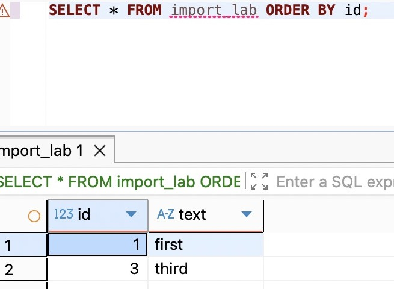

# 支线27A：保存点、异常捕获与事务所有权

主线采纳要求完整成功，任何必需对象失败都应回滚全部变化。有时规则不同：导入文件中的每一行可以独立拒绝，但已经通过的行希望一批提交。此时只会“遇到错误就ROLLBACK”还不够；反过来，在catch里忽略错误也不能让失败的PostgreSQL事务继续工作。我们需要先确定允许部分完成的单位，再选择数据库机制。

## 一行允许失败，不等于每一行立即提交

假设一批导入有三行，第一、三行合法，第二行缺少必要文本。产品允许跳过第二行，但要求用户取消本批时，第一、三行也不留下。每行各用一个事务可以隔离错误，却无法在最后取消已经提交的第一行；一个大事务不做额外处理，又会被第二行的错误打断。

保存点SAVEPOINT是在一个事务内部放下可返回的标记。回滚到标记会撤销标记之后的变化，并恢复可继续执行的事务状态，标记之前的变化仍留在这个尚未提交的事务内。它不是嵌套的独立提交，也没有替业务决定哪些错误可以跳过。

在一个DBeaver连接中打开配套 `database/chapter-24/04-savepoint.sql`，保持Auto-commit，逐块执行。先单独创建临时表，再开始事务：

```sql
CREATE TEMP TABLE import_lab (id integer PRIMARY KEY, text text NOT NULL);
BEGIN;
INSERT INTO import_lab VALUES (1,'first');
SAVEPOINT optional_row;
```

接着单独执行 `INSERT INTO import_lab VALUES (2,NULL);`。收到23502后，不能直接插入第三行，否则仍是25P02。现在可以选择回滚整个事务，也可以回到刚才的标记：

```sql
ROLLBACK TO SAVEPOINT optional_row;
INSERT INTO import_lab VALUES (3,'third');
RELEASE SAVEPOINT optional_row;
SELECT * FROM import_lab ORDER BY id;
```

结果有1、3两行。ROLLBACK TO保留了第一行，并使我们能够继续；RELEASE只是移除保存点，不把这两行提交出去。单独执行外层 `ROLLBACK;`，再 `SELECT count(*) FROM import_lab;`，结果为0。如果最后选择COMMIT，两行才会作为同一个外层事务提交。临时表在BEGIN之前创建，所以外层回滚后表仍存在，连接关闭后才消失。[PostgreSQL的SAVEPOINT说明](https://www.postgresql.org/docs/18/sql-savepoint.html)也区分了回滚到标记与释放标记。



## catch处理JavaScript控制流，不能恢复数据库状态

数据库约束失败后，catch可以让JS继续运行，但数据库事务仍在失败状态。恢复需要ROLLBACK，或在事先存在保存点时ROLLBACK TO。没有先设保存点，不能在失败以后补一个标记，让已经失败的语句重新变成可选步骤。

另一类错误来自应用自身。例如表达写入成功后，JS检查发现业务条件不成立，于是抛错。若外层catch吞掉这个错误并正常返回，事务框架可能提交已执行的SQL，因为数据库没有发生语句错误，框架也看见回调正常结束。“捕获错误后return null”不能通用地表示回滚。要取消当前动作，就让错误离开拥有事务边界的回调；日志和HTTP映射放在事务外处理。

主线不会为学习记录设置可选保存点。学习记录失败后保留表达与accepted候选，恰好违背采纳的整体约束。只有业务明确允许部分成功，才值得引入局部回滚及失败明细；不是为了让批量接口尽量返回200而忽略问题。导入中的格式错误可以归到具体行，但连接丢失、语句超时或未知数据库错误不能一律当成“这一行跳过”。

## 函数拆开之后，仍然只能有一个提交决定者

采纳变长时可能拆成 `createExpression(tx, candidate)` 与 `createLearningRecord(tx, ...)`。拆函数没有改变数据库的工作单元。外层accept创建事务，内层只接收当前tx并执行自己的写入，不能偷偷从全局DatabaseService取根客户端，也不能自己开始另一个独立事务后提前提交。

以Prisma的类型表达这个约束，可以把参数声明为 `Prisma.TransactionClient`。它只说明这个函数使用事务客户端，并不会自动判断传进来的对象属于哪个业务动作。当前主线方法很短，保留在一起更容易审查，因此没有为了“以后可能拆”先加这一层。

若一个内部函数既要独立调用、又要被外部事务复用，可以让底层函数只接收tx，独立入口在外面建立事务再调用它。比“有tx就用、没tx就偷偷新建”的可选参数更容易看清责任。嵌套调用 `$transaction` 也不应被理解为自动创建保存点；本章所用交互式tx客户端不提供同样的事务管理入口。确实需要保存点时要针对锁定版本与驱动确认支持方式，不能靠相同方法名猜测语义。

## 把决定迁回采纳

遇到新需求，先写清用户取消时应该留下什么。如果保存表达和学习记录必须同时存在，外层只有一个提交决定；若一批互不依赖的候选允许逐项成功，多个短事务与每项结果往往比长事务更合适。只有“允许跳过局部失败，但保留项仍须一起提交”这个条件成立时，保存点才直接解决问题。

ACID中的一致性也依赖这种业务判断。原子性不会知道某个写入可选与否；数据库约束能保护已编码的规则，事务能把规则相关的变化放进共同边界，但漏掉的业务规则不会从四个字母里自动生成。隔离处理并发可见性，持久性处理已提交事实在故障后的保存，两者也不等同备份与恢复策略。主线每次先明确结果，再选事务范围，正是在把这些责任分开。

## 附录：本支线必要技术点速查

| 名称 | 用途 | 必要注意点 |
| --- | --- | --- |
| SAVEPOINT | 标记事务内可局部返回的位置 | 必须在可能失败的语句之前建立 |
| ROLLBACK TO | 撤销标记之后的变化并恢复事务可用性 | 外层事务仍未结束 |
| RELEASE SAVEPOINT | 移除保存点 | 不等于COMMIT，外层仍可全部回滚 |
| try／catch | 处理应用控制流 | 不自动修复失败数据库事务，不自动要求回滚 |
| TransactionClient | 让内部函数使用外层事务 | 不把根客户端调用自动纳入当前事务 |

官方入口：[SAVEPOINT](https://www.postgresql.org/docs/18/sql-savepoint.html)、[ROLLBACK TO](https://www.postgresql.org/docs/18/sql-rollback-to.html)、[RELEASE SAVEPOINT](https://www.postgresql.org/docs/18/sql-release-savepoint.html)、[Prisma事务API](https://docs.prisma.io/docs/orm/v7/prisma-client/queries/transactions)。

[返回第27章](chapter.md) · [第四篇导读](../README.md)
