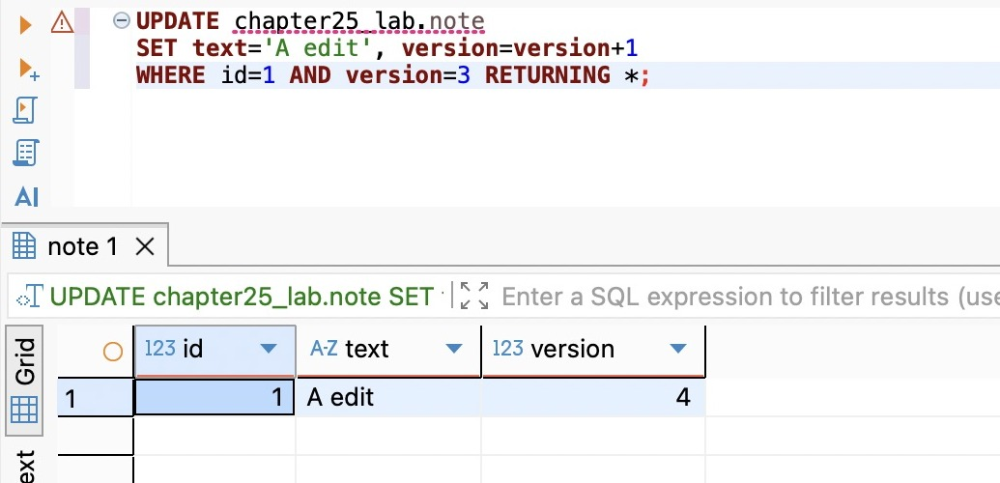
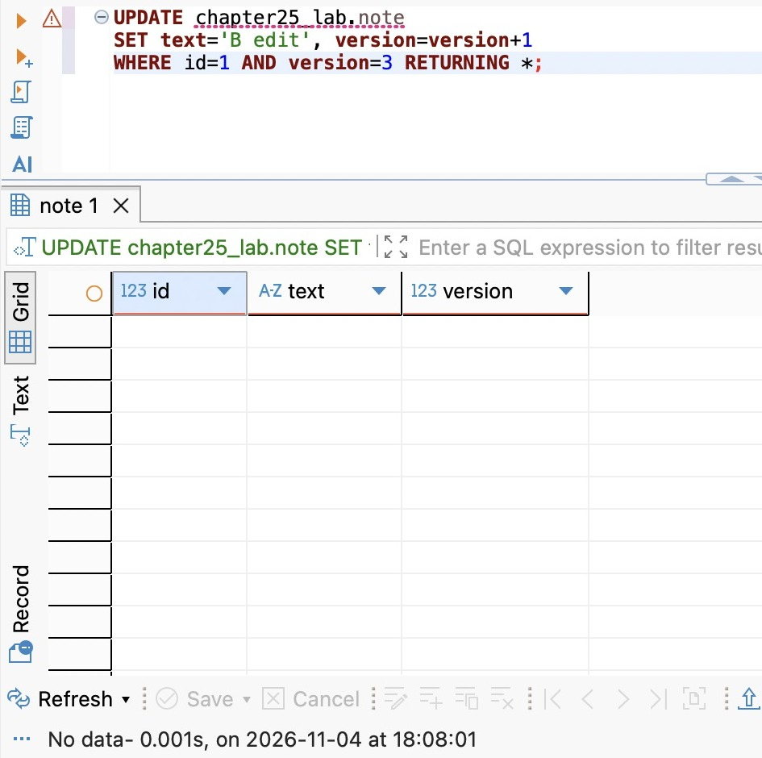
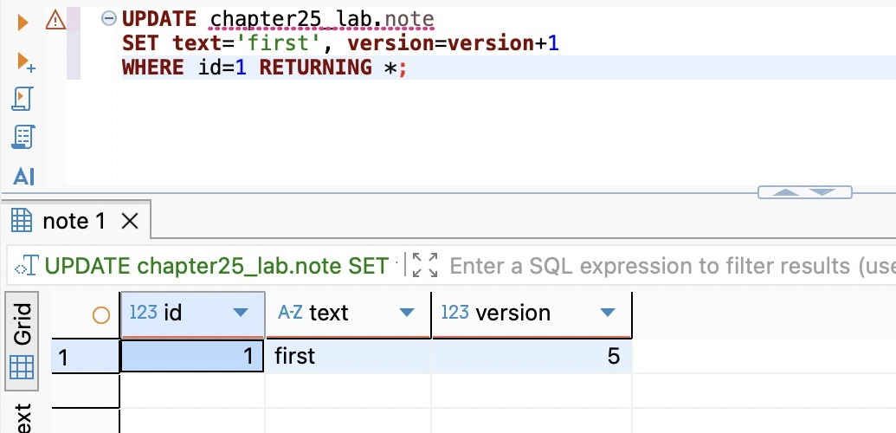

# 支线28A：版本校验、丢失更新与ABA

主线用status=pending表达采纳的有效前提，因为候选内容不变、终态不能重新打开。如果对象允许编辑，即使status一直是draft，内容也可能已经被另一个人改过。此时问“仍可编辑吗”不够，还要问“现在还是我看到的那一版吗”。

这条支线从一张独立备注表说明版本比较，不给EPP提前增加备注或编辑接口。配套 `database/chapter-25/06-version.sql` 接在主线实验表之后，使用同一个隔离库。已有chapter25_lab时只建note，不重复运行setup。

时间参考：阅读约30～35分钟，SQL操作另加10～15分钟；按约2300个汉字、17行关键SQL、三张实拍与版本比较实验估算，非读者实测。

## 两个人都保存成功，为什么仍然丢失一次修改

假设A、B都打开备注“first”，两人各自编辑。A保存“A edit”，B稍后保存“B edit”。若后端执行 `UPDATE note SET text=$new WHERE id=$id`，两个请求都可能返回成功，最终只剩B的内容。

数据库没有丢掉一条已经确认的INSERT，也没有违反原子性；它按要求先后覆盖同一字段。丢失的是A的编辑意图：B基于旧页面写入，却在自己没有看见A修改的情况下把它盖掉。若产品明确允许最后保存者覆盖，这就是规则；若产品要求用户先处理他人改动，就必须把“基于哪个版本”带入写入条件。

编辑期间长时间持有数据库行锁不合适。用户可能去开会、关闭页面或断网，连接和锁不应跟着一个页面开几个小时。因此可以让编辑发生时不持锁，保存时在数据库中比较基础版本；只有版本仍匹配才更新。这就是这里的乐观并发控制：乐观指先允许各自工作，提交时仍严格检查冲突，不是希望冲突不会发生。

## 版本比较必须和写入成为同一件事

先执行：

```sql
CREATE TABLE chapter25_lab.note (
  id integer PRIMARY KEY,
  text text NOT NULL,
  version integer NOT NULL
);
INSERT INTO chapter25_lab.note VALUES (1,'first',3);
```

A、B分别SELECT id=1，记下相同的version=3。A保存时执行：

```sql
UPDATE chapter25_lab.note
SET text='A edit', version=version+1
WHERE id=1 AND version=3
RETURNING *;
```

返回一行，text为A edit、version为4。



B仍拿着自己最初读取的3，执行：

```sql
UPDATE chapter25_lab.note
SET text='B edit', version=version+1
WHERE id=1 AND version=3
RETURNING *;
```



这次返回零行，原内容保持A edit。不要先SELECT比较版本，再用只有id的UPDATE：比较和写入之间又会出现主线的时间窗口。也不要先把version单独加一，再另外更新内容；两处必须属于同一条修改，或至少在维护相同前提的同一事务里一起成功。

这种“比较并交换”常缩写为CAS。这里交换的是数据库行的新值，比较的是应用定义的版本。两个操作真的同时到达时，数据库仍会用内部锁协调UPDATE，失败者等待以后重新检查条件；乐观并发控制不意味着数据库完全不加锁，它避免的是应用跨用户思考时间长期持锁。

如果映射到一个HTTP编辑接口，读取响应应提供当前version，保存请求携带baseVersion。服务端自行递增，不能信任客户端提交一个任意“新版本”。有权限的对象存在但版本不匹配，可根据契约返回409；资源不存在／不归属的情况保持不可见。条件更新零行本身分不出所有原因，错误分类仍要遵守权限边界，不能为了给出精细提示泄露他人的对象。

本章EPP没有这个接口，不把示例字段随手加入Capture PATCH。第25章修订序号占位解决的是两个追加者争同一个序号；一个人拿着旧页面、在别人提交之后才开始追加，仍可能得到下一个新序号。若要拒绝这种过期编辑，需要显式携带并校验基础修订，不能把“保存了历史”当成“已经检测过期页面”。

## 冲突后不能偷偷换个版本重发

B收到冲突后，最省事的程序可能先GET到version=4，再把原来的B edit自动按4重发。这样只是晚一点覆盖了A，等于撤销“用户必须看到他人修改”的承诺。

合理流程应保留B的本地输入，读取A的新内容，展示差别，由人选择合并、采用新版或明确覆盖。若产品允许自动合并，还必须定义字段级规则。例如A改标题、B改标签，可以按各字段基础值推导互不覆盖的合并；两人都改同一句备注，则很难只靠时间判断。不要把后台重试事务的P2034策略套到用户编辑冲突上：数据库中止的事务可以重新计算，旧编辑意图则可能需要新的产品决定。

改变需求再看：如果操作是“计数器增加1”，它不依赖页面读到的旧值，`SET count=count+1`通常比读取版本、提交旧数值加一更直接。若是“余额仍足够才扣减”，可以用 `WHERE balance>=amount` 的条件更新维护该行前提。版本比较适合需要拒绝基于旧状态的覆盖，不能成为所有UPDATE必须携带的装饰字段。

## 内容又变回first，为什么仍不是原来那一版

继续在A将备注改回first，并递增版本：

```sql
UPDATE chapter25_lab.note
SET text='first', version=version+1
WHERE id=1 RETURNING *;
```



现在内容与最初相同，version已经是5。如果只比较text='first'，还停留在最初页面的请求会通过，无法知道中间发生过A edit。这类“从A变成B又变回A”的过程称为ABA。单调前进的版本能够区分两个看似相同的内容状态；前提是所有写入口都递增版本，任何后台脚本绕过它都可能破坏判断。

这不是要求所有业务都拒绝ABA。如果规则只关心当前值是否匹配，回到相同内容可能仍能接受。若用户确认的是某一轮审阅、某一代资源或某次授权，历史上发生过变化就有意义，必须用对应身份表达。主线候选之所以能只比pending，是因为不允许终态回到pending；一旦允许重开，就要重新检查原前提是否仍充分。

不要用created_at做这个版本，也别随意把updated_at当严格CAS令牌。时间精度、同一时间点的多次变化、客户端时钟和未更新的写路径都可能让它不够可靠。整数版本、不可复用修订ID各有适用场景；整数还要考虑增长范围，长期系统可使用足够大的整数或稳定的新版本身份。这里用3、4、5只是为了让每一步清楚可见。

## 单行版本保护不到另一行的规则

再改变一个条件：两名值班者分别在不同的行，每人关闭值班前都检查“至少还有一个人在岗”。A、B各自看到对方仍在，各自只更新自己的行。即使两行都有version，而且两个条件UPDATE都成功，最后也可能无人值班：没有人修改对方那一行，因此版本没有发生碰撞。

这是判断依赖的范围大于写入比较的范围。可以让同一班次的操作先锁住一个稳定的班次行，在锁内重新统计并决定；也可以按统一顺序锁住所有参与行，再检查；或使用SERIALIZABLE并处理整个事务的中止重试。选择哪种方式取决于数据规模、成员是否会新增、所有写路径能否遵守协议。单行version不是跨行规则的万能替代品。

回到EPP：候选的状态、修订的版本、用户的生命周期和表达的合并身份分别代表不同前提。先说清本次操作依赖哪一个，才能选择条件、版本或锁。主线28.5扩大锁范围的理由正来自这里，而不是因为“用了数据库就应该多加几把锁”。

实验结束后，A、B均无未结束事务，再执行06脚本末尾的专用对象清理。保留正式采纳数据，不清空业务表。

## 附录：本支线必要技术点速查

| 名称 | 用途 | 必要注意点 |
| --- | --- | --- |
| baseVersion | 声明编辑依据 | 从原读取携带，不能冲突后偷偷替换 |
| version=version+1 | 由服务器推进版本 | 所有有效写入口遵守，内容变化与版本一起提交 |
| CAS | 在同一更新内比较并修改 | 单独先查版本仍有竞争窗口 |
| 零影响行 | 说明条件没有被满足 | 不是自动覆盖许可；仍需按权限分类 |
| ABA | 内容或状态变回原值，但已不是原代次 | 是否需要拒绝取决于确认语义 |
| 多行前提 | 判断依赖其他对象时扩大保护范围 | 单行版本无法自动保护全局计数或生命周期 |

官方入口：[PostgreSQL 18 READ COMMITTED的更新条件](https://www.postgresql.org/docs/18/transaction-iso.html#XACT-READ-COMMITTED)、[Prisma乐观并发控制](https://docs.prisma.io/docs/orm/v7/prisma-client/queries/transactions#optimistic-concurrency-control)。

[返回第28章](chapter.md) · [返回第四篇](../README.md)
