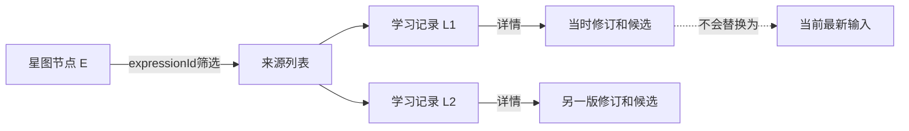
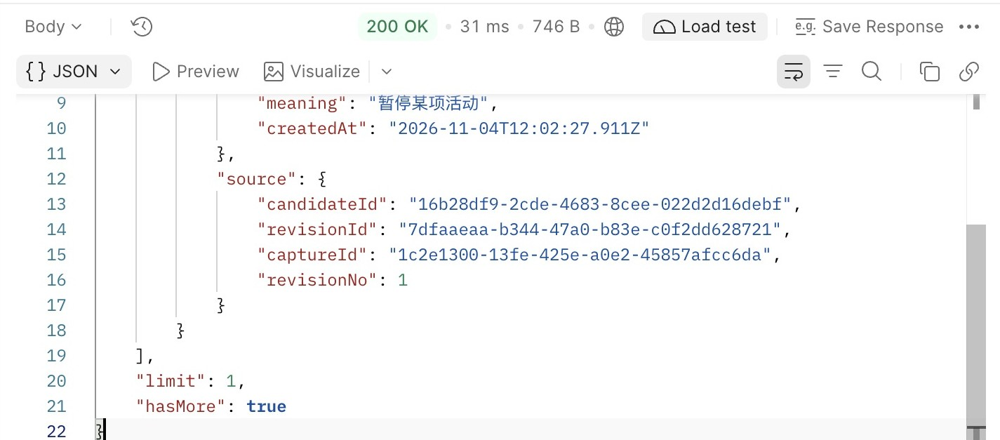
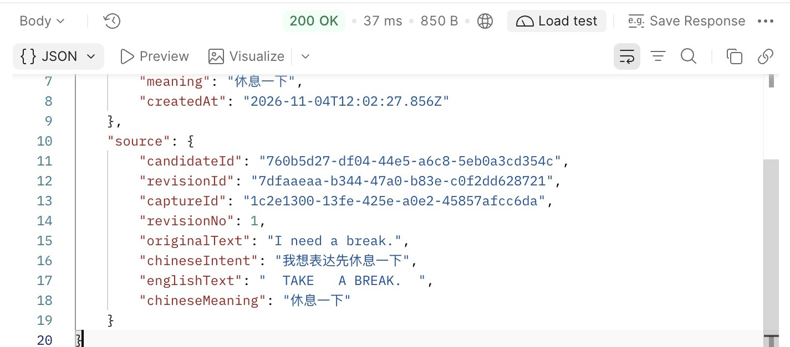
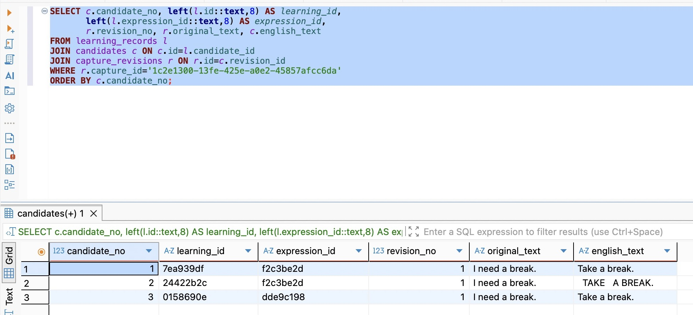
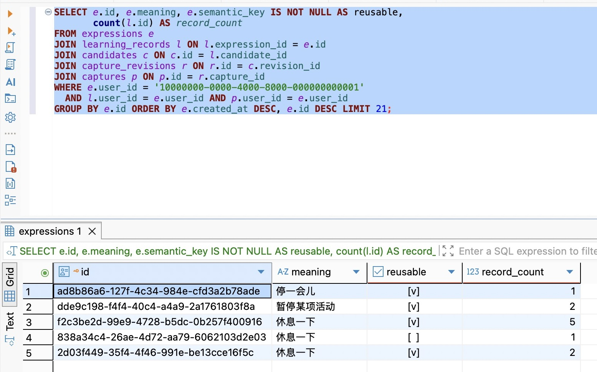
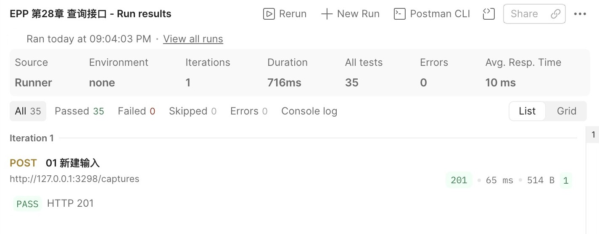
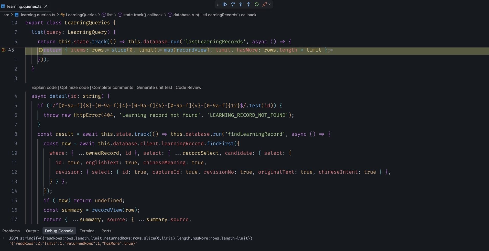

# 第28章 构建可供客户端使用的查询接口

第二十七章让两个内容相同的候选能够复用正式表达，同时保留两条学习来源。写入已经能区分“同一个操作重试”“同一个候选再次采纳”和“不同候选采纳相同内容”。现在轮到读取：客户端打开自己的内容列表时，一行究竟应该代表一个表达，还是一次收录？点进去以后，要看当前输入，还是当时决定采纳的那一版？

这些问题不能靠把ORM结果序列化来回答。数据库为保存事实拆了多张表，页面却需要一个有明确用途的结果。少返回一层关系，客户端可能要逐条补请求；多返回全部关系，又会把原文、内部比较键和不断增长的历史一起带走。本章沿已有数据建立基础星图、学习记录列表和详情，让调用方能按稳定身份从概览走回来源。

代码从 `part-04/chapter-27` 继续，完成状态为 `part-04/chapter-28`。仍使用Node.js 24.22.1、Prisma 7.10.1、PostgreSQL 18和固定开发用户，不增加依赖，也不修改模型或已有迁移。日常观察继续使用Postman、DBeaver和VS Code；本章选择HTTP请求走通调用过程，完整页面由后续客户端篇承担。

## 28.1 先决定一行代表什么，再决定查哪些表

### 星图节点与学习来源是两种行粒度

假设昨天和今天各采纳了一次 `Take a break.`。两个LearningRecord指向同一个Expression。星图可以只画一个表达节点，再告诉我它有两条来源；来源列表则应该显示两条记录，分别保留自己的candidateId、revisionId和时间。两种视图都正确，前提是没有把其中一种数量说成另一种。

本章的基础星图只提供节点。节点ID就是已有expression.id，附带代表文本、义项、表达创建时间和recordCount。recordCount表示当前用户可见的采纳来源数，不能叫练习次数、熟练度或掌握程度。尚未建立语义关系与练习事实，因此不返回虚构的连线、相似度、坐标和颜色等级。后面的客户端可以布置节点，但位置本身不会凭空成为领域事实。

学习列表的一项则以learningRecord.id为身份。它包含采纳时间、表达摘要和来源定位；详情再增加当时的输入与候选内容。列表不展开每个表达的全部来源，否则外层即使只有20项，一个表达仍可能带出几万条嵌套记录。



沿图调用时，expressionId用来找“这个表达有哪些来源”，learningRecord.id用来找“这一条来源是什么”。两个ID都是UUID，不代表可以互换。若把表达ID填到学习详情路径，正常结果是404；不要因为它长得像合法ID就怀疑数据库丢行。

三个入口的职责由此确定：

| 入口 | 一项代表什么 | 本章参数 |
| --- | --- | --- |
| `GET /star-map` | 一个有可见学习来源的表达身份 | limit |
| `GET /learning-records` | 一次采纳留下的学习记录 | limit、可选expressionId |
| `GET /learning-records/:id` | 指定学习记录及其历史来源 | 不接受查询参数 |

这不是为每张表都创建一套CRUD。ExpressionForm、Candidate和CaptureRevision仍参与关系查询，但调用方不需要知道每一层怎样存储，也不需要请求一份CommandReceipt才能显示来源。接口按用途组织，表按事实组织，两者不必同构。

### 历史副本继续拥有可访问的身份

前章迁移保留了旧重复表达，只为其中一个代表留下semanticKey。假设E1、E2曾分别被采纳，旧回执仍可能返回E2。基础星图应把两个既存身份都列出来，它们的来源列表也分别可读；不能为了让图显得干净，在查询里加 `semantic_key IS NOT NULL`。

这里的节点不是“全世界唯一语义”，而是当前数据库中有用户来源的正式表达身份。新采纳复用E1，旧E2仍有自己的历史。若将来要把两者展示成一个概念组，需要另行定义分组ID、成员与点击行为；直接按显示文本去重会丢掉E2的入口。前章保留旧数据的决定，必须在读取时继续成立。

没有采纳来源的表达不进入星图；pending和discarded候选也不会变成学习记录。现有候选列表仍能查看它们，本章不通过制造空学习记录来统一所有状态。

## 28.2 把存储关系变成公开响应

### 先写出响应允许包含的字段

前章采纳响应适合确认一次写入，本章列表适合展示很多条来源。两者都引用Expression，不要求拥有相同形状。列表采用一个平坦的表达摘要：id、text、meaning和createdAt；代表形式表的ID在这次用途里没有作用，便不返回。日后表达允许多个形式时，需要明确扩展这个摘要，不能让数据库加一行就使客户端得到不确定的text。

在 `src/learning-contract.ts` 中建立公开Schema，继续复用前文已有的文本与时间约束。下面是摘要、列表与星图的核心定义：

```ts
export const ExpressionSummarySchema = z.object({
  id: z.uuid(), text: OriginalTextSchema, meaning: OriginalTextSchema,
  createdAt: z.iso.datetime(),
});
export const LearningSummarySchema = z.object({
  id: z.uuid(), createdAt: z.iso.datetime(), expression: ExpressionSummarySchema,
  source: z.object({ candidateId: z.uuid(), revisionId: z.uuid(), captureId: z.uuid(),
    revisionNo: z.number().int().positive() }),
});
export const LearningListSchema = z.object({
  items: z.array(LearningSummarySchema).max(100),
  limit: z.number().int().min(1).max(100), hasMore: z.boolean(),
});
export const StarMapSchema = z.object({
  nodes: z.array(ExpressionSummarySchema.extend({
    recordCount: z.number().int().positive(),
  })).max(100),
  limit: z.number().int().min(1).max(100), hasMore: z.boolean(),
});
```

详情用LearningSummarySchema.extend扩展source，增加originalText、可空chineseIntent、englishText和chineseMeaning。前两项取自候选绑定的修订，后两项取自候选。这样，正式表达可以保留代表形式，详情仍能显示用户本次候选的原拼写。

```ts
export const LearningDetailSchema = LearningSummarySchema.extend({
  source: LearningSummarySchema.shape.source.extend({
    originalText: OriginalTextSchema,
    chineseIntent: StoredChineseIntentSchema.nullable(),
    englishText: OriginalTextSchema, chineseMeaning: OriginalTextSchema,
  }),
});
```

为什么既要手工投影又要Schema？投影说明从哪条关系取哪个事实，并把数据库Date转换为公开ISO字符串；Schema检查最终形状、约束和字段白名单。两者工作不同。TypeScript的类型不会在运行时删除多余字段；把对象断言成某个接口，更不等于它已经不含userId或semanticKey。

沿用ResponseSchemaInterceptor，让Zod解析返回值。它默认剔除对象中未声明的属性；若缺少必要字段或数据不符合约束，则让服务返回安全的500，而不是把一份残缺详情当200交付。输入Schema却使用strict拒绝未知参数，因为调用方写错筛选项不应被静默忽略。输出裁去未公开字段与输入拒绝不支持的意图，不是同一个策略。

### 用户范围必须参与关系匹配

固定开发用户仍由服务端常量提供，不能开放 `?userId=` 让调用方挑选身份。以后认证机制会替换这个来源，本章先把读范围放在正确位置。

最容易漏掉的是详情。列表写了where.userId，不代表详情可以直接findUnique({where:{id}})。知道一个ID只是知道对象的地址，不证明有权读取它；来源里的Capture也有归属。当前数据库用各自外键保证“引用的行存在”，没有跨多张表强制所有user_id相等，所以查询需要同时约束学习记录、表达和输入的归属。

在 `src/learning.queries.ts` 先定义本章三个查询共同使用的来源范围：

```ts
const ownedRecord = {
  userId: DEVELOPMENT_USER_ID,
  expression: { userId: DEVELOPMENT_USER_ID },
  candidate: { revision: { capture: { userId: DEVELOPMENT_USER_ID } } },
} satisfies Prisma.LearningRecordWhereInput;
```

这里的satisfies让编译器核对对象是否符合Prisma查询条件类型，同时保留字面量的推导结果，不执行数据库校验。最终保证范围的是实际where。即使有人通过其他写入途径构造了跨用户关系，本章查询也不能沿那条关系返回对方原文；它会排除该项。排除不代表坏数据已经修复，维护时仍应查明来源。

对于详情，缺失、非法或不属于当前用户的ID统一返回404，不另发请求告诉调用方“这个ID确实属于别人”。对于列表，expressionId只是筛选条件：有效UUID没有匹配项时返回200与空items，既不暗示表达存在，也不把正常空结果写成存储错误。真正的数据库失败则是500或503，不能catch后返回[]。

### 选字段与选关系分别限制什么

Prisma默认读取模型的标量字段；include关系也可能带出相关模型的全部标量。我们在查询入口显式select，先减少读取和后续映射接触的信息，再通过公开Schema验证。对照[Prisma 7字段选择](https://www.prisma.io/docs/orm/v7/prisma-client/queries/select-fields)时，要区分“没有读取”与“读取后没有输出”，两种边界都应有理由。

```ts
const expressionSelect = {
  id: true, meaning: true, createdAt: true,
  forms: { select: { text: true }, orderBy: { id: 'asc' }, take: 2 },
} satisfies Prisma.ExpressionSelect;
const recordSelect = {
  id: true, createdAt: true, expression: { select: expressionSelect },
  candidate: { select: { id: true, revision: { select: {
    id: true, captureId: true, revisionNo: true,
  } } } },
} satisfies Prisma.LearningRecordSelect;
```

为什么forms取2而不是1？当前契约要求恰好一个代表形式。取1会把异常的多个形式藏起来，取全部又会失去嵌套数量边界。取2足以区分0、1和多于1；投影时只接受长度为1。这个上限用于发现当前模型的不一致，并不是多形式产品规则。

```ts
type ExpressionRow = Prisma.ExpressionGetPayload<{ select: typeof expressionSelect }>;
type RecordRow = Prisma.LearningRecordGetPayload<{ select: typeof recordSelect }>;
function expressionView(row: ExpressionRow) {
  if (row.forms.length !== 1) throw new Error('Expected one expression form');
  return { id: row.id, text: row.forms[0]!.text, meaning: row.meaning,
    createdAt: row.createdAt.toISOString() };
}
function recordView(row: RecordRow) {
  return { id: row.id, createdAt: row.createdAt.toISOString(),
    expression: expressionView(row.expression),
    source: { candidateId: row.candidate.id, revisionId: row.candidate.revision.id,
      captureId: row.candidate.revision.captureId,
      revisionNo: row.candidate.revision.revisionNo } };
}
```

GetPayload从实际select推导结果类型，避免手写一份与查询逐渐分离的内部接口。日期显式toISOString，继续沿用连接UTC与数据库timestamptz的约定。表达创建时间可能早于学习记录时间；两个字段各自描述创建表达与这次采纳，不能为了让页面“看起来一致”强行改成同一个时间。

关系字段不等于一个不受限制的嵌套JSON。这里candidate、revision、expression都是单个对象；唯一数组forms有检测上限。没有返回该修订的所有候选、Capture的所有历史或Expression的所有学习记录，才真正限制了返回结果的规模。

## 28.3 先提供有界列表，再把分页问题留在明处

### 默认值和上限都属于公开契约

只提供 `limit=100` 的示例，并不等于接口有上限；如果不传就读全部，第一次调用仍可能取走整个用户的数据。本章两个新列表默认20、最多100，响应明确回显生效limit。这个约定只属于新查询，不在本章悄悄改变前面 `/captures` 已有的读取契约。

参数用HTTP层的字符串定义，不先用Number转换再校验。否则空字符串可能变0，科学计数法、前导零和重复参数数组也可能意外被接受。在 `learning-contract.ts` 增加：

```ts
export const LearningQuerySchema = z.object({
  limit: z.string().regex(/^(?:[1-9]\d?|100)$/).optional(),
  expressionId: z.uuid().regex(/^[0-9a-f-]+$/).optional(),
}).strict();
export const StarMapQuerySchema = LearningQuerySchema.omit({ expressionId: true });
export type LearningQuery = z.infer<typeof LearningQuerySchema>;
```

沿用simple查询解析器，重复limit会成为数组，无法通过string检查；unknown字段由strict拒绝。星图不接受expressionId，详情不接受任何查询参数。这里没有开放orderBy、include或任意字段名让客户端直传ORM：支持一个查询选项，就要同时承诺它的意义、数据范围、成本和错误行为。

### 多取一行只回答“还有没有”，不回答“共有多少”

本章的学习列表查询放在LearningQueries.list中。构造函数接收已有DatabaseService和ApplicationState；后者让关闭服务时知道查询仍在途，前者维持安全日志与数据库错误映射。

```ts
list(query: LearningQuery) {
  const limit = Number(query.limit ?? '20');
  return this.state.track(() => this.database.run('listLearningRecords', async () => {
    const rows = await this.database.client.learningRecord.findMany({
      where: { ...ownedRecord,
        ...(query.expressionId ? { expressionId: query.expressionId } : {}) },
      select: recordSelect,
      orderBy: [{ createdAt: 'desc' }, { id: 'desc' }], take: limit + 1,
    });
    return { items: rows.slice(0, limit).map(recordView), limit,
      hasMore: rows.length > limit };
  }));
}
```

假设limit为20：读到21行，返回前20行并标hasMore=true；读到20行，表示该次查询没有观察到第21行。items.length只是本次返回数量，不能改名total。读取一个额外位置可以回答这里需要的问题，不必为每次列表额外COUNT全部匹配行。

筛选、排序、截取在数据库里按同一查询意图执行。若先取最近20条，再在JS里按expressionId筛选，一个确实有很多来源的表达也可能只返回空集，hasMore还会失去对应范围。决定hasMore的第21行必须与返回项服从同样的用户和表达条件。

createdAt降序让新来源靠前；id降序补齐同一毫秒下的并列，形成确定顺序。UUID随机值并不代表更晚发生，它只在时间相等时提供稳定补充。没有ORDER BY便没有可依赖的数据库行顺序；[PostgreSQL的LIMIT说明](https://www.postgresql.org/docs/18/queries-limit.html)特别提醒这一点。此处先确定单次截取的顺序，下一章再讨论跨请求翻页时的插入、移动与游标。

hasMore=true时，本章还没有合法的“下一页”参数。客户端可以提示只展示最近一部分，但不能自行猜 `offset=20` 或 `cursor=最后ID`；服务会拒绝这些未知参数。将不完整写进响应，比把20条摆成全量内容可靠。若业务此刻必须遍历全部来源，分页就是当前必要能力，不能仅调大上限；本书在紧接着的第二十九章完成它。

### 星图从表达出发，计数仍受来源范围限制

星图不能先取20条LearningRecord再在JS按expressionId去重，否则两个来源共享表达时，节点数量会不足，而且更早的表达可能永远看不到。查询根改为Expression，条件要求至少存在一条可见来源，返回每个表达的受限计数：

```ts
const rows = await this.database.client.expression.findMany({
  where: { userId: DEVELOPMENT_USER_ID,
    learningRecords: { some: ownedRecord } },
  select: { ...expressionSelect,
    _count: { select: { learningRecords: { where: ownedRecord } } } },
  orderBy: [{ createdAt: 'desc' }, { id: 'desc' }], take: limit + 1,
});
return { nodes: rows.slice(0, limit).map(row => ({
  ...expressionView(row), recordCount: row._count.learningRecords,
})), limit, hasMore: rows.length > limit };
```

将这段放在starMap方法中，像list一样解析已验证的limit，并使用state.track与database.run('readStarMap', ...)。some只决定这个表达是否进入结果，_count决定公开的来源数量；二者使用同样的ownedRecord。只过滤外层表达，却对所有用户的学习关系计数，会把不该公开的存在信息混进数字。

表达节点按表达的createdAt排序，不按最近一次采纳排序。因此再次采纳旧表达会增加recordCount，但不会自动把节点移动到最前面。若产品以后需要“最近学习”排序，应先定义使用采纳时间还是练习时间，再改变查询；不能复用一个含义不匹配的createdAt来凑结果。

limit限制返回根对象数量，不保证扫描、排序与COUNT成本也只涉及20行。关系select也不承诺每次只有一条SQL；实际Prisma策略可能分批读取关联表。这里不启用预览特性，不在循环里为每行另发详情查询。先通过查询事件观察实际行为，第三十章再以执行计划和数据规模决定索引与性能调整；不能仅看ORM代码一行就宣布不存在N+1或已经足够快。

## 28.4 用历史数据走完概览、来源和详情

### 详情沿采纳时的修订读取

在LearningQueries.detail中，先按现有路径约定拒绝非法ID，再把ID与ownedRecord放进同一个findFirst条件。不能先取裸行、返回后才在页面判断用户。查询只为详情增加必要的原文列：

```ts
const row = await this.database.client.learningRecord.findFirst({
  where: { ...ownedRecord, id },
  select: { ...recordSelect, candidate: { select: {
    id: true, englishText: true, chineseMeaning: true,
    revision: { select: { id: true, captureId: true, revisionNo: true,
      originalText: true, chineseIntent: true } },
  } } },
});
if (!row) return undefined;
const summary = recordView(row);
return { ...summary, source: { ...summary.source,
  originalText: row.candidate.revision.originalText,
  chineseIntent: row.candidate.revision.chineseIntent,
  englishText: row.candidate.englishText, chineseMeaning: row.candidate.chineseMeaning,
} };
```

这一段放在state.track与database.run('findLearningRecord', ...)内。拿到undefined后，在数据库错误包装层外抛 `new HttpError(404, 'Learning record not found', 'LEARNING_RECORD_NOT_FOUND')`；否则把正常缺失错误放进database.run，会被统一当成存储失败。非法路径ID也返回同样404。这里沿用前文的小写字面UUID规则，路径中百分号编码由httpBoundary先拒绝，不把不同编码当作新身份入口。

### 注册不止是增加一个Controller

新增 `src/learning.controller.ts`，让三个方法分别使用对应查询Schema和响应Schema：

```ts
@Controller()
export class LearningController {
  constructor(private readonly queries: LearningQueries) {}
  @Get('learning-records')
  @UseInterceptors(new ResponseSchemaInterceptor(LearningListSchema))
  list(@Query(new SchemaPipe(LearningQuerySchema)) query: LearningQuery) {
    return this.queries.list(query);
  }
  @Get('learning-records/:id')
  @UseInterceptors(new ResponseSchemaInterceptor(LearningDetailSchema))
  detail(@Param('id') id: string,
    @Query(new SchemaPipe(EmptyObjectSchema)) _query: object) {
    return this.queries.detail(id);
  }
  @Get('star-map')
  @UseInterceptors(new ResponseSchemaInterceptor(StarMapSchema))
  starMap(@Query(new SchemaPipe(StarMapQuerySchema)) query: Pick<LearningQuery, 'limit'>) {
    return this.queries.starMap(query);
  }
}
```

在现有CapturesModule.controllers加入LearningController，并注册LearningQueries工厂，注入DatabaseService、ApplicationState。当前查询仍围绕同一组捕获与采纳事实，不再造一个只转发调用的Store接口；将来数据源或职责真正分开，再按已知变化拆模块。

```ts
{ provide: LearningQueries,
  useFactory: (database: DatabaseService, state: ApplicationState) =>
    new LearningQueries(database, state),
  inject: [DatabaseService, ApplicationState] },
```

还要沿请求实际经过的地方检查两处。`http-boundary.ts`在Nest匹配之前维护路径与方法约定，增加三个GET入口；对它们POST应为405并带Allow: GET，未定义路径仍404。`request-observation.ts`增加固定标签 `/star-map`、`/learning-records`、`/learning-records/:id`，保持日志不含原始路径ID、筛选值和原文。只加装饰器会留下前置404或无法归类的日志。

OpenAPI同步三个路径、公开Schema、limit与expressionId参数、空结果和错误语义。现有ETag与条件请求继续适用；304没有JSON正文，应使用同一URL之前保存的表示。当前Express处理链在请求带Cache-Control: no-cache时会发送完整200响应；研究缓存时检查实际请求头，不把“没看到304”直接归因于查询没有生效。

### 从现有库继续，不为读接口制造迁移

在DBeaver先核对当前库与用户，保留前章学习记录和回执。模型没有变化，所以本章不生成空迁移，也不重填semanticKey。日常联调先使用DEV：数据库CLI的 `.env.database` 与API的 `.env` 都应指向它。项目根目录运行：

```bash
nvm use
npm ci
npm run check
npm run db -- migrate status
npm run db -- migrate diff --from-config-datasource --to-schema prisma/schema.prisma --exit-code
npm run dev
```

独立VERIFY使用 `npm run db:verify -- migrate status` 和同样的diff参数，读取 `.env.database-verify`；启动校验API时也要通过自己的配置明确指向VERIFY，不能只改CLI配置便以为服务已换库。对照DBeaver中的current_database()、current_user与服务的非敏感目标信息，确认库名与身份一致。首次建立独立校验库才按前篇部署全部迁移并准备固定用户，已有27章库只核对状态，不重新初始化。

导入 `requests/chapter-28.postman_collection.json`，确认baseUrl是本次开发服务。01～11复用前章写入链准备样本：A、B同义项，C义项不同；08先追加新修订，09～11仍采纳初版候选。D、E保持未选择，不会进入学习列表。01每次运行会新建输入并更新本集合变量，中断后继续查询，不为重发GET重新执行全部准备。

12读取星图。找到A/B共同的expressionId，recordCount至少为2；若前章已有相同带句号表达，复用同一身份后数量可能更大，所以不能把示例环境总数写死为2。13把学习列表limit设为1，应只有一个items元素且hasMore=true。14按该expressionId筛选，应能找到A、B两条来源；两者learningRecord.id不同，expression.id相同。



图28-1　请求13的响应末尾。items只包含一条来源，limit与hasMore明确说明这不是全部记录；向上滚动仍可查看该项的身份与表达摘要。

15用B采纳响应中保存的learningRecord.id打开详情。source.revisionId应等于初版，source.originalText仍是 `I need a break.`；source.englishText保留B的大小写和空白，expression.text返回代表形式。16读取当前Capture却是 `Let us pause here.`。这不是接口彼此矛盾，而是一个读取当前内容，一个读取历史来源。



图28-2　请求15的source仍显示revisionNo=1、原输入和B的原候选拼写。接口返回的是采纳来源，不用当前输入覆盖它。

在DBeaver执行 `database/chapter-28/01-read-model.sql`。第一条业务查询按学习记录连接来源，第二条按表达分组计数；比较同一expression_id的出现次数。SQL中的用户条件与HTTP相同，观察SELECT结果不需要COMMIT。旧重复表达即使reusable为false，仍应出现在有来源的结果里。查询里的LIMIT 21用于观察“默认20加一条探测”，不是让页面返回21条。



图28-3　为看清本轮A、B、C，图中观察查询按本轮captureId筛选，并仅显示ID前八位。A、B的learning_id不同，expression_id相同；三条来源的revision_no都是1，original_text仍是初版输入。短ID仅用于画面对照，接口和表中的身份仍是完整UUID。



图28-4　配套SQL按表达分组，f2c3be2d开头的表达有5条来源，其中包含既有的3条和本轮A、B，不能只数上一图的筛选结果。838a34c4开头的旧副本reusable未勾选，即semantic_key为NULL，但仍有1条来源，因此继续出现在读取结果中。reusable说明未来是否用它做内容复用，不代表学习记录是否可见。

17用一个不存在的有效expressionId得到200空items与hasMore=false；18、19分别验证超上限与重复limit为400，20验证客户端传userId被拒绝，21用非法详情身份得到404。空筛选不是异常，坏参数不是空结果。若返回503，应按X-Request-Id查看database.failed的安全错误码，恢复连接或解除阻塞后再发GET；不要通过返回空数组让页面假装用户没有收录过内容。



图28-5　集合按01～21顺序执行，35条断言通过。断言涵盖成功读取、正常空集和预期的400／404；全部通过不等于所有请求都应该是200。

### 在断点中观察“多取”与“少返回”

VS Code选择Run and Debug中的 `EPP: attach to npm run dev` 并启动附加。打开 `src/learning.queries.ts`，在list方法的 `return { items: rows.slice(0, limit)... }` 行左侧设置断点（本章完成代码第45行）。Postman发送 `/learning-records?limit=1`。至少两条来源存在时，在Debug Console分别输入 `rows.length`、`limit`，应得到2和1；也可以用Watch保存这两个表达式。按Continue后，Postman公开items只有1条，hasMore为true。再看recordView：内部是candidate.revision嵌套对象，公开结果已经整理为source；这一变化来自明确投影，不是序列化器猜出了页面需求。



图28-6　本机HTTP请求命中TypeScript第45行，黄色行尚未返回。Debug Console中的只读表达式显示readRows=2、limit=1、returnedRows=1、hasMore=true；这里只比较数组长度，没有再次执行SQL。实拍请求由本机命令行发起，与Postman调用相同入口。

若要观察完整响应Schema，可沿前章方法在ResponseSchemaInterceptor的map回调查看value与schema.parse结果。只观察虚构样本，不展开连接串或环境对象。查询返回后的断点通常已不持有数据库事务，但仍占用HTTP在途请求；长暂停可能使客户端超时。继续或断开后重新发送GET，不能拿人为暂停的时长评价SQL性能。

灰色断点先核对附加端口、当前.dev产物和source map。需要时在同一次开发编译的learning.queries.js对应return处绑定，确认黄色暂停行和实际变量。保存源码观察编译与进程重启，原学习ID仍可读取；收尾移除实验断点、断开调试并正常停止本次API。

### 查询新增之后，旧写入与交付方式仍要成立

在独立目录仅放dist、package.json、package-lock.json、.npmrc，用相同Node运行 `npm ci --omit=dev`；通过进程环境提供DATABASE_URL，以 `NODE_ENV=production PORT=3001 node dist/src/server.js` 启动。默认docs为404，没有Inspector或watch。新查询不会因为复制了源码才偶然可用。

先拿升级前保存的learningRecord.id读详情，再用原operationId重放旧采纳，比较原JSON；停止并重启产物后再读同一ID。读接口本身不应改动候选状态、表达键、来源或回执。开发自动重启与生产重启各自验证已有数据保持，不用“新建一次成功”代替旧数据兼容。

本章最小自动检查覆盖列表上限与并列顺序、过滤先于截取、旧修订详情、旧副本可见、跨用户来源排除、公开字段以及坏参数。它们只运行在独立校验库；正常实践用保存的请求与只读SQL观察。当前阶段交付的是可解释、有上限的读取契约，尚不是全量星图或完整遍历能力。

下次继续时保留当前目标库、章节代码、Postman变量和已保存的学习ID。无需重新采纳来制造可查询数据。第二十九章就在这些列表上增加翻页，并研究当同一时间有多行、两次请求之间又新增记录时，“下一页”究竟应该从哪里继续。

## 知识支线

[支线28A：查询视图、快照与读模型的取舍](side-01-read-models.md)从订单列表解释行粒度、聚合膨胀、多次读取和独立读模型的成本。

## 附录：本章必要技术点速查

| 名称 | 本章用途 | 注意点与官方入口 |
| --- | --- | --- |
| select与嵌套select | 只读取用途需要的标量及关系 | 读取字段选择不等于用户授权，[Prisma 7字段选择](https://www.prisma.io/docs/orm/v7/prisma-client/queries/select-fields) |
| 关系where、some、过滤计数 | 排除不属于用户的来源，按表达计数 | 根对象、来源与计数使用一致范围，[关系查询](https://www.prisma.io/docs/orm/v7/prisma-client/queries/relation-queries) |
| take、orderBy | 有界截取与确定并列顺序 | 多取一行不代表总数或分页，[过滤与排序](https://www.prisma.io/docs/orm/v7/prisma-client/queries/filtering-and-sorting)、[PostgreSQL LIMIT](https://www.postgresql.org/docs/18/queries-limit.html) |
| SchemaPipe与响应Interceptor | 拒绝不支持的查询，检查公开响应 | 输入strict与输出投影职责不同，[Nest管道](https://docs.nestjs.com/pipes)、[拦截器](https://docs.nestjs.com/interceptors) |
| satisfies、GetPayload | 核对选择形状并推导内部结果类型 | 不提供运行时权限或字段删除，[TypeScript satisfies](https://www.typescriptlang.org/docs/handbook/release-notes/typescript-4-9.html#the-satisfies-operator)、[Prisma类型安全](https://www.prisma.io/docs/orm/v7/prisma-client/type-safety) |
| GROUP BY与聚合 | 对照表达数和来源数 | 先明确聚合的行粒度，[PostgreSQL表表达式](https://www.postgresql.org/docs/18/queries-table-expressions.html) |

本章完成代码状态为 `part-04/chapter-28`，配套入口为 `database/chapter-28/README.md`。

[上一章：一致性整合](../chapter-27-integration/chapter.md) · [第四篇导读](../README.md) · [全书目录](../../README.md)
