# 第29章 幂等与审计：响应丢失后如何安全重试

上一章让同一个候选只能建立一份采纳关系：pending条件决定谁能改变状态，唯一约束防止重复关系，事务把相关事实一起提交。现在把时间再向后推一点：数据库已经提交，服务也准备好了201，客户端却只看到网络错误。再次点击采纳会得到409，这能阻止重复写入，却没回答用户最关心的问题：刚才那次到底成功了吗，原来的学习记录又是哪一条？

本章从 `part-04/chapter-28` 继续到 `part-04/chapter-29`，给采纳增加操作身份、请求指纹和持久化结果。相同操作重试时返回原来的成功结果；身份相同而内容不同则拒绝。新增记录与业务变化进入同一笔数据库事务，并说明这份记录能证明什么、为什么不能把所有运行日志都当成审计。

仍使用PostgreSQL 18、Prisma 7.10.1、固定开发用户和DEV／VERIFY／SHADOW。采纳Body由空对象改为必填operationId；原文创建、修订追加、候选创建与放弃沿用各自的旧契约，不因为这一章完成就全部获得结果重放。接口仍采纳具体候选，不提前加入语义去重或外部AI调用。

配套入口是 `database/chapter-26/README.md`，包含三个分块SQL文件和Postman集合。先理解29.1的身份约定，再在29.2迁移；29.3实现并联调，29.4重现响应丢失。可以在迁移核对后、普通重放成功后分别停下；保留集合变量，结束实验事务，下一次从已保存的操作继续。

阅读约 170～205 分钟，跟做另加 105～135 分钟。可分三次：先选定迁移前样本并核对结构，再完成普通采纳与同键重放，最后对照响应丢失、回滚和重启后的结果。跟做包括自行写对账查询及核对不匹配的样本；附录按需查阅，支线另计。

## 29.1 采纳已经提交，但客户端没有收到响应

### 先画出客户端看不见的那一段

一次请求至少经过接收、事务执行、提交、生成HTTP响应和客户端收到响应。事务能保证采纳相关数据的原子性，不能把网络另一端的“已经收到”一起纳入提交。客户端超时，可能是请求根本没到服务器，也可能是服务还在等待锁，还可能是提交完成后连接才断开。

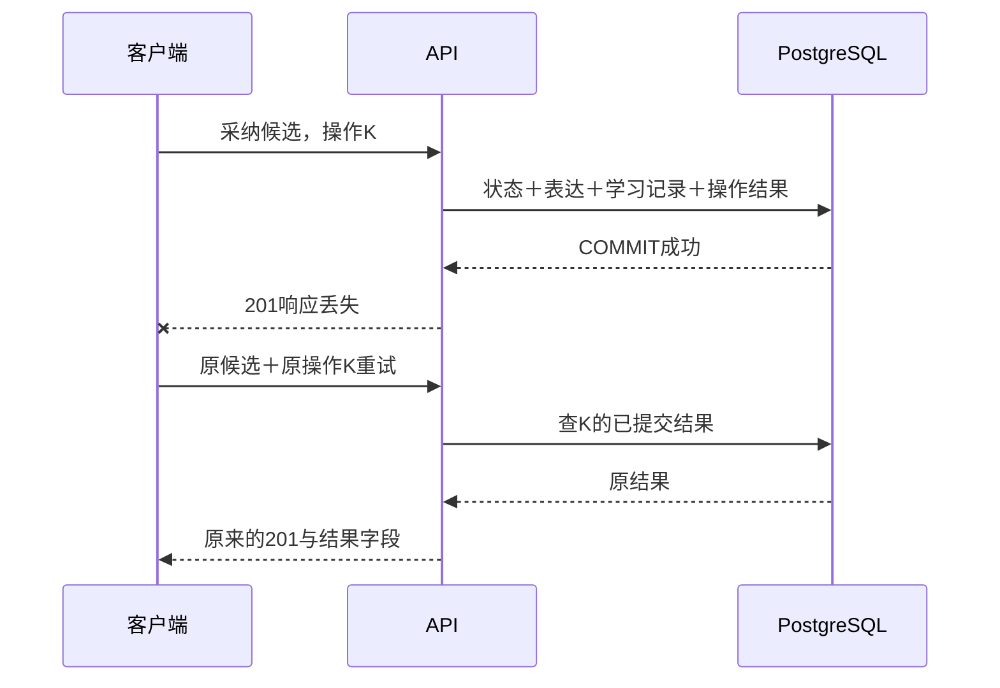

GET到accepted能证明候选已经处于终态，却未必能证明“就是这次操作完成的”。另一台设备可能先采纳，同一页面也可能在此前成功过。仅凭候选状态把所有409改成200，相当于把不同意图都解释成同一次成功。对于后续的付款、预约、发送，这种含混会更危险。

因此先区分三个问题：业务对象是谁，操作依据是哪一版，客户端想恢复的是哪一次决定。candidateId回答第一个问题，并通过revisionId指向不可变输入；operationId回答第三个问题。修订ID不能当操作ID：同一修订有多个候选，也可以发生多种动作。requestId则用于跟踪一次HTTP经过，重试应有新的requestId，却保留相同operationId。

把自己放在素材详情页前，只看得到一个还亮着的“采纳”按钮。第一次点击后没有成功提示。现在有两段都说得通的历史。第一段，页面开始等待时连接就断了，库里还是待采纳；第二段，库里已经有了学习记录，只是页面没拿到它的标识。页面此刻完全相同。假如把按钮文字从“处理中”直接改回“采纳”，用户下一次点击究竟是接着上一次，还是接受了一个新的确认框？这个问题不能交给服务端按两次到达的时间间隔猜。用户放下电脑一小时后回来，仍可能只想找回上一笔。

先在纸上写四行：按下确认、数据库接受这次决定、服务准备好返回值、页面读完返回值。分别在第一行与第二行之间、第三行与第四行之间画一个中断符号。第一种情况下需要一次真正的写，第二种只需要读出已有结果。现在假设恢复按钮只会查询候选状态。第一种情况下查到待采纳，尚可继续；第二种情况下即使查到已采纳，也缺少学习记录的标识和当时返回的表达。再改变一个条件，让另一名使用同一开发账号的同事先采纳。查询依旧显示已采纳，这次却不能把别人的操作算在我的确认名下。状态能帮助界面决定按钮还要不要显示，却不能独自完成这四行之间的对账。

服务端手里其实有两类很不一样的唯一性。前章把学习记录连到候选，回答“这条候选最多贡献几条采纳关系”。现在需要再加一条联系，回答“这一次确认曾给调用方哪份结果”。第一类联系能在两个不同的确认撞到同一候选时保护数据；第二类联系能在同一个确认分两次送达时解释成功。把第一类的冲突直接当成第二类的命中，就丢掉了“属于哪次确认”这个条件。反过来，只有操作身份而没有候选条件，也挡不住两人各拿自己的操作身份同时确认。两种唯一性分别保护不同的东西，后面两个约束必须同时留下。

再从页面保存的数据反推服务端需要接收什么。页面原来只记着选中了列表的第几行。刷新后排序一变，原来的第二行可能已换成另一条候选。即使保存了操作键，用“当前第二行”的地址重发仍是不同请求。至少要记住实际发给服务的目标标识，以及这一次采纳生成的键。当前采纳的正文没有别的可选业务输入，因此这两项就足以重建操作内容。以后若增加让用户选择表达形式的选项，待确认记录也要保存当时的选择；只保留选项面板的当前值，会把编辑界面后来发生的变化带进旧命令。

在 Postman 里也可以区分“准备请求”和“执行请求”。保存请求模板时，地址里还是集合变量，那个模板本身可以被很多操作使用。要恢复的是首次发送时变量实际代表的候选和操作。两个请求页即使显示相同的双花括号，也可能在不同时间解析成不同的值。稍后准备好第一组样本后，先打开集合变量查看这两个实际值，在自己的练习记录里把它们写在同一行，再打开采纳请求看最终地址和正文。核对的是两处引用是否指向刚才那一对。若继续做第二组时先更新了变量，旧请求页仍在屏幕上并不能把变量拨回原来的状态。

### 身份必须早于第一次发送

本章客户端使用随机UUID，并以小写表示。选定候选、确认这次意图后，先生成并保存operationId，再发送请求。若在发送成功后才生成，恰好丢失响应时就没有恢复依据；若每次点击Send重新生成，服务看到的永远是新操作。

浏览器里可以用 `crypto.randomUUID()`，但调用位置比函数名字更重要。需要跨刷新恢复时，应把candidateId与operationId作为同一份待确认操作保存在适合该客户端的持久存储中，直到确认结果。这里不建设客户端队列，Postman的集合变量承担本章的保存入口。它在创建新候选成功后生成一次UUID，采纳请求只引用变量；不要把 `{{$guid}}` 直接放进采纳Body。新样本建立后，集合同时清掉上一轮expressionId、learningRecordId和otherCandidateId，避免首次响应丢失时误拿旧结果作比较。开始第二组实验前先保留上一组需要回查的ID；不要在尚未确认的操作上重跑01～03。

```json
{
  "operationId": "35000000-0000-4000-8000-000000000001"
}
```

路径仍为 `POST /candidates/:id/accept`。示例UUID便于讲解，真实每次新操作应另生成；重试则不能变。URL中的candidateId同样需要保留，不能把页面当前选中的另一候选代进去。

把身份放在Body而非请求头，是这条小接口的明确选择：原来Body只有空对象，现在只有一个有意义的必填字段，直接沿用Zod和图形集合。使用请求头也可成立，但仍必须解决验证、作用域、重复值和客户端保存，换个位置本身不会产生幂等性。

### 本章承诺的“相同”

我们把成功操作限定在服务端用户范围内，数据库键为(user_id, operation_id)。两个用户碰巧使用相同UUID不应拿到对方结果；请求也不允许自己声明userId。当前从固定开发身份取值，第五篇换成真实身份时仍保留这个来源约束。

相同用户、相同身份、相同采纳内容，返回第一次提交的201与原字段值。不是再创建一次学习记录，也不是从当前表达重新拼一份看起来差不多的响应。对象键顺序、requestId、响应耗时和Date等传输信息允许不同；业务结果中的ID、acceptedAt与内容保持。JSONB不保留对象键顺序，所以这里承诺语义结果一致，而非原始字节一致。

只保存成功结果。400说明输入不符合契约，404说明当前身份看不到目标，409说明业务或操作身份冲突，它们不占用一条成功回执。数据库异常也不会单独留下“失败完成”行。由此可知：同一身份在失败后还可能成功，它不是对所有HTTP状态永久缓存的通用服务。这一边界应在客户端契约里说清楚，不能让调用者靠猜测决定是否继续。

“返回原来的成功”可以在还没有代码时先定义成几组可以逐项比较的值。画两列，左列是第一次成功的公开结果，右列是同一操作的恢复结果。候选标识和采纳时刻应能对应，表达标识和学习记录标识也应能对应；学习记录内部指向的候选和表达又要分别对得上前两项。只要求两个返回值中都有一个看起来合法的学习记录标识，无法发现每次重放都重新生成了标识的错误。只要求两次学习记录标识相同，也查不出返回的表达取自另一个候选。这里要比较的是一组带关系的字段，不是一串互相独立的类型检查。

再在两列下面写一项不应相同的量：两次独立到达服务的请求各有自己的请求编号。倘若把整份传输响应不加选择地缓存下来，连第二次的诊断编号都沿用第一次，日后遇到第二次网络过慢，日志会把人领回第一次请求。反过来，把新的请求编号当作数据库里的操作身份，每次到达又都会变成独立操作。实现时让传输层照常为这一次响应安排请求编号，让业务层只拿首次公开结果填入成功响应，就能同时满足两边。日期头、响应耗时也应沿这条界线判断。

最后给这张纸增加第三列“第一次根本没有成功”。若候选仍待采纳且没有回执，原操作再次到达时有机会完成第一次提交；若另一项操作已经抢先采纳，当前操作会遇到业务冲突。两种情况都没有违反只重放成功结果的承诺。由此可给页面写出更准确的提示：失去响应时保留那次确认，重试成功后使用返回的学习记录；收到明确冲突时核对目标与操作，别用新键反复尝试。至于断线时页面应该显示“正在查明上次结果”还是“已失败，请重新采纳”，现在可以依据它掌握的事实选词。下一节要做的，就是把纸上左列存到重启以后也找得到的地方。

## 29.2 给成功操作保存一份可核对的回执

### 为什么不在内存中记一个Set

若只保存“处理过K”，进程重启就丢失，而且仍然不知道该返回哪个结果。把结果放进Redis等独立存储，又需要解释数据库提交与缓存写入之间的故障窗口。当前所有采纳事实都在PostgreSQL，一张同库表就能与它们原子提交，没有理由先引入另一套协调系统。

也可以只存learningRecordId，下次回查关联对象。对于允许返回当前状态的接口，这常常足够；但本章选择重放首次响应，表达以后可能补充形式、修订说明，当前投影不必等于当时结果。所以这里保存经过公开Schema筛选的响应快照，而不是所有数据库对象，更不保存请求头、Cookie、原始异常或完整日志。

CommandReceipt的一行表示“某个用户的一次采纳操作已经成功，并得到这份结果”。行里没有running状态：执行中由事务锁协调，完成时才插入全部非空字段。这样不需要额外回答running行的租约、接管和超时清理；长时间任务在后续篇另有模型，不能把本章的短事务任意拉长。

在 `prisma/schema.prisma` 增加以下模型，User和Candidate各增加反向字段 `commandReceipts CommandReceipt[]`，其余关系保留：

```prisma
model CommandReceipt {
  userId      String @map("user_id") @db.Uuid
  operationId String @map("operation_id") @db.Uuid
  action      String @db.Text
  candidateId String @map("candidate_id") @db.Uuid
  fingerprint String @db.Text
  statusCode  Int @map("status_code")
  response    Json @db.JsonB
  recordedAt  DateTime @default(now()) @map("recorded_at") @db.Timestamptz(3)
  user        User @relation(fields: [userId], references: [id], onDelete: Restrict, onUpdate: Restrict, map: "command_receipts_user_id_fkey")
  candidate   Candidate @relation(fields: [candidateId], references: [id], onDelete: Restrict, onUpdate: Restrict, map: "command_receipts_candidate_id_fkey")

  @@id([userId, operationId], map: "command_receipts_pkey")
  @@map("command_receipts")
}
```

主键不包含candidateId或fingerprint。否则同一个operationId换个候选或指纹就能再插一行，数据库反而无法表达“同一身份不能表示另一件事”。候选ID用于关联和核对，指纹用于确认请求内容相同；它们与操作身份承担不同责任。这里也不增加独立id，因为用户与操作身份已经足以定位一行。

`action`使用 `accept-candidate/v1`，标明动作及其语义版本。以后如果采纳支持选择形式、合并目标等新输入，版本和指纹需要一起演进；不能悄悄改旧动作的解释。statusCode固定201，保留为这份成功结果的组成部分。recordedAt是服务写入记录的时间，不是数据库提交序号，也不证明用户何时看到了响应；Prisma可能显式写入应用生成的时间，不能据列默认值推断所有INSERT都使用数据库时钟。

可以不看模型，先试着从空白纸写一条“找回采纳”的查询。已知条件是服务端认定的用户，以及客户端保留的操作键；不知道的恰恰是表达与学习记录的标识。于是结果的一行应代表一项成功操作，起点应选回执表。先写 FROM，再在 WHERE 写下 user_id 和 operation_id 两个等号，最后才决定 SELECT 要拿哪些列。对刚才的问题，先取 candidate_id、action、status_code 已能确认命中了哪条路径；要回答用户点开哪条学习记录，再从 response 的 learningRecord 对象取 id。反过来从表达表按英文原文搜索，英文相同的两个候选就可能给出两条结果，查询自身没有任何条件能说明哪条来自这次确认。

把这一推导再反向用来审表。若表的主键只有操作键，用户甲保存过某个键，用户乙碰巧生成相同值，乙的合法操作便会被不相关的人占住。若主键由用户、键和目标三项组成，甲先把键用于候选一，随后请求候选二时，两行的第三项不同，两次都符合唯一性。此时即使业务代码小心比较过目标，数据库仍允许写出相反的历史。选择两列主键，相当于声明一个函数关系：在一个用户范围内，知道操作键，应能唯一确定成功动作、目标和结果。某一列究竟该站在等号左边还是右边，取决于调用者在首次结果丢失后还能提供什么，以及换掉那一项表示新的身份还是原身份用错了。

还有一个方向容易混淆。按候选标识查询回执，是作者核对业务事实时很方便的反查，却不是客户端恢复的查法。假设用户手上只剩候选一，拿它查询库能知道一次采纳成功；若要证明手里的操作键就是这次确认，仍需把操作键代进去。稍后在 DBeaver 可以先按键查回候选标识，再用这个实际值查学习记录；最后从学习记录的表达标识回到表达表。每一步只带上一步已经读到的值，结果才是一条连续的证据。若在三个窗口各从第一行复制一个标识，三个对象都可能存在，彼此却毫无关系。空库里只放一条样本时这个错误最难察觉，因此前章留下的非空数据是这次迁移检验的一部分。

现在推敲 response 用什么表示。只保存状态码，恢复方能知道成功，却给不出资源；只保存资源标识，能找到今天的数据，却可能失去首次显示的内容；保存公开对象，既能把当时结果交回去，又不需要把整次网络请求搬进数据库。为了避免“挑了对象却挑错对象”，写入时使用本次事务刚创建的学习记录和表达组成结果，再用同一对象返回调用者。一份对象经过序列化后只是数据，读回时仍需按采纳成功结构解析。比如快照只剩表达这一项，顶层依旧是合法 JSON 对象，数据库的顶层类型检查会通过，而缺学习记录的结果不能供客户端恢复。字段形状与事务来源各自防的是一类错误。

### 请求指纹先定义结构，再计算摘要

当前采纳的业务输入只有动作和candidateId，候选内容自身不可变，不接收客户端再次传来的英文或中文。代码在 `src/prisma-candidate.store.ts` 的accept开头生成：

```ts
const action = 'accept-candidate/v1';
const fingerprint = createHash('sha256')
  .update(JSON.stringify([action, id])).digest('hex');
const lockKey = JSON.stringify(['command', DEVELOPMENT_USER_ID, operationId]);
```

同文件从 `node:crypto` 导入createHash。固定顺序的数组避免对象键排列造成差异；不对原始HTTP文本直接哈希，所以JSON缩进变化不会变成不同意图。用户身份已进入主键作用域，operationId是查找键，都不需要靠指纹再次定义身份。候选ID沿用已有小写路径约定，不悄悄trim或把一个不合法值改造成合法对象。

本章即使不算SHA-256，只比较固定动作与candidateId也能判断相同；这里保留摘要作为请求语义的明确版本化表示，同时仍直接比较动作和候选ID。以后字段增加时，先决定省略、null、默认值、顺序是否等价，再构造规范化输入。给任意JSON套一个hash函数，不能替代这些判断。

动作版本也约束保存结果的解释。当前回执只会是v1，使用当前AcceptanceSchema读取；将来修改响应字段时，应保留v1解析器，或为已保存快照设计可验证的升级，不能把旧JSON直接交给不兼容的新Schema。更不能删除解析失败的回执后重做业务；当前解析失败会安全报错，等待修复存储或兼容逻辑。

摘要不是加密。可猜的内容依然可能被枚举；这里摘要只包含动作与UUID，但响应快照仍含用户英语内容。后面的保留策略必须面对这份真实数据，不能因为旁边有一串哈希就称它已经匿名。

### 追加迁移，不给旧采纳编造身份

在 DBeaver 不妨给迁移前后的观察选同一个起点。迁移前从一条已采纳且有学习记录的旧候选出发，写下候选、修订、学习记录与表达四个标识，另选一条待采纳候选作对照。若练习副本里没有前一种，就先按前章正常采纳流程建立样本再停写。迁移后不用凭记忆找那句英文，而用原标识重新查询。预期旧候选仍已采纳，学习记录仍指向旧表达；另一条仍待采纳。新表第一次部署在这个停写的前章副本上时应为零行。以后重复 status 或重新启动服务，库已经有过真实回执，期望值就要改成“原有结果保持”，不能把零行当作每次启动的健康条件。

停止旧API和会写入的脚本，先记录旧候选、学习记录与表达关联。追加 `20261104120000_command_receipts/migration.sql`，不重写前章迁移：

```sql
BEGIN;
SET LOCAL lock_timeout = '2s';
SET LOCAL statement_timeout = '10s';
CREATE TABLE public.command_receipts (
  user_id uuid NOT NULL,
  operation_id uuid NOT NULL,
  action text NOT NULL,
  candidate_id uuid NOT NULL,
  fingerprint text NOT NULL,
  status_code integer NOT NULL,
  response jsonb NOT NULL,
  recorded_at timestamptz(3) NOT NULL DEFAULT CURRENT_TIMESTAMP,
  CONSTRAINT command_receipts_pkey PRIMARY KEY (user_id, operation_id),
  CONSTRAINT command_receipts_user_id_fkey FOREIGN KEY (user_id)
    REFERENCES public.users(id) ON DELETE RESTRICT ON UPDATE RESTRICT,
  CONSTRAINT command_receipts_candidate_id_fkey FOREIGN KEY (candidate_id)
    REFERENCES public.candidates(id) ON DELETE RESTRICT ON UPDATE RESTRICT,
  CONSTRAINT command_receipts_action_check CHECK (action = 'accept-candidate/v1'),
  CONSTRAINT command_receipts_fingerprint_check CHECK (fingerprint ~ '^[0-9a-f]{64}$'),
  CONSTRAINT command_receipts_status_check CHECK (status_code = 201),
  CONSTRAINT command_receipts_response_check CHECK (jsonb_typeof(response) = 'object')
);
COMMIT;
```

这次没有INSERT回填。旧学习记录是真实事实，但客户端当年的operationId不存在，首次响应也未必能从当前对象精确恢复。生成随机UUID补进去既不能帮助客户端找到它，还会制造“曾收到这个操作”的假历史。保留旧accepted及其学习关系，新表为空，才是忠实的升级结果。

CHECK能约束动作值、摘要表示、成功状态与JSON顶层形状，不能自动证明快照每个字段都正确，也不能跨表保证快照对应本次修改。写入前用AcceptanceSchema校验，事务保证一起提交；直接执行维护SQL仍需要遵守这些约定。外键保护引用存在，权限由沿修订和原文归属的查询承担。

沿用前章配置，先VERIFY后DEV，明确CLI和API分别从哪里取得DATABASE_URL。成品分支运行以下命令；从前章自行实现则先按第20章create-only流程生成并审核迁移，不再额外执行同义CREATE：

```bash
nvm use
npm ci
unset DATABASE_URL SHADOW_DATABASE_URL
npm run db:verify -- migrate deploy
npm run db:verify -- migrate status
npm run db:verify -- migrate diff --from-config-datasource --to-schema prisma/schema.prisma --exit-code
npm run db -- migrate deploy
npm run db -- migrate status
npm run db -- migrate diff --from-config-datasource --to-schema prisma/schema.prisma --exit-code
npm run check
```

DBeaver刷新public下的Tables，查看command_receipts的Columns和Constraints，并运行 `01-inspect.sql` 的结构查询。主键应精确为(user_id, operation_id)，非延迟且已验证；原有用户、素材、修订、候选、表达、形式与学习记录的行和关系保持。migrate status与Schema diff不能替代旧数据核对，Prisma模型也没有覆盖所有手写CHECK。

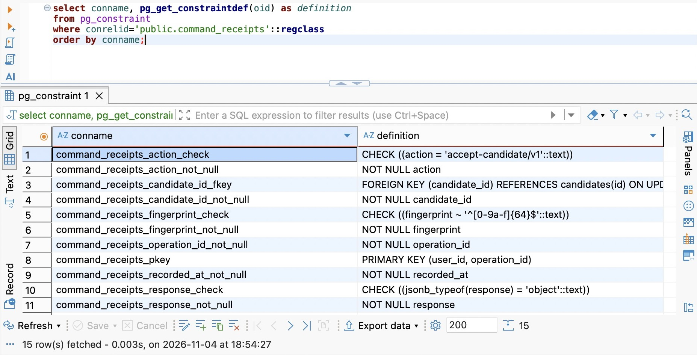

图中主键只包含user_id和operation_id；动作、摘要与JSON形状另有CHECK。展开或横向滚动definition列，核对完整外键定义。

在DatabaseService.onModuleInit沿用前章启动探针，读取一次commandReceipt，并从pg_constraint核对 `command_receipts_pkey` 的类型p、定义 `PRIMARY KEY (user_id, operation_id)`、convalidated与condeferrable。缺表、缺列或主键不符时拒绝就绪；主键不符的安全错误码为COMMAND_CONSTRAINT_MISSING，加入databaseFailure白名单。不能缺表后回退到无幂等的旧路径，否则一个部署错误就会悄悄改变客户端承诺。

这段代码放在 `src/database.service.ts` 既有学习记录唯一约束检查之后、缺失修订检查之前；原有失败关闭连接的catch保持：

```ts
await this.client.commandReceipt.findMany({ take: 1 });
const receiptKeys = await this.client.$queryRaw<{ definition: string; condeferrable: boolean }[]>`
  SELECT pg_get_constraintdef(oid) AS definition, condeferrable
  FROM pg_constraint WHERE conrelid = 'public.command_receipts'::regclass
    AND conname = 'command_receipts_pkey' AND contype = 'p' AND convalidated
`;
if (receiptKeys.length !== 1 || receiptKeys[0]?.definition !== 'PRIMARY KEY (user_id, operation_id)'
  || receiptKeys[0].condeferrable) throw Object.assign(new Error('Command identity constraint is missing'), {
    code: 'COMMAND_CONSTRAINT_MISSING',
  });
```

若迁移被锁阻塞，先看55P03等首因，再核对失败记录和实际结构；显式事务回滚后应没有半张新表。解决持锁原因、确认已回滚，才对这个迁移执行migrate resolve --rolled-back，再deploy。若表已经存在却没有正确历史，不自行drop：先核对来源及是否有业务行。resolve修改的是历史登记，不替你恢复数据。

要自己写这条对照查询，先决定是否要看见没有学习记录的候选。我们想把待采纳者也放进结果，所以把候选放在 FROM，把学习记录放在 LEFT JOIN 右边；两者按候选标识配对。再按同样思路把回执接到候选。下面两个全零占位分别替换成已保存的两个不同候选标识，在新表部署完成后执行。迁移前只能查已有的前两张表，应先去掉回执那一列与相应的连接。

```sql
SELECT n.id AS candidate_id, n.revision_id, n.status,
       l.id AS learning_id, l.expression_id, r.operation_id
FROM public.candidates AS n
LEFT JOIN public.learning_records AS l ON l.candidate_id = n.id
LEFT JOIN public.command_receipts AS r ON r.candidate_id = n.id
WHERE n.id IN ('00000000-0000-0000-0000-000000000000',
               '00000000-0000-0000-0000-000000000000')
ORDER BY n.id;
```

先手算两行应有的空值。旧采纳那行有学习记录和表达，两列来自同一条关系；操作键为空。待采纳那行的学习记录、表达和操作键都为空，但左侧的候选标识和状态有值。等本章以后者完成一次新采纳，再执行相同查询，只有它那一行从三处空值变为三个实际标识。若把第一个 LEFT JOIN 换成普通 JOIN，待采纳者在第一步就消失了，不能再拿缺一行解释为候选被删除。若在 WHERE 末尾加上回执的成功状态等于二百零一，空值行也无法满足等号，整张表又只留下新采纳。要保留原有两种历史，应当让右侧没有匹配的情形继续出现在结果中。

还要给这条查询的行数加上适用条件。学习关系对候选有唯一约束；回执表的主键却按用户与操作键定义。在按本章程序正常写入的样本里，一个候选最多有一次成功采纳，两次重放不会给右侧增加第二行。假如将来支持对同一候选执行别的成功动作，或在维护时留下多条关联，连接后同一候选就可能出现多行。这时先展开操作键逐行看，不要加一个 DISTINCT 让熟悉的两行重新出现。明细提供的是查验约定的机会，不能把想要的行数先写进查询，再用返回的行数证明约定正确。

## 29.3 把业务修改和重放结果放进同一事务

### 未存在的回执，不能直接靠行锁保护

直觉上可以先查K，没有就采纳，再插入K。但两个请求都可能查不到；同候选竞争时，后来的请求会在pending条件处得到409，仍不能重放。同一身份改成两个不同候选时，两边甚至都能走到写结果，最后由唯一约束让其中一个事务失败。唯一约束守住存储规则，却不会自动替应用选择怎样读取并返回胜者结果。

可行的一种方案是先插入占位命令，再把running改成completed，但要保证失败分支不会提交空壳、所有返回路径都正确处理状态。另一种是在事务开始时，为尚未存在的操作身份取得事务级建议锁；完成后只插完整结果。前章已建立这种机制，本章选择后者，以减少持久状态。

锁键由命名空间command、服务端userId和operationId组成，不含candidateId。因此同一身份换候选仍竞争同一把锁；若把candidateId也加进去，两个请求就会各取一把锁，失去本章要的串行协调。hashtextextended把这个字符串映射为64位锁键，碰撞最多让无关操作额外等待，精确身份仍由复合主键和字段比较决定，不能用锁的哈希值直接作为业务身份。

在accept的 `$transaction` 回调开始处加入：

```ts
await tx.$executeRaw`SET LOCAL lock_timeout = '1s'`;
await tx.$queryRaw`
  SELECT pg_advisory_xact_lock(hashtextextended(${lockKey}, 0))::text
`;
const candidate = await tx.candidate.findFirst({
  where: { id, revision: { capture: { userId: DEVELOPMENT_USER_ID } } },
});
if (!candidate) return undefined;
const previous = await tx.commandReceipt.findUnique({
  where: { userId_operationId: { userId: DEVELOPMENT_USER_ID, operationId } },
});
if (previous) {
  if (previous.action !== action || previous.candidateId !== id
    || previous.fingerprint !== fingerprint) return 'operation-conflict';
  return AcceptanceSchema.parse(previous.response);
}
```

这里的SQL仍是参数化模板，字符串没有拼进SQL源码。锁函数返回void，显式转成text让当前Prisma适配器能处理查询结果；返回文本不是成功凭证，函数正常返回才意味着已取得锁。必须使用事务级函数，提交或回滚即释放；连接池中随意使用会话锁，可能把锁遗留给下一次借到连接的请求。

**取锁、检查归属、查回执是三个按序完成的动作。** 当前使用READ COMMITTED，等待锁结束后再发下一条查询，才能看到前一持有者提交的回执。不要为了“少一次往返”把取锁和读取塞到同一条SQL：那条语句的快照可能早于锁等待结束，拿到锁也不会自动刷新它的语句快照。也不要只把隔离级别换成REPEATABLE READ却保持同样推理，它可能保留更早快照；改变隔离规则需要重做整个竞争过程。

查回执之前仍检查当前候选归属。知道operationId不是读取凭证，历史成功也不赋予永久访问权。候选不存在或不属于当前用户返回404，不向调用者披露另一个对象的结果。当前没有权限撤销和账号删除接口，未来接入时要把它们纳入一致的访问与生命周期协议。

把两次采纳并排演算一次。用甲、乙代表同一用户的两次独立请求，不代表两个账号。两者都带候选一和键甲。第一次进事务时回执表没有对应行，所以对回执做普通查询只会得到空集。哪怕给那条查询加上行锁，也没有一行现成的东西供第二个事务等待。建议锁允许双方先从同一组值算出一个名字，再到数据库里依这个名字排队，不要求这个名字已经是一行数据。取得锁的事务接下来可能成功也可能失败，锁本身没有保存结果的功能。把应用全部关掉以后要找回结果，仍得读持久表。

令第一次请求拿到锁，第二次紧随其后。第一次把候选改为已采纳，建立表达、形式、学习记录，最后插入回执。对它自己而言，这些中间结果已经能在本事务查询到；对另一条普通连接而言，在提交之前仍可能看见待采纳且没有回执。两种读数同时成立。不要因为调试器在第一笔事务里能展开 response，就在页面上提前打印成功；也不要因为另一连接在提交前数到零条，就向用户保证第一次什么也没做。能把“已经执行某条语句”提升为“其他连接可据此恢复”的事件是事务提交。

让第二次请求等到第一次提交，重新读候选，看到已采纳。现在有两条看似都合理的分支：根据状态拒绝再次采纳，或者先查操作结果。一定要选后者。因为第一次正常成功恰好会把状态变成已采纳，如果状态判断放最前，所有成功重放都会被自己刚制造的状态挡住。顺着主键找到回执，再比较动作、候选与指纹都相等，就有足够证据交还原结果。把第二次请求的键只换掉一个值，这条回执便查不到；此时再看已采纳状态，拒绝的是新的决定。一个判断顺序能同时满足两种结果，无须给重放额外开放一条修改终态的路径。

再换一个条件：第一次拿到锁后，最后插入回执时出错，整笔回滚。第二次只看到回滚后的待采纳状态，查不到学习关系或成功结果。它仍然带最初的键，可以走首次业务写入，最终留下的是这第二次成功尝试生成的标识。当用户问“为什么同一键的两次调用可能各自在内存里生成过不同的表达标识”，要追问其中哪份提交了。回滚的一份从未成为承诺给调用方的成功结果，真正应保持稳定的是第一份已提交的快照。把生成标识提早到锁前，也不能据此保证它对应一条已保存的记录。

从这个排队故事还可以推出三种时间限制各在限制什么。回调外需要先从池取得事务，配置中的 maxWait 是等待取得交互式事务的预算，单位毫秒。已经进到事务后，数据库的 lock_timeout 作用于尝试取得锁的等待；一秒过去仍拿不到锁，那条语句会失败。交互式事务本身还设了五千毫秒的期限，不能因某把锁在一秒内到手就无限延长整笔工作。页面从点击到看到响应还包括网络、排队和序列化。若一次恢复花了超过一秒但成功返回，不能倒推数据库一定忽略了锁等待上限；先问哪段时间真是在等待同一把锁。

### 没有旧结果，才尝试改变业务状态

上述代码紧接前章条件更新及表达创建；没有回执时，accepted或discarded仍返回业务冲突。保留pending条件与学习关系唯一约束，因为不同operationId不会互相排队，仍可能竞争同一候选。以下片段替换前章回调中从状态检查到return的位置：

```ts
if (candidate.status !== 'pending') return 'conflict';
const acceptedAt = new Date();
const claimed = await tx.candidate.updateMany({
  where: { id, status: 'pending' }, data: { status: 'accepted', acceptedAt },
});
if (claimed.count !== 1) return 'conflict';
const expression = await tx.expression.create({ data: {
  id: randomUUID(), meaning: candidate.chineseMeaning,
  forms: { create: { id: randomUUID(), text: candidate.englishText } },
}, include: { forms: true } });
const learningRecord = await tx.learningRecord.create({ data: {
  id: randomUUID(), userId: DEVELOPMENT_USER_ID,
  candidateId: id, expressionId: expression.id,
} });
const response = AcceptanceSchema.parse({
  candidate: project({ ...candidate, status: 'accepted', acceptedAt }),
  expression: { ...expression, createdAt: expression.createdAt.toISOString() },
  learningRecord: { ...learningRecord, createdAt: learningRecord.createdAt.toISOString() },
});
await tx.commandReceipt.create({ data: {
  userId: DEVELOPMENT_USER_ID, operationId, action, candidateId: id, fingerprint,
  statusCode: 201, response,
} });
return response;
```

所有数据库操作都通过tx，尤其不能把最后一行插入写成database.client.commandReceipt.create。后者会跑到另一条连接和事务里，成功或失败都可能与业务提交错开。response先经过已有公开Schema，内部userId与关系字段不会因为spread一起进入快照；JSON可序列化值中的日期已经转成字符串。

回执写失败时必须让异常离开回调，Prisma回滚此前的accepted、表达、形式和学习记录。不要catch后仍return response，也不要先提交业务再异步补回执。反过来，回执与业务提交成功后，HTTP响应即使失败也不能删掉回执；它正是下一次恢复的依据。

回调return不是提交完成。外面的 `$transaction` Promise完成后，Service才能返回给Controller；如果提交结果在连接异常中未知，就沿用存储异常映射，客户端以后用同一身份恢复。内部仍只对P2034做最多三次完整事务尝试，退避位于事务外，maxWait=2000、timeout=5000、每次取锁等待1秒保持前章设定。不把网络异常、P2028或任意500加入自动循环。

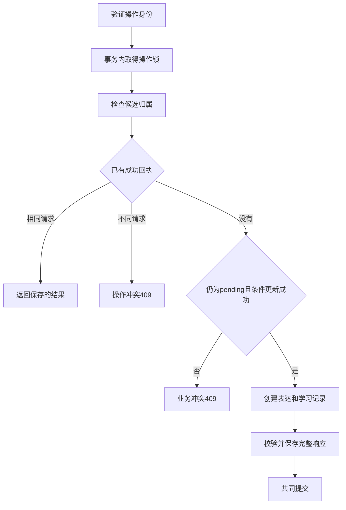

锁序现在是操作身份在前、候选写锁在后；以后加入用户生命周期协调时，应统一为用户生命周期→操作身份→候选→按稳定ID排序的已有表达，所有相关写入口遵守同一方向。建议锁是协作协议，不能阻止绕过它的SQL；复合主键仍是数据库兜底。若另一条不遵守协议的写入口导致P2002，本章安全回滚并报错，不把任意唯一冲突都冒充回执命中。

现在把原场景改成“两个不同操作确认同一个候选”。操作锁因键不同而互不排斥。两边第一遍都可能读到待采纳，各自在自己的语句快照中也都读不到回执。如用普通更新只按标识定位，先读到的状态很快就可能过时。真正要表达的动词是“把仍然待采纳的这一行改为已采纳”。因此把状态条件放回 UPDATE 的 WHERE，让数据库在允许更新时再检查一次。先完成更新的事务命中一行；后发更新若要等行锁，等到前者提交后条件已不满足，影响零行。程序必须根据影响行数决定是否继续创建表达。在编辑器里看 claimed 时，一和零是两条不同的业务分支，不是两次更新的耗时差异。

顺着胜者分支把表之间的引用填出来。候选已有修订标识，修订能找到所属素材；新表达取候选的含义，新形式保存候选的英文；新学习记录同时指向这条候选和刚得到的表达。最后回执行里的 candidate_id 应能连回起点，而快照中的学习记录标识应能连到前一步。把这条链画出来之后就知道为什么只验证候选状态不够：假设忘了保存形式，候选和学习记录的计数都可能正确，而学习者打开表达却找不到英文。后面隔离库末步失败的对照，要关注所有新增对象是否随候选状态一起前进或撤回。这一章每次成功采纳建自己的表达，还不能把相同英文的两次采纳推算成只增一个表达。

再看代码里最容易读错的两个 return。事务回调返回公开对象，是向事务管理者交出“这些语句已完成，我想返回这个对象”；管理者随后还要结束事务。外面的 await 才在收到成功确认之后向调用方交结果。若把给客户端的响应放在回调内部，网络写出以后即使提交失败也收不回来。反过来，只要是数据库本身明确已经中止的那几类竞争失败，重新执行一遍回调有机会成功。源码只在识别出指定的竞争错误时有限重跑；从零开始的 attempt 最多经历零、一、二三个取值，不是每次超时都跑三遍。下一轮仍按同一用户与键查找，回调内部临时形成的数据不能作为跨轮次的成功凭证。

最后在装配图上找出两个必须等待的地方。Service 等的是受状态追踪包裹的 store.accept；它需要从存储结果区分找不到、候选冲突、键冲突和成功。Controller 交给框架的是这一整项工作的结果，成功结构还要经响应检查。若前端只听到一个“保存失败”，追问服务是明确拒绝了请求、数据库明确回滚，还是返回成功的过程没走完。只有前两种能把判断推进到对应的失败位置，第三种仍要携带原键恢复。下一节的代理把这个差别做成可以稳定观察的正常采纳流程。

### 让契约贯穿Controller、Service与文档

在 `src/candidate-contract.ts` 新增严格输入；空对象仍供放弃等旧接口使用，不把它全局替换：

```ts
export const AcceptCandidateSchema = z.object({
  operationId: z.uuid().regex(/^[0-9a-f-]+$/, 'Expected a lowercase UUID'),
}).strict();
export type AcceptCandidateInput = z.infer<typeof AcceptCandidateSchema>;
```

Controller的accept接收这个输入，保留查询参数必须为空以及响应Schema校验：

```ts
@Post('candidates/:id/accept')
@UseInterceptors(new ResponseSchemaInterceptor(AcceptanceSchema))
accept(@Param('id') id: string,
  @Body(new SchemaPipe(AcceptCandidateSchema)) input: AcceptCandidateInput,
  @Query(new SchemaPipe(EmptyObjectSchema)) _query: object) {
  return this.candidates.accept(id, input);
}
```

补齐相应导入。Service仍在边界验证未知输入，新增OperationConflictError，并把结果映射集中在已有位置：

```ts
async accept(id: string, input: unknown) {
  const parsed = AcceptCandidateSchema.safeParse(input);
  if (!parsed.success) throw new InvalidCandidateError('Invalid operation identity');
  const result = await this.state.track(() => this.store.accept(id, parsed.data.operationId));
  if (result === 'operation-conflict') throw new OperationConflictError('Operation identity was already used for another request');
  if (result === undefined) throw new CandidateNotFoundError('Candidate not found');
  if (result === 'conflict') throw new CandidateConflictError('Candidate is no longer pending');
  return result;
}
```

Store的accept签名增加operationId，返回类型增加 `'operation-conflict'`。在httpFailure中将OperationConflictError映射409及OPERATION_CONFLICT，保留CANDIDATE_CONFLICT表示候选业务状态不允许。二者虽然状态码相同，调用者下一步不同：前者检查是否误复用了身份，后者查明谁已经决定了候选。不得捕获所有409后自动生成新UUID再发。

OpenAPI的accept requestBody指向AcceptCandidate，components加入它；201说明同时覆盖首次与重放，400说明缺失／非法身份与多余输入，409分别说明两种冲突。生成文档后在Swagger确认必填operationId，Postman使用本章集合，旧章集合只用于对应章节分支。typecheck能找出漏改的TS调用者，找不出旧JSON请求；必须一起核对请求文件和运行说明。

启动npm run dev，导入本章集合，按01～04准备候选。发送05得到201，保存learningRecord.id、expression.id和acceptedAt；再发送06，三个值应完全相同。DBeaver用01脚本查当前候选，学习记录和回执都应只有一行。仅看到两次201不够：错误实现也可能两次创建成功，必须核对同一份结果及数据库数量。


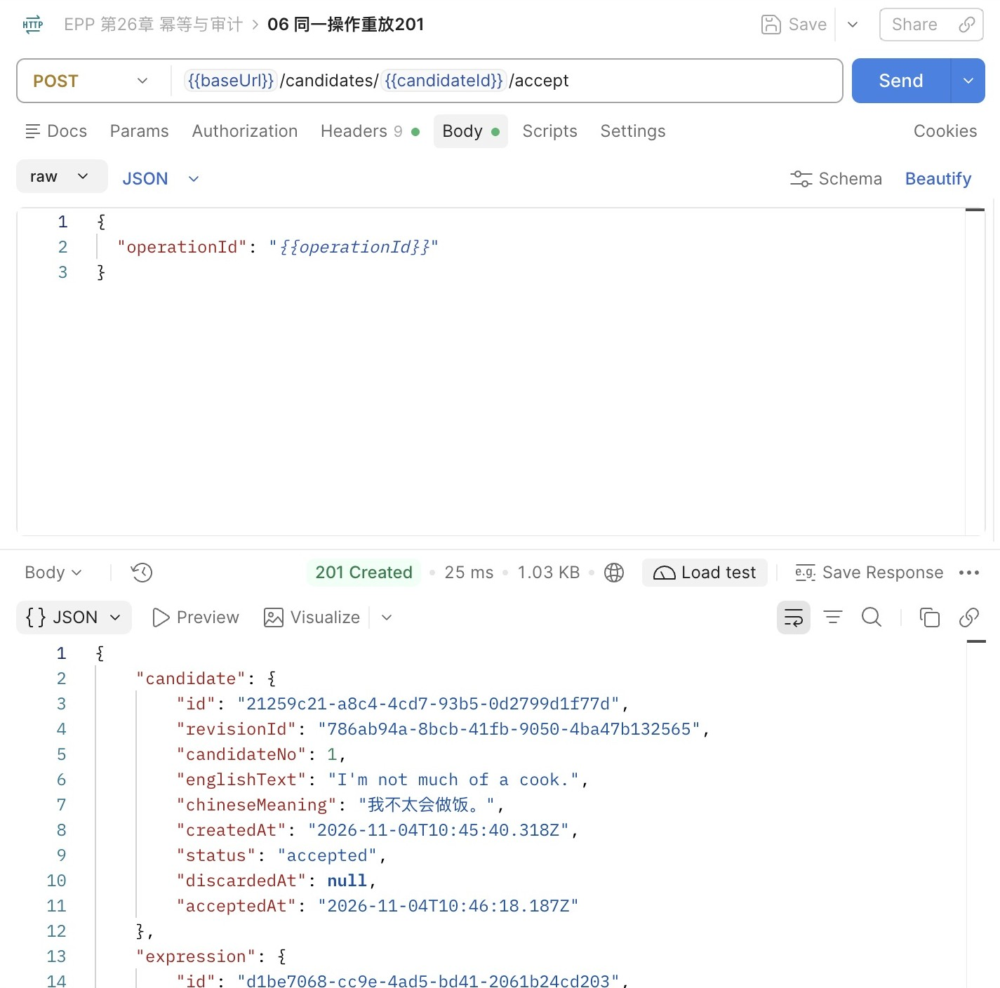

两图candidate.id与acceptedAt一致，表达ID也保持；向下滚动响应继续核对学习记录ID。请求耗时和传输大小可以变化，不能拿它们判断业务是否重复。

## 29.4 响应丢失、请求变化和旧历史，各自怎样恢复

### 真正丢掉一份已经成功的响应

沿用上一节的样本，先执行07～13：07为已采纳候选换身份，08创建第二个候选，09误用第一份成功身份，10～12验证非法输入，13读取状态。第二个候选应仍为pending，后文会解释各个冲突；暂不发送14。DBeaver查询两候选，作为断网前的对照：

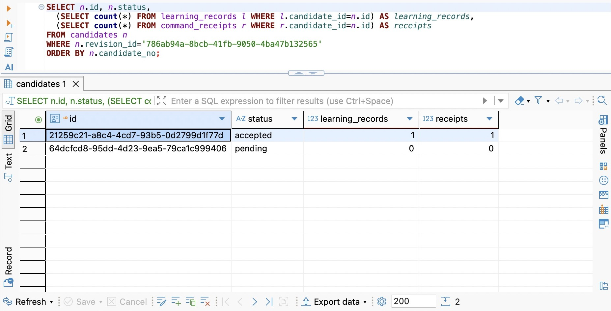

第一候选已经有一份学习记录和回执，第二候选两项都为0。接下来只对第二候选执行14，在第二终端运行：

```bash
node examples/lost-acceptance-response.mjs
```

这个独立Node脚本只监听本机3010，转发采纳请求到本机3000。它不挂进EPP路由，也不进入生产dist。若API端口不同，使用 `TARGET_PORT=实际API端口 PORT=实验端口` 启动；不能把代理端口与目标设成同一个值。

代理不是随机断网。它会消费第一份上游201，然后断开客户端连接，确保这次演示对应“服务已经成功，返回路上丢了”。关键处理如下，完整转发、超时及错误收尾在配套文件中：

```js
if (dropNextSuccess && result.statusCode === 201) {
  dropNextSuccess = false;
  result.resume();
  result.on('end', () => {
    console.log('Upstream 201 consumed; dropping the client response.');
    response.destroy();
  });
}
```

Postman打开14，把该请求的URL临时改为 `http://127.0.0.1:3010/candidates/{{otherCandidateId}}/accept`，Body仍引用otherOperationId，不更改集合的baseUrl。发送14。客户端应出现网络错误，而不是得到一份伪造500；代理终端显示已消费上游201。DBeaver此时查询应是accepted、学习记录1、回执1。这个对照直接打破“客户端显示失败，所以数据库没做”的推断。

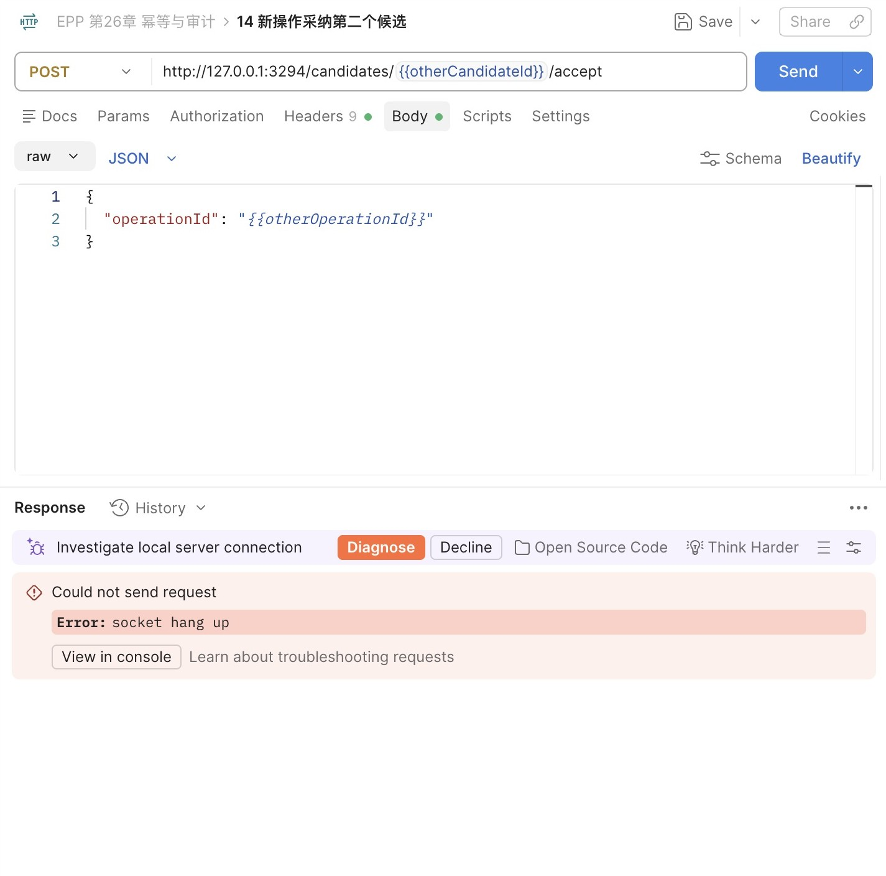

图中实验代理使用3294端口；使用默认配置时对应3010。应观察socket hang up与仍然保留的Body变量，不根据客户端的自动诊断建议重建操作。

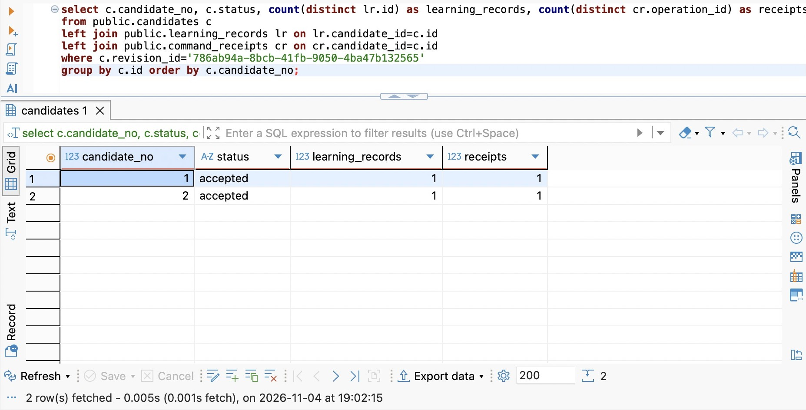

候选2已经accepted，学习记录和回执各1行。查询数据库能确认提交事实，客户端仍需用原身份取回结果。

不重跑创建，不重新生成UUID，再发14。代理第二次正常转发，API读回执，Postman得到201。将结果ID与回执中保存的ID比较。最后把14的URL恢复为 `{{baseUrl}}/candidates/{{otherCandidateId}}/accept`，Ctrl+C关闭代理。代理重启后会再次丢弃第一份成功响应，不能把它留在日常请求链路里。

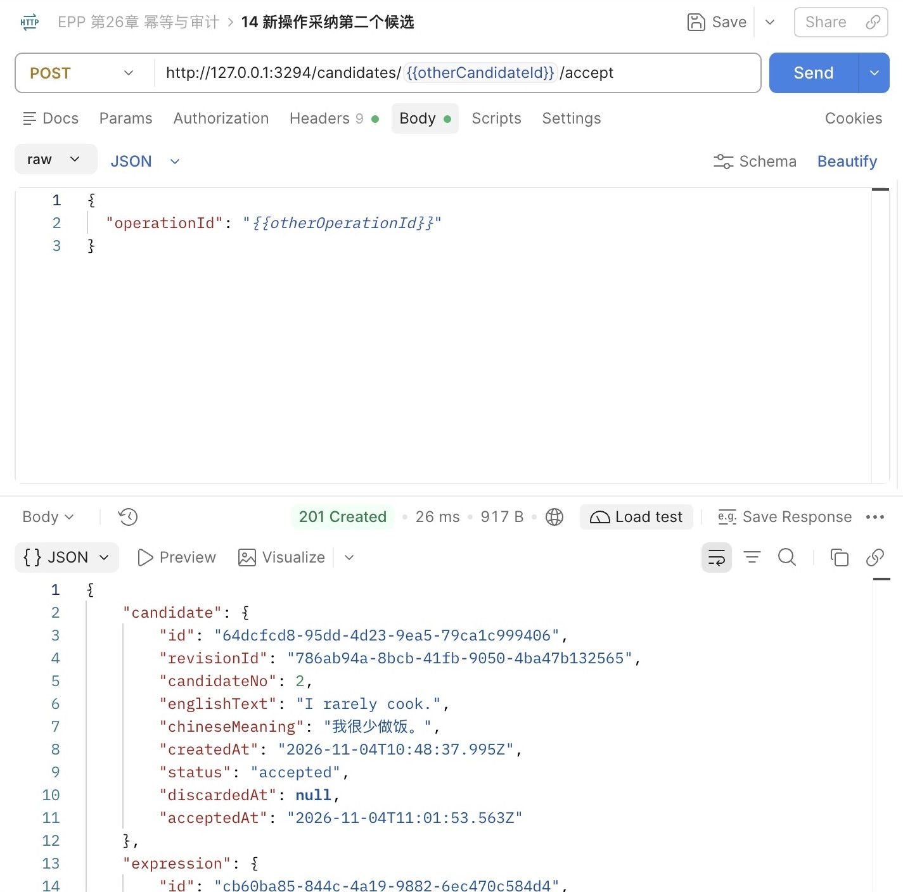

返回的是第二候选已保存的结果；不是因为换了新UUID才成功。此时再查数据库，数量仍为1。

真实网络错误本身不会告诉你故障发生在哪个时点；本实验通过代理人为固定时点，才知道首次已经提交。实际恢复不依赖客户端猜对阶段：原操作若回滚，下一次可以执行；若已经提交，下一次重放；若仍在执行，下一次等同一操作锁，或在等待上限后返回503，稍后仍用同一身份确认。

对于这组故障，先把观测位置标在图上，再解释同一时刻的三个窗口。Postman 位于代理下游，看到的是连接关闭，没有可供解析的采纳正文。代理处在两个连接中间，上游响应的状态和读完事件都已发生，所以它能说明 API 的成功结果已经抵达代理。DBeaver 是数据库的另一连接，能看到的是已提交的表状态。三者之间没有谁替谁作证：仅发现代理进程正在运行，还没证明这笔走过它；仅发现库里有候选，也没证明这一笔已经采纳；仅看 Postman 的红色错误，则连业务是否运行过都不知道。把同一个候选和操作贯穿三个窗口，才把三条证据变成一次可解释的经历。

可以先在纸上给这次实验记三列数：候选二的学习关系数、候选二的回执数、客户端拿到的完整采纳响应数。第一次发十四号请求前是零、零、零；代理消耗上游成功但客户端断开之后是一、一、零；再次发同键并读完之后应为一、一、一。若再手工重放一次，前两列仍是一，第三列变成二。后两次运行中传回的字节总数会增加，业务行数却不增加，这正是“允许多次交付同一结果”的含义。若一开始手里拿的是候选一，前两列基线已经是一、一，这轮即使丢掉的只是一次重放响应也会显示相同数字，无法验证从零到一的提交。先核对零值样本的用意就在这里。

实际动手时可以在 DBeaver 建两个结果标签。第一个按候选二的实际标识查状态和数量，第二个按用户和 otherOperationId 查回执及学习记录标识。发送前两个结果分别是待采纳且零、无行；断开后在自动提交的读取连接重新执行，两个结果应分别变为已采纳且各一、恰好一行。表格里昨天打开的结果不会自己变成刚提交的行，必要时重新执行查询，不要只展开左侧数据库树。若查询一直看见旧状态，核对编辑器绑定的数据库、是否处于保留旧快照的手动事务、传入的是哪个候选。能用这些只读条件解释差异时，不需要再发一次新的写请求去试。

还有一种看似成功的错误复现。若十四号请求的地址仍用正常的 baseUrl，Postman 会直接拿到完整结果，数据库也会出现一行回执，只有代理没有“已消费”的那条信息。这说明本轮没有观察到返回途中断开，不能把已经成功的样本再称为第一次提交。可以用它练习“重放的响应也可能丢”，要练习首次提交则需另取一个确实待采纳的候选和全新的操作键，再记录零值起点。若代理已经消费过本轮第一次成功，后续正常转发恰是它的设计；重启代理会重新布置故障，重启 API 则不会重置数据库里的成功记录。先弄清是哪个进程的哪份状态在变，比反复重启所有组件更容易得到干净的对照。

### 给正在执行的操作一个有限等待

在DBeaver的独立连接A运行02脚本的A1块，使用本次operationId替换全零UUID，保留JSON数组格式和固定用户。确认与API连接的是同一个隔离练习库。A取的是同一个事务级建议锁，不改业务表；此时Postman发送相同操作，约一秒后得到503。A单独ROLLBACK，再重发，得到成功或已保存的原结果。

不能把503转换成“立刻换UUID再试”，那会逃出原操作的协调范围。客户端还应限制次数并延迟，例如先等一秒，再等两秒，连续几次仍无法确认就保留待确认状态，允许稍后手工恢复；不要同步让数百个请求无限重试。具体总等待预算取决于产品，在 Postman 中逐次手动重放，可以看清哪次请求拿到了原来的结果。

锁等待失败和响应丢失可能长得相似，但依据不同：前者可在安全日志看到55P03，后者可能在服务日志看到201而客户端没有结果。无论哪一种，重试都保持操作身份和业务输入。未知结果是需要继续核对的状态，不是重新制造业务对象的理由。

### 末步失败，回执也不能落单

为了自己写出末步失败的对账，先暂停其他写入，把本轮的候选标识与操作键分别记在结果页标题旁。候选处于待采纳时，即使原文的修订已经派生过别的候选，本轮候选自己的学习关系也应为零。另记下表达与形式的总数；因为一次失败中的新表达标识不会作为成功字段返回，事后很难靠这个未知标识搜到孤行。这里比较总数的前提很窄，只有这个隔离副本在观测期间确实没有其他写入才成立。若多人并行练习，应使用自己的副本，不能把别人的正常新增当成本轮回滚失败。

候选和回执则可以写有范围的查询。先选候选自身的一行，再为这行各算一个数：学习记录里 candidate_id 等于当前行 id 的条数；操作表里同时满足指定用户、指定键且指向该候选的条数。这样即使没有学习记录，外层的候选也会出现，两个数里能真正读到零。若从学习记录出发做内连接，没有结果时整行都消失，你无法从空白网格区分“候选本来不存在”和“候选存在但没有成功”。第二种情况才是这里要检验的回滚结果。下面以第一张表演示写法，先运行它确认目标存在，再仿写第二个计数放在其右边。

```sql
SELECT n.id, n.status,
       (SELECT count(*) FROM public.learning_records AS l
        WHERE l.candidate_id = n.id) AS links_for_candidate
FROM public.candidates AS n
WHERE n.id = '00000000-0000-0000-0000-000000000000';
```

替换掉占位标识后，先看外层能否精确返回一行。仿写回执计数时，若只写用户和操作键而省掉候选条件，得到一条并不能说明它属于正在看的目标；若只写候选条件，得到一条又不能说明它对应你要恢复的那次确认。可以把查询改成先显示 r.candidate_id、r.operation_id 两列明细，拿自己刚保存的两个值逐项核对，然后才改成 count。因不同条件被误写而刚好相等的两个一，比明显错误的零更容易蒙混过去。需要检查键是否已被其他目标占用时，单独按用户与键查，再看返回的实际目标，不要在这个排错查询里先过滤掉其他候选。

用另一个新pending候选，在独立练习库执行03脚本，为它的operationId增加一个只拒绝这次INSERT的CHECK。NOT VALID只跳过检查已有行，新写入仍受约束。发送采纳，应得到500；查询应是pending、学习记录0、回执0，表达及形式也不应留下本次孤儿。它比只在第一个SELECT处制造错误更有解释力：前面的业务写入实际执行过，最后一步失败仍能一起撤销。

在没有调试器暂停、故障约束已提交的情况下发送本轮采纳。如果立即得到旧的成功响应，逆着程序走：走到末步才会因约束失败，若读旧回执直接返回，自然没有末步可拒绝；若请求用的是另一个键，也不在实验约束限定的范围里。若请求只是长时间等待，先看添加约束的 DBeaver 连接是否仍持有未结束的 DDL 事务。不同连接等待锁与违反已经生效的检查约束，是两个不同的故障。看清当前连接的提交状态，在隔离库里结束自己的那一笔事务后再比较；别把所有异常都归结为“事务回滚已经成功”。

单独移除这个实验约束，再用原候选与原operationId重发，才能得到完整成功。不要在正式数据库加入故障约束，不要为了清理实验批量删除command_receipts。中断后先查pg_constraint，确认约束是否仍在，再决定从故障观察还是恢复步骤继续。

VS Code连接开发Inspector时，先在CandidatesService.accept的 `if (result === 'operation-conflict')` 处下断点；store的Promise此时已完成，适合停下来观察结果。发送同一已成功操作，在Debug Console只查看result中的状态与三个对象ID，不展开数据库连接或运行环境。

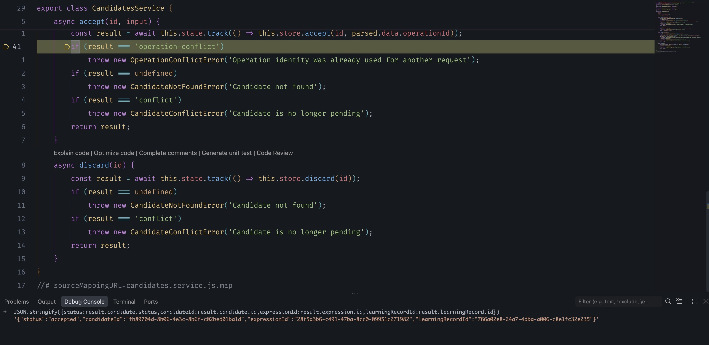

图中黄色箭头停在检查语句，控制台显示accepted及候选、表达、学习记录ID。截图显示的是编译后的candidates.service.js第41行，对应本章TS第30行；判断暂停位置应认语句，不照搬生成文件的行号。若TS断点显示灰色Unbound breakpoint，先核对当前连接的Inspector和开发目录；仍未绑定时，可打开该次开发编译生成的 `.dev/src/` 中同名JS，在对应语句设置断点，不能仅凭编辑器里有一个断点圆点就认定命中。本次用本机HTTP请求触发暂停，继续后收到201，响应逐字段等于原回执。

停用服务层断点，再对同一已成功操作在Store的 `return AcceptanceSchema.parse(previous.response)` 下断点，看previous存在、候选和指纹相同。

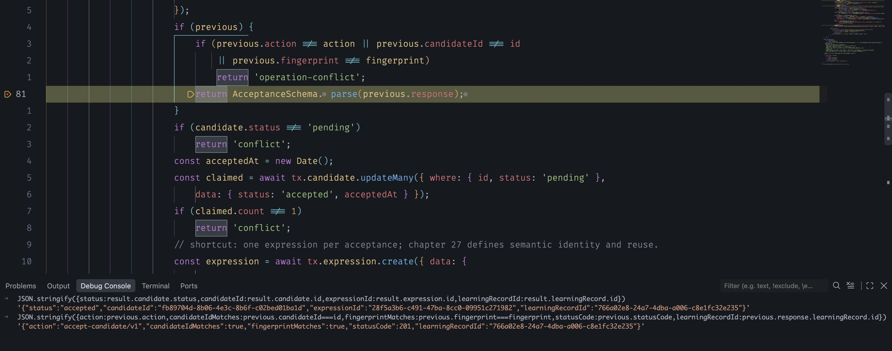

这里是prisma-candidate.store.js第81行，对应TS第79行。控制台的candidateIdMatches和fingerprintMatches均为true，statusCode为201，learningRecordId与上一图一致；因此当前路径准备返回已有快照，不会继续走下面的pending判断和创建表达逻辑。这里只观察虚构样本的少量字段，不把完整response复制进普通日志。

重放断点仍在事务里，暂停超过5秒可能使当前请求失败；不能把“停了多久”当成稳定的超时实验。本次继续后实际仍返回201，断开调试后用原操作重试也返回201，两次结果都与保存快照一致，数据库学习记录和回执仍各一条。无论本机调试得到201还是超时错误，都要以继续后的HTTP和数据库核对收尾，不把暂停时看到的对象当成新提交证据。之前成功的回执不会因为这次读取超时被撤销。

### 两种409与没有回执的历史

普通流程中，07为已采纳候选换一个operationId，应得到CANDIDATE_CONFLICT。08创建第二个pending候选，09携带第一个成功operationId，应得到OPERATION_CONFLICT，第二候选仍pending。10～12再检查缺失身份、夹带字段、查询参数400；13读取状态，14用另一新身份采纳第二候选，15确认已采纳不能放弃。

同一身份但目标当前不可见，先返回404，因为权限检查在重放之前。它不会为了证明身份冲突泄漏其他候选是否存在。失败尝试未保存回执，所以07的业务冲突没有占用otherOperationId，14可以正常使用它；一旦成功，这个身份就永久代表那次成功内容，不能再用于新操作。

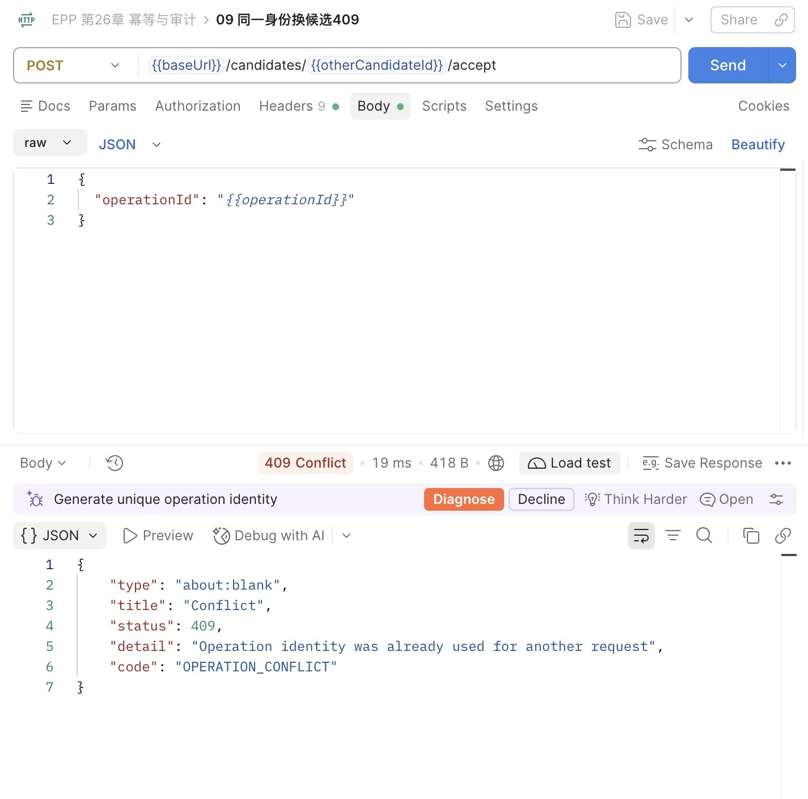

这里URL换成otherCandidateId，Body却仍使用第一份operationId，所以错误码是OPERATION_CONFLICT。图形客户端可能自动建议生成新身份；应先查明是错误替换目标还是确实想发起新操作，不能把自动建议当作业务决定。

升级前已采纳的候选没有回执，对它带任何新身份请求，都返回CANDIDATE_CONFLICT。用01脚本的NOT EXISTS查询可以找到这些旧关系，再沿learningRecord查看既有表达；这是读取历史事实，不是重放原命令。当前没有公开学习记录详情接口，数据库查询用于本章核对，第32章再建设面向客户端的查询投影。

旧记录无回执不等于迁移丢数据，新版本成功记录缺回执则需要调查。区分两者要看可靠的部署与写入来源，不能只用recordedAt机械划线；时钟和应用混跑可能使推断失真。发布时停止全部旧写入口，就是为了防止升级后仍不断产生“只有业务、没有操作结果”的新记录。

## 29.5 领域审计与运行日志，分别留下什么

### 一次成功事实，与多次执行尝试

运行日志中的requestId、路由模板、耗时和安全错误码回答“这次HTTP经过了什么”。相同operationId可能对应一次首次请求、两次网络重试和一次锁等待失败；重放也会产生新的请求日志，但数据库仍只有一条成功回执。日志还可能轮转、丢失或在写文件前进程退出，不能拿日志是否出现success来替代数据库事实。

command_receipts则回答：服务端认定哪个用户，以哪个操作身份，对哪个候选完成了哪个动作，得到什么结果。通过candidate→revision→capture可追溯决定依据，通过response中的学习记录ID核对结果。查询审计时优先选这些标识和状态，不默认展开用户全文：

```sql
SELECT operation_id, action, candidate_id, status_code, recorded_at,
       response #>> '{learningRecord,id}' AS learning_record_id,
       response #>> '{expression,id}' AS expression_id
FROM public.command_receipts
WHERE user_id='10000000-0000-4000-8000-000000000001'
  AND operation_id='35000000-0000-4000-8000-000000000001';
```

把示例operationId替换为本次集合保存值。SQL里的user_id是受信任的查询范围，不是允许客户端任意提交的过滤器。当前本机操作仍由固定开发用户完成，这只能证明固定身份下的服务决定，不能追溯到一个真实登录者。第五篇接入身份后，审计主体才会来自经过认证的会话。

这张表是成功采纳的领域审计依据，但不是完整审计平台。它没有记录读取、拒绝、放弃、管理员修改或所有权限变动，也不是第25章讨论的事件溯源：业务当前状态仍在业务表，不能仅靠回执重建整个系统。若需求要求记录每次拒绝，需另定义尝试事件及保存机制；把拒绝记录也写进随后回滚的业务事务，最终什么都留不下来。

审计也不自动意味着防篡改。当前应用所有者仍有数据库写权限，CHECK和外键不能防止有权限的人改写一个结构合法的response。若要追究管理员操作，需要独立访问控制、外部留存与可验证的完整性设计；本章不把“多一张表”包装成不可抵赖证据。先准确说明这份记录由谁写、可以回答哪类问题，才谈进一步保护。

设想接班人拿到一张联调记录，上面只有“同一候选昨天成功两次”。先把这个句子改写成可查的两个问题。若“成功”指客户端两次取得采纳响应，服务能允许它发生；若指数据库对同一候选建立了两条学习关系，便违反前章的数据规则。先问对方给的是请求编号、操作键还是学习记录标识，再决定从日志还是数据库开始。有两个请求编号只能说明有两次尝试；有两个不同学习记录标识才有理由进一步核对是否真的指向同一个候选。只因用户重复看见成功就删除一条业务数据，会把本来正确的恢复当成重复写入。

若对方提供的是操作键，从前面那条按主键的查询开始。先看返回几行，再核对行动、目标和结果标识。拿到快照中的学习记录标识以后，想验证的已经变成“当时返回的关系是否对应当前库中的那条关系”。因此 JOIN 的条件应和这个问题一致：用学习记录主键去对快照里的标识，再逐项检查候选、用户与表达。只按候选去连，能验证有一条关系，却无法发现快照所写的学习记录标识取错。反过来，只按记录标识连上，也不能证明它属于这一候选。先连标识再比较内容，就能把“能找到行”和“找到的行彼此一致”分开。以下在本机合成样本上做只读对账，替换末尾的操作键。

```sql
SELECT r.candidate_id, l.id AS actual_learning_id,
       l.candidate_id = r.candidate_id AS same_candidate,
       l.user_id = r.user_id AS same_owner,
       l.expression_id::text = (r.response #>> '{expression,id}') AS same_expression
FROM public.command_receipts AS r
LEFT JOIN public.learning_records AS l
  ON l.id::text = (r.response #>> '{learningRecord,id}')
WHERE r.user_id = '10000000-0000-4000-8000-000000000001'
  AND r.operation_id = '00000000-0000-0000-0000-000000000000';
```

这条查询里把 UUID 转为文本，是为了和 JSON 取出的文本标识作等值对照。按主键只选中一条回执，再检查一个练习样本，关注的是能否读出不一致；不要因此把给整库做大批量关联时的类型与索引选择也固定下来。若结果为零行，说明指定范围里连起点都没找到。若有一行而学习记录标识为空，是左连接保留了起点，右侧没对上，后面的等值判断会是未知值。若标识存在但某一布尔列为假，要回到那两列各自的明细看究竟哪一个值不同。不要在 WHERE 先过滤出三个比较都为真的行，否则三种现象都会被压成一个看不出原因的空结果。

换一个方向，想找的是“已有学习记录，但找不到采纳回执”。这次起点必须换成学习记录及其候选；从回执表出发永远枚举不到根本没有回执的那几笔。给每条学习记录提出一个存在性问题：是否至少有一条回执指向这条候选？若答案为否就留下，这是配套查询里 NOT EXISTS 的来源。把子查询中与外层候选配对的条件遮掉，问题便变成“整个库里有没有至少一条回执”；只要本章曾成功采纳一次，所有旧候选都会被错误排除。验算时取一条迁移前已采纳的候选与一条迁移后成功的候选，在外层用这两个候选标识限定样本，再运行查询，结果应只包含前者。这一对比可以在不修改任何历史的条件下发现漏写关联条件的问题。

### 快照有用途，也增加一份内容副本

为了重放，我们把候选文本、中文含义和表达快照存了一份。好处是未来当前对象变化时仍能解释原结果；代价是数据保留、备份、权限与删除都必须覆盖这份副本。不能只删captures中的原文，就声称相关内容已经从系统消失。

本章没有自动过期或清理接口，成功回执随业务数据保留。这个决定让重试期限明确，也避免删除后旧身份突然又被当成新请求。它不等于建议所有系统永远保存全部响应；当产品提出保留期限时，要同时回答三个问题：多久允许重试、过期后怎样回应、哪些审计元数据仍需要留下。章末支线用预约和邮件场景继续推导这些变化。

删除response而保留摘要，只能判断某个身份曾出现过，无法重放原结果；删除整行则连身份占用都失去。若要缩短内容保存期，可以设计“已完成但结果不可再重放”的最小占位记录，收到旧身份时明确拒绝或引导查询；这需要新状态与协议，不能靠定时DELETE偷偷改变已有承诺。

运行日志继续沿用白名单，不输出operationId、fingerprint、响应全文或SQL参数。排错可以用虚构样本在断点观察它们，真实生产调查按受控查询读取最少字段，避免把敏感快照复制到普通日志、工单或截图。operationId本身不是密码，但仍能关联一组用户动作；没有必要为了方便就把它放进所有公共错误响应。

沿同一条结果再问一个时间问题。假设上午发起采纳，午后页面恢复连接，晚上又从产物进程成功重放。候选上只有首次采纳的 acceptedAt，回执上有 recordedAt，三次经过服务可能各有请求日志时间。用回执时间按天统计，数的是该时间段登记的成功决定；用请求日志按天统计，数的是该时间段实际送达并被记录的尝试。午后重放不应该被记成第二次采纳，也不应因回执仍是上午的时间就从午后的故障调查中消失。若任务是解释“今天有多少人成功学习”，还需先定义人数、学习关系和时间窗口，再选数据源。沿用接口成功次数会把一个不断恢复页面的用户放大许多倍。

这也影响交接时该保留什么。操作人为了让同事复查“昨天那笔采纳恢复过”，可以给出练习库、合成账号、候选标识和操作键，说明哪一次的代理观察到了上游成功、哪一次客户端完整收到结果。接手者据这些条件查询回执并重放，能验证现在仍取到同一学习记录，不能倒推昨天客户端确实读完了哪一段字节。如果没有保留当时的网络观察，就把昨天的接收情况保留为未知。照片中一排已采纳状态只描述拍摄时的页面，相比之下，明确说出哪个环节缺少观测更便于后来的人继续判断。

当需求进一步变为“用户只想回想自己哪天采纳，不需要重新显示当时的完整文案”，可以重新评估保存什么。若只保留标识与时间，就足以列出操作清单，却不足以重放原响应；若展示层改为点开时查当前表达，又会把将来追加的内容带回来。产品可以另设当前视图，同时维持历史回执的承诺，或者为较老的操作清楚说明详细结果已到期。两者的差异会体现在接口如何回答很晚才到的同键请求上。不能只改备份保留天数，就期望所有客户端自动理解新的重试期限，因为在线回执、备份和客户端保存的键各有自己的寿命。

从这里也能反推一次恢复演练该选哪些数据。若只备份业务表，恢复后仍看得到已采纳候选，用户用原键却只能遇到候选冲突；若只恢复回执而找不到对应业务事实，返回的学习记录标识就失去了可以核对的关系。应当让这批有关联的表来自同一一致视图，并在恢复副本用一组已知的旧键和候选查证。此章只在同库事务内建立共同提交与重放，不在日常库练习覆盖式还原。到了真正安排备份时，优先留住这些可检验的问题，比只看一个导出文件是否存在更能发现遗漏。

### 从开发目录走到可恢复产物

npm run check后按前章方式将dist、package.json、package-lock.json与.npmrc复制到独立目录，安装运行依赖，运行环境提供DATABASE_URL，再npm start。不开Inspector和watch，docs默认404，实验代理不进入交付产物。把一次已成功操作的candidateId和operationId留在Postman中，重启服务，再发同一采纳：应返回原结果，数据库仍只有一条回执与学习记录。进程内缓存无法通过这项对照。

这次升级是输入契约变化，旧客户端的空Body会400，应同步更新客户端；不是让服务替缺失身份的请求临时生成UUID。第28章程序能连接新增表后的库，也不代表可以安全回退：它不会写回执，会丢失新承诺。出现问题时保留幂等契约修复实现，或停写检查，不通过删除回执、恢复旧API来假装兼容。

本章完成的是单数据库中成功采纳的重试恢复。若以后采纳还要发邮件、扣外部额度或调用另一个服务，不能把那些副作用塞进这个回调就称为原子提交；事务回滚无法撤回已经发出的邮件。第 30 章先把操作身份接到创建与追加修订，第 31 章再整合现有模型与表达身份，后台执行和跨系统交付在后续篇接上；当前边界的原因在支线29A中展开。

离开这一章前，可以在开发进程已经停止的条件下自行重建一次读回路线。先不打开示例 SQL，只看集合里留下的两个值：知道候选标识，可以查状态和学习记录；知道用户与操作键，可以查那一次成功的快照。分别写出两条只取标识的查询，先用同一笔成功的样本比对，再把候选换成迁移前的旧样本，保留原操作键。头一条仍然可能找到学习记录，后一条依然会指向原来的新候选。这样只靠两次普通读取就能辨出“我知道这个业务已经完成”和“我有证据证明这是我想恢复的那次提交”之间的距离。最后恢复集合里的原目标和键，启动产物完成前述同键读回，不要把为了读明细临时换过的候选当成下一次发送目标。

这一章把身份加在已经存在的候选上，页面第一次发送前就知道目标。下章创建素材时，第一次成功的响应若丢失，客户端连新素材标识都没有。沿用刚才的推导，能带过去的是操作键、原始意图和同库成功回执；不能直接照搬的是“先拿目标标识查候选”的第一步。这一点决定了创建与追加虽然都能支持重试，却要分别说明第一次从哪里取得业务对象。

## 知识支线

- [支线29A：重试期限、外部副作用与“恰好一次”](side-01-retry-boundaries.md)：从预约过期和发送邮件推导身份保留、结果查询与事务边界。

## 附录：本章必要技术点速查

| 名称 | 本章用途 | 必要注意点 |
| --- | --- | --- |
| operationId | 客户端保存一次采纳意图的身份 | 发送前生成；重试不能更换；服务端用户限定作用域 |
| requestId | 关联一次HTTP执行 | 同一操作重试会产生新的请求ID |
| createHash／SHA-256 | 固定输入结构的请求指纹 | 先定义规范化语义；摘要不是加密或权限凭证 |
| (user_id, operation_id)主键 | 唯一标识成功操作 | 不把candidateId或fingerprint并入键来放松身份约束 |
| pg_advisory_xact_lock | 协调尚无结果行的操作 | 事务结束释放；所有参与路径遵守协议；设置等待上限 |
| hashtextextended | 将锁名映射为64位键 | 碰撞只应影响等待，业务身份仍精确比较 |
| READ COMMITTED | 取锁后独立语句读取已提交回执 | 等待锁不刷新同一语句或更高级别的旧快照 |
| $transaction／tx | 提交业务和回执 | 回调return早于提交确认；不混用根client |
| JSONB／response快照 | 保存公开语义结果 | 不保存对象键顺序；不塞入内部字段、秘密或异常 |
| 201／OPERATION_CONFLICT | 重放成功／同身份改意图 | 与CANDIDATE_CONFLICT区分；不自动换身份消除冲突 |
| NOT VALID CHECK | 隔离库末步失败实验 | 新写入仍受检查；恢复时只移除该实验约束 |
| 领域审计／运行日志 | 成功事实／执行尝试 | 各自范围与保留不同；都不能单独证明客户端已收到 |

官方入口：[PostgreSQL 18建议锁](https://www.postgresql.org/docs/18/explicit-locking.html#ADVISORY-LOCKS)、[事务快照](https://www.postgresql.org/docs/18/transaction-iso.html)、[JSON类型](https://www.postgresql.org/docs/18/datatype-json.html)、[Prisma 7交互式事务](https://docs.prisma.io/docs/orm/v7/prisma-client/queries/transactions)、[Node.js 24 Crypto](https://nodejs.org/docs/latest-v24.x/api/crypto.html)。Prisma入口明确为v7，避免把后续版本的不同API直接带入本章。

本章完成代码状态为 `part-04/chapter-29`，第 30 章从此继续。

[上一章：并发控制：两个请求同时到来怎么办](../chapter-28-concurrency/chapter.md) · [返回第四篇](../README.md) · [返回全书目录](../../README.md) · [下一章：创建素材与追加修订怎样承受重试](../chapter-30-write-retry/chapter.md)
