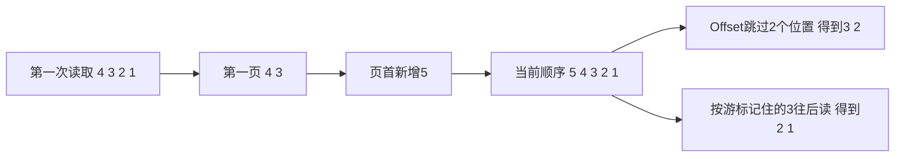
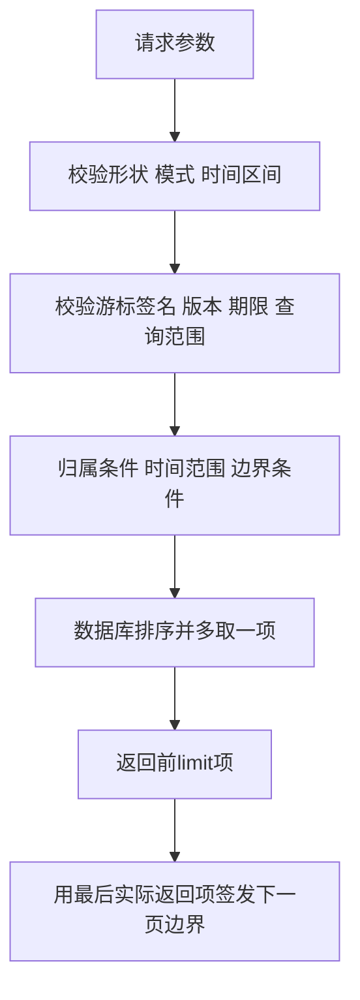
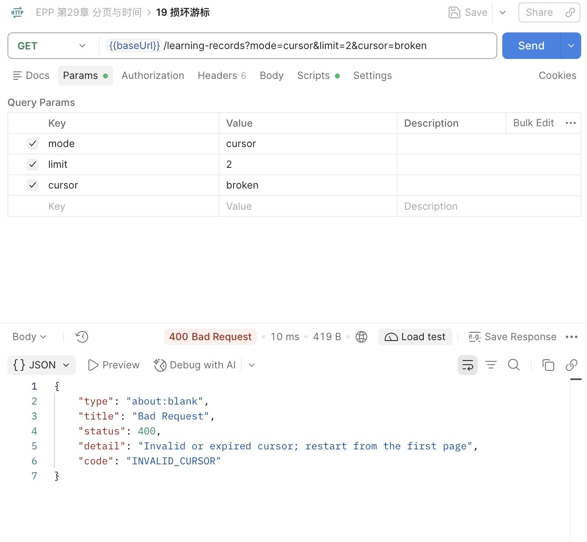
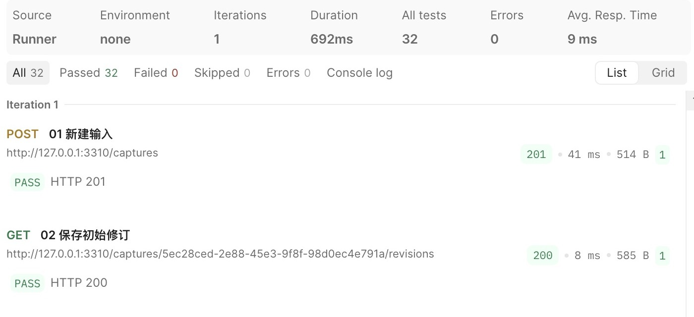
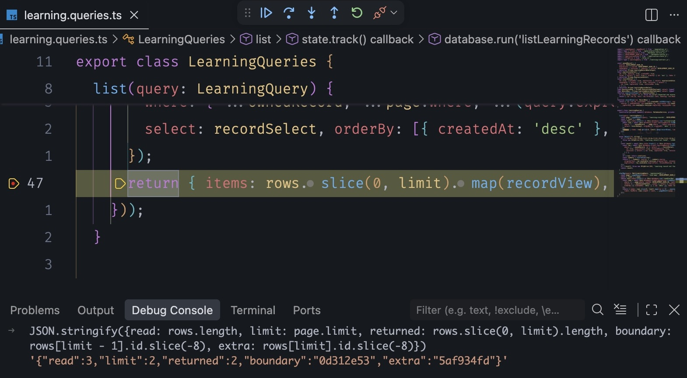
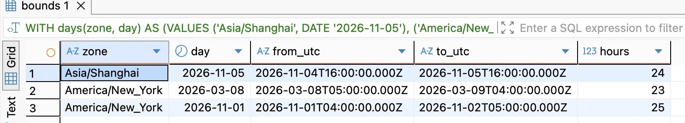
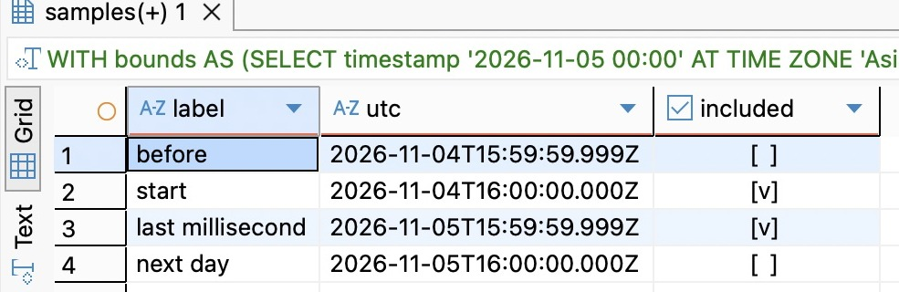

# 第29章 分页与时间：下一页从哪里继续

第二十八章的列表最多返回100项，hasMore只说明这一次查询还看到了更多记录。客户端现在知道列表没有展示完，却没有合法的办法继续。把limit调大并不能解决问题：来源会持续增加，两次请求之间还可能发生新的采纳。“再取20条”需要先回答，接着哪个位置取，位置改变以后又算谁的下一页。

本章沿学习记录和基础星图建立两种分页方式，再把日期筛选接到同一套查询上。分页与时间放在一起，是因为我们已经按createdAt排序；时间既是续页边界的一部分，也会被用户理解成“今天收录的内容”。数据库里的时间点、页面上的日期、两次读取之间的变化，需要各自有明确含义。

从 `part-04/chapter-28` 继续，完成状态为 `part-04/chapter-29`。保持Node.js 24.22.1、Prisma 7.10.1、PostgreSQL 18与固定开发用户。本章沿用现有时间列，不改模型、不追加迁移、不增加依赖。先核对既有数据库迁移状态，再修改代码；不用重建数据。

## 29.1 Offset跳过位置，Cursor接着边界

### 先把“第二页”写成一次具体变化

学习记录按createdAt降序，再按id降序排列。为了看清位置变化，先用4、3、2、1表示同一时刻的四条记录，页长为2。第一页得到4、3，下一次跳过两行，就得到2、1。这里的limit是每页最多返回几条，offset（偏移量）是从当前列表开头跳过几条。数据不变时，页码从1开始，第p页的offset是 `(p - 1) * limit`。

问题发生在第一页读完后。另一条采纳5进入队头，当前顺序变成5、4、3、2、1。第二页仍然跳过两个位置，得到3、2；3重复了。若第一次读完后删除的是4，当前顺序变成3、2、1，再跳两行只得到1，2被漏掉。

换一种问法：我上次看到3，排在它后面的还有什么？客户端第一次请求 `/learning-records?mode=cursor&limit=2`，服务返回4、3，以及一个叫 `nextCursor` 的字符串。这就是游标（cursor）：服务把最后一条的创建时间和ID记在里面。下一次仍用相同的筛选和页长，把这串值原样作为 `cursor` 参数传回。服务按这两个字段找排在3后面的记录，得到2、1；客户端不用自己拆游标，也不用数前面有几条。



两种分页各有适用情形。后台列表需要跳到第十页，且允许刷新后位置变化，可以使用Offset；连续向下加载学习记录，更关心接着已经看过的位置读取，适合按键值继续。Cursor不提供任意页码跳转；没有前面的边界，服务不知道所谓第十页从哪一行开始。不要为了界面有页码就宣称两者可以无损互换。

Offset还有成本：数据库仍要处理被跳过的行，返回20行不等于只访问20行。当前将offset限制为0～10000，是接口的资源预算，不是这个数字以下一定很快。第三十章会检查实际查询计划。需要深翻或全量处理时应重新选择读取方式，不能不断放宽上限。[PostgreSQL 18的LIMIT／OFFSET说明](https://www.postgresql.org/docs/18/queries-limit.html)给出了跳过位置、唯一排序及深Offset的行为边界。

### 用DBeaver观察两种读法

在DBeaver连接独立VERIFY库，打开配套 `database/chapter-29/01-page-boundaries.sql`。先选中BEGIN、SET LOCAL、临时表与INSERT执行；后面的SELECT逐条选中执行，不要一次运行整个文件后只看最后一个结果。临时表只存在于当前连接，换编辑器时先确认仍是同一会话。

先在同一编辑器准备四条创建时间相同的记录。`timestamptz(3)` 是 PostgreSQL 用来保存时间点的类型，这里的 3 表示小数秒保留三位，也就是毫秒。时间末尾的 `Z` 表示按 UTC（协调世界时）书写；`SET LOCAL` 让当前事务也按 UTC 显示时间，方便对照输入和结果。

```sql
BEGIN;
SET LOCAL TIME ZONE 'UTC';
CREATE TEMP TABLE page_lab (
  id integer PRIMARY KEY, created_at timestamptz(3) NOT NULL
) ON COMMIT DROP;
INSERT INTO page_lab VALUES
 (4, '2026-11-05T00:00:00Z'), (3, '2026-11-05T00:00:00Z'),
 (2, '2026-11-05T00:00:00Z'), (1, '2026-11-05T00:00:00Z');
```

接下来逐条执行。读到最后一条 SELECT 时，把 `(created_at, id) < (时间, 3)` 看成两步：先比时间，较早的入选；时间相同才比 ID，小于 3 的入选。这里比较的是数据库里的两个值。

```sql
SELECT * FROM page_lab
ORDER BY created_at DESC, id DESC LIMIT 2;
-- 第一页：4、3；它们的created_at相同。

INSERT INTO page_lab VALUES (5, '2026-11-05T00:00:01Z');
SELECT * FROM page_lab
ORDER BY created_at DESC, id DESC LIMIT 2 OFFSET 2;
-- 第二次按位置：3、2。

SELECT * FROM page_lab
WHERE (created_at, id) < (timestamptz '2026-11-05T00:00:00Z', 3)
ORDER BY created_at DESC, id DESC LIMIT 2;
-- 第二次按边界：2、1。
```

这里在一个连接中顺序改变临时表，是为了隔离位置变化，不冒充双连接并发证明。HTTP操作稍后再在两次读取之间提交真实采纳。结果网格中同时看created_at和id：若只记时间，四条并列记录会被看成一个位置。

继续执行文件里的DELETE，只删除临时表的3，再运行相同边界查询，仍得到2、1。边界保存了值，不需要那一行继续存在。最后执行ROLLBACK，撤销整个临时实验；SQL报错导致事务失败时也先ROLLBACK，再从BEGIN重新开始。此实验不修改captures或learning_records。

### 同一毫秒下，为什么不能只带时间

下一页的条件必须是：时间早于上一页最后一项，或者时间相等但ID更小。只用 `created_at < lastTime`，会把同一毫秒剩余的项全部排除；用 `<=`，又会重复已经返回的项。两个字段共同组成一个严格的边界：

```text
created_at < lastTime
OR (created_at = lastTime AND id < lastId)
```

排序方向和比较方向必须一致。当前两个字段都降序，所以取“小于”；若改成升序，边界也要改成“大于”。如果一个字段升序、另一个降序，就要分别判断方向，不能对整对值直接用“小于”。UUID是唯一补充键，不是发生先后的证据；同一时间内按UUID排序，只保证这组数据有确定顺序。

已有列使用毫秒精度，Prisma读出的Date和toISOString也保留毫秒，边界往返不会把更精细的值截掉。若以后列改成微秒，仍用JavaScript Date保存边界会丢精度，可能重复或漏项；应保留数据库的完整精度表示并同步查询实现。这里没有为了分页新增序号，也没有把ID误当成提交顺序。

## 29.2 给边界加上可验证的查询上下文

### 游标不是最后一项的ID，也不是一张通行证

只发一个UUID看似简单，但服务需要重新查出那行的时间，行删除后会丢失位置。我们选择把时间和ID一起放进游标。进一步考虑：学习来源列表拿到的游标，能否用于星图？按表达E1查询后，把expressionId改成E2还能继续吗？同一串边界值在不同集合里没有相同含义。

本章将这些条件绑定到游标：资源名称、当前用户、固定排序版本、实际limit、expressionId、from和to。缺省limit与显式20等价；其他条件按已经校验的值处理。不允许客户端传userId决定身份；目前由固定开发用户提供，身份篇接入后替换成已认证用户，每页仍保留关系归属条件。

拿到 `nextCursor` 时，客户端看到的是一串形如 `body.mac` 的字符，中间用点分开。左边是游标带回的数据（载荷）：`at` 和 `id` 记位置，`scope` 记上面这组查询条件，`v` 是格式版本（本章为 1），`expires` 是到期时间。右边用来检查左边有没有被改过。整轮遍历从第一页开始计30分钟，后续页继承同一个到期时间，不因翻页无限续期。过期意味着重新读取第一页，不代表数据消失。这个期限是当前接口的维护选择，限制旧格式与旧查询上下文的存活时间；它不保证结果被保存了30分钟。

编码本身不能防修改。左边用 Base64url 把 JSON 的字节写成适合放进 URL 的字符，客户端也能解码。如果右边只是用 SHA-256 算出的摘要（由内容算出的一串固定长度的字节），客户端改了左边也能重算右边。所以服务端用只有自己知道的密钥和左边的字符串计算校验值。用密钥和哈希函数（这里选 SHA-256）生成这种校验值的算法叫 HMAC，算出的值就是右边的 `mac`，下文也叫游标签名。收到续页请求时，服务端用同一把密钥重算，对不上就拒绝。它能发现篡改，不能隐藏内容，所以游标里不放原文、密码或令牌；日常日志也不记录游标、日期或查询条件。也不拿“签名有效”代替用户权限：即使游标曾由服务签发，数据库条件仍须限定当前用户可见的来源。



### 在现有配置入口管理密钥

`src/config.ts`增加cursorKey，并在EnvironmentSchema中接受 CURSOR_HMAC_KEY：32 个随机字节，每个字节写成两个十六进制字符，共 64 个字符，字母用小写。这是留在服务端的密钥。生产缺失时在监听前报配置字段错误；日志只出现字段名，不出现值。开发和测试未配置时，每次创建应用临时生成一把密钥，这意味着开发自动重启后旧游标会失效。

```ts
import { randomBytes } from 'node:crypto';
// AppConfig增加 readonly cursorKey: string。
// EnvironmentSchema中：
CURSOR_HMAC_KEY: z.string().regex(/^[0-9a-f]{64}$/).optional(),
// parseConfig拿到parsed.data后、返回Object.freeze之前：
if (value.NODE_ENV === 'production' && !value.CURSOR_HMAC_KEY) {
  throw new ConfigError('CURSOR_HMAC_KEY');
}
// 返回对象中增加：
cursorKey: value.CURSOR_HMAC_KEY ?? randomBytes(32).toString('hex'),
```

需要在开发重启前后接着翻页时，在项目根目录运行一次下面的命令，然后把生成值写入已忽略的.env；不要覆盖已有数据库配置，不要把生成结果放进截图或提交。生产由环境注入同一把持久密钥，不自动读取开发.env。密钥是在.env中单独新增一行 `CURSOR_HMAC_KEY=生成的64位值`；等号右边换成刚生成的值，不能照抄这段说明文字。

```bash
node --input-type=module -e "import { randomBytes } from 'node:crypto'; console.log(randomBytes(32).toString('hex'))"
```

单机重启要保持密钥；以后多实例必须使用同一个配置，否则请求落到另一实例就会被拒绝。轮换密钥会使旧游标失效，客户端重新开始即可。当前只用新密钥验证，不同时接受新旧两把密钥。

### 核心实现：先验证原字节，再相信载荷

新增 `src/pagination.ts`，用Node内置crypto与已有Zod，完整签名函数和载荷Schema如下：

```ts
import { createHmac, timingSafeEqual } from 'node:crypto';
import { z } from 'zod';
import type { LearningQuery } from './learning-contract.js';
import { HttpError } from './http.js';

const CursorSchema = z.object({
  v: z.literal(1), scope: z.string(), expires: z.number().int().positive(),
  at: z.iso.datetime({ precision: 3 }), id: z.uuid().regex(/^[0-9a-f-]+$/),
}).strict();
function signature(body: string, key: string) {
  return createHmac('sha256', Buffer.from(key, 'hex')).update(body).digest();
}
```

pageRequest根据已验证的query构造scope，固定数组顺序消除对象属性排列的歧义。它只包含明确的协议字段，不直接序列化整个请求对象。随后先验签，再解析左边的 JSON。留意正则里的 43：右边传的是 32 字节的校验值，写成不带填充的 Base64url 字符串后是 43 个字符。它随游标发给客户端，密钥仍留在服务端。

```ts
export function pageRequest(query: LearningQuery, resource: string,
  userId: string, key: string) {
  const limit = Number(query.limit ?? '20');
  const scope = JSON.stringify([resource, userId, 'createdAt-desc,id-desc', limit,
    query.expressionId ?? null, query.from ?? null, query.to ?? null]);
  let expires = Date.now() + 30 * 60 * 1000;
  let boundary: { at: string; id: string } | undefined;
  if (query.cursor !== undefined) {
    try {
      if (query.cursor.length > 2048 ||
        !/^[A-Za-z0-9_-]+\.[A-Za-z0-9_-]{43}$/.test(query.cursor)) throw new Error();
      const [body, mac] = query.cursor.split('.') as [string, string];
      const actual = Buffer.from(mac, 'base64url');
      if (actual.toString('base64url') !== mac || actual.length !== 32 ||
        !timingSafeEqual(actual, signature(body, key))) throw new Error();
      const parsed = CursorSchema.parse(
        JSON.parse(Buffer.from(body, 'base64url').toString('utf8')));
      if (parsed.scope !== scope || parsed.expires <= Date.now() ||
        new Date(parsed.at).toISOString() !== parsed.at) throw new Error();
      boundary = parsed;
      expires = parsed.expires;
    } catch {
      throw new HttpError(400,
        'Invalid or expired cursor; restart from the first page', 'INVALID_CURSOR');
    }
  }
  // 下面接where构造和返回值，不在这里结束函数。
```

timingSafeEqual要求两侧长度相同，所以先检查32字节；固定长度比较避免简单逐字符比较提前结束，但不能据此宣称整段HTTP处理都具有恒定时间。把收到的校验值解码再编码，是为了只接受服务端会生成的那一种拼写。验证签名使用收到的body原字符串，不能先改写JSON再验证另一份内容。[Node 24 crypto文档](https://nodejs.org/docs/latest-v24.x/api/crypto.html)说明了HMAC及恒定时间比较的接口与边界。

接在同一函数里建立 where。先看日期：`gte` 是“大于或等于”，所以起点 from 算在内；`lt` 是“小于”，所以终点 to 不算。再看 OR：它给出上一节的两种续页条件。记录既要落在日期范围内，又要排在游标之后，不能让一组条件覆盖另一组：

```ts
  const where = {
    ...(query.from || query.to ? { createdAt: {
      ...(query.from ? { gte: new Date(query.from) } : {}),
      ...(query.to ? { lt: new Date(query.to) } : {}),
    } } : {}),
    ...(boundary ? { OR: [
      { createdAt: { lt: new Date(boundary.at) } },
      { createdAt: new Date(boundary.at), id: { lt: boundary.id } },
    ] } : {}),
  };
  return { limit, offset: Number(query.offset ?? '0'),
    mode: query.mode, scope, expires, where };
}
```

这种用上一页末项的排序字段值继续读取的做法，叫键集分页（keyset pagination）。它使用Prisma的where表达边界，没有使用Prisma内置cursor参数。内置cursor通常以一个可定位记录的唯一条件建立起点，本章希望即使边界行不再存在，仍能用保存的值继续。选哪一种取决于记录生命周期与所需语义，不取决于方法名字是否叫cursor。

最后从本次返回项生成下一页；多取的那一行只用来判断hasMore，不能拿它当边界，否则它会被跳过：

```ts
export function pageResult(page: ReturnType<typeof pageRequest>,
  rows: { id: string; createdAt: Date }[], key: string) {
  const more = rows.length > page.limit;
  if (page.mode === 'offset') {
    const next = page.offset + page.limit;
    return { nextOffset: more && next <= 10000 ? next : null };
  }
  if (page.mode !== 'cursor') return {};
  if (!more) return { nextCursor: null };
  const last = rows[page.limit - 1]!;
  const body = Buffer.from(JSON.stringify({
    v: 1, scope: page.scope, expires: page.expires,
    at: last.createdAt.toISOString(), id: last.id,
  })).toString('base64url');
  return { nextCursor: body + '.' + signature(body, key).toString('base64url') };
}
```

Offset达到预算上限时，可能hasMore=true而nextOffset=null：数据仍有，但这个入口不允许继续深跳。界面应该说明达到页深上限，收窄日期或从Cursor首页重新开始；不能把null解释成总数据已经耗尽。Cursor的null才表示本次读取没有观察到更多匹配行；之后新增数据仍可能改变结果。

## 29.3 接回两个列表，保留旧调用方

### 模式与输入一起校验

旧客户端只会发送limit和expressionId。若服务突然要求传mode，或给严格校验的旧响应加字段，就可能把正常请求升级成错误。本章采用显式选择：不传mode，仍返回旧有items／nodes、limit和hasMore；传mode=offset才增加nextOffset，传mode=cursor才增加nextCursor。默认limit仍20，最大100，旧详情不变。

在 `src/learning-contract.ts` 用下面的PageQuerySchema与validPage替换原列表查询定义，再分别派生学习与星图Schema。日期先规范为带三位毫秒的UTC格式；29.4再把用户所说的一天换算到它。

```ts
const InstantSchema = z.iso.datetime({ precision: 3 }).refine(value => {
  const date = new Date(value);
  return !value.startsWith('0000-') && Number.isFinite(date.getTime()) &&
    date.toISOString() === value;
}, 'Expected a UTC millisecond instant in years 0001..9999');
const PageQuerySchema = z.object({
  limit: z.string().regex(/^(?:[1-9]\d?|100)$/).optional(),
  mode: z.enum(['offset', 'cursor']).optional(),
  offset: z.string().regex(/^(?:0|[1-9]\d{0,3}|10000)$/).optional(),
  cursor: z.string().min(1).max(2048).optional(),
  from: InstantSchema.optional(), to: InstantSchema.optional(),
}).strict();
function validPage(query: z.infer<typeof PageQuerySchema>) {
  return (query.offset === undefined || query.mode === 'offset') &&
    (query.cursor === undefined || query.mode === 'cursor') &&
    !(query.from && query.to && query.from >= query.to);
}
export const LearningQuerySchema = PageQuerySchema.extend({
  expressionId: z.uuid().regex(/^[0-9a-f-]+$/).optional(),
}).refine(validPage, 'Invalid pagination mode or time range');
export const StarMapQuerySchema = PageQuerySchema.refine(
  validPage, 'Invalid pagination mode or time range');
export type LearningQuery = z.infer<typeof LearningQuerySchema>;
```

不传offset视为0，但传了offset就必须选择offset模式。cursor与offset不能混用；重复参数被simple解析成数组后不能通过string校验；未知字段仍由strict拒绝。from、to允许只给一端，两端都有时要求from严格早于to。输入里的 `2026-02-30` 不会被悄悄滚到三月；日期有效性由Schema检查，ISO往返再确认规范表示。接口年份限定0001～9999；JavaScript能表示的0000年不直接作为当前数据库适配器的合法输入。也不接受无时区本地时间或额外的小数精度。refine里的Date仍要先检查是否有效：不能假定前面的格式检查失败就一定不会执行后续细化；直接对Invalid Date调用toISOString会抛异常，把坏参数变成500。这里返回false，让统一输入校验产生400。

在LearningListSchema和StarMapSchema中都展开PageInfo，其他字段原样保留：

```ts
const PageInfo = {
  nextCursor: z.string().nullable().optional(),
  nextOffset: z.number().int().nonnegative().nullable().optional(),
};
// 两个列表Schema的z.object开头都增加 ...PageInfo。
```

服务发出响应前，只保留输出 Schema 列出的字段。如果这里漏写 nextCursor，断点里明明算出了它，Postman 收到的 JSON 里却没有。新增字段optional是为了旧模式允许省略；显式分页时pageResult负责返回对应字段，即使最后一页也明确给null。

### 查询条件留在数据库中

在 `src/learning.queries.ts` 导入pageRequest、pageResult，构造函数增加私有cursorKey。list的完整查询主体改成：

```ts
list(query: LearningQuery) {
  const page = pageRequest(query, 'learning-records',
    DEVELOPMENT_USER_ID, this.cursorKey);
  const { limit } = page;
  return this.state.track(() => this.database.run('listLearningRecords', async () => {
    const rows = await this.database.client.learningRecord.findMany({
      where: { ...ownedRecord, ...page.where,
        ...(query.expressionId ? { expressionId: query.expressionId } : {}) },
      select: recordSelect,
      orderBy: [{ createdAt: 'desc' }, { id: 'desc' }],
      take: limit + 1, skip: page.offset,
    });
    return { items: rows.slice(0, limit).map(recordView), limit,
      hasMore: rows.length > limit, ...pageResult(page, rows, this.cursorKey) };
  }));
}
```

pageRequest放在database.run之外。游标错误是客户端400，不该被存储包装器误判成数据库故障。真正SQL失败仍走原503路径，不能返回空页。日期、边界、表达与归属一起参与where；先取一页再在JavaScript筛日期，会使页长和hasMore失真。

starMap使用相同的边界机制，但绑定不同资源。完整方法如下，沿用第二十八章的 expressionSelect。`some` 要求这个表达至少有一条当前用户可见的来源，`_count` 只数这些可见来源。控制器参数类型同步改为 `Omit<LearningQuery, 'expressionId'>`，学习详情不改。

```ts
starMap(query: Omit<LearningQuery, 'expressionId'>) {
  const page = pageRequest(query, 'star-map', DEVELOPMENT_USER_ID, this.cursorKey);
  const { limit } = page;
  return this.state.track(() => this.database.run('readStarMap', async () => {
    const rows = await this.database.client.expression.findMany({
      where: { ...page.where, userId: DEVELOPMENT_USER_ID, learningRecords: { some: ownedRecord } },
      select: { ...expressionSelect, _count: { select: { learningRecords: { where: ownedRecord } } } },
      orderBy: [{ createdAt: 'desc' }, { id: 'desc' }], take: limit + 1, skip: page.offset,
    });
    return { nodes: rows.slice(0, limit).map(row => ({ ...expressionView(row), recordCount: row._count.learningRecords })),
      limit, hasMore: rows.length > limit, ...pageResult(page, rows, this.cursorKey) };
  }));
}
```

这里日期与游标针对表达自己的createdAt。某个老表达今天再次被采纳，会增加recordCount，但不会变成今天新创建的节点。星图的recordCount仍统计全部可见来源，不随节点日期范围截断；若用户要“今天学过的表达”，查询应从LearningRecord的时间推导，这时要看的是每次采纳发生在哪一天，而不是每个表达创建在哪一天，不能靠给现有参数改文案完成。

`src/captures.module.ts`的工厂新增APP_CONFIG注入，模块顶部导入APP_CONFIG及AppConfig类型：

```ts
{ provide: LearningQueries,
  useFactory: (database: DatabaseService, state: ApplicationState,
    config: AppConfig) => new LearningQueries(database, state, config.cursorKey),
  inject: [DatabaseService, ApplicationState, APP_CONFIG] },
```

同时更新openapi.ts：两个列表描述默认模式、offset上限、日期语义、30分钟期限和INVALID_CURSOR；参数从各自Schema的shape生成，不能只有实现接受cursor而文档不出现。Zod的跨字段refine不会自动变成OpenAPI能表达的全部组合规则，模式互斥与from＜to仍需写进接口说明。输出字段由各自响应Schema导出。

### 用已保存请求观察真实变化

运行 `npm run check` 后，用 `npm run dev` 启动。导入 `requests/chapter-29.postman_collection.json`，在集合Variables确认baseUrl对应当前API。它沿用前章的创建、修订、候选与采纳入口，没有实验业务路由。用新的虚构输入做一次准备；已有集合和真实数据不清空。

01～11新建一条输入，保存A～E候选，追加新修订，再采纳旧版A、B、C。A、B复用表达，仍有各自来源；D留待两页之间采纳。中断时保留变量，已创建或已采纳的步骤不要为了翻页重新运行。采纳超时仍按原operationId查证或重试，不能换一个操作身份。

12发送旧limit请求，响应仍只有旧字段。13发送Cursor首页，limit=2；测试脚本把nextCursor存为firstCursor，同时保存第一页ID。14读Offset首页。此时先记下两项身份，再执行15采纳D，使新学习记录进入队头；16按offset=2读取，17按保存的firstCursor读取。若期间没有其他写入，Offset会重复原第一页末项，Cursor沿旧边界继续。观察learningRecord.id，别只看英文文本：不同来源可能恰好共享表达。做16、17的对照期间不要重新发送13，否则脚本会用新首页覆盖firstCursor和第一页ID，比较的就不再是插入前的边界。

18保留firstCursor但将limit改成1，应为400／INVALID_CURSOR；19传损坏游标，也拒绝。20、21分别读取星图首页与下一页，使用单独starCursor；不要混用两种资源的游标。集合没有假设第二页之后一定结束，手工继续时用刚返回的nextCursor替换上一轮值，直到null。参数变化、期限到达或密钥轮换后，删除cursor重新取首页。



图29-1：损坏的cursor在查询前被拒绝。这里只展示虚构的broken值；核对状态、code和重新开始的提示，不用把真实游标复制到截图。



图29-2：按集合顺序运行后，32项断言通过。集合检查的是预定的行为样例，不能由通过数量推导完整的并发或生产保证。

开发重启使游标失效时，先区分是否使用了临时密钥。若配置了固定密钥却仍失败，逐项比较limit、资源、日期、expressionId和当前用户；用X-Request-Id关联400，日志不记录游标本体。不要把失败恢复写成不断重试同一个无效cursor。

在 VS Code 的 Run and Debug 中启动 `EPP: attach to npm run dev`，在 `src/learning.queries.ts` 的 `list` 方法给 `return { items: ... }` 这一行设置断点。用 Postman 新开一个 GET 请求，发送 `/learning-records?mode=cursor&limit=2`，这样可以保留请求13为前面的对照实验保存的变量。请求会等在断点处。确认黄色箭头停在返回行，再切到 Debug Console。已有至少三条匹配记录时，输入下面的表达式：

```js
JSON.stringify({
  read: rows.length,
  limit: page.limit,
  returned: rows.slice(0, limit).length,
  boundary: rows[limit - 1].id.slice(-8),
  extra: rows[limit].id.slice(-8)
})
```



图29-3中，`boundary` 是第2条记录的ID末8位，`extra` 是第3条的末8位，截短只是为了方便比对。第2条是客户端已经看过的最后一项，服务端用它的完整ID和创建时间签发游标。第3条让本页的 `hasMore` 为真，下一次查询仍应能读到它。

按 F5 继续后回到 Postman，检查响应有两项、`hasMore` 为 true，以及供续页使用的 `nextCursor`。若调试器里有续页字段而响应中缺少它，沿 ResponseSchemaInterceptor 检查公开Schema。调试时只查看本次查询所需的变量，不展开密钥配置。

### 稳定排序不等于固定快照

每次翻页，服务都会重新查数据库。游标只记住“上次读到哪”，没有固定“上次查询时能看见哪些记录、它们当时是什么值”。数据库快照固定的就是这样的可见范围和版本。页首新项不会插入已经走过的边界后面；但若新数据被回填到更早时间，它仍可能出现在后续页。排序字段被修改，旧项可能跨过边界；关系归属或可见来源变化，也会改变后续结果。星图计数尤其是实时事实，不承诺各页取自同一时刻。

当前业务入口不允许修改学习记录与表达的createdAt，这使边界稳定；管理员SQL、导入和未来修复工具仍可能改变前提。若需求是“导出任务开始时所有记录，每条恰好一次”，就不能直接复用UI分页并宣布完成。需要明确快照、冻结成员集合或可追踪导出任务，支线29A继续推导。没有相应索引时，Cursor也不自动等于快查询，成本留给下一章验证。

## 29.4 先确定是哪一天，再形成UTC区间

### 时间点、当地钟表和日历日期各是什么

`2026-11-05T00:00:00.000Z`是一个时间点。在上海显示为11月5日08:00；若用户筛“上海的11月5日”，起点其实是前一天16:00Z。对ISO字符串取前10位得到的是UTC日期，不能直接当作所有用户的本地日期。

PostgreSQL的timestamptz保存时间点，输出按会话TimeZone显示，不保留原始输入的时区名称；timestamp without time zone保存一组钟表读数，单凭它不能确定全球时间点；date只表达日历日期。为“某天生日”保留date、为“某次采纳发生时刻”保留timestamptz，是对事实的不同选择。预约“纽约每天九点”还需要地区时区与日历规则，单存一个UTC时间点不能表达将来的全部重复计划。[PostgreSQL日期与时间类型](https://www.postgresql.org/docs/18/datatype-datetime.html)说明了这些类型与显示转换。

API 会重复使用一组数据库连接，这组连接叫连接池。前篇已让它们按 UTC 显示时间。DBeaver 用自己的连接，可以按不同的时区显示同一条记录。判断是否同一时刻，可以把两边都转成 UTC 再比较，不能仅凭两块界面相差八小时就给数据加八小时“修复”。

### 自然日用左闭右开，不找最后一微秒

本章API接受from包含、to不包含，条件为 `created_at >= from AND created_at < to`。上海2026年11月5日对应：

```text
from = 2026-11-04T16:00:00.000Z
 to = 2026-11-05T16:00:00.000Z
```

下一天从前一天的to接着开始，午夜只属于其中一天。不要把结束时间写成23:59:59；那会漏掉最后一秒里的记录。写成23:59:59.999虽然适配当前毫秒列，却把正确性绑在存储精度上。用下一天起点作排除边界，不必猜最后一个可表示时刻，也避免BETWEEN两端都包含造成相邻日期重复。

在DBeaver打开 `database/chapter-29/02-natural-day.sql`，先执行第一条只读查询。先看上海这一行：`day::timestamp` 把 11 月 5 日这个日期写成 11 月 5 日 00:00 的钟表读数；`AT TIME ZONE zone` 指明这是上海的午夜，于是能确定它在全球对应哪个时间点。对下一天也做一次同样的换算，再用两个时间点相减。`extract(epoch FROM end_at-start_at)` 在这里取出相差的秒数，除以 3600 就是两次午夜之间实际经过的小时数：

```sql
WITH days(zone, day) AS (VALUES
 ('Asia/Shanghai', DATE '2026-11-05'),
 ('America/New_York', DATE '2026-03-08'),
 ('America/New_York', DATE '2026-11-01')),
 bounds AS (SELECT zone, day,
   day::timestamp AT TIME ZONE zone AS start_at,
   (day + 1)::timestamp AT TIME ZONE zone AS end_at FROM days)
SELECT zone, day,
 to_char(start_at AT TIME ZONE 'UTC', 'YYYY-MM-DD"T"HH24:MI:SS.MS"Z"') AS from_utc,
 to_char(end_at AT TIME ZONE 'UTC', 'YYYY-MM-DD"T"HH24:MI:SS.MS"Z"') AS to_utc,
 extract(epoch FROM end_at-start_at)/3600 AS hours
FROM bounds;
```



图29-4：相邻的本地午夜分别换算成UTC后，上海示例为24小时，纽约两个切换日分别为23和25小时。

上海这一行是24小时，纽约两行分别是23与25小时。自然日不是恒定86400000毫秒：夏令时开始会跳过一段钟表时间，结束会重复一段。应先在目标地区日历中求下一天，再把两个边界各自换成时间点，不能给起点固定加24小时。[PostgreSQL的AT TIME ZONE与时间运算](https://www.postgresql.org/docs/18/functions-datetime.html)提供了这一转换机制。

本章选定的示例日期在这些地区具有明确的午夜边界；并非所有地区、历史日期都如此。某些地区切换可能跨午夜，甚至跳过整个日历日。面向全球预约时必须定义不存在或重复的本地时间如何处理，不能靠数据库默认选择替产品作决定；支线29A进一步区分历史展示与未来计划。

再执行文件的第二条查询，四个虚构时间点分别位于起点前1毫秒、起点、终点前1毫秒和终点。included应依次为false、true、true、false。此处是只读VALUES，不改任何业务时间。Postman的22把同一from／to传给真实学习列表，范围内没有已有记录时返回200空集是正确的；想对照一条实际记录，就先查看它的createdAt，选覆盖它的地区日期，再用前述SQL求边界。23验证不存在的日期被拒绝，24仍读取旧来源详情。



图29-5：included只勾选起点和终点前1毫秒；起点前与下一日起点都不属于本日。

当前API刻意只接收规范UTC边界，没有加入任意day／timeZone的服务端换算入口。这样，分页条件明确且可复核；调用方选择某个自然日时负责先求出边界。未来客户端若需要服务端统一处理日期与地区，应定义地区白名单、无效日与换区规则，再增加对应契约，而不是让服务器默认时区猜测用户意图。

### 交付时把时间、密钥与旧数据一起核对

先用 `npm run check` 核对类型与产物，再在独立校验库运行现有 `npm test`。测试只从.env.test的TEST_DATABASE_URL取连接，不读取日常.env，不回退到继承的DATABASE_URL。本章小范围回归覆盖并列边界、页首插入、边界行删除、签名与查询范围、到期、日期区间、两个列表和旧响应；正常操作仍以保存的图形请求与SQL为主。

交付核对沿用独立目录：复制dist、package.json、package-lock.json、.npmrc，运行 `npm ci --omit=dev`。先由运行环境设置DATABASE_URL与持久CURSOR_HMAC_KEY，再启动 `NODE_ENV=production PORT=3001 node dist/src/server.js`。不要把.env或密钥文件复制到交付目录。缺少密钥应启动失败并只报告字段名，提供后生产/docs默认404且不开Inspector。

读取升级前的学习ID和原采纳回执，比较原结果；再取一页游标，正常停止并用相同密钥重启，继续下一页。若为了验证轮换改用新密钥，预期是旧游标400、重新取首页200；数据库记录不应因此变化。生产游标期限基于服务时钟，多实例时还需要时钟同步，不能用客户端时间决定是否过期。

中断后保留数据库、章节代码、已保存的操作身份和请求条件。30分钟内且密钥不变可以继续，超过期限重新读取首页；不要重新执行01来“恢复分页”。本章建立了可解释的下一页与日期区间，下一章会沿这些真实where、orderBy、skip和take检查执行成本，判断哪些索引有用、哪些只增加写入负担。

## 知识支线

[支线29A：完整导出、变化中的列表与地区日历](side-01-snapshots-and-calendar.md)改变读取目标，推导快照、成员冻结与未来日历规则为什么不能由一个游标替代。

## 附录：本章必要技术点速查

| 名称 | 本章用途 | 必要注意点与官方入口 |
| --- | --- | --- |
| LIMIT／OFFSET | 跳过位置后截取 | 唯一排序仍不能阻止跨请求漂移，[PostgreSQL 18](https://www.postgresql.org/docs/18/queries-limit.html) |
| 行比较与OR边界 | 按时间和唯一ID继续 | 顺序方向与边界严格性一起推导，[行比较](https://www.postgresql.org/docs/18/functions-comparisons.html#ROW-WISE-COMPARISON) |
| Prisma skip／take／where | 将分页和筛选放在数据库 | 本章自己表达键集条件，不依赖边界行存在，[Prisma 7分页](https://www.prisma.io/docs/orm/v7/prisma-client/queries/pagination) |
| createHmac／randomBytes | 签发游标与生成密钥 | 密钥需持久保存，HMAC不是加密，[Node 24 crypto](https://nodejs.org/docs/latest-v24.x/api/crypto.html) |
| timingSafeEqual | 比较固定长度摘要 | 先检查长度，整个处理流程不因此自动恒定时间，[Node 24 crypto](https://nodejs.org/docs/latest-v24.x/api/crypto.html#cryptotimingsafeequala-b) |
| base64url | URL适用的字节表示 | 能解码，不保密，[Node Buffer](https://nodejs.org/docs/latest-v24.x/api/buffer.html) |
| z.iso.datetime与refine | 日期表示及跨字段输入校验 | 日期必须有效，跨字段规则另写接口说明，[Zod日期](https://zod.dev/api#iso-datetimes) |
| AT TIME ZONE | 当地钟表与时间点互换 | 根据输入类型有不同方向，[PostgreSQL时间函数](https://www.postgresql.org/docs/18/functions-datetime.html#FUNCTIONS-DATETIME-ZONECONVERT) |
| 左闭右开区间 | 相邻自然日无重叠衔接 | 使用下一日边界，不猜最大精度；列类型见[时间类型](https://www.postgresql.org/docs/18/datatype-datetime.html) |

本章完成代码状态为 `part-04/chapter-29`，配套入口为 `database/chapter-29/README.md`。

时间参考（估算）：阅读约120～145分钟，跟做另加70～95分钟；依据正文推导、随文代码、分页与日历实验、图形请求、断点和产物恢复估算，支线单列，非读者实测。

[上一章：查询接口](../chapter-28-queries/chapter.md) · [第四篇导读](../README.md) · [全书目录](../../README.md)
