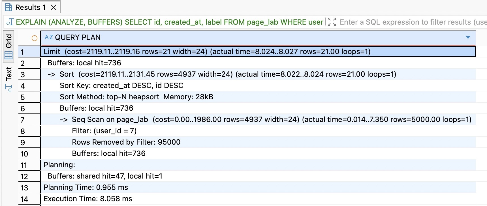
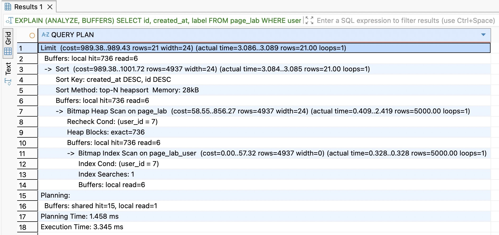
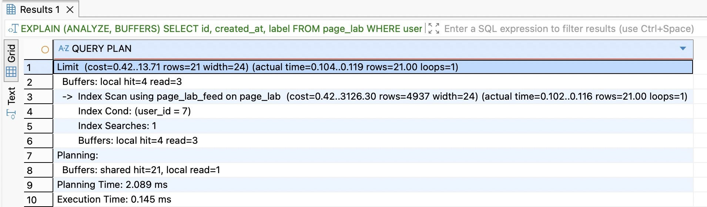
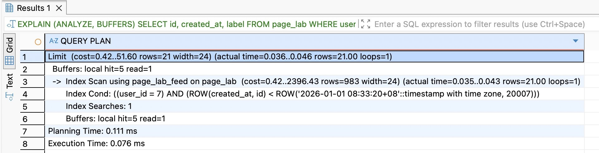
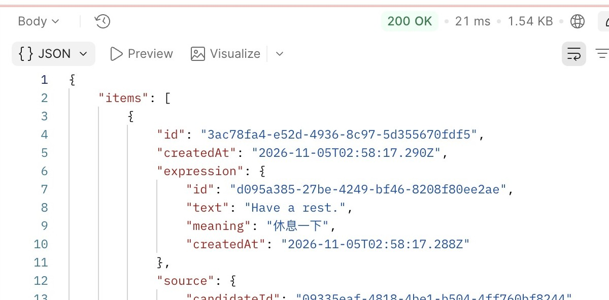
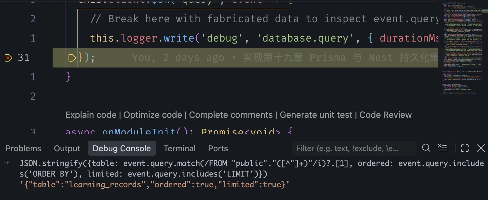

# 第30章 索引与执行计划：查询为什么变慢

打开学习记录，页面只要最近的二十条。假设你在浏览器里看到响应体很小，请求却等了很久。数据库可能沿着已经排好的记录读到第二十一条就停，也可能把十万条记录逐条看完，才知道哪二十条应该排在最前面。两种做法交给页面的 JSON 可以完全相同。从哪里能看出差别？

从上一章的 `part-04/chapter-29` 继续，配套状态为 `part-04/chapter-30`。本章先在 DBeaver 里用同一个查询改变一个条件，亲眼看数据库多做或少做了哪一步。再回到应用，查清一次页面请求真正向数据库问了几次，最后给学习列表追加一个经过比较的索引。沿用 Node.js 24.22.1、Prisma 7.10.1 和 PostgreSQL 18。先准备已有采纳记录的独立校验库 VERIFY，保留第二十九章的 API 配置、固定游标密钥和已保存的请求。

## 30.1 从列表和详情看索引的收益与写入成本

先取同一个用户最近的一页学习记录。在 `src/learning.queries.ts` 的 `list` 方法里，`orderBy` 要求先按创建时间降序，同一时刻再按 ID 降序。`take: limit + 1` 多取一条判断还有没有下一页。把这次读取拆小，先只看学习记录这张表怎样找行，下面的 SQL 可以单独运行。应用另外还会检查表达和原始记录分别属于谁，30.5 会用带这些条件的完整查询再验证。

```sql
SELECT id, created_at, expression_id, candidate_id
FROM public.learning_records
WHERE user_id = '10000000-0000-4000-8000-000000000001'
ORDER BY created_at DESC, id DESC
LIMIT 21;
```

如果从表头往后读，遇到别人的记录就略过，遇到自己的就留下，那么读到第 21 条时还不能停。后面的行可能更新。换一种存法，另外维护一份按用户、时间和 ID 排好的条目，每个条目又能找到表里的那一行。数据库先找到这个用户的开头，顺着读，取够就可以停。这样一份帮助数据库找行的数据结构叫**索引**。这里采用 PostgreSQL 创建普通索引时默认的 B-tree。这里的“页”是数据库成块读写数据的单位，和页面上显示的第几页各有含义。B-tree 把这些块分层组织，上层用键值范围缩小查找范围，底层按顺序保存条目。索引决定可以怎样读，SQL 里的 ORDER BY 仍决定接口承诺的顺序。[PostgreSQL 的索引与排序](https://www.postgresql.org/docs/18/indexes-ordering.html)

再看详情。`detail(id)` 问的是“这个身份对应哪一条，我能看吗”。主键保证每行 ID 唯一，PostgreSQL 已为它建立唯一索引。在 DBeaver 执行配套文件 `database/chapter-30/02-upgrade.sql` 的第二条 SELECT，可以看到 `learning_records_pkey`。此前为防同一候选被采纳两次，数据库还维护 `learning_records_candidate_id_key`。前者有助于按学习记录 ID 定位，后者有助于按候选 ID 查重复。两者都没有把某个用户的最近记录排在一起。反过来，按 ID 找到详情以后，原来的归属检查仍要执行。

读得更省，写入时就多一份工作。每采纳一个候选，事务已经要写表行、主键和候选唯一键。加了列表索引，再插一行就要找到新条目的位置，写相应的索引页。在已有页放不下时，还要拆分页面。索引占用磁盘空间，读写时也会占用缓存。修改被索引的字段同样要维护新条目，旧版本需要后续清理。这使我们可以具体讨论设计取舍：读最近一页是常用操作，值得试一份有序索引；一个还没有读法和样本的未来字段，可以等有了查询再决定。

## 30.2 单列索引、联合索引与排序

打开 `database/chapter-30/01-compare.sql`，在 DBeaver 的独立 VERIFY 连接新建 SQL 编辑器。整个实验留在同一个编辑器、同一个数据库连接里。文件的第一步创建**临时表**，即只有这个连接能看到的实验表，断开连接就自动清除。在空白实验会话中按分号逐条选中执行。先做第 1 步，停在第 2 步。真实学习记录用 UUID，这个实验用小整数作身份，方便直接看出哪条应该排在前面。

```sql
CREATE TEMP TABLE page_lab (id integer PRIMARY KEY, user_id integer NOT NULL,
  created_at timestamptz NOT NULL, label text NOT NULL);
INSERT INTO page_lab SELECT n, n % 20, timestamptz '2026-01-01 00:00Z' +
  (n / 10) * interval '1 second', 'sample-' || n FROM generate_series(1,100) AS n;
ANALYZE page_lab;
```

`generate_series(1,100)` 给出 1 到 100 的整数。`n % 20` 让二十个用户交错出现，7、27、47、67、87 都属于用户 7。整数除法 `n / 10` 让相邻一组记录共用创建时间。先把第 2 步中的 `SELECT` 单独选中执行，最近一页的 ID 应为 87、67、47、27、7。最后一条 `ANALYZE page_lab` 让数据库采样行数、值分布等信息，下次选择读取方式时就有了依据。这一步更新的是供数据库估算的数据。

现在预测两种索引会省掉哪一步。第一种只按 `user_id` 建索引，用户 7 的条目容易定位，但同一用户内没有按时间排列的约定。数据库拿到他的所有候选行之后，还得比较它们。第二种把三列放进**同一个联合索引**。先按用户分组，同组内时间从新到旧，时间相同再按 ID 从大到小。这样“找到用户 7”的位置也恰好是“从他最近一条开始读”的位置。

```sql
-- 文件第 4、5 步。先记录下一节中尚未加索引时的结果，再分开执行这两句。
CREATE INDEX page_lab_user ON page_lab(user_id);
CREATE INDEX page_lab_feed ON page_lab(user_id, created_at DESC, id DESC);
```

列序来自当前问题。若产品改为“所有用户放在一起看最近动态”，用户 A 的最后一条和用户 B 的第一条在这份索引中相邻，它们的时间却可能相隔一年。这份顺序无法直接给出跨用户时间线。若改为“这个用户某个很少出现的表达”，现有索引能顺时间读，但可能跳过许多其他表达才凑够一页。把 expression_id 插在用户和时间之间适合后一种筛选，却打散了无表达筛选时的时间顺序。先比较两种请求各自的频率和计划，再决定第二份索引是否值得维护。[PostgreSQL 的多列索引](https://www.postgresql.org/docs/18/indexes-multicolumn.html)

## 30.3 用 EXPLAIN 看数据库实际读了多少行

回到文件第 2 步。SQL 前面加 `EXPLAIN`，数据库会列出准备采用的步骤，叫**执行计划**。例如先逐行扫描，接着排序，最后只取二十一条。加上括号里的 `ANALYZE`，这次会真正执行查询并把实测值写在估算旁边。前一节单独执行的 ANALYZE 是更新统计资料，两处同名，操作不同。括号里的 `BUFFERS` 再报告访问了多少数据块。我们始终用 SELECT 做这个实验。把同样的前缀加到 UPDATE 或 DELETE 上会真的写数据。

```sql
EXPLAIN (ANALYZE, BUFFERS)
SELECT id, created_at, label FROM page_lab WHERE user_id = 7
ORDER BY created_at DESC, id DESC LIMIT 21;
```

在 DBeaver 选中**整条语句连同 EXPLAIN**，执行 SQL 语句，看下方结果网格的 `QUERY PLAN` 列。只选下半段会看到用户记录。把结果列拉宽，从最深缩进往外读：扫描给上一层行，排序给 Limit 行，Limit 决定何时停。每一种独立的读取、筛选或排序步骤在图中占一个节点。每个节点第一组括号里的 `rows` 是预计产出的行数，`cost` 是规划器在当前成本模型下比较不同方案的估值。第二组的 `actual time` 单位是毫秒，`rows` 是实际交给上一层的行数。`loops` 是这一节点执行了几遍，多遍时行数和时间按每遍平均显示。父节点包含子节点的工作，直接相加会重复计算。[PostgreSQL 18 的 EXPLAIN 读法](https://www.postgresql.org/docs/18/using-explain.html)

先记录 100 行时的计划。现在做第 3 步，补到 100,000 行并重新采样。还用同一条 SELECT，同一个用户和页长。此时用户 7 占 5,000 行。图中 `Seq Scan` 表示逐块读表，`Filter` 是读到一行后才检查的条件。它交给上层 5,000 行，`Rows Removed by Filter` 显示另有 95,000 行被排除。`Sort` 虽然只需保留最大的 21 项（图中的 top-N），仍须接收全部 5,000 个候选，才能知道最后的 21 项是谁。



图30-1。先看扫描层的 5,000 与 95,000，再往上看 Limit 的 21。结果网格左边的行号是计划文本行号。

执行第 4 步建单列索引，再执行第 2 步。图30-2 的 `Bitmap Index Scan` 先标记哪些位置可能有用户 7 的行，`Bitmap Heap Scan` 按数据页去表里取这些行。这里的 heap 是存放表行的地方。这样取行有利于减少在不同页之间来回走，取出的顺序仍要交给 Sort 整理。这里两个扫描名中的 Bitmap 都指用来标记匹配位置的一组位。看到索引名称就结束诊断，会漏掉这 5,000 行的排序输入。



执行第 5 步建联合索引，再跑第 2 步。图30-3 的 `Index Cond` 写着 `user_id = 7`，数据库可以在索引里用它定位；`Index Scan` 顺着匹配条目读，同时回表取 `label`。上层取够 21 项就停，计划里也少了一层 Sort。实验表上原先的单列索引仍在，数据库是从可用读法中自己作的选择。



比较图30-1和图30-3里的 `Buffers`。这里的 `local` 指当前会话临时表及其索引使用的缓冲区，正式表通常显示 `shared`。`hit` 表示需要的块已经在相应的数据库缓冲区，`read` 表示需要把块读进来，操作系统仍可能已经缓存了数据。相同块反复访问也会计数。图30-3 中索引扫描预计可匹配约五千行，实际只交出 21 行，因为上层取够就停了。看到预计和实际相差很多，先检查父节点有没有提前停止，再判断统计资料是否估错。连续运行时耗时常会缩短，所以固定参数，先比“哪一层消失了、处理多少行”，再比多次运行的耗时。最后用第 8 步看索引大小，本例单列约 696 kB，联合约 3984 kB。它们是在这批整数和时间值上的实测，UUID 业务表应另外量。

继续做第 6、7 步。用户 7 的最大 ID 是 99987，此后每次减 20。第 4000 项为 20007。Offset 请求跳过前 4000 项再交出 21 项，Limit 的下一层至少要交出 4021 项。在本例深页中数据库甚至改选了先找行再排序。用上一页末项的一对值当作边界，取同一页可以这样写：

```sql
SELECT id, created_at, label FROM page_lab WHERE user_id = 7
AND (created_at, id) < (timestamptz '2026-01-01 00:33:20Z', 20007)
ORDER BY created_at DESC, id DESC LIMIT 21;
```



图30-4。看 `Index Cond`，这次连时间和 ID 的边界也用于定位。分别只执行第 6、7 步的 SELECT，结果应从 19987 到 19587，顺序相同。如果只看到“用到了索引”，还要看边界写在 `Index Cond` 还是 `Filter`。第二十九章的 Prisma 实现用两个 OR 分支表达同样的先后关系。规划器可能仅用用户定位，再逐行过滤这两个分支。这个行比较实验展示了一种可选读法，判断应用的深页要拿实际 SQL、参数和分布再看一次。完成后断开实验连接，临时表与两个实验索引随即清除。

## 30.4 区分查询次数、返回体积和连接占用

现在回到页面。一条查学习记录的 SQL 更快，会缩短这部分工作，但用户等的是从发送 HTTP 到拿到整页。假设先查 N 条学习记录，再在循环里为每条查一次表达，就产生 1 + N 次数据库往返，这种随列表长度增加的额外查询叫 **N+1**。每句都能按主键很快查到一行，累计来回的时间仍可能明显。换成 Promise.all 同时发送只是改变排队方式。

用现有服务做一次区分。先停下前一个开发进程。在代码仓库根目录，确认 .env.test 里的 TEST_DATABASE_URL 指向装有虚构记录的 VERIFY。npm run dev 平时读取 .env 的 DATABASE_URL。下面从测试配置文件取出 VERIFY 的连接串，只传给这次启动的开发进程。终端不会打印连接串。开发服务准备好以后才开始观察，启动时服务自己也会核对表与约束。校验库至少准备四条归属当前用户的学习记录；样本不足时可按第二十九章已保存步骤追加虚构采纳。

```bash
(
  verify_url=$(node -e 'const {parseEnv}=require("node:util"); const {readFileSync}=require("node:fs"); const u=parseEnv(readFileSync(".env.test","utf8")).TEST_DATABASE_URL; if(!u) process.exit(1); process.stdout.write(u)') || exit 1
  DATABASE_URL="$verify_url" DB_QUERY_DEBUG=true LOG_LEVEL=debug npm run dev
)
```

在 Postman 新开 GET，先后发 `/learning-records?limit=1` 和 `/learning-records?limit=3`。在每个响应的 Headers 找到 `X-Request-Id`，用这个值从开发终端筛出该次请求的 `database.query` 事件，数一数有几条。从两次响应的 Body 看实际返回的项数，同时看大小和耗时。本例两次分别给出 1 项和 3 项，两次都发了 5 条 SQL。沿查询事件检查到学习记录、表达、候选、表达形式、修订五组读取。关联数据按本页的身份成批读取。比如三条学习记录只用了两个表达，可以先收集两个表达的 ID，一次查回所需字段，再按 ID 对回原列表。自行改写批量读取时，保留用户范围和来源的原有顺序。两条记录引用同一表达，页面上仍应显示两条来源。这两次没有表现出“每多一项就多打一条”的模式；空页、其他关联策略或换 ORM 版本可能给出其他次数。



图30-5。页面用到表达和来源摘要。若把详情里的整段原文也放进列表，SQL 次数可能完全相同，响应仍会变大，编码、传输和解析都要处理更多字节。对照 `src/learning.queries.ts` 的 `recordSelect` 和 `detail`，前者只选来源身份，后者才读取历史原文。只在 JavaScript 最后删字段，数据库到应用之间仍会运回那些内容。处理过量返回，应同时看数据库取的列、关联取的行数和最终响应的字节数。

要核对数据库真的收到了哪条 SQL，在 VS Code 用已有的 **EPP: attach to npm run dev** 附加。在 `src/database.service.ts` 找到 `this.client.$on('query', event => { ... })`，给回调里的 `this.logger.write` 设置断点。单独重发一次 GET，暂停后在 Debug Console 输入：

```js
JSON.stringify({
  table: event.query.match(/FROM "public"\."([^"]+)"/i)?.[1],
  ordered: event.query.includes('ORDER BY'),
  limited: event.query.includes('LIMIT')
})
```



图30-6。这里观察的是查询形状。继续运行可能停在同一请求的下一条关联查询。取消断点后继续，重新发送一次，再测 HTTP 耗时。断点会暂停 Node 进程，消耗连接或请求的超时预算；长时间停住甚至可能得到 503。本机诊断仅用虚构数据，日常日志继续只写耗时与请求身份，诊断结束后按 Ctrl+C 停止进程，这次启动的临时设置随之结束。

还可能出现另一种慢：SQL 根本没有轮到执行。API 重复使用一组已经打开的数据库连接；所有连接都被借出时，后来者先在池中等待。把连接上限缩成 1，用配套的小程序单独观察。它只读 VERIFY，沿用 `.env.test` 的 TEST_DATABASE_URL，与运行中的 API 各有自己的连接池：

```bash
node --env-file=.env.test database/chapter-30/04-pool.mjs
```

程序先借走唯一连接，再发起 `SELECT 1`；此时打印 `total: 1, idle: 0, waiting: 1`。放回第一条连接后，第二次读取才完成，输出 `result: 1, waiting: 0`。这解释了为什么终端里 SQL 本身很短，用户却可能已经等了很久。真实故障要对照同一次 HTTP、查询事件和池状态。错误日志里的 waiting 是记录错误那个瞬间的值，超时请求离队后可能已是零。查持有连接的事务是否在等网络、是否忘记释放，再决定要改事务范围、读法还是池容量。任务领取会争用行，向量检索按相似度选近邻，到实际业务章节再按各自的查询目标设计索引。

## 30.5 将选定索引追加到已有库

实验给了一个值得带回 EPP 的候选。接下来要回答两个问题：完整归属检查会不会改变这份索引的作用，以及能否在保留旧数据的前提下交付。先在 DBeaver 对 **尚处于第二十九章结构** 的 VERIFY 执行 `02-upgrade.sql`，保存数据库名、原有索引、来源行数、列表身份和顺序。再运行 `03-owned-page.sql`。它保留了当前版本 Prisma 为 `limit=3` 实际发出的第一条 SELECT，包含到表达、候选、修订和原始记录的关联。文件中 `PREPARE` 给带占位符的 SQL 命名，`EXECUTE` 把固定演示用户传给三个归属条件，另外两个参数 4、0 表示读取四条、跳过零条。同一个连接中依次执行准备、带 EXPLAIN 的执行、最后的 DEALLOCATE，下一次可以用同名重新准备。后续四次关联读取仍按 30.4 单独核对。

在一个保留前章 8 条学习记录的校验库上，迁移前后主表查询都用了顺序扫描。读取一页数据已经能看完这张小表，规划器有理由选择直接扫描。为检验规模变化，另一份隔离副本保留这 8 条，再加入 20,000 条属于同一用户的虚构来源，连同候选与修订一起建立，更新统计资料。下表比较同一个带归属检查的首条 SQL 在**同一批 20,008 条记录**上迁移前后的结果。

| 完整查询里观察的位置 | 创建索引前 | 创建索引后 |
| --- | --- | --- |
| 学习记录这一层交出多少行 | 顺序扫描交出 20,008 行 | 有序索引扫描交出 4 行 |
| 为获得前四项做了什么 | 关联并比较候选，再取排序靠前的四项 | 按目标顺序逐条查归属，取够即停 |
| 应用给客户端多少项 | 3 项，第 4 项用于 hasMore | 同样的 3 项和 hasMore |

想自己复现表中两万条记录的对照，先断开指向前章 VERIFY 的连接。用有建库权限的本机角色连接维护库 postgres，用 `CREATE DATABASE demo_ch30_lab TEMPLATE 你的校验库名;` 复制只含虚构数据的校验库，将示例中的源库名换成实际名称。源库必须仍是第 29 章结构，且复制期间没有其他会话使用它。让新库沿用可创建索引的表属主连接。在新库新开 DBeaver 编辑器，切到手动提交，执行配套 `05-rehearse-scale.sql` 建两万条关联样本。它检查库名以 `_ch30_lab` 结尾，也检查目标索引尚未存在。保持这个编辑器和事务，依次粘贴执行 03 的三条语句，只执行下方迁移中的 CREATE INDEX，再执行 03，最后 ROLLBACK。回到 02 应看到原行数和原索引。若中途报错，先 ROLLBACK，从副本的原状态重新做。正式迁移仍在另一个 VERIFY 连接里验证。

在这份新计划里，`Nested Loop` 意味着外层每拿到一条候选记录，内层拿它的关联键去找匹配行。向下找到 `learning_records_user_feed_idx`，再回头看与它同级、用主键访问表达等表的节点。若大量候选过不了归属检查，数据库得继续往后找，索引层就可能交出远多于四条。这里计数的是完整查询中某一层的工作，不能据此宣称正式服务有固定响应时间。对于筛表达、深游标或星图来源计数，都应保留它们自己的条件重新测。

具体修改只需要两处。在 `prisma/schema.prisma` 的 LearningRecord 模型末尾、`@@map` 之前加入：

```prisma
@@index([userId, createdAt(sort: Desc), id(sort: Desc)], map: "learning_records_user_feed_idx")
```

把实际结构变更追加在 `prisma/migrations/20261105090000_learning_feed_index/migration.sql`，保留已经应用过的迁移文件：

```sql
BEGIN;
SET LOCAL lock_timeout = '2s';
SET LOCAL statement_timeout = '30s';
CREATE INDEX learning_records_user_feed_idx ON public.learning_records
  (user_id, created_at DESC, id DESC);
COMMIT;
```

普通 CREATE INDEX 可以让其他连接继续读表，构建期间会与写入冲突。本章沿用有停写窗口的小库路径，先停止目标库的 API 和其他写入者。两秒是获取锁时允许等待的上限，三十秒约束该语句的总执行时间。二者是这次交付愿意承担的预算。已有数据留在原表，全程无需改时间、重新采纳或回填 ID。先用第二十九章代码状态确认历史迁移都已应用；切到本章文件后，status 应只多出这一项待应用迁移。项目根目录执行：

```bash
nvm use
npm run check
npm run db:verify -- migrate status
npm run db:verify -- migrate deploy
npm run db:verify -- migrate status
```

VERIFY 的 CLI 读取 `.env.database-verify`。运行测试的 `.env.test` 和启动 API 的 DATABASE_URL 各核对一次目标。升完回到原库重跑 02、03，两次列表的身份与顺序应一致，索引定义里应看到 user_id、created_at DESC、id DESC。已有 ID 仍能打开详情，星图来源计数与旧回执保留。运行 `npm test` 验证既有读写和翻页，再从 Postman 取首页、沿原游标取下一页。随后才按同样的停写、部署、复核顺序，把命令中的 `db:verify` 换成 `db` 应用于已确认的 DEV。独立交付产物沿用前章的 dist 和生产依赖，进程环境提供 DATABASE_URL 与持久游标密钥，正常停止并重启后仍能接着翻页。

若部署卡在锁上，先读 migrate 输出并运行 status，再查 `pg_indexes` 和迁移记录。例如在目标库中执行下面的只读 SQL，确认是哪次尝试、是否已完成或已登记回滚。

```sql
SELECT migration_name, started_at, finished_at, rolled_back_at
FROM public._prisma_migrations
WHERE migration_name = '20261105090000_learning_feed_index'
ORDER BY started_at;
```

从另一个 DBeaver 连接检查当前事务，在确定归属后让占锁者正常结束。只有确认这次事务已回滚、索引确实没有留下、失败版本尚未完成时，才用下面两条命令登记“该次失败已回滚”并重试。它们是故障恢复分支，正常升级不需要执行。

```bash
npm run db:verify -- migrate resolve --rolled-back 20261105090000_learning_feed_index
npm run db:verify -- migrate deploy
```

如果索引已存在或定义对不上，保留现场，核对是否连错库或有人手工实施过变更。恢复接口旧版本时，这个普通索引可以留在库中；要撤销索引的维护成本，应另行评估并追加迁移。数据量已经无法在停写预算内完成时，需要换部署办法，支线 30A 继续讨论。下章回到业务一致性，把竞争、重试和查询所见的事实放进同一个有限名额预约场景。

## 知识支线

[支线30A：写入不能停时，索引怎样交付](side-01-online-index.md)

## 附录：本章必要技术点速查

| 名称 | 本章用途 | 复查入口 |
| --- | --- | --- |
| B-tree 与联合索引 | 在用户范围内按时间与 ID 连续取行 | [多列索引](https://www.postgresql.org/docs/18/indexes-multicolumn.html) |
| ANALYZE | 数据量明显变化后更新统计样本 | [统计资料](https://www.postgresql.org/docs/18/sql-analyze.html) |
| EXPLAIN (ANALYZE, BUFFERS) | 对照估算、实际行数和块访问，定位多余工作 | [执行计划](https://www.postgresql.org/docs/18/using-explain.html) |
| pg.Pool | 用 totalCount、idleCount、waitingCount 辨别借用与等待 | [node-postgres 连接池](https://node-postgres.com/apis/pool) |
| CREATE INDEX、migrate deploy | 在有数据的校验库落实模型选定的索引 | [PostgreSQL 建索引](https://www.postgresql.org/docs/18/sql-createindex.html) |

时间参考（估算）：阅读约65～85分钟，跟做另加50～70分钟。依据五节推导、四种读取计划、接口与断点对照、连接池实验和一次校验库升级估算，支线单列。

[上一章：分页与时间](../chapter-29-pagination/chapter.md) · [下一章：让采纳经得起竞争与重试](../chapter-31-review/chapter.md) · [第四篇导读](../README.md) · [全书目录](../../README.md)
